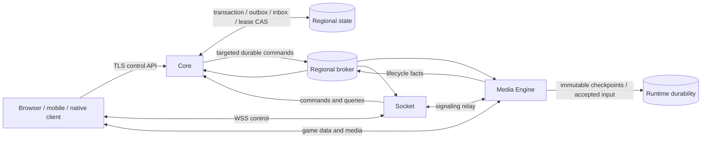
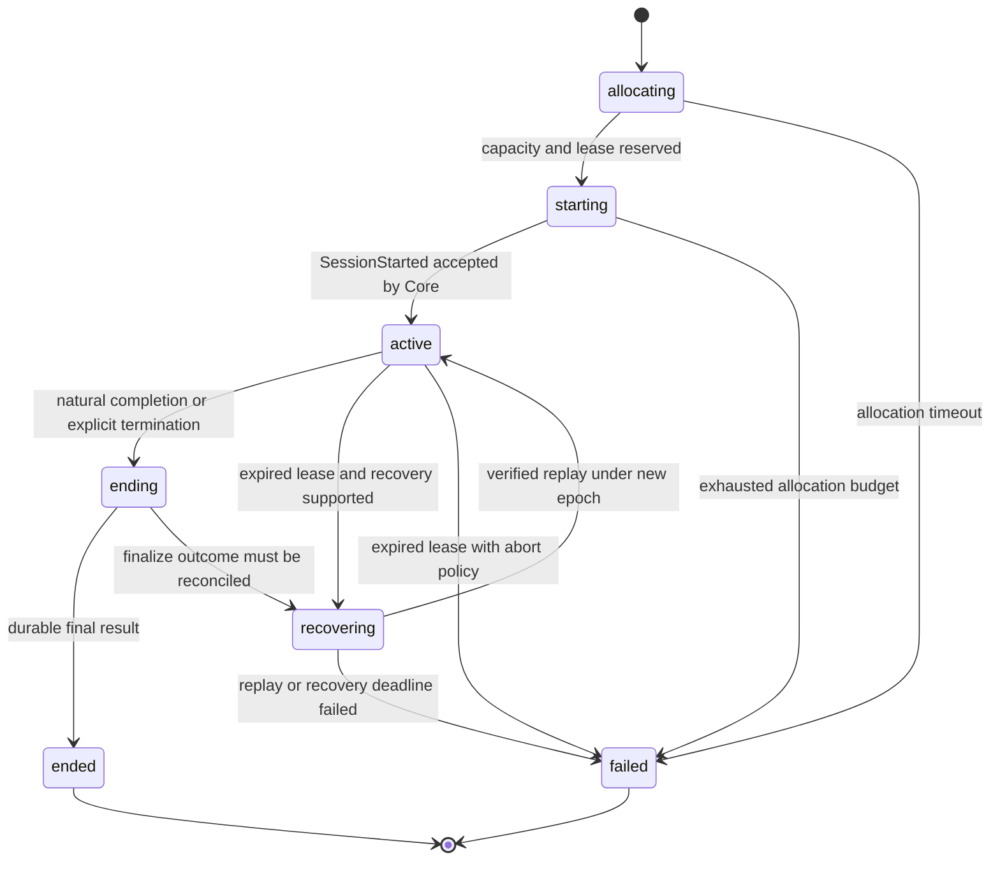

# Architecture contract

This catalog specifies the production implementation target. It contains contracts, generated Go/JavaScript bindings, operational rules and acceptance scenarios. It does **not** implement a running backend, and passing catalog tests is not evidence that a deployed service has survived a restart. Runtime readiness requires the fault-injection evidence below.

Exactly three deployable application services remain from the old project: **Core**, **Socket**, and **Media Engine**. Clients, game modules, storage, brokers, TURN and deployment controllers are external actors or infrastructure, not extra application microservices. The same binaries support single-region self-hosting and multiple independent regional clusters.

## Boundaries and authority

| Concern | Authority | Persistent boundary |
| --- | --- | --- |
| Identity, authorization, rooms, membership and quotas | Core | Regional transactional database; identity has one declared home |
| Session lifecycle, allocation, leases, admission tickets | Core | Regional transactional database with compare-and-set |
| Control connections, signaling relay, user-facing projections | Socket | Recoverable external connection cache; Core remains canonical |
| Game ticks, interest management, audio/video and transport state | One Media Engine owner per session | Memory plus game-policy checkpoint and accepted-input log |
| Game rules, codecs and recovery serializer | Versioned game module inside Media Engine | Immutable module digest and schema version |

No process-local room mutex, sticky Socket connection, cached engine address, global database transaction, or broker consumer assignment is an authority boundary. Every mutation is checked against the authenticated tenant and the authoritative resource version. All identifiers are opaque and tenant-scoped.

## Open sessions and game modules

A room is a durable lobby; a session is one authoritative runtime with a unique ID, fixed region/cluster, immutable game build and bounded lifetime. A session can admit late players and spectators while active, subject to game rules and capacity. Presence, lobby membership, session membership and transport connectivity are distinct states. A lost Socket connection does not remove a player immediately or kill the session.

Core hosts matchmaking as a module. A deployment can start with first-fit regional room selection, then add rating, latency, party and game-specific rules without adding a microservice. The match command cannot trust a client-reported rating. Match selection and seat reservation must share a transaction; optimistic search results never reserve capacity.

Each GameProfile pins gameId and buildDigest, player/spectator limits, tick rate, channels, maximum lifetime, empty timeout, and recovery policy. The module interface is initialize, authorizeJoin, join, leave, validateInput, tick, snapshotForPlayer, serializeCheckpoint, restoreCheckpoint and finalize. A module never opens arbitrary network connections or writes another tenant's state; sandbox/isolation and CPU/memory/fuel limits are deployment requirements. Native modules require a trusted build pipeline; untrusted extensions need a sandbox such as WASM or process isolation. These are adapters within Media Engine, not extra catalog services.

| Game family | Suggested profile, to benchmark | Recovery and traffic |
| --- | --- | --- |
| IO / arena | 20–30 Hz, spatial interest sets, short sessions | Unreliable-sequenced inputs/deltas, reliable full state; checkpoint/replay if deterministic |
| FPS | 60 Hz, server authority, bounded rewind and anti-cheat checks | Never replay expired player actions; abort or explicitly tested deterministic recovery |
| Social / party | 5–20 Hz, reliable actions, audio/video plus game channels | Checkpoint/replay for durable social state; renegotiate media after owner failure |
| Persistent social world | Bounded runtime generations with application-visible handoff | Explicit state transfer at a game safe point; cannot drain an infinite session indefinitely and guarantee finite rollouts |

Rates are starting budgets, not advertised capacity. One enormous session does not become faster merely by adding replicas: partition worlds into independent sessions/zones or design a separate multi-owner simulation protocol in a future version.

## Regional topology and horizontal scaling

Every session belongs to one **tenantId / regionId / clusterId** authority domain. Region names are configuration, not enums baked into clients. Core replicas in that cluster use one strongly consistent authority database (or one declared shard for the session); other regions never synchronously write its leases. Clusters may be independent for data residency, operators, game build, capacity class or failure isolation.

Discovery is a small cached read model of permitted regions and endpoints. It is not a central room lock or a per-tick dependency. An identity's home authority issues short-lived audience-bound credentials; target regions validate signatures using cached keys. Identity changes/revocations replicate with bounded lag. New authentication may be unavailable if its home is down; existing valid region-scoped credentials can continue under the configured revocation window. Strict revocation deployments must fail closed when freshness exceeds 60 seconds.

Region choice uses measured latency, tenant residency, game build availability and actual admission capacity. Core atomically checks local admission even if discovery says accepting. Existing sessions are never silently redirected by geo-DNS, connection balancers or stale discovery. A failed region rejects new admissions; clients choose another allowed region for a **new** session. Live cross-region ownership migration is outside v1.

Scale Core and Socket by adding replicas. Core partitions database tables/authority shards by tenant and session/room ID when required; all records participating in a room-start/admission transaction must reside on the same authority shard. Allocation workers contend using compare-and-set or row locking, not leader assumptions. If a leader election is used to reduce contention, correctness must still hold with overlapping leaders.

Scale Media Engine by adding nodes and placing whole sessions. Capacity reservations account for CPU/tick time, memory, network egress, codec workload, build compatibility and transport support; session count alone is insufficient. Reserve capacity in the same Core transaction as the allocation epoch. Heartbeats provide estimates and cannot override reservations or a persisted drain intent. Per-tenant quotas avoid noisy-neighbor starvation.

Game/media endpoints remain addressable for the entire session, including a drain. UDP uses a session-aware route to the current owner; a generic round-robin datagram balancer is invalid. WebRTC ICE/TURN and UDP routing must preserve owner affinity. Socket replicas do not need affinity: resumption rehydrates state, rotates the connection generation and resolves the current owner.

## Session state machine

Core is the sole publisher of canonical lifecycle revision. Engine facts carry the observed owner epoch and allocation ID; a consumer must not apply them as canonical state until Core accepts their transition. Started/Recovered notifications received first by Socket trigger a Core query. One active-or-pending session per room is enforced by a durable unique constraint, not just a check before insert.

Starting may retry only after fencing the prior allocation and advancing owner epoch. Each owner grant includes engineId, fresh incarnationId and allocationId. A failed or ended session never returns to active. Rematch creates a new session ID. Recovery cannot extend the original endsBy. Ending recovery first checks whether final result settlement already committed; if so, reconcile completion rather than replay gameplay.

## Ownership, leases and split-brain exclusion

Default lease: 15 seconds; renew at most every 5 seconds. Store time decides expiry. Engines keep a conservative monotonic local deadline corrected for measured round-trip and clock uncertainty (minimum 2-second safety margin); if uncertainty consumes that margin, stop accepting inputs and stop authoritative sends until renewed. A heartbeat does not renew ownership. Lack of broker messages does not establish failure.

A successor may be granted only after a transactional check of expired/revoked ownership in the authority store. Core increments a durable decimal ownerEpoch on every grant; overflow beyond 19 digits fails admission instead of wrapping. Every owner-issued fact, checkpoint, input and endpoint ticket is epoch-bound. Consumers reject older epochs and mismatched incarnation/allocation IDs. A resumed old process must re-register with a new incarnation and cannot reuse a prior in-memory lease.

The durable store, result sink and input log enforce the current fencing token on writes. Network effects cannot be transactionally fenced by a database: engines must self-fence before their safe deadline, and clients reject state from an older epoch once the new owner is known. Short-lived transport authorization and reconnection bound lingering media after a partition. No guarantee is made that pre-fence packets already in flight disappear.

## Delivery and wire contract

| Plane | Contract | Recovery |
| --- | --- | --- |
| Control HTTP / WSS | Bounded JSON request/reply, authenticated origin | Retry with same idempotency key; query outcome after ambiguity |
| Durable lifecycle broker | At-least-once, aggregate-key partition ordering | Transactional outbox/inbox, deduplication, DLQ, reconciler |
| Signaling | Ephemeral authenticated directed exchange | Repeat negotiation using fresh credentials and generation |
| Game data | Per-channel negotiated reliability and sequence | Discard expired data; full snapshot after baseline loss |
| Audio/video | Negotiated tracks or codec frames, congestion controlled | Re-establish transport; never replay missed live media |

The JSON Schema is Draft 7 and uses local named definitions. Every documented message has a self-contained downloadable schema and a synthetic valid example. Envelope fields are messageId, exact type/version, occurredAt (UTC RFC3339), tenantId, regionId, clusterId, correlationId and data. Bootstrap discovery/auth requests use the installation's configured bootstrap region/cluster IDs. They do not use a wildcard tenant; anonymous discovery still names a known public tenant. Trust comes from credentials/mTLS, never these fields alone.

Durable messages additionally carry aggregateId, aggregateRevision and causationId. A message version alone is not a dispatch key: dispatch by **type + version + authorized channel**. No producer/source field is trusted from JSON; broker credentials, publishing ACLs and the topic route establish the producer. Generic CommandResult is returned on the original authenticated request/connection and its result.requestId matches the original messageId; correlationId is tracing, not routing authority.

A control command idempotency record is keyed by tenant + authenticated caller + type + idempotencyKey. Store canonical payload hash, operation state and result in the same transaction as the state change. Same key/different payload is idempotency-conflict; same key/same payload returns the recorded result. Retain records for at least 24 hours; command retries expire after 10 minutes. Expired admission/connection tokens are never refreshed by replaying an old success: reject expired, then request a new operation/key. User-visible terminal results and settlement uniqueness survive session retention, independently of inbox cleanup.

Ephemeral signaling commands deduplicate only inside the live negotiation/connection generation, for at most 60 seconds. After process or transport loss the client restarts negotiation; these commands cannot promise durable exactly-once effects. GameInput uses sequence deduplication instead of command idempotency. The generated Go structs preserve wire types and optionality; they do not enforce JSON Schema, cross-field invariants, cryptographic validation, quotas or authority. Consumers must implement those checks before trusting data. JavaScript exports structural validators; the same semantic checks remain mandatory.

Counters/epochs/ticks are decimal **strings**, not JSON numbers, to avoid JavaScript precision loss. Numeric schema fields stay inside exact JS integer range. IDs are opaque; do not encode topology by parsing an ID. Strings are byte-budgeted at transport ingress after encoding. Unknown fields and unknown versions are rejected in v1; this is a closed contract and intentional negotiation is mandatory.

## Outbox, ordering and reconciliation

Core updates state, idempotency result and outbox atomically; broker publication is retried until acknowledged. Consumers commit inbox ID + side effect + resulting outbox in one transaction before ACK. Engine durability adapters must provide an equivalent atomic record for checkpoint/final-result intent; process-local buffers alone cannot implement the contract.

Default broker retention is 7 days; inbox deduplication retention is **8 days**, covering the broker window plus one day of replay delay. Replay beyond inbox retention requires aggregate-level deduplication or a dedicated reconciliation import, never blind re-enqueue. Redelivery uses exponential backoff from 100 ms to 30 seconds with full jitter and a 10-minute retry budget. Poison/unknown-version messages go to a bounded 7-day DLQ with original type/version/message ID and reason; alert immediately. Redrive keeps identity and epoch and is operator-audited.

Ordering is per producer-owned aggregate revision; multiple producers do not invent a shared sequence. Core owns canonical room/session revisions; engine facts use that engine/session fact stream; engine lifecycle uses engineId + incarnationId. Out-of-order facts may be buffered within a bounded window (256 entries / 5 seconds), then re-read authority. Never wait indefinitely for a missing fact. Core reconcilers scan allocating/starting/recovering/ending sessions and drain intents every 5 seconds, with CAS to make overlapping runs safe. Default allocation deadline 30 seconds (maximum 3 fenced attempts); recovery deadline 60 seconds; overdue ending reconciles durable final results before declaring failure.

Socket fanout is a projection. Each Socket replica receives the relevant regional event feed and filters for its locally connected members, or uses explicit per-gateway subscriptions managed in ConnectionCache. A single competing-consumer queue across Socket replicas would lose updates for clients on other replicas and is prohibited. Backpressure drops replaceable projections and emits resync-required instead of growing buffers forever.

## Operational budgets and security

Defaults to start load testing: 64 KiB encoded control request (256 KiB hard parser ceiling for authorized full responses), 5-second authentication deadline, 10-second control request deadline, 60-second ticket, 2-minute resume token, 30-second disconnected presence grace, maximum 256 queued Socket frames / 1 MiB per connection, 100 control commands/second burst 200 per principal. Operators set tighter game- and tenant-specific limits before public exposure. Large rooms need paginated membership/projections before they reach these limits; the schema's upper bound is not a recommendation to send a giant room snapshot.

Enforce TLS for public control/signaling, mTLS plus publish/subscribe ACLs between services, and DTLS-SRTP for WebRTC. Native UDP adapters must provide authenticated encryption, anti-replay, key rotation and address validation before any game payload; raw unauthenticated UDP is not a supported production adapter. Protect pre-auth amplification, ICE abuse, connection storms and oversized frames at the edge. Trust authenticated player ownership, not playerId sent by the client. Spectators receive interest-filtered state and cannot submit game input.

Never log assertions, tokens, tickets, SDP, ICE credentials, raw media or user payloads. Logs carry correlation/message IDs and redacted error codes. Metrics use bounded labels (region, service, build, reason), not user/session IDs. Audit operator drain/termination, authorization changes and DLQ replay. Every session has a mandatory timestamped event archive. Audio/video capture is optional, attached to that session, and gated by the configured recording permission and participant policy. Secrets stay excluded from event payloads. See [session recording](/docs/entities/SessionRecordingIndex/1.0.0) and [media recording](/docs/entities/MediaRecording/1.0.0) for APIs, coverage, retention and authorized playback.

## Production acceptance gates

These are required runtime tests, **not tests already performed by this catalog**. Record build, topology, seed, load profile, traces, state checks and observed recovery time for every run.

| Fault under concurrent joins and traffic | Required observable result |
| --- | --- |
| Core killed after DB commit before broker publish | Exactly one room/session/settlement; committed outbox eventually publishes |
| Socket killed with connected players | Reconnect to another replica, current Core snapshot, no ghost authority; media sessions remain active |
| Drain races allocation on Media Engine | Allocation either rejected/reassigned under new epoch or counted until completion; no untracked session |
| Planned Media Engine maintenance with 100 active sessions | No new sessions, existing traffic/lease renewal intact, no exit before last session and durable writes finish |
| Engine crashes after snapshot object write before manifest | Orphan object ignored; restore only committed verified checkpoint |
| Engine crashes after final result before event ACK | Reconciler settles once and replays terminal notification |
| Engine isolated from authority, still connected to clients | Self-fences before safe lease deadline; successor only after authority expiry and new epoch |
| Duplicate / reordered lifecycle events | No stale state regression, leaked seat or duplicate reward |
| Broker unavailable for 10 minutes | Bounded outbox growth, admission sheds load when durable budget exhausted; live data bypasses broker |
| Region lost | No second live owner from asynchronous replica; new sessions use another permitted region; old sessions fail or recover through declared DR procedure |
| Bad token, cross-tenant IDs, replayed UDP packet, spectator input | Rejected before state mutation; bounded resource usage |
| Client misses delta baseline / changes network | Full interest-filtered snapshot and fresh transport generation; old input rejected |
| 2x target sustained load / slow receivers | Tick and admission SLOs measured, bounded queues, fair shedding; no claim of unlimited scale |

Suggested initial SLOs: 99.9% monthly regional admission availability, p99 accepted control latency below 250 ms within region (excluding game loading), tick processing p99 below 80% of tick budget, owner crash detected within 20 seconds (15-second lease plus 5-second reconciler interval) and recoverable game resumed within 60 seconds after detection. Measure under the promised capacity and agreed dependencies before publishing these as guarantees. Alert on tick overruns, lease slack below 2 seconds, outbox age over 30 seconds, any stale-epoch write accepted, DLQ entries, failed recovery and stuck drains.

## Decisions and migration from millsmess-old

1. Preserve Core / Socket / Media Engine; the old Client service becomes an external actor. This keeps the requested three application services.
2. Replace the old central room-lock path with regional transactional ownership. A global authority on every room change would make regional availability depend on cross-region latency.
3. Separate durable room/session identity from Socket process state. Runtime projections can be rebuilt.
4. Separate restart drain from crash recovery. Waiting for completion handles planned maintenance; it cannot prevent crashes or resurrect uncheckpointed media state.
5. Treat audio, video and game as logical channels with explicit adapter capabilities. HTTP/2/3 are reserved future adapters and never advertised by v1.
6. Replace old loose scalar versions and missing schemas with exact 1.0.0 message contracts. This is a breaking protocol migration, not an in-place wire-compatible update.
7. Adapt the old schema-to-Go writer and pub/sub metadata generation into deterministic Go/JS types and a route manifest. Dispatch includes message identity, not only version; no service-specific PubsubRegistry or backend implementation is generated now.
8. Keep generated libraries inside eventcatalog and manage their dependency/release graph with Dispat. The old repository is read-only input; runtime libraries and services are not copied.
9. Retain fixed region/session ownership in v1. Cross-region active-active simulation and seamless transfer of live WebRTC/UDP connections require new protocols and evidence.

| Old contract | New contract |
| --- | --- |
| GetMe / ProfilesUpdate | GetProfile / ProfileReturned / ProfileUpdated / AccessRevoked |
| RoomJoin / RoomLeave / RoomMatch | JoinRoom / LeaveRoom / MatchRoom |
| RoomSessionStart / RoomSessionRematch | StartSession / RematchSession |
| RoomPlayerDataUpdate / PlayerUpdate | UpdateRoomPlayerData / RoomUpdated / ConnectionState |
| NegotiationClient / NegotiationServer | NegotiateTransport / TransportNegotiated / ICE messages |
| SessionUpdate | SessionStarted / SessionRecovered / SessionEnded / SessionFailed, reconciled through GetSession |
| PlayerMove | GameInput with game-owned codec and authoritative validation |

## Contract evolution and library management

contracts/schema.json and contracts/messages.json are the source of truth; channels, stores, flows and content prose are also authored sources. `pnpm generate` materializes EventCatalog pages, standalone schemas, examples, Go structs, JS/TS bindings and routes. `pnpm check` verifies referential integrity, schemas/examples and exact generated content; `pnpm test` exercises negative contracts and wire round-trips; `pnpm test:go` compiles and round-trips the generated Go package. The build must pass from `pnpm install --frozen-lockfile`.

Do not edit a released schema in place. Preserve old EventCatalog versioned resources and generated binding packages, introduce a new protocol version, negotiate it, then dual-read during a bounded migration before removing old producers. Because v1 objects reject unknown fields and enums are closed, even an added wire field requires a new negotiated contract version. Current tooling intentionally targets only 1.0.0 and refuses another version: extend the version model and compatibility fixtures before adding v2. Library semver and wire version are independent; documentation-only changes need not alter wire messages.

Dispat 1.8.2 configuration declares catalog as the provider and Go/JS bindings as consumers, with explicit kept generation edges. pnpm installs dependencies and maintains the lockfile; Dispat plans and orders library checks/versioning. Initial packages are private/local, and no production publication is configured. A future release must add registry/license/governance and CI publication together, validate packed artifacts, then use the configured pipeline. No new software license is inferred from the old project's commercial license or this architecture request.

## Primary references

- [EventCatalog source and release history](https://github.com/event-catalog/eventcatalog) — the pinned npm release was verified as 4.10.12 on 2026-09-08.
- [Dispat 1.8.2 configuration](https://github.com/yohimik/dispat/tree/services/dispat/v1.8.2/packages/docs/docs/configuration) and [agent guide 1.8.1](https://github.com/yohimik/dispat/tree/specs/agent-guide/v1.8.1/specs/agent-guide).
- [WebRTC data channels, RFC 8831](https://www.rfc-editor.org/rfc/rfc8831), [RTP, RFC 3550](https://www.rfc-editor.org/rfc/rfc3550), [UDP usage guidance, RFC 8085](https://www.rfc-editor.org/rfc/rfc8085).
- [Kubernetes pod lifecycle](https://kubernetes.io/docs/concepts/workloads/pods/pod-lifecycle/) — pod termination is a bounded mechanism, not a substitute for application drain.

## Matchmaking, live statistics and leaderboards

Core includes a matchmaker with versioned built-in FIFO, skill, latency-first, party/team-balanced and weighted strategies, plus a constrained custom strategy interface. The [MatchPolicy](/docs/entities/MatchPolicy/1.0.0) entity specifies algorithms, candidate filters, starvation bounds, atomic ticket claims and backfill. Presets are checked-in JSON, not executable backend implementations.

PostgreSQL is authoritative for match outcomes, per-player statistics, ratings, leaderboard entries, seasonal snapshots and rewards. Optional Redis serves fresh live rank projections; ClickHouse receives historical event/sample/result projections for analytical queries. The [LeaderboardDefinition](/docs/entities/LeaderboardDefinition/1.0.0) entity specifies exact sorting, deduplication, live freshness targets, cache recovery and season finalization. A ClickHouse outage cannot block gameplay, admission or result settlement. Statistics workers, matchmaking workers and session lease renewals have separate resource budgets within Core.

## Recording every session

All admitted sessions durably record their timestamped lifecycle, membership, accepted game inputs, authoritative game events, tick boundaries, results and redacted channel/recording metadata. This is independent of whether a game supports crash recovery. A failed mandatory recorder stops acceptance of unrecordable actions; event capture is never silently sampled away. The [SessionRecordingIndex](/docs/entities/SessionRecordingIndex/1.0.0) specifies time, ordering, durability and completeness.

[RecordingPolicy](/docs/entities/RecordingPolicy/1.0.0) independently enables optional audio/video at session start or through authorized runtime commands. Per-track segments and playback manifests retain sessionId and matching timeline offsets. [MediaRecording](/docs/entities/MediaRecording/1.0.0) defines finalization, explicit crash gaps and playback. Planned engine drain also waits for pending event records, recording segments and open recordings to reach zero.
