# Mills Mess Engine specification

**Version:** 0.0.0 **Status:** Draft for review **Versioning model:** Semantic Versioning 2.0.0
**License:** GPL-3.0-or-later. See [LICENSE](./LICENSE).

This document is Mills Mess Engine specification **0.0.0**. It is the normative architecture of a clustered, session-based multiplayer game engine whose mandatory services are Socket, Inspector and Engine and whose other services are optional. Draft assembled 2026-10-24; headings are numbered by the assembly step and cross-references use section titles.

## Table of contents

- [1. Status and conformance](#1-status-and-conformance)
  - [1.1 Document status](#11-document-status)
  - [1.2 Conformance language](#12-conformance-language)
  - [1.3 Abstract roles and reference adapters](#13-abstract-roles-and-reference-adapters)
  - [1.4 Conformance targets](#14-conformance-targets)
  - [1.5 License](#15-license)
  - [1.6 Versions and the draft catalog](#16-versions-and-the-draft-catalog)
  - [1.7 Conformance](#17-conformance)
- [2. Goals, non-goals and deployment profiles](#2-goals-non-goals-and-deployment-profiles)
  - [2.1 Goals](#21-goals)
  - [2.2 Non-goals](#22-non-goals)
  - [2.3 Deployment profiles](#23-deployment-profiles)
  - [2.4 Optional services and extension roles](#24-optional-services-and-extension-roles)
  - [2.5 Feature degradation matrix](#25-feature-degradation-matrix)
  - [2.6 Conformance](#26-conformance)
- [3. Identifiers, time, counters and envelopes](#3-identifiers-time-counters-and-envelopes)
  - [3.1 Scalar types](#31-scalar-types)
  - [3.2 Canonical serialization and contract hashes](#32-canonical-serialization-and-contract-hashes)
  - [3.3 Opaque identifiers](#33-opaque-identifiers)
  - [3.4 Installation, region and cluster scope](#34-installation-region-and-cluster-scope)
  - [3.5 Counters, epochs and revisions](#35-counters-epochs-and-revisions)
  - [3.6 Time and clocks](#36-time-and-clocks)
  - [3.7 Control envelope](#37-control-envelope)
  - [3.8 Sink-fact envelope](#38-sink-fact-envelope)
  - [3.9 Service envelope](#39-service-envelope)
  - [3.10 Realtime envelope](#310-realtime-envelope)
  - [3.11 Idempotency](#311-idempotency)
  - [3.12 Correlation](#312-correlation)
  - [3.13 Conformance](#313-conformance)
- [4. Profile, roles, permissions and quotas](#4-profile-roles-permissions-and-quotas)
  - [4.1 Profile entity](#41-profile-entity)
  - [4.2 User kinds and roles](#42-user-kinds-and-roles)
  - [4.3 Room profile and ownership](#43-room-profile-and-ownership)
  - [4.4 Permission matrix](#44-permission-matrix)
  - [4.5 Room quotas](#45-room-quotas)
  - [4.6 Credential issuance](#46-credential-issuance)
  - [4.7 Guest-to-member migration](#47-guest-to-member-migration)
  - [4.8 Bans, suspension and sanctions](#48-bans-suspension-and-sanctions)
  - [4.9 Deletion and tombstones](#49-deletion-and-tombstones)
  - [4.10 Deployments without Profiles](#410-deployments-without-profiles)
  - [4.11 Conformance](#411-conformance)
- [5. Client connection and presence](#5-client-connection-and-presence)
  - [5.1 Connection object](#51-connection-object)
  - [5.2 Authentication states](#52-authentication-states)
  - [5.3 Social and Feed operations on a connection](#53-social-and-feed-operations-on-a-connection)
  - [5.4 Connection generation](#54-connection-generation)
  - [5.5 Resume](#55-resume)
  - [5.6 Attachment states during a saga](#56-attachment-states-during-a-saga)
  - [5.7 Multi-room membership](#57-multi-room-membership)
  - [5.8 Presence, membership and transport connectivity](#58-presence-membership-and-transport-connectivity)
  - [5.9 Conformance](#59-conformance)
- [6. Room](#6-room)
  - [6.1 Room profile and identity](#61-room-profile-and-identity)
  - [6.2 Room lifecycle](#62-room-lifecycle)
  - [6.3 Region home](#63-region-home)
  - [6.4 Capacity and visibility](#64-capacity-and-visibility)
  - [6.5 Owner and host controls](#65-owner-and-host-controls)
  - [6.6 Membership operations](#66-membership-operations)
  - [6.7 Room death and restart on another engine](#67-room-death-and-restart-on-another-engine)
  - [6.8 Limits](#68-limits)
  - [6.9 Conformance](#69-conformance)
- [7. Session, players, teams, groups, observer and session events](#7-session-players-teams-groups-observer-and-session-events)
  - [7.1 Session](#71-session)
  - [7.2 Session state machine](#72-session-state-machine)
  - [7.3 SessionPlayer](#73-sessionplayer)
  - [7.4 SessionPlayer state machine](#74-sessionplayer-state-machine)
  - [7.5 Capacity, late join and spectators](#75-capacity-late-join-and-spectators)
  - [7.6 Teams and groups](#76-teams-and-groups)
  - [7.7 Mute matrix](#77-mute-matrix)
  - [7.8 Observer role](#78-observer-role)
  - [7.9 Visibility of game data and media](#79-visibility-of-game-data-and-media)
  - [7.10 Controls and authority](#710-controls-and-authority)
  - [7.11 SessionEvent](#711-sessionevent)
  - [7.12 Event ring](#712-event-ring)
  - [7.13 Optional services and traceless mode](#713-optional-services-and-traceless-mode)
  - [7.14 Conformance](#714-conformance)
- [8. Engine node, lease, epoch, placement and capacity](#8-engine-node-lease-epoch-placement-and-capacity)
  - [8.1 Engine identity and registration](#81-engine-identity-and-registration)
  - [8.2 Heartbeat and the engine registry](#82-heartbeat-and-the-engine-registry)
  - [8.3 Engine inbox and per-player sagas](#83-engine-inbox-and-per-player-sagas)
  - [8.4 Engine node states](#84-engine-node-states)
  - [8.5 Capacity units and session charges](#85-capacity-units-and-session-charges)
  - [8.6 Reservation and allocation](#86-reservation-and-allocation)
  - [8.7 Placement](#87-placement)
  - [8.8 Owner lease and epoch](#88-owner-lease-and-epoch)
  - [8.9 Store-time expiry, safety margin and self-fencing](#89-store-time-expiry-safety-margin-and-self-fencing)
  - [8.10 Drain](#810-drain)
  - [8.11 Restarting a session on another engine](#811-restarting-a-session-on-another-engine)
  - [8.12 Pressure and growing sessions](#812-pressure-and-growing-sessions)
  - [8.13 Move eligibility and nomination](#813-move-eligibility-and-nomination)
  - [8.14 Offer, claim and arbitration](#814-offer-claim-and-arbitration)
  - [8.15 Session move](#815-session-move)
  - [8.16 Moves without a free engine](#816-moves-without-a-free-engine)
  - [8.17 Move metrics, alerts and logs](#817-move-metrics-alerts-and-logs)
  - [8.18 Timing defaults](#818-timing-defaults)
  - [8.19 Optional services and the Minimal profile](#819-optional-services-and-the-minimal-profile)
  - [8.20 Conformance](#820-conformance)
- [9. Socket](#9-socket)
  - [9.1 Closed responsibility list](#91-closed-responsibility-list)
  - [9.2 Instance identity and internal operations](#92-instance-identity-and-internal-operations)
  - [9.3 Connection admission budgets](#93-connection-admission-budgets)
  - [9.4 Handshake, negotiation and authentication](#94-handshake-negotiation-and-authentication)
  - [9.5 Frame routing](#95-frame-routing)
  - [9.6 Optional service routes](#96-optional-service-routes)
  - [9.7 Gateway attachment routing](#97-gateway-attachment-routing)
  - [9.8 Gateway link to the Engine](#98-gateway-link-to-the-engine)
  - [9.9 Socket topic and queue](#99-socket-topic-and-queue)
  - [9.10 Fanout and backpressure](#910-fanout-and-backpressure)
  - [9.11 Reconnect and resume](#911-reconnect-and-resume)
  - [9.12 Dependency failure](#912-dependency-failure)
  - [9.13 Socket maintenance runbook](#913-socket-maintenance-runbook)
  - [9.14 Traceless mode, logs and metrics](#914-traceless-mode-logs-and-metrics)
  - [9.15 Conformance](#915-conformance)
- [10. Inspector](#10-inspector)
  - [10.1 Store contract and routing tags](#101-store-contract-and-routing-tags)
  - [10.2 Key layout](#102-key-layout)
  - [10.3 Store-side procedures](#103-store-side-procedures)
  - [10.4 Operations and sagas](#104-operations-and-sagas)
  - [10.5 Player lock and join saga](#105-player-lock-and-join-saga)
  - [10.6 Moves and pressure arbitration](#106-moves-and-pressure-arbitration)
  - [10.7 Presence, invite grants and principal delivery](#107-presence-invite-grants-and-principal-delivery)
  - [10.8 Credentials, tickets and keys](#108-credentials-tickets-and-keys)
  - [10.9 Reconciler](#109-reconciler)
  - [10.10 Topology options](#1010-topology-options)
  - [10.11 Store loss](#1011-store-loss)
  - [10.12 Partitions](#1012-partitions)
  - [10.13 Region locality](#1013-region-locality)
  - [10.14 Without Profiles](#1014-without-profiles)
  - [10.15 Minimal profile and traceless mode](#1015-minimal-profile-and-traceless-mode)
  - [10.16 Conformance](#1016-conformance)
- [11. Engine runtime](#11-engine-runtime)
  - [11.1 Process architecture](#111-process-architecture)
  - [11.2 Per-session isolation](#112-per-session-isolation)
  - [11.3 Session states in the Engine](#113-session-states-in-the-engine)
  - [11.4 Lease renewal and suspension](#114-lease-renewal-and-suspension)
  - [11.5 Tick loop and deadline accounting](#115-tick-loop-and-deadline-accounting)
  - [11.6 Input application and acceptance window](#116-input-application-and-acceptance-window)
  - [11.7 Service queue inbox](#117-service-queue-inbox)
  - [11.8 Saga verification before attachment](#118-saga-verification-before-attachment)
  - [11.9 Offload worker](#119-offload-worker)
  - [11.10 Restart class A: planned handoff](#1110-restart-class-a-planned-handoff)
  - [11.11 Restart class B: crash re-adoption](#1111-restart-class-b-crash-re-adoption)
  - [11.12 Session moves under pressure](#1112-session-moves-under-pressure)
  - [11.13 Game module interface](#1113-game-module-interface)
  - [11.14 Session end and cleanup](#1114-session-end-and-cleanup)
  - [11.15 Conformance](#1115-conformance)
- [12. Transports and wire codec](#12-transports-and-wire-codec)
  - [12.1 Lanes and reliability classes](#121-lanes-and-reliability-classes)
  - [12.2 Adapter interface](#122-adapter-interface)
  - [12.3 Required adapters and capability matrix](#123-required-adapters-and-capability-matrix)
  - [12.4 Adapter framing](#124-adapter-framing)
  - [12.5 Platform matrix](#125-platform-matrix)
  - [12.6 Optional QUIC-based adapter](#126-optional-quic-based-adapter)
  - [12.7 Secure UDP protocol](#127-secure-udp-protocol)
  - [12.8 WebRTC adapters and signaling](#128-webrtc-adapters-and-signaling)
  - [12.9 Embedded relay](#129-embedded-relay)
  - [12.10 Negotiation](#1210-negotiation)
  - [12.11 Ticket consumption and resume](#1211-ticket-consumption-and-resume)
  - [12.12 Attachment gate and saga verification](#1212-attachment-gate-and-saga-verification)
  - [12.13 Session moves and re-attachment](#1213-session-moves-and-re-attachment)
  - [12.14 Frame budgets and envelope budgets](#1214-frame-budgets-and-envelope-budgets)
  - [12.15 Control envelope and JSON debug envelope](#1215-control-envelope-and-json-debug-envelope)
  - [12.16 Binary frame layout](#1216-binary-frame-layout)
  - [12.17 Sequencing and generations](#1217-sequencing-and-generations)
  - [12.18 Acknowledgement and input acceptance](#1218-acknowledgement-and-input-acceptance)
  - [12.19 Snapshot, delta and interest management](#1219-snapshot-delta-and-interest-management)
  - [12.20 Send queues, backpressure and coalescing](#1220-send-queues-backpressure-and-coalescing)
  - [12.21 Replay windows and duplicate suppression](#1221-replay-windows-and-duplicate-suppression)
  - [12.22 Rate limits, ceilings and timeouts](#1222-rate-limits-ceilings-and-timeouts)
  - [12.23 Optional services, traceless mode and restarts](#1223-optional-services-traceless-mode-and-restarts)
  - [12.24 Primary references](#1224-primary-references)
  - [12.25 Conformance](#1225-conformance)
- [13. Portable session object, client prediction and state synchronization](#13-portable-session-object-client-prediction-and-state-synchronization)
  - [13.1 Session object](#131-session-object)
  - [13.2 Host to session operations](#132-host-to-session-operations)
  - [13.3 Capabilities granted to the session](#133-capabilities-granted-to-the-session)
  - [13.4 Forbidden to the session](#134-forbidden-to-the-session)
  - [13.5 Determinism](#135-determinism)
  - [13.6 Determinism test](#136-determinism-test)
  - [13.7 Runners](#137-runners)
  - [13.8 Sandboxed hosting and fault containment](#138-sandboxed-hosting-and-fault-containment)
  - [13.9 Sync models](#139-sync-models)
  - [13.10 Shadow and predicted instances](#1310-shadow-and-predicted-instances)
  - [13.11 Clock and input lead](#1311-clock-and-input-lead)
  - [13.12 Local application and the replay stream](#1312-local-application-and-the-replay-stream)
  - [13.13 Acknowledgement](#1313-acknowledgement)
  - [13.14 Reconciliation](#1314-reconciliation)
  - [13.15 Correction thresholds and smoothing](#1315-correction-thresholds-and-smoothing)
  - [13.16 Remote entities and the prediction horizon](#1316-remote-entities-and-the-prediction-horizon)
  - [13.17 Misprediction and loss](#1317-misprediction-and-loss)
  - [13.18 Snapshot and delta codec](#1318-snapshot-and-delta-codec)
  - [13.19 Partial worlds and interest](#1319-partial-worlds-and-interest)
  - [13.20 Late join and resume](#1320-late-join-and-resume)
  - [13.21 Entity ownership and authority](#1321-entity-ownership-and-authority)
  - [13.22 Generated bindings](#1322-generated-bindings)
  - [13.23 Responsibilities](#1323-responsibilities)
  - [13.24 Optional services and the Minimal profile](#1324-optional-services-and-the-minimal-profile)
  - [13.25 Primary references](#1325-primary-references)
  - [13.26 Conformance](#1326-conformance)
- [14. Audio and video](#14-audio-and-video)
  - [14.1 Forwarding unit and media graph](#141-forwarding-unit-and-media-graph)
  - [14.2 Tracks and down-tracks](#142-tracks-and-down-tracks)
  - [14.3 Forward decision](#143-forward-decision)
  - [14.4 Mute matrix in the media plane](#144-mute-matrix-in-the-media-plane)
  - [14.5 Observer and hidden subscribers](#145-observer-and-hidden-subscribers)
  - [14.6 Codec policy](#146-codec-policy)
  - [14.7 Simulcast and layer selection](#147-simulcast-and-layer-selection)
  - [14.8 RTP path](#148-rtp-path)
  - [14.9 Frame-envelope path](#149-frame-envelope-path)
  - [14.10 Processor and bandwidth budgets](#1410-processor-and-bandwidth-budgets)
  - [14.11 Recording tap points](#1411-recording-tap-points)
  - [14.12 Minimal profile, optional services and traceless mode](#1412-minimal-profile-optional-services-and-traceless-mode)
  - [14.13 Conformance](#1413-conformance)
- [15. Profiles service](#15-profiles-service)
  - [15.1 Responsibilities and boundaries](#151-responsibilities-and-boundaries)
  - [15.2 Storage through repositories](#152-storage-through-repositories)
  - [15.3 Sign-in and member credentials](#153-sign-in-and-member-credentials)
  - [15.4 Public operations](#154-public-operations)
  - [15.5 Member identity for Social and Feed](#155-member-identity-for-social-and-feed)
  - [15.6 Calls to Inspector and the outbox](#156-calls-to-inspector-and-the-outbox)
  - [15.7 Events consumed and produced](#157-events-consumed-and-produced)
  - [15.8 Absence and degradation](#158-absence-and-degradation)
  - [15.9 Security](#159-security)
  - [15.10 Conformance](#1510-conformance)
- [16. Statistics service](#16-statistics-service)
  - [16.1 Event trace](#161-event-trace)
  - [16.2 Analytics and session summaries](#162-analytics-and-session-summaries)
  - [16.3 Settlement ledger](#163-settlement-ledger)
  - [16.4 Points and achievements](#164-points-and-achievements)
  - [16.5 Leaderboard definitions](#165-leaderboard-definitions)
  - [16.6 Sort and rank semantics](#166-sort-and-rank-semantics)
  - [16.7 Live projection](#167-live-projection)
  - [16.8 Reading boards](#168-reading-boards)
  - [16.9 Seasons](#169-seasons)
  - [16.10 Rebuild, claims and erasure](#1610-rebuild-claims-and-erasure)
  - [16.11 Storage through repositories](#1611-storage-through-repositories)
  - [16.12 Public operations](#1612-public-operations)
  - [16.13 Events consumed and produced](#1613-events-consumed-and-produced)
  - [16.14 Absence and degradation](#1614-absence-and-degradation)
  - [16.15 Security and privacy](#1615-security-and-privacy)
  - [16.16 Conformance](#1616-conformance)
- [17. Payment service](#17-payment-service)
  - [17.1 Provider adapter contract](#171-provider-adapter-contract)
  - [17.2 Plans and periods](#172-plans-and-periods)
  - [17.3 Subscription lifecycle](#173-subscription-lifecycle)
  - [17.4 Webhook ingestion and idempotency](#174-webhook-ingestion-and-idempotency)
  - [17.5 Purchases and micro-transactions](#175-purchases-and-micro-transactions)
  - [17.6 Entitlements](#176-entitlements)
  - [17.7 Public operations](#177-public-operations)
  - [17.8 Storage through repositories](#178-storage-through-repositories)
  - [17.9 Events consumed and produced](#179-events-consumed-and-produced)
  - [17.10 Absence and degradation](#1710-absence-and-degradation)
  - [17.11 Security](#1711-security)
  - [17.12 Conformance](#1712-conformance)
- [18. Inventory service](#18-inventory-service)
  - [18.1 Item definitions](#181-item-definitions)
  - [18.2 Grants, consumptions and revocations](#182-grants-consumptions-and-revocations)
  - [18.3 Item ledger operations](#183-item-ledger-operations)
  - [18.4 Sources of grants](#184-sources-of-grants)
  - [18.5 Items and entitlements](#185-items-and-entitlements)
  - [18.6 Change notification](#186-change-notification)
  - [18.7 Public operations](#187-public-operations)
  - [18.8 Storage through repositories](#188-storage-through-repositories)
  - [18.9 Events consumed and produced](#189-events-consumed-and-produced)
  - [18.10 Absence and degradation](#1810-absence-and-degradation)
  - [18.11 Security](#1811-security)
  - [18.12 Conformance](#1812-conformance)
- [19. Social service](#19-social-service)
  - [19.1 Responsibilities and boundaries](#191-responsibilities-and-boundaries)
  - [19.2 Entities and storage](#192-entities-and-storage)
  - [19.3 Public operations](#193-public-operations)
  - [19.4 Friend requests and friendships](#194-friend-requests-and-friendships)
  - [19.5 Privacy and blocking](#195-privacy-and-blocking)
  - [19.6 Presence tracking in Inspector](#196-presence-tracking-in-inspector)
  - [19.7 Online status and last seen](#197-online-status-and-last-seen)
  - [19.8 Delivery to principals](#198-delivery-to-principals)
  - [19.9 Conversations and read-back](#199-conversations-and-read-back)
  - [19.10 Invites and room grants](#1910-invites-and-room-grants)
  - [19.11 Versioned journal store](#1911-versioned-journal-store)
  - [19.12 Git reference adapter](#1912-git-reference-adapter)
  - [19.13 Journal writer and batching](#1913-journal-writer-and-batching)
  - [19.14 Content keys, retention and erasure](#1914-content-keys-retention-and-erasure)
  - [19.15 Generations, mirrors and restore](#1915-generations-mirrors-and-restore)
  - [19.16 Rate limits](#1916-rate-limits)
  - [19.17 Events consumed and produced](#1917-events-consumed-and-produced)
  - [19.18 Absence and degradation](#1918-absence-and-degradation)
  - [19.19 Security](#1919-security)
  - [19.20 Conformance](#1920-conformance)
- [20. Feed service](#20-feed-service)
  - [20.1 Responsibilities and boundaries](#201-responsibilities-and-boundaries)
  - [20.2 Source facts](#202-source-facts)
  - [20.3 Standing changes](#203-standing-changes)
  - [20.4 Season-final items](#204-season-final-items)
  - [20.5 Feed item schema](#205-feed-item-schema)
  - [20.6 Fan-out and bounds](#206-fan-out-and-bounds)
  - [20.7 Ordering, idempotency and pagination](#207-ordering-idempotency-and-pagination)
  - [20.8 Feed state and retention](#208-feed-state-and-retention)
  - [20.9 Read operations and real-time push](#209-read-operations-and-real-time-push)
  - [20.10 Privacy](#2010-privacy)
  - [20.11 Storage through repositories](#2011-storage-through-repositories)
  - [20.12 Events consumed and produced](#2012-events-consumed-and-produced)
  - [20.13 Absence and degradation](#2013-absence-and-degradation)
  - [20.14 Security](#2014-security)
  - [20.15 Conformance](#2015-conformance)
- [21. Recording](#21-recording)
  - [21.1 Components and authority](#211-components-and-authority)
  - [21.2 Recording policy and consent](#212-recording-policy-and-consent)
  - [21.3 Engine tap points](#213-engine-tap-points)
  - [21.4 Capture, segments and the spool](#214-capture-segments-and-the-spool)
  - [21.5 Object store driver](#215-object-store-driver)
  - [21.6 Manifest, epochs and gaps](#216-manifest-epochs-and-gaps)
  - [21.7 Restart, drain and adoption](#217-restart-drain-and-adoption)
  - [21.8 Normalization pipeline](#218-normalization-pipeline)
  - [21.9 Target profiles](#219-target-profiles)
  - [21.10 Normalization failure handling](#2110-normalization-failure-handling)
  - [21.11 Retention and erasure](#2111-retention-and-erasure)
  - [21.12 Playback authorization](#2112-playback-authorization)
  - [21.13 Absence, the Minimal profile and traceless mode](#2113-absence-the-minimal-profile-and-traceless-mode)
  - [21.14 Defaults and observability](#2114-defaults-and-observability)
  - [21.15 Conformance](#2115-conformance)
- [22. Anonymous traceless mode](#22-anonymous-traceless-mode)
  - [22.1 Definition of a trace](#221-definition-of-a-trace)
  - [22.2 Data classes](#222-data-classes)
  - [22.3 Mode and configuration flags](#223-mode-and-configuration-flags)
  - [22.4 Detection of absent services](#224-detection-of-absent-services)
  - [22.5 Coordination store profile](#225-coordination-store-profile)
  - [22.6 Key lifetimes](#226-key-lifetimes)
  - [22.7 Logs, metrics and traces](#227-logs-metrics-and-traces)
  - [22.8 Rate limiters and addresses](#228-rate-limiters-and-addresses)
  - [22.9 Memory handling](#229-memory-handling)
  - [22.10 Residual traces outside the core](#2210-residual-traces-outside-the-core)
  - [22.11 Traces in standard mode](#2211-traces-in-standard-mode)
  - [22.12 Conformance](#2212-conformance)
- [23. Integration bus](#23-integration-bus)
  - [23.1 Topic role](#231-topic-role)
  - [23.2 Queue role](#232-queue-role)
  - [23.3 Binding modes](#233-binding-modes)
  - [23.4 Delivery contract](#234-delivery-contract)
  - [23.5 Message paths](#235-message-paths)
  - [23.6 Access and declaration](#236-access-and-declaration)
  - [23.7 Reference adapters](#237-reference-adapters)
  - [23.8 Shuffling conformance adapter](#238-shuffling-conformance-adapter)
  - [23.9 Producers, consumers and direction](#239-producers-consumers-and-direction)
  - [23.10 Sink operations](#2310-sink-operations)
  - [23.11 Fact identity and ordering](#2311-fact-identity-and-ordering)
  - [23.12 Ring, priorities and bounded memory](#2312-ring-priorities-and-bounded-memory)
  - [23.13 Never blocking the tick](#2313-never-blocking-the-tick)
  - [23.14 Gaps](#2314-gaps)
  - [23.15 Sink delivery and retention](#2315-sink-delivery-and-retention)
  - [23.16 Consumer obligations](#2316-consumer-obligations)
  - [23.17 Service queue](#2317-service-queue)
  - [23.18 Topics, envelope and message identity](#2318-topics-envelope-and-message-identity)
  - [23.19 Delivery without order](#2319-delivery-without-order)
  - [23.20 Minimal profile and traceless mode](#2320-minimal-profile-and-traceless-mode)
  - [23.21 Deployments without consumers](#2321-deployments-without-consumers)
  - [23.22 Conformance](#2322-conformance)
- [24. Persistence abstraction](#24-persistence-abstraction)
  - [24.1 Scope](#241-scope)
  - [24.2 Common repository contract](#242-common-repository-contract)
  - [24.3 Revisions, pages and cursors](#243-revisions-pages-and-cursors)
  - [24.4 Repositories per aggregate](#244-repositories-per-aggregate)
  - [24.5 Unit of work](#245-unit-of-work)
  - [24.6 Outbox](#246-outbox)
  - [24.7 Inbox and idempotency records](#247-inbox-and-idempotency-records)
  - [24.8 Reference adapters](#248-reference-adapters)
  - [24.9 Migrations](#249-migrations)
  - [24.10 Retention, erasure and traceless mode](#2410-retention-erasure-and-traceless-mode)
  - [24.11 Repository contract test suite](#2411-repository-contract-test-suite)
  - [24.12 Conformance](#2412-conformance)
- [25. Clustering, regions and deployment](#25-clustering-regions-and-deployment)
  - [25.1 Topology of an installation](#251-topology-of-an-installation)
  - [25.2 Region directory and discovery](#252-region-directory-and-discovery)
  - [25.3 Client region choice](#253-client-region-choice)
  - [25.4 Room home and region locality](#254-room-home-and-region-locality)
  - [25.5 Clusters and failure domains](#255-clusters-and-failure-domains)
  - [25.6 Scaling per service](#256-scaling-per-service)
  - [25.7 Auto-balancing of growing sessions](#257-auto-balancing-of-growing-sessions)
  - [25.8 Reference deployments](#258-reference-deployments)
  - [25.9 Topics and queues per profile](#259-topics-and-queues-per-profile)
  - [25.10 Social, Feed and the journal store in deployment](#2510-social-feed-and-the-journal-store-in-deployment)
  - [25.11 Backup and restore of Social and Feed](#2511-backup-and-restore-of-social-and-feed)
  - [25.12 Health, readiness and liveness](#2512-health-readiness-and-liveness)
  - [25.13 Drain and termination](#2513-drain-and-termination)
  - [25.14 Configuration through the environment](#2514-configuration-through-the-environment)
  - [25.15 Validation and effective configuration](#2515-validation-and-effective-configuration)
  - [25.16 Upgrade runbook](#2516-upgrade-runbook)
  - [25.17 Restart runbooks](#2517-restart-runbooks)
  - [25.18 Optional services and the Minimal profile](#2518-optional-services-and-the-minimal-profile)
  - [25.19 Conformance](#2519-conformance)
- [26. Security and privacy](#26-security-and-privacy)
  - [26.1 Trust boundaries](#261-trust-boundaries)
  - [26.2 Principals and authentication](#262-principals-and-authentication)
  - [26.3 Credentials, tickets and tokens](#263-credentials-tickets-and-tokens)
  - [26.4 Keys and rotation](#264-keys-and-rotation)
  - [26.5 Service authentication](#265-service-authentication)
  - [26.6 Authorization](#266-authorization)
  - [26.7 Rate limits](#267-rate-limits)
  - [26.8 Abuse protection](#268-abuse-protection)
  - [26.9 Invites and chat](#269-invites-and-chat)
  - [26.10 Cheating and game authority](#2610-cheating-and-game-authority)
  - [26.11 Encryption per transport](#2611-encryption-per-transport)
  - [26.12 Data inventory and retention](#2612-data-inventory-and-retention)
  - [26.13 Deletion](#2613-deletion)
  - [26.14 Logging and privacy](#2614-logging-and-privacy)
  - [26.15 Threat model](#2615-threat-model)
  - [26.16 Optional services and the Minimal profile](#2616-optional-services-and-the-minimal-profile)
  - [26.17 Conformance](#2617-conformance)
- [27. Observability and logging](#27-observability-and-logging)
  - [27.1 Signals and destinations](#271-signals-and-destinations)
  - [27.2 Log line shape](#272-log-line-shape)
  - [27.3 Typed fields and redaction](#273-typed-fields-and-redaction)
  - [27.4 Log levels](#274-log-levels)
  - [27.5 Coalescing](#275-coalescing)
  - [27.6 Per-session debug flag and replay file](#276-per-session-debug-flag-and-replay-file)
  - [27.7 Correlation in logs and spans](#277-correlation-in-logs-and-spans)
  - [27.8 Metrics and bounded labels](#278-metrics-and-bounded-labels)
  - [27.9 Traces](#279-traces)
  - [27.10 Queue and topic signals](#2710-queue-and-topic-signals)
  - [27.11 Log retention classes](#2711-log-retention-classes)
  - [27.12 Reference alerts](#2712-reference-alerts)
  - [27.13 Anonymous traceless mode rules](#2713-anonymous-traceless-mode-rules)
  - [27.14 Optional services](#2714-optional-services)
  - [27.15 Social and Feed signals](#2715-social-and-feed-signals)
  - [27.16 Conformance](#2716-conformance)
- [28. Performance and memory budgets](#28-performance-and-memory-budgets)
  - [28.1 Per-tick budget at 60 Hz](#281-per-tick-budget-at-60-hz)
  - [28.2 Allocation discipline](#282-allocation-discipline)
  - [28.3 Pooling and buffer ownership](#283-pooling-and-buffer-ownership)
  - [28.4 Bounded queues](#284-bounded-queues)
  - [28.5 Backpressure](#285-backpressure)
  - [28.6 Collector tuning](#286-collector-tuning)
  - [28.7 Memory budget per session](#287-memory-budget-per-session)
  - [28.8 Capacity model per engine node](#288-capacity-model-per-engine-node)
  - [28.9 Per-session and per-player limits](#289-per-session-and-per-player-limits)
  - [28.10 Client runner budgets](#2810-client-runner-budgets)
  - [28.11 Leak-prevention rules](#2811-leak-prevention-rules)
  - [28.12 Benchmark gates](#2812-benchmark-gates)
  - [28.13 Optional services and the Minimal profile](#2813-optional-services-and-the-minimal-profile)
  - [28.14 Social and Feed rate limits and queues](#2814-social-and-feed-rate-limits-and-queues)
  - [28.15 Conformance](#2815-conformance)
- [29. Distribution and developer experience](#29-distribution-and-developer-experience)
  - [29.1 Library layout](#291-library-layout)
  - [29.2 Game developer surface](#292-game-developer-surface)
  - [29.3 Reference container images](#293-reference-container-images)
  - [29.4 Configuration surface](#294-configuration-surface)
  - [29.5 Packaging and versioning](#295-packaging-and-versioning)
  - [29.6 Licensing](#296-licensing)
  - [29.7 Conformance](#297-conformance)
- [30. Contracts and code generation](#30-contracts-and-code-generation)
  - [30.1 Catalog shape](#301-catalog-shape)
  - [30.2 Envelopes in the catalog](#302-envelopes-in-the-catalog)
  - [30.3 Closed objects and the vocabulary gate](#303-closed-objects-and-the-vocabulary-gate)
  - [30.4 Counters and scalar semantics](#304-counters-and-scalar-semantics)
  - [30.5 Exact versioning and contract hashes](#305-exact-versioning-and-contract-hashes)
  - [30.6 Generator architecture](#306-generator-architecture)
  - [30.7 Targets](#307-targets)
  - [30.8 Conformance vectors](#308-conformance-vectors)
  - [30.9 Optional service contracts](#309-optional-service-contracts)
  - [30.10 Conformance](#3010-conformance)
- [31. Testing strategy and acceptance gates](#31-testing-strategy-and-acceptance-gates)
  - [31.1 Test levels](#311-test-levels)
  - [31.2 Coverage target and denominator](#312-coverage-target-and-denominator)
  - [31.3 Harness](#313-harness)
  - [31.4 Fault injection](#314-fault-injection)
  - [31.5 Invariant tests](#315-invariant-tests)
  - [31.6 Determinism tests](#316-determinism-tests)
  - [31.7 Transport conformance suite](#317-transport-conformance-suite)
  - [31.8 Client binding conformance suite](#318-client-binding-conformance-suite)
  - [31.9 Queue and topic contract suite](#319-queue-and-topic-contract-suite)
  - [31.10 Join saga conformance](#3110-join-saga-conformance)
  - [31.11 Session move conformance](#3111-session-move-conformance)
  - [31.12 Social and Feed conformance](#3112-social-and-feed-conformance)
  - [31.13 Performance tests at 60 Hz](#3113-performance-tests-at-60-hz)
  - [31.14 Chaos tests](#3114-chaos-tests)
  - [31.15 Anonymous-mode conformance](#3115-anonymous-mode-conformance)
  - [31.16 Production acceptance matrix](#3116-production-acceptance-matrix)
  - [31.17 Initial SLOs](#3117-initial-slos)
  - [31.18 Release gate](#3118-release-gate)
  - [31.19 Conformance](#3119-conformance)
- [32. Relationship to the draft catalog 1.0.0](#32-relationship-to-the-draft-catalog-100)
  - [32.1 Retained conventions](#321-retained-conventions)
  - [32.2 Reversed decisions](#322-reversed-decisions)
  - [32.3 Protocol version policy](#323-protocol-version-policy)
  - [32.4 Catalog tooling changes](#324-catalog-tooling-changes)
  - [32.5 Conformance](#325-conformance)
- [33. Open questions](#33-open-questions)
  - [33.1 Identity, rooms and privacy](#331-identity-rooms-and-privacy)
  - [33.2 Sessions, transports and media](#332-sessions-transports-and-media)
  - [33.3 Services, distribution and operations](#333-services-distribution-and-operations)
  - [33.4 Social and feed](#334-social-and-feed)
- [Appendix A. Glossary](#appendix-a-glossary)
  - [A.1 Installation and deployment profiles](#a1-installation-and-deployment-profiles)
  - [A.2 Abstract roles and adapters](#a2-abstract-roles-and-adapters)
  - [A.3 Services and extension roles](#a3-services-and-extension-roles)
  - [A.4 Principals, profiles and roles](#a4-principals-profiles-and-roles)
  - [A.5 Credentials, tickets and keys](#a5-credentials-tickets-and-keys)
  - [A.6 Quotas, entitlements and sanctions](#a6-quotas-entitlements-and-sanctions)
  - [A.7 Connections and presence](#a7-connections-and-presence)
  - [A.8 Rooms](#a8-rooms)
  - [A.9 Sessions and players](#a9-sessions-and-players)
  - [A.10 Groups, mute and controls](#a10-groups-mute-and-controls)
  - [A.11 Session events, timers and policies](#a11-session-events-timers-and-policies)
  - [A.12 Engine nodes, placement and capacity](#a12-engine-nodes-placement-and-capacity)
  - [A.13 Ownership and fencing](#a13-ownership-and-fencing)
  - [A.14 Restart, drain and durability](#a14-restart-drain-and-durability)
  - [A.15 Session timers](#a15-session-timers)
  - [A.16 Service queue and inter-service messaging](#a16-service-queue-and-inter-service-messaging)
  - [A.17 Player lock and saga record](#a17-player-lock-and-saga-record)
  - [A.18 Saga verification and the attachment gate](#a18-saga-verification-and-the-attachment-gate)
  - [A.19 Pressure and growing sessions](#a19-pressure-and-growing-sessions)
  - [A.20 Offers, claims and session moves](#a20-offers-claims-and-session-moves)
  - [A.21 Move transfer and re-attachment](#a21-move-transfer-and-re-attachment)
  - [A.22 Session object and runners](#a22-session-object-and-runners)
  - [A.23 Ticks, inputs and determinism](#a23-ticks-inputs-and-determinism)
  - [A.24 Sync models and prediction](#a24-sync-models-and-prediction)
  - [A.25 Interest, snapshots and state codec](#a25-interest-snapshots-and-state-codec)
  - [A.26 Transports and lanes](#a26-transports-and-lanes)
  - [A.27 Envelopes, scalars and contract hashes](#a27-envelopes-scalars-and-contract-hashes)
  - [A.28 Counters and clocks](#a28-counters-and-clocks)
  - [A.29 Delivery, queues and backpressure](#a29-delivery-queues-and-backpressure)
  - [A.30 Audio and video](#a30-audio-and-video)
  - [A.31 Integration bus](#a31-integration-bus)
  - [A.32 Persistence and the coordination store](#a32-persistence-and-the-coordination-store)
  - [A.33 Privacy](#a33-privacy)
  - [A.34 Statistics](#a34-statistics)
  - [A.35 Payment and Inventory](#a35-payment-and-inventory)
  - [A.36 Social graph and settings](#a36-social-graph-and-settings)
  - [A.37 Presence tracking and delivery to principals](#a37-presence-tracking-and-delivery-to-principals)
  - [A.38 Conversations, invites and the journal](#a38-conversations-invites-and-the-journal)
  - [A.39 Feed](#a39-feed)
  - [A.40 Recording](#a40-recording)
  - [A.41 Observability, distribution and testing](#a41-observability-distribution-and-testing)
- [Appendix B. Invariants](#appendix-b-invariants)
  - [B.1 Identifiers, counters and envelopes](#b1-identifiers-counters-and-envelopes)
  - [B.2 Profiles, roles and quotas](#b2-profiles-roles-and-quotas)
  - [B.3 Client connections and presence](#b3-client-connections-and-presence)
  - [B.4 Rooms](#b4-rooms)
  - [B.5 Sessions, players and groups](#b5-sessions-players-and-groups)
  - [B.6 Engine nodes, leases and placement](#b6-engine-nodes-leases-and-placement)
  - [B.7 Inspector and the coordination store](#b7-inspector-and-the-coordination-store)
  - [B.8 Service queue](#b8-service-queue)
  - [B.9 Player lock and join saga](#b9-player-lock-and-join-saga)
  - [B.10 Saga verification and the attachment gate](#b10-saga-verification-and-the-attachment-gate)
  - [B.11 Pressure and session moves](#b11-pressure-and-session-moves)
  - [B.12 Socket](#b12-socket)
  - [B.13 Engine runtime](#b13-engine-runtime)
  - [B.14 Transports and wire codec](#b14-transports-and-wire-codec)
  - [B.15 Session object, prediction and synchronization](#b15-session-object-prediction-and-synchronization)
  - [B.16 Audio and video](#b16-audio-and-video)
  - [B.17 Profiles, Statistics, Payment and Inventory](#b17-profiles-statistics-payment-and-inventory)
  - [B.18 Recording](#b18-recording)
  - [B.19 Anonymous traceless mode](#b19-anonymous-traceless-mode)
  - [B.20 Integration bus](#b20-integration-bus)
  - [B.21 Persistence abstraction](#b21-persistence-abstraction)
  - [B.22 Clustering and deployment](#b22-clustering-and-deployment)
  - [B.23 Security and privacy](#b23-security-and-privacy)
  - [B.24 Observability and performance](#b24-observability-and-performance)
  - [B.25 Distribution and contracts](#b25-distribution-and-contracts)
  - [B.26 Testing](#b26-testing)
  - [B.27 Social](#b27-social)
  - [B.28 Feed](#b28-feed)
  - [B.29 Queue and topic roles, delivery and ordering](#b29-queue-and-topic-roles-delivery-and-ordering)
  - [B.30 Conformance](#b30-conformance)
- [Appendix C. Message inventory](#appendix-c-message-inventory)
  - [C.1 Reading the tables](#c1-reading-the-tables)
  - [C.2 Socket messages](#c2-socket-messages)
  - [C.3 Inspector client operations](#c3-inspector-client-operations)
  - [C.4 Inspector service operations](#c4-inspector-service-operations)
  - [C.5 Inspector service queue messages](#c5-inspector-service-queue-messages)
  - [C.6 Inspector projections and facts](#c6-inspector-projections-and-facts)
  - [C.7 Engine service queue messages](#c7-engine-service-queue-messages)
  - [C.8 Engine session channel](#c8-engine-session-channel)
  - [C.9 Engine session controls](#c9-engine-session-controls)
  - [C.10 Engine media messages](#c10-engine-media-messages)
  - [C.11 Engine simulation channel](#c11-engine-simulation-channel)
  - [C.12 Engine facts](#c12-engine-facts)
  - [C.13 Engine messages sent only with Recording](#c13-engine-messages-sent-only-with-recording)
  - [C.14 Engine handoff socket](#c14-engine-handoff-socket)
  - [C.15 Engine operator endpoint](#c15-engine-operator-endpoint)
  - [C.16 Profiles messages, optional service](#c16-profiles-messages-optional-service)
  - [C.17 Statistics messages, optional service](#c17-statistics-messages-optional-service)
  - [C.18 Payment messages, optional service](#c18-payment-messages-optional-service)
  - [C.19 Inventory messages, optional service](#c19-inventory-messages-optional-service)
  - [C.20 Social messages, optional service](#c20-social-messages-optional-service)
  - [C.21 Feed messages, optional service](#c21-feed-messages-optional-service)
  - [C.22 Recording messages, optional service](#c22-recording-messages-optional-service)
  - [C.23 Topics and binding modes](#c23-topics-and-binding-modes)
  - [C.24 Operations that are not messages](#c24-operations-that-are-not-messages)
  - [C.25 Conformance](#c25-conformance)
- [Appendix D. Configuration reference](#appendix-d-configuration-reference)
  - [D.1 Environment names and value forms](#d1-environment-names-and-value-forms)
  - [D.2 Status in the minimal anonymous deployment](#d2-status-in-the-minimal-anonymous-deployment)
  - [D.3 Identity, region and store keys](#d3-identity-region-and-store-keys)
  - [D.4 Service authentication, health and drain keys](#d4-service-authentication-health-and-drain-keys)
  - [D.5 Logging and privacy keys](#d5-logging-and-privacy-keys)
  - [D.6 Integration and service queue keys](#d6-integration-and-service-queue-keys)
  - [D.7 Socket keys](#d7-socket-keys)
  - [D.8 Inspector keys](#d8-inspector-keys)
  - [D.9 Placement, pressure and move keys](#d9-placement-pressure-and-move-keys)
  - [D.10 Engine keys](#d10-engine-keys)
  - [D.11 Optional QUIC-based adapter keys](#d11-optional-quic-based-adapter-keys)
  - [D.12 Relay and media keys](#d12-relay-and-media-keys)
  - [D.13 Keys of optional services](#d13-keys-of-optional-services)
  - [D.14 Values that are not configuration](#d14-values-that-are-not-configuration)
  - [D.15 Conformance](#d15-conformance)
- [Appendix E. Error codes](#appendix-e-error-codes)
  - [E.1 Surfaces and mapping](#e1-surfaces-and-mapping)
  - [E.2 Envelope, dispatch and common codes](#e2-envelope-dispatch-and-common-codes)
  - [E.3 Connection codes](#e3-connection-codes)
  - [E.4 Credential and quota codes](#e4-credential-and-quota-codes)
  - [E.5 Room and admission codes](#e5-room-and-admission-codes)
  - [E.6 Saga, lock and service queue codes](#e6-saga-lock-and-service-queue-codes)
  - [E.7 Queue and topic codes](#e7-queue-and-topic-codes)
  - [E.8 Session move codes](#e8-session-move-codes)
  - [E.9 Attachment and session codes](#e9-attachment-and-session-codes)
  - [E.10 Engine registry and drain codes](#e10-engine-registry-and-drain-codes)
  - [E.11 Placement and procedure codes](#e11-placement-and-procedure-codes)
  - [E.12 Lease, snapshot and handoff codes](#e12-lease-snapshot-and-handoff-codes)
  - [E.13 Session object and runner codes](#e13-session-object-and-runner-codes)
  - [E.14 Transport and media codes](#e14-transport-and-media-codes)
  - [E.15 Persistence and integration bus codes](#e15-persistence-and-integration-bus-codes)
  - [E.16 Profiles and Statistics codes](#e16-profiles-and-statistics-codes)
  - [E.17 Payment and Inventory codes](#e17-payment-and-inventory-codes)
  - [E.18 Social and Feed codes](#e18-social-and-feed-codes)
  - [E.19 Versioned journal store codes](#e19-versioned-journal-store-codes)
  - [E.20 Recording and object store codes](#e20-recording-and-object-store-codes)
  - [E.21 Reason values](#e21-reason-values)
  - [E.22 Primary references](#e22-primary-references)
  - [E.23 Conformance](#e23-conformance)
- [Appendix F. Log event catalog](#appendix-f-log-event-catalog)
  - [F.1 Catalog rules](#f1-catalog-rules)
  - [F.2 Process events](#f2-process-events)
  - [F.3 Store events](#f3-store-events)
  - [F.4 Queue and topic events](#f4-queue-and-topic-events)
  - [F.5 Socket events](#f5-socket-events)
  - [F.6 Inspector events](#f6-inspector-events)
  - [F.7 Engine ownership events](#f7-engine-ownership-events)
  - [F.8 Engine drain and handoff events](#f8-engine-drain-and-handoff-events)
  - [F.9 Engine session lifecycle events](#f9-engine-session-lifecycle-events)
  - [F.10 Engine participant and input events](#f10-engine-participant-and-input-events)
  - [F.11 Engine pressure and move events](#f11-engine-pressure-and-move-events)
  - [F.12 Engine tick, offload, transport and media events](#f12-engine-tick-offload-transport-and-media-events)
  - [F.13 Integration bus, item ledger and persistence events](#f13-integration-bus-item-ledger-and-persistence-events)
  - [F.14 Profiles and Statistics events](#f14-profiles-and-statistics-events)
  - [F.15 Payment and Inventory events](#f15-payment-and-inventory-events)
  - [F.16 Social and Feed events](#f16-social-and-feed-events)
  - [F.17 Recording events](#f17-recording-events)
  - [F.18 Security events of the mandatory core](#f18-security-events-of-the-mandatory-core)
  - [F.19 Security events with Profiles present](#f19-security-events-with-profiles-present)
  - [F.20 Conformance](#f20-conformance)

## 1. Status and conformance

This specification defines the architecture of a clustered, session-based multiplayer game engine: its entities, services, protocols, failure behavior, budgets and conformance obligations. It is general purpose and names no programming language and no library. Every interface is a set of abstract operations, and infrastructure products appear only as reference adapters behind abstract roles. Socket, Inspector and Engine are mandatory; Profiles, Statistics, Payment, Inventory, Recording, Social and Feed are optional. This section states the document's status, its normative vocabulary, its conformance targets, the license and the relationship to the draft catalog 1.0.0.

### 1.1 Document status

The document version is 0.0.0, the unreleased baseline, and its status is draft for review. Its first release carries version 1.0.0. Nothing is released and the repository is private. This specification therefore replaces the draft catalog in place: no dual-read, no retained package and no wire compatibility exist. Facts that can age, such as the reach of a browser feature, carry the ISO date on which they were verified.

Assembly numbers the headings. A cross-reference names a section or subsection by its exact title in quotes, never by number, so renumbering changes no reference. Headings are sentence-case noun phrases, and each section that defines behavior closes with its own "Conformance" subsection.

The sections of Parts I to IV and the appendices are normative. "Glossary" and "Invariants" restate rules that other sections own. When a restatement and its section differ, the section is authority and the restatement is a defect. Diagrams, worked arithmetic and the "Primary references" lists are informative. A diagram carries no number, timeout or budget that the prose does not state. "Open questions" is normative only in that the text assumes each stated default until a decision replaces it.

### 1.2 Conformance language

Normative text uses ordinary lowercase words with a fixed strength. The words must, must not, never, cannot, requires, only and exactly state an absolute requirement or an absolute prohibition, and the word may states a permission. A bare imperative such as "Record ...", "Alert on ..." or "Never log ..." binds the implementer or the operator the sentence addresses. These words carry the force of the absolute requirement, absolute prohibition and optional levels of RFC 2119. The capitalized keywords are not used, and no recommendation level exists.

A recommendation appears as a stated default: "Default lease: 15 seconds; renew at most every 5 seconds." An operator may change a default within its stated range. A value outside the range is refused with configuration-invalid. Every default and every target is a starting value for load tests, not an advertised capacity, latency or fairness guarantee. Only a figure the text names a protocol constant is fixed. A target is reported against its figure and fails no gate until a measurement replaces it. An enforced bound fails the test that exceeds it, and the text says which of the two a figure is.

The phrase "X, not Y" names the reading a rule forbids. "A lease is a hint, not authority to write" forbids treating a live lease as write permission. "outside this version" marks deferred scope, and no statement implies a feature that is outside this version. Message, field, entity and state names appear bare. Error codes appear as the lowercase kebab-case names of "Error codes".

Every obligation is testable. A "Conformance" subsection lists one-sentence statements that name a setup, an input or fault and the observable result. These statements are required runtime tests, **not tests already performed by this specification**. Every rule holds in the Minimal profile unless it names an optional service, a mode or a sync model. A rule that names an optional service holds whenever that service is declared and states nothing about deployments without it.

### 1.3 Abstract roles and reference adapters

The specification uses infrastructure only through abstract roles, each defined by its operations in the section that owns it. A reference adapter is a named product that implements a role; the specification cites it without requiring it. An adapter is acceptable for a role when it passes that role's contract test suite.

| Role | Operations defined in | Reference adapters |
| --- | --- | --- |
| Coordination store | "Inspector" | a Redis-protocol store: Valkey 9.0 or later as the default image, Redis 7.4 or later as the tested alternative |
| Queue role | "Integration bus" | coordination-store streams, the default and the only adapter of the Minimal profile and of traceless mode, each fan-out queue and each round-robin group one consumer group; optional in mode=standard: a streaming broker with consumer groups (a Kafka-protocol broker 4.2 or later with share groups, or NATS JetStream), a classic broker with exchanges and queues (an AMQP 0-9-1 broker with replicated queues), cloud queue and topic services |
| Topic role | "Integration bus" | coordination-store streams, one stream per topic and 16 shard streams for the sink topic; optional in mode=standard: a broker topic or the subjects of one stream in the streaming family, a fan-out exchange in the classic broker family, a managed topic in the cloud services; binding mode fan-out or round-robin on every adapter; no sink topic exists while the event sink answers through its null adapter |
| Relational store | "Persistence abstraction" | PostgreSQL 14 or later |
| Document store | "Persistence abstraction" | MongoDB 4.0 or later as a replica set |
| Analytics store | "Statistics service" | ClickHouse 25.3 or later |
| Object store | "Recording" | S3-compatible object storage; two provider-native cloud object stores; the local file system |
| Media normalizer | "Recording" | an ffmpeg 7.1 or later process in a job container |
| Container orchestrator | "Clustering, regions and deployment" | Kubernetes; Docker Swarm (a single-host compose file and bare hosts are the other reference deployments) |

A product name appears only in a reference-adapter cell, in a sentence about a role's adapter or reference image, or in a primary reference. A message broker is never mandatory, and it is legal only in mode=standard. Code-generation targets are named, because the generated bindings are part of the contract: Go and TypeScript first, then C++, C# and GDScript (see "Contracts and code generation"). WebAssembly is named only as the reference portable target of the session object. Implementation choices of the reference build, such as its server language or its WebRTC stack, are not part of this specification.

### 1.4 Conformance targets

A conformance claim names its target, the build, the deployment profile and the run record. The table lists every target and the evidence it requires.

| Target | Conforms when | Rule |
| --- | --- | --- |
| Socket, Inspector, Engine | every "Conformance" statement of its own section and of each section that names it passes | Engine conformance requires all five required transport adapters |
| Optional service | its section's statements pass with the service declared, and every Minimal profile statement still passes | each optional service conforms on its own |
| Generated binding | every conformance vector set passes bit for bit and its loopback session passes | a third-party binding conforms on the same terms |
| Reference adapter | the contract test suite of its role passes | repository suite, queue and topic contract suite with the shuffling adapter |
| Deployment profile | every applicable row of the production acceptance matrix passes with its run record | see "Testing strategy and acceptance gates" |
| Game module | the testkit's tests pass | developer evidence, not a capacity claim |

The required transport adapters are WebSocket, TCP, secure UDP, WebRTC data channels and WebRTC RTP. A QUIC-based adapter is optional: no conformance level requires it, and its absence or failure blocks no other adapter. Secure UDP is required for conformance, while a security review gates its public exposure and its listener defaults to disabled. Passing contract vectors proves bindings and schemas; it is never evidence that a deployed service survived a restart.

### 1.5 License

All code is licensed under GPL-3.0-or-later: every library, reference image, contracts package, generated binding, the client runner, the testkit, the generator and the catalog tooling. The specification presents this license as the decision and recommends no other. Every library and package root carries the license file. Every source file carries a header with its license identifier, and every generated file carries a header naming the generator and the license. Publication of a package or image is refused while any of this material is missing.

The license attaches obligations to conveying code, not to running it, and it has no network clause. The table states what that means for a game developer who links the libraries. It is a reading for planning, not legal advice for a specific case.

| Situation | Consequence for the game developer |
| --- | --- |
| Hosting the engine with a closed game module for players, distributing no binary | No source obligation |
| Modifying Socket, Inspector or another service and operating it privately | No source obligation |
| Distributing a game image or server binary to another party, a public registry included | The module linked into the Engine forms a combined work under the license; its corresponding source accompanies the binary |
| Delivering the portable session artifact to clients for prediction | The artifact holds session-library and generated code with the developer's session code, so it is conveyed object code under the license |
| Distributing a game client that embeds a generated binding or the client runner | The client is licensed under GPL-3.0-or-later |
| Closed-source and console clients | Conflict with the rows above; a risk this specification flags, not a statement about any platform agreement |

Whether the contracts packages, the generated bindings and the client runtime carry a linking exception is a product decision in "Open questions". The specification assumes no exception, so the license applies unchanged, and the license material blocks the first emitter release until that question is answered. Every header carries GPL-3.0-or-later. "Distribution and developer experience" holds the full analysis, including clients written independently against the published contract representation.

### 1.6 Versions and the draft catalog

Seven version spaces exist, and none derives from another (see "Distribution and developer experience"). The document version is 0.0.0 until the first release. The handshake protocol integer is 1, carried in Hello and Attach, and the catalog label is 1.0.0, the version const of every message. Library versions follow the release tool and never change either constant; schemaHash and snapshotSchemaHash identify a game build's positional layout and state schema.

Before the first release a contract change replaces the contract in place under protocol 1 and label 1.0.0. After the first release a contract change requires a new protocol integer negotiated through Hello and Attach, and its compatibility rules are outside this version. The draft catalog 1.0.0 in the repository is a draft reference, not a constraint. A draft convention survives only where it serves the requirements, and the catalog is rewritten to match this specification (see "Relationship to the draft catalog 1.0.0").

### 1.7 Conformance

1. No capitalized RFC 2119 keyword occurs in the assembled specification, and every normative sentence uses the obligation words of "Conformance language".
2. The assembled specification names no programming language and no library outside the code-generation targets, the reference portable target, the reference-adapter cells and sentences and the primary references.
3. Every quoted cross-reference in the assembled specification names an existing section title or a subsection title outside "Glossary" and "Invariants", and a title that exists only as a subsection heading of those appendices fails the check.
4. Every section that defines behavior ends with a "Conformance" subsection.
5. A default set outside its stated range is refused with configuration-invalid naming the key.
6. Every library root, package root, source file and generated file carries the license material this section requires, and publication is refused while any of it is missing.
7. Every reference image carries the license text and a reference to the corresponding source of its exact build.
8. Every message carries version 1.0.0, Hello and Attach carry protocol integer 1, and the document carries version 0.0.0 until its first release.
9. A reference adapter is accepted for a role only after that role's contract test suite passed against it.
10. Engine conformance fails without any one of the five required transport adapters, and no conformance level fails an Engine that lacks the QUIC-based adapter.
11. Secure UDP passes the transport conformance session in the test environment while its listener defaults to disabled.
12. The "Abstract roles and reference adapters" table lists exactly two messaging roles, the queue role and the topic role, and the assembled specification defines no third messaging role.
13. An adapter is accepted for the queue role or the topic role only after the conformance tests of "Integration bus" pass against it under the shuffling adapter with binding mode fan-out and with round-robin.
14. The Minimal profile runs the queue role and the topic role on the coordination-store streams of its one store, and with mode=traceless start fails naming the family when an adapter of any broker family is declared for either role.

## 2. Goals, non-goals and deployment profiles

The engine hosts game sessions of bounded size, each owned by one Engine at a time, across horizontally scaled regions. A guest-only installation is complete without any optional service, and each optional service adds features without changing the core's rules. This section states what the design commits to, what it excludes, the three deployment profiles and what each optional service adds or removes. Every goal holds in the Minimal profile unless its row names an optional service.

### 2.1 Goals

Each goal names the mechanism that meets it and the section that owns its rules. A goal is a commitment of the design, not a measured property: the figures in the owning sections stay starting values until measured.

| Goal | Mechanism | Owning section |
| --- | --- | --- |
| Session-based play with a maximum per session | seats from 0 to maxPlayers − 1 from the game profile, a 256-seat ceiling, spectators and observers in a separate index space | "Session, players, teams, groups, observer and session events" |
| One Profile entity for users and rooms | roles from guest to admin, a permission matrix, configurable quotas, guest-to-member migration | "Profile, roles, permissions and quotas" |
| Real-time play up to 60 ticks per second | fixed-timestep tick loop, binary positional codec, a per-tick budget with at least 4 ms of slack | "Engine runtime" |
| Cross-platform transports | WebSocket, TCP, secure UDP, WebRTC data channels and WebRTC RTP behind one adapter interface; an optional relay in the Engine | "Transports and wire codec" |
| Audio and video with teams, groups and hidden observers | an in-engine forwarding unit that enforces sealed groups and a server-side mute matrix | "Audio and video" |
| Client prediction and state synchronization | one portable session object for server and client runners, rewind-and-replay reconciliation, lockstep as an alternative | "Portable session object, client prediction and state synchronization" |
| Sessions that survive restarts and crashes | RAM authority with offload to the coordination store, fenced leases, planned handoff and crash re-adoption | "Engine runtime" |
| Coordination without message order | unordered at-least-once queues, a fenced per-player lock and a join saga verified against the store before any transport exists | "Inspector" |
| Growing rooms that never die for capacity | pressure-driven moves of a whole session to a free engine from its offloaded state; capacity-exhausted for new members when none is free | "Engine node, lease, epoch, placement and capacity" |
| Horizontal scaling across regions | stateless Socket and Inspector pools, engines scaled by count, per-region keyspaces, regions chosen by the client | "Clustering, regions and deployment" |
| Guest games that leave no trace | the Minimal profile in traceless mode with a falsifiable definition of a trace | "Anonymous traceless mode" |
| Optional services that never block the core | five extension roles with null adapters, projection operations and a bus that never blocks a tick | "Integration bus" |
| Friends with online status and last seen, with Social | friendships formed when a member accepts a friend request, presence derived by Inspector from live control connections, last seen kept by Social and pushed to friends | "Social service" |
| User-to-user chats and room invites, with Social | direct conversations and invites appended to the versioned journal store, a git repository as its required reference adapter; invites projected into private rooms as grants by Inspector | "Social service" |
| Feed lists, with Feed | per-member feed items written from the achievement and standing facts of Statistics to the member and, with Social declared, to its friends | "Feed service" |
| Libraries and stock images | fifteen libraries, reference images, one environment-driven configuration and a testkit | "Distribution and developer experience" |
| Typed contracts for every client language | one catalog generated into bindings with conformance vectors | "Contracts and code generation" |

Optional services add members and moderation, history and leaderboards, subscriptions and purchases, items beyond a session, recordings, friends with presence, chats and invites, and feed lists. Each is specified in its own section, and no goal above requires one unless its row names it. Every obligation is a testable statement, and the 95% coverage target has a defined denominator (see "Testing strategy and acceptance gates").

### 2.2 Non-goals

Each non-goal is outside this version. The table states what exists instead, so a reader never infers an excluded feature from a neighboring rule.

| Non-goal | What exists instead |
| --- | --- |
| Matchmaking beyond a public room list | ListRooms over a per-region public-room directory, unlisted rooms joined by roomId and regionId, and AdmitPlayer in the game module |
| Cross-region failover and cross-region membership | one fixed home region per room; a region whose store is down answers region-unavailable, and nothing re-homes silently |
| Multi-tenancy | one single-tenant installation; no tenantId exists in any envelope, key or identifier |
| Runtime-loaded game modules | modules and extension libraries linked at build time; a new game build is a new game image |
| Server-side media mixing | selective forwarding per down-track; the recording normalizer is the only component that transcodes |
| A session spanning several engines | one owning Engine per session; a session that outgrows its node moves whole or refuses new members |
| Migration of WebRTC transport state across a restart | server-initiated ICE restart; media and relay-allocation migration stay behind a gating test |
| Lockstep without a server runner | server-paced lockstep with a stall deadline |
| End-to-end media encryption | per-hop encryption with the Engine as the remote peer of every leg |
| Client attestation and input-pattern cheat detection | server authority, input validation and hidden information kept on the server |
| Defense against a hostile operator | data minimization by default and a stated list of residual traces |
| Planned restart class A on a container orchestrator | migrate mode on the orchestrator; class A on bare hosts and in the single-host compose file; a product decision in "Open questions" |
| A dynamic region registry | a static region directory rolled out by the upgrade runbook |
| Ownership transfer of a room | TransferHost moves the session's host flag; ownership stays with ownerProfileId |
| Player reports and a content-filter role | bans, suspensions and audited profile reads by moderators and admins (see "Profile, roles, permissions and quotas"); a product decision in "Open questions" |

A non-goal is not a promise of a later version. A version that adds one names its protocol, its messages and its conformance statements, and it changes no rule of this version silently.

### 2.3 Deployment profiles

A deployment profile is the set of services an installation declares, and presence of an optional service is declared in configuration, never probed. The mode setting is separate from the profile. It has no default, takes traceless or standard and must be equal on Socket, Inspector and Engine (see "Anonymous traceless mode").

| Component | Minimal profile | Standard profile | Full profile |
| --- | --- | --- | --- |
| Socket, Inspector, Engine | required | required | required |
| Coordination store | the only store; ephemeral profile in traceless mode | required | required |
| Service queue | coordination-store streams | coordination-store streams, or a broker family for the service topics | as Standard |
| Event sink | null adapter | coordination-store streams or a broker once a consumer is declared | as Standard |
| Profiles | absent; every principal is a guest | optional; required by Payment, Inventory, Social and Feed | declared |
| Statistics | absent | optional; required by Feed | declared |
| Payment | absent | optional, with Profiles | declared |
| Inventory | absent | optional, with Profiles | declared |
| Recording | absent | optional, with a spool and the normalizer image | declared |
| Social | absent | optional, with Profiles | declared |
| Feed | absent | optional, with Statistics and Profiles | declared |
| Relational or document store | none | one per declared service that keeps aggregates | for Profiles, Statistics, Payment, Inventory, Social, Feed and manifests |
| Analytics store | none | with Statistics | declared |
| Object store | none | with Recording | declared |
| Versioned journal store | none | with Social | declared |
| Mode | traceless or standard; traceless in the reference deployment | standard only | standard only |
| Writes outside the coordination store | none in traceless mode | the declared services' stores | the declared services' stores |

The Minimal profile is Socket, Inspector, Engine and one coordination store, guests only and no optional service declared. Run with mode=traceless it is the minimal anonymous deployment: it persists no trace that outlives a session, and every key it writes carries an expiry. The reference single-host compose file runs it that way. mode=standard is legal on the Minimal profile. It permits the relaxations of "Anonymous traceless mode": raw identifiers at info and the operator-enabled diagnostics store persistence, debug logging and a forensic snapshot path. Raw identifiers at info are the default of logging.identifiers in mode=standard.

The Standard profile is the mandatory core with at least one optional service declared and not all seven, in mode=standard. Its reference composition is Profiles and Statistics in the statistics bundle image, which adds members, moderation, history and leaderboards. Every other legal subset is a Standard profile as well. The Full profile declares Profiles, Statistics, Payment, Inventory, Recording, Social and Feed, in mode=standard. Payment, Inventory and Social require Profiles, Feed requires Statistics and Profiles, and the validate command refuses each without them. Statistics and Recording run without Profiles and then key every record by the pseudonymous guest playerId.

Social and Feed serve member principals only. Declaring Social turns on Inspector's presence tracking and the private room visibility, and requires a versioned journal store whose required reference adapter is a git repository. Without Social neither presence tracking nor private visibility exists. Feed without Social holds each member's own items only.

A message broker is optional in the Standard profile and the Full profile and never mandatory. A declared broker family carries the service topics (Inspector work, engine inbox, fleet, delivery and Socket), the sink topic or both, each selected independently. Every player lock, saga record and outcome stays in the coordination store. Traceless mode refuses at start a declared optional service, the Recording extension, a broker and every local-disk path.

### 2.4 Optional services and extension roles

Optional services attach to the mandatory core through five extension roles, each with a null adapter that is the production behavior of the Minimal profile. The core calls the same operations whether an adapter is null or real, so "optional" is a mechanism a library author can test, not a configuration accident. Bans, entitlements, signing keys and guest claims that an optional service places into Inspector keys travel through projection operations, never through a role. Inspector therefore stays the only writer of its keys.

| Extension role | Filled by | Null adapter |
| --- | --- | --- |
| Credential issuer | Profiles | Inspector signs guest credentials only |
| Event sink | every declared consumer | compiled-in no-op that allocates nothing and appends nothing |
| Entitlement source | Payment | role values of the quotas configuration group |
| Media tap | Recording | no capture buffer and no spool directory exist |
| Item ledger | Inventory | empty read-only view; inventory-absent at the next tick boundary |

A declared but unreachable optional service is a degraded dependency with the failure behavior of its own section. It is never treated as absent and never blocks the start of a mandatory service. A game profile that needs a member feature declares requiresProfiles=true or requiresInventory=true. Inspector refuses CreateRoom for it with feature-unavailable in a deployment that lacks the service, instead of degrading silently. A new optional service fits one of these roles, adds a role with its own null adapter, or fills none when no mandatory-core path calls it. Social and Feed fill none: undeclared, their client operations answer feature-unavailable from Socket without a network call. Their only core changes are switches the validate command derives from their declarations. Social's declaration turns on presence tracking, invite grants and the private visibility, and Social's or Feed's turns on DeliverToPrincipals with Socket's principal slots.

### 2.5 Feature degradation matrix

The matrix covers every feature that depends on an optional service. It states what the core does when the service is absent and when it is declared but unreachable. Features outside the matrix need no optional service. Guest play, rooms, sessions, audio and video, groups, observers, prediction, lockstep, restart survival, growing-room moves, scaling and the embedded relay all run in the Minimal profile.

| Feature | Requires | Service absent | Declared but unreachable |
| --- | --- | --- | --- |
| Members, roles and moderators | Profiles | every principal is a guest that Inspector issued; IssueControlTicket answers forbidden | issued member credentials verify until they expire, 1 hour by default; sign-in answers retryable-unavailable |
| Durable bans and audited reads | Profiles | sanctions are Kick, BlockInRoom, rate limits and credential expiry | projected bans stay enforced until their lifetimes end |
| Guest-to-member migration | Profiles | RegisterMember and ClaimGuest answer feature-unavailable | registration answers retryable-unavailable; the guest record stays untouched |
| Member points | Profiles | no member exists; guest points settle through Inspector per region | applied later from the outbox or the sink inside its 10-minute horizon; a longer outage is a logged gap |
| History, achievements and analytics | Statistics | results reach clients and are otherwise forgotten | the sink holds facts for 10 minutes; beyond it the trace is marked partial |
| Leaderboards and seasons | Statistics | ReadBoard answers feature-unavailable | boards stay readable from the projection with an older watermark |
| Subscriptions and paid quotas | Payment | the entitlement source answers role values | projected entitlements stay valid until their until; checkout answers retryable-unavailable |
| Purchases | Payment and Inventory | Payment operations answer feature-unavailable; products with item grants are refused without Inventory | webhooks wait in provider retries; completed purchases reach Inventory once it returns |
| Items beyond a session | Inventory | empty view; Consume and Grant complete with inventory-absent | the view is marked pending after 2 seconds; Consume and Grant complete with unavailable after 5 seconds |
| Recording and playback | Recording | recording=true refused with feature-unavailable; no capture buffer exists | capture continues into the spool until the spool-full rule stops the newest recording |
| Friends and friend requests | Social and Profiles | Social operations answer feature-unavailable from Socket without a network call | Social operations answer retryable-unavailable; rooms, sessions and admission are unaffected |
| Online status and last seen | Social and Profiles | Inspector tracks no presence; no presence field, key or fact exists | Inspector keeps tracking presence; GetPresence and ListFriends answer retryable-unavailable, and pushes to friends wait for recovery |
| Chats and room invites | Social and Profiles | SendMessage and SendInvite answer feature-unavailable; CreateRoom and UpdateRoom refuse private with feature-unavailable | sends answer retryable-unavailable; projected grants keep admitting until they expire; with only the repository host unreachable, appends queue up to 4096 per shard, then sends answer journal-busy |
| Feed lists | Feed, Statistics and Profiles | ReadFeed and MarkFeedSeen answer feature-unavailable; Statistics publishes no StandingChanged | facts wait in the sink within its 10-minute horizon; beyond it each lost fact counts as feed-gap and no item is backfilled |
| Friend items in feeds | Feed and Social | feeds hold the member's own items only | own items appear at once; friend items are retried for 24 hours, then never appear |
| Durable room profiles | Profiles | a room exists only in Inspector's keys and ends with them | live rooms are unaffected; durable profiles catch up from room facts |
| Facts for consumers | a declared consumer | Emit is a one-branch no-op and nothing is appended | ticks are unaffected; a Gap event follows 60 seconds of unavailability |

Traceless mode makes every Service absent cell the only legal state, because the start-time gate refuses every declaration. A declared service is never treated as absent at run time: the last column applies, and no Socket, Inspector or Engine path waits for the service.

### 2.6 Conformance

1. A Minimal profile deployment with only its required configuration keys set runs a 4-guest session with audio, video, groups, a planned restart and a session move, and opens no connection to any store other than the coordination store.
2. With mode=traceless, start fails when an optional service, the Recording extension, a message broker or a local-disk path is declared, and the error names the key.
3. The validate command refuses Payment, Inventory or Social declared without Profiles, and Feed declared without Statistics or without Profiles.
4. Every extension role answers through its null adapter when its service is undeclared, and through its degraded behavior, never the null adapter, when the service is declared but unreachable.
5. A declared but unreachable optional service never delays the start, readiness or drain of Socket, Inspector or Engine.
6. A game profile declaring requiresProfiles=true or requiresInventory=true is refused at CreateRoom with feature-unavailable in a deployment that lacks the service.
7. Every row of the feature degradation matrix behaves as its Service absent cell with the service undeclared, and as its Declared but unreachable cell with the service declared and unreachable.
8. A module that passes the testkit in the Minimal profile passes it unchanged with every optional service declared.
9. No optional service writes a coordination-store key of Inspector; every fact it places into Inspector keys arrives through a projection operation.
10. A growing session on a full node either moves whole to a free engine or refuses new members with capacity-exhausted while every existing player keeps its tick, and no session spans two engines.
11. No envelope, key or identifier of any profile carries a tenantId.
12. A roomId presented to another region's Socket is never redirected.
13. The single-host compose file runs the Minimal profile in traceless mode and passes the anonymous-mode suite of "Testing strategy and acceptance gates".
14. Without Social, Inspector writes no presence field, key or fact and CreateRoom refuses private visibility with feature-unavailable; with Social declared, the validate command turns presence tracking on.
15. With Social or Feed undeclared, its client operations answer feature-unavailable from Socket without a network call; declared but unreachable, they answer retryable-unavailable while no Socket, Inspector or Engine path waits on it.
16. A Full profile deployment declares exactly the seven optional services Profiles, Statistics, Payment, Inventory, Recording, Social and Feed in mode=standard.

## 3. Identifiers, time, counters and envelopes

This section fixes the scalar types, identifiers, clocks and envelopes that every contract uses. It holds unchanged in the Minimal profile: Socket, Inspector, Engine and one coordination store, guests only, no optional service. Optional services reuse these scalars and envelopes and add no field to the client control envelope. Payloads, channels and delivery classes belong to "Contracts and code generation" and "Transports and wire codec".

### 3.1 Scalar types

Every field of every message, snapshot envelope and sink fact has one of these scalar types or a named structure built from them. A value that violates its form is rejected with message-invalid before dispatch. No receiver repairs, trims or coerces a value.

| Scalar | Wire form on JSON | Rule |
| --- | --- | --- |
| ID | 1 to 128 characters; first a letter or digit, then letters, digits, underscore or hyphen | opaque; case-sensitive; compared byte for byte |
| EventId | at most 192 characters, built as "Sink-fact envelope" states | compared whole, never split |
| Counter | decimal string: 0, or a nonzero digit and at most 18 more digits; at most 9223372036854775807 | 64-bit integer in memory; compared numerically |
| Timestamp | exactly 24 characters, YYYY-MM-DDTHH:MM:SS.sssZ | UTC, millisecond precision |
| Digest | 32 lowercase hexadecimal characters | 128 bits |
| Bytes | canonical padded base64, standard alphabet | decoded size bounded per field |
| Version | MAJOR.MINOR.PATCH, no leading zeros | const per message |
| Small integer | JSON integer inside its declared range | range within −(2^53 − 1) to 2^53 − 1 |

Counters are decimal **strings**, not JSON numbers. A parser that reads numbers as double-precision floats loses integers above 2^53. The ceiling is 2^63 − 1, not the largest 19-digit string, because every binding target has a signed 64-bit integer and some lack an unsigned one. A binding without a native 64-bit integer uses an exact 64-bit representation, never a float. A leading zero, sign, exponent, whitespace or JSON number in a Counter field is message-invalid.

Small integers carry the protocol integer, tick rates, sizes, counts and durations. A duration field name ends with its unit, Ms or Seconds, as in retryAfterMs and maxSessionSeconds.

### 3.2 Canonical serialization and contract hashes

Canonical JSON follows RFC 8785, the JSON Canonicalization Scheme: sorted members, no insignificant whitespace, one string escaping and one number form. Wire names are ASCII, so code-unit and code-point key order agree in every binding. The contract hash is the first 128 bits of SHA-256 over canonical bytes, written as a Digest; it is a protocol constant of protocol 1 with conformance vectors.

schemaHash and snapshotSchemaHash are contract hashes over the subsets "Contracts and code generation" defines. The payload hash of "Idempotency" is the contract hash of {type, version, data} with idempotencyKey removed from data. The state digest of the session object hashes canonical state bytes, not JSON (see "Portable session object, client prediction and state synchronization"). A hash input is canonical bytes, never bytes as received.

### 3.3 Opaque identifiers

An identifier names one entity and carries no topology, owner, time or order. The owning service mints it; every other component stores, compares and forwards it unchanged. Nothing parses an identifier to find a region, cluster, shard, engine or creation time. A new random identifier is 128 bits from a cryptographically secure source, written as 32 lowercase hexadecimal characters. That form is a minting rule, not a validation rule: a consumer accepts every valid ID.

| Identifier | Minted by | Scope and lifetime |
| --- | --- | --- |
| playerId of a guest | Inspector at IssueGuest; Profiles when guestIssuer=profiles | guest credential lifetime |
| profileId of a member, subscriber, moderator or admin | Profiles at registration | durable; a tombstone id after erasure |
| profileId of a room profile | Inspector at CreateRoom in every deployment; with Profiles present, Profiles stores the durable aggregate under that profileId | never assumed equal to roomId |
| roomId | Inspector at CreateRoom | home region; until the room closes or idles out |
| sessionId | Inspector at StartSession | one session; a room's next session gets a new one |
| connectionId, socketId | Socket per connection, per process | one connection, one process |
| engineId | the node's configuration, kept by its successor | the node; incarnation separates processes |
| messageId | the sender | one message and every retry of it |
| correlationId | the originator of a unit of work | that work and its retries |
| idempotencyKey | the client, once per logical command | every retry of that command |

Identifiers are never reused: a closed room, ended session or closed connection never lends its identifier to a new entity. A client-supplied identifier names a target, never the caller. Inspector takes the caller from the principal Socket authenticated. A data field naming a caller other than that principal is refused with forbidden.

Guest playerIds are pseudonymous, not anonymous: they link a guest's actions for the credential lifetime. "Anonymous traceless mode" therefore keeps them out of every log line at every level. With Profiles present, Profiles mints durable member profileIds and Inspector keeps minting guest playerIds unless guestIssuer=profiles. ClaimGuest rewrites no identifier: the guest playerId stays valid until its credential expires and the guest record redirects to the member profileId.

### 3.4 Installation, region and cluster scope

An installation is single-tenant: one configuration and one installation signing key set. No tenantId exists in any envelope, key or identifier. Whether one installation hosts several isolated games is a product decision in "Open questions".

A region is an operator-declared placement domain with its own coordination keyspace, Inspector pool and engine fleet. regionId comes from the region directory, which is configuration, not an enum compiled into clients. regionId belongs to the connection context: the Socket a client reaches fixes the region for the whole connection. The client control envelope carries no regionId. A command naming a region in its data, such as CreateRoom, must name the connection's region; any other value is refused with region-unknown and nothing is forwarded.

Keyspaces have no cross-region access, so an identifier minted in one region names nothing in another. A roomId presented to another region's Socket is answered with room-closed, never redirected, so a region never reveals whether a room exists elsewhere. Guest credentials verify in every region through the installation key set, but a guest's record, quota and points exist per region in the Minimal profile. Sink facts carry regionId because their consumers serve several regions.

A cluster is a failure domain inside a region. Engines declare clusterId at registration, and placement prefers the requester's cluster (see "Clustering, regions and deployment"). clusterId appears in engine registration, metrics and logs only. It never enters a client envelope, sink fact, ticket or identifier.

### 3.5 Counters, epochs and revisions

A counter only grows within its scope and has one writer per scope. Counters compare numerically: "10" is greater than "9". An increment past the maximum fails with counter-overflow and never wraps.

| Counter | Writer and rule | Not to be confused with |
| --- | --- | --- |
| ownerEpoch | Inspector; 1 at session_create, increased only by lease_acquire; kept in the session index | incarnation |
| incarnation | Engine process; a successor registers its predecessor's value + 1 | ownerEpoch |
| control generation | Inspector; per principal and region, assigned at every connect report from a strictly increasing counter in the principal's {profile:P} aggregate | membership revision |
| attachment generation | owner Engine; per seat and session, increased on every accepted Attach, a reconnect, a transport switch and a re-attach after a move included | membership revision |
| membershipRevision | owner Engine; join, leave, role, team or group change of one SessionPlayer | connection generation |
| session revision | owner Engine; roster, group or state change | membershipRevision |
| room revision | Inspector; member, settings, block or close write | session revision |
| snapshotRevision | owner Engine; snapshot_commit refuses a value not above the stored one | tick |
| tick | the session's runner; one per simulated step | wall-clock time |
| input sequence | client; one per input of a SessionPlayer, continuous across generations and adoption | frame sequence |
| frame sequence | each side of an attachment; the Engine's state frame sequence over both lanes and one per-lane frame sequence per lane, each from 1 in every attachment generation | input sequence |
| seq | owner Engine; one per SessionEvent, continued by an adopter | producerSequence |
| producerSequence | each producer; one per fact under one producerId | seq |

A planned restart changes the incarnation and keeps the epoch. A connection generation is not a membership revision: reconnect rotates the former without granting membership.

The epoch is the fencing token. Every Engine write to a session key carries ownerEpoch and is refused with stale-epoch on mismatch with the index epoch. Every ticket, snapshot envelope, sink fact and session-channel message about a session carries ownerEpoch. A client keeps the highest ownerEpoch seen per session and refuses a lower one; ownerEpoch="0" names no owner. The ownerEpoch of an admission ticket Inspector signed from the primary replaces the highest epoch held for that session, even when lower. A store failover can roll the index back to the previous holder at its epoch. A realtime frame carries no epoch: it inherits the epoch AttachAck stated for its attachment, and a new owner always means a new attachment and generation.

Revisions order projections. A room or session projection whose revision is at or below the held one is discarded. The realtime envelope carries the low 32 bits of ticks and sequences; the 64-bit value is the contract value everywhere else.

### 3.6 Time and clocks

Three clocks exist and none substitutes for another. The wall clock stamps Timestamps and expiries. Each process's monotonic clock measures durations: self-fence, renewals, deadlines, budgets and backoff. The tick counter is the only time a session object sees.

A Timestamp has exactly one form: UTC, three-digit milliseconds, uppercase T and Z, no offset. Consumers reject offsets, missing milliseconds, lowercase letters and second 60. occurredAt is the producer's wall clock at creation; it is a label, not an ordering key. Order comes from counters: ownerEpoch then seq for session facts, producerSequence for other facts, revisions for projections, ticks for simulation.

An expiry check compares the issuer's Timestamp with the verifier's wall clock with no skew allowance. This covers expiresAt of credentials and tickets, until of bans and blocks, and notBefore and retiredAt of keys. Operators synchronize service wall clocks to a common time source. Skew shifts a 60-second ticket's expiry by the skew and never changes ownership, because epochs and monotonic clocks decide ownership. Durations never come from subtracting wall-clock readings, with one exception. gapTicks is informational and is the one sanctioned cross-process wall-clock difference, computed from store time where the store records the commit. Coordination-store key lifetimes are set as store-side durations.

Tick 0 is the state after Init; the first Tick call receives tick 1. A tick never converts to a wall-clock instant: a rate step (60 → 30 → 20 → 10 Hz) changes the step length while the counter continues. The session object receives no clock; elapsed time reaches it only as tick counts and as gapTicks after a restore.

### 3.7 Control envelope

Every JSON message on the control, placement, service and session channels uses one closed envelope, except a service queue message, which uses the service envelope. tenantId, regionId, clusterId, aggregateId, aggregateRevision and causationId do not exist in it.

| Field | Scalar | Rule |
| --- | --- | --- |
| messageId | ID | minted by the sender; a client retry of a command reuses its messageId and its idempotencyKey |
| type | string | the PascalCase message name; const per message |
| version | Version | const per message; 1.0.0 for every message of this contract |
| occurredAt | Timestamp | the sender's wall clock at creation |
| correlationId | ID | see "Correlation" |
| data | named closed object | one definition per type and version |

Envelope and data objects are closed with explicit required lists. An unknown field, a missing required field or a wrong scalar form is rejected with message-invalid and has no effect. Dispatch is exact on **type + version + authorized channel**, never on version alone or on a field naming the source. A pair the channel does not accept is refused with message-unknown. Message kinds are command, event, query and reply.

Context the client does not choose stays out of the envelope. Socket holds regionId, connectionId, generation, the negotiated protocol and the principal per connection, and forwards them inside the placement-channel message it sends for the client. A request or reply between services uses the same envelope; its caller is a service credential, not a principal. A message between services on the service queue uses the service envelope instead. On the session channel the envelope travels on the reliable-ordered lane of an attachment.

Every command and query receives exactly one reply. Its data carries requestId, equal to the request's messageId, and its envelope carries the request's correlationId. A reply holds a result or an error object: a code from "Error codes", an optional retryAfterMs and, for message-invalid, an optional field holding an RFC 6901 JSON Pointer. The error object has no free-text field, so no identifier or payload leaks through it. A request with an invalid messageId receives an error reply without requestId.

Control message cap: 64 KiB encoded; parser ceiling: 256 KiB. A message above 64 KiB is refused with payload-too-large before dispatch. A receiver never buffers more than 256 KiB of one message; beyond it the connection closes with payload-too-large. Hello and Attach carry protocol integer 1 and schemaHash, and an unsupported protocol closes with version-mismatch before any other payload is parsed.

### 3.8 Sink-fact envelope

Facts that Engine, Inspector and every optional service's outbox relay or Recording publish to the event sink use a second closed envelope. Its fields are eventId, type, version, occurredAt, regionId, producerId, producerSequence, sessionId or none, ownerEpoch or none, tick or none, correlationId and data. It exists only when a consumer is declared. In the Minimal profile the event sink is the null adapter: no fact envelope is built and nothing is appended to any event sink stream (see "Integration bus").

eventId is deterministic, so a redelivered fact deduplicates. A session fact's eventId is "s." + sessionId + "." + ownerEpoch + "." + seq. Any other fact's eventId is "p." + producerId + "." + producerSequence. The period never occurs in an ID, so the components never collide. Consumers compare eventId whole and never split it. An adopter continues seq under its new ownerEpoch, so a fenced predecessor's facts never collide with the adopter's.

A producer that keeps producerSequence durably, such as the Profiles outbox, keeps one producerId. A producer that cannot, such as an Inspector process, mints a new producerId at every start. producerSequence starts at 1 under a new producerId and never restarts under an existing one. Order holds per (sessionId, ownerEpoch, seq) for session facts and per producerId otherwise; no global order exists.

### 3.9 Service envelope

Every message Inspector and Engine exchange through the service queue uses a third closed envelope, the service envelope. It exists in the Minimal profile, because the service queue is part of the mandatory core; an optional service never produces or consumes it. Delivery is at least once and unordered on a work topic and best effort on the fleet topic (see "Integration bus"). Encoded, one service envelope is at most 16 KiB; a larger message is refused at Publish with message-too-large.

| Field | Scalar | Rule |
| --- | --- | --- |
| messageId | ID | the idempotency key; reused on every retry and republish of one step, never minted twice for it |
| type | string | the PascalCase message name; const per message |
| version | Version | const per message; 1.0.0 for every message of this contract |
| occurredAt | Timestamp | the producer's wall clock at creation |
| regionId | ID | the region of the topic |
| producerId | ID | the producing instance |
| producerIncarnation | Counter | the producing process's incarnation |
| correlationId | ID | see "Correlation" |
| key | ID | the playerId of a per-player message, the sessionId of every other message |
| sagaId | ID or absent | equal to messageId on a per-player message |
| fence | Counter or absent | the fence of the saga that published a per-player message |
| ownerEpoch | Counter or absent | the session epoch the producer acted under |
| hop | Small integer, 0 to 3 | redirects so far; a fourth redirect dead-letters the message |
| expiresAt | Timestamp | the topic's horizon unless the owning section sets a shorter one |
| data | named closed object | one definition per type and version |

The service envelope is closed like the control envelope: an unknown field, a missing required field or a wrong scalar form is rejected with message-invalid and has no effect. A consumer drops a message past its expiresAt with an Ack and no effect. "Integration bus" defines how messageId is built and how duplicates are dropped. Delivery order is a hint, not authority: fence, ownerEpoch and the session index decide every outcome.

### 3.10 Realtime envelope

Every binary frame on the simulation channel starts with the realtime envelope, a 12-byte header. InputFrame and StateUpdate follow it with an acknowledgement block; every other kind starts its payload at offset 12. "Transports and wire codec" owns the wire layout: the acknowledgement blocks, the StateUpdate prefix, the Fragment kind and the meaning of sequence per kind. Offsets count from the frame's first byte.

| Offset and size | Field | Rule |
| --- | --- | --- |
| 0, 1 byte | lane and flags | bits 0–1 logical lane; bit 2 resync, set only on InputFrame; bits 3–7 zero |
| 1, 2 bytes | message kind | authored; 0x0001–0x7FFF core; 0x8000–0xFFFE the game's extension domain; 0x0000 and 0xFFFF invalid |
| 3, 1 byte | generation | low 8 bits of the attachment generation |
| 4, 4 bytes | sequence | low 32 bits of the sequence value; meaning per kind |
| 8, 4 bytes | tick | low 32 bits of the tick the frame refers to |

Multi-byte fields are little-endian unsigned integers unless "Transports and wire codec" declares a field signed. Reserved bits and bytes are zero on send. Under protocol 1 a frame with a nonzero reserved bit or byte, lane value 3 or an invalid kind is discarded and counted, never interpreted.

Lane values are 0 reliable-ordered, 1 reliable-unordered and 2 unreliable-sequenced; 3 is never sent. The lane field names the logical lane even where a transport collapses lanes onto one stream, so coalescing and lane semantics survive the collapse. The resync bit on an InputFrame reports baseline-missing; the Engine answers with a full-class StateUpdate within 32 ticks, and that full-class StateUpdate is the resync.

Message kind numbers are authored in the contract layout source, unique within protocol 1 and never reused. They are not derived from a layout, so a kind keeps its meaning under the map encoding a client with a different schemaHash uses. The payload is the positional layout of schemaHash or that map encoding, as AttachAck states; the envelope is the same under both. How an adapter separates control envelopes from realtime frames on a shared stream is specified in "Transports and wire codec".

The generation byte only discards frames of a stale attachment. A frame whose generation byte differs from the low 8 bits of the current generation is discarded and counted. The full generation travels in Attach and AttachAck. The limit of 3 reconnects per minute per principal keeps at most one stale generation alive inside any 256-step window.

On a StateUpdate, sequence is the Engine's state frame sequence of the attachment, one space over both lanes, and tick is the tick of the state. On an InputFrame, sequence is the input sequence of the newest input carried and tick is its target tick; the payload repeats the last 3 unacknowledged inputs. Every other kind carries the sender's per-lane frame sequence. The InputFrame's acknowledgement block acknowledges state frame sequences. The Engine maps each acknowledged StateUpdate to its tick and interest class, which becomes the receiver's acknowledged baseline. The StateUpdate's block acknowledges receipt of input sequences; ackInputSequence acknowledges outcomes, as "Transports and wire codec" defines.

A receiver reconstructs each 64-bit value as the one nearest its reference whose low 32 bits match. The references are the full input sequence in Attach, the server tick in AttachAck and the full ticks of every HostEvents message and every resync. A tick or sequence never wraps inside a session: 24 hours at 60 Hz is 5,184,000 ticks, and 128 inputs per tick stay far below 2^32. Each field has its own reconstruction window. An Engine frame sequence is accepted within its reference ± 2^15. An Engine tick at the client is accepted from its reference − 32 to its reference + 4 × tickRate. An input sequence at the Engine is accepted from sequenceWatermark to sequenceWatermark + 128 × 8. A frame reconstructed outside the window of any of its fields is discarded and counted, never wrapped. The input target tick window [arrivalTick − 2, arrivalTick + 8] of "Engine runtime" applies after reconstruction and is a separate check. A client that lost its reference sets the resync bit and re-reads the full values from the resync.

A realtime envelope and its payload together never exceed the lane's MTU. Default MTU: **1200 bytes**; raised only by adapters that probe the path. At 60 Hz to 16 players the 12-byte header costs about 92 kbit/s per session, against 150 × 8 × 60 × 16 ≈ 1.15 Mbit/s for a 150-byte JSON envelope. Simulation traffic therefore never uses the control envelope.

### 3.11 Idempotency

Every state-changing operation names the basis on which a duplicate is recognized, and a duplicate never repeats an effect.

| Operation family | Duplicate basis | Duplicate outcome |
| --- | --- | --- |
| Client commands executed by Inspector | principal + type + idempotencyKey, payload hash | recorded result; idempotency-conflict on a different payload |
| Session controls | messageId within one attachment generation | executed at most once |
| Simulation input | input sequence against sequenceWatermark | dropped and counted |
| Service queue messages, placement and per-player | messageId; for per-player messages the fence against the applied fence | the first answer; a duplicate is acknowledged without effect |
| Projection operations | revision | no change at or below the stored revision |
| ReportSessionEnded | sessionId in the settled set | ok; no second settlement |
| Sink facts | eventId | dropped by the consumer |
| Item ledger Consume and Grant | the request key | the recorded outcome |
| Payment provider events | provider + providerEventId | no effect |

Every control-channel command from an authenticated connection carries idempotencyKey in its data. The client mints it once per logical command and reuses it on every retry, each retry with the same messageId. The scope is **principal + type + idempotencyKey**; another principal or type makes another command. Inspector keeps the record in an idempotency hash with per-field expiry inside the principal's {profile:P} aggregate (see "Inspector"). The record holds the payload hash, the state pending or completed, the identifiers minted for the command and the result.

Default idempotency record lifetime: **10 minutes** after completion; a pending record is re-driven after 30 seconds. A duplicate with the same payload hash and a completed record returns the recorded result. A different payload hash is refused with idempotency-conflict in every state. A pending record younger than 30 seconds answers retryable-unavailable with retryAfterMs=1000. An older pending record is re-driven with the identifiers recorded at claim time. Every saga step is create-if-absent, revision-checked or compensable, so the re-drive converges on the first attempt's entity instead of creating a second.

The recorded result never holds a ticket, credential, resume token or attachment secret. A replay re-runs only the issuance step: a replayed JoinRoom returns the recorded revision with a freshly signed ticket and nonce. No secret lies in the store beside a result.

Commands available before Authenticate carry no key. IssueGuest is not idempotent: a lost reply costs one unused guest record, which expires with the credential lifetime and counts toward the guest issuance rate limit. A repeated Authenticate only re-binds the same principal.

Session controls travel on the reliable-ordered lane, which never duplicates within a generation, and the Engine executes each at most once per messageId. A control resent after a reconnect is a new command. Every executed control appears as a control host event with its tick and decision, so a binding reads those events before resending a control whose reply it lost. The sequenceWatermark per player is part of the snapshot envelope, so an adopter refuses every input its predecessor applied.

In the Minimal profile and in traceless mode the record lives only in the coordination store under a key with an expiry, as "Anonymous traceless mode" permits. With Profiles, Payment or Inventory present, each service records idempotency in its own store, in the unit of work of the effect and its outbox entry (see "Persistence abstraction"). Scope, payload hash, outcomes and lifetime match Inspector's.

### 3.12 Correlation

correlationId is tracing, not routing authority. The originator mints it once per unit of work from random bits only, never from a playerId, username, address or clock. A retry reuses it, so the trace shows every attempt. No receiver uses correlationId to authorize, route, deduplicate or order, and none rejects a repeated value.

Work keeps its correlationId across hops (Socket → Inspector → Engine) and in its replies, sink facts, log lines, AuditRecords and outbox entries. Work that no client message started mints its own, per reconciler run, drain or reconciler-driven placement. Facts the tick loop emits carry the correlationId of the PlaceSession that gave the current owner the session. No causationId exists; the chain is correlationId plus each reply's requestId.

A client-supplied correlationId is an untrusted label: the logging interface records it as a typed field after validating it as an ID. In traceless mode correlationId stays in logs, because it is random and names no person (see "Observability and logging").

### 3.13 Conformance

1. A Counter field holding a leading zero, sign, exponent, whitespace or JSON number is rejected with message-invalid.
2. Every binding accepts the Counter 9223372036854775807 and rejects 9223372036854775808 with message-invalid.
3. The Counter 9007199254740993 round-trips through every generated binding without loss.
4. An increment past the Counter maximum fails with counter-overflow and leaves the stored value unchanged.
5. An ID that is empty, longer than 128 characters or starts with an underscore or hyphen is rejected with message-invalid.
6. A consumer accepts a valid ID that is not in the minted hexadecimal form.
7. A Timestamp with an offset, without milliseconds, with lowercase t or z or with second 60 is rejected with message-invalid.
8. schemaHash, snapshotSchemaHash and the payload hash match the conformance vectors in every binding.
9. Reordering the members or whitespace of a command changes neither its payload hash nor its idempotency outcome.
10. An envelope or data object with an unknown field is rejected with message-invalid and has no effect.
11. A type + version pair not accepted on the receiving channel is refused with message-unknown, even when the type exists under another version.
12. A control message above 64 KiB is refused with payload-too-large, and one above 256 KiB closes the connection without further buffering.
13. Every reply carries requestId equal to the request's messageId and the request's correlationId.
14. No client control envelope carries regionId, tenantId or clusterId.
15. A CreateRoom naming a region other than the connection's is refused with region-unknown and creates nothing in any region.
16. A data field naming a caller other than the authenticated principal is refused with forbidden.
17. A client refuses a session-channel message whose ownerEpoch is below the highest it has seen for that session.
18. A realtime frame with a nonzero reserved bit or byte, lane value 3 or kind 0x0000 or 0xFFFF is discarded and counted.
19. A realtime frame whose generation byte differs from the current generation is discarded and counted.
20. A frame sequence, tick or input sequence reconstructed outside its reconstruction window is discarded and counted, never wrapped.
21. No realtime envelope and payload together exceed the lane's MTU, 1200 bytes by default.
22. A repeated keyed command with the same payload returns the recorded result and produces no second effect.
23. A repeated keyed command with a different payload is refused with idempotency-conflict.
24. The same idempotencyKey from two principals executes two independent commands.
25. An Inspector killed after creating a room and before completing the record leaves exactly one room after a retry 30 seconds later, and the retry returns that roomId.
26. A replayed JoinRoom returns the recorded revision with a freshly signed ticket, and no idempotency record holds a ticket, credential, resume token or attachment secret.
27. Every idempotency record in the coordination store carries a positive expiry.
28. A duplicate input sequence is dropped and counted, including after adoption by another engine.
29. An adopter's sink facts never share an eventId with its fenced predecessor's.
30. An Inspector restart yields a new producerId, so no producerSequence repeats under one producerId.
31. In the Minimal profile no sink-fact envelope is built and nothing is appended to any event sink stream.
32. A repeated correlationId changes no routing, authorization or deduplication outcome.
33. A wall-clock step of 10 seconds on an Engine changes no lease renewal, self-fence deadline or tick budget.
34. A verifier refuses a ticket from the first millisecond after its expiresAt by its own wall clock.
35. A service queue message with a field outside the service envelope is rejected with message-invalid and has no effect.
36. A consumer acknowledges a service queue message past its expiresAt and applies no effect.

## 4. Profile, roles, permissions and quotas

Profile is the one entity that represents both a user and a room. A user profile is a principal that authenticates, joins rooms and accumulates points; a room profile is the identity of a lobby and always names its owner. Inspector holds every profile fact that admission needs, in the coordination store under keys with a lifetime. Profiles, when present, holds the durable aggregates and all personal data through repositories (see "Persistence abstraction"). The Minimal profile has guests only and writes no profile to disk; every rule below holds there, and each rule states what changes when Profiles, Payment or Statistics is present.

This section owns kinds, roles, ownership, permissions, quotas, credentials, migration, sanctions and erasure. It does not own room lifecycle, session membership or connection state, which are specified in "Room", "Session, players, teams, groups, observer and session events" and "Client connection and presence".

### 4.1 Profile entity

A profile has profileId, kind and createdAt. profileId is opaque, follows "Identifiers, time, counters and envelopes" and carries no topology, role or region; it is never parsed. kind is user or room and never changes after creation. For a user profile the playerId used by admission, tickets, rosters and events is its profileId; no second user identifier exists.

A user profile adds username, role and points. A member also holds email, required by default, and the personal fields the operator configures. username is a display name, not unique, validated at issuance and never used as a key. Validation applies Unicode NFC normalization first and then permits letters and digits of any script, space, hyphen and underscore, 32 code points at most. Control, bidirectional-override and invisible code points are refused with username-invalid, never stripped. Email and personal fields live only in the Profiles store: no credential, ticket, coordination-store key, sink fact or log line carries them.

The table fixes where each field lives. The Minimal profile column is complete on its own; the other column applies only when Profiles is declared.

| Field | Kind | Minimal profile | With Profiles present |
| --- | --- | --- | --- |
| profileId, kind, createdAt | user and room | guest record or room key in the coordination store | durable aggregate; Inspector caches what admission needs, with expiry |
| username, role | user | guest record; role guest only | ProfileRepository; the stored role is authority |
| points | user | guest record, per region, for the guest credential lifetime | member points in ProfileRepository; guest points stay in the guest record |
| email, personal fields | user | absent | ProfileRepository only |
| ownerProfileId, gameId, regionId, visibility, limits, settings | room | room key meta | RoomProfileRepository beside the live room key |
| claimedBy, redirectTo | user, guest only | guest record after a claim | guest record; Profiles keeps the claim record |

The guest record is the {profile:P} meta hash of "Inspector" with username, role, points, issuedAt, claimedBy and redirectTo. Its lifetime equals the guest credential lifetime and it exists per region. First use of a guest credential in a region creates a fresh record with zero points there, so guest points are regional in every deployment. A guest record is a projection of the credential, not proof of identity: the signed credential remains the authority.

### 4.2 User kinds and roles

Five user kinds exist: guest, member, member with subscription, moderator and admin. The stored role takes four values, guest, member, moderator and admin, ranked in that order. Member with subscription is a derived kind with the configuration value subscriber; it ranks as member and is never a stored role. No other role value is accepted by any operation.

A guest has playerId, username and points and nothing else. Inspector issues it in every deployment unless the operator delegates guest issuance to Profiles. A guest has no email and no personal field, so a guest-only installation holds no personal data at all. Guest identity lasts as long as the guest credential; a new guest credential is a new principal.

A member is a durable principal that exists only when Profiles is present. A member registers with or without a live guest credential; with one, the guest's points, history and achievements move to the member (see "Guest-to-member migration"). A member is a member with subscription while the entitlement projection of the region holds at least one entitlement whose source is a subscription and whose until has not passed. Subscription status follows the projection, never the credential: credentials carry no entitlements, so a canceled subscription ends at its until whatever credential the member holds.

A moderator holds every member right plus three powers. It reads any principal's profile with an audit record, bans and unbans principals it outranks, and issues SetMute, Kick and EndSession on any session in the region through a control ticket. An admin holds every moderator right plus SetRole, bans of moderators and ListAudit. The first admin is created only by the Profiles operator command, which runs inside the Profiles process with no network exposure and appends an audit record with actor operator. SetRole refuses to demote the last admin with last-admin.

SetRole(profileId, role, actor) → revision accepts the roles member, moderator and admin. It fails with forbidden when the actor's stored role is not admin, role-invalid for guest or subscriber and not-found for an unknown or erased profile. It fails with last-admin when the change would demote the last admin and audit-unavailable when the audit record cannot be appended. Profiles checks every moderator and admin operation against the stored role at the time of the call. The role inside a credential is a hint for Inspector, not authority for Profiles. A demoted moderator therefore loses Profiles powers at once and keeps moderator control tickets for at most the remaining member credential lifetime, default 1 hour.

### 4.3 Room profile and ownership

A room profile has profileId, kind room, ownerProfileId, gameId, regionId, visibility, limits and settings. ownerProfileId is required and names a user profile, never a room. CreateRoom sets it from the authenticated principal; a client-supplied owner field is never read. CreateRoom on a connection without a principal fails with unauthenticated, and every room has exactly one room profile from creation to close.

The owner alone may call UpdateRoom, CloseRoom, BlockInRoom, UnblockInRoom and StartSession on its room; any other principal receives not-owner. A declared Profiles service may also call CloseRoom with its service credential, which erasure uses. The owner's player holds the session host flag by default (see "Session, players, teams, groups, observer and session events"). TransferHost moves the host flag inside a session, not ownership; ownership transfer is outside this version.

Ownership after a claim resolves through the redirect. Inspector treats a principal as the owner when ownerProfileId equals its playerId, or when ownerProfileId is a claimed guest record whose redirectTo equals its playerId. A redirect is written once and never changes, so the two reads need no atomic span. A guest whose credential expired cannot manage its rooms; the room expires after its idle lifetime of 24 hours, or 1 hour in traceless mode.

In the Minimal profile the room key is the whole room profile and disappears with the room. With Profiles present, Profiles keeps the durable room profile from Inspector's RoomChanged facts, which the round-robin group profiles reads from the event sink (see "Integration bus"). Inspector stays the only writer of the live room key, and a closed room never reopens.

### 4.4 Permission matrix

The matrix lists every action that depends on the user kind in four tables. The first holds the default quotas, which are configurable per role (see "Room quotas"), and the points each kind holds. The action tables follow: rooms and sessions, then identity and moderation, then social and feed. Requires names the optional service an action needs; none means the Minimal profile offers it.

| Kind | roomsOwned | roomsJoined | Points |
| --- | --- | --- | --- |
| guest | 1 | 2 | regional, until the credential expires |
| member | 3 | 3 | durable with Profiles |
| member with subscription | 10 | 4 | as member |
| moderator | 3 | 3 | as member |
| admin | 3 | 3 | as member |

| Action | Allowed kinds | Requires |
| --- | --- | --- |
| Browse regions, public rooms and public boards | every kind | none |
| Update, close, block and unblock in an owned room | every kind | none |
| Start a session in an owned room | every kind | none |
| Host controls listed in hostControls on an owned room's session | every kind | none |
| SetMute, Kick and EndSession on any session in the region | moderator and admin | Profiles |
| Subscriptions and purchases | every kind except guest | Payment |
| Hold items beyond a session | every kind except guest | Inventory |

Identity and moderation actions follow. Every action in this table except ForgetGuest requires Profiles.

| Action | Allowed kinds | Requires |
| --- | --- | --- |
| Register as a member and claim the guest record | guest only | Profiles |
| Read own profile | every kind | Profiles |
| Edit own personal fields | every kind except guest | Profiles |
| Erase own profile through Profiles | every kind except guest | Profiles |
| Erase own guest record through ForgetGuest | guest only | none |
| Read any principal's profile, audited, with its billing and inventory when Payment and Inventory are present and the regional guest record for a guest | moderator and admin | Profiles |
| Ban, suspend and unban a guest or member | moderator and admin | Profiles |
| Ban, suspend and unban a moderator | admin only | Profiles |
| Promote and demote moderators and admins | admin only | Profiles |
| Read audit records through ListAudit | admin only | Profiles |

Social and feed actions follow. Social requires Profiles, and Feed requires Statistics and Profiles (see "Social service" and "Feed service"), so no action in this table exists in the Minimal profile or in traceless mode.

| Action | Allowed kinds | Requires |
| --- | --- | --- |
| Send, accept, decline and cancel friend requests; remove a friend; list own friends and requests | every kind except guest | Social |
| Read a friend's presence and last seen, as the friend's settings allow | every kind except guest | Social |
| Read and update own social settings | every kind except guest | Social |
| Block and unblock another member; list own blocks | every kind except guest | Social |
| Send messages, read and mark read own direct conversations, delete own messages | every kind except guest | Social |
| Read any direct conversation through ModerateConversation, audited | moderator and admin | Social |
| Send, accept, decline and cancel room invites; list own invites | every kind except guest | Social |
| Join a private room through an accepted invite | every kind except guest | Social |
| Read own feed and mark it seen | every kind except guest | Feed |
| Receive feed items about friends | every kind except guest | Feed and Social |
| Read another principal's feed | no kind, moderator and admin included | Feed |

A guest receives member-required from every operation of this table, and no guest playerId enters a Social or Feed record. Social checks each action against the friendship, block and settings rules of "Privacy and blocking". Inspector admits the invitee of a private room only with the matching grant (see "Invites and room grants"). ModerateConversation appends an AuditRecord in the same unit of work and fails with audit-unavailable otherwise, so the rule that no unaudited view of another principal exists covers conversations too. With Social or Feed absent, its operations answer feature-unavailable from Socket.

Enforcement is placed with the owner of each fact. Inspector enforces quotas, ownership, bans at JoinRoom and Admit, invite grants of private rooms at JoinRoom, and the moderator grant of IssueControlTicket. Profiles enforces registration, profile reads, roles, bans and audit; Payment enforces purchases. Social enforces friendships, blocks, conversations and invites; Feed enforces that a caller reads only its own feed. The Engine verifies only tickets and enforces hostControls through the host flag the ticket grants. An open connection without a principal may call only Hello, ListRegions, ListRooms for public rooms, ReadBoard for public boards, IssueGuest, Authenticate and the Profiles operations RegisterMember, SignIn and RenewCredential. Those three answer feature-unavailable when Profiles is absent (see "Client connection and presence").

A guest reads its own record through Quota(playerId), which answers the effective limits, the current counts and the regional points; Quota for another playerId fails with forbidden. A member reads its own profile through ReadProfile with itself as target, which appends no audit record because no other principal's data is shown. ReadProfile on another target requires the moderator role, appends an AuditRecord in the same unit of work and fails with audit-unavailable when that append fails. No unaudited view of another principal exists.

A ban requires the actor to outrank the target by stored role. A moderator therefore cannot ban a moderator or an admin, and an admin cannot ban another admin before demoting it with SetRole. A guest target ranks lowest, so a moderator may ban a guest playerId observed in a session. Self-bans fail the same rank check.

### 4.5 Room quotas

Two quotas bound each principal: roomsOwned, the rooms in state open or locked whose owner is the principal, and roomsJoined, the room memberships the principal holds across every connection. A guest with roomsJoined=2 holds at most 2 memberships in total, never 2 per connection. Ownership grants no membership; an owner that joins its own room uses one roomsJoined unit. Rate limits apply on top: 5 room operations per minute per principal, refused with rate-limited.

The quotas configuration group holds one pair per kind: quotas.guest.roomsOwned and quotas.guest.roomsJoined, and the same pair under member, subscriber, moderator and admin. Defaults: guest 1 and 2; member, moderator and admin 3 and 3; subscriber 10 and 4. The group applies in every deployment, the Minimal profile included. The validate command refuses a negative value and a roomsJoined of 0; roomsOwned=0 is legal and forbids room creation for that kind.

Inspector's Quota(playerId) computes the effective limits in this order: the role value from the credential, then the subscriber pair when the principal is a member with subscription, then any entitlement value rooms.owned or rooms.joined from the projection. An entitlement value overrides the role value for its principal. Payment absent, the entitlement source answers role defaults and no member with subscription exists. A member whose projection is missing falls back to role defaults with a warning; the fallback never applies while a projected entitlement has not reached its until.

Counting uses the reservation saga of "Inspector": quota_reserve on {profile:P} → the room procedure → quota_confirm, with quota_release on failure. An unconfirmed reservation expires after 30 seconds. Two concurrent CreateRoom calls against a remaining quota of one produce exactly one room and one quota-exceeded, because quota_reserve is a single-tag procedure. The reconciler recomputes drifted counters from the room member hashes in an incremental walk that advances every 5 seconds; that repair is a safety net, not the admission check.

Lowering a quota never closes a room or removes a membership. Existing rooms and memberships stay; new ones are refused with quota-exceeded until the count is below the new limit. The same holds when an entitlement expires and the principal falls back to its role value. Quotas are counted per region, because each region has its own keyspace with no cross-region read; a principal using several regions holds up to that many times its limits.

### 4.6 Credential issuance

One abstract operation verifies every credential: Authenticate(credential) → principal (playerId, role, username, expiresAt, issuer, kid), with the errors expired, revoked and issuer-unknown. A credential holds playerId, username, role, issuer, kid, issuedAt and expiresAt. It never holds email, personal fields, entitlements or points. Socket verifies credentials through the credential issuer role; the Engine never verifies a credential, only tickets.

In the Minimal profile Inspector is the only issuer. IssueGuest(username) generates a 128-bit random playerId on the server, validates the username, sets role guest and signs with the installation key set held in {auth}. Default guest credential lifetime: **7 days**, configurable from 1 hour to 30 days. Errors are username-invalid, rate-limited above 60 issuances per minute per address digest, issuer-delegated when Profiles issues guests, and retryable-unavailable while the coordination store is unreachable. The credential is the only thing the client stores, and only with the user's consent; otherwise the client holds it for the session alone.

The installation key set is installation-wide, so a guest credential verifies in every region. A single-region installation without AUTH_SIGNING_KEY generates its key at Inspector start with an atomic create-if-absent. Losing an ephemeral store then invalidates every guest credential, and guests obtain new identities with zero points. The validate command refuses more than one region without AUTH_SIGNING_KEY, and every region seeds {auth} from the operator-supplied set. Keys rotate every 24 hours with overlapping key ids. A retired key stays verifiable for the longest configured credential lifetime plus 1 hour, so no credential outlives its signing key.

With Profiles present, Profiles authenticates members by its own flows and signs member, moderator and admin credentials with its own key. It publishes that key to every region through PublishSigningKey and retires it through RetireSigningKey. Default member credential lifetime: **1 hour**; renewal re-reads the stored role and ban state, never the previous credential. Inspector keeps issuing guests unless the operator sets guestIssuer=profiles; Inspector then answers IssueGuest with issuer-delegated, and Profiles signs guest credentials with identical content and lifetime rules. The validate command refuses guestIssuer=profiles without Profiles.

Authenticate rejects an Inspector-signed credential carrying any role other than guest with issuer-unknown. A credential role is checked against its issuer, not trusted because the signature verifies. Admission and control tickets are signed by Inspector in every deployment, after Authenticate succeeded and the bans, quotas and grants of this section passed.

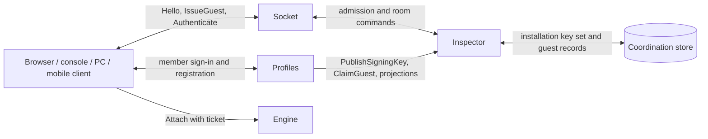

### 4.7 Guest-to-member migration

Migration turns a guest into a member while the guest's sessions continue. Points move into the member profile; history and achievements move when Statistics is present; the guest id is retired and never becomes a member id. The procedure needs Profiles: without it every registration and claim operation answers feature-unavailable and the guest record stays untouched. The guest credential is held in memory for one request at a time and is never written to the Profiles store or its outbox.

1. The client calls Profiles' RegisterMember(registration, guestCredential) while its guest credential is live. Profiles verifies the credential through Authenticate and refuses an expired or revoked one with that error, or any non-guest credential with invalid-proof; no member is created in either case.
2. In one unit of work Profiles creates the member profile with a new profileId and zero points, a claim record (claimId, guestPlayerId, memberProfileId, state pending, the installation directory's regions as pending) unique on guestPlayerId, and, when Statistics is declared, a GuestClaimed fact in the outbox. A second registration with the same guest credential fails on the unique claim with already-claimed.
3. Profiles calls Inspector's ClaimGuest(guestPlayerId, memberProfileId, proof) in every pending region with its service credential and the guest credential as proof. Inspector verifies the proof, then a single-tag procedure on {profile:P} writes claimedBy and redirectTo, records the points value at claim and returns it. A region holding no record writes a claimed record with zero points for the remaining credential lifetime, so a later first use there cannot create an unclaimed record.
4. In one unit of work per answered region Profiles adds that region's points to the member, marks the region done and keys the addition by claimId + regionId, so a replayed answer adds nothing. The claim becomes complete when no region is pending. RegisterMember returns the member credential and the claim state, complete or partial.
5. Statistics consumes GuestClaimed and re-keys the guest's history and achievements to the member in one job idempotent on claimId. It applies the same mapping to every event for the guest id that arrives after the job, until the guest credential expires.
6. The guest credential stays valid until it expires, so open memberships, attachments and resume tokens continue. A new JoinRoom with it fails with already-claimed, and the client switches to the member credential. The claimed record then expires with the credential; the guest id is retired and Profiles keeps it in the member's formerGuestIds.

ClaimGuest replays are idempotent: the same guestPlayerId with the same memberProfileId returns the recorded points without a second write. A different memberProfileId fails with already-claimed; a proof that does not verify or names another playerId fails with invalid-proof. A caller without a declared service credential receives forbidden. A partial claim is completed by CompleteClaim(guestCredential), which an authenticated member calls while the guest credential is live; Profiles retries only the pending regions.

Sessions that end after the claim credit the member, never the claimed record. When ReportSessionEnded carries a delta for a claimed guest playerId, settle_points adds nothing to the guest record, and Inspector reports the delta as a member delta for redirectTo in SessionSettled. Profiles applies member points from exactly one source, PointsSettled when Statistics is declared and SessionSettled otherwise (see "Statistics service"). No delta is therefore applied twice or dropped silently.

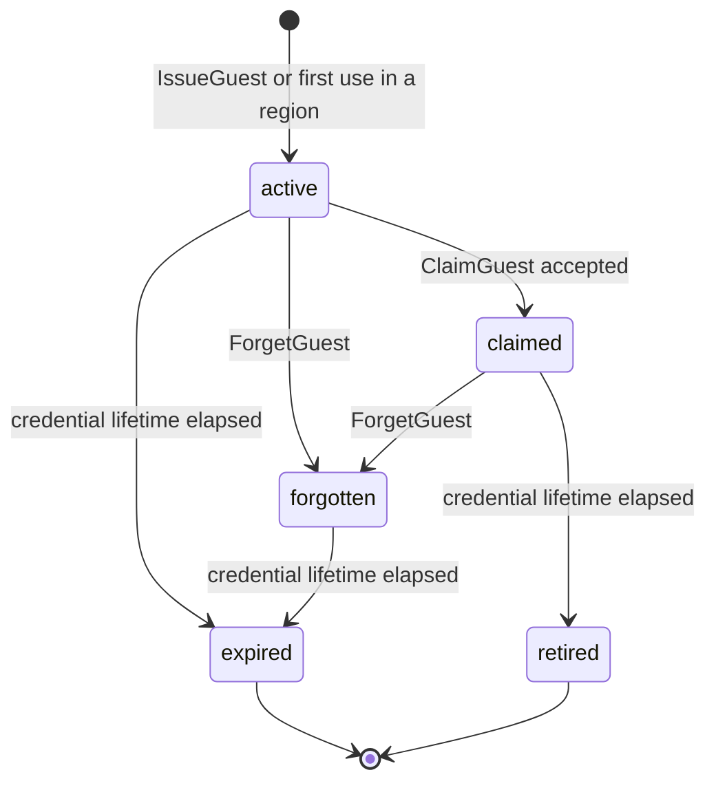

A claimed record answers admission only for memberships and attachments that existed before the claim. A retired id cannot be issued again, because IssueGuest draws a fresh random id and never accepts one from the client. A forgotten record keeps only its revoked entry until the credential lifetime ends, plus claimedBy and redirectTo when it was claimed. The diagram is per region; the claim record in Profiles is the installation-wide view.

These are required runtime tests for migration, not tests performed by this specification. Each row names a fault and the result that must be observable.

| Failure during migration | Required observable result |
| --- | --- |
| Guest credential expired or revoked at registration | Refused with expired or revoked; no member, claim record or GuestClaimed |
| Two concurrent registrations with one guest credential | One member; the other refused with already-claimed; one GuestClaimed |
| Profiles crashes after step 2 before any ClaimGuest | Member exists with every region pending; CompleteClaim finishes the claim; GuestClaimed relayed once from the outbox |
| One region unreachable during step 3 | Member credential returned with claim state partial; that region stays pending |
| ClaimGuest reply lost and retried | Same points returned; member points increase once per region |
| Guest credential expires with regions pending | Claim marked lapsed for those regions, logged at warn with a counter; their points are lost; history still moves |
| Statistics unavailable during step 5 | GuestClaimed waits in the outbox; the re-key job runs once when relayed |
| Session of the guest ends after the claim | Delta credited to the member through one settlement source; guest record unchanged |
| Profiles absent | RegisterMember and ClaimGuest answer feature-unavailable; guest record untouched |

### 4.8 Bans, suspension and sanctions

A ban is a Profiles fact: profileId, scope installation or room, roomId for room scope, until or none, reason, issuedBy and revision, stored through BanRepository. A suspension is a ban with until; a ban without until lasts until an unban. The target may be a member or a guest playerId. Profiles appends the AuditRecord in the same unit of work as the ban or unban, and fails the action with audit-unavailable when the append fails.

Profiles projects every ban into every region of the installation directory through ProjectBan and removes it through RevokeBan, idempotent by revision with outbox retry (see "Inspector"). An installation-scope ban writes the revoked entry of {profile:P}. Its lifetime is until for a suspension; for a ban without end it is the longest configured credential lifetime plus 1 hour. That lifetime suffices because the projection only has to outlive every credential the principal can still present. Profiles issues and renews no member credential for a banned profile, and a guest id never receives a new credential.

A room-scope ban is projected as an entry of that room's blocks hash carrying a ban marker, with expiry at until or the end of the room, whichever comes first. JoinRoom answers banned for an entry with the ban marker and blocked for an owner's BlockInRoom entry. Room closure is terminal, so the room-scope entry never needs to outlive the room; the ban fact stays in BanRepository as the durable record. A projection with a revision not higher than the stored one changes nothing, so an unban delivered before its ban leaves the principal unbanned.

Enforcement in a region starts when that region acknowledges the projection, never earlier and never through a cross-region read. Inspector then refuses JoinRoom, Admit and IssueControlTicket with banned. Socket closes the principal's control connections in that region with banned for installation scope. For room scope Inspector removes a current member with the saga shape of BlockInRoom in "Inspector". Under the player's lock it publishes PlayerLeaving with reason banned when a session is active, prepares the leave entry, writes the block with the fence, commits and releases the lock. A live Engine attachment ends through that membership loss, or at once through Kick; the projection itself makes no Engine call.

A Block of "Privacy and blocking" is a sanction one member applies to another, not a ban. Social stores it in one direction, at most 1000 per blocker. Inspector never enforces it: a Block changes no room membership, writes no entry in a room's blocks hash and closes no connection. A Block needs no rank and limits no moderator power, so ModerateConversation, bans and session controls ignore it. An owner who wants the blocked member out of a room uses BlockInRoom.

In one unit of work Block deletes the pair's friendship and pending friend requests in both directions and revokes the pair's pending invites. The pair's conversation stays readable to both participants and closes to new entries from the blocked member. With Feed declared, each member's friend items about the other leave both feeds within 60 seconds. The blocked member's friend requests, messages, invites and presence reads toward the blocker answer exactly what an unknown profileId answers, so a block is never revealed. The blocker's own attempts answer blocked. Unblock restores nothing.

Without Profiles no durable ban exists, because no durable identity exists. The sanctions are Kick from a session, BlockInRoom by the room owner for the room's lifetime, the in-memory rate limits and credential expiry. A sanctioned guest can obtain a new guest identity, bounded by the issuance rate limit. Moderator controls do not exist without Profiles, because no credential can carry a moderator role.

### 4.9 Deletion and tombstones

A member erases its own profile through Profiles. Erasure revokes access first and removes data second, so no window exists in which an erased profile still acts. Erasure is irreversible; the profileId is never reused.

1. In one unit of work Profiles deletes email, personal fields and username, replaces the profile by a tombstone (profileId, erasedAt), writes an installation-scope ban with reason erased for the member and for every former guest id whose credential can still be live, appends the AuditRecord and enqueues ProfileErased carrying profileId and formerGuestIds.
2. Profiles projects the bans to every region; from each region's acknowledgement Socket closes the member's connections there with banned and Inspector refuses admission.
3. Profiles calls CloseRoom with its service credential for every open room profile the member owns, region by region through its outbox.
4. When Statistics is declared, it replaces the member id and the former guest ids by a random tombstone id within 24 hours and keeps no mapping back; without Statistics no trace exists and the step is empty.
5. When Recording is declared, it deletes or redacts the recordings in which the member appears under the room's erasure policy, default delete (see "Recording"); when Payment or Inventory is declared, each acts on ProfileErased under the rules of "Payment service" and "Inventory service". Without these services the step is empty.
6. When Social is declared, it destroys within 24 hours every content key of the member's slot in every conversation and appends a tombstone of reason erased to each such conversation. The member's chat messages and invites therefore become unreadable for everyone (see "Content keys, retention and erasure"). It deletes the member's SocialProfile, friendships, friend requests, blocks in both directions, invite index rows and participant rows, and revokes the member's pending invites through RevokeInvite. Without Social the step is empty.
7. When Feed is declared, it deletes within 24 hours every feed item whose recipientId or subjectId is the member, its FeedState, its fan-out jobs and its exclusion records (see "Privacy" in "Feed service"). Without Feed the step is empty.

The tombstone lasts for the revocation window: the longest configured credential lifetime plus 1 hour. During the window Profiles answers erased to any operation naming the profileId, and a late sink fact cannot recreate the profile. After the window the tombstone is removed. Durable room profiles keep ownerProfileId as the tombstoned id, so the invariant that every room names its owner survives erasure without naming a person.

Audit records survive erasure. AuditRepository is append-only, so its records keep the pseudonymous profileId and expire under the security retention class of "Observability and logging". They hold no email or personal field, because those never enter an audit record.

Chat history survives erasure only as ciphertext. The peer's own entries stay readable to the peer under the peer's keys. The versioned journal store and its mirrors keep ciphertext, random conversationIds, positions, slots, months and commit times only. No erasure rewrites a journal commit, and key backups are kept at most 30 days, so the last copy of a destroyed key disappears 30 days after its destruction. Erasure publishes no FriendshipEnded or BlockAdded, because Social and Feed each act on ProfileErased themselves.

A guest needs no erasure path beyond ForgetGuest(credential). Inspector deletes the guest record's username, points, quota and entitlement fields in the serving region and keeps only a revoked entry with reason forgotten until the credential expires. On a claimed record guest_forget keeps claimedBy and redirectTo, so ownership redirection and member settlement are unaffected. Socket closes the connections bound to that credential in the region with revoked. The guest record is regional, so the reference bindings call ForgetGuest in every region where the credential was used and then discard the credential. In traceless mode every guest key expires with the credential even without ForgetGuest.

### 4.10 Deployments without Profiles

The Minimal profile runs this section on Inspector alone. Every principal is a guest issued by Inspector, every user profile is a guest record in the coordination store and every room profile is an Inspector room key. Quotas come from the quotas configuration group with role guest, ownership is checked against the guest playerId and points settle through settle_points into the regional guest record. Nothing in this section writes to disk in the Minimal profile.

Without Profiles there are no members, personal fields, moderators, admins, audit records, durable bans, migration or member erasure. RegisterMember, CompleteClaim and ClaimGuest answer feature-unavailable, and a game profile declaring requiresProfiles=true is refused at CreateRoom with feature-unavailable instead of degrading silently. Statistics adds history and achievements; Payment and Inventory, which both require Profiles, add the member with subscription and items beyond a session. A declared but unreachable service is degraded, never absent: projected bans and entitlements stay enforced until their lifetimes end.

### 4.11 Conformance

1. An Inspector-signed credential carrying any role other than guest is rejected with issuer-unknown.
2. A guest credential carries a server-generated 128-bit playerId and no email, personal field, entitlement or points.
3. A guest credential issued in one region authenticates in every other region of the installation.
4. The validate command refuses a configuration with more than one region and no AUTH_SIGNING_KEY.
5. A credential signed by a retired key verifies until the credential's own expiry.
6. CreateRoom ignores any client-supplied owner and sets ownerProfileId to the authenticated principal.
7. UpdateRoom, CloseRoom, BlockInRoom and StartSession by a non-owner fail with not-owner.
8. Two concurrent CreateRoom calls against a remaining roomsOwned of one create exactly one room.
9. A guest with roomsJoined=2 holding memberships on two connections receives quota-exceeded on a third JoinRoom from any connection.
10. Changing quotas.guest.roomsOwned changes the guest limit in the Minimal profile with no optional service declared.
11. The validate command refuses a negative quota value and a roomsJoined of 0.
12. An entitlement value rooms.owned overrides the role value for its principal until the entitlement's until.
13. Lowering a quota below current usage closes no room and removes no membership.
14. A member whose subscription entitlement passed its until receives member quotas while still holding an unexpired credential.
15. Quota for another principal's playerId fails with forbidden.
16. ReadProfile on another principal by a member fails with forbidden.
17. ReadProfile on another principal by a moderator appends exactly one AuditRecord in the same unit of work.
18. ReadProfile fails with audit-unavailable and returns no data when the audit append fails.
19. SetRole by a moderator fails with forbidden, and SetRole to guest or subscriber fails with role-invalid.
20. SetRole that would demote the last admin fails with last-admin.
21. A demoted moderator is refused by Profiles at once and receives no control ticket after its member credential expires.
22. A moderator banning a moderator or an admin fails with forbidden.
23. A second registration with a claimed guest credential fails with already-claimed and creates no member.
24. A replayed ClaimGuest with the same memberProfileId returns the same points and adds them to the member once.
25. After a claim, the guest's open session continues and a new JoinRoom with the guest credential fails with already-claimed.
26. A session result for a claimed guest credits the member through one settlement source and leaves the guest record unchanged.
27. With Statistics present, the guest's history and achievements are keyed to the member after GuestClaimed is consumed.
28. With Profiles absent, RegisterMember and ClaimGuest answer feature-unavailable.
29. An installation-scope ban is enforced in a region only after that region acknowledged ProjectBan.
30. A banned principal receives banned on JoinRoom, Admit and IssueControlTicket and its control connections close with banned.
31. A RevokeBan with a revision lower than the stored ban leaves the ban in force.
32. Every revoked entry, including one for a ban without end, carries a positive expiry.
33. After erasure, Profiles answers erased for the profileId during the revocation window and the member's credentials are refused in every acknowledged region.
34. Within 24 hours of ProfileErased, Statistics holds no event keyed by the member id or its former guest ids.
35. ForgetGuest removes the guest's username and points in the serving region and revokes the credential there.
36. In the Minimal profile no operation of this section writes a file, and every key it writes carries a positive expiry.
37. IssueGuest with a username of 33 code points after NFC normalization, or holding a control, bidirectional-override or invisible code point, is refused with username-invalid.
38. The 61st IssueGuest within one minute from one address digest is refused with rate-limited.
39. With guestIssuer=profiles, IssueGuest at Inspector answers issuer-delegated.
40. ForgetGuest on a claimed guest record keeps claimedBy and redirectTo, so the member still passes the ownership check on the guest's rooms and receives the delta of a session that ends afterwards.
41. A guest receives member-required from every Social and Feed operation of the permission matrix, and with Social or Feed absent those operations answer feature-unavailable.
42. ModerateConversation by a member fails with forbidden; by a moderator it appends exactly one AuditRecord, or fails with audit-unavailable and returns no entry.
43. No operation returns another member's feed items to any role, moderator and admin included.
44. A Block between two members of one room changes neither membership nor the room's blocks hash, and the blocked member's friend request, message, invite and presence read toward the blocker answer as for an unknown profileId.
45. Within 24 hours of ProfileErased, no content key of the member's conversation slots and no friendship, friend request, block, invite index row or pending invite grant of the member exists, while the peer's own entries stay readable. With Feed declared, no feed item names the member.
46. Erasure changes no commit identifier of the versioned journal store.

## 5. Client connection and presence

A Client connection is Socket's object for one client control connection, authenticated optionally as one principal. Socket owns the object and its registry entry; Inspector owns room membership; the owning Engine owns session attachments and seats. The connection carries no membership, placement or game state of its own: every fact it reports is a binding to a fact another service owns. Socket restart drops control connections but cannot delete membership. This section defines the object, its authentication states, the Social and Feed operations of an authenticated connection, connection generations, resume, attachment states during a saga or a session move, multi-room membership and the separation of presence, membership and transport connectivity.

### 5.1 Connection object

Socket creates the object when a transport connection reaches it and destroys it at closed. A connectionId is opaque, generated by Socket at accept and never reused; a reconnect always creates a new object with a new connectionId. The object holds the fields below; Socket mirrors the fields the registry needs into the {conn:C} hash of the coordination store.

| Field | Content | Writer |
| --- | --- | --- |
| connectionId | Opaque bounded identifier, new per transport connection | Socket at accept |
| socketId | The Socket process instance holding the connection | Socket at accept |
| principal | None while open; then playerId, role, username, expiresAt, issuer and kid from Authenticate | Socket after Authenticate |
| generation | Control generation assigned by Inspector at the connect report; none until then | Inspector, copied by Socket |
| state | open, reporting, authenticated, closing or closed | Socket |
| memberships | Set of roomIds whose membership is bound to this connection; Socket memory only | Socket from Inspector answers |
| attachments | Per sessionId: attachment state (pending, attached, suspended, moving or detached), attachment generation and path (gateway or direct) | Socket from Engine answers |
| principalSlots | With Social or Feed declared: per projection type + slotKey, the newest undelivered principal projection, at most 64 slots; Socket memory only | Socket from DeliverProjection without a roomId |
| createdAt | Timestamp at accept | Socket at accept |

The registry entry {conn:C} holds socketId, playerId, generation, state and attachments with a 60-second expiry, renewed every 20 seconds by Socket. The registry is a projection: Socket rebuilds it from live connections after a store loss, and its loss costs presence for at most one expiry, never membership. No decision about membership, admission, placement or game outcome reads the registry as authority. Socket also fans out Inspector projections to the connections listed for each room in its memberships set; that fan-out is a projection, not a delivery guarantee. With Social or Feed declared, Socket also writes each projection that DeliverProjection carries without a roomId into the principal slots of every local connection authenticated as the named playerId. Principal slots are separate from room fan-out and are a hint as well (see "Delivery to principals").

### 5.2 Authentication states

A connection moves open → reporting → authenticated → closing → closed. Hello is the first message on the connection and must arrive within the Hello deadline. Default Hello deadline: **5 seconds**, a starting value. Hello carries protocol (the integer 1 for this contract), supported, schemaHash, clientBuild and an optional credential; it carries no ticket. Socket answers HelloAck with the chosen protocol, its supported range and the region directory revision, or closes with version-mismatch before parsing any further payload.

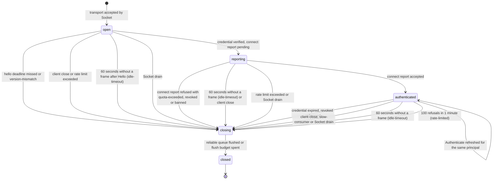

An open connection may call only Hello, ListRegions, ListRooms for public rooms, ReadBoard for public boards, IssueGuest, Authenticate and the Profiles operations RegisterMember, SignIn and RenewCredential. Those three answer feature-unavailable when Profiles is absent (see "Profiles service"). Every other operation on an open connection returns unauthenticated, and Socket forwards none of them to Inspector or an Engine. An anonymous connection therefore browses without leaving a binding anywhere. A credential in Hello is equivalent to an Authenticate call immediately after HelloAck.

Authenticate(credential) → principal (playerId, role, username, expiresAt, issuer, kid); errors expired, revoked, issuer-unknown. Socket verifies the signature offline through the credential issuer role against the installation key set, and the connection enters reporting. Socket then sends the connect report, the first ReportPresence call of the connection, which assigns the control generation, enforces the concurrent connection limit and checks an installation-scope ban. The connection becomes authenticated only after Inspector accepts the connect report; a ban answer closes it with banned, and a refusal at the connection limit closes it with quota-exceeded. A signature check is necessary, not sufficient: a valid signature on a banned principal never yields authenticated.

A connection in reporting relays Attach by resume token only and answers every other Inspector-bound operation with retryable-unavailable. Reporting is a wait, not a grant: it forwards no JoinRoom, Admit or room mutation to Inspector and holds no membership binding. Revoked is reserved for a forgotten guest credential and a rotated renewal token presented again; a ban is always banned, whether Socket meets it at the connect report or after authenticated.

In the Minimal profile Inspector is the only signer: the client calls IssueGuest(username) on the open connection and then Authenticate with the returned guest credential. Guest credentials last 7 days by default. With Profiles present, member, subscriber, moderator and admin credentials are signed by Profiles and last 1 hour; the client renews them by calling Authenticate again on the same connection. A refresh must carry the same playerId: a credential for another principal is refused with forbidden, because a connection never changes principal. A connection whose credential reaches expiresAt without a refresh moves to closing with expired.

Closing is bounded: Socket stops reading client messages, flushes the reliable queue within its slow-consumer budget and closes the transport. Closing tears down nothing that another service owns. Gateway attachments of the connection move to suspended at the owning Engine, memberships stay bound until they expire or are rebound, and direct-transport attachments are unaffected. A client keepalive, the Keepalive message or any other frame, is due at least every 20 seconds, because a browser cannot send transport-level ping frames. Socket closes a connection in open after Hello, in reporting or in authenticated that sent nothing for 60 seconds with idle-timeout. Both figures are starting values. A connection in any of these states that collects 100 rate-limited refusals within 1 minute closes with rate-limited, and a Socket drain closes it with socket-draining (see "Socket").

### 5.3 Social and Feed operations on a connection

An authenticated connection may call the client operations of Social and Feed beside the room, session and Profiles operations, only when the installation declares that service. Socket routes each call through the optional service route of "Socket" to the declared service and passes the principal from the call context. The service refuses a data field naming another caller with forbidden. An open connection that calls any of them receives unauthenticated. A connection in reporting receives retryable-unavailable, because its connect report and with it the ban check are not accepted yet. Neither state forwards such a call.

| Service | Operations | Callable by |
| --- | --- | --- |
| Social | SendFriendRequest, AcceptFriendRequest, DeclineFriendRequest, CancelFriendRequest, RemoveFriend, ListFriends, ListFriendRequests, Block, Unblock, ListBlocks | member principals; a guest receives member-required |
| Social | GetSocialSettings, UpdateSocialSettings, GetPresence | member principals; a guest receives member-required |
| Social | SendMessage, ListConversations, ReadConversation, MarkRead, DeleteMessage | member principals; a guest receives member-required |
| Social | SendInvite, AcceptInvite, DeclineInvite, CancelInvite, ListInvites | member principals; a guest receives member-required |
| Social | ModerateConversation | moderator and admin; a guest receives member-required, a member or subscriber forbidden |
| Feed | ReadFeed, MarkFeedSeen | member principals; a guest receives member-required |
| Inspector, with presence tracking on | SetPresenceStatus(status) | any authenticated principal, for the calling connection only |

Results, errors and limits of each Social operation are those of "Public operations" in "Social service", and those of each Feed operation are those of "Read operations and real-time push". Socket enforces nothing of them beyond the principal and the route, and every call counts against the control message limit of the connection. When Social or Feed is not declared, Socket answers its operations with feature-unavailable without a network call. SetPresenceStatus answers feature-unavailable while presence tracking is off, which is exactly when Social is not declared. The Minimal profile and traceless mode declare neither service, so every such call answers feature-unavailable there and the connection gains no field, key or principal slot.

With Social declared, the connect report, every ReportPresence renewal and the clean-close report also write the connection's field of {profile:P}:conns. The heartbeat that renews room presence therefore renews presence tracking too (see "Presence tracking in Inspector"). The generated client binding sends SetPresenceStatus away after 5 minutes without local input or when the application moves to the background, and available at the next input. Presence tracking grants nothing: it changes no membership, seat or attachment.

With Social or Feed declared, an authenticated connection receives FriendRequestChanged, FriendshipChanged, FriendPresence, ConversationEntry, InviteChanged and FeedUpdated in its principal slots. It receives ProjectionsDropped with a count when a 65th slot is needed. A push is a hint, not a record. The generated client binding reads back through the matching list or read operation, ReadConversation and ReadFeed included. It does so when a pushed revision or position is not adjacent to its local one or a ProjectionsDropped notice arrives (see "Delivery to principals"). A reconnect therefore loses no message, invite or feed item: each is durable in its service before any push.

### 5.4 Connection generation

A connection generation orders bindings of the same principal; it is a counter, never a membership revision. Two scopes exist and both are decimal-string counters on JSON. The control generation is per principal and region, and Inspector assigns it at the connect report from a strictly increasing counter in the principal's {profile:P} aggregate. The attachment generation is per seat and session, and the owning Engine assigns it on every accepted Attach, which covers a reconnect and a transport switch alike.

A room membership records the connectionId and control generation it is bound to. A rebind moves the membership to a connection with a strictly higher control generation; a renewal must match both the stored connectionId and generation. A heartbeat from an older connection therefore renews nothing and steals nothing back, even when it arrives late. When a store failover loses the principal's counter while a room still holds a higher generation, the rebind is refused with stale-generation carrying the stored value. Inspector then raises the counter above that value and Socket retries the rebind once.

The attachment generation lives in the session players hash, in the Engine's RAM and in the snapshot envelope, so an adopting engine continues it. Attach and AttachAck carry the full value; the binary frame header carries its low 8 bits, which only discard frames of a stale attachment. A newer Attach for the same seat detaches the older attachment with superseded. Reconnects are limited to 3 per minute per principal, keyed by the resume token's playerId, so at most one stale attachment generation is alive inside any 256-step window. A re-attach through AttachRedirect after a session move does not count toward that limit, because the move, not the client, ended the previous attachment. A generation increment never grants membership, a seat or a role.

### 5.5 Resume

A control connection is never resumed; a reconnect is a new connection that authenticates again. Membership survives the gap because it belongs to Inspector, and a session seat survives it because it belongs to the Engine. The client keeps three things across the gap: its credential, the roomIds it holds and one resume token per attachment. The credential is stored under the consent rules of "Profile, roles, permissions and quotas", and a binding that may not store it ends the guest identity with the process.

The owning Engine mints a resume token on every accepted Attach and returns it with AttachAck. Only its digest is stored, in the session players hash and in the snapshot envelope; the previous token of that seat stops verifying at once. A resume token re-attaches an attachment that is suspended inside the resume window. Default resume window: **120 seconds**; the game profile chooses 0 to 3600 seconds. After the window the seat is left, and a returning player gets a new seat through Admit under the late-join policy.

Reconnect procedure, run by the generated client binding:

1. Open a control connection to any Socket of the room's region and send Hello with the stored credential; continue once HelloAck arrives.
2. Socket verifies the credential and sends the connect report; Inspector returns the new control generation.
3. Socket calls ReportPresence with the held roomIds; Inspector rebinds each membership to the new connection and returns the outcome per room.
4. For each suspended attachment, send Attach with the resumeToken, as a gateway stream through Socket or as the first message of a direct transport connection.
5. The Engine verifies the digest, increments the attachment generation and answers AttachAck with a new resume token, followed by a resync; the client sees a resync, never a leave and join.

A resume runs no saga: it re-attaches a seat the Engine already admitted, so it takes no player lock and waits for no verification. When the coordination store is unavailable, steps 2 and 3 fail with retryable-unavailable and step 4 still succeeds at a reachable owning engine. Socket keeps such a connection in reporting with generation none, relays Attach by resume token only, answers every other Inspector-bound operation with retryable-unavailable and retries the connect report with backoff. A direct-transport resume reaches the engine address the client already holds. A gateway resume succeeds only while Socket can still route to the owner from its last known placement. After an adoption or a session move to another engine the resume token verifies at the new owner, because its digest travels in the snapshot envelope.

### 5.6 Attachment states during a saga

An attachment binds one connection to one seat or viewer slot of one session. The owning Engine is its authority; Socket and the client binding mirror its state from Engine answers. A join reaches the Engine on two paths: the PlayerJoining message of the join saga through the unordered service queue, and the client's Attach carrying the admission ticket. Neither path grants anything alone. The Engine takes the player's lock after Inspector releases it and reads the saga record and the room member field. It admits the attachment only when the verification rule of "Saga verification before attachment" in "Engine runtime" passes for the saga messageId the ticket binds. A valid ticket counts as a delivery of the message id it binds, so a slow queue never holds back a fast client.

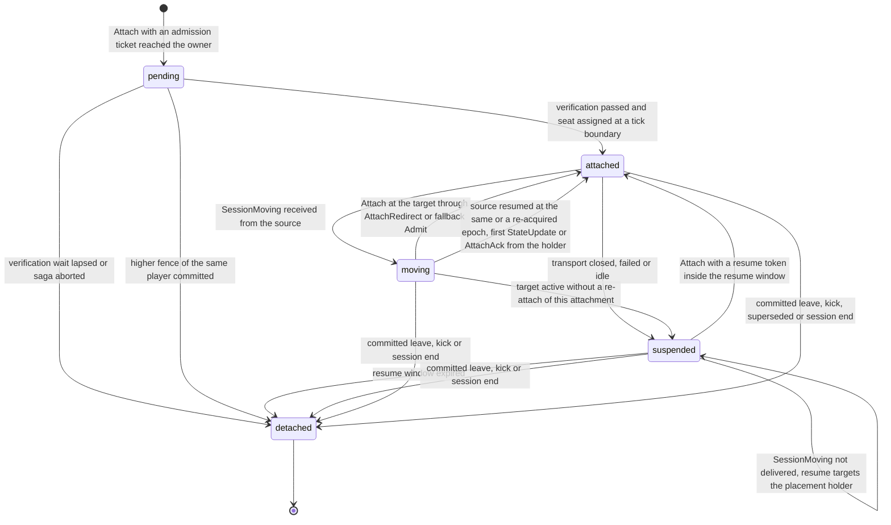

A pending attachment holds the Attach and nothing else. The Engine binds no transport state to it. A direct stream that carried the Attach stays unbound and carries only the AttachAck or the refusal, and no secure UDP keys are derived. The first SignalDescription of a WebRTC attachment receives no answer, so no peer connection, ICE agent or relay allocation exists. The SessionPlayer enters joining only after the pass, so a pending attachment owns no seat and counts against no seat limit. Default verification wait: **6 seconds** from the first receipt of the message or its ticket, re-read with backoff from 50 ms doubling to 400 ms; a starting value. When the wait lapses with the join unmatched, the Attach is refused with saga-incomplete and nothing is kept, so a half-open attachment is impossible. When an Attach is refused with saga-incomplete, the generated client binding repeats the JoinRoom or Admit that minted its ticket up to 3 times under the same idempotencyKey, with backoff from 1 second and full jitter. It then reports the code to the game client.

Removal never waits for a message. A committed leave, a regroup to a lesser role and a committed join of the same player at a higher fence apply at the next tick boundary as soon as the saga record shows them as the highest entry. They apply even when their message never arrived. A leave delivered before its join leaves the player detached, and the late join is dropped by fence, so no transport state is ever created for it. One player holds at most one attachment per session: the newer connection's join supersedes the older attachment, which is detached with superseded or never created. Duplicates are normal operation: one PlayerJoining delivered many times beside its ticket yields one seat, one attachment and one applied fence.

An attachment moves to moving when the source of a session move sends SessionMoving on its reliable-ordered lane (see "Engine runtime"). The client binding keeps its seat, its resume token and its unacknowledged inputs, which the replay stream resends to the target. Inspector pushes AttachRedirect through Socket's projection fan-out with a ticket bound to the move's claimId, carrying the target's addresses, lanes, relay credential and a fresh secure UDP attachment secret. The binding attaches to the target with that ticket and its resume token. The target admits only a player in its roster, keeps the seat, increments the attachment generation and sends a full snapshot of the receiver's interest classes. A binding without an AttachRedirect 5 seconds after SessionMoving calls Admit, which answers session-moving until placement is placed and a ticket for the target after it.

Socket routes a new gateway stream by the new placement, never by the engine that held the previous stream. A WebRTC attachment opens a new peer connection to the target, because no transport state moves between hosts. The source keeps a tombstone for 60 seconds that answers Attach and datagrams for the session with session-moved, unless it re-acquires the session first. Default client-visible pause: **2 seconds** target, an unmeasured starting value, not a guarantee. A move removes no participant and changes no room membership.

A move that aborts at the source returns its attachments to attached at the source. When lease_handover answers claim-lost, the source resumes at the same epoch, and its first StateUpdate returns each moving attachment to attached with its seat and attachment generation unchanged. When the source re-acquires the session after a lapsed claim, it drops its tombstone and publishes SessionMoved naming itself as holder. Inspector then re-tickets the members to it, and each moving attachment returns to attached on its AttachAck. A suspended attachment receives no SessionMoving and stays suspended through the move; its resume Attach is routed by the placement in the session index and verifies at the holder. A committed leave, a kick or the session end detaches a suspended or moving attachment as it detaches an attached one, and the move is no reason to keep the seat.

Every part of this subsection holds in the Minimal profile: the player lock, the saga record and the service queue are coordination-store keys with expiries, and a move needs only engines and the store. No optional service changes an attachment state or adds a step to a saga. In traceless mode a saga or a move writes nothing outside expiring store keys (see "Anonymous traceless mode").

### 5.7 Multi-room membership

A principal may hold memberships in several rooms of one region at once, up to its roomsJoined quota. The quota is counted per principal across every connection, never per connection: a guest with quota 2 holds at most 2 memberships in total. Each membership binds to one connection at a time, and the memberships of one principal may bind to different connections. A connection holds at most one attachment per active session of a room it joined.

| Role | Rooms joined concurrently | Configuration key |
| --- | --- | --- |
| guest | 2 | quotas.guest.roomsJoined |
| member | 3 | quotas.member.roomsJoined |
| subscriber | 4, or entitlement rooms.joined | quotas.subscriber.roomsJoined |
| moderator | 3 | quotas.moderator.roomsJoined |
| admin | 3 | quotas.admin.roomsJoined |

The quotas configuration group applies in every deployment profile, the Minimal profile included, and a value of 1 configures single-room connections. The validate command refuses a negative value and a roomsJoined of 0. With Payment present, an entitlement value rooms.joined from the entitlement projection overrides the role value for its principal; without Payment the role value is final. Quotas are enforced per region, because keyspaces have no cross-region access, so a principal connected to two regions holds a separate quota in each. An installation-wide membership quota is outside this version.

A principal holds at most 2 concurrent connections per region. A connect report beyond the limit is refused with quota-exceeded and the connection closes; an earlier connection whose registry entry has not yet expired still counts. Inputs and unreliable frames belong to an attachment keyed by sessionId, so multi-room membership never makes input sequencing ambiguous. The gateway path carries several attachments as streams of one control connection, while a direct transport connection carries exactly one attachment.

### 5.8 Presence, membership and transport connectivity

Four layers describe whether a player takes part, and each has its own owner, lifetime and counter. Presence is a hint, not authority; transport loss is not leaving; leaving the room is not leaving the session.

| Layer | Authority and storage | Ends when | Counter |
| --- | --- | --- | --- |
| Transport connectivity | Socket for the control connection; owning Engine for each attachment; process memory and {conn:C} | The transport closes or fails | Control and attachment generation |
| Presence | Derived: the bound connection's registry entry exists and is authenticated | The bound connection's entry expires or Socket reports it closed | None |
| Room membership | Inspector; {room:R} members field | LeaveRoom, BlockInRoom, room deletion or field expiry | Membership revision |
| Session seat | Owning Engine; RAM, players hash and snapshot | Leave, Kick, session end or resume window expiry | Session membership revision |

A member is present while the connection its membership is bound to has a live registry entry in state authenticated. Socket reports a closing connection through ReportPresence, and Inspector then publishes PresenceChanged to the room. A Socket crash sends no report, so presence of its connections lapses when their registry entries expire, at most 60 seconds later. GetRoom derives presence at read time and is the read of record; PresenceChanged is a projection that may arrive late or twice.

Presence renewal writes the membership field's expiry without changing the membership revision. Default presence expiry: **60 seconds**; renewed every 20 seconds by ReportPresence. A member holding a seat in the room's active session has its field expiry extended by the resume window, 180 seconds with the defaults. Membership therefore never ends before the Engine releases the seat, and a seat held by the Engine never belongs to a non-member. Expiry is the only implicit end of membership; Socket restart, transport loss and absence never delete a membership field. Presence renewal takes no player lock, because it grants no right. A rebind writes the member field and therefore runs under the player lock, and it leaves the field's sagaMessageId and sagaFence unchanged, because it records no saga entry and changes no seat or role.

A direct-transport attachment stays live when the control connection drops, and the control connection stays authenticated when a direct transport fails. A gateway attachment rides the control connection and moves to suspended when it closes. A membership field lost to a store failover is re-asserted by the next presence heartbeat through the join saga, under the player lock and room_join's capacity, block and closed checks. A re-assertion refused there ends that membership with the refusal reason. The owning Engine verifies a re-assertion like any join and assigns no second seat to a player it already seats.

With Profiles present, Socket closes live connections of a principal with banned once the region holds the ban projection. When an event sink consumer is declared, Inspector publishes RoomMembershipChanged facts through the event sink; in the Minimal profile the sink is null and nothing is appended anywhere. In traceless mode the registry entry and membership fields carry playerId only under their expiries, and log lines at every level carry no playerId and carry connectionId only as a keyed digest (see "Anonymous traceless mode").

### 5.9 Conformance

1. An open connection that calls any operation outside Hello, ListRegions, ListRooms for public rooms, ReadBoard for public boards, IssueGuest, Authenticate, RegisterMember, SignIn and RenewCredential receives unauthenticated, and Inspector observes no call; with Profiles absent, RegisterMember, SignIn and RenewCredential on an open connection answer feature-unavailable.
2. A connection that sends no Hello within the Hello deadline is closed and leaves no registry entry after 60 seconds.
3. A Hello with a protocol outside Socket's supported range is closed with version-mismatch before any payload field is parsed.
4. A connection with a validly signed credential of a principal under an installation-scope ban never reaches authenticated and closes with banned.
5. Authenticate on an authenticated connection with a credential for a different playerId is refused with forbidden and the principal is unchanged.
6. A member connection whose credential passes expiresAt without a refresh moves to closing with expired, and its memberships remain in the room.
7. A third concurrent connection of one principal in one region is refused with quota-exceeded at the connect report.
8. Two connect reports of one principal return strictly increasing control generations.
9. A presence heartbeat from an older connection after a rebind to a newer connection leaves the membership bound to the newer connection.
10. A rebind refused with stale-generation after a counter loss succeeds on the single retry with a generation above the stored value.
11. Every accepted Attach for a seat increments its attachment generation, and the previous attachment of that seat is detached with superseded.
12. A resume token verifies exactly once: the token returned by the next AttachAck replaces it and the earlier token yields ticket-invalid.
13. An attachment resumed inside the resume window keeps its seat and receives a resync, and no leave or join event is emitted for it.
14. An attachment resumed after an adoption or a session move to another engine verifies its resume token at the new owner.
15. With the coordination store unavailable, a resume through Attach succeeds at a reachable owning engine while JoinRoom and Admit fail with retryable-unavailable.
16. A guest with roomsJoined 2 holding memberships through two connections is refused with quota-exceeded on a third JoinRoom from either connection.
17. A configuration with any roomsJoined of 0 or below fails the validate command.
18. Killing a Socket process removes no membership field, and presence of its connections lapses within 60 seconds.
19. A seated member whose connection closed keeps its membership field for at least the resume window plus the presence expiry.
20. A presence renewal never changes the membership revision, and a rebind changes the control generation without changing the membership revision.
21. In the Minimal profile a full join, play, disconnect, resume and session move cycle appends nothing to any event sink, writes nothing to disk and leaves only coordination-store keys with a positive expiry.
22. Every statement of this list that involves a queue message holds with the shuffling adapter, which reorders every batch and duplicates 10% of messages.
23. An Attach bound to a join saga that has not committed yields no seat, no SessionPlayer, no bound transport stream, no secure UDP key, no WebRTC peer connection and no relay allocation until the verification passes.
24. A pending attachment of a committed join becomes attached within one verification backoff step after Inspector releases the player lock.
25. An Attach whose ticket binds a message id that the saga record holds as aborted, or never held, is refused with saga-incomplete.
26. With Inspector killed after publishing PlayerJoining and before saga_prepare, the Attach is refused with saga-incomplete within 6 seconds plus one backoff step, and a client retry with the same messageId and idempotencyKey derives the same saga messageId and yields exactly one membership and one attachment.
27. A PlayerLeaving delivered before its PlayerJoining leaves the player detached, and no transport state is ever created for the late join.
28. One PlayerJoining delivered 100 times in random order beside its ticket yields one seat, one attachment and one applied fence.
29. A join of the same player from a second connection detaches the first connection's attachment with superseded, and the player holds exactly one attachment in the session.
30. An attachment that receives SessionMoving re-attaches to the target through AttachRedirect with the same seat, an incremented attachment generation and a full snapshot of its interest classes.
31. A binding that receives no AttachRedirect within 5 seconds after SessionMoving calls Admit, which answers session-moving until placement is placed and a ticket for the target after it.
32. A re-attach through AttachRedirect does not count toward the reconnect limit of 3 per minute per principal.
33. An Attach reaching the source of a move within 60 seconds after the source dropped its frozen copy is answered with session-moved, and a new gateway stream for the session is routed by the new placement.
34. A presence renewal takes no player lock, and a rebind leaves the member field's sagaMessageId and sagaFence unchanged.
35. A generated client binding whose Attach is refused with saga-incomplete after every attempt repeats the JoinRoom that minted its ticket exactly 3 times under the same idempotencyKey and then reports saga-incomplete to the game client.
36. A connection whose credential verified and whose connect report is not yet accepted is in reporting, relays Attach by resume token only and answers every other Inspector-bound operation with retryable-unavailable.
37. A connection in reporting reaches authenticated only when Inspector accepts its connect report, and Inspector observes no JoinRoom, Admit or room mutation from it before then.
38. A connect report refused with quota-exceeded, revoked or banned closes the connection from reporting with that code, and the connection never reaches authenticated.
39. A connection in reporting that sends no frame for 60 seconds closes with idle-timeout.
40. An authenticated connection that sends no frame for 60 seconds closes with idle-timeout, and its memberships remain in the room.
41. A move whose lease_handover answers claim-lost returns every moving attachment to attached at the source on its first StateUpdate, at the same epoch, seat and attachment generation.
42. A source that re-acquires a session after a lapsed claim drops its tombstone and publishes SessionMoved naming itself, and every moving attachment of that session returns to attached at the source.
43. A committed leave, a kick or the session end detaches a suspended attachment, and its resume token no longer verifies.
44. A committed leave, a kick or the session end during a move detaches the moving attachment, and the holder after migration_complete holds no seat for that player.
45. A suspended attachment receives no SessionMoving, and its resume Attach after the move verifies at the placement holder with the same seat.
46. A connection in open that sent Hello and then sends no frame for 60 seconds closes with idle-timeout.
47. A Socket drain closes every connection in open or reporting with socket-draining.
48. A connection in reporting that collects 100 rate-limited refusals within 1 minute closes with rate-limited.
49. An authenticated connection that collects 100 rate-limited refusals within 1 minute closes with rate-limited, and its memberships remain in the room.
50. With Social and Feed declared, an authenticated member connection reaches every operation of "Public operations" in "Social service" and "Read operations and real-time push" through Socket, and the service receives the principal from the call context, never from a data field.
51. A Social or Feed operation on an open connection receives unauthenticated, on a connection in reporting receives retryable-unavailable, and the service observes no call in either case.
52. A guest connection receives member-required from every Social and Feed operation, and a member or subscriber connection receives forbidden from ModerateConversation.
53. With Social or Feed not declared, its operations answer feature-unavailable from Socket without a network call, and SetPresenceStatus answers feature-unavailable while presence tracking is off.
54. SetPresenceStatus changes the status of the calling connection's {profile:P}:conns field only, and a principal with one available and one away connection reads online.
55. A connection with 64 undelivered principal slots that needs a 65th receives ProjectionsDropped, and its binding's read-back yields every message, invite and feed item committed meanwhile.
56. In the Minimal profile and in traceless mode a connection holds no principal slot, and Inspector writes no {profile:P}:conns field for it.

## 6. Room

A room is the profile of kind room: a lobby with a home region, an owner, members, settings and at most one active session. Inspector owns the live room in the {room:R} aggregate of the coordination store and is its only writer. The room outlives its sessions: a session ends, fails or moves to another engine while the room keeps its members, blocks and settings. The room does not own simulation, seats or media; those belong to the session on its owning Engine (see "Session, players, teams, groups, observer and session events"). Room profiles share the Profile entity with user profiles (see "Profile, roles, permissions and quotas").

### 6.1 Room profile and identity

A room has two identifiers: roomId names the live lobby in its region and profileId names the room profile. Both are opaque bounded identifiers carrying no topology, and neither is parsed to find a region, store shard or engine. Inspector generates both at CreateRoom in every deployment. In the Minimal profile the room profile exists only as the room's keys with their lifetimes. With Profiles present, the room profile is also a durable aggregate in RoomProfileRepository under the profileId Inspector minted, and Inspector caches only what admission needs.

| Field | Content | Mutable |
| --- | --- | --- |
| roomId, profileId | Opaque identifiers of the live room and its profile | No |
| ownerProfileId | Required owner principal; a guest playerId or a member profileId | No |
| gameId, gameBuild | Game and pinned build used by the next session | gameBuild between sessions only |
| regionId | Home region, fixed at creation | No |
| state | open, locked or closed | Inspector only |
| maxPlayers, maxSpectators | Capacity, bounded by the game profile | Yes |
| visibility | public or unlisted; private only with Social declared | Yes |
| settings | Closed object: title, recording, recordingPolicy, resumeWindowSeconds copied from the game profile, roomInviters (owner or members) with Social declared, and the module's declared room options | Yes |
| sessionId | The active session or none | Inspector only |
| revision | Room revision counter | Inspector only |

A live room is never revived under its roomId once its keys are gone. With Profiles present, the owner reopens a durable room profile by calling CreateRoom with its profileId. Inspector creates a new roomId carrying the stored settings, and the room counts against roomsOwned again. Without Profiles, CreateRoom with a profileId is refused with feature-unavailable. A room profile must name an owner: CreateRoom without an authenticated owner is impossible, because the owner is the calling principal.

### 6.2 Room lifecycle

A room moves between three states. Open permits joins under capacity and policy, locked prevents settings changes while a session is being placed, and closed is terminal for the lobby. Whether a session is attached is the sessionId field, not a room state: an open room with a sessionId hosts an active session and admits members into it.

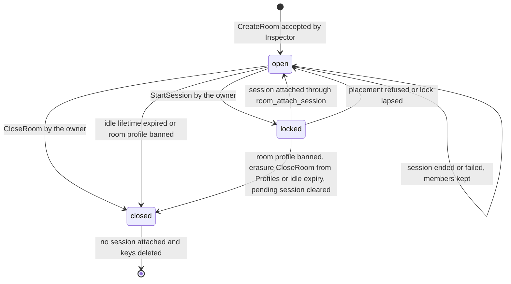

StartSession(roomId, requester) locks the room and runs the StartSession saga of "Inspector": reserve engine capacity, create the session index with epoch 1, confirm the reservation and attach the session with the expected room revision. A lock that is not followed by room_attach_session within 30 seconds lapses, and Reconcile returns the room to open. A placement that finds no capacity leaves the session orphaned, which members see as recovering. After 120 seconds the session is marked failed and the room returns to open with its members intact. The 120-second rule applies only to an orphaned session, which has no engine at all, never to a session bound by capacity, which keeps running (see "Capacity and visibility"). StartSession on a room that already has a sessionId or a lock is refused with already-active.

When the owning engine reports the session ended or faulted through ReportSessionEnded, Inspector clears sessionId and increments the room revision. Members remain members and may join the next session, which has a new sessionId. A session's end never closes its room, and a room's close never ends its session. Inspector never writes a session state reported by a live owner (see "Engine runtime").

CloseRoom(roomId, owner) moves the room to closed at once; the owner's CloseRoom on a locked room is refused with room-locked. The ban projection, an erasure CloseRoom from Profiles and Reconcile at idle expiry pass that check. They close a locked room and clear its pending session through room_attach_session(clear), because a lock never shields a room from a sanction or an expiry. A closed room refuses JoinRoom, Admit for a new session, UpdateRoom and StartSession with room-closed. An active session attached to a closed room runs to its own end under its own rules, and its members keep their seats. Inspector deletes the room's keys when the room is closed and no session is attached, which is immediately for a room without a session and at ReportSessionEnded otherwise.

Default room idle lifetime: **24 hours**; 1 hour in traceless mode. Every member write renews it, presence renewal included, so a room with present members never expires. A room whose lifetime elapses is closed by Reconcile under the same rules as CloseRoom. An owned room without members still counts against roomsOwned until it closes or expires.

### 6.3 Region home

The client picks the region before it connects and creates the room there; the room's regionId is the region whose Inspector accepted CreateRoom. The home region never changes, and no operation moves a room or its session to another region. Every member reaches the room through a Socket of its home region, and its session is placed only on engines of that region. A region whose coordination store is down answers region-unavailable, and nothing re-homes silently.

An invitation or link names regionId beside roomId; a client never derives the region from the identifier. A Social invite carries roomId, regionId and inviteId, and AcceptInvite answers all three (see "Invites and room grants"). A JoinRoom for a roomId absent from the region's keyspace answers room-closed, so a region never reveals whether a room exists elsewhere. Cross-region failover and cross-region membership are outside this version. Quotas, guest points and blocks are per region for the same reason: keyspaces have no cross-region access.

### 6.4 Capacity and visibility

maxPlayers comes from the game profile and the room may lower it, never raise it. The data plane ceiling is 256 seats, and the default for 60 Hz profiles is 64; a game profile above the engine's capacity class is refused at placement. room_join enforces capacity before any Engine admits the player, and the owning Engine enforces it again at seat assignment. Inspector's count is a gate, not the seat authority: the Engine refuses an Attach whose seat it already holds for another player.

A room's capacity and its engine's capacity are separate gates. Placement charges a new session at the room's occupancy plus a growth reserve, never at maxPlayers. Default growth reserve: **25%** of occupied seats, at least 2 seats; a starting value. A room that keeps growing past the reserve on a node without free capacity has its session moved whole to a free engine from the offloaded state, while the room itself never moves (see "Engine runtime"). The room keeps its state, revision, members, blocks and settings across the move, and the session keeps its sessionId.

While a move of the session is possible and the source node is at or above the 90% placement refusal, JoinRoom and Admit for a new member answer session-moving with a retry hint of 1 second. That answer lasts at most 15 seconds, the offer lifetime plus the hard bound of the move. From the freeze to migration_complete, JoinRoom and Admit into the session answer session-moving; LeaveRoom and UpdateMember proceed, and Inspector publishes their messages to the claim target. Inspector answers these refusals from the session index before lock_acquire, so a refusal writes no saga entry, no member field and no quota reservation. A move in progress never answers capacity-exhausted.

When no engine can take the session, its source marks it bound. JoinRoom and Admit for a new player or spectator of a bound session answer capacity-exhausted with a retry hint of 30 seconds, and every existing member keeps its seat and its tick. A rejoin of a player holding a seat is never refused for capacity, because its weight is charged already. A bound session never ends for capacity. Bound clears on a completed move or when the source node returns to normal, and a newly registered engine absorbs the session within one offer round.

Members join with a role. Player counts against maxPlayers and holds a seat in the active session. Spectator counts against maxSpectators, at most 1024, receives only the public interest class and has no input rights. Observer is requested at JoinRoom only by the room owner, counts against the 64 observer places and is hidden from every member projection other members receive. UpdateMember changes a member's role or seat under the regroup saga of "Inspector", and it may change a member between a seat-holding role and a viewer role. room_member_update checks capacity and answers room-full. The Engine applies a regroup that grants a seat or publish rights only after verification, and a regroup to a lesser role at the next tick boundary. Inside a session the module changes visibility through SetVisibility (see "Session, players, teams, groups, observer and session events").

Visibility is public or unlisted. A public room is listed by ListRooms(region, filter, page) and joinable by any authenticated principal under the room's rules. An unlisted room is absent from listings and joinable by any principal that holds its roomId and regionId, so the roomId acts as the invitation. Unlisted is privacy by obscurity of a 128-bit identifier, not access control: AdmitPlayer of the game module and BlockInRoom are the controls that refuse a principal.

With Social declared, visibility gains the value private. A private room is absent from every listing. JoinRoom admits only its owner, a principal already holding a member field or a principal holding a live grant whose inviteId matches the call's inviteId (see "Membership operations"). Private is access control, not obscurity: holding roomId and regionId admits nobody. Grants come only from Social invites, which Social projects through ProjectInvite and removes through RevokeInvite (see "Invites and room grants"). For a private room the setting roomInviters, owner by default or members, decides whether members may invite beside the owner; any member may invite to a public or unlisted room. CreateRoom and UpdateRoom refuse private with feature-unavailable when Social is not declared, so the Minimal profile and traceless mode never hold a private room.

ListRooms answers from the public-room directory, kept as fields of the {region:G} directory hash with per-field expiry and refreshed on every public room write. The directory is an eventually consistent view; room_join remains the authoritative capacity and closed check. Pages hold at most 100 rooms with an opaque cursor, and the filter accepts gameId and free capacity. An open connection may call ListRooms; GetRoom and every mutation require authenticated. GetRoom returns the member list and presence to members of the room only, and a capacity summary to any other principal.

### 6.5 Owner and host controls

The owner is the principal named by ownerProfileId, fixed for the room's lifetime. Owner rights are room rights: UpdateRoom, CloseRoom, BlockInRoom, UnblockInRoom and StartSession. The host is a session role held by one player at a time, with the controls the game profile lists in hostControls (see "Session, players, teams, groups, observer and session events"). The host flag is assigned at Init to the room owner's SessionPlayer when one exists, whether player or observer, never a spectator. Otherwise the hostMigration policy chooses the first host at the first admission.

| Operation | Owner | Host | Member | Moderator or admin |
| --- | --- | --- | --- | --- |
| UpdateRoom, BlockInRoom, UnblockInRoom | Yes | No | No | No |
| StartSession | Yes | No | No | No |
| CloseRoom | Yes | No | No | Through a ban on the room profile, with Profiles |
| JoinRoom, LeaveRoom, GetRoom | Yes | Yes | Yes | Yes |
| Session controls in hostControls | When host | Yes | No | SetMute, Kick and EndSession through a control ticket |

Ownership transfer is outside this version. An owner that leaves the room or goes offline keeps ownership, and the room keeps running. The room cannot start a new session until the owner returns, and it closes at idle expiry after its last member leaves. A guest owner that registers as a member keeps ownership of its open rooms: the owner check follows the guest record's redirect to the member identity (see "Profile, roles, permissions and quotas").

BlockInRoom(roomId, owner, playerId) writes a block entry with an until equal to the room's lifetime, removes the member's field and increments the room revision. A block is a room fact and a Kick is a session fact: a block never removes a seat from a running session. The client binding of the owner therefore issues Kick through the session controls when the blocked player is seated. Without Profiles, a kick and a room block are the only sanctions, and both end with the room.

With Profiles present, a moderator or admin bans a room profile through ProjectBan with the room's profileId. Inspector then closes the room under the CloseRoom rules and refuses JoinRoom with banned. A ban with scope room on a user profile refuses that user's JoinRoom and Admit for the room with banned. Inspector projects it as an entry of the room's blocks hash carrying a ban marker, which ends with the room. JoinRoom answers banned for a ban entry and blocked for an owner's block. Every such ban is audited by Profiles.

### 6.6 Membership operations

Every room mutation is a control command on an authenticated connection, routed by Socket to any Inspector process. Each carries an idempotencyKey chosen by the client, and Inspector stores the payload hash, state, minted identifiers and result in the principal's {profile:P}:idempotency hash, keyed by type + idempotencyKey (see "Idempotency"). A retry with the same key and payload returns the stored result without a second effect; the same key with a different payload is refused with idempotency-conflict. Default idempotency record lifetime: **10 minutes**, a starting value.

| Operation | Inputs → outputs | Errors |
| --- | --- | --- |
| CreateRoom | owner, gameId, region, settings, profileId or none → roomId, revision | quota-exceeded, region-unknown, game-unknown, feature-unavailable, forbidden, rate-limited |
| UpdateRoom | roomId, owner, settings, expectedRevision → revision | not-owner, stale-revision, room-locked, room-closed, feature-unavailable, forbidden |
| CloseRoom | roomId, owner → revision | not-owner, room-locked |
| JoinRoom | roomId, playerId, connectionId, credential, role, inviteId or none → revision, ticket when a session is active | room-full, room-closed, blocked, banned, already-claimed, invite-required (private room without a valid grant), not-owner (role observer requested by a principal other than the owner), feature-unavailable, quota-exceeded, rate-limited, saga-busy, session-moving, capacity-exhausted, retryable-unavailable |
| LeaveRoom | roomId, playerId, connectionId → revision | not-member, saga-busy |
| UpdateMember | roomId, actor, playerId, role, expectedRevision → revision | not-owner, forbidden, stale-revision, room-full, saga-busy |
| BlockInRoom | roomId, owner, playerId → revision | not-owner, room-closed, limit-exceeded, saga-busy, retryable-unavailable |
| UnblockInRoom | roomId, owner, playerId → revision | not-owner, room-closed |
| GetRoom | roomId → room view with revision; members and presence for members only | room-closed |
| Admit | roomId, playerId, connectionId → ticket | not-member, room-closed, banned, session-inactive, session-ending, saga-busy, session-moving, capacity-exhausted, retryable-unavailable |
| ReportPresence | connectionId, generation or none, roomIds → generation, outcome per room | quota-exceeded, banned, revoked, retryable-unavailable |

JoinRoom runs the join saga of "Inspector" under the principal's player lock. Inspector calls lock_acquire on {player:P} and receives a fence. When the room has an active session, it publishes PlayerJoining to the engine the session index names, or to the claim target while placement is migrating. It then calls saga_prepare, quota_reserve on {profile:P} and room_join on {room:R}, which writes the member field with sagaMessageId and sagaFence. Only after room_join succeeds does Inspector call saga_commit and quota_confirm, mint the admission ticket and release the lock. Publishing before the store update is safe because the message is a trigger and the saga record is the authority.

A failed step compensates under the same lock: a refused room_join runs quota_release and saga_abort, and an unconfirmed reservation expires after 30 seconds, so a crashed Inspector never leaks a quota slot. Default player lock lease: **5 seconds**, never renewed; a waiter retries for at most 6 seconds and then answers saga-busy, which is retryable. The saga messageId is the first 128 bits of a cryptographic hash over playerId + roomId + kind + the client envelope's messageId, so a client retry, which reuses its messageId, derives the same value. A committed saga answers its outcome again with a ticket for the same messageId and republishes PlayerJoining, which the Engine drops by fence or verifies afresh. Admit runs the same saga with kind admit for a principal that already holds the membership.

A JoinRoom by a principal that is already a member returns the current revision and rebinds the membership to the calling connection; it reserves no second quota slot. With Profiles present, a new JoinRoom presenting a guest credential whose guest record is claimed is refused with already-claimed, and the client switches to the member credential (see "Profile, roles, permissions and quotas"). Open memberships of that guest are unaffected. A JoinRoom into a room whose game profile declares requiresProfiles=true or requiresInventory=true is refused with feature-unavailable when the deployment no longer declares that service, which happens only for a room created before a configuration change. When the room has an active session, JoinRoom returns an admission ticket in the same reply, and the client attaches with it. The ticket binds the saga messageId and fence, and the attachment stays pending until the Engine verifies the saga (see "Attachment states during a saga"). A ticket is a right to attempt an Attach, not admission.

JoinRoom into a private room adds an invite check to room_join and replaces none of its capacity, block, ban and closed checks. room_join admits the owner and a principal already holding a member field without a grant. Any other principal must name the inviteId of a live field for it in {room:R}:grants. room_join deletes that grant in the same procedure and records the consumed grant in the new member field. A call without an inviteId, with an inviteId that matches no live grant for the caller or after the grant's until passed answers invite-required. The saga then compensates like any refused room_join. The compensating room_leave, conditioned on the saga's messageId, restores the grant while until has not passed, so an aborted join never consumes an invite. JoinRoom ignores the inviteId for a public or unlisted room. The client reaches this call after AcceptInvite, through a Socket of the region that AcceptInvite answers (see "Invites and room grants").

LeaveRoom runs the leave saga under the same lock: lock_acquire → PlayerLeaving published to the session holder → saga_prepare and room_leave → saga_commit and quota_release → lock_release. room_leave removes the membership only when the calling connection holds the binding and the fence is not below the field's sagaFence. Another connection of the same principal receives not-member and the client binding rebinds before it retries. A LeaveRoom issued while a join of the same player is in flight waits for the lock, and its higher fence orders it last. LeaveRoom increments the room revision, and the owning Engine applies the committed leave at the next tick boundary, even when PlayerLeaving never reached it: the attachment detaches and the SessionPlayer moves to left. PlayerLeaving is a trigger, not authority; Inspector never calls into an Engine to remove a seat. A grant is single use: after LeaveRoom of a private room, the invitee needs a new invite to join it again.

UpdateRoom is compare-and-set on expectedRevision: a stale revision is refused with stale-revision, and a locked room with room-locked. Settings that placement consumes (gameBuild, maxPlayers, maxSpectators, recording, recordingPolicy and the module options) apply to the next session, while title and visibility apply at once. recording=true is refused with feature-unavailable when Recording is absent, and the traceless start gate makes it absent in traceless mode. CreateRoom and UpdateRoom refuse recording=true with forbidden when the owner lacks the entitlement recording.enabled (see "Recording policy and consent"). A game profile declaring requiresProfiles=true or requiresInventory=true makes CreateRoom fail with feature-unavailable in a deployment lacking that service.

The room revision increments on every membership, role, block, settings, state and session change. A membership field records the revision at which it last changed, so its membership revision is comparable with the room revision. Presence renewal and rebind change neither: a rebind changes the control generation only. Inspector publishes RoomState and RoomMemberChanged projections with the revision, and a client discards any projection whose revision is not above the last it applied. A client that sees a revision gap calls GetRoom, because projections are hints and the room keys are authority.

With Profiles present, Inspector publishes RoomChanged facts (creation, settings change, close) through the event sink, and the round-robin group profiles maintains the durable room profile from them (see "Integration bus"). Inspector has no unit of work in Profiles' store. With any other event sink consumer declared, Inspector publishes RoomChanged and RoomMembershipChanged facts through the same sink. In the Minimal profile both are absent, and the room exists only in Inspector's keys with their lifetimes.

### 6.7 Room death and restart on another engine

The room does not run on an engine, so an engine's death never kills a room. The room's session runs on one owning Engine at a time, and that session moves to another engine by adoption, by migration or by a pressure move when it outgrows its node, under the rules of "Engine runtime". A room dies only by CloseRoom, idle expiry, a ban on its profile or loss of its keys. The table states what survives each event.

| Event | Room and membership | Session | Client connections |
| --- | --- | --- | --- |
| Engine crash | Unchanged | Adopted by another engine from the last snapshot; loss bounded by one snapshot interval or one journal batch | Attachments reconnect with resume tokens; seats kept inside the resume window |
| Planned restart on the same host | Unchanged | Handed off with the same epoch | Preserved per transport as "Engine runtime" states |
| Drain in migrate mode | Unchanged | Moved by the transfer of a pressure move, target assigned by Inspector | Clients pause and re-attach |
| Session outgrows its engine | Unchanged | Moved whole to a free engine from the final snapshot; same sessionId, epoch advanced once | Pause of 2 seconds target; re-attach through AttachRedirect |
| Growing session with no free engine | Unchanged; new members refused with capacity-exhausted | Bound; continues on its engine with every existing player | Unchanged |
| Orphaned session without capacity for 120 seconds | Members kept; room returns to open | Marked failed with the reason visible to the room | Attachments detached |
| Session ended | Members kept; sessionId cleared | Ended; the next session has a new sessionId | Attachments detached |
| Socket crash | Unchanged; presence lapses within 60 seconds | Unchanged; gateway attachments suspended | Clients reconnect to any Socket of the region |
| Store failover losing acknowledged writes | Membership re-asserted by the next presence heartbeat | Lease renewed by the owner within 5 seconds | Unchanged |
| Total loss of the store dataset | Room keys lost; the room is closed | Continues on its engine through index_restore until it ends | GetRoom and JoinRoom answer room-closed |
| Owner leaves | Unchanged; ownership kept | Unchanged; host migrates by policy | Unchanged |
| Idle expiry or CloseRoom | Closed; keys deleted when no session is attached | Runs to its end when attached | Members keep their seats until the session ends |

Session continuity and room continuity are separate guarantees. Across adoption the session keeps its sessionId, its roster, its group graph, its mute matrix, its resume token digests and its state up to the last committed snapshot, under a new epoch. Transport connections, unsnapshotted ticks, buffered unreliable frames and text chat do not survive a crash; WebRTC media resumes through ICE restart. A pressure move keeps the same sessionId, roster, group graph, mute matrix and resume token digests and loses nothing beyond the freeze. The target restores the final snapshot taken at the frozen tick, no participant is removed and the epoch advances exactly once. Unflushed sink events become an explicit Gap when an event sink consumer is declared.

Total loss of the store dataset is the one event that ends a room while its session lives. Engines rebuild every session index they hold, and the sessions continue to their end, but no room meta exists to receive the result. In the Minimal profile the room is gone for good and its members create a new room. With Profiles present the owner reopens the durable room profile under a new roomId. A room is never reconstructed from a session, because the session does not hold the room's members, blocks or settings.

### 6.8 Limits

Every figure below is a starting value for load tests, not an advertised capacity, unless it is a protocol constant. Operators set tighter game-specific limits before public exposure.

| Limit | Default | Rule |
| --- | --- | --- |
| Rooms owned per principal | guest 1; member, moderator and admin 3; subscriber 10 | quotas.<role>.roomsOwned; entitlement rooms.owned overrides; per region |
| Rooms joined concurrently | guest 2; member, moderator and admin 3; subscriber 4 | quotas.<role>.roomsJoined, at least 1; entitlement rooms.joined overrides; per region |
| Concurrent connections | 2 per principal per region | refused with quota-exceeded beyond it |
| Players per room | game profile maxPlayers; 64 at 60 Hz | hard ceiling 256 seats |
| Spectators and observers | maxSpectators up to 1024; 64 observers | separate from maxPlayers |
| Blocks per room | 256 entries | each until the room's lifetime |
| Live invite grants | 256 per private room | with Social declared; invites-full at ProjectInvite; each until its invite's expiresAt |
| Room operations | 5 per minute per principal | CreateRoom, UpdateRoom, CloseRoom, JoinRoom, LeaveRoom, BlockInRoom and UnblockInRoom; rate-limited beyond it |
| Control messages | 20 per second per connection; 64 KiB per message | parser ceiling 256 KiB applied before decoding |
| Room idle lifetime | 24 hours; 1 hour in traceless mode | renewed on any member write |
| Room lock lapse; quota reservation | 30 seconds each | Reconcile reopens a lapsed lock |
| Player lock | 5 seconds, never renewed; waited for at most 6 seconds | saga-busy past the lock wait |
| Saga entry deadline | 10 seconds | at most 64 saga entries per player |
| Verification wait | 6 seconds | saga-incomplete past the wait |
| Presence expiry and heartbeat | 60 seconds; every 20 seconds | extended by the resume window for seated members |
| Resume window | 120 seconds | 0 to 3600 seconds per game profile |
| ListRooms page | at most 100 rooms | opaque cursor |

Every limit has a counter and a refusal code; none is enforced by truncation or silent drop. A limit refusal leaves the room revision unchanged and holds no quota reservation after its saga compensates.

### 6.9 Conformance

1. CreateRoom by a principal at its roomsOwned quota is refused with quota-exceeded and leaves no room key.
2. CreateRoom retried with the same idempotencyKey and payload returns the same roomId and consumes one quota slot.
3. A request reusing an idempotencyKey with a different payload is refused with idempotency-conflict and has no effect.
4. A room's regionId equals the region whose Inspector accepted CreateRoom and never changes.
5. JoinRoom for a roomId absent from the region's keyspace answers room-closed.
6. JoinRoom on a room at maxPlayers is refused with room-full, and the quota reservation is released within 30 seconds.
7. A JoinRoom whose room_join fails leaves the principal's joined count unchanged after the saga compensates.
8. JoinRoom by a current member returns the current revision, rebinds the membership and reserves no second quota slot.
9. JoinRoom on a room with an active session returns an admission ticket in the same reply.
10. LeaveRoom from a connection that does not hold the binding is refused with not-member and removes nothing.
11. A committed LeaveRoom by a seated member detaches its attachment and moves its SessionPlayer to left at the next tick boundary, even when PlayerLeaving never reached the Engine.
12. UpdateRoom with an expectedRevision below the current revision is refused with stale-revision and changes nothing.
13. UpdateRoom on a locked room is refused with room-locked.
14. StartSession by a principal other than the owner is refused with not-owner.
15. StartSession on a room with a sessionId or a lock is refused with already-active.
16. A lock without room_attach_session for 30 seconds returns the room to open.
17. A session left orphaned for 120 seconds is marked failed and the room returns to open with every membership intact.
18. ReportSessionEnded clears the room's sessionId, increments its revision and keeps every membership.
19. CloseRoom on a room with an active session leaves the session running to its end and refuses every new JoinRoom with room-closed.
20. The keys of a closed room without a session are deleted within one Reconcile period.
21. A room without members expires after the idle lifetime, and a room with a present member does not.
22. recording=true at CreateRoom or UpdateRoom is refused with feature-unavailable when Recording is absent.
23. A blocked player's JoinRoom is refused with blocked until the room closes.
24. BlockInRoom removes the membership field and leaves the blocked player's seat until a Kick or the session end.
25. An unlisted room never appears in ListRooms, and JoinRoom with its roomId succeeds under capacity.
26. An observer membership is absent from the member projections that players and spectators receive.
27. A projection with a revision not above the client's last applied revision is discarded by the generated binding.
28. A crash of the owning engine leaves the room's revision, members and blocks unchanged, and the session is active on another engine with its sessionId.
29. With Profiles present, a ban on a room profile closes the room and refuses JoinRoom with banned.
30. With Profiles absent, CreateRoom naming a profileId is refused with feature-unavailable.
31. A sixth room operation by one principal inside one minute is refused with rate-limited.
32. In traceless mode every {room:R} key carries a positive expiry of at most 1 hour after the last member write.
33. Two concurrent JoinRoom calls of one principal for one room yield one membership and one quota slot, and the second completes after the first releases the player lock or answers saga-busy after 6 seconds.
34. A JoinRoom retried with the same messageId and idempotencyKey after its saga committed returns the same revision and a ticket bound to the same saga messageId.
35. The member field written by a committed JoinRoom carries the sagaMessageId and sagaFence that its admission ticket binds.
36. A holder paused past the 5-second player lock lease has its late room_join refused with stale-fence once another holder's write for that player, a leave included, has landed in that room.
37. A JoinRoom whose Inspector is killed after room_join and before saga_commit ends, within one Reconcile period after the 10-second saga deadline, either committed with its quota confirmed or aborted with its member field removed, never both.
38. A LeaveRoom issued while a JoinRoom of the same player is in flight takes effect after the join commits or is resolved, and the player ends detached with no transport state.
39. 1000 shuffled and duplicated joins, leaves and regroups for 50 players leave every room's member fields and every engine roster equal to the committed saga entries at quiescence.
40. A session whose room keeps growing on a pressured engine moves to a free engine with the same sessionId, the room's revision, members, blocks and settings unchanged and the epoch advanced exactly once.
41. While a move of the session is possible and the source node is at or above 90%, JoinRoom for a new member answers session-moving with a retry hint of 1 second and never capacity-exhausted.
42. JoinRoom and Admit for a new player or spectator of a bound session answer capacity-exhausted with a retry hint of 30 seconds and write no saga entry, member field or quota reservation.
43. A rejoin of a player holding a seat in a bound session is never refused with capacity-exhausted.
44. A bound session keeps every existing player at its tick, never ends for capacity and is never marked failed by the 120-second rule.
45. A new engine registering while a session is bound receives that session within one offer round, after which JoinRoom for a new member succeeds under room capacity.
46. In the Minimal profile a join saga, a leave saga and a session move write only coordination-store keys with a positive expiry and append nothing to any event sink.
47. A 257th BlockInRoom in one room is refused with limit-exceeded and writes no block field.
48. With Profiles present, a ban on a room profile that arrives while the room is locked closes the room, clears its pending session and refuses JoinRoom with banned.
49. The owner's CloseRoom on a locked room is refused with room-locked and leaves the room locked.
50. UpdateMember moving a spectator to role player in a room at maxPlayers is refused with room-full, and a committed move to role player grants the seat only after the Engine's verification.
51. With Social declared, JoinRoom into a private room without an inviteId, or with an inviteId matching no live grant for the caller, answers invite-required and leaves no member field and no quota reservation after the saga compensates.
52. The invitee's JoinRoom with the matching inviteId succeeds once, deletes the grant and records it in the member field, and a second JoinRoom with the same inviteId after LeaveRoom answers invite-required.
53. A join into a private room aborted after room_join, a quota-exceeded abort included, restores the grant while until has not passed, and a later JoinRoom with that inviteId succeeds.
54. The owner and a principal already holding a member field join a private room without an inviteId, and JoinRoom ignores an inviteId for a public or unlisted room.
55. A private room never appears in ListRooms, and a blocked or banned principal holding a live grant is refused with blocked or banned.
56. Without Social, and therefore in the Minimal profile and in traceless mode, CreateRoom and UpdateRoom setting private answer feature-unavailable and no {room:R}:grants field is written.

## 7. Session, players, teams, groups, observer and session events

A session is one run of a game module inside one room, owned by exactly one Engine at a time under a lease and an owner epoch. The owner Engine holds the session, its SessionPlayer records, its group graph, its mute matrix and its event ring in RAM. Inspector holds the room, the placement and the lease (see "Inspector"). This section defines these session-scoped entities, their state machines and the rules that decide who sees, hears and controls what. It does not define room lifecycle, transport framing or the boundary of the session object. Those belong to "Room", "Transports and wire codec" and "Portable session object, client prediction and state synchronization".

Every rule in this section holds in the Minimal profile: Socket, Inspector, Engine and one coordination store, guests only, no optional service. Players, spectators, observers, groups, chat and both mute kinds need no optional service. The subsection "Optional services and traceless mode" states each change an optional service makes; no other subsection depends on one.

### 7.1 Session

A Session names its room, its game build, its owner and epoch, its state and tick and the roster, group graph and event sequence that the owner Engine holds. Inspector creates the identity at StartSession; the owner Engine writes everything that changes during play.

| Field | Meaning | Writer |
| --- | --- | --- |
| sessionId | Opaque identifier; a room's next session receives a new one | Inspector at StartSession |
| roomId | The room that started the session; the room outlives it | Inspector |
| gameId, gameBuild | The game and the pinned build; the build changes only through Upgrade at adoption | Inspector from the room |
| profile limits | maxPlayers, maxSpectators, lateJoin, spectatorDelay, resumeWindow, hostControls, hostMigration, maxSessionSeconds | Engine from the game profile at placement |
| regionId | The home region; never changes | Inspector |
| ownerEngineId, ownerEpoch | Current owner and fencing epoch | Inspector lease operations |
| state | Engine session state | Owner Engine |
| tick | Last simulated tick | Owner Engine |
| revision | Increments on every roster, group or state change | Owner Engine |
| durabilityClass | snapshot-only or snapshot-and-journal | Game profile |
| roster | SessionPlayer records | Owner Engine |
| group graph | Groups and their members | Owner Engine |
| event sequence | The next SessionEvent seq | Owner Engine |
| createdAt | Timestamp; the wall clock at creation, used for listings, idle expiry and maxSessionSeconds | Inspector |

The session revision orders projections; it is not membership authority. Every projection a client receives carries sessionId, ownerEpoch and revision, and a client discards a projection whose revision is not higher than the highest it holds for the same session and epoch. A client refuses every frame whose epoch is lower than the highest epoch it has seen, so a fenced predecessor cannot overwrite an adopter's view. One active-or-pending session per room is enforced by room_attach_session with an expected revision, not by a check before the call.

A session ends in exactly five ways. The module commands EndAt(tick) through the session context and the host calls End(reason) at that tick; an authorized controller issues EndSession; the last player leaves and the empty-session timeout expires; maxSessionSeconds elapses; or the operator ends it through the operator endpoint, which calls End with reason operator at the next tick boundary. In the controller, timeout and maxSessionSeconds cases the host calls End(reason) at the next tick boundary. EndAt is the session's command and End is the host's call: the module never calls End. Default empty-session timeout: **60 seconds**; maxSessionSeconds defaults to 4 hours and accepts up to 24 hours per game profile.

A session is empty when no SessionPlayer of role player or observer is in joining, active or disconnected; spectators alone never hold a session open. A session that faults never calls End: it reports finalState faulted with an abandoned result under the profile's abandon policy, so the room sees a reason, never a silent end.

### 7.2 Session state machine

The owner Engine advances the state; Inspector writes only failed, and only for a session without a live lease.

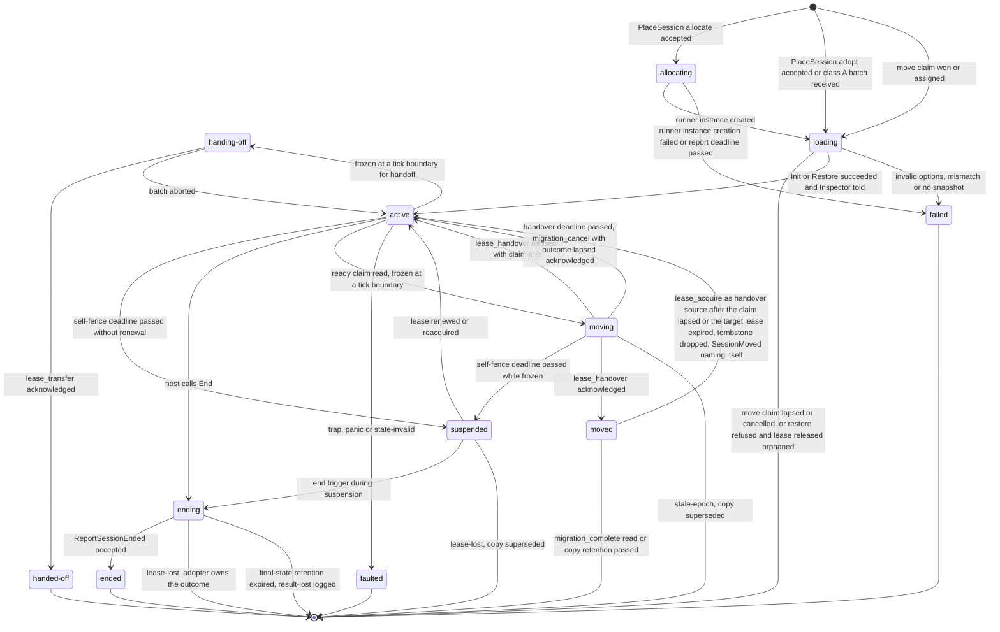

The terminal states are ended, failed and faulted; handed-off and moved end that engine's copy only, because the successor or the move target continues the same session. No terminal state returns to active: ended sessions never recover, and a room starts a new session with a new identity instead. Inspector marks a session failed after the 30-second allocating and loading report deadline or after 120 seconds without capacity, and never overwrites a state a live owner reported.

orphaned, migrating and recovering are not session states. orphaned and migrating are values of the placement field in the session index, written by Inspector when a lease is released without an owner. RECOVERING is the client-visible status of a session whose placement is orphaned or migrating or whose adopter is in loading. A client in that status keeps its seat and resume token and expects a resync, never a leave and a join.

In suspended the owner keeps the session in RAM, refuses inputs and controls with session-suspended, stops outbound state and keeps forwarding audio, never video, under the last committed group graph and mute matrix. A session that reaches ending while the store is unreachable keeps its final state and result in RAM and retries ReportSessionEnded for the final-state retention of 10 minutes. lease-lost means an adopter owns the outcome, and expiry logs result-lost at error. Timers and their rules belong to "Engine node, lease, epoch, placement and capacity".

### 7.3 SessionPlayer

A SessionPlayer binds an authenticated playerId to one session with a role, a seat or viewerIndex, group memberships and a monotonic membership revision. The playerId comes from the verified admission ticket, never from a field the client sends.

| Field | Meaning |
| --- | --- |
| playerId | Principal identifier bound by the admission ticket |
| seat | Stable index 0 to maxPlayers − 1; held by role player only |
| viewerIndex | Stable index in a separate space of at most maxSpectators + 64; held by spectators and observers |
| role | player, spectator or observer |
| host | Flag; at most one SessionPlayer holds it |
| groupIds | Groups the player belongs to; always includes the public group for role player |
| hidden, observes | Observer visibility flag and subscribe allow-list of groups |
| membershipRevision | Increments on join, leave, role, host, team or group change |
| attachmentGeneration | Increments on every accepted Attach, a reconnect, a transport switch and a re-attach after a move included |
| sequenceWatermark | Highest input sequence with a final outcome |
| joinedAtTick, leftAtTick | Tick of entry into active and of entry into left |
| publishMute | One flag per medium |
| state | invited, joining, active, disconnected or left |

Seats and viewerIndex values are two index spaces, so spectators and observers never consume a seat and never enter the dense mute bitset. A connection generation is not a membership revision: reconnect rotates the former without granting new membership. The role changes in place only through a host transfer and through SetVisibility on an observer. A change between a seat-holding role and a viewer role is a regroup, which releases the old seat or viewerIndex and assigns a new seat or viewerIndex at a tick boundary, so the two index spaces never share an entry.

### 7.4 SessionPlayer state machine

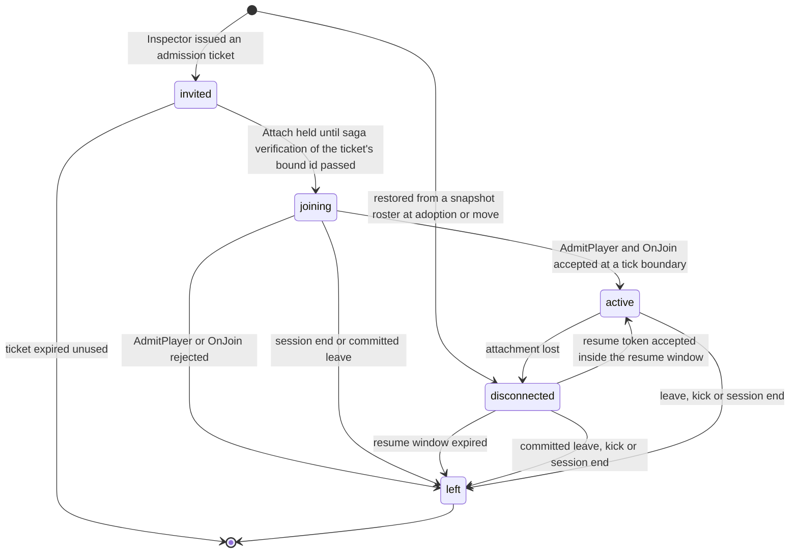

invited exists only in Inspector's admission record: the ticket names the seat or viewer role that Inspector recorded in the room's member entry, and the Engine materializes the SessionPlayer at Attach. An invited player that never attaches leaves no SessionPlayer and no event in the Engine. At Attach the Engine verifies the ticket offline and holds the attachment pending until the verification rule of "Saga verification before attachment" in "Engine runtime" passes for the ticket's bound id. When the verification wait lapses first, it refuses the Attach with saga-incomplete and materializes nothing. Only after the pass does it check that the named seat is free or held by the same playerId and that seats in joining, active or disconnected stay at or below maxPlayers. It then runs AdmitPlayer and OnJoin at the next tick boundary.

left is terminal for the seat. A returning player receives a new seat and a new SessionPlayer under the late-join policy, and a resume token for a left player is refused. A kick moves the player to left with reason kicked and closes its attachment. A kick is not a block, so re-admission follows the late-join policy unless the room owner calls BlockInRoom.

Disconnect is not a host event: the session object observes only the absence of inputs, and a return inside the resume window is a joined event with isRejoin=true. After a crash adoption or a move every restored SessionPlayer enters disconnected and the resume window restarts when the adopter enters active. Default resume window: **120 seconds**; the game profile chooses 0 to 3600 seconds.

### 7.5 Capacity, late join and spectators

maxPlayers comes from the game profile and is enforced twice: by room_join in Inspector before the Engine sees the player, and again at seat assignment in the Engine. The data plane has a hard ceiling of **256 seats**, because mute bitsets and interest classes are sized to it. The default seat limit for 60 Hz profiles is 64, and placement refuses a profile whose maxPlayers exceeds the engine's capacity class. Defaults are starting values for load tests, not capacity guarantees.

maxSpectators is declared by the profile from 0 to 1024 and defaults to 0, so a profile admits spectators only by declaring them. A session holds at most 64 observers beside its spectators. Spectators have no input rights, receive only the public interest class, never publish by default and never issue controls.

Spectator delay is 0 to 30 seconds per profile and defaults to 0. A delay above 0 sends state and HostEvents through one delayed send ring per session, budgeted at about 2.1 MiB at 60 Hz and 30 seconds. Media cannot be delayed within that budget, so a spectator with a delay above 0 receives no player media; live media and delayed state never mix.

Late join is a profile policy for role player: none admits players only before the session's first active tick, untilTick admits them until the declared lateJoinUntilTick, and always admits them at any active tick. A player Attach outside the policy is rejected with late-join-closed. Spectators and observers are admitted at any active tick under their caps and AdmitPlayer. A late joiner receives a full snapshot of its interest classes on the reliable-unordered lane and the HostEvents of later ticks from the event ring.

### 7.6 Teams and groups

A team is a module-level label used by game rules; the Engine stores it and routes nothing by it. A group is an Engine-level set of SessionPlayers with visibility semantics: groupId, name, visibility and members. The session always holds the public group, which contains every player, receives every spectator and cannot be dissolved. A session holds at most 32 groups including the public group, and a player may belong to several groups. A CreateGroup beyond 32 groups fails with group-limit, as an outcome to the module and a reply to a host control, and creates nothing.

Each group has one visibility mode. Open makes data, media and chat visible to members and leaves other groups unaffected. Sealed makes members see and hear only inside the group: a sealed member's media and chat reach only that group's members and its observers, and the member receives media and chat only from inside it. The module may widen game data across a sealed boundary through its Interest answer; nothing widens media or chat across it.

The module or an authorized controller creates, fills, moves and dissolves groups through CreateGroup(name, members, visibility), MoveToGroup(player, group) and DissolveGroup(group). MoveToGroup replaces the player's non-public memberships with the named group, and MoveToGroup to the public group removes them all; overlapping memberships come from CreateGroup with overlapping member lists. Every group command issued during Tick t applies atomically, in issue order, at the boundary before Tick t + 1 as one grouped host event per affected player. Every group change increments the membership revision of each affected player and the session revision, and the mute bitset is recomputed before the next packet is forwarded.

A werewolf night phase is one CreateGroup with the wolves and visibility sealed, issued in one tick: from the next boundary wolves hear only wolves, and the module publish-mutes the public group's audio so villagers hear nobody. DissolveGroup at dawn returns the wolves to the public group and SetMute restores the public audio. Classroom pairing is one CreateGroup per pair; dissolving the pairs returns every student to the class. Groups never move a player between rooms or sessions: regrouping is membership inside one session, not a room move.

### 7.7 Mute matrix

Two independent server states exist per (player, medium) where medium is audio, video, text or data. Publish-mute stops the source: the Engine tells the source to stop and drops anything it still sends. Forward-mute is a rule of allow or deny per (source player or group, target player or group, medium), evaluated per packet and never revealed to the source. For the data medium the two states are named input-muted and snapshot-hidden.

| Medium | Publish-mute | Forward-mute | Source learns |
| --- | --- | --- | --- |
| audio | Source told to stop; packets dropped at ingress | Packets dropped for denied targets | Publish-mute only |
| video | Source told to stop; every layer dropped at ingress | Packets dropped for denied targets | Publish-mute only |
| text | SendChat refused with publish-muted | Messages withheld from denied targets | Publish-mute only |
| data | input-muted: inputs dropped with outcome dropped | snapshot-hidden: entities the source seat owns omitted for denied targets | input-muted only |

Specificity decides between rules: seat-to-seat beats seat-to-group, which beats group-to-seat, which beats group-to-group, which beats the default. Between rules of equal specificity deny wins, so a conflict fails closed. The default is allow within a shared group and deny across groups, where a sealed member counts only its sealed groups as shared. Publish-mute overrides every allow, and no allow rule crosses a sealed boundary for audio, video or text.

The matrix is materialized as a per-session bitset indexed by (source seat, target seat, medium), 32 KiB at the 256-seat ceiling. It is recomputed from the rules on every membership revision and every SetMute, swapped in at a tick boundary and consulted per packet; rules are never evaluated per packet. An input-muted player's inputs still receive a final outcome, so ackInputSequence advances and prediction is corrected, not stalled. A snapshot-hidden entity leaves the target's world through an explicit removal entry, never through silence.

Viewers hold a viewerIndex and no seat, so they never enter the dense bitset. A viewer receives what its subscribed groups allow minus a sparse deny set keyed by (source seat or group, viewerIndex, medium). Spectators and observers never publish by default; an observer publishes only through an explicit forward rule stored as a sparse allow entry (observer, target group, medium).

SetMute(player or group, medium, publishMute, forwardMute, receivers) is the one command that writes the matrix. A forward-mute change produces a muted SessionEvent, which is not a host event and therefore never reaches a client through HostEvents or a roster projection. A profile with syncModel lockstep cannot declare snapshot-hidden; the validator refuses it, because a lockstep session has no hidden information.

### 7.8 Observer role

An observer is a SessionPlayer with role observer, hidden=true, no publish right and a subscribe allow-list of groups (observes). The observer is absent from every roster projection, snapshot, HostEvents record, presence fan-out and media computation that the observed groups receive, so participants cannot observe the observer. An observer subscribed to a sealed group counts as inside that group for receiving, and its explicit forward rule into a group it observes is the only path into a sealed group from outside.

The teacher of an online classroom is an observer, by default also the host. The teacher creates pairs and subscribes to some of them. The teacher hears and sees them and is neither heard nor seen until a forward rule opens audio into one pair. SetVisibility(player, hidden, observes) changes the hidden flag and the allow-list at a tick boundary. Switching to visible adds the observer to the roster projections of the observed groups from that tick as an observer without a seat. Switching back to hidden removes it from projections from that tick; receivers that already saw it are not made to forget.

A spectator is an observer limited to the public group without controller rights and without forward rules. A spectator is visible in roster projections by default, and SetVisibility may hide it.

The Engine guarantees hiddenness for every projection it computes: rosters, HostEvents, media and presence. The SessionRoster projection carries sessionId, ownerEpoch, revision and the visible roster. The session object sees every SessionPlayer through Roster(), and a module that writes a hidden observer into an entity visible to participants breaks the guarantee inside its own state. The testkit's observer check detects that leak by comparing participant updates with and without the observer present.

### 7.9 Visibility of game data and media

Game data and media follow group membership through two independent pipelines that read the same group graph and bitset. The game-data pipeline is a module decision bounded by the Engine; the media pipeline is an Engine decision the module cannot widen.

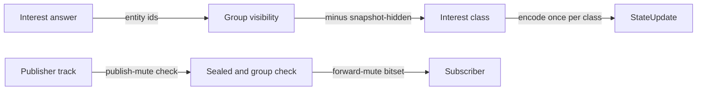

A receiver's game data is the Interest answer for that receiver, intersected with group visibility, minus the snapshot-hidden set. An entity whose ownerSeat belongs to a sealed group reaches only receivers inside that group unless the module's Interest answer for a receiver names it, which is the widening the module may perform. Server-owned entities follow the Interest answer alone. Snapshot-hidden rules apply after the widening and always win.

Interest classes are coarser than seats: a class is the set of receivers sharing one Interest answer, one group-visibility set and one snapshot-hidden set. Spectators share the public class, and observers share one class per subscribed group set. The profile declares maxInterestClasses, default 8, from 1 to maxPlayers + 2; a receiver whose combination would exceed the cap is encoded on its own against a depth-1 ring. Ring sizes belong to "Transports and wire codec".

The media router enforces sealed-group isolation independently of the module's Interest answer. A regroup takes effect for media on the first packet after the tick boundary and for game data in the StateUpdate of that tick. Text chat is a SendChat command addressed to one group and a ChatMessage event to each receiver the text column of the matrix allows, both on the reliable-ordered lane. The session core never writes chat to the event ring, a snapshot or any store.

HostEvents records reach a receiver under the same group visibility as game data. A record filtered out by visibility is a declared source of misprediction, corrected at reconciliation. In lockstep mode a sealed group isolates media and chat only and never game data, because lockstep host events travel unfiltered.

### 7.10 Controls and authority

The Engine exposes a fixed control set. Each control names its issuers, and an issuer outside the table cannot obtain the control by any message.

| Control | Effect | Module | Host | Moderator or admin |
| --- | --- | --- | --- | --- |
| CreateGroup | New group with members and visibility | yes | if listed in hostControls | no |
| MoveToGroup | Replace a player's non-public groups | yes | if listed | no |
| DissolveGroup | Remove a group; members keep their other groups | yes | if listed | no |
| SetMute | Write the mute matrix | yes | if listed | yes, any session in the region |
| SetVisibility | Change an observer's hidden flag and allow-list | yes | if listed | no |
| Kick | Move a player to left with reason kicked | yes | if listed | yes, any session in the region |
| EndSession | End at the next tick boundary | yes, as EndAt | if listed | yes, any session in the region |
| TransferHost | Move the host flag | yes | if listed | no |

The module issues every control through its session context; a module command takes effect at the next tick boundary and does not pass through OnControl. hostControls defaults to SetMute, Kick and TransferHost; a classroom or werewolf profile lists the group controls it hands to the host. The Engine's operator endpoint, a local socket with no network exposure by default, may end or drain sessions; an operator end is End with reason operator, not a controller command.

A moderator or admin reaches a session only through a control ticket. Inspector issues it through IssueControlTicket after verifying the credential, signs a grant naming the session and the controls, limits it to 60 seconds and single use per engine. The Engine verifies only tickets, never credentials. A control attachment receives command results only, never state, rosters or media; observing a session requires admission as an observer under room rules.

Every host or moderator command passes through the module's OnControl at the next tick boundary, which allows or vetoes it with a reason. The decision becomes a control host event carrying the controller, the command and the decision, and an allowed command takes effect at the following boundary. A command from an issuer without the grant is rejected with control-forbidden, counted and never reaches OnControl.

The host flag is assigned at Init to the room owner's SessionPlayer when one exists, and otherwise by the hostMigration policy at the first admission. When the host leaves and does not return within the resume window, the flag transfers by hostMigration. longest-connected, the default, picks the active player or observer with the lowest joinedAtTick and then the lowest seat. module leaves the flag unassigned until the module issues TransferHost, and none leaves the session without a host. Spectators never receive the flag.

### 7.11 SessionEvent

A SessionEvent records one fact of one session: sessionId, ownerEpoch, seq, tick, kind, actor and a closed payload per kind. Its identity is sessionId + ownerEpoch + seq, so an adopter that continues the sequence under a new epoch never collides with a fenced predecessor. seq increases by one per event within a session; the adopter continues from the event sequence offloaded with the snapshot.

| Kind | Produced when | Host event | Payload |
| --- | --- | --- | --- |
| admitted | AdmitPlayer accepted | yes | playerId, role |
| joined | OnJoin accepted, including rejoin | yes | playerId, seat or viewerIndex, isRejoin |
| left | Player entered left | yes | playerId, reason |
| grouped | A group change applied | yes | playerId, groupIds |
| control | A controller command reached OnControl | yes | controller, command, decision allow or veto |
| entitlement | EntitlementUpdated delivered | yes | playerId, features |
| inventory | A ledger request completed | yes | requestId, outcome |
| rate | Tick rate stepped | yes | tickRate |
| scheduled | A Schedule command fell due | yes | token |
| muted | Publish-mute or forward-mute changed | no | target, medium, rule |
| recording | A recording started, stopped or declared a gap, before the first captured frame | no | recordingId, scope, state started, stopped or gapped, reason |
| custom | Module Emit | no | Module-defined in the extension domain |
| result | End returned a result | no | result digest, point deltas |
| ended | Session reached a terminal state | no | finalState, reason |
| gap | Events were lost to a full ring or an unavailable sink | no | first and last missing seq |

Host events reach the session object stamped with the tick at which they apply, before that tick's Tick, in canonical order: host events in seq order, then inputs in sequence order per seat with seats ascending. The same records reach client runners through HostEvents under group visibility, so a replayed tick reproduces the server's order. A payload larger than 4 KiB is refused and counted; the module receives no partial event.

### 7.12 Event ring

Each session holds one event ring of **1024 entries** of at most 4 KiB, bounded at 4 MiB per session and allocated at Init. The ring serves late-joiner catch-up, reconnect resync and HostEvents delivery in every deployment, and feeds the integration flusher only when a consumer is declared (see "Integration bus"). The tick never waits on the ring or the flusher.

When the ring is full the oldest custom entry is displaced first, then the oldest lifecycle or host entry; a result entry is never displaced. A displaced entry not yet flushed to a declared consumer produces a gap event. A client whose last authoritative tick precedes the oldest retained host event receives a full snapshot of its interest classes instead of a partial catch-up.

The ring is not part of the snapshot. An adopter starts with an empty ring and the offloaded event sequence, so every client resuming after adoption resyncs from a full snapshot. With no consumer declared, Emit is a one-branch no-op: custom events never enter the ring, and nothing is appended outside process memory. At session end the ring is zero-filled before its memory returns to the pool.

### 7.13 Optional services and traceless mode

Profiles adds member principals and the moderator and admin roles; without it every principal is a guest, IssueControlTicket answers forbidden and moderator controls do not exist. Statistics receives SessionEvents through the integration bus and marks a session's trace partial after a gap; without it events leave the ring only toward participants. Payment adds entitlement host events; without it, the entitlement source answers role defaults and no entitlement event occurs. Inventory adds inventory outcomes; without it Consume and Grant complete with inventory-absent.

Recording adds a hidden recorder: a subscriber bound to a group with observer semantics, receiving each packet after the forward decision, so a group recording contains exactly what that group could hear. The recorder never appears in a roster, and it is never a secret: the room's recording setting is visible to every member before join. Without Recording no recorder and no capture buffer exist.

In traceless mode the null sink is the only integration adapter, so no custom event enters the ring and no SessionEvent leaves process memory. No replay file is written. Start is refused when debug logging or a per-session debug flag is configured without privacy.debugAllowed=true; with it, a warning prints at start. Log lines carry sessionId and roomId only as keyed digests. Roster, ring, snapshot and media buffers are zero-filled at session end (see "Anonymous traceless mode").

### 7.14 Conformance

1. A session that reaches a terminal state never accepts another input, control or Attach.
2. A room that starts a session after one ended receives a different sessionId.
3. A client discards a projection whose revision is not higher than the highest it holds for the same session and epoch.
4. A frame carrying an epoch lower than the highest seen by the client is refused.
5. A session whose last player and last observer leave ends 60 seconds later with the default profile, and a session holding only spectators ends the same way.
6. A session reaching maxSessionSeconds calls End at the next tick boundary.
7. A session object trap ends that session with faulted and an abandoned result while every other session on the engine keeps ticking.
8. A suspended session refuses inputs and controls with session-suspended, keeps forwarding audio and forwards no video.
9. An Attach that would raise occupied seats above maxPlayers is rejected with room-full even when Inspector issued the ticket.
10. A player Attach under lateJoin none after the first active tick is rejected with late-join-closed, while a spectator Attach under the cap succeeds.
11. A disconnected player that returns inside the resume window keeps its seat and produces a joined event with isRejoin=true and no left event.
12. A disconnected player that returns after the resume window is refused with its old resume token.
13. A kicked player can be re-admitted under the late-join policy and cannot be re-admitted after BlockInRoom.
14. A late joiner receives a full snapshot of its interest classes followed by the HostEvents of later ticks.
15. A spectator with spectatorDelay above 0 receives state delayed by that amount and no player media.
16. A group command issued during tick t is visible to the session object as a grouped host event before Tick t + 1 and not earlier.
17. After a sealed group is created, no audio, video or chat packet from a member reaches a non-member, and no packet from a non-member reaches a member except through an observer's forward rule.
18. A seat-to-seat allow rule overrides a group-to-group deny rule for open groups and never crosses a sealed boundary for audio, video or text.
19. Two rules of equal specificity that conflict resolve to deny.
20. A forward-muted source receives no message, roster change or HostEvents record that reveals the rule.
21. An input-muted player's inputs are dropped with outcome dropped and ackInputSequence still advances past them.
22. A snapshot-hidden entity leaves the target's world through an explicit removal entry.
23. A participant in a group observed by a hidden observer receives no roster entry, HostEvents record, presence change or media from the observer.
24. An observer's forward rule into an observed sealed group delivers its audio to that group only.
25. A lockstep profile declaring snapshot-hidden is refused by the validator.
26. A host or moderator command without the grant is rejected with control-forbidden and never reaches OnControl.
27. A vetoed command changes nothing and produces a control host event with decision veto.
28. In the Minimal profile IssueControlTicket returns forbidden for every principal.
29. A control ticket reused on the same engine is refused.
30. When the host leaves and does not return within the resume window, longest-connected transfers the flag to the active player or observer with the lowest joinedAtTick.
31. An adopter continues SessionEvent seq under the new epoch, and no two events of one session share sessionId + ownerEpoch + seq.
32. A full ring displaces custom entries before lifecycle or host entries and never displaces a result entry.
33. A client resuming after adoption receives a full snapshot, not a ring catch-up.
34. In the Minimal profile a session with 4 guests, groups and audio produces no SessionEvent outside process memory and no custom ring entry.
35. With Recording present a group recording contains no packet that a member of that group could not receive.
36. An Attach whose ticket binds a message id that has not passed saga verification creates no SessionPlayer in joining and is refused with saga-incomplete when the verification wait lapses.
37. A committed LeaveRoom of a disconnected seated player releases the seat at the next tick boundary, before the resume window lapses.
38. An operator end through the operator endpoint ends the session at the next tick boundary with reason operator and passes through no OnControl.

## 8. Engine node, lease, epoch, placement and capacity

An engine node is one Engine process registered in one region under an engineId and an incarnation. Inspector owns the engine registry, the placement of sessions, capacity reservations and the session index. The owner Engine holds a session lease while it renews it, and proves ownership with the epoch on every write outside its own memory. This section defines registration, heartbeat, the engine inbox, capacity accounting, pressure, placement, the owner lease and its epoch, drain, the restart of a session on another engine and the move of a growing session to a free engine. It does not define the tick loop, the snapshot envelope or the steps of a planned-restart handoff; those belong to "Engine runtime". Key layouts, routing tags and procedure atomicity belong to "Inspector", and this section uses the procedure names defined there.

Every mechanism here runs on the coordination store alone, the topic role and the queue role of "Integration bus" included. The Minimal profile (Socket + Inspector + Engine + one coordination store, guests only) therefore has the complete behavior. Every record it writes is a key with a lifetime. Optional services change only the media charge of a recorded room, the drain counters and Flush, the requirements a move target satisfies and, with Payment, the feature list of re-minted tickets. A broker adapter, when declared for the service topics, carries the inbox and fleet topics and their queues, as "Optional services and the Minimal profile" states.

### 8.1 Engine identity and registration

engineId is an opaque, bounded identifier configured per node. It names a placement target, not a process, and stays the same across restarts of the Engine on that node. incarnation is a decimal counter that names one process lifetime of that engineId. A cold start takes its incarnation from the wall clock in milliseconds at process start. A successor of a planned restart takes the predecessor's incarnation + 1, read over the handoff socket. An incarnation is never parsed for time and never compared across engineIds.

RegisterEngine runs the engine_register procedure. Its inputs are engineId, regionId, clusterId, incarnation, state (ready or successor) and the declared capacity (capacityClass, capacityUnits, egressMbps, mediaUnits, memoryBytes). They also carry the addresses per transport, the enabled transports, the relay flag, the game builds the image carries, the mode and a digest of the placement group. A mode or digest that differs from Inspector's is refused with configuration-invalid, and the Engine logs at error and stays not ready (see "Anonymous traceless mode"). Placement messages reach the Engine on the queue channel through its inbox topic {bus:G:engine:E}, so registration carries no address for it. Its output is generation, a registration counter kept for diagnostics. generation is a counter, not authority: no fencing or adoption rule reads it.

| Stored registry record | Caller | Outcome |
| --- | --- | --- |
| Absent | Any incarnation, state ready | Accepted; record created with state ready and a 15-second lifetime; engine added to the region set scored by free units |
| Present, same incarnation | Same incarnation | Accepted as re-registration; declared capacity and addresses replaced; session list kept |
| Present, no open handoff window | State successor, incarnation = stored + 1 | Accepted; successorIncarnation and handoffUntil = store time + 30 seconds recorded; stored incarnation unchanged until the window closes |
| Any other combination | Any | Refused with duplicate-incarnation |
| Any | regionId absent from the region directory | Refused with region-unknown |

A cold start refused with duplicate-incarnation retries at every heartbeat interval until the stored record expires, which happens at most 15 seconds after the predecessor's last heartbeat. Two live processes with one engineId therefore cannot both register: the second one logs the refusal at error and never becomes ready. Readiness is true only after an accepted registration and, for a successor, only after its heartbeat closed the handoff window. An Engine accepts no PlaceSession and no attachment before its registration is accepted.

The Engine executes RegisterEngine, Heartbeat and the session-key procedures directly against the coordination store, using the versioned procedure library that "Inspector" defines. A not-loaded error, which an ephemeral store returns after any restart, makes the Engine load the same versioned library and retry once. A missing procedure is never bypassed by a client-side read-modify-write.

### 8.2 Heartbeat and the engine registry

Heartbeat runs the engine_heartbeat procedure every 5 seconds. Its inputs are engineId, incarnation, state, usedUnits, usedMemoryBytes, usedEgress, the pressure state (normal or pressured), the flag mediaFull and the session list. The session list holds sessionId, epoch and state for every session the Engine keeps in RAM under a lease it holds or is reacquiring. A move source also lists the frozen copy of a session it handed over, until the index shows migration_complete or 30 seconds after the handover. The output is ok with the drain flag and drain mode when Inspector set them through DrainEngine; the errors are stale-incarnation and not-registered.

Each accepted heartbeat renews the registry record for 15 seconds and the engine's score and the region set for 60 seconds. During an open handoff window the procedure accepts both incarnations and stores the union of their session lists. The first successor heartbeat reporting state ready after the last transfer closes the window: the stored incarnation becomes the successor's and successorIncarnation is cleared. A heartbeat of any other incarnation is answered with stale-incarnation from then on. A window that reaches handoffUntil without closing ends the same way for the successor, which exits non-zero as "Engine runtime" requires.

The session list is the acknowledgement that a placement took effect. A placement message Inspector sent is complete when the engine's heartbeat lists the session, not when a PlacementReply arrived. A failed heartbeat is retried at the next interval, never queued as a backlog. A missed heartbeat never fences a session; only the lease deadline does. Liveness of the Engine comes from the age of its heartbeat loop, not from store acceptance, so a store outage never makes the orchestrator kill a healthy Engine.

A heartbeat answered with not-registered means the record expired, through an engine-to-store partition longer than 15 seconds or through a store restart that lost its dataset. The Engine registers again with the same incarnation and heartbeats at once. After a dataset loss it also runs index_restore for every session whose index is absent, so the reconciler finds no orphan. index_restore is refused with exists-with-higher-epoch when an adopter already owns the session.

A heartbeat answered with stale-incarnation retires the Engine, unless it holds no session. A retired Engine never renews or reacquires a lease again. It hands every session whose self-fence deadline has not passed to MigrateSession after a synchronous snapshot, drops every other session with superseded and exits with a non-zero code. An Engine that holds no session and receives stale-incarnation exits with code 0, which is the normal end of a handoff predecessor.

Reconcile prunes expired engines from the region set every 5 seconds. The region set is an eventually consistent view for candidate ordering; the authoritative capacity check is engine_reserve against the registry record.

### 8.3 Engine inbox and per-player sagas

Each engine consumes its inbox queue, bound with binding mode fan-out to its inbox topic {bus:G:engine:E}, under the topic role and the queue role of "Integration bus". Producers publish only to the inbox topic, and the engine reads only from its inbox queue. The inbox carries the placement messages (PlaceSession, EntitlementUpdated and Drain), the per-player messages of the join saga (PlayerJoining, PlayerLeaving and PlayerRegrouped) and the move messages MigrationClaimed and ClaimAssigned. Delivery is at-least-once and unordered: a duplicate, a reordered pair or a redelivery after a restart is normal operation, never a fault. Every Consume renews the inbox queue's idle expiry, and the queue and its binding expire 60 seconds after the engine's last Consume (see "Access and declaration"). Both incarnations consume the inbox during an open handoff window, as "Engine runtime" defines for restart class A.

A message is a trigger, not an outcome; the coordination store holds the outcome. For a per-player message the engine parks it in its pending set, takes the player's lock and compares the saga record with every message id it received. It admits the attachment only after that verification passes, under the join saga of "Inspector" and the verification step of "Engine runtime". The engine writes nothing under a player's lock; its hold is a read with a target below 10 ms. Per engine the pending set holds at most 4096 messages, the oldest refused with saga-incomplete when it is full, and the applied-id set holds 65,536 ids for 10 minutes. The applied-id set is a fast path, not the correctness rule: the fence comparison decides, so evicting an id changes no outcome.

A message for a session this engine does not hold is redirected, never dropped. The engine republishes it with the same messageId and hop + 1 to the inbox of the holder the session index names, or of the claim target while placement is migrating. It acknowledges the delivery only after that Publish is accepted. It nacks the message with a 1-second delay when the placement is orphaned, and a fourth redirect dead-letters it to the dead-letter queue of the inbox queue. When the reconciler prunes an expired engine, it consumes that engine's inbox queue to exhaustion before the queue expires. It republishes its messages to the holders by sessionId with unchanged messageIds, so a crashed engine strands no join.

### 8.4 Engine node states

The node state machine below is the Engine's own view; the registry record stores ready, draining or drained and the handoff fields.

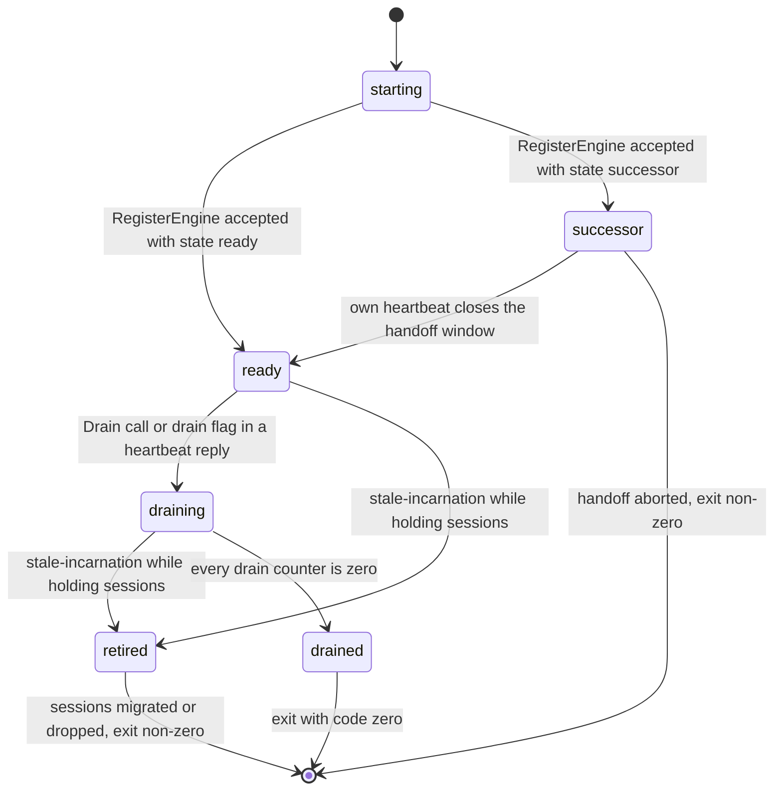

Only a ready Engine accepts PlaceSession; a draining Engine refuses it with draining and engine_reserve refuses a draining record. A draining Engine keeps serving its sessions, admitting players into them under the profile's join policy and accepting rejoins. drained is reported only when activeSessions, pendingSnapshots, openRecordingSegments and pendingSinkBatches are all zero. The predecessor of a successful handoff reaches drained when its last session is transferred and stops heartbeating. pressure and mediaFull are fields on the record, not node states. pressure runs its own normal → pressured → normal cycle, defined in "Pressure and growing sessions", and changes placement order and whether the Engine offers or claims a move. mediaFull changes media eligibility. Neither changes what the Engine serves.

### 8.5 Capacity units and session charges

A capacity unit is 1% of one reference core, so one reference core is 100 units. Each Engine declares capacityUnits, egressMbps, mediaUnits and memoryBytes from a load test of its instance type. capacityUnits is the minimum of the processor-, memory- and egress-derived figures of that test. mediaUnits is the part of capacityUnits that media down-tracks and relay allocations may hold together. Declared figures are starting values, not advertised capacity; operators publish no figure before their own load test.

| Charge | Formula | Worked default | Charged against |
| --- | --- | --- | --- |
| Simulation | tickRate ÷ 60 × (6 + 0.12 × seats) units | 16 seats at 60 Hz: about 8 units; 64 seats at 20 Hz: about 4.6 units | capacityUnits |
| Audio down-track | 0.1 units each | 10 talkers each heard by 9 others: 90 down-tracks, 9 units | capacityUnits and mediaUnits |
| Video down-track at 720p | 0.4 units each | 1 teacher video to 29 receivers: 29 down-tracks, 11.6 units | capacityUnits and mediaUnits |
| Relay allocation | 0.2 units per Mbit/s of its ceiling | default 4 Mbit/s ceiling: 0.8 units | capacityUnits and mediaUnits; bytes against a 30% relay share of egressMbps |
| Memory | 256 KiB + 64 KiB per seat + baseline rings + event ring (4 MiB) + spectator delay ring + module state + sandboxMemory | 16 seats at 60 Hz, one interest class: about 6.25 MiB before module state (see "Memory budget per session" in "Performance and memory budgets"); sandboxed session adds 64 MiB by default | memoryBytes, in bytes |

seats in the simulation formula counts the occupied seats and viewer slots at the moment of measurement, never maxPlayers. Placement charges a new session at the room's occupancy plus a growth reserve of 25% of the occupied seats, at least 2 seats. An adoption charges the occupancy of the players hash plus the same reserve. A reservation at maxPlayers would idle most of a fleet, so growth beyond the reserve is what "Pressure and growing sessions" handles. The media charge is the down-track budget of the profile's media policy, charged in full at placement. Relay allocations are charged when an attachment allocates them and released with the attachment. A session's charge is the greater of its placement charge and its weight at the last sample. It rises with occupancy and never falls below the placement charge, so a lower tick rate after lag degradation or an emptier roster frees nothing. seats in the memory formula stays maxPlayers, because the session's arenas are sized at Init. Memory is reserved in bytes against memoryBytes and is never converted to units. The memory estimate uses the maximum encoded size of the declared state schema; the components of the memory formula are defined in "Performance and memory budgets".

usedUnits in a heartbeat is the greater of the summed charges of the sessions the Engine holds and its measured processor use in units. usedMemoryBytes is the greater of the summed memory charges and the measured resident memory. usedEgress is measured over the last heartbeat interval. An under-declared session weight therefore costs capacity instead of over-admitting.

An Engine refuses new work at 90% and enters pressured state at 80%, under the hysteresis of "Pressure and growing sessions". engine_reserve refuses a session when usedUnits + reservedUnits + its charge exceeds 90% of capacityUnits. It also refuses when usedMemoryBytes + reservedMemoryBytes + the memory charge exceeds 90% of memoryBytes, and while usedEgress exceeds 90% of egressMbps. Egress is measured, not reserved. Pressure triggers a session move, not a refusal; the scale-up signal of "Clustering, regions and deployment" is units or egress above 80% or any bound session. The Engine sets mediaFull when media and relay charges exceed 90% of mediaUnits or relay bytes exceed the 30% relay share. Inspector then skips the engine for sessions with a media policy, and the relay refuses new allocations with relay-capacity.

Capacity classes group instance types so a profile can name the class it needs. These figures are starting values to load test, not guarantees.

| Capacity class | Sessions and seats | Egress | Media down-tracks | Relay allocations |
| --- | --- | --- | --- | --- |
| small | 64 sessions, 512 seats | 50 Mbit/s | 1000 | 512 |
| medium | 256 sessions, 4096 seats | 500 Mbit/s | measured before publication | measured before publication |
| large | measured before publication | measured before publication | measured before publication | measured before publication |

An Engine refuses a session that would exceed its class's session or seat count, even below the unit threshold. A profile whose single session exceeds every class of the region is refused at placement with no-capacity.

### 8.6 Reservation and allocation

A reservation is a claim that expires; an allocation is a charge tied to a session the Engine holds. engine_reserve writes a reservation field keyed by sessionId with the units and bytes of the charge and a 30-second expiry. The field counts in reservedUnits and reservedMemoryBytes. A reservation never makes a session run; it only keeps two concurrent placements from spending the same free units.

engine_confirm marks the field confirmed and restarts its 30-second expiry. engine_heartbeat removes a reserved or confirmed field whose session appears in the heartbeat's session list, because from that heartbeat on the charge is part of the reported usedUnits. The charge is therefore counted exactly once at every instant: in reservedUnits until the Engine lists the session, then in usedUnits. A confirmed field whose session is never listed expires 30 seconds after confirmation, which matches the report deadline under which Inspector marks such a session failed.

engine_release removes a reservation or ends an allocation. The Engine stops counting a charge when its session leaves RAM for any reason. An engine_confirm that finds no field fails with reservation-unknown, and the saga compensates and restarts at candidate selection. When the registry record expires, every reservation and allocation of that engine expires with it; capacity is never leaked by a crashed engine.

### 8.7 Placement

Inspector places a session when StartSession allocates it and when Adopt restarts it elsewhere. Placement chooses one engine in the room's home region; a session never leaves its region and nothing re-homes silently.

1. Inspector reads the region set and takes the engines in score order. An engine whose registry record has expired is skipped even when the set still lists it.
2. Inspector keeps an engine only when it is ready, its capacity class holds the profile, it offers every transport the profile requires and it carries the session's gameBuild. For a session with a media policy, mediaFull must also be clear. For an adoption, an engine carrying the snapshot's build is preferred over one that would need Upgrade.
3. Normal engines come before pressured ones, and within each group engines of the requester's cluster come first. When the game profile asks for isolation, the cluster holding the fewest sessions of that gameId in the region comes first instead.
4. Within that order the strategy decides. placement.strategy=packed, the default, takes the engine with the least free units that still exceed the session's charge; placement.strategy=spread takes the engine with the most free units. Ties are broken by engineId order, so a placement is reproducible from the same registry state.
5. Inspector runs engine_reserve on the first candidate. A refusal moves to the next candidate; each candidate is tried at most once per attempt.
6. When the candidates are exhausted, StartSession fails with no-capacity and an adoption leaves the placement orphaned until the next reconciler period.

StartSession = engine_reserve → session_create → engine_confirm → room_attach_session → PlaceSession(allocate). session_create writes the index with epoch "1" and the lease for the placing engine. A failure after session_create runs lease_release with state failed and engine_release. Adopt = engine_reserve → lease_acquire → PlaceSession(adopt, snapshotRevision) → snapshot load. A refusal of PlaceSession (artifact-unavailable, build-unknown, no-capacity, draining, upgrade-required or stale-epoch) runs lease_release with placement orphaned and engine_release, and the reconciler retries at its next period.

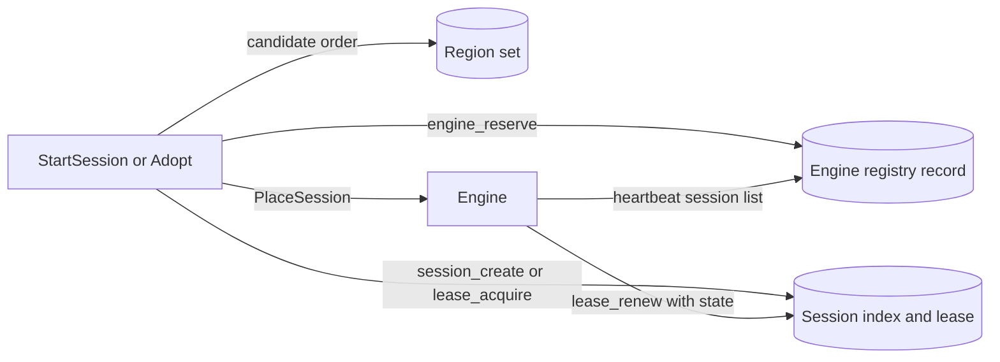

A placement message the Engine does not answer within 5 seconds is republished with the same messageId, the same arguments and the same epoch, never reissued with a new epoch. A PlacementReply is a hint; the heartbeat session list remains the acknowledgement. PlaceSession is idempotent for a session the Engine already holds at that epoch. An Engine that holds the session at a higher epoch refuses with stale-epoch.

### 8.8 Owner lease and epoch

The lease of a session is a string holding engineId + incarnation + epoch with a lifetime of 15 seconds. The epoch lives in the session index, not in the lease, so it survives lease expiry. It starts at "1" in session_create and advances only in lease_acquire, by exactly one. It is a decimal string counter of at most 19 digits, and overflow fails the acquisition instead of wrapping. A planned restart of class A keeps the epoch: lease_transfer changes the incarnation only.

Fencing is the correctness mechanism and the lease is the efficiency mechanism. A live lease is a hint about who owns the session, not authority to write. Every Engine write to a session key compares the caller's epoch and holder (engineId + incarnation) with the index and is rejected with stale-epoch on a mismatch. Every ticket, snapshot, journal batch, sink event and session message carries the epoch, and clients refuse frames whose epoch is lower than the highest they have seen.

| Procedure | Precondition | Effect | Errors |
| --- | --- | --- | --- |
| session_create | No index for the session | Index with epoch "1", holder and state allocating; lease for the placing engine | already-active |
| lease_renew | Live lease names the caller's engineId, incarnation and epoch | Lifetime restarted at store time; owner's state and tick written to the index | lease-lost |
| lease_reacquire | No live lease; index epoch and holder equal the caller | New lease with the same epoch | lease-lost |
| lease_acquire | No live lease, or a live lease already naming the caller at the index epoch; while placement is migrating, only the engine the live claim names, after that claim lapsed the handover source, and any adopter once the source's registry record expired or its heartbeat no longer lists the session | Index epoch + 1, holder replaced, placement placed, except for the claim target, whose placement stays migrating until migration_complete; repeated call by that holder returns the same epoch | lease-held, session-unknown, claim-lost |
| lease_transfer | Live lease with the caller's engineId and epoch; caller is the recorded successorIncarnation inside the handoff window | Lease and index holder take the new incarnation; epoch unchanged | lease-lost, stale-incarnation |
| lease_release | Caller's epoch and holder equal the index | Lease deleted; final state or placement written; snapshot and journal deleted when the state is ended | stale-epoch |
| snapshot_commit, journal_append | Caller's epoch and holder equal the index; snapshot revision greater than stored; placement not migrating | Snapshot or batch stored; index tick and revision updated | stale-epoch, stale-revision, session-moving |

session_create, lease_acquire, lease_transfer and lease_release are ownership writes: each waits for one replica acknowledgement within a 500 ms budget. lease_renew, heartbeats and presence never wait. A replica acknowledgement that times out returns retryable-unavailable whether or not the write took effect. Callers retry the same procedure with the same arguments and epoch, which the idempotent forms in the table make safe. An acknowledged write can still be lost on store failover. Such a loss resolves either toward a fresh adoption at a higher epoch or back to the previous holder at its epoch, and never toward two accepted holders at one epoch, because every write checks holder and epoch. When the loss rolls the index back, clients and the Socket routing cache can still hold the lost adopter's higher ownerEpoch. The ownerEpoch of an admission ticket Inspector signed from the primary replaces the highest epoch held for that session, even when lower, so clients re-attach to the reacquiring holder through a fresh Admit.

Adoption is possible only when the lease key has expired and either the owner's registry record has expired or the owner's heartbeat no longer lists the session. The registry condition covers a renewal that the store acknowledged and then lost on failover. The owner still heartbeats and lists the session, so no adopter takes it; its next renewal fails with lease-lost and its lease_reacquire succeeds at the same epoch. With both conditions required, no interval exists in which one engine acts as owner while another holds the lease. A move is the one other path to a new holder. The owner releases the lease explicitly through lease_handover after its final snapshot, and lease_acquire then admits only the claim target. The explicit release replaces the expiry condition and the epoch still advances only in lease_acquire. This holds while the store hosts' clocks satisfy the precondition of "Store-time expiry, safety margin and self-fencing".

### 8.9 Store-time expiry, safety margin and self-fencing

Every lifetime in this section is measured by the store, on the store's clock, from the instant the store executes the write. No process computes another process's expiry, and Inspector judges a lease or a registry record expired only by its absence from the store. Inspector-enforced deadlines (reservation expiry, the handoff window, the report deadline, the no-capacity deadline, the offer lifetime, the claim deadlines and the move cooldown) use the store's time read inside the procedure. The clock of an Inspector process is never consulted.

The owner never learns the store-side expiry instant; it knows only when it sent its own requests. Its self-fence deadline is therefore measured from the send instant of the last successful request that set the lease. Those requests are session_create, lease_acquire, lease_reacquire, lease_renew and lease_transfer. Default lease: **15 seconds**; renew every 5 seconds; self-fence at 12 seconds. Renewal is lease ÷ 3 and the fence is 0.8 × lease. Because the send instant precedes the store's execution, the owner's deadline precedes the store-side expiry by at least the 3-second safety margin plus the request latency.

The owner measures the deadline on a monotonic clock that keeps advancing while the process is paused and while the host is suspended. A clock that stops during host suspension is invalid here: a resumed process would act on an expired lease. The margin covers the rate difference between the owner's and the store's clocks, the delay between a deadline check and the write it guards and a wall-clock difference between store hosts after failover. The precondition of exclusive ownership is that replicated store hosts keep their wall clocks within the safety margin of each other. Beyond it a lease can expire early and two engines can simulate one session briefly. The epoch and holder check still rejects every store write of the superseded holder. No guarantee is made that frames it sent before fencing disappear.

The owner checks the deadline at the start of every tick and before every write outside its memory: every store procedure, every sink publication and every outbound state frame. A failed renewal is retried every 1 second until it succeeds. A lease_renew answered with lease-lost is followed at once by one lease_reacquire. Reaching the deadline moves the session to suspended without any external signal. A paused process detects the deadline on its first tick after resuming, before any write.

A suspended session refuses inputs with session-suspended, stops outbound state, keeps forwarding audio and keeps its state in RAM. It writes nothing for the session except lease_renew and lease_reacquire attempts, and ReportSessionEnded retries for a session that reached ending, which Inspector checks by epoch. A successful renewal or reacquisition resumes the session within one tick at the same epoch. A lease_reacquire answered with lease-lost means an adopter owns the session: the copy is dropped with superseded, released in one Close and removed from the heartbeat list. Outside traceless mode the Engine may write that copy as a forensic snapshot to a configured local path; in traceless mode it never does.

Lease slack is the time left until the self-fence deadline at the instant a renewal succeeds; it is about 7 seconds under the defaults. A renewal with slack below 3 seconds is logged at warn and alerted; a self-fence and every stale-epoch rejection are logged at error. The lease lifetime is an installation setting, and renewal and fence are derived from it. The validate command refuses a lease below 10 seconds, where the margin falls to 2 seconds.

### 8.10 Drain

Drain removes an engine from placement and ends with an exit that no session notices beyond its stated pause. DrainEngine(engineId, mode) at Inspector sets the drain flag, which the next heartbeat reply delivers. Drain(mode) on the queue channel or on the Engine's local operator endpoint, which the orchestrator's pre-stop hook calls, enters draining directly. Both return ok with the engine's session count; a second call while draining returns already-draining and leaves the mode unchanged, and an unknown mode returns mode-unknown.

| drain.mode | Sessions | Client-visible effect | Ends when |
| --- | --- | --- | --- |
| wait (default) | Run until they end; at the drain budget of 600 seconds the rest migrate | None until the budget; then a migrate pause | Every counter is zero |
| migrate | Each moves through the fenced transfer of a session move to a target Inspector assigns at once through MigrateSession, with a final snapshot at the frozen tick | Pause with a 2-second target; AttachRedirect to the target; resync at a new epoch | Every counter is zero |
| handoff | Move to a same-host successor by class A as "Engine runtime" defines | Per-transport result of "Engine runtime"; epoch unchanged | Every session transferred |

1. The pre-stop hook or DrainEngine starts the drain. The Engine reports draining in its next heartbeat, and Inspector stops placing on it within one heartbeat interval; this permits step 2.
2. The Engine refuses PlaceSession with draining and keeps serving, admitting and accepting rejoins for the sessions it holds. Step 3 starts at once.
3. Sessions leave by the mode. In handoff mode the remaining sessions turn to migrate mode on any of three events: no successor announcement within 30 seconds, an aborted handoff or a handoff past its 20-second node bound. Migrate snapshots share the offload bound of 64 writes in flight per node.
4. The Engine reports drained only when activeSessions, pendingSnapshots, openRecordingSegments and pendingSinkBatches are all zero. It logs the drain certificate at info with engineId, incarnation, mode, the four counters, forced migrations and drain duration.
5. The process exits with code 0. Sessions migrated at budget expiry, by a handoff fallback or by retirement are counted as forced-migration and alerted.

A finite termination grace cannot prove that sessions finished; the drain certificate and the forced-migration counter are the evidence. Termination grace equals the drain budget plus 30 seconds, except on the Docker Swarm reference adapter of the container orchestrator role, whose stop grace equals the drain budget (see "Reference deployments"). A kill at grace expiry is a crash and recovers by adoption. Scaling down removes only an engine that reported drained, never one holding sessions. MigrateSession cannot run while the store is unavailable. A draining engine then keeps its sessions under the lease rules and never reports drained with a session in RAM.

A draining Engine, an Engine in a handoff window and a successor incarnation neither offer nor claim a move. Drain cancels the node's unclaimed offers through migration_cancel and lets a claimed move finish before a handoff starts. That costs at most the 5-second ready deadline plus the 5-second hard bound of "Session move". A class A handoff keeps the engineId and the epoch and needs no move; migrate mode, MigrateSession and pressure all use the one transfer of "Session move".

### 8.11 Restarting a session on another engine

A room survives the loss of its engine because the room lives in the coordination store; its session survives because its snapshot and players hash do. Adoption restarts the same session, with the same sessionId and seats, on another engine at a higher epoch. It never creates a new session for the room. Ended sessions never recover.

| Trigger | Who starts the adoption | Epoch | State loss bound |
| --- | --- | --- | --- |
| Engine crash | Reconciler, once the lease and registry conditions hold | + 1 | One snapshot interval, or one journal batch with snapshot-and-journal |
| Engine-only partition | Reconciler; the isolated copy is dropped with superseded | + 1 | Same as a crash |
| Client rejoin that finds the conditions met | Inspector at Admit, without waiting for the reconciler period | + 1 | Same as a crash |
| Drain in migrate mode, budget expiry or retirement | Owner through MigrateSession; Inspector assigns the target at once | + 1 | No accepted input lost |
| Pressure on the owner's node | Free engine through migration_claim, or the reconciler on its behalf | + 1 | No accepted input lost; inputs after the freeze resent by clients |
| Planned restart with a same-host successor | No adoption; lease_transfer | Unchanged | No accepted input lost |

MigrateSession(sessionId, engineId, epoch) → claimId opens a move whose target Inspector assigns at once, without an offer round or a claim delay, and the transfer of "Session move" runs from its first step. no-capacity leaves the session running on the draining engine until its drain budget. The engine then commits a final snapshot and releases the lease with placement orphaned, which clients see as recovering. The reconciler marks a placement orphaned when it finds the adoption conditions met and runs Adopt in the same period. The index records the store time of the transition, which starts the no-capacity deadline.

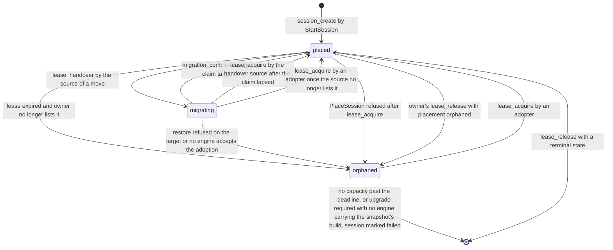

On PlaceSession(adopt) the adopter loads the last committed snapshot and verifies its checksum and snapshotSchemaHash. A differing hash calls Upgrade, and a module that cannot upgrade makes the adopter refuse with upgrade-required. The adopter restores the session, replays the journal when present and advances the sequence watermarks so replayed inputs are ignored. It then enters active and reports the state through lease_renew; until then the session is in loading. Clients see recovering while the placement is orphaned or migrating or the adopter is loading. They reconnect with their resume token, keep their seat within the 120-second resume window and see a resync at the new epoch, never a leave and a join. After upgrade-required the reconciler prefers an engine carrying the snapshot's build and otherwise marks the session failed with the reason visible to the room.

Inspector writes failed only to a session without a live lease. A session in allocating or loading whose owner has not reported a state within the 30-second report deadline is marked failed. A placement orphaned for 120 seconds because no engine has capacity marks the session failed; the room then resets to its lobby with its members intact. This rule covers an orphaned session only, which has no engine at all; a bound session keeps running, as "Moves without a free engine" states. Inspector never overwrites a state reported by a live owner. The crash re-adoption target is 25 seconds from crash to active elsewhere: 15 seconds of lease, up to 5 seconds of reconciler period, then the load. It is a figure to measure, not a guarantee. Session continuity holds for every trigger and every transport; transport continuity is the per-transport table of "Engine runtime".

### 8.12 Pressure and growing sessions

A session never spans engines in this version. A session that keeps gaining client connections on a node without free capacity therefore moves whole to a free engine or stops admitting new members; it never ends for capacity. The move is pull-based: the loaded engine publishes an unordered pressure message, a free engine claims the session, and the claimant adopts the state the session already offloads to the coordination store.

Each Engine samples every second, per session, its weight in units, memory bytes, egress, media units and attachment count. Per node it samples the used fractions of capacityUnits, egressMbps, mediaUnits and memoryBytes, which are the four pressure dimensions. A session's growth is its weight now minus its weight 30 seconds ago. A session is growing when that growth is at least max(2 units, 10% of its weight), or when it deferred or refused a join in the last 30 seconds. Its projected weight is the weight plus twice the 30-second growth, the next 60 seconds at the measured rate, capped at its weight at maxPlayers + maxSpectators.

Pressure is a per-node state with two values. normal → pressured when any dimension stays at or above 80% for 10 consecutive seconds; pressured → normal when every dimension stays below 70% for 30 consecutive seconds. The 10-point band and the two dwell times are the hysteresis, so a single sample above 80% changes nothing. The 90% refusal of engine_reserve stays the admission limit: pressure starts a move, it never refuses work. The Engine reports its state in the pressure field of every heartbeat, and placement prefers a normal engine over a pressured one for a new session.

### 8.13 Move eligibility and nomination

A session may move only when every condition below holds, and a session that fails one is never offered. Its state is active, never allocating, loading, suspended, ending, handing-off or moving. Its game profile's migratable flag is true, which is the default. Its last snapshot committed within the snapshot interval plus 5 seconds, and its Snapshot bytes were within the 256 KiB cap. Its cooldown has passed: 120 seconds after its last completed move and 30 seconds after its creation. Its engine is neither draining nor in a class A handoff window.

Both durability classes are eligible, because the final snapshot is taken at the frozen tick and no journal batch is lost. A lockstep session is eligible, because every runner restores the full snapshot after re-attach. A session with a sandboxed runner, media or an active recording is eligible when the target satisfies the requirements the offer lists. Eligibility is a property of the session, not of the node's load.

A pressured node without an open offer nominates at most one session per 15 seconds. It nominates the eligible growing session with the highest growth, ties broken by higher weight and then lower sessionId. When the growing session is ineligible, it nominates instead the eligible session whose weight most closely covers the node's excess above 70%, so the growing session gains room on its own node. After an offer lapses unclaimed, the node backs off for that session for 30 seconds, doubling to 120 seconds.

### 8.14 Offer, claim and arbitration

The session index is the authority over a move; the fleet topic carries hints only. The fleet topic {bus:G:fleet} is a topic of the topic role with a 60-second horizon. Every engine and every Inspector instance of the region consumes it through a fleet queue of its own, bound with binding mode fan-out, so each receives a copy of every offer and every capacity notice. No round-robin binding exists on the fleet topic, because every engine judges each offer for itself. Each consumer declares its fleet queue and its binding at start, an engine before RegisterEngine, so a registered engine misses no offer for want of a binding.

migration_offer writes offerId, offerUntil = now + 10 seconds and the excluded engines into the index. excluded holds the previous owner for 300 seconds after a move and every engine whose claim on this session failed in the last 120 seconds. The source then publishes SessionPressure on the fleet topic with messageId = offerId. A Publish answered unavailable is repeated with the same messageId until offerUntil, never under a new one. A claim against an offer the index does not hold fails, whatever the message said.

SessionPressure carries sessionId, ownerEpoch, sourceEngineId, weight, projectedWeight, growth per minute, memoryBytes including sandboxMemory, egress, mediaUnits, relay allocations, snapshotBytes, durabilityClass, excluded and offerUntil. Its requirements are gameBuild, artifact kind, transports, media capabilities, capacity class, clusterId preference and the enabled extension libraries. Its expiresAt equals offerUntil, so a delivery after the offer lapsed is acknowledged unread by the consuming side of the adapter and counted as expired, never handed to a consumer as live.

An engine reading SessionPressure from its fleet queue acknowledges it on receipt, because the fleet topic carries hints. It considers the offer only when it is not pressured, not draining, not in a handoff window, holds no open offer of its own and is not excluded. It must also satisfy every requirement, and its usage after reserving the projected weight must stay at or below 70% in every dimension, which keeps a target out of pressured state by construction. It waits a claim delay of 1000 ms × its highest post-reservation usage fraction plus 0 to 50 ms of jitter, so the freest eligible engine claims first. It then runs engine_reserve on its own registry record for the projected units and memory bytes, followed by migration_claim. The engine keeps the offerIds it considered until their offerUntil and acknowledges a repeated delivery without effect. An evicted id costs at most a migration_claim refused with claim-lost and the release of its reservation, because the index holds one claim per offer. No delivery order changes which claim wins.

The first fenced claim wins. migration_claim is a compare-and-set on the session index that succeeds only while the caller's epoch equals the index epoch, placement is placed, the offer is live and no claim exists. A losing engine releases its reservation at once. The winner publishes MigrationClaimed to the inbox topic of the source, which reads it from its inbox queue and acknowledges it once it compared the claimId with the index. A duplicate, or a claim the index no longer holds, is acknowledged without effect. The source also reads the index every 250 ms while its offer is open, so a lost or delayed MigrationClaimed delays the move by at most 250 ms.

Every Inspector instance keeps the offers read from its fleet queue in memory until their offerUntil. The instance holding the region's reconciler mutex assigns every offer still unclaimed 3 seconds after it was written. It reads the offer from the session index, picks the engine with the most free units that satisfies the requirements and the 70% rule, runs engine_reserve and migration_claim on its behalf and publishes ClaimAssigned to that engine's inbox topic. The assigned engine acknowledges ClaimAssigned once it read the claim from the index, then proceeds as a claimant, or calls migration_cancel with claim-declined when its own state changed. A ClaimAssigned whose claimId the index no longer holds is acknowledged without effect. A SessionPressure accepted and then lost before any delivery, which a failover of the coordination-store stream adapter can cause, lapses unclaimed and unassigned and is handled as an offer for which the reconciler found no candidate. The source re-offers under a new offerId after the backoff of the nomination rule. With an offer lifetime of 10 seconds and a reconciler period of 5 seconds, at least one reconciler pass falls between the third and the eighth second of every offer. Neither the fleet topic nor the reconciler is an authority: exactly one target adopts, because migration_claim and the lease_acquire after it are single-tag compare-and-set operations on one session index.

| Procedure | Precondition | Effect | Errors |
| --- | --- | --- | --- |
| migration_offer | Caller's epoch and holder equal the index; session eligible; no open offer; cooldown passed; in the drain form that MigrateSession writes for a draining or retired holder, the engine-eligibility conditions, the cooldown and the previous-owner exclusion are skipped | offerId, offerUntil and excluded written | stale-epoch, offer-open, cooldown, not-eligible |
| migration_claim | Caller's epoch equals the index epoch; placement placed; offer live; no claim; caller not excluded | claimId, target engineId and incarnation, reservationId and a 5-second claim deadline written | claim-lost, offer-expired, stale-epoch |
| migration_ready | Live claim names the caller | Claim marked ready | claim-lost |
| migration_cancel | Placement placed; caller is the holder, or the claimed engine for outcome claim-declined | Offer or claim cleared with the outcome claim-declined, lapsed, draining, bound or cleared; a failed claimant added to excluded for 120 seconds; bound sets pressure=bound and cleared sets pressure none | none; a mismatch changes nothing |
| lease_handover | Live lease with the caller's engineId and epoch; claim ready | Lease deleted; placement migrating; handoverRevision recorded; claim extended by 5 seconds | stale-epoch, claim-lost |
| migration_complete | Caller holds the lease at the index epoch and is the claim target | Placement placed and holder written; offer and claim cleared; previousOwner and cooldownUntil recorded; pressure=bound cleared | stale-epoch, claim-lost |

### 8.15 Session move

A move is a fenced stop-and-copy: the session stops on the source at a tick boundary and resumes on the target at the same tick from the final snapshot. It reuses the adoption path, so no live state stream and no transport state crosses hosts. The session lease plays the part of the per-player lock, the epoch is the fence, migration_claim and lease_handover are the shared-store steps and SessionMoved is the message. Pressure moves, drain in migrate mode and MigrateSession all run this one transfer.

1. Prepare. The claimant loads the game build and the declared artifact, reserves the sandbox instance, prefetches the latest committed snapshot and calls migration_ready within 5 seconds of the claim. A claim not ready by then lapses; the source cancels it through migration_cancel and re-offers with the claimant excluded. Nothing reaches clients and the source keeps ticking; step 2 starts when the source reads the ready claim.
2. Freeze. At the next tick boundary the source sends SessionMoving(sessionId, ownerEpoch, reason pressure or drain, expectedPauseMs) on the reliable-ordered lane of every attachment and stops ticking. It flushes the session's tap ring with a 250 ms deadline, commits the final snapshot synchronously through snapshot_commit at the frozen tick and calls lease_handover. Step 3 starts when lease_handover answers ok.
3. Adopt. The target calls lease_acquire with its claimId, which advances the epoch from e to e + 1, and loads the snapshot at handoverRevision. Any other revision, a checksum or snapshotSchemaHash mismatch or an artifact failure refuses the move: the target releases the lease with placement orphaned and the reconciler adopts the session. Otherwise the target restores with gapTicks equal to the ticks elapsed since the freeze, builds membership from the store, resumes ticking at the frozen tick, calls migration_complete at epoch e + 1 and engine_confirm, and publishes SessionMoved(sessionId, ownerEpoch e + 1, holderEngineId, claimId) to the Inspector work topic.
4. Re-ticket. Inspector checks that the session index names that holder at that epoch and mints, for every room member holding a seat or viewer slot, an admission ticket bound to claimId with the target's addresses, lanes, relay credential and a fresh secure UDP attachment secret. Socket pushes each ticket to the member's connection as AttachRedirect. The target admits only a player in its roster, matched by the resume token digest; it keeps the seat, increments the attachment generation and sends a full snapshot of the receiver's interest classes. A binding without AttachRedirect 5 seconds after SessionMoving calls Admit itself, which answers session-moving until placement is placed.
5. Retire. The source keeps a tombstone (sessionId → target, epoch e + 1) for 60 seconds from the instant it drops the frozen copy, which answers Attach and datagrams for the session with session-moved and redirects queue messages for it. It keeps listing the frozen copy in its heartbeat, which entitles it to re-acquire after a lapsed claim. It releases the session's units and drops the copy when the index shows migration_complete or 30 seconds after the handover, whichever comes first.

No transport state crosses hosts. A WebSocket attachment re-attaches on a new gateway stream that Socket routes by the new placement, a secure UDP attachment uses the fresh attachment secret, and a WebRTC attachment opens a new peer connection to the target. A re-attach through AttachRedirect does not count toward the reconnect limit. Inputs that reach the source after the freeze are discarded; input redundancy and the client's replay stream resend them to the target. While placement is migrating, snapshot_commit and journal_append refuse every caller with session-moving, so the source cannot write after the handover; after the target's lease_acquire every source write fails with stale-epoch.

During a move both engines count the session's charge: the target from engine_reserve, the source until it drops the frozen copy. The charge is counted twice for at most 30 seconds and never zero times. Pauses are unmeasured starting values until the move measurement of "Testing strategy and acceptance gates". The freeze to the target's first tick has a 500 ms target, with a hard bound of 5 seconds enforced by the claim extension at lease_handover. The client-visible pause has a 2-second target, the figure of migrate mode. Session continuity holds across a move as across crash re-adoption: no participant is removed, the tick counter resumes at the frozen tick, gapTicks reports the elapsed wall time, every seat is kept and the epoch advances exactly once. Media pauses for the same interval.

| Failure during a move | Compensation | Observable result |
| --- | --- | --- |
| Claimant crashes or misses ready before the freeze | Claim lapses after 5 seconds; source cancels and re-offers after backoff with the claimant excluded | No pause; the session never left the source |
| Source crashes after the offer or the claim, before the freeze | Lease expires; crash adoption by the reconciler; the claim is void once the epoch moves | Ordinary crash recovery |
| Store unavailable between the freeze and lease_handover | At the 2-second handover deadline the source calls migration_cancel with outcome lapsed and reads the index; placement placed returns it to active at epoch e, placement migrating moves it to moved; while the store stays unavailable it stays frozen and suspends at the self-fence deadline | Pause of at most the handover deadline plus one tick, or a suspension until the store returns |
| Source crashes after lease_handover | None; the target acquires and restores the handover snapshot | Pause within the hard bound; no state loss |
| Target crashes after lease_handover, before lease_acquire | Claim lapses 5 seconds after the handover; the source calls lease_acquire and resumes from its frozen copy at epoch e + 1; without the source, the reconciler adopts from the handover snapshot | Pause of at most 5 seconds plus one tick; no loss |
| Target crashes after lease_acquire, before migration_complete | Lease expires after 15 seconds; the handover source re-acquires from its frozen copy while it holds it, otherwise the reconciler adopts from the handover snapshot | Crash-recovery pause; no loss beyond the freeze, because the target could write nothing while placement was migrating |
| Restore fails on the target | lease_release with placement orphaned and the reason; reconciler adopts elsewhere; target excluded for 120 seconds | Crash-recovery pause |
| Store failover during the move | Each step is a single-tag compare-and-set retried with the same claimId; a lost acknowledged write fails the next step's precondition | The move completes or aborts; two owners never coexist |
| SessionMoved lost or delayed | The binding's 5-second fallback Admit | Pause bounded by the fallback |

Between the offer and the freeze, existing players continue, and the source verifies and admits joins while its node stays below the 90% refusal threshold. At or above that threshold, JoinRoom and Admit for a new member of the session answer session-moving with a retry hint of 1 second. That answer lasts at most the offer lifetime plus the hard bound, and it is never capacity-exhausted while a move is possible. From the freeze to migration_complete, Inspector answers session-moving for the session. Inbox messages for it that reach the source are nacked with a delay of 1 second until the handover and then redirected to the claim target with the same messageId. A join the source verified before the freeze travels in the snapshot roster with its applied fence, so its holder is re-ticketed in step 4 even when it never attached. A rejoin of a player holding a seat is never refused for capacity, because its weight is charged already.

### 8.16 Moves without a free engine

When an offer lapses unclaimed and the reconciler found no candidate, the source calls migration_cancel with outcome bound, which sets pressure=bound in the session index. From then on JoinRoom and Admit for a new member of that session answer capacity-exhausted with a retry hint of 30 seconds. The source refuses with capacity-exhausted any attachment that would raise its node above the 90% refusal threshold. Every existing player continues, and the session never ends for capacity.

The source re-offers with the backoff of the nomination rule while it stays pressured. When a Reconcile run finds a newly registered engine, or an engine that left pressured state, Inspector publishes CapacityAvailable on the fleet topic. Every source holding a bound session reads it from its fleet queue, acknowledges it on receipt and re-offers at once. New capacity is therefore absorbed in one offer round. A lost CapacityAvailable delays the re-offer to the next backoff step and decides nothing. pressure=bound clears on a completed move, or when the source node returns to normal and the source calls migration_cancel with outcome cleared. Any bound session is a scale-up signal of "Clustering, regions and deployment", and the 120-second no-capacity rule applies only to an orphaned session, never to a bound one.

### 8.17 Move metrics, alerts and logs

Track per engine the pressure state per dimension, a session growth histogram, offers published, claims won and lost, offer-to-claim latency, freeze-to-first-tick and client pause histograms per profile, moves completed and aborted by reason, capacity-exhausted refusals per game, bound sessions as a gauge, fleet-queue deliveries acknowledged as expired and a ping-pong counter. A ping-pong is a move back to an engine that owned the session in the last 10 minutes. Inspector exposes reconciler assignments, offers expired unclaimed, re-tickets minted and fallback Admits during moves. Metric labels carry region, engine, game and reason only, never a sessionId.

Alert on bound sessions above zero for 60 seconds, a move abort rate above 10% over 10 minutes, client pause p99 above 2 seconds, ping-pong above zero and more than half of a region's engines pressured for 5 minutes. Log every move step at debug with sessionId, claimId and engineIds, and a completed move at info with its duration and pause. Log capacity-exhausted, an offer expired unclaimed and an aborted move at warn, and a restore failure after lease_acquire and any ping-pong at error.

### 8.18 Timing defaults

The last column names the clock each timer runs on. "store" is the store's clock; "owner" is the owner's monotonic clock from the send instant of the last successful lease request. Engine, Inspector, caller, claimant and client binding name that process's monotonic clock. orchestrator names the orchestrator's own timer; observed marks an end-to-end measurement, not a timer; derived marks a value computed from other rows.

| Timer | Default | Rule or range | Measured on |
| --- | --- | --- | --- |
| Session lease lifetime | 15 seconds | installation setting, at least 10 seconds | store |
| Lease renewal | every 5 seconds | lease ÷ 3 | owner |
| Failed renewal retry | every 1 second | until success | owner |
| Self-fence deadline | 12 seconds | 0.8 × lease | owner |
| Safety margin | 3 seconds | lease − fence; refused below 2 seconds | derived |
| Lease slack warning | below 3 seconds | slack is fence deadline minus renewal success | owner |
| Registry record lifetime; heartbeat | 15 seconds; every 5 seconds | | store; Engine |
| Region set lifetime | 60 seconds | renewed by heartbeats and Reconcile | store |
| Handoff window | 30 seconds | from successor registration | store |
| Ownership-write replica acknowledgement | 500 ms | ownership writes only | caller |
| Reconciler period | 5 seconds | one runner per region under a store-side mutex | Inspector |

The placement, drain and recovery timers follow.

| Timer | Default | Rule or range | Measured on |
| --- | --- | --- | --- |
| Engine reservation | 30 seconds | restarted by engine_confirm | store |
| Placement message retry | 5 seconds without an answer | same arguments and epoch | Inspector |
| Report deadline for allocating and loading | 30 seconds | from session_create or lease_acquire; no live lease | store |
| No-capacity deadline | 120 seconds | from the orphaned transition | store |
| Crash to active elsewhere | 25 seconds target | to measure | observed |
| Resume window | 120 seconds | 0 to 3600 seconds per game profile | Engine |
| Drain budget (wait mode) | 600 seconds | configurable | Engine |
| Termination grace | drain budget + 30 seconds | | orchestrator |
| Successor announcement | 30 seconds | handoff mode, then migrate | Engine |
| Handoff node bound | 20 seconds enforced | 2 seconds per 1000 sessions target, unmeasured | Engine |
| Migrate-mode and move client pause | 2 seconds target | to measure | observed |
| Final-state retention for ReportSessionEnded | 10 minutes | | Engine |
| Session index, snapshot, journal and players lifetime | 10 minutes after the last owner write | deleted on clean end | store |

The pressure and move timers follow.

| Timer | Default | Rule or range | Measured on |
| --- | --- | --- | --- |
| Pressure sample | every 1 second | per session and per node | Engine |
| Growth window; projection horizon | 30 seconds; 60 seconds | projected weight = weight + 2 × growth | Engine |
| Pressure enter; exit | at or above 80% for 10 seconds; below 70% for 30 seconds | any dimension to enter, every dimension to exit | Engine |
| Nomination interval | at most one offer per 15 seconds per node | | Engine |
| Offer lifetime | 10 seconds | offerUntil in the index | store |
| Unclaimed-offer backoff | 30 seconds, doubling to 120 seconds | per session | Engine |
| Claim delay | 1000 ms × highest post-reservation usage fraction + 0 to 50 ms jitter | target ceiling 70% of every dimension | claimant |
| Reconciler assignment | after 3 seconds unclaimed | | store |
| Claim ready deadline; handover-to-active bound | 5 seconds; 5 seconds | both enforced | store |
| Handover deadline | 2 seconds from the freeze | enforced; on expiry migration_cancel with outcome lapsed | Engine |
| Freeze to first tick | 500 ms target | unmeasured | observed |
| Move cooldown; previous-owner exclusion | 120 seconds, 30 seconds after creation; 300 seconds | failed claimants excluded for 120 seconds | store |
| Move tombstone; source copy retention | 60 seconds from dropping the copy; until migration_complete or 30 seconds after lease_handover | | Engine |
| Fallback Admit | 5 seconds after SessionMoving | | client binding |
| Engine inbox queue; redirect hops | 60 seconds after the engine's last Consume; at most 3 | a fourth redirect dead-letters | store |

Defaults are starting values, not capacity, latency or recovery guarantees. Measure the targets under the promised capacity before publishing them as bounds.

### 8.19 Optional services and the Minimal profile

In the Minimal profile the registry record, region set, reservations, leases, session index, snapshots and journal are coordination-store keys with lifetimes, and the Engine writes nothing to local disk. In traceless mode the forensic snapshot after superseded is never written, and log lines carry sessionId only as a keyed digest. The journal of snapshot-and-journal stays permitted, because it is a store stream with an expiry, not a directory. openRecordingSegments and pendingSinkBatches are identically zero in the Minimal profile, because the media tap and the event sink are null adapters.

Offers, claims and moves need only engines and the coordination store. The fleet topic, the inbox topics and their queues run on the coordination-store stream adapter, the only adapter of the Minimal profile and the only legal adapter in traceless mode. In traceless mode every fleet queue, inbox queue and dead-letter queue is a key with an expiry. A dead-lettered SessionPressure, MigrationClaimed or ClaimAssigned is logged with its type, a keyed digest of its messageId and its reason, never with its payload or an identifier. A single-engine installation degrades to capacity-exhausted for new members of a bound session and keeps every existing player. In traceless mode a move writes no file, and every key it writes carries a positive expiry.

With Recording present, a recorded room adds one down-track per recorded publisher and recording scope to its media charge, and drain waits for open recording segments. The recorder seals its open segment at a move's freeze and opens the next one on the target, so the manifest shows a pause, not a gap. A move target must link the same extension libraries, which the offer's requirement list enforces. With any event-sink consumer declared, drain calls the sink's Flush with the drain deadline and waits for pending sink batches. A sink fact carries the epoch, so a fenced engine's facts never collide with an adopter's. With Statistics present a move reaches the trace as Inspector's placement facts, and session facts continue their sequence under the new epoch as after an adoption.

With Payment present the tickets re-minted after a move carry the feature list from the current entitlement projection. With a broker adapter declared for the service topics, the inbox and fleet topics move to it with their fan-out bindings. The locks, the saga records and every move outcome stay in the coordination store, so a broker outage fails sagas closed and never corrupts one. With Profiles present nothing in this section changes. No optional service takes part in registration, placement, leases, adoption or moves, and none can delay a lease renewal or a tick.

### 8.20 Conformance

1. Two Engine processes with one engineId never both hold an accepted registration outside an open handoff window.
2. A cold start finding a live registry record of another incarnation is refused with duplicate-incarnation and becomes ready only after that record expires.
3. A successor registration is accepted only with the stored incarnation + 1 and records a handoff window of 30 seconds of store time.
4. After the successor's heartbeat closes the window, every heartbeat of the predecessor incarnation is answered with stale-incarnation.
5. An Engine answered with stale-incarnation while holding sessions migrates those within their fence deadline, drops the others with superseded and exits non-zero.
6. A heartbeat answered with not-registered is followed by registration with the same incarnation, and by index_restore only for sessions whose index is absent.
7. On the engine that reserved or holds a session, its charge is counted exactly once in reservedUnits or usedUnits at every instant from engine_reserve to session end or to the release after a move.
8. A confirmed reservation whose session never appears in a heartbeat expires 30 seconds after confirmation.
9. engine_reserve refuses a session whose charge would raise units or memory above 90% of the declared figure, and refuses any session while measured egress exceeds 90%.
10. sandboxMemory is reserved in bytes against memoryBytes and never appears in capacityUnits.
11. A session's charge never falls below its placement charge after a tick-rate step down or a player leaving, and rises with its occupied seats and viewer slots.
12. Placement never selects a draining, retired or expired engine, nor one lacking a transport, build or capacity class the profile requires.
13. With identical registry state, packed placement selects the engine with the least free units above the charge and spread selects the one with the most, ties broken by engineId.
14. A placement message unanswered for 5 seconds is retried with the same epoch and never causes a second epoch increment.
15. Two engines racing lease_acquire for one session never both succeed.
16. The epoch advances only in lease_acquire, by exactly one, and remains unchanged across a class A handoff.
17. A store write carrying a lower epoch or a different holder than the index is rejected with stale-epoch and counted.
18. An owner that cannot renew for 12 seconds on its monotonic clock suspends the session without any external signal.
19. An owner paused past its fence deadline writes nothing for the session before its first post-resume deadline check suspends it.
20. A suspended session refuses inputs with session-suspended, keeps forwarding audio and resumes within one tick of a successful renew or reacquire at the same epoch.
21. A renewal acknowledged and then lost on store failover leads to a successful lease_reacquire at the same epoch and no adoption.
22. No session is adopted while its lease is live or while its owner's live registry record lists it.
23. A partitioned owner whose session was adopted drops its copy with superseded when its lease_reacquire returns lease-lost.
24. With a 5-second clock skew between store hosts injected at failover, no write of the superseded holder is accepted after the adopter's lease_acquire.
25. During a total store outage no session is adopted, and every session resumes at its epoch without state loss when the store returns.
26. An engine crash leaves its sessions active on other engines, with clients keeping their seats through the resume token and the crash-to-active time reported against the 25-second target.
27. A session orphaned for 120 seconds without capacity is marked failed and its room returns to its lobby with members intact.
28. Inspector never marks failed a session whose owner holds a live lease.
29. A draining Engine refuses PlaceSession with draining and still accepts rejoins for its sessions.
30. Drain in migrate mode loses no accepted input, and every client pause is reported against the 2-second target.
31. drained is never reported while any of activeSessions, pendingSnapshots, openRecordingSegments or pendingSinkBatches is above zero.
32. Sessions migrated at drain budget expiry are counted as forced-migration and alerted.
33. A handoff without a successor announcement within 30 seconds, or past its 20-second node bound, continues in migrate mode.
34. In the Minimal profile in traceless mode, a drain, a crash adoption and a self-fence leave an empty local file-system diff and only keys with an expiry.
35. Placement charges a new session at the room's occupancy plus a growth reserve of 25% of the occupied seats, at least 2 seats, and never at maxPlayers.
36. A node enters pressured state only after one dimension stays at or above 80% for 10 consecutive seconds, and returns to normal only after every dimension stays below 70% for 30 consecutive seconds.
37. Placement of a new session selects a pressured engine only when no normal engine qualifies.
38. A session that is not active, has migratable=false, has a snapshot older than the snapshot interval plus 5 seconds, is inside its cooldown or runs on a draining or handing-off engine is never offered.
39. A pressured node opens at most one offer per 15 seconds and nominates the eligible growing session with the highest growth, or the covering session when the growing one is ineligible.
40. With ten idle engines racing one offer, exactly one migration_claim succeeds, every loser's reservation is released within 1 second and the winner's post-reservation usage fraction was within 0.05 of the lowest post-reservation usage fraction among the eligible engines.
41. No engine claims an offer while it is pressured, draining, in a handoff window, holding an open offer or excluded, or when its usage after reserving the projected weight would exceed 70% in any dimension.
42. An offer unclaimed for 3 seconds is assigned by the reconciler to an engine that satisfies the requirements and the 70% rule.
43. A source write after lease_handover is refused with session-moving, and after the target's lease_acquire with stale-epoch.
44. A move advances the epoch exactly once, removes no participant, keeps every seat and resume token and resumes the tick counter at the frozen tick.
45. Two engines, one at 85% of units with a 40-seat room gaining 4 players per second and one empty: the room moves to the empty engine and the restored digest equals the digest of the final snapshot.
46. A claimant killed before migration_ready leaves the session on the source with no client-visible pause.
47. A target killed after lease_handover and before lease_acquire leads the source to resume at epoch e + 1 within 5 seconds plus one tick.
48. A target killed after lease_acquire leads to an adoption from the handover snapshot with no state loss beyond the freeze.
49. A store failover injected at each move step either completes or aborts the move, never with two owners.
50. A lockstep session and a session with secure UDP, WebRTC and WebSocket attachments move with every runner restored and every attachment re-established through AttachRedirect or the fallback Admit.
51. Load oscillating around 80% for 30 minutes yields no ping-pong and at most one move per session per 120 seconds.
52. With one full engine and a growing room, new joins receive capacity-exhausted, existing players keep their tick and the session is never marked failed.
53. A new engine registering while a session is bound receives that session within one offer round after CapacityAvailable.
54. A join published during a move is redirected and admitted exactly once on the target.
55. A message for a session the receiving engine does not hold is republished with the same messageId and hop + 1, and a fourth redirect dead-letters it.
56. The reconciler republishes the unacknowledged inbox messages of a pruned engine to the current holders, and the adopter admits every committed join among them.
57. A drain started while a claim is ready lets the move complete before the handoff, and a draining engine or a node in a handoff window never offers or claims.
58. During a move the session's charge is counted on the target from engine_reserve and on the source until it drops the frozen copy, at most 30 seconds after lease_handover.
59. In the Minimal profile in traceless mode, a move writes no file and every key it writes carries a positive expiry.
60. Every statement on the engine inbox and on moves holds with the shuffling adapter of "Testing strategy and acceptance gates", which reorders every Consume batch, duplicates 10% of messages, holds back 5% for up to the visibility timeout and repeats 1% of acknowledged messages once.
61. After a failover that loses an adopter's lease_acquire, clients re-attach to the reacquiring holder through a fresh Admit.
62. A source whose node returns to normal calls migration_cancel with outcome cleared, and JoinRoom for a new member then succeeds.
63. Every engine and every Inspector instance of a region receives each SessionPressure and CapacityAvailable through its own fleet queue bound with binding mode fan-out, and the fleet topic carries no round-robin binding.
64. An engine declares its fleet queue and binding before RegisterEngine, and every offer published after its registration was accepted reaches its fleet queue.
65. A SessionPressure delivered after its offerUntil is acknowledged unread, counted as expired and never followed by engine_reserve or migration_claim.
66. With every SessionPressure, MigrationClaimed and ClaimAssigned delivered twice, each offer yields at most one successful migration_claim, every repeat is acknowledged without effect or ends in a released reservation, and the epoch advances once per move.
67. A SessionPressure lost before any delivery leaves the session running on its source, and the source re-offers under a new offerId after the backoff.
68. In traceless mode a dead-lettered SessionPressure, MigrationClaimed or ClaimAssigned is logged with its type, a keyed digest of its messageId and its reason only, and every fleet and inbox queue key carries a positive expiry.

## 9. Socket

Socket is the public gateway of one region. It terminates TLS for client control connections and for WebSocket game traffic, verifies credentials, applies per-connection budgets and routes every message it accepts to exactly one destination. It owns no business state: its only store is the connection registry, {conn:C} entries with a 60-second lifetime that any instance rebuilds from its live connections. Socket does not own rooms, membership, presence decisions, placement, admission, game state or media; Inspector and the Engine own them (see "Inspector" and "Engine runtime"). Instances are interchangeable behind any layer-4 balancer, and a Socket restart drops its TCP connections but cannot delete canonical membership.

"No business logic" is a closed list, not an empty one. The table below is exhaustive: any behavior outside it belongs to another service. A Socket build that decides membership, placement, admission, a quota or a game outcome is non-conforming. The Client connection entity, its states and resume are defined in "Client connection and presence"; this section defines what the gateway does with them.

### 9.1 Closed responsibility list

| Responsibility | Socket does | Socket never does |
| --- | --- | --- |
| Transport | Terminates TLS and the WebSocket upgrade; mirrors the chosen protocol in the subprotocol token | Terminates TLS for a direct Engine transport |
| Negotiation | Validates Hello; answers HelloAck or closes with version-mismatch | Interprets an Attach beyond its routing claim |
| Credentials | Verifies credentials offline against the verification key set | Issues a credential, ticket or resume token |
| Budgets | Applies admission budgets, rate limits and parser ceilings | Enforces a room quota, ban or engine capacity |
| Connection state | Runs the Client connection state machine; writes {conn:C} | Reads any key of the coordination store outside the messaging adapter's calls on its own Socket queue |
| Routing | Routes control messages to Inspector or a declared optional service; relays gateway streams, signaling included, to the owning Engine | Retries a client command; routes by a client-supplied address |
| Fan-out | Delivers Inspector projections, principal projections and AttachRedirect from its own Socket queue, and close orders, to its own connections | Merges, filters, reorders or re-encodes game frames; accepts a delivery whose producer is Social or Feed |
| Inter-service messages | Relays client control requests to Inspector as request and reply; consumes exactly one queue, the queue of its own Socket topic | Publishes to any topic; consumes a queue of another topic or of another Socket incarnation; holds or reads a player lock, a saga record or a move offer |

Outside the messaging adapter's calls on its own Socket topic and queue, Socket's store access is write-only. It writes, renews and marks closed its own {conn:C} entries and never reads them back, so losing the registry changes nothing Socket decides: the next renewal rewrites every live entry. Leaderboards, rooms, sessions and session moves reach Socket only through Inspector replies and projections. Socket reading a projection key directly would widen this list and is forbidden.

Socket takes no part in the work topics of the service queue. The mandatory core exchanges asynchronous work through the topic role and the queue role, unordered and at least once (see "Integration bus"). Socket's relay of a client control request to any Inspector instance is one of the two request-and-reply paths that stay outside them. Inspector runs the join saga of a room operation behind that reply: the per-player lock, the published message, the shared-store writes and the release. Socket therefore sees a saga only as a slower reply or a refusal code, never as a message. Socket's one use of the two roles is the consumer side of its own Socket topic, which carries projections and nothing else (see "Socket topic and queue"). It publishes to no topic, and moving the service topics to a broker family changes only the adapter behind that one queue.

### 9.2 Instance identity and internal operations

A Socket instance serves exactly one region and forwards nothing to another region's Inspector or engines. socketId is opaque and generated at process start, so a restarted process is a new instance with no inherited connections. At start the instance loads the region directory from configuration, fetches the verification key set through the credential issuer role, binds its listeners, declares its Socket topic, its queue and their fan-out binding, and registers through SocketHeartbeat. The declaration precedes the first SocketHeartbeat, so no directory entry ever names a socketId whose topic does not exist yet. Readiness is true only after all five steps succeed; liveness comes from the age of the instance's event loop.

Inspector reaches an instance in two ways. CloseConnections is a call to the delivery address in its directory entry, which Inspector holds in the region directory with a 60-second expiry (see "Inspector"). DeliverProjection is a message Inspector publishes to the Socket topic of the instance's socketId, never a call (see "Socket topic and queue"). The operations below form Socket's side of the placement channel and of the queue channel. Every call carries a correlationId and a service credential, and every message carries the service envelope of "Integration bus"; Socket accepts DeliverProjection and CloseConnections only from Inspector.

| Operation | Direction | Inputs → outputs | Errors | Pre- and postconditions |
| --- | --- | --- | --- | --- |
| SocketHeartbeat | Socket → Inspector | socketId, deliveryAddress, state (serving, draining, drained), connectionCount, mode → ok | retryable-unavailable; configuration-invalid when mode differs from Inspector's, and the Socket logs at error and stays not ready | Every 20 seconds; the first call registers; drained removes the entry |
| ReportPresence | Socket → Inspector | batch of at most 500 (connectionId, playerId, generation, roomIds, state) → outcome per entry | retryable-unavailable | The first report of a connection is its connect report; renews membership presence |
| DeliverProjection | Inspector → Socket topic → Socket queue | message data: socketId, roomId or none, playerId or none, projection type, slotKey or none, revision, body; no answer | dead-lettered at once with message-invalid when roomId is none without playerId and slotKey, or when its type, producer kind or socketId does not match the topic | With roomId set, delivered only to local connections whose memberships hold roomId and, when playerId is set, whose principal is playerId; with roomId none, written into the principal slot (projection type + slotKey) of every local connection authenticated as playerId |
| CloseConnections | Inspector → Socket | socketId, playerId or credential digest, reason → closed count | socket-unknown | Closes every local connection of that principal or credential with the reason |
| Drain | operator endpoint → Socket | budget → ok with connectionCount | already-draining | Starts "Socket maintenance runbook"; the endpoint is local with no network exposure |

socket-unknown means the call named a socketId this process does not hold, which happens after a restart. An instance whose directory entry expired keeps serving its connections, keeps consuming its Socket queue and receives no projection until a heartbeat succeeds again. Default heartbeat: every **20 seconds**; directory entry lifetime: 60 seconds.

The registry entry {conn:C} holds socketId, playerId, generation, state and attachments. Default lifetime: **60 seconds**; renewed every 20 seconds together with presence. generation is the control generation that Inspector returned at the connect report; Socket copies it and never computes one. attachments lists the gateway attachment streams this instance relays after their AttachAck, never a pending one; direct-transport attachments are known to the owning Engine only.

### 9.3 Connection admission budgets

Budgets apply before any business call, in the order of the table, so a refused client costs at most one TCP accept and one comparison. Every figure is a starting value for the load test, not an advertised capacity. A refusal before the upgrade answers a retryable status with a retry hint of 1 second with full jitter up to 10 seconds. A refusal after the upgrade answers or closes with the code in the last column.

| Budget | Default | Scope | On violation |
| --- | --- | --- | --- |
| Instance connections | Refuse new connections above 90% of maxConnections; starting value 10,000 | Instance | Upgrade refused, retry hint |
| Relay and memory | Refuse above 90% of relayMbps or memoryBytes, both declared from a load test | Instance | Upgrade refused, retry hint |
| Accept rate | 500 new connections per second | Instance | Upgrade refused, retry hint |
| Transport handshake | 5 seconds from TCP accept to completed upgrade | Connection | Socket closed without a reply |
| Hello deadline | 5 seconds after the upgrade | Connection | handshake-timeout |
| Open connections | 25% of maxConnections never authenticated; 60 seconds without a message | Instance; connection | Upgrade refused; idle-timeout |
| Address digest | 64 concurrent connections; 120 new connections per minute | Instance | Upgrade refused with rate-limited |
| Inactivity | Client keepalive at least every 20 seconds; close after 60 seconds without a frame | Connection | idle-timeout |
| Control rate | 20 control messages per second; 16 requests in flight | Connection | rate-limited reply; close after 100 refusals in 1 minute |
| Message size | 64 KiB control message; **256 KiB parser ceiling** | Connection | payload-too-large reply; close above the ceiling |
| Inbound bytes | 4 Mbit/s per connection, all streams together | Connection | Reading paused until the budget refills |
| Attachment streams | 16 per connection | Connection | limit-exceeded |
| Room operations | 5 per minute per principal | Instance | rate-limited |
| Guest issuance | 60 per minute per address digest | Instance | rate-limited |

The parser ceiling applies to the frame length before any decoding, and the 64 KiB cap applies to the decoded control message. A frame above the ceiling closes the connection because its remaining bytes cannot be skipped safely; a message between the two figures is refused and the connection stays open. Room operations are CreateRoom, UpdateRoom, CloseRoom, JoinRoom, LeaveRoom, BlockInRoom and UnblockInRoom. Pausing reads under the inbound budget delays the control stream of the same connection; the flooding client pays for its own traffic, never another client.

Every Socket limit lives in process memory per instance, so a client spread over N instances meets up to N times a per-instance limit. The authoritative limits live elsewhere. Inspector enforces room quotas, the room-operation limit of 5 per minute per principal through rate_take, and the 2 concurrent connections per principal and region at the connect report. Socket's room-operations row is a per-instance pre-filter of that limit. The owning Engine enforces the reconnect limit of 3 per minute per principal at Attach, because only the Engine verifies the resume token that keys it.

The address digest is a keyed digest under a per-process key rotated every 24 hours, with entries expiring within 24 hours. The address comes from the transport connection, or from a proxy header only when that header arrives from a configured balancer address: a forwarded address is trusted from the balancer, not from the client. Without either source every client shares the balancer's digest.

Socket reports pressure above 80% of maxConnections, relayMbps or memoryBytes, the scale-up signal of "Clustering, regions and deployment". Operators declare the three figures from a load test that includes WebSocket game relay, which is part of Socket's capacity class.

### 9.4 Handshake, negotiation and authentication

The client offers subprotocol tokens in the upgrade request; Socket selects the token of the highest protocol both support. An upgrade without a recognized token is accepted, because Hello is the authority and the token is a hint for proxies. Hello is the first message on the control stream, and any other first message closes the connection with message-unknown. Socket answers HelloAck with the chosen protocol, its supported range and the region directory revision. A protocol outside the range closes with version-mismatch before any payload field is parsed.

The protocol integer is 1 for this contract. schemaHash and clientBuild are connection context, not admission criteria: the Engine negotiates the positional codec at Attach (see "Transports and wire codec"). Socket's own control messages are HelloAck, SocketDraining, CredentialExpiring, ProjectionsDropped and the error replies of this section; every other message it delivers was produced by another service.

Authenticate verifies the signature by kid, the notBefore and expiresAt bounds and the issuer offline, with the errors expired and issuer-unknown. The connect report then lets Inspector assign the control generation, enforce the connection limit and check revocation, as "Client connection and presence" defines. A valid signature is necessary, not sufficient: the connection becomes authenticated only when Inspector accepts the connect report. The verification key set refreshes every hour and on an unknown kid, at most once per 10 seconds, so a flood of forged kids costs one fetch per 10 seconds.

Socket receives verification material only and never holds the ticket-encryption key, so a compromised Socket cannot decrypt the secure UDP attachment secret encrypted inside a ticket. The Admit reply and AttachRedirect carry that secret in plaintext over the client's TLS connection, and Socket relays both without retaining or logging the secret.

In the Minimal profile the key set holds Inspector's keys only, and IssueGuest on the open connection is the only way to obtain a credential. With Profiles present, the key set also holds the Profiles keys published through PublishSigningKey, and Socket's path is unchanged: one Authenticate path verifies every principal. Socket sends CredentialExpiring 5 minutes before expiresAt; a member binding renews with Authenticate on the same connection. A credential that reaches expiresAt closes the connection with expired, and its gateway streams close toward the Engine with the same reason.

### 9.5 Frame routing

Socket dispatches on type + version + authorized channel, from the route table generated with the contracts (see "Contracts and code generation"). It never routes by version alone, by a field inside data or by a destination the client names. Every forwarded call carries the call context Socket holds: regionId, socketId, connectionId, control generation, negotiated protocol, correlationId and, once authenticated, the principal (playerId, role, issuer, kid, expiresAt). A principal field written by the client is untrusted: Inspector takes the caller from the call context and refuses a differing data field with forbidden.

| Message class | Destination | Socket checks | Answered by Socket |
| --- | --- | --- | --- |
| Hello, Authenticate, ListRegions | Socket | Connection state, size | version-mismatch, expired, issuer-unknown |
| IssueGuest, ListRooms, ReadBoard, GetRoom, room mutations, StartSession, Admit, IssueControlTicket, Quota, ForgetGuest; SetPresenceStatus while presence tracking is on | Inspector of the region | State, rates, size | unauthenticated; retryable-unavailable after 2 seconds, after 11 seconds for a saga operation |
| Attach on a new attachment stream | Engine resolved by "Gateway attachment routing" | Stream budget, ticket signature | ticket-invalid; retryable-unavailable |
| SignalDescription and SignalCandidate on an attachment stream, the first SignalDescription opening a new stream | Engine resolved by "Gateway attachment routing" from the ticket the first SignalDescription carries | Stream budget, ticket signature on the first SignalDescription, size | ticket-invalid; retryable-unavailable |
| Any frame on a live attachment stream | Engine holding the stream | Size, inbound bytes | payload-too-large; stream closed with link-lost when the link fails |
| Client-facing messages of a declared optional service | That service | State, rates, size | feature-unavailable; retryable-unavailable |
| Any other type + version | None | | message-unknown |

ListRegions is answered from the configured region directory, the same configuration Inspector serves. A call that Inspector does not answer within its route deadline, 2 seconds by default, is answered with retryable-unavailable and the 1-second jittered retry hint. Socket never retries a client-originated message on its own: the client retries a command with the same idempotencyKey, and the destination's idempotency record returns the first result. Socket forwards messages of one connection in arrival order and relays replies in completion order; the client matches each reply by result.requestId, which equals the request's messageId.

JoinRoom, LeaveRoom, Admit, UpdateMember and BlockInRoom are saga operations. Inspector answers them only after it acquired the player's lock, ran the saga's shared-store steps and released the lock, and a waiter holds for at most the 6-second lock wait before saga-busy. Default saga route deadline: **11 seconds**, the 6-second lock wait plus the 4-second holder bound plus 1 second; every other Inspector route keeps 2 seconds. A shorter deadline would answer retryable-unavailable for a saga that later commits, which the client's retry repairs but the reply misreports. Arrival order on a connection is a forwarding order, not a saga order. Inspector orders the room operations of one player by the fence of the player lock, so two operations sent through two instances need no order between them. Socket relays saga-busy, session-moving and capacity-exhausted unchanged with the retry hint Inspector set and never converts one into another or retries it.

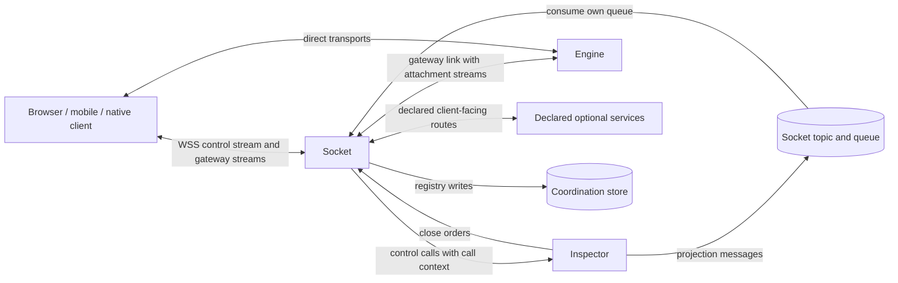

Every WebSocket message belongs to exactly one stream: the control stream or one attachment stream, with the stream framing defined in "Transports and wire codec". Per-message compression is off by default, because it costs processor time on the 60 Hz path and gains little on positional frames; an operator may enable it for the control stream only. Direct transports bypass Socket entirely. A client on a direct transport keeps its control connection on Socket for rooms, admission and projections, and Socket never sees its game frames.

### 9.6 Optional service routes

Clients reach only Socket, the Engine's transport ports and the relay, so every client-facing operation of an optional service passes through Socket. A route exists only for a service declared in configuration, never for one discovered by probing. Each route covers exactly the client-facing messages that the service's own section lists, such as member sign-in in "Profiles service", checkout and portal links in "Payment service" and playback authorization in "Recording". Socket applies the same state check, rates and size limits as for Inspector routes and forwards the same call context; the service makes every authorization decision.

With Social declared, the route table holds every operation of "Public operations" in "Social service" and ModerateConversation, and with Feed declared, ReadFeed and MarkFeedSeen of "Read operations and real-time push". Social and Feed are installation-scoped, so these routes reach the service's instances in its home region from every region's Socket. That address is a declared service, not another region's Inspector or engines. SetPresenceStatus is an Inspector operation, not a Social one: it routes to the Inspector of the region with the connectionId of the call context. Its route exists only while presence tracking is on, which the validate command sets exactly when Social is declared. AcceptInvite answers roomId and regionId; the client then sends JoinRoom(roomId, inviteId) through a Socket of that region, which routes it to Inspector like any room operation and never to Social. Socket never inspects a message body, an invite content or a feed item on these routes.

In the Minimal profile no optional service is declared, so the route table holds Socket, Inspector and Engine routes only, and a message of an optional domain is answered with feature-unavailable without any network call. In traceless mode a declared optional service fails start (see "Anonymous traceless mode"), so the same holds there by construction. Optional services never deliver to connections through Socket: their facts reach clients through Inspector projections after a projection operation, or as replies to a routed call. Social and Feed reach a principal's connections only through DeliverToPrincipals of "Delivery to principals", a message on the delivery topic. Inspector turns it into DeliverProjection messages with roomId none on Socket topics (see "Socket topic and queue"). Provider webhooks of Payment are not client traffic and never pass through Socket.

### 9.7 Gateway attachment routing

An attachment stream opens with Attach, which Socket relays to the owning Engine unchanged. Socket resolves the owner from two sources, both signed by Inspector or derived from Inspector: the ticket inside the Attach and the instance's routing cache. A ticket names the owning engine's addresses per allowed transport, and its gateway entry is the engine's gateway-link address when WebSocket is allowed. Socket checks only the ticket's signature for routing; expiry, nonce, seat and epoch are the Engine's checks.

The routing cache maps sessionId to (engineId, gateway-link address, ownerEpoch). It is filled only from verified tickets of Attach messages and from the session placement that Inspector's RoomState projections carry in their sessionId, holderEngineId and ownerEpoch fields. An entry leaves when no connection of the instance references its session. The ownerEpoch of an admission ticket Inspector signed from the primary replaces the highest epoch held for that session, even when lower, and overwrites the cache entry. Resolution order: a cache entry with a higher ownerEpoch than the ticket's wins, except over such a ticket; otherwise the ticket's binding; otherwise the cache entry; otherwise Socket answers ticket-invalid without contacting any Engine. The cache is a hint, not authority: the Engine accepts or refuses every Attach, and a refusal reaches the client unchanged.

This order keeps rejoins working while the coordination store is unavailable. The client binding keeps the last ticket of every attachment, so an Attach carrying an expired or consumed ticket plus a resume token reaches the engine that still owns the session, and that engine verifies the resume token offline. After an adoption, the RoomState projection carries the adopter's placement and epoch, and the cache routes a resume to it. A client whose resume still fails with ticket-invalid or epoch-stale calls Admit for a fresh ticket and attaches again.

A gateway attachment stream is pending at Socket from its Attach until the Engine answers AttachAck or closes the stream. The Engine holds a valid ticket's Attach until the store verification of the join saga passes for the message id the ticket binds, for at most the 6-second verification wait. It creates no stream binding, seat, key or relay allocation before the pass (see "Engine runtime"). Socket mirrors that rule on its side: a pending stream receives no credit window, and Socket relays nothing on it but the Attach; a client frame sent earlier is dropped and counted. A pending stream that receives neither AttachAck nor a close within 8 seconds, the verification wait plus 2 seconds, is closed with link-lost. A stream closed with saga-incomplete therefore leaves only a retired streamId on the link, never a half-open attachment.

A WebRTC attachment uses its gateway stream for signaling only (see "Transports and wire codec"). The stream opens with the first SignalDescription, which carries the admission ticket and routes exactly as an Attach does. Afterwards it carries SignalDescription and SignalCandidate in both directions and nothing else, and Socket relays both opaquely without interpreting a session description. The stream is pending until the Engine answers the first SignalDescription or closes the stream, under the rules of a pending Attach: no credit window, nothing relayed but the first SignalDescription, and link-lost after 8 seconds. A held SignalDescription answered with saga-incomplete reaches the client unchanged. The data channels and media of the attachment are a direct transport, so Socket never sees them.

A session move reaches routing in three ways. From the freeze to the completed move, and earlier while the source node stands at or above the 90% refusal threshold with an offer open, Inspector answers JoinRoom and Admit for a new member with session-moving and a 1-second retry hint. For a session that no free engine could take it answers capacity-exhausted with a 30-second retry hint. Socket relays both refusals unchanged. From the freeze until migration_complete the source closes an Attach for the session with session-moving. After migration_complete it keeps a tombstone for 60 seconds and closes an Attach with session-moved, and Socket relays that close and removes the routing cache entry of that session at that ownerEpoch or lower. After the target completes the move, Inspector delivers AttachRedirect with a ticket for the target at the new ownerEpoch, and the next Attach routes by that ticket, because its epoch is above every cached entry. A cached placement is never preferred over a redirect ticket of a higher epoch, and Socket never infers a move from a failed link.

### 9.8 Gateway link to the Engine

Socket opens one link per pair of Socket instance and Engine incarnation, on the first Attach routed to that engine. The link runs on the private network, optionally under mutual TLS, and Socket presents its service credential when it opens it. An Engine accepts gateway links only from that credential, and a draining Engine keeps accepting links because it keeps accepting rejoins. Socket closes a link that has carried no stream for 60 seconds.

A link carries many attachment streams, one attachment per stream. Socket relays stream bytes unchanged in both directions, keeps order within a stream and never merges, splits or re-encodes frames. The Engine's side of the link is the gateway adapter, plaintext inside the cluster, with the lanes of a WebSocket attachment collapsed onto one ordered stream (see "Transports and wire codec"). Coalescing of unreliable-lane messages on that collapsed stream happens in the Engine, which knows message kinds; Socket does not.

Flow control applies in the Engine-to-Socket direction only. Socket grants each stream a credit window, default 64 KiB, and replenishes it as it writes that stream's bytes to the client. The gateway adapter's Backpressure reports the unspent credit, so the Engine applies its own bounded send queue (reliable 256 KiB; unreliable 64 frames, drop oldest) to a slow WebSocket client exactly as to a direct one. The Socket-to-Engine direction carries no credit. The Engine reads the link at line rate into its bounded input queue of 128 per player, and Socket's inbound byte budget bounds what one client can send.

A link that the Engine closes with reason handoff belongs to a planned restart. Socket reconnects to the same address, where the successor now listens, and rebinds every stream of the link by streamId and attachment generation. Target: within one tick; hard bound: 2 seconds. During the gap Socket holds client frames within each stream's credit and pauses reading beyond it, while the Engine side holds outbound frames in its send queues. A stream not rebound within 2 seconds closes with link-lost, its attachment becomes suspended at the Engine, and the client resumes it with its resume token.

A link that drops without a close reason is treated as an engine fault. Socket retries the link for 2 seconds, then closes its streams with link-lost; the client resumes once a RoomState projection names an active holder. Streams the Engine closes (superseded, session-ended, epoch-stale, slow-consumer, saga-incomplete, session-moved, restart) are relayed to the client with the Engine's reason, and Socket never reopens one on its own.

A session move closes no link. The source sends SessionMoving on each attachment's reliable-ordered lane, which reaches a WebSocket client through its stream like any other frame, and then stops ticking. A WebSocket attachment re-attaches on a new stream of a link to the target, opened on its first Attach as for any engine. The source closes the old stream with session-moved, and Socket relays that close like any other. No stream is rebound across engines, because no transport state moves between hosts, and the handoff rebind of the planned restart applies only within one engineId.

### 9.9 Socket topic and queue

Every Socket incarnation owns exactly one topic and exactly one queue of the topic role and the queue role (see "Integration bus"). socketId is new at every process start, so the topic is {bus:G:socket:S} for region G and socketId S. A restarted process declares a new topic and a new queue and never consumes those of its predecessor. Socket declares the topic with the 60-second hint horizon and the 16 KiB message cap, and its queue with a 10-second visibility timeout, a delivery limit of 10 and a 60-second idle expiry. It binds the queue to the topic with binding mode fan-out, no group and the type DeliverProjection. Inspector is the only producer on the topic and the instance is its only consumer. The binding is never round-robin, because a projection belongs to the connections of exactly one process and no other instance may take it.

Every projection reaches a Socket on this one queue, whatever service produced its content. The table names the path of each content kind up to Inspector, Inspector's step and the message that lands on the Socket topic.

| Content | Path to Inspector | Inspector's step | On the Socket topic |
| --- | --- | --- | --- |
| Room projections: RoomState, RoomMemberChanged and the other projections of "Room" | Inspector's own room, membership and placement writes | one DeliverProjection per socketId among the members' live conns fields | roomId set; room slot |
| AttachRedirect | SessionMoved from the target engine on the Inspector work topic, round-robin in group inspector | one ticket per member; one DeliverProjection per socketId among that member's connections | roomId and playerId set; room slot |
| Messages: ConversationEntry | DeliverToPrincipals from Social on the delivery topic {bus:G:deliver} of every region, round-robin in group inspector | reads each recipient's conns fields, groups the live ones by socketId and publishes one DeliverProjection per socketId | roomId none; principal slot |
| Invites: InviteChanged | DeliverToPrincipals from Social on the same delivery topic | the same | roomId none; principal slot |
| Friend requests and friendships: FriendRequestChanged, FriendshipChanged | DeliverToPrincipals from Social on the same delivery topic | the same | roomId none; principal slot |
| Presence: FriendPresence | PresenceChanged from Inspector on the sink topic of the subject's region, round-robin in group social; Social then publishes DeliverToPrincipals to the delivery topic of every region | the same | roomId none; principal slot |
| Feed items: FeedUpdated | Statistics facts on the sink topic, round-robin in group feed; Feed then publishes DeliverToPrincipals to the delivery topic of every region | the same | roomId none; principal slot |

Social and Feed hold publish rights on the delivery topic and on no Socket topic. Every principal projection therefore crosses one round-robin hop to an Inspector instance and one fan-out hop to each Socket holding a recipient's connection. Inspector stays the only service that addresses Socket's connections. Socket consumes no queue of the delivery topic and no group of the sink topic. Message bodies, invite contents and feed items travel inside DeliverProjection bodies of at most 8 KiB within the 16 KiB message cap, and the queue holds them only within its 60-second horizon.

Socket acknowledges each delivery as soon as it has written the projection into its slots, as a consumer of a hint topic may. A crash between the write and Ack therefore yields a redelivery that the revision-gated slot absorbs. Duplicates and any order are normal operation. A projection whose revision is not above the last delivered one, or not above the undelivered one in its slot, is dropped, so a repeated or late older copy changes nothing. A delivery past its expiresAt or the horizon is acknowledged unread and counted as expired. A message whose type is not DeliverProjection, whose producer kind is not Inspector, whose socketId is not the instance's own or whose data is invalid is dead-lettered at once with its reason, logged at error and counted. Socket never nacks a projection, because the next revision supersedes it. A Consume answered queue-unknown makes Socket declare its topic, queue and binding again at once, and a projection published meanwhile is lost, which the read-back of "Fanout and backpressure" repairs.

The queue expires 60 seconds after its last Consume and its binding ends with it, so the undelivered projections of a crashed or drained instance expire unread. Its dead-letter queue has no binding and keeps messages 24 hours, 1 hour in traceless mode. The Standard profile and the Full profile may move the service topics, Socket topics included, to a broker family selected in the integration group. Every rule of this subsection holds unchanged on each adapter.

In the Minimal profile the Socket topic lives on the coordination-store stream adapter of the one store and carries room projections and AttachRedirect only, because no delivery topic exists and no principal projection is produced. In traceless mode the coordination-store stream adapter is the only legal one. The Socket topic, its queue and its dead-letter stream are keys with positive expiries: the 60-second horizon, the 60-second idle expiry and the 1-hour dead-letter retention. A dead-lettered message is logged with its type, a keyed digest of its messageId and its reason, never with its body or an identifier.

### 9.10 Fanout and backpressure

Socket fans out Inspector projections and nothing else. Game frames are relayed per attachment stream, never fanned out by Socket. The Engine encodes once per interest class and sends one copy per attachment, so group visibility and the mute matrix are decided where the session lives. A projection is a hint, not authority. A client acts on the next Inspector reply, ticket or AttachAck, and repairs a revision gap with GetRoom (see "Room").

DeliverProjection names a roomId, a projection type and a revision, and Socket writes the projection into the slot of every local connection whose memberships hold that room. Each connection keeps at most one undelivered projection per (room, projection type): a newer revision replaces an older undelivered one, and a projection whose revision is not above the last delivered one is dropped. Replacement leaves a revision gap the client sees and repairs; Socket never invents, merges or edits a view. Projection memory per connection is therefore bounded by its memberships, at most the roomsJoined quota, times the number of projection types, plus the 64 principal slots below.

A DeliverProjection with roomId none is a principal projection. Socket writes it into the principal slot (projection type + slotKey) of every local connection authenticated as that playerId, whatever rooms its memberships hold, and of no other connection. A connection not yet authenticated holds no principal slot. Principal slots are separate from the room slots above. A connection holds at most one undelivered projection per principal slot and at most 64 principal slots. A newer revision replaces an older undelivered one, and a revision not above the last delivered one is dropped. A FriendPresence revision is a pair compared in order (see "Delivery to principals"). When a 65th slot is needed, the oldest undelivered slot is dropped and Socket sends ProjectionsDropped with the count, which tells the binding to read back.

| Projection type | slotKey | Produced by |
| --- | --- | --- |
| FriendRequestChanged | requestId | Social |
| FriendshipChanged | pairKey | Social |
| FriendPresence | subject profileId + regionId | Social |
| ConversationEntry | conversationId | Social |
| InviteChanged | inviteId | Social |
| FeedUpdated | recipient profileId | Feed |

Every connection of a principal receives each principal projection. Inspector groups the principal's live {profile:P}:conns fields by socketId and publishes one DeliverProjection to the Socket topic of each instance. Social and Feed publish every delivery to the delivery topic of every region of the installation directory, so a principal's connections on several instances and in several regions each receive it. Socket never copies a principal projection to a connection of another principal and never retries one. A principal projection is a hint. The binding repairs a gap by read-back: ListConversations and ReadConversation for messages, ListInvites for invites, ListFriends and GetPresence for presence and ReadFeed for feed items. Message bodies and invite contents cross Socket memory inside ConversationEntry and InviteChanged bodies and are never written to disk or to the store. In the Minimal profile and in traceless mode neither Social nor Feed runs, so no principal projection arrives and every principal slot stays empty.

AttachRedirect is the one room projection addressed to a principal. After a session move, Inspector mints one ticket per member holding a seat or viewer slot and publishes DeliverProjection with playerId set to the Socket topic of each socketId among that member's connections. Socket writes it only into the slot of connections whose principal is that playerId and whose memberships hold the roomId. Its revision is the session's new ownerEpoch, so a redirect of a lower epoch never replaces or follows one of a higher epoch. A missed redirect is repaired by the client, not by Socket: the binding calls Admit itself 5 seconds after SessionMoving when no AttachRedirect arrived. Socket never copies one member's redirect to another connection, because each ticket binds one playerId and one attachment secret.

Each connection has one write buffer toward the client, shared by replies, projections and relayed stream frames. Default write buffer cap: **256 KiB**; slow-consumer close after 5 seconds above the cap. When the buffer is full, Socket first withholds credit from attachment streams, so the Engine drops unreliable frames, coalesces and lowers snapshot frequency for that receiver. It then holds room and principal projection slots, which keep only their newest revision, and then delays control replies, which wait and are never dropped. Last, it closes with slow-consumer and requires resync. A reply that cannot be written within the slow-consumer budget closes the connection instead of disappearing.

CloseConnections is the second fan-out path, a call to the delivery address and never a message on the Socket topic. Inspector sends it to every instance of the region directory when a region acknowledges a ProjectBan of installation scope, and Socket closes each local connection of the principal with banned. ForgetGuest produces the same call keyed by the credential digest, and Socket closes with revoked. In the Minimal profile no durable ban exists, so banned never arrives; Kick and BlockInRoom act in the Engine and Inspector without any Socket close order.

### 9.11 Reconnect and resume

Socket keeps no resume state. Resume is a contract among the client, Inspector, which keeps room membership through presence fields that expire 60 seconds after the last renewal, and the owning Engine, which holds the seat for the resume window, default 120 seconds. A reconnect through any instance of the region is equivalent to one through the original instance. The procedure and its generations are defined in "Client connection and presence"; the gateway's part is routing the resume Attach by "Gateway attachment routing".

When a control connection closes for any reason, Socket closes each of its gateway streams toward the Engine with the connection's close reason, and the Engine moves those attachments to suspended. Socket then reports the connection closed through ReportPresence, marks {conn:C} closed and stops renewing it. Socket never calls LeaveRoom for a closed connection: leaving is a client command or a presence expiry, not a transport event. Closing a control connection has no effect on direct-transport attachments, which Socket never sees. Principal slots belong to the connection and close with it: a reconnected connection starts with empty principal slots. The binding reads back what it missed, because every message, invite and feed item is durable before its push.

A Socket crash sends no report. Its registry entries expire within 60 seconds and presence lapses with them. Its Socket queue expires 60 seconds after its last Consume with every undelivered projection, and engines suspend the gateway attachments of its dropped links. Clients reconnect to another instance and resume inside the resume window; game logic sees a resync, never a leave and join.

A session move is a re-attach, not a reconnect. The control connection stays open through the move, its memberships and projection slots stay as they were, and only the session's attachments change engines. The target admits a re-attach through AttachRedirect without counting it toward the reconnect limit of 3 per minute, and Socket counts nothing on its own. A move therefore never produces a Socket close, a ReportPresence change or a {conn:C} rewrite beyond the attachments field.

Close codes are stable and closed. Socket emits: version-mismatch, handshake-timeout, idle-timeout, unauthenticated (reply only), message-unknown (reply only), payload-too-large, rate-limited, limit-exceeded (reply only), expired, revoked, banned, quota-exceeded (from the connect report), slow-consumer, link-lost (per stream), socket-draining and retryable-unavailable (reply only). Every close carries a retry hint when reconnecting can succeed, and never one for version-mismatch, revoked or banned.

### 9.12 Dependency failure

Socket fails per dependency and never blocks one path on another. The table lists each fault with the behavior it requires and what keeps working.

| Fault | Socket behavior | What continues |
| --- | --- | --- |
| Coordination store unavailable | Registry writes fail and are retried at the next renewal, never awaited; under the coordination-store stream adapter Consume on the Socket queue fails and is retried, so no projection arrives | Authentication, gateway relay, resume at a reachable owner; Inspector replies retryable-unavailable |
| Inspector unreachable | Inspector-bound calls answered retryable-unavailable after 2 seconds; the status endpoint reports region-unavailable after 10 seconds | Authenticate for connections already reported, gateway relay, Attach routing by ticket and cache |
| Credential issuer unreachable | Cached key set kept; an unknown kid yields issuer-unknown | Every principal whose kid is cached |
| One Engine unreachable | Its link retried for 2 seconds, then its streams closed with link-lost | Streams of every other engine |
| Declared optional service unreachable | Its routes answer retryable-unavailable | Everything outside those routes |
| Service queue or declared broker unavailable | Consume on the Socket queue is retried and no projection arrives meanwhile; nothing else changes | Every other Socket path; clients repair projection gaps by read-back; Inspector answers new sagas with retryable-unavailable and writes nothing |
| Session moving to another engine | Inspector's session-moving and capacity-exhausted relayed with their hints; session-moved closes relayed and the cache entry removed | The control connection, every other session's streams, re-attach by AttachRedirect or the fallback Admit |
| Socket instance crash | Connections drop; registry entries expire within 60 seconds | Membership until presence expiry; seats within the resume window |

A connection whose connect report cannot reach Inspector follows the rule of "Client connection and presence": it relays Attach, answers Inspector-bound calls with retryable-unavailable and retries the report with backoff. A declared optional service that is unreachable stays declared; Socket starts without it and never treats it as absent.

### 9.13 Socket maintenance runbook

Socket has no connection-preserving restart in this version: TLS state lives in the process, so every restart drops its client connections. Session continuity through resume is the guarantee, and clients on direct transports keep playing through it. The runbook below covers rolling updates, scale-down and node maintenance, with the update order start-first.

1. Start the replacement instance first. It becomes ready only after it loaded the region directory and the key set, bound its listeners, declared its Socket topic and queue and had one SocketHeartbeat accepted; the next step waits for readiness.
2. Call Drain on the old instance through the pre-stop hook. The instance reports readiness false and state draining, accepts no new connection and keeps serving existing ones; proceed after 10 seconds, so the balancer has stopped sending new connections.
3. Send each connection SocketDraining with a reconnect delay drawn uniformly from 0 to 10 seconds, then close it with socket-draining, connections without a live gateway stream first. Close at an even rate that finishes within 80% of the drain budget and at least 100 connections per second; continue while connections remain and the budget has not expired.
4. When no connection remains or the drain budget expires, close the rest with socket-draining, mark their registry entries closed and send SocketHeartbeat with state drained. Proceed when Inspector accepts the heartbeat or after 5 seconds.
5. Log the drain report at info, with connections drained, forced closes and duration, and exit with code 0. Default drain budget: **300 seconds**; termination grace equals the drain budget plus 30 seconds, except on the Docker Swarm reference adapter of the container orchestrator role, whose stop grace equals the drain budget (see "Clustering, regions and deployment").

A finite termination grace cannot prove every client reconnected; the drain report and the forced-close counter are the evidence. Membership survives every step because Socket deletes none, and seats survive because each drained client resumes inside the resume window. A drain closure counts as one reconnect toward the Engine's limit of 3 per minute, which one maintenance pass never exceeds. An instance stopped without Drain behaves as a crash and increments the undrained-exit counter at its successor's start.

### 9.14 Traceless mode, logs and metrics

Socket requires the mode setting like Inspector and the Engine and refuses to start when it is unset. In traceless mode Socket writes nothing to disk and keeps no access log of its own; {conn:C} holds playerId only under its 60-second expiry and never an address. The client address lives in process memory only, as the rotating keyed digest of the admission budgets. Credentials, tickets, resume tokens, attachment secrets and payloads, principal projection bodies included, never appear in a log line at any level. At every level sessionId and roomId appear only as keyed digests. In traceless mode start is refused when debug logging or a per-session debug flag is configured without privacy.debugAllowed=true; with it, a warning prints at start. An AttachRedirect lives in a projection slot in process memory only until it is written to the client, exactly like an Admit reply. A session move therefore adds nothing to disk or to the store at Socket beyond its message on the expiring Socket topic.

Log levels follow "Observability and logging". Debug: every connection and stream state transition, every routing decision with destination and duration, every refusal with its budget, every AttachRedirect delivery with its ownerEpoch, every principal projection delivery with its projection type and delivered count, every Consume batch of the Socket queue with its size, every declaration of the Socket topic and queue, every pending-stream close and every cache entry removed after session-moved. Info: process start with the effective configuration and secrets redacted, region directory loaded, drain report. Warn: slow-consumer closes above 1% of connections per minute, Inspector calls answered retryable-unavailable, key set refresh failures, pressure above 80%, coalesced to one line per key per 10 seconds. Error: listener bind failure, configuration invalid, key set unavailable at start, link authentication failure, a dead-lettered message of the Socket queue.

Track connections by state, messages per second by route, relay throughput, projection slots occupied, closes by reason, admission refusals by budget, links per engine and rebind duration. Track saga route latency, saga route deadlines reached, pending streams and their wait, pending-stream closes, AttachRedirect deliveries and session-moved closes relayed. Track principal projections by type, principal slots occupied and ProjectionsDropped notices sent. Track Lag of the Socket queue as gauges (ready, in flight, dead-lettered, oldest ready age) and expired and dead-lettered messages as counters. Metric labels carry region, instance, route and reason only, never a sessionId or a playerId.

### 9.15 Conformance

1. A Socket build performs no coordination-store key read in any test scenario; its only store calls are {conn:C} writes with a positive expiry, the messaging adapter's calls on its own Socket topic and queue and, in traceless mode, the start-time persistence query.
2. An upgrade arriving while the instance holds 90% of maxConnections is refused with a retry hint and no Inspector call is made.
3. A connection that completes the upgrade and sends no Hello within 5 seconds is closed with handshake-timeout.
4. A Hello whose protocol lies outside the supported range is closed with version-mismatch before any other field is parsed.
5. A frame longer than the 256 KiB parser ceiling closes the connection with payload-too-large, and a 100 KiB control message is refused while the connection stays open.
6. The 21st control message within one second on a connection is refused with rate-limited and never reaches Inspector.
7. A credential with an unknown kid triggers at most one key set fetch per 10 seconds under a flood of such credentials.
8. A validly signed credential yields authenticated only after Inspector accepts the connect report.
9. A forwarded call carries the principal Socket verified, and a client-written playerId that differs is refused with forbidden by the destination.
10. A message whose type + version is absent from the route table is answered with message-unknown and forwarded nowhere.
11. A call that Inspector does not answer within 2 seconds is answered with retryable-unavailable, and Socket sends the command to Inspector exactly once.
12. Replies carry result.requestId equal to the request's messageId when Inspector completes requests out of order.
13. An Attach carrying an expired ticket with a valid signature is relayed to the engine the ticket names, and that engine's verdict reaches the client unchanged.
14. An Attach carrying neither a ticket nor a session in the routing cache is answered with ticket-invalid and no Engine receives it.
15. After an adoption projection with a higher ownerEpoch, an Attach carrying the old ticket is routed to the adopter.
16. With the coordination store unavailable, a gateway resume to the reachable owning engine succeeds while JoinRoom and Admit return retryable-unavailable.
17. Socket never receives the ticket-encryption key, and no Socket log line at any level contains a ticket, credential, resume token or attachment secret, including those inside an Admit reply or an AttachRedirect.
18. Bytes on an attachment stream reach the Engine and the client unchanged and in order across 600 ticks at 60 Hz.
19. A client that stops reading has its write buffer bounded at 256 KiB and is closed with slow-consumer within 5 seconds above the cap.
20. Under a slow WebSocket client the Engine's send queue for that attachment stays within its caps, and other attachments on the same link keep their tick rate.
21. Two projections for one room delivered to a slow connection leave only the newer revision in its slot, and the client receives no revision lower than one already delivered.
22. A projection is delivered only to connections whose memberships hold its roomId.
23. A CloseConnections with banned closes every local connection of the principal and no other connection.
24. An Engine handoff with 1000 gateway attachments rebinds every stream to the successor without closing any client connection, within the 2-second bound.
25. A link that drops without a close reason closes its streams with link-lost after 2 seconds, and the affected attachments resume through any instance inside the resume window.
26. Closing a control connection closes its gateway streams toward the Engine, removes no membership field and leaves direct-transport attachments live.
27. Killing a Socket instance removes no membership field, and its registry entries expire within 60 seconds.
28. A drain of an instance with 10,000 connections closes them all with socket-draining within the drain budget, connections without a gateway stream first, and exits with code 0.
29. In the Minimal profile a message of an optional domain is answered with feature-unavailable without any network call.
30. A declared but unreachable optional service yields retryable-unavailable on its routes while Inspector and Engine routes keep working.
31. In traceless mode a scripted session through Socket leaves no file changed under any writable path of the Socket container and no address in the coordination store.
32. Socket publishes to no topic and consumes no queue other than the queue of its own Socket topic in any test scenario, with the coordination-store stream adapter and with a declared broker adapter.
33. A JoinRoom whose saga waits 5 seconds on the player lock receives Inspector's outcome rather than retryable-unavailable, and Socket forwards the command to Inspector exactly once.
34. A saga operation that Inspector does not answer within 11 seconds is answered with retryable-unavailable, while a GetRoom unanswered for 2 seconds is answered with retryable-unavailable.
35. saga-busy, session-moving and capacity-exhausted reach the client unchanged, with the 1-second retry hint for session-moving and the 30-second retry hint for capacity-exhausted.
36. A gateway stream whose Attach the Engine holds for verification receives no credit window, and a client frame sent on it before AttachAck reaches no Engine.
37. An Attach refused with saga-incomplete after the verification wait leaves no open stream on the link and no attachment in {conn:C}.
38. A pending gateway stream that receives neither AttachAck nor a close within 8 seconds is closed with link-lost.
39. An AttachRedirect for one player reaches only that principal's connections whose memberships hold the room, and a redirect with a lower ownerEpoch delivered after a higher one is dropped.
40. After the source closes an Attach with session-moved, the routing cache holds no entry for that session at that epoch, and an Attach carrying the redirect ticket reaches the target.
41. A move of a session with 100 gateway attachments re-attaches every attachment to the target on a new stream with no control connection closed, no ReportPresence change and no reconnect counted.
42. With the service queue unavailable, authentication, gateway relay and resume at a reachable owner keep working while JoinRoom returns retryable-unavailable.
43. In the Minimal profile, a single full engine with a growing room yields capacity-exhausted on JoinRoom through Socket while every existing gateway stream of that session keeps relaying at the tick rate.
44. A first SignalDescription on a new attachment stream reaches only the engine its ticket names, the stream receives no credit window until the Engine answers it, and later SignalDescription and SignalCandidate messages reach the Engine and the client unchanged.
45. With Social and Feed declared, SendMessage reaches Social and ReadFeed reaches Feed with the principal from the call context, and SetPresenceStatus reaches the Inspector of the region with the connection's connectionId. With Feed absent, ReadFeed answers feature-unavailable without any network call, and with Social absent, SetPresenceStatus does too.
46. A DeliverProjection with roomId none and playerId P reaches every local connection authenticated as P, including one that holds no membership, and no connection of another principal.
47. Two FeedUpdated or two ConversationEntry projections for one slotKey delivered to a slow connection leave only the newer revision in its principal slot, and a revision not above one already delivered is dropped.
48. A connection with 64 undelivered principal slots that receives a projection for a 65th slot drops the oldest undelivered slot, receives ProjectionsDropped with count 1 and keeps every room slot.
49. A DeliverProjection on a Socket topic whose producer kind is Social or Feed is dead-lettered at once and delivers nothing to any connection.
50. No Socket log line at any level contains a principal projection body, and in the Minimal profile and in traceless mode no connection holds a principal slot.
51. A starting Socket declares its Socket topic, its queue and their fan-out binding before its first SocketHeartbeat, and a restarted process consumes only the queue of its new socketId, never that of its predecessor.
52. Under the shuffling adapter, room and principal projections of one slot delivered duplicated and reordered reach the client with no revision twice and none lower than one already delivered.
53. A message on the Socket topic whose type is not DeliverProjection, or whose socketId is another instance's, is dead-lettered at once, delivers nothing, yields one error line and one counter record, and is never redelivered.
54. A Consume answered queue-unknown makes Socket declare its topic, queue and binding again, and the next projection Inspector publishes reaches its connections.
55. With Social and Feed declared, a ConversationEntry, an InviteChanged, a FriendPresence and a FeedUpdated published as DeliverToPrincipals on the delivery topic of a region reach every connection of the recipient in that region through the Socket topic of each instance holding one, and Socket consumes no queue of the delivery topic or the sink topic.
56. In the Minimal profile, RoomState and AttachRedirect reach clients through the Socket topic on the coordination-store stream adapter with no process beyond Socket, Inspector, Engine and the store, and in traceless mode the Socket topic, its queue and its dead-letter key each carry a positive expiry.

## 10. Inspector

Inspector is the coordination authority of a region. It owns the room registry and room membership, presence, the engine registry and capacity reservations, session placement, ownership leases and epochs, quotas, idempotency records of client commands, admission and control tickets, guest identity when no credential issuer is configured, guest points, the projection operations, the read path of live leaderboards and the reconciler. With Social declared it also owns per-principal presence tracking and the invite grants of private rooms, and with Social or Feed declared the delivery to principals. It also owns the per-player locks and saga records, the fallback assignment of session moves and the re-ticketing of a moved session. Every fact it asserts lives in the region's coordination store under a key with a lifetime, so Inspector processes hold no state between requests and any process answers any request. Inspector does not own game simulation, seats, transport state, node pressure, durable member profiles, the event trace or media. It never consumes the event sink: facts that an optional service must place into Inspector keys arrive through the projection operations. Through the topic role and the queue role of "Integration bus" each Inspector instance consumes exactly three queues: its member queue of the round-robin group inspector on the Inspector work topic, its member queue of the round-robin group inspector on the delivery topic when Social or Feed is declared, and its own fan-out fleet queue. It publishes to the engine inbox topics, the fleet topic and the Socket topics, and never consumes a queue of another identity except a pruned engine's inbox queue in the reconciler.

The coordination store is an abstract role: a networked key-value store with per-key atomic operations, key and hash-field expiry, server-side procedures over keys sharing one routing tag, an incremental key scan by pattern, and append-only streams with consumer groups. The reference adapter is a Redis-protocol store, with Valkey 9.0 or later as the default image and Redis 7.4 or later as the tested alternative. Every statement in this section holds in the Minimal profile, where Socket, Inspector, Engine and one coordination store serve guests only and persist no trace. The Standard and Full profiles change only what the presence of an optional service changes, and "Without Profiles" and "Minimal profile and traceless mode" in "Inspector" state each change.

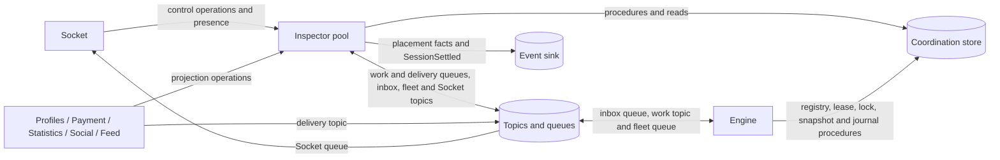

The event sink edge exists only when a consumer is declared; in the Minimal profile the sink is the null adapter and Inspector appends nothing anywhere. The Engine calls its registry, session-key and player-lock procedures directly on the store, as "Engine node, lease, epoch, placement and capacity" states, so no Inspector process sits on the lease, heartbeat or verification path. Inspector owns the procedure library and the key layout for every caller.

Every asynchronous message Inspector publishes or consumes travels through the topic role and the queue role of "Integration bus". A producer publishes only to a topic and a consumer reads only from a queue bound to it. Each binding has one binding mode: fan-out gives its queue a copy of every message, and round-robin makes its queue a member of a named round-robin group, of which exactly one member receives each message. Delivery is at-least-once with order optional, and duplicates, redelivery and reordering are normal operation, never faults. The reference adapter is the coordination-store stream adapter, the only adapter of the Minimal profile and of traceless mode. A declared message broker may carry the same topics and queues. Every lock, saga record and outcome stays in the coordination store, so a broker outage fails sagas closed and never corrupts one. No Inspector decision depends on the order in which two messages arrive: order comes from fences, epochs and revisions in the store, not from the queue.

### 10.1 Store contract and routing tags

The store contract is single-tag atomicity. A server-side procedure touches only keys sharing one routing tag, and every tag names exactly one aggregate: one room, one session, one engine, one region directory, one profile, one player's lock and saga record, one topic, one presence index shard, one connection or the installation key set. No procedure spans aggregates. An operation that crosses aggregates is a saga of ordered, idempotent, compensable procedure calls whose intermediate states expire, and the reconciler repairs what a crashed saga leaves (see "Operations and sagas"). The specification never promises cross-tag atomicity.

The routing tag is the brace-enclosed prefix of a key, such as {room:R} in {room:R}:members. The reference adapter maps the tag onto its hash-tag rule, so every key of one aggregate lands in one slot of a sharded cluster. Identifiers inside tags are opaque: Inspector never parses a tag to find a region, a shard, an engine or an owner. Keyspaces are per region, and no Inspector, Engine or Socket reads or writes another region's tags.

Every key carries a lifetime. A key that loses its renewal expires on the store's own clock, and every "now" inside a procedure is the store's time read in that procedure, never a time supplied by the caller. The owner's self-fence deadline runs on the owner's monotonic clock instead, as "Engine node, lease, epoch, placement and capacity" defines, and neither clock is ever compared with the other.

Procedures form one versioned library (reference adapter: a function library whose name carries the library version, loaded on every primary). Inspector loads it at start. Any caller, Inspector or Engine, that receives not-loaded loads the same versioned library and retries once. An ephemeral store returns not-loaded after every restart and a new cluster primary returns it until loaded. A missing procedure is never bypassed by a client-side read-modify-write. Two library versions coexist during a rolling upgrade because their names differ.

Reads that decide admission, placement, adoption or fencing go to the primary. A replica read is a hint, not authority, and no ticket, placement or adoption is derived from one. Inspector processes may cache the {auth} key set in memory; a cache miss on a kid and every rotation reread it from the primary.

### 10.2 Key layout

The tables list every key written in a region's keyspace. R, S, E, G, P, C and B stand for opaque room, session, engine, region, profile, connection and board identifiers. n stands for a shard number of the event sink or of the presence index. Lifetimes are starting values unless they derive from another constant; the derivation is stated where it exists.

| Key pattern | Type | Lifetime | Writer | Purpose |
| --- | --- | --- | --- | --- |
| {room:R}:meta | hash | 24 hours idle, 1 hour in traceless mode, renewed by every member write | Inspector | profileId, ownerProfileId, gameId, gameBuild, regionId, state, maxPlayers, maxSpectators, visibility (public, unlisted, or private only with Social declared), settings including recording and, with Social declared, roomInviters, sessionId, pendingSessionId, lockRevision, lockedAt, revision |
| {room:R}:members | hash, per-field expiry | each field 60 seconds, renewed every 20 seconds; seated fields 60 seconds + resume window; key as meta | Inspector, under the player's lock | playerId → role, seat or viewerIndex, connectionId, socketId, control generation, revision, sagaMessageId, sagaFence, and the consumed grant (inviteId, until, inviterId) of a member admitted to a private room by invite; seat hold fields seat → until; tombstone fields playerId → removed, sagaFence, each 10 minutes, at most 1024 |
| {room:R}:blocks | hash, per-field expiry | each field until its block or room-scope ban ends, capped at the room lifetime; at most 256 fields | Inspector | playerId → until, ban marker for a room-scope ban, revision |
| {room:R}:grants | hash, per-field expiry | each field until its invite's until; key as meta; at most 256 live fields; exists only with Social declared | Inspector through ProjectInvite, RevokeInvite, room_join and room_leave(compensate) | private rooms only: inviteeId:inviteId → until, inviterId, one field per invite, so several live grants of one invitee coexist |
| {session:S}:index | hash | 10 minutes after the last owner write | Inspector creates; owner Engine writes; a claimant Engine, or the reconciler on its behalf, writes only the claim | roomId, gameId, gameBuild, state as last reported by the owner, placement (placed, orphaned or migrating), placedAt, orphanedAt, epoch, holderEngineId, holderIncarnation, tick, snapshotRevision, snapshotTick, durabilityClass, finalState, resultDigest, settled; move fields pressure (none or bound), offerId, offerUntil, excluded, claimId, targetEngineId, targetIncarnation, claimUntil, ready, handoverRevision, previousOwner, cooldownUntil |
| {session:S}:lease | string | 15 seconds, renewed every 5 seconds | Inspector or adopter creates; owner Engine renews | engineId + incarnation + epoch |
| {session:S}:snapshot | string | as index; deleted when the session ends | owner Engine | latest snapshot envelope, at most 320 KiB stored |
| {session:S}:journal | stream | as index; trimmed at each snapshot commit; deleted when the session ends | owner Engine | accepted-input batches for durabilityClass snapshot-and-journal |
| {session:S}:players | hash | as index; deleted when the session ends | owner Engine | seat → playerId, resumeTokenDigest, attachment generation |

Engine and region keys follow. The region directory is six keys under one tag, so its procedures stay single-tag while each key keeps its own type.

| Key pattern | Type | Lifetime | Writer | Purpose |
| --- | --- | --- | --- | --- |
| {engine:E}:meta | hash | 15 seconds, renewed every 5 seconds by Heartbeat | Engine through engine_register and engine_heartbeat; Inspector through engine_drain | the registry record of "Engine node, lease, epoch, placement and capacity" with reservedUnits, reservedMemoryBytes and the node's pressure state (normal or pressured) |
| {engine:E}:reservations | hash, per-field expiry | each field 30 seconds, restarted by engine_confirm; key as meta | Inspector | sessionId → units, memoryBytes, confirmed flag |
| {region:G}:engines | sorted set | 60 seconds, renewed by every heartbeat and by Reconcile | Engine and Inspector through region_engine_score | engineId scored by free units; candidate order, a hint |
| {region:G}:directory | hash, per-field expiry | key as engines; each field as its room's meta | Inspector | public rooms: roomId → gameId, free capacity, state, sessionId, revision; read by ListRooms |
| {region:G}:sessions | hash | key as engines; fields removed by Reconcile | Inspector at StartSession; Engine and Inspector through region_engine_score | sessionId → roomId or none, engineId or none; the reconciler's walk |
| {region:G}:sockets | hash, per-field expiry | key as engines; each field 60 seconds, renewed every 20 seconds by SocketHeartbeat | Inspector | socketId → deliveryAddress, state, connectionCount; the Sockets whose Socket topic receives DeliverProjection and the address of CloseConnections |
| {region:G}:sagas | sorted set | key as engines | Inspector through region_saga_put and region_saga_remove | playerId scored by the deadline of its oldest pending saga entry; the reconciler's saga walk |
| {region:G}:reconcile | string | 5 seconds | Inspector | reconciler mutex holder, walk cursor, quota cursor and the set of normal engines seen by the previous run |

Profile keys exist per principal and region. The meta hash exists for guests only; every other profile key exists for members too.

| Key pattern | Type | Lifetime | Writer | Purpose |
| --- | --- | --- | --- | --- |
| {profile:P}:meta | hash | guest credential lifetime, 7 days by default, renewed on use | Inspector | guest record: username, role, points, issuedAt, claimedBy, redirectTo |
| {profile:P}:conns | hash, per-field expiry | principal's credential lifetime, renewed at every connect report; connection fields 60 seconds | Inspector | control generation counter; connectionId → generation and socketId for live connections; with presence tracking on, each field also carries status (available or away) and activity (roomId, gameId and room visibility, or none) |
| {profile:P}:presence | hash | as {profile:P}:conns | Inspector, recomputed by every procedure that writes a conns field | exists only with presence tracking on: state (online, away, in-session or offline), revision, since, gameId, roomId, roomVisibility, lastActiveAt; read by ReadPresence |
| {profile:P}:quota | hash, per-field expiry | 24 hours, renewed on write; reservation fields 30 seconds; rate fields 60 seconds | Inspector | confirmed fields owned:R and joined:R; reservation fields; room-operation rate counter |
| {profile:P}:idempotency | hash, per-field expiry | each field 10 minutes after completion | Inspector | type + idempotencyKey → payload hash, state, minted identifiers, result without secrets |
| {profile:P}:entitlements | hash, per-field expiry | each field until + 24 hours | Inspector through ProjectEntitlement | feature → value, until, revision |
| {profile:P}:revoked | string | until the ban ends; for a ban without end, an unban tombstone or a forgotten guest, the longest configured credential lifetime + 1 hour | Inspector through ProjectBan, RevokeBan and ForgetGuest | until, scope, reason, revision |
| {profile:P}:settled | set | 10 minutes | Inspector | sessionIds whose deltas this profile already received |
| {conn:C} | hash | 60 seconds, renewed every 20 seconds | Socket | socketId, playerId, generation, state, attachments |
| {auth}:keys | hash | longest configured credential lifetime + rotation period + 1 hour, 8 days + 1 hour with the defaults, renewed at every rotation | Inspector; Profiles through PublishSigningKey and RetireSigningKey | kid → issuer, material, notBefore, retiredAt: signing keys and the region's relay secret |
| {events:G:n} | stream | entries trimmed to 10 minutes; key renewed on append | Engine, Inspector, Profiles | sink shards, 16 per region; created only when a consumer is declared |
| {presence:G:n} | sorted set | 60 seconds, renewed by every write and by Reconcile | Inspector | exists only with presence tracking on; 16 per region by playerId hash: playerId scored by the expiry of its latest conns field; the reconciler's presence sweep |
| {board:B} | sorted set | season horizon + 7 days | Statistics | live leaderboard projection read by ReadBoard |

Player, topic and queue keys follow. P in a {player:P} tag is the principal's playerId. The tag is separate from {profile:P} because the lock and the saga record are written by sagas of every kind, and an Engine acquires and releases the lock while writing nothing else.

| Key pattern | Type | Lifetime | Writer | Purpose |
| --- | --- | --- | --- | --- |
| {player:P}:lock | string | 5 seconds, never renewed | Inspector; Engine through lock_acquire and lock_release only | holder (service kind, instance id, incarnation), fence, sagaId |
| {player:P}:fence | string | 10 minutes after the last acquisition | Inspector and Engine through lock_acquire | fence counter, created at the store clock in ms × 1024 |
| {player:P}:sagas | hash, per-field expiry | each field 10 minutes after its last write; at most 64 fields | Inspector | messageId → fence, kind (join, admit, leave or regroup), roomId, sessionId or none, connectionId, controlGeneration (the control generation of the binding connection), role, seat or none, state (pending, committed or aborted), preparedAt, deadline |
| {bus:G:inspector}:stream | stream with one consumer group, the round-robin group inspector, whose consumers are the Inspector instances' member queues | entries trimmed to 10 minutes; key 60 seconds after the last Reconcile | Engine | Inspector work topic: PlacementReply and SessionMoved |
| {bus:G:engine:E}:stream | stream with one consumer group, the engine's inbox queue bound in binding mode fan-out | entries trimmed to 10 minutes; every Consume renews the inbox queue's idle expiry, and the queue and its binding expire 60 seconds after the engine's last Consume (see "Access and declaration") | Inspector, Engine and the reconciler | engine inbox topic: placement, per-player, claim and redirected messages |
| {bus:G:fleet}:stream | stream with one consumer group per fleet queue, each bound in binding mode fan-out | entries trimmed to 60 seconds; key 60 seconds after the last Reconcile; a fleet queue's group removed 60 seconds after its last Consume | Engine and Inspector | fleet topic: SessionPressure and CapacityAvailable, hints; one fleet queue per engine and per Inspector instance |
| {bus:G:deliver}:stream | stream with one consumer group, the round-robin group inspector | entries trimmed to 60 seconds; key 60 seconds after the last Reconcile | Social and Feed | delivery topic: DeliverToPrincipals; exists only with Social or Feed declared |
| {bus:G:socket:S}:stream | stream with one consumer group, Socket S's queue bound in binding mode fan-out | entries trimmed to 60 seconds; key 60 seconds after Socket S's last Consume | Inspector | Socket topic: DeliverProjection, AttachRedirect included |
| {bus:G:topic}:dead:Q | stream | 24 hours, 1 hour in traceless mode | the coordination-store stream adapter | the dead-letter queue of Q, one fan-out queue or one round-robin group, named after it: messages moved at the delivery limit of 10 deliveries and by DeadLetter; read only by operator tooling |

No key exists without a lifetime, {auth}, the region keys, the player keys and the queue streams included. Every value is bounded: a members hash by maxPlayers + maxSpectators + 64 observers plus seat holds and 1024 tombstones, a blocks hash by 256 entries, a grants hash by 256 live fields, a presence index shard by one member per tracked principal, a snapshot by 320 KiB, a session list by the engine's capacity class, a saga hash by 64 fields, a queue message by 16 KiB and a stream by its horizon. With a declared broker the topics and queues live in the broker under the same names, horizons and binding modes, and the stream keys do not exist. The region keys sit in one slot per region by construction; each entry is small and every read of them is a hint checked by a single-tag procedure afterwards. The procedure library is not a key and has no lifetime: an ephemeral store loses it with the dataset, and the not-loaded rule above restores it.

Appends to {events:G:n} use the store's atomic stream append with minimum-identifier trimming, not a procedure, and their consumers are specified in "Integration bus". {board:B} is written by Statistics alone (see "Statistics service"). Inspector only reads it and answers feature-unavailable when no board key exists.

### 10.3 Store-side procedures

Each procedure runs atomically inside one tag, touches a number of fields bounded by the aggregate's declared limits and returns a closed result. Preconditions are checked inside the procedure, and a failed precondition changes nothing. Idempotent means a repeat with the same arguments returns the first result without a second effect. Ownership writes (session_create, lease_acquire, lease_transfer and lease_release) wait for one replica acknowledgement within 500 ms. A wait that times out is answered retryable-unavailable although the write can have taken effect, so the caller repeats the same call with the same epoch.

Room procedures run on {room:R}. The membership procedures write member fields, seat holds and tombstones; every one except room_join(renew) carries the fence of the player's live lock.

| Procedure | Preconditions | Postconditions | Errors |
| --- | --- | --- | --- |
| room_join(playerId, role, connectionId, socketId, generation, fence, messageId, actor or none, inviteId or none), form join | meta present; state open or locked; no live block for playerId; fence not below the sagaFence of the existing field or tombstone of playerId; for role player, player fields + seat holds below maxPlayers; for role spectator, spectator fields below maxSpectators; for role observer, observer fields below 64 and actor is the owner; for a private room without a member field of playerId, actor is the owner or the live grants field playerId:inviteId exists | member field with a 60-second expiry, sagaMessageId = messageId and sagaFence = fence; a tombstone of playerId replaced; revision + 1; room lifetime renewed; an existing member field of playerId is rebound instead; for an admission by grant, that grants field deleted and recorded in the member field, other grants of playerId kept; inviteId ignored for a public or unlisted room | room-closed, room-full, banned for a block field carrying the ban marker, blocked for any other block field, not-owner, invite-required, stale-fence |
| room_join, form rebind | field of playerId present; generation strictly above the stored one; fence not below sagaFence | connectionId, socketId and generation replaced; sagaFence = fence; sagaMessageId unchanged; expiry renewed; revision unchanged | not-member, stale-generation with the stored value, stale-fence |
| room_join, form renew | field present with the same connectionId and generation | expiry renewed, extended by the resume window when seated; room lifetime renewed; revision unchanged | not-member |
| room_seat(playerId, sessionId, resumeWindow, fence, messageId) | field present; meta sessionId equals sessionId; fence not below sagaFence | for role player, the lowest free seat not under a hold; for role spectator, a viewerIndex while spectators holding one stay below maxSpectators; for role observer, a viewerIndex while observers holding one stay below 64; recorded once and returned; sagaMessageId and sagaFence written; expiry 60 seconds + resume window | not-member, session-inactive, room-full, stale-fence |
| room_leave(playerId, connectionId, fence, messageId) | field present with the same connectionId; fence not below sagaFence | field replaced by a tombstone playerId → removed with sagaFence = fence and a 10-minute expiry, the oldest tombstone removed when 1024 exist; a recorded seat becomes a hold field until now + resume window; revision + 1 | not-member, stale-fence |
| room_leave, form compensate (playerId, messageId, fence) | field present with sagaMessageId equal to messageId; fence, the resolver's live lock fence, not below sagaFence | field replaced by a tombstone as above; a grant the field recorded restored to {room:R}:grants with its expiry at until while until has not passed | stale-fence; a messageId mismatch changes nothing |
| room_member_update(actor, playerId, role, expectedRevision, fence, messageId) | field present; revision equals expectedRevision; fence not below sagaFence; for a move to role player, player fields + seat holds below maxPlayers; to role spectator, spectator fields below maxSpectators; to role observer, observer fields below 64 | role replaced; a seat recorded or released to a hold field as the role requires; the member field stays with sagaMessageId and sagaFence written; revision + 1 | not-member, stale-revision, room-full, stale-fence |

A tombstone is not a member: it counts against no cap, every member read and every member projection skips it, and room_join(rebind), room_join(renew), room_seat and room_leave answer not-member for it. It exists only to keep the highest fence of a removed member field for the saga-record lifetime.

The room lifecycle procedures write meta, blocks and the session binding.

| Procedure | Preconditions | Postconditions | Errors |
| --- | --- | --- | --- |
| room_create(ownerProfileId, gameId, gameBuild, limits, visibility, settings) | meta absent; ownerProfileId present | meta with state open and revision 1; room lifetime started | room-exists, owner-required |
| room_attach_session, form lock (sessionId, expectedRevision) | revision equals expectedRevision; state open; no sessionId and no pendingSessionId | state locked; pendingSessionId, lockRevision and lockedAt set; revision + 1 | stale-revision, already-active, room-closed |
| room_attach_session, form attach (sessionId, lockRevision) | pendingSessionId and lockRevision equal the arguments | state open; sessionId set; pending fields cleared; revision + 1 | stale-revision |
| room_attach_session, form clear (sessionId) | sessionId or pendingSessionId equals sessionId | both cleared; seats and holds cleared; state open unless closed; a closed room's keys deleted; revision + 1 | none; a mismatch changes nothing |
| room_settings(actor, settings, expectedRevision) | actor is the owner; revision equals expectedRevision; state open | settings replaced; revision + 1 | not-owner, stale-revision, room-locked, room-closed |
| room_block(actor, playerId, until, revision, fence or none) | actor is the owner, or the projection path with a revision above the field's; fewer than 256 live block fields, or a field for playerId exists; when a member field of playerId exists, a fence not below its sagaFence, and none only when no member field exists | block field with expiry at until or the room's end, carrying the ban marker when written by the projection path; a member field replaced by a tombstone with sagaFence = fence; revision + 1 | not-owner, room-closed, stale-fence, also for none against a member field, limit-exceeded for a 257th block entry |
| room_unblock(actor, playerId, revision) | as room_block | field removed; revision + 1 | not-owner |
| room_close(actor) | actor is the owner, the projection path or the reconciler; state not locked for the owner | state closed; members, blocks and grants deleted; pending session fields cleared; meta deleted when no session is attached; returns the owner and removed playerIds | not-owner, room-locked for the owner only |
| room_grant(inviterId, inviteeId, inviteId, until) | meta present; state open or locked; inviterId is the owner, or holds a member field and the room is not private with roomInviters owner; fewer than 256 live grants fields, or the field inviteeId:inviteId exists | for a private room, grants field inviteeId:inviteId → until, inviterId with its expiry at until, beside any other live grant of inviteeId; for a public or unlisted room nothing written; gameId and visibility returned; a repeat returns the first result | room-unknown for absent meta, room-closed, forbidden, invites-full |
| room_ungrant(inviteeId, inviteId) | none | grants field inviteeId:inviteId removed; no other grant of inviteeId touched | none; an absent field changes nothing |

Ownership resolves through the guest redirect of "Profile, roles, permissions and quotas". The owner check accepts the playerId in ownerProfileId and the member named by that guest's redirectTo, which Inspector reads before the call and passes as actor. A redirect is written once and never changes, so the read needs no atomic span with the procedure.

Every member-field write except room_join(renew), room_attach_session(clear), the expiry of a seat hold and room_close carries the fence of the player's live lock. The fence rule is the same in every procedure: a fence lower than the sagaFence of the player's field or tombstone is refused with stale-fence and changes nothing. The room procedures cannot see {player:P}, so they enforce only this order; the saga procedures below enforce that the fence is the live lock's. A paused holder's late room write is refused with stale-fence once a later holder's write for that player has landed in that room, and otherwise the resolver aborts its entry as superseded. Presence renewal, expiry, the session-end clear of seats and holds and room_close grant no right, which is why they alone run without the lock. room_grant and room_ungrant write no member field and take no player lock: a grant admits nothing until a fenced room_join consumes it.

Profile procedures run on {profile:P}.

| Procedure | Preconditions | Postconditions | Errors |
| --- | --- | --- | --- |
| guest_touch(username, issuedAt, lifetime) | none | record with role guest and points 0 created when absent; lifetime renewed; existing fields untouched | none |
| guest_claim(memberProfileId) | claimedBy empty or equal to memberProfileId | claimedBy and redirectTo set; points recorded and returned; an absent record is created claimed with zero points for the remaining credential lifetime | already-claimed |
| guest_forget(until) | none | meta, quota, entitlements, settled and idempotency deleted, except that a claimed record keeps a meta holding only claimedBy and redirectTo; revoked written with reason forgotten until the credential expires | none |
| profile_connect(connectionId, socketId, limit, floor) | revoked absent or past; live connection fields below limit | counter = max(counter, floor) + 1; connection field with a 60-second expiry; new generation returned; with presence tracking on, the field carries status available and activity none, and the presence hash is recomputed | banned for a revoked entry with a ban reason, revoked for reason forgotten, quota-exceeded |
| profile_presence(connectionId, generation, socketId) | connection field present with that generation; with presence tracking on, a missing field is accepted when revoked is absent or past | field expiry renewed; with presence tracking on, a missing field recreated from generation and socketId with status available and activity none, the counter raised to at least generation, lastActiveAt = now, the presence hash recomputed and the stored activity returned | not-member; with presence tracking on, banned or revoked for a missing field |
| profile_disconnect(connectionId, generation) | presence tracking on | connection field of that generation removed; lastActiveAt = now; presence hash recomputed | none; a mismatch changes nothing |
| presence_status(connectionId, generation, status) | presence tracking on; connection field present with that generation | status replaced; presence hash recomputed | not-member |
| presence_activity(connectionId, generation, activity) | presence tracking on; connection field present with that generation | activity replaced; presence hash recomputed | not-member |
| presence_sweep() | presence tracking on | presence hash recomputed from the live connection fields; whether the state changed and the expiry of the latest live field returned | none |
| presence_read() | presence tracking on | the presence hash, with state offline when no live connection field is left; absent when no hash exists | none |
| rate_take(limit) | room operations in the current 60-second window below limit | counter + 1 | rate-limited |
| idempotency_claim(type, key, payloadHash, identifiers) | none | absent: pending record stored and new returned; present: stored state, age and result returned | idempotency-conflict |
| idempotency_complete(type, key, result) | pending record present | state completed; result stored; 10-minute expiry started | none |
| quota_reserve(kind, roomId, limit, reservationId) | confirmed fields of kind + live reservations of kind below limit, or a confirmed field for kind:roomId present | reservation field with a 30-second expiry, or the existing confirmed field reported | quota-exceeded with the confirmed roomIds |
| quota_confirm(reservationId or none, kind, roomId) | none | confirmed field kind:roomId written and reservation removed, even after the reservation expired; with none, written when absent | none |
| quota_release(kind, roomId or reservationId) | none | field removed | none |
| settle_points(sessionId, delta) | record present | sessionId added to settled; points + delta only when the insertion is new and the record is unclaimed; redirectTo returned for a claimed record | profile-unknown |
| profile_project(kind, payload, until, revision) | carried revision above the stored one | revoked or entitlements field written with its lifetime; a RevokeBan writes a tombstone holding the revision | none; an older revision returns ignored |

quota_confirm writes even after its reservation expired, because the room write it follows already happened. The count can then exceed the limit by the reservations that expired mid-saga, and the next quota_reserve refuses until it falls back. A quota-exceeded answer carries the confirmed roomIds, and Inspector checks each against its room before reporting the refusal. A confirmed field whose room is gone, or whose room no longer holds the principal as owner or member, is released with quota_release and the reservation is tried once more. This drift repair is a safety net for saga crashes and idle expiry, not the admission check.

Every procedure that writes a connection field recomputes the presence hash in the same call when presence tracking is on, under the rules of "Presence tracking in Inspector". The state is offline when no live field is left, in-session when a field carries an activity, away when every field's status is away and online otherwise. revision increments whenever state, gameId or roomId changes. It starts at the store clock in ms × 1024 when the hash is created, so it never repeats after the hash expired. The procedure returns whether the hash changed, and only a change leads to a PresenceChanged fact. Without presence tracking these fields, the presence hash and the presence procedures do not exist, and profile_connect and profile_presence behave exactly as in the Minimal profile.

The presence index has two procedures on {presence:G:n}. presence_index_put(playerId, score) writes the member with the expiry of the principal's latest connection field as its score. presence_index_remove(playerId, score) removes the member only while its score still equals score, so a renewal that rescored the principal after the reconciler read it is never lost.

Player procedures run on {player:P}. Each is bounded by the 64 saga fields, and every one except saga_read compares the caller's fence with the live lock.

| Procedure | Preconditions | Postconditions | Errors |
| --- | --- | --- | --- |
| lock_acquire(holder, sagaId) | no live lock | fence counter + 1, created at the store clock in ms × 1024 when absent; lock written with holder, fence and sagaId and a 5-second lifetime; counter lifetime restarted at 10 minutes; fence returned | lock-held with holderKind and remainingMs, including when the caller already holds the lock |
| lock_release(fence) | live lock carries fence | lock deleted | not-holder; a lock with another fence is never deleted |
| saga_prepare(fence, messageId, kind, roomId, sessionId, connectionId, controlGeneration, role, seat) | live lock carries fence; fewer than 64 fields, or a field for messageId exists | pending entry with preparedAt = now and deadline = now + 10 seconds; a repeat returns the stored entry | stale-fence, saga-busy |
| saga_commit(fence, messageId), saga_abort(fence, messageId) | live lock carries fence; entry present | pending entry set to committed or aborted; a repeat returns the stored state | stale-fence, saga-unknown |
| saga_resolve(fence, messageId, outcome) | live lock carries fence; fence above the entry's; entry pending | entry set to committed or aborted; a resolved entry returns its state | stale-fence, saga-unknown |
| saga_read(sessionId or roomId) | none | entries of that session or room in fence order with their states | none |

The Engine calls only lock_acquire, lock_release and saga_read. saga_read takes no lock, and the Engine's verification reads it under the lock only to see the state between two sagas (see "Player lock and join saga").

Engine and region procedures run on {engine:E} and {region:G}. Heartbeat is engine_heartbeat followed by region_engine_score, two procedures because they touch two tags.

| Procedure | Preconditions | Postconditions | Errors |
| --- | --- | --- | --- |
| engine_register | the registration table of "Engine node, lease, epoch, placement and capacity"; regionId checked by the caller against the static region directory | record created or replaced, or the handoff window opened at store time + 30 seconds | duplicate-incarnation, region-unknown |
| engine_heartbeat | record present; incarnation equals the stored one, or the successorIncarnation before handoffUntil | lifetime 15 seconds; used figures and session list stored; union of both lists while the window is open; reservation fields of listed sessions removed; drain flag and mode returned | stale-incarnation, not-registered |
| engine_drain(mode) | record present; not already draining | drain flag and mode set for the next heartbeat reply | not-registered, already-draining |
| engine_reserve(sessionId, units, memoryBytes) | record present; neither draining nor flagged; units and memory within 90% as "Engine node, lease, epoch, placement and capacity" defines; egress below 90% | reservation field with a 30-second expiry; reserved figures recomputed from live fields | not-registered, draining, no-capacity |
| engine_confirm(sessionId) | reservation field present | field confirmed; expiry restarted at 30 seconds | reservation-unknown |
| engine_release(sessionId) | none | field removed; reserved figures recomputed | none |
| region_engine_score(engineId, freeUnits, draining, sessions) | none | engine scored by freeUnits, removed when draining; a sessions entry written for each listed session lacking one; lifetimes of engines, directory and sessions renewed to 60 seconds | none |
| region_room_put(roomId, entry, lifetime), region_room_remove(roomId) | none | directory field written with the room's lifetime, or removed | none |
| region_session_put(sessionId, roomId), region_session_remove(sessionId) | none | sessions field written or removed | none |
| region_socket(socketId, deliveryAddress, state, connectionCount) | none | sockets field written with a 60-second expiry, or removed for state drained | none |
| region_saga_put(playerId, deadline), region_saga_remove(playerId) | none | sagas member written with the lower of the stored and the new deadline, or removed | none |
| reconcile_lock(holder), reconcile_unlock(holder, cursor) | lock: key absent; unlock: holder matches | lock: key with a 5-second lifetime; unlock: cursor stored for the next run, holder cleared | lock-held |

Session procedures run on {session:S} and follow the lease and fencing rules of "Engine node, lease, epoch, placement and capacity"; this table adds the fields and forms Inspector depends on. Every procedure that an Engine calls compares the caller's epoch and holder with the index.

| Procedure | Preconditions | Postconditions | Errors |
| --- | --- | --- | --- |
| session_create(roomId, gameId, gameBuild, durabilityClass, engineId, incarnation) | index absent | index with epoch 1, placement placed, state allocating, placedAt = now, cooldownUntil = now + 30 seconds; lease for the placing engine | already-active |
| lease_renew(engineId, incarnation, epoch, state, tick) | live lease equals engineId + incarnation + epoch | lease lifetime restarted; state and tick recorded; index lifetime renewed | lease-lost |
| lease_reacquire(engineId, incarnation, epoch) | no live lease; index epoch and holder equal the caller | new lease at the same epoch | lease-lost |
| lease_acquire(engineId, incarnation, claimId or none) | index present and not terminal; no live lease, or a live lease already naming the caller at the index epoch; while placement is migrating, only the engine the live claim names with that claimId, or after the claim lapsed the handover source, or an adopter the reconciler admits under the adoption condition | epoch + 1; holder replaced; placedAt = now; orphanedAt cleared; lease written; placement placed, except that it stays migrating for a claimant until migration_complete | lease-held, session-unknown, session-ended, claim-lost |
| lease_transfer(engineId, epoch, fromIncarnation, toIncarnation) | live lease with engineId, epoch and fromIncarnation, or already toIncarnation; toIncarnation = fromIncarnation + 1 | lease and holderIncarnation set to toIncarnation; epoch unchanged | lease-lost, stale-incarnation |
| lease_release(engineId, incarnation, epoch, outcome) | index epoch and holder equal the caller | lease deleted; a terminal outcome records state, finalState and resultDigest, and for ended also deletes snapshot, journal and players; outcome orphaned sets placement orphaned and orphanedAt; a repeat returns the recorded outcome | stale-epoch |
| snapshot_commit(epoch, holder, snapshotRevision, tick, envelope, players) | epoch and holder equal the index; placement not migrating; snapshotRevision above the stored one; envelope at most 320 KiB | snapshot and players replaced; tick, snapshotRevision and snapshotTick recorded; journal entries at or below snapshotTick trimmed; lifetimes renewed | stale-epoch, stale-revision, snapshot-too-large, session-moving |
| journal_append(epoch, holder, batch) | epoch and holder equal the index; placement not migrating | batch appended; lifetimes renewed | stale-epoch, session-moving |
| index_restore(engineId, incarnation, epoch, fields, players) | index absent, or present with an epoch not above the caller's | index and players written; no lease written | exists-with-higher-epoch |
| session_mark(expectedEpoch, value, reason) | no live lease; index epoch equals expectedEpoch; state not terminal | orphaned: placement orphaned and orphanedAt = now when not already orphaned; failed: state failed with reason | lease-held, stale-epoch |
| session_settle(epoch) | index terminal at epoch | settled = true | stale-epoch |

Move procedures run on the same index and are the authority of a move; the fleet topic and the reconciler are not. Each is a compare-and-set on {session:S}:index, so exactly one claim and one adopter exist per move.

| Procedure | Preconditions | Postconditions | Errors |
| --- | --- | --- | --- |
| migration_offer(epoch, offerId, excluded), form pressure | caller is the holder at the index epoch; placement placed; state active as last reported; no live offer or claim; now at or past cooldownUntil | offerId, offerUntil = now + 10 seconds and excluded written; excluded keeps previousOwner for 300 seconds after a move and each failed claimant for 120 seconds | stale-epoch, offer-open, cooldown, not-eligible |
| migration_offer, form drain (epoch, offerId, excluded) | called only inside MigrateSession, after Inspector found the holder draining or retired; caller is the holder at the index epoch; placement placed; state active as last reported; no live offer or claim; the engine-eligibility conditions, cooldownUntil and the previousOwner exclusion are not checked | as the pressure form, except that excluded keeps only the failed claimants | stale-epoch, offer-open, not-eligible |
| migration_claim(epoch, offerId, engineId, incarnation, reservationId) | epoch equals the index epoch; placement placed; offer live with offerId; no claim; engineId not excluded | claimId, targetEngineId, targetIncarnation, claimUntil = now + 5 seconds and ready = false written; claimId returned | claim-lost, offer-expired, stale-epoch |
| migration_ready(claimId) | live claim with claimId | ready = true | claim-lost |
| migration_cancel(claimId or offerId, outcome) | placement placed; caller is the holder, or the claimed engine for outcome claim-declined | offer and claim cleared; a failed claimant added to excluded for 120 seconds; outcome bound sets pressure bound; outcome cleared sets pressure none | none; a mismatch changes nothing |
| lease_handover(epoch, claimId, snapshotRevision) | live lease names the caller at the index epoch; live ready claim with claimId; snapshotRevision equals the stored one | lease deleted; placement migrating; handoverRevision recorded; claimUntil = now + 5 seconds | stale-epoch, claim-lost |
| migration_complete(epoch, claimId) | holder at the index epoch is the claimed engine; placement migrating; claimId matches | placement placed; offer and claim cleared; previousOwner = handover source; cooldownUntil = now + 120 seconds; pressure none; a repeat returns ok | stale-epoch, claim-lost |

A claim that lapses after lease_handover stays recorded with claimUntil in the past, which is what lets lease_acquire admit the handover source. The adoption condition for any other adopter crosses tags, so the reconciler checks it before it calls lease_acquire.

The installation key set has one procedure on {auth}. auth_publish(kid, issuer, material, notBefore, form) adds a field (form add), adds it only when absent (form ifAbsent, which returns the stored field to a loser) or sets retiredAt with a field expiry of the {auth} span (form retire). It renews the key's lifetime to its full span on every add.

### 10.4 Operations and sagas

Socket calls the client operations on behalf of an authenticated connection, except the few an open connection may call. Every client mutation first runs rate_take where the room-operation limit applies, then idempotency_claim, and finishes with idempotency_complete, under the rules of "Identifiers, time, counters and envelopes". A replay returns the recorded result and re-runs only the issuance of tickets, credentials and secrets, which are never stored. Every mutation answers retryable-unavailable with a retry hint of 1 second, full jitter, up to 10 seconds, while the store is unreachable.

The room operations create and change rooms and their memberships.

| Operation | Saga, in order | Compensation and errors |
| --- | --- | --- |
| CreateRoom | configuration checks (region, game, feature, and visibility private only with Social declared) → quota_reserve(owned) → room_create → quota_confirm → region_room_put for a public room | quota_release on any failure; room-exists retries with a new roomId; quota-exceeded, region-unknown, game-unknown, feature-unavailable, rate-limited |
| UpdateRoom | visibility private only with Social declared → room_settings → region_room_put for a public room, region_room_remove otherwise | not-owner, stale-revision, room-locked, room-closed, feature-unavailable |
| CloseRoom | room_close → quota_release(owned) for the owner and quota_release(joined) per removed member → region_room_remove | not-owner, room-locked |
| JoinRoom | read revoked, blocks and the move answers of "Moves and pressure arbitration" → lock_acquire(P) → PlayerJoining(join) when a session is active → region_saga_put → saga_prepare → quota_reserve(joined) → room_join, carrying the inviteId for a private room → room_seat when a session is active → saga_commit → quota_confirm → presence_activity when presence tracking is on → sign ticket → lock_release → region_saga_remove → region_room_put | the compensation table of "Player lock and join saga"; banned, blocked, room-full, room-closed, not-owner for role observer, invite-required, quota-exceeded, saga-busy, session-moving, capacity-exhausted |
| LeaveRoom | lock_acquire(P) → PlayerLeaving when a session is active → region_saga_put → saga_prepare(leave) → room_leave → saga_commit → quota_release(joined) → lock_release → region_saga_remove → region_room_put | not-member runs saga_abort; not-member, saga-busy |
| UpdateMember | actor check as for room_settings, or a moderator or admin control grant → lock_acquire(P) → PlayerRegrouped when a session is active → region_saga_put → saga_prepare(regroup) → room_member_update → saga_commit → lock_release → region_saga_remove → region_room_put | a refused room_member_update runs saga_abort and lock_release; not-owner, forbidden, stale-revision, room-full, saga-busy |
| BlockInRoom | lock_acquire(P) → for a member, PlayerLeaving(reason blocked) when a session is active, region_saga_put and saga_prepare(leave) → room_block with the fence → saga_commit → quota_release(joined) for a removed member → lock_release → region_saga_remove | a refused room_block runs saga_abort for a member and lock_release; not-owner, room-closed, saga-busy, limit-exceeded |
| UnblockInRoom | room_unblock | not-owner |

The presence, session and identity operations keep connections bound, place and admit sessions and issue identities.

| Operation | Saga, in order | Compensation and errors |
| --- | --- | --- |
| ReportPresence, connect report | profile_connect → guest_touch for a guest → with presence tracking on, presence_index_put and PresenceChanged when the presence hash changed | banned, revoked, quota-exceeded |
| ReportPresence, close report (state closed) | without presence tracking, no profile write, and the connection field expires; with it, profile_disconnect → PresenceChanged when the presence hash changed | none |
| SetPresenceStatus(status) | presence_status on the calling connection's field → PresenceChanged when the presence hash changed | feature-unavailable without presence tracking; not-member |
| ReportPresence, renewal | profile_presence → with presence tracking on, presence_index_put → room_join(renew) per roomId → presence_activity when the returned room facts differ from the stored activity; not-member → lock_acquire(P) → room_join(rebind) with the fence → lock_release, with no message and no saga entry; a missing field → the JoinRoom saga | per room: renewed, rebound, re-joined or lost with the refusal reason; stale-generation → profile_connect with the stored value as floor, then one retry; a lock-held rebind is left to the next renewal |
| StartSession | room_attach_session(lock) → region_session_put → candidate read of {region:G}:engines, normal engines before pressured ones → engine_reserve → session_create → engine_confirm → room_attach_session(attach) → PlaceSession(allocate) published to the engine inbox topic of the chosen engine | after session_create: lease_release(failed) and engine_release; any failure, a refusing PlacementReply included: room_attach_session(clear); not-owner, already-active, no-capacity |
| Admit | read member, room, index, lease, revoked, blocks and the move answers → lock_acquire(P) → PlayerJoining(admit) → region_saga_put → saga_prepare(admit) → room_seat → saga_commit → read engine addresses and entitlements → sign ticket → lock_release → region_saga_remove | a refused room_seat runs saga_abort and lock_release; not-member, session-inactive, session-ending, banned, saga-busy, session-moving, capacity-exhausted, never capacity-exhausted for a player holding a seat; an orphaned or unowned session starts Adopt under the guard of "Reconciler", or starts none while the guard holds, and in both cases answers retryable-unavailable with a 1-second retry hint while placement is orphaned |
| IssueControlTicket | verify a moderator or admin role → read revoked → sign ticket | forbidden, banned |
| ListRooms, ListRegions, ReadBoard | read {region:G}:directory, the static region directory or {board:B} | ReadBoard: feature-unavailable |
| IssueGuest | generate playerId → guest_touch → sign credential | username-invalid, issuer-delegated; Socket answers rate-limited from its own address-digest limiter |
| ForgetGuest | guest_forget → CloseConnections with revoked to the Sockets of the credential's live connections | none |

Engines and optional services call the service operations with their service credential. A caller without a declared service credential receives forbidden on every projection operation. ReadPresence, ProjectInvite and RevokeInvite accept only Social's service credential, and Inspector admits a DeliverToPrincipals message from the delivery topic only with producer kind Social or Feed. "Presence, invite grants and principal delivery" states their rules.

| Operation | Saga, in order | Compensation and errors |
| --- | --- | --- |
| SocketHeartbeat | region_socket | none |
| RegisterEngine, Heartbeat | engine_register; engine_heartbeat → region_engine_score, called by the Engine | duplicate-incarnation, region-unknown, stale-incarnation, not-registered; configuration-invalid when mode or the placement-group digest differs from Inspector's |
| DrainEngine | engine_drain | already-draining, mode-unknown |
| Adopt (reconciler, Admit) | engine_reserve → lease_acquire → PlaceSession(adopt) published to the engine inbox topic of the adopter → engine_confirm on an accepting PlacementReply → region_session_put | refusal: lease_release(orphaned) and engine_release; retried next period |
| MigrateSession(sessionId, engineId, epoch) | caller is the holder at the index epoch and is draining or retired → target chosen as in the fallback assignment of "Moves and pressure arbitration" → engine_reserve on the target → migration_offer in its drain form, which skips the engine-eligibility and cooldown conditions, and migration_claim, with no claim delay → ClaimAssigned to the target's inbox → claimId | stale-epoch, no-capacity, not-eligible; on no-capacity or not-eligible the session keeps running on the caller until its drain budget, or at once for a retired caller, after which the Engine commits a final snapshot and calls lease_release(orphaned) |
| PlacementReply, consumed from the instance's member queue of the round-robin group inspector on the Inspector work topic | on accepted, engine_confirm; on refusal, the compensation of the StartSession or Adopt saga → Ack | a reply is a hint; a duplicate changes nothing; a delivery unsettled at a crash returns to any member of the group |
| SessionMoved, consumed from the same member queue | index check of holder, epoch and placement placed → per member holding a seat or viewer slot: sign a ticket bound to claimId → AttachRedirect published to the Socket topic of each of that member's Sockets → Ack | a mismatch acknowledges the message without effect |
| DeliverToPrincipals(deliveries), consumed from the instance's member queue of the round-robin group inspector on the delivery topic | at most 256 deliveries → read {profile:P}:conns per recipient → DeliverProjection with roomId none published to the Socket topic of each distinct live socketId → Ack | a message beyond a bound, with a type outside the admitted set or from another producer kind dead-lettered at once; never republished; no delivered count reaches the producer |
| ReportSessionEnded | lease_release(final) → settle_points per guest seat with a delta → session_settle → room_attach_session(clear) → region_session_remove → SessionSettled to the sink when Profiles is declared | each step idempotent, so the Engine's retry converges; stale-epoch |
| ClaimGuest | verify proof → guest_claim | already-claimed, invalid-proof |
| ReadGuest(playerId, regionId) | caller holds the Profiles service credential, for an audited ReadProfile → read the regional guest record → Quota(playerId); answers username, regional points, effective limits and current counts | forbidden, not-found |
| ProjectBan, RevokeBan | installation scope: profile_project(revoked) → CloseConnections to the Sockets of the principal's live connections; room scope, RevokeBan: room_unblock on that room; room scope, ProjectBan on a current member: lock_acquire(P) → PlayerLeaving(reason banned) when a session is active → region_saga_put → saga_prepare(leave) → room_block with the fence → saga_commit → quota_release(joined) → lock_release → region_saga_remove; room scope, ProjectBan on a non-member: room_block with no fence; room profile: room_close | an older revision returns ignored; saga-busy is retried by the calling service's outbox |
| ProjectEntitlement | profile_project(entitlements) → EntitlementUpdated to the owner of each active session in a room named by the principal's joined quota fields | an older revision returns ignored |
| PublishSigningKey, RetireSigningKey | auth_publish(add) or auth_publish(retire) | none |
| ReadPresence(profileIds) | at most 500 ids → presence_read per id → the presence hash per id | message-invalid above 500 ids |
| ProjectInvite(roomId, inviterId, inviteeId, inviteId, until) | room_grant → gameId and visibility | room-unknown, room-closed, forbidden, invites-full; never an outbox entry, because its answer decides whether the invite exists |
| RevokeInvite(roomId, inviteeId, inviteId) | room_ungrant | none; idempotent, retried by Social's outbox |

Placement and per-player messages travel on the queue channel as messages on topics, never as a synchronous call. Every engine E declares its engine inbox topic {bus:G:engine:E} and binds exactly one queue to it, its inbox queue, in binding mode fan-out, before RegisterEngine. Its engineId consumes that queue, and both incarnations compete for its deliveries during a class A handoff window. Inspector publishes PlaceSession, EntitlementUpdated, Drain, ClaimAssigned, PlayerJoining, PlayerLeaving and PlayerRegrouped to the engine inbox topic of the engine concerned, authenticated with the Inspector service credential and idempotent by messageId. It publishes only to an engine whose registry record exists, so the binding precedes every message Inspector publishes to it. The Engine answers with PlacementReply, which carries the outcome and the messageId it answers, on the Inspector work topic {bus:G:inspector}. Every Inspector instance binds its own member queue to the Inspector work topic in binding mode round-robin in the round-robin group inspector before it serves a request, so exactly one instance receives each PlacementReply and SessionMoved. Any instance may act on either, because the session index decides and the instance does not.

| Path | Topic and producers | Bound queues and binding mode | Horizon and Inspector rule |
| --- | --- | --- | --- |
| Per-engine inboxes | engine inbox topic {bus:G:engine:E}; Inspector, engines (MigrationClaimed, redirects), the reconciler (a pruned engine's inbox) | the engine's inbox queue, fan-out | 10 minutes; Inspector publishes and never consumes it, except the reconciler's drain of a pruned engine's inbox queue |
| Inspector work topic | {bus:G:inspector}; engines (SessionMoved) | one member queue per Inspector instance, round-robin in group inspector | 10 minutes; acknowledged after the index check of "Moves and pressure arbitration" and its publishes |
| Placement replies | the Inspector work topic; engines (PlacementReply) | the group inspector, round-robin | 10 minutes; a hint, the heartbeat session list being the acknowledgement; acknowledged after engine_confirm or the compensation |
| Social and Feed deliveries | delivery topic {bus:G:deliver}; Social and Feed (DeliverToPrincipals) | one member queue per Inspector instance, round-robin in group inspector | 60 seconds; a hint, never republished |
| Projections to Socket | Socket topic {bus:G:socket:S} per Socket instance; Inspector (DeliverProjection for room members and principals, AttachRedirect) | that Socket's queue, fan-out | 60 seconds; a revision not above the delivered one is dropped by Socket |

A round-robin group is one shared delivery point, so an Inspector instance owns no message. The deliveries a crashed or stopped instance held return to the group inspector after the 10-second visibility timeout, and messages published while every instance is down wait within the horizon. A delivery that cannot succeed yet, such as a refusal whose compensation finds the store unavailable, is nacked with a delay of 1 second. One that can never succeed, such as an unknown type, an invalid schema or a producer kind its topic does not admit, is dead-lettered at once. PlaceSession(sessionId, roomId, gameId, gameBuild, epoch, placementKind, snapshotRevision or none, durabilityClass, settings) answers accepted or one of artifact-unavailable, build-unknown, no-capacity, draining, upgrade-required and stale-epoch. EntitlementUpdated(sessionId, playerId, entitlements, revision) answers ok, session-unknown or stale-revision. Drain(mode) answers ok with the session count, already-draining or mode-unknown.

A placement message unanswered for 5 seconds is republished with the same messageId, the same arguments and the same epoch, never reissued with a new messageId or a new epoch. The order of messages carries no meaning, a reply is a hint, and the engine's heartbeat session list is the acknowledgement that a placement took effect. A per-player message goes to the engine inbox topic of the holder that the session index names, or of the claim target while placement is migrating. An engine redirects what it no longer holds, so the inbox Inspector chose is a hint, not authority.

Inspector reaches Socket's connections through the Socket topics. Every Socket instance S declares its Socket topic {bus:G:socket:S} and binds exactly one queue to it, its own, in binding mode fan-out, before its directory entry is written. After every room write Inspector publishes DeliverProjection once per distinct socketId among the room's member fields, to the Socket topic of each socketId that {region:G}:sockets holds, with the new revision. Delivery is a projection, not a guarantee. A missing sockets field skips the publish, and a Publish answered unavailable drops that delivery. Socket drops a revision not above the one it delivered, no Inspector decision waits for it, and clients repair a revision gap with GetRoom. DeliverToPrincipals reaches the Sockets named in the principal's {profile:P}:conns fields through the same topics, with roomId none. CloseConnections stays a call of "Socket" at the deliveryAddress of {region:G}:sockets.

Inspector holds no saga state in memory beyond one request. A crash between steps leaves only states that expire or that the reconciler repairs. Quota and engine reservations expire after 30 seconds, a room lock without attach lapses after 30 seconds, a player lock expires after 5 seconds, a pending saga entry is resolved after its 10-second deadline, and a session index without a live lease enters the reconciler's rules. Every step is create-if-absent, revision-checked or idempotent, so a re-driven pending idempotency record converges on the entities the first attempt created instead of creating a second set. A failure is reported to the caller only after its compensation ran or was handed to an expiry.

Admit writes room_seat and its own saga's player keys only. Its ticket binds playerId, sessionId, roomId, seat or viewerIndex, role, ownerEpoch, the owner's addresses per allowed transport, the lane map, the TURN credential when the relay is enabled, the feature list, the encrypted attachment secret when secure UDP is allowed, the saga's messageId and fence or the claimId of a move, a nonce and a 60-second expiry. A ticket is signed only after the shared-store step of its saga commits: saga_commit for a join or admit, and the claimant's lease_acquire for the re-ticket of a moved session. The 256-bit attachment secret reaches the client in the Admit reply, or in AttachRedirect, over the control connection and the Engine only encrypted inside the ticket, never in the ticket body in clear. The Engine verifies the ticket offline, admits it only after the verification of "Player lock and join saga" passes for its messageId and enforces single use with its in-memory nonce set, so no ticket is consumed through the store. The Engine refuses a ticket naming a stale epoch with epoch-stale, and a ticket bound to a messageId the store holds as aborted, or never held, with saga-incomplete. The client then calls Admit again.

### 10.5 Player lock and join saga

One lock per playerId lives in {player:P}:lock, beside the player's saga record. Every write to a {room:R} member field happens under that lock, except presence renewal of the field's expiry, expiry itself, room_attach_session(clear) with the expiry of a seat hold, and room_close. Default player lock lease: **5 seconds**, never renewed. A holder that has not finished 4 seconds after acquisition on its own monotonic clock stops issuing writes under that fence and runs the compensation of its step. The lock is not reentrant across services or within one: a second lock_acquire by the current holder answers lock-held, so no code path mistakes its own earlier acquisition for a fresh one. Waiters retry with backoff from 25 ms doubling to 200 ms with full jitter for at most the lock wait of 6 seconds, the lease plus 1 second. Past it the Inspector operation answers saga-busy, which is retryable. These are starting values, not latency guarantees.

The fence is both the fencing token and the order of the player's saga steps, independent of the order in which the queue delivers messages. The counter starts at the store clock in ms × 1024 when the record is created. A record recreated after expiry therefore never issues a fence at or below one issued before, provided the store clock never steps back by more than the 10-minute record lifetime. A holder paused past its lease cannot commit, because saga_commit compares its fence with the live lock. A crashed holder leaves at most a pending entry, which the compensation table resolves.

For a saga started by a client request, messageId is the first 128 bits of a cryptographic hash over playerId + roomId + kind + the client envelope's messageId, so a client retry derives the same value. Inspector reuses that messageId on every retry and republish and never mints a second one for the same step. A per-player message carries sagaId equal to its messageId and the fence of the saga that published it.

The join saga, step by step:

1. Lock. Inspector calls lock_acquire for P with sagaId = messageId m and receives fence f. A lock-held answer is retried with the waiter backoff until the lock wait ends in saga-busy.
2. Publish. When the room has an active session, Inspector publishes PlayerJoining(m, f) to the inbox of the holder the session index names, or of the claim target while placement is migrating. Without an active session no message is published, and the saga ends with membership only.
3. Update the shared store. Inspector calls region_saga_put for P, then saga_prepare(f, m), quota_reserve(joined) and room_join(f, m), followed by room_seat(f, m) when a session is active; the member field then carries sagaMessageId m and sagaFence f.
4. Engine receipt. The Engine parks PlayerJoining in its pending set keyed by messageId and calls lock_acquire for P, which answers lock-held while Inspector runs steps 1 to 5; nothing is allocated for the attachment.
5. Finalize. When room_join succeeded, Inspector calls saga_commit(f, m) and quota_confirm, and only then signs the admission ticket bound to m and f.
6. Release and verify. Inspector calls lock_release(P, f), calls region_saga_remove when no pending entry of P remains and answers the client with the revision and the ticket. The Engine then obtains the lock, runs saga_read, releases the lock and opens no transport state for the attachment until its verification passes.

Publishing before the store update is safe only because the Engine never acts on a message alone: the message is a trigger and the store is the truth. The Engine's verification, which "Engine runtime" defines, passes when four conditions hold. No entry above its applied fence for P is pending, and every message id it received is committed or aborted. It received the highest committed entry, a valid ticket counting as a delivery of the id it binds. The member field carries that entry's sagaMessageId, or is absent when that entry is a leave. Inspector's obligations that make this check sound are exact. saga_read returns every entry of the session in fence order, no entry is committed without the member field carrying its messageId, and no ticket exists for an uncommitted id. The Engine's hold on the lock is a read with a target below 10 ms; it writes nothing under the lock.

Every crash point on the Inspector side has one compensation. The resolver is the reconciler or the next lock holder of P, which acquires P's lock first and then calls saga_resolve.

| Step and failure | Compensation | Observable result |
| --- | --- | --- |
| lock_acquire stays lock-held past the lock wait | None; nothing was written | saga-busy, retryable |
| Inspector crashes after lock_acquire | Lock expires after 5 seconds | Client retry runs the same saga with the same messageId |
| Publish answers unavailable | lock_release | retryable-unavailable; nothing written |
| Inspector crashes after publish, before saga_prepare | None; no entry carries m | Engine refuses m with saga-incomplete after its verification wait; client retry republishes m |
| saga_prepare refused with stale-fence | The step stops before any room write | retryable-unavailable; no entry for m exists |
| quota_reserve answers quota-exceeded | saga_abort, lock_release | quota-exceeded; the Engine discards m as aborted |
| room_join or room_seat refused (room-full, blocked, room-closed, not-owner, stale-fence) | quota_release, saga_abort, lock_release | The refusal code; the Engine discards m as aborted |
| Inspector crashes after saga_prepare, before room_join | Resolver finds the entry past its deadline and the member field without m: saga_resolve abort; the reservation expires in 30 seconds | The next attempt runs at a higher fence |
| Inspector crashes after room_join, before saga_commit | Resolver finds the member field carrying m: quota_reserve again when the reservation expired, then saga_resolve commit and quota_confirm; on quota-exceeded, room_leave(compensate) for m with the resolver's fence and saga_resolve abort | Membership equals the resolved entry within one reconciler period after the deadline |
| Inspector crashes after saga_commit, before lock_release | Lock expires after 5 seconds | The Engine verifies after expiry; a client retry receives the stored outcome and a ticket for m |
| LeaveRoom while a join is in flight | The leave waits for the lock and runs after the join commits or is resolved | The leave's higher fence orders it last |
| The session moves while m is in flight | The source redirects m to the claim target with hop + 1 | The target verifies m against the same saga record |

The resolver never decides from the queue: the member field carrying m with sagaFence f is the only evidence that step 3 completed, and an entry is never committed without it. A pending entry whose fence is below a committed entry of the same player and room is superseded. The resolver aborts it and removes the member field through room_leave(compensate) when the field still carries its messageId. A compensation is itself a fenced step under the resolver's own lock, so two resolvers cannot both act on one entry.

LeaveRoom, UpdateMember, Admit, BlockInRoom and a room-scope ProjectBan on a member have the same shape with PlayerLeaving, PlayerRegrouped, PlayerJoining(admit), PlayerLeaving(reason blocked) and PlayerLeaving(reason banned), and the operations tables list their steps. The Engine applies a committed removal of rights as soon as saga_read shows it as the highest entry, and waits for a full pass before any grant. Inspector therefore publishes a removal before its room write exactly as it publishes a grant. A rebind changes only the connection binding, which grants nothing, so it runs under the lock with its fence and publishes no message. A group change inside a session is Engine-local and runs no saga, because the Engine is the only authority over the group graph. A member field whose presence lapsed publishes no message: the Engine's resume window governs the seat, and a later join starts a new saga.

A client retry of a committed JoinRoom or Admit answers the stored outcome again with a ticket for the same messageId and republishes PlayerJoining, which the Engine drops by fence or verifies afresh. A retry of an aborted saga runs a new attempt at a higher fence. No retry ever produces a second membership.

### 10.6 Moves and pressure arbitration

A session never spans engines in this version, so a session that outgrows its node either moves whole to a free engine or stops admitting new members; it never ends for capacity. Pressure is an Engine observation: the Engine samples its sessions' growth, enters and leaves pressured state and nominates the session to move, as "Engine node, lease, epoch, placement and capacity" defines. Inspector never declares a node pressured and never nominates a session. Its part is the authority fields written by the move procedures, the fallback assignment, MigrateSession, the admission answers during a move, the re-ticketing after it and CapacityAvailable.

A move, as the store sees it: migration_offer by the source → SessionPressure on the fleet topic → engine_reserve on the claimant → migration_claim → migration_ready → final snapshot_commit → lease_handover → lease_acquire by the claimant at epoch + 1 → migration_complete → engine_confirm → SessionMoved on the Inspector work topic. The first fenced claim wins, because migration_claim and the lease_acquire after it are single-tag compare-and-set operations on one index. SessionPressure, MigrationClaimed and ClaimAssigned are hints; a claim against an offer the index does not hold fails. Default offer lifetime: **10 seconds**; claim ready deadline 5 seconds; handover-to-active bound 5 seconds. The two 5-second bounds are enforced; the client pause of 2 seconds is an unmeasured target, not a guarantee.

Fallback assignment. Reconcile assigns every offer still unclaimed 3 seconds after it was written, which is offerUntil minus 7 seconds. It takes the SessionPressure message for that offerId from the open offers. Every Inspector instance reads them from its own fan-out fleet queue and keeps them in memory until offerUntil, so the instance holding the reconciler mutex needs no read of the topic. It picks from {region:G}:engines the engine with the most free units that satisfies every listed requirement, is neither pressured, draining, in a handoff window nor excluded, holds no open offer of its own and stays at or below 70% of every dimension after reserving the projected weight. It then calls engine_reserve for that engine and migration_claim on its behalf, and publishes ClaimAssigned to its inbox; the engine proceeds as a claimant or calls migration_cancel with claim-declined. With the 10-second offer lifetime and the 5-second period, at least one reconciler pass falls between the third and the eighth second of every offer. An offer whose message Inspector cannot read, or for which no engine qualifies, gets no claim and lapses; the source then marks the session bound.

MigrateSession is the drain variant of the same transfer. Inspector verifies that the caller is the holder at the index epoch and that its registry record shows it draining, or names a later incarnation, which makes the caller retired. It chooses the target as in the fallback assignment with requirements read from the index and the caller's registry record, and writes the offer in its drain form and the claim at once with no claim delay. The drain form skips the cooldown and the previous-owner exclusion, so a drain or retirement within 120 seconds of a move still migrates. No-capacity leaves the session placed on the caller; it is never orphaned by Inspector while its holder runs.

Admission during a move. Inspector answers from the index before lock_acquire, so a refusal writes nothing. While placement is migrating, JoinRoom and Admit for the session answer session-moving. While an offer or claim is live and the holder's registry record shows 90% or more of any dimension, JoinRoom and Admit for a new member answer session-moving with a retry hint of 1 second. That answer lasts at most the offer lifetime plus the hard bound, and it is never capacity-exhausted while a move is possible. With pressure=bound, they answer capacity-exhausted with a retry hint of 30 seconds for a new member. A player holding a seat or viewer slot in the session is never refused for capacity, because its weight is charged already. The Engine refuses at Attach any new attachment that would raise its node above 90%, which closes the race between this read and the attach.

Re-ticketing. The Inspector instance whose member queue of the round-robin group inspector receives SessionMoved checks that the index names that holder at that epoch with placement placed. It then signs, for every room member holding a seat or viewer slot in the session, an admission ticket bound to claimId with the target's addresses, lanes, relay credential and a fresh secure UDP attachment secret. Before it acknowledges SessionMoved, it publishes AttachRedirect(sessionId, ownerEpoch, ticket), a DeliverProjection with playerId set, to the Socket topic of each of the member's Sockets. A duplicate SessionMoved re-signs the same tickets and changes no key. A client binding without an AttachRedirect 5 seconds after SessionMoving calls Admit itself, which answers session-moving until placement is placed and then runs an ordinary admit saga.

CapacityAvailable. Each Reconcile run compares the normal, non-draining engines of {region:G}:engines with the set stored in {region:G}:reconcile by the previous run. When an engine registered since then, or an engine left pressured state, the run publishes one CapacityAvailable on the fleet topic, and every source holding a bound session re-offers at once. Inspector never clears pressure=bound: migration_complete or the source's migration_cancel with outcome cleared does. The 120-second no-capacity rule of "Reconciler" applies only to an orphaned session, never to a bound session, which keeps running.

Inspector exposes reconciler assignments, offers expired unclaimed, re-tickets minted, fallback Admits during moves, sagas resolved by outcome, lock waits, saga-busy answers and dead-lettered messages. Alert on bound sessions above zero for 60 seconds and on any dead-lettered work-topic message. Inspector logs debug for every saga and move step with sessionId, claimId and engineIds, warn for an offer expired unclaimed and a resolved saga, and error for a dead-lettered message. Metric labels carry region, engine, game and reason only, never a sessionId or playerId.

### 10.7 Presence, invite grants and principal delivery

Presence tracking, invite grants and delivery to principals serve only Social and Feed, which "Social service" and "Feed service" define. The validate command turns presence tracking on exactly when Social is declared. Without Social no status or activity field, presence hash, presence index or grants field is written, SetPresenceStatus answers feature-unavailable, and visibility private answers feature-unavailable at CreateRoom and UpdateRoom. The delivery topic and DeliverToPrincipals exist whenever Social or Feed is declared, because DeliverToPrincipals reads only the generation and socketId of connection fields, which every profile writes. No operation of this subsection publishes to an engine inbox topic or the Inspector work topic or waits for Social or Feed, and only the grant consumption inside room_join runs under a player lock.

Presence. A connect report, a renewal, a close report and SetPresenceStatus each run one procedure on {profile:P} that recomputes the presence hash. Inspector appends PresenceChanged(playerId, regionId, state, gameId, roomId, roomVisibility, revision, lastActiveAt) to the event sink after a procedure that changed it. A crash between the procedure and the append loses that fact only: Social's read path through ReadPresence never depends on it. Every connect report and renewal of a tracked connection also calls presence_index_put, the one extra store call per 20-second renewal. Inspector writes activity through presence_activity on the connection a membership binds. It does so after the saga_commit of every join, admit, leave and regroup saga and at a renewal whose room facts differ from the stored activity. When several memberships of one connection qualify, the most recently committed one sets it. An observer membership never sets activity, and a session end reaches activity at the next renewal, at most 20 seconds later.

ReadPresence reads each id through presence_read. presence_read reports offline for a principal without a live connection field even before the reconciler's sweep, so no read shows a lapsed connection as online. ReadPresence reads the region's own keyspace only, and Inspector serves no presence read to a client: every client read passes Social's visibility rules of "Online status and last seen". A failover that loses a connection field is repaired by the next renewal, which recreates the field through profile_presence. A live connection therefore reads offline for at most one renewal period.

Invite grants. ProjectInvite runs room_grant on the room's tag in the region that received it, and RevokeInvite runs room_ungrant; the steps around them are those of "Invites and room grants". A grant exists only for a private room. There room_join admits only the owner, a principal already holding a member field or a principal holding a live grant with the matching inviteId. room_join deletes that grant and records it in the member field in the same procedure, so a grant is single use: LeaveRoom drops it with the field. Only room_leave(compensate) of an aborted join, conditioned on the saga's messageId, restores it, and only while until has not passed, so an aborted join never consumes an invite. JoinRoom ignores the inviteId for a public or unlisted room, and a private room is never written to {region:G}:directory.

A grants field expires at until on the store's clock, and the grants hash shares the room's lifetime and is deleted with the room's keys. A grant is keyed by inviteeId and inviteId, so a second invite of the same invitee into the same private room adds a field beside the first. Each stays usable at JoinRoom with its own inviteId until it is consumed, revoked or expires, and room_ungrant removes only its own field. Every live grant counts toward the bound of 256. A member field of a private room lost to failover is re-asserted through the JoinRoom saga like any join. It needs a live grant, and otherwise that membership ends with invite-required.

Delivery to principals. DeliverToPrincipals is a message on the delivery topic {bus:G:deliver} of the region, which Social and Feed publish with their service credentials. Every Inspector instance consumes that topic through its member queue of the round-robin group inspector, so exactly one instance handles each message. It carries at most 256 deliveries of (playerId, projection type, slotKey, revision, body of at most 8 KiB), within the 16 KiB message cap of every topic, which Publish enforces with message-too-large. The projection type is one of FriendRequestChanged, FriendshipChanged, FriendPresence, ConversationEntry, InviteChanged and FeedUpdated, and a message whose producer kind is Feed may carry FeedUpdated only. A message beyond a bound, with another type, with a type Feed may not send or from a producer kind other than Social or Feed is dead-lettered at once before any read and counted. For each recipient Inspector reads {profile:P}:conns and groups the live fields by socketId. It then publishes DeliverProjection of "Socket" to the Socket topic of that socketId, with roomId none, the playerId, the projection type, the slotKey, the revision and the body.

Inspector acknowledges the message after its publishes and writes no key. A recipient without a live field costs one read and no publish, and a missing sockets field or a Publish answered unavailable drops that delivery. Delivery is a hint, as "Delivery to principals" states: Inspector never republishes it, no delivered count reaches the producer, and the producing service repairs by read-back. A message older than the delivery topic's 60-second horizon is acknowledged unread as expired. Inspector never reads, stores or logs a body.

Inspector exposes deliveries to principals by projection type, delivered connection counts, grants written, consumed, restored and revoked, presence sweeps and PresenceChanged appends. Metric labels carry region, projection type and reason only, never a playerId, roomId or inviteId. Inspector logs debug for every grant and sweep, with roomId and inviteId as keyed digests, and never logs a delivery body at any level.

### 10.8 Credentials, tickets and keys

Inspector signs guest credentials, admission tickets and control tickets with the installation key set in {auth}:keys; credential content and lifetimes are those of "Profile, roles, permissions and quotas". Inspector encrypts each attachment secret inside the signed ticket under the installation ticket-encryption key, as "Security and privacy" defines. The credential issuer role delivers verification keys to Socket and Engine and the ticket-encryption key to Engine only, and its null adapter, used in the Minimal profile, serves them from {auth}:keys as Inspector holds it. Engines verify only tickets, never credentials.

A single-region installation without AUTH_SIGNING_KEY generates its signing key with auth_publish(ifAbsent), so concurrent Inspector processes converge on one key. Rotation every 24 hours uses a kid derived from the rotation period's index, so every process proposes the same kid and the first ifAbsent write wins. A retired key stays verifiable for the longest configured credential lifetime + 1 hour, which the {auth} lifetime covers. Inspector never re-publishes a generated key from its memory: a lost generated key is replaced by a new one, and guests obtain new identities.

A multi-region installation always runs with an operator-supplied key set; the validate command refuses more than one region without AUTH_SIGNING_KEY. Every region's Inspector seeds {auth}:keys from that set with auth_publish(ifAbsent) at start and whenever it finds the key absent, so a guest credential verifies in every region by construction. The ticket-encryption key is a symmetric member of the set, seeded and rotated with the signing keys under the same kid rule. The relay secret is the one per-region member: each region generates its own with auth_publish(ifAbsent) under issuer relay and rotates it with the signing keys.

### 10.9 Reconciler

Reconcile runs every 5 seconds in every Inspector process and does work only in the process whose reconcile_lock succeeded. The mutex is an efficiency lock, not a correctness lock: every repair is a procedure that checks its own precondition, so two overlapping runs produce the same result as one. A run mints its own correlationId and ends with reconcile_unlock, storing the walk cursor.

1. Remove {region:G}:engines members whose {engine:E}:meta is absent through region_engine_score, and renew the lifetimes of the region keys.
2. Walk {region:G}:sessions. For each entry read the index, the lease and the holder's registry record.
3. An entry whose index is absent and whose room holds it as pendingSessionId with lockedAt older than 30 seconds: room_attach_session(clear) and region_session_remove.
4. A live lease: no action. An index in allocating or loading without a live lease and with placedAt older than 30 seconds: session_mark(failed), then room_attach_session(clear).
5. No live lease, placement placed and the adoption condition met (the holder's record absent, or present without the session in its list): session_mark(orphaned) and Adopt in the same run. A placement already orphaned: Adopt again. A placement migrating with a live claim, or with a lapsed claim while the handover source's live record still lists the session: no action, because the claimant or the source acquires. A placement migrating with a lapsed claim and the source's record absent or no longer listing the session: Adopt from the handover snapshot.
6. A placement orphaned for 120 seconds: session_mark(failed) with reason no-capacity, then room_attach_session(clear), which keeps every membership. A session with pressure bound is placed, not orphaned, and this step never applies to it.
7. A terminal index that is settled, or unsettled past the final-state retention of 10 minutes: room_attach_session(clear) and region_session_remove; an unsettled one is logged with result-lost at error.
8. An entry whose index is absent and that is not pending: region_session_remove.
9. A live offer without a claim, written 3 seconds ago or earlier: the fallback assignment of "Moves and pressure arbitration".
10. Read {region:G}:sagas members scored at or before now. For each player: lock_acquire, saga_read, resolve every pending entry past its deadline by the compensation table of "Player lock and join saga", lock_release, then region_saga_remove when no pending entry remains. A lock-held answer leaves the player for the next run.
11. For each engine removed in step 1: consume its inbox queue to exhaustion before the queue's 60-second idle expiry, the one case in which a process consumes a queue of another identity. Republish each delivery with the same messageId and hop + 1 to the engine inbox topic of the holder the index names and then acknowledge it. When the placement is orphaned, acknowledge the delivery without republish and never nack it, because no later run consumes this queue. The adopter rebuilds membership from the committed saga entries (see "Saga verification before attachment" in "Engine runtime"). Delete the inbox topic key once the queue reports no ready and no in-flight delivery.
12. Compare the normal, non-draining engines with the set the previous run stored, publish CapacityAvailable when an engine joined that set, and store the new set with the cursor.
13. Recompute drifted quota counters from the room member hashes. Walk the region's {profile:P}:quota and {room:R}:meta keys with the store's incremental key scan, at most 256 keys per run, resuming from the quota cursor stored with the walk cursor. For a {profile:P}:quota key, read the room of each confirmed field owned:R or joined:R and release with quota_release every field whose room is absent or closed, no longer names P as owner for owned:R, or holds no member field of P for joined:R. For a {room:R}:meta key in state open or locked, write with quota_confirm(none, kind, R) the confirmed field owned:R of the owner and joined:R of each member field, tombstones excluded, whose principal lacks it. A field changed by a saga between the reads and the write is corrected on the next pass of the walk.
14. With presence tracking on, renew the lifetime of each of the 16 {presence:G:n} shards and read from each at most 1000 principals whose score passed. For each, run presence_sweep on its {profile:P} and append PresenceChanged with state offline when the sweep changed the hash. Rescore a principal that still holds a live connection field with presence_index_put, and remove every other one with presence_index_remove at the score that was read. A crash between the sweep and the removal repeats the sweep in the next run, which changes nothing and appends no second fact.

Rooms need no lifecycle walk. Idle expiry is the store's expiry of the room keys, which every operation treats as a closed room: an absent roomId answers room-closed. ProjectInvite, whose caller is Social rather than a client, answers room-unknown instead. Quota fields that pointed at an expired room are released by step 13, or earlier by the drift repair of quota_reserve when a refusal would otherwise be answered, and directory fields expire with their room. Reservations need no step either, because per-field expiry removes them and every reservation procedure recomputes the reserved figures from live fields.

A message on the Inspector work topic, an engine inbox topic or the delivery topic delivered 10 times without acknowledgement moves to the dead-letter queue of its fan-out queue or round-robin group at its next redelivery. A fourth redirect of one message dead-letters it. Both are logged at error and counted. Neither blocks a player, because a later fence supersedes the message and the Engine's verification wait bounds every Attach that waited for it.

After its own start, and after any period in which its store calls failed, an Inspector process completes successful store calls for one lease lifetime, 15 seconds by default, before it runs steps 4 to 6 or starts Adopt from Admit. Owners retry lease_renew every second and lease_reacquire at once on lease-lost, so they reclaim their sessions at the same epoch before any adoption is attempted. This guard is what makes a total store outage end without adoption, an Inspector process started during or after the outage included. It never delays adoption after an engine crash in a process that kept reaching the store.

Takeover is proactive through the reconciler, and the crash re-adoption target of "Engine node, lease, epoch, placement and capacity" assumes the walk of step 2 fits one period. A client Admit that finds the adoption condition met starts Adopt only when the answering Inspector process has completed successful store calls for at least one lease lifetime since its own start and since its last failed call. Otherwise Admit answers retryable-unavailable with a 1-second retry hint and leaves adoption to the reconciler.

### 10.10 Topology options

The same procedures run on three store topologies, and a deployment changes topology by configuration only.

| Topology | Use | Failover and write loss | Requirements |
| --- | --- | --- | --- |
| Standalone | Development and the single-host reference deployment | No failover; a restart in the ephemeral profile is a dataset loss | Authentication; never reachable by clients |
| Replicated with automatic failover (reference: monitor-based failover, Sentinel) | Small production regions | Acknowledged writes can be lost on failover; a primary refuses writes when no replica acknowledged within 10 seconds | Three failure monitors on independent hosts; at least one replica |
| Sharded cluster (reference: cluster mode) | Large regions | As replicated, per shard; a primary on the minority side stops serving after the node timeout | Routing tags on every key; full slot coverage required; the procedure library on every primary |

Ownership writes wait for one replica acknowledgement with a 500 ms budget; presence, heartbeats, renewals and reservations never wait. On a standalone store the wait is skipped, because no replica exists. The budget bounds the store write, not the per-session freeze of a class A handoff. The successor of "Engine runtime" ticks in RAM before its lease_transfer is acknowledged and defers every store write for that session until it is.

Full slot coverage is required because a partial cluster would place sessions whose room or profile slot cannot be written; the region refuses mutations instead. A sharded cluster spreads rooms, sessions, engines and profiles across slots, while the region keys and {auth}:keys stay single-slot per region. The design tolerates lost writes because the owner Engine renews every lease within 5 seconds from RAM and the next presence heartbeat re-asserts every membership field. A lost lease_acquire can let the same epoch value be issued again. Fencing still holds, because every write checks holder and epoch against the index the store actually holds, and the earlier adopter loses its next renewal.

### 10.11 Store loss

Three events differ: the store is unreachable, the dataset is lost by an ephemeral restart, or a failover loses acknowledged writes. In each, mutations fail closed and running sessions keep their state in Engine RAM. Ticket issuance stops while ticket verification does not. With the coordination-store stream adapter every topic and queue shares the store's fate: Publish answers unavailable with the store, so every saga answers retryable-unavailable before its first write, and attachments already admitted continue.

While the store is unreachable, every Inspector mutation answers retryable-unavailable and no ticket, credential or placement is issued. The owning engine still accepts an Attach carrying a valid admission ticket, or a resume token whose digest matches the players hash it holds in RAM, so rejoins succeed and new admissions do not. Engines keep simulating while their leases are valid, suspend at the 12-second self-fence deadline and resume within one tick of a successful renewal. No competitor can be placed and the reconciler guard holds off adoption, so every session resumes at its epoch without loss. A session that ends meanwhile retries ReportSessionEnded for the 10-minute final-state retention, then logs result-lost at error; member fields that expired meanwhile are re-joined by the next ReportPresence through the JoinRoom saga.

A dataset loss empties the keyspace. Engines receive not-registered and session-unknown, register again, run index_restore and reacquire at the same epoch, so the reconciler finds no orphan. Rooms, members, blocks, quotas, idempotency records and guest records are gone: every room of the region is closed while its sessions run to their end, and room_attach_session(clear) on a missing room changes nothing. A guest whose credential still verifies gets a fresh record with zero points. A generated signing key is replaced, which ends every guest identity, and an operator-supplied set is seeded again. Player locks, saga records, topics, queues and their groups are gone too, and each consumer declares its own topics, queues and bindings again at its next Consume answered queue-unknown. An Engine holding a parked message finds no entry for it and refuses its Attach with saga-incomplete after the verification wait. A recreated fence counter starts above every fence issued before. An offer or claim in flight is lost with the index. index_restore keeps the copy with the highest epoch, which places the session under the source or under a target that already acquired, and a further move is offered under the nomination rules.

| Fault | Required observable result |
| --- | --- |
| Store unreachable for 60 seconds under joins and traffic | Mutations answer retryable-unavailable; sessions suspend at 12 seconds; resume at the same epoch; no adoption; rejoins by resume token succeed throughout |
| Session ends during the outage | ReportSessionEnded accepted once after the store returns; guest points applied once |
| Ephemeral store restart | not-loaded answered once per caller then reloaded; indexes restored; no session adopted; rooms closed; guests recreated with zero points |
| Failover losing a lease renewal | Owner's next renewal fails with lease-lost; lease_reacquire succeeds at the same epoch; no adoption |
| Failover losing a membership write | Next presence renewal re-runs the JoinRoom saga; the membership returns or ends with the refusal reason |
| Failover losing a quota confirmation | Count lower by the lost fields until the next drift repair; never above the limit by more than the reservations expired mid-saga |
| Procedure library missing after reload | Error logged; the operation answers retryable-unavailable; never a client-side read-modify-write |
| Failover losing a saga_commit | The member field carries m; the resolver commits the entry within one reconciler period after its deadline |
| Failover losing a presence write, with presence tracking on | The next renewal recreates the connection field and recomputes the presence hash; a live connection reads offline for at most one renewal period, and a recreated hash starts at a revision above every earlier one |
| Failover losing a grants field | The invitee's JoinRoom answers invite-required and writes nothing; Social's invite stays pending until it expires |
| Store failover at each step of a move | Each step retried with the same claimId; a lost acknowledged write fails the next step's precondition; the move completes or aborts, never with two owners |
| Declared message broker unavailable | JoinRoom, LeaveRoom, UpdateMember, Admit and BlockInRoom answer retryable-unavailable and write nothing; admitted attachments continue |

### 10.12 Partitions

A partition is a store outage seen by one side. The table states what each side does; the lease, epoch and holder rules make every outcome safe without a consensus store.

| Partition | Behavior |
| --- | --- |
| One Inspector process from the store | That process answers retryable-unavailable and fails reconcile_lock; Socket retries another process; the region keeps serving |
| One engine from the store | The engine suspends its sessions at 12 seconds; after the lease and its registry record expire the reconciler adopts them from the last snapshot at epoch + 1; the isolated copy is dropped with superseded when its lease_reacquire returns lease-lost |
| One engine from Inspector, store reachable | With the coordination-store stream adapter no separate path exists, so placement and saga messages still arrive; with a declared broker partitioned from the engine, placement messages are republished every 5 seconds, a PlaceSession never delivered leaves a session without renewals, which the 30-second report deadline marks failed, and joins still verify because a valid ticket counts as a delivery of its messageId |
| Socket from the store | Registry entries lapse within 60 seconds; presence reports through Inspector continue; membership is unaffected |
| Store primary on the minority side | It stops accepting writes after 10 seconds, or after the cluster node timeout; writes accepted in that window can be lost and resolve as in "Store loss" |
| Region from region | No effect: no operation reads or writes another region's keyspace |

An engine-only partition is the case in which play on the isolated copy is discarded; the self-fence deadline bounds it to 12 seconds of play after the last successful renewal. Clients of an adopted session reconnect with their resume token, keep their seats inside the resume window and see a resync at the new epoch. No guarantee is made that frames the isolated copy sent before fencing disappear.

### 10.13 Region locality

Each region has its own keyspace, Inspector pool and engine fleet, and no operation crosses regions. The region directory is static configuration loaded at Inspector start: ListRegions answers from it, and a region whose store is unreachable answers region-unavailable for itself. A room, its session and its members' quotas live in the room's home region only, and nothing re-homes silently. Cross-region failover and cross-region reads are outside this version.

Guest records, quotas, connection counts, blocks and guest points exist per region. A guest credential verifies in every region because the key set is installation-wide, but first use in a new region creates a fresh record with zero points. Relay secrets are per region, so a TURN credential works only toward engines of the region that issued it.

A projection operation writes only the keyspace of the region whose Inspector received it. The calling service therefore fans ProjectBan, RevokeBan, ProjectEntitlement, PublishSigningKey and RetireSigningKey out to every region of the installation directory, and its outbox retries a region until that region acknowledges. An installation-scope ban or entitlement is enforced in a region from the moment that region acknowledged, never earlier and never through a cross-region read. Statistics writes game-wide boards into every region's keyspace the same way (see "Statistics service"). Social and Feed publish DeliverToPrincipals to the delivery topic of every region, because a principal may hold connections in several. Social sends ProjectInvite and RevokeInvite to the room's region only and reads presence per region through ReadPresence. No Inspector merges presence across regions.

### 10.14 Without Profiles

Without Profiles every principal is a guest that Inspector issued, and Inspector is the only signer. Quota reads the role values of the quotas configuration group; the guest defaults are 1 room owned and 2 rooms joined, per region. No moderator or admin exists, so IssueControlTicket answers forbidden for every principal; a room owner's player uses the host controls of its own attachment. ClaimGuest has no caller and the registration operations of "Profile, roles, permissions and quotas" answer feature-unavailable.

No projection operation has a caller, so {profile:P}:revoked holds only forgotten entries and {profile:P}:entitlements stays absent. Social and Feed require Profiles, so presence tracking stays off and no grant, private visibility, delivery topic or delivery to principals exists. Sanctions are Kick from a session, BlockInRoom for the room's lifetime, the rate limits and credential expiry; no durable ban exists, because no durable identity exists. Guest points settle through settle_points into the regional guest record, and no SessionSettled is published. A game profile declaring requiresProfiles=true or requiresInventory=true is refused at CreateRoom with feature-unavailable.

With Profiles present, Inspector keeps issuing guests unless guestIssuer=profiles, in which case IssueGuest answers issuer-delegated. Member credentials verify against keys Profiles published into {auth}:keys. Bans arrive through ProjectBan and are checked at the connect report, JoinRoom, Admit and IssueControlTicket. Room profiles become durable aggregates in Profiles, and {room:R}:meta caches the fields admission reads with the room's lifetime; membership, state, sessionId and revision remain Inspector's alone. On ReportSessionEnded Inspector applies no member delta. It publishes SessionSettled once through the event sink with the member deltas, including the deltas of claimed guests under redirectTo, and Profiles applies them from exactly one source as "Statistics service" defines.

With Payment present, Quota reads entitlement values from {profile:P}:entitlements and falls back to role values only when the projection is absent, logging a warning for a member. Tickets re-signed for a moved session carry the feature list from the current projection. A Payment or Profiles outage never downgrades a principal whose projected entitlement has not reached until. With Statistics present, ReadBoard answers from {board:B}, and a move reaches the trace as Inspector's placement facts; without it, ReadBoard answers feature-unavailable. No optional service consumes a queue of the work, engine inbox, fleet, delivery or Socket topics, so locks, sagas and moves behave identically in every profile. With Recording absent, recording=true is refused with feature-unavailable at CreateRoom and UpdateRoom. With Social present, presence tracking is on, private rooms and their grants exist, and ReadPresence, ProjectInvite, RevokeInvite and DeliverToPrincipals have a caller; with Feed present, DeliverToPrincipals carries FeedUpdated. Either one's presence creates the delivery topic, to which both only publish. Neither consumes a queue of a core topic or takes a player lock, and no room, session or admission path waits on either. A declared but unreachable optional service is degraded, never absent: its projections stay enforced until their lifetimes end, and no Inspector operation waits for it.

### 10.15 Minimal profile and traceless mode

The minimal anonymous deployment is the Minimal profile in traceless mode: Socket, Inspector, Engine and one coordination store, guests only, mode=traceless on all three services. The mode setting has no default; an Inspector started without it fails start and names both values. In traceless mode Inspector refuses to start when any optional service or a message broker is declared, or the store reports persistence enabled. The coordination-store stream adapter is the only legal adapter of the topic role and the queue role, because every broker family may retain messages on disk. The work, engine inbox, fleet and Socket topics, their queues and their dead-letter streams are keys with expiries: 10-minute and 60-second horizons, a 1-hour dead-letter retention and a 60-second idle expiry. Messages carry playerId and connectionId only inside these expiring keys, and a move writes nothing outside expiring store keys. Inspector queries the store's snapshot and append-log settings at start and every 60 seconds. On a change it logs at error, answers StartSession with retryable-unavailable while the violation lasts and leaves running sessions and adoptions untouched.

The store runs in its ephemeral profile: persistence disabled, diskless replication on both sides, slow-query log and command monitoring disabled, memory bounded with eviction disabled and server-log redaction of user data where the adapter offers it. A store at its bound therefore refuses writes, and every caller fails closed. The conformance suite inspects the store's own log for identifiers instead of trusting the redaction setting. Every key Inspector writes carries a positive expiry; the longest-lived are {auth}:keys at 8 days + 1 hour with the defaults and the guest record at the guest credential lifetime. Room idle lifetime is 1 hour.

No {events:G:n} or {board:B} key exists, because no consumer and no Statistics can be declared. No {profile:P}:presence, {presence:G:n}, {room:R}:grants or {bus:G:deliver} key exists either, connection fields carry no status or activity, and visibility private answers feature-unavailable, because Social cannot be declared. A clean session end deletes the snapshot, journal and players keys inside lease_release; the remaining index holds no playerId, username or address and expires 10 minutes later. Inspector never receives a client address: the guest issuance limiter runs in Socket's memory under a rotating keyed digest. At every level Inspector logs sessionId and roomId only as 64-bit keyed digests under a per-process key rotated every 24 hours, never playerId, username, token, ticket, attachment secret or payload; correlationId stays. The generated signing key is legal only in a single-region installation, and its loss with the ephemeral dataset ends every guest identity, which traceless mode accepts.

### 10.16 Conformance

1. Every procedure in the library touches keys of exactly one routing tag.
2. Every key written by Inspector, Engine or Socket carries a positive expiry, {auth}:keys and every {region:G} key included.
3. A caller receiving not-loaded loads the versioned library and retries once, and no operation falls back to a client-side read-modify-write.
4. Two library versions loaded side by side answer their own callers without interfering.
5. Every expiry and every deadline Inspector enforces is computed from the store's time, and a 5-second skew of an Inspector clock changes no outcome.
6. No admission, placement or adoption decision is taken from a replica read.
7. Two concurrent JoinRoom calls for the last place produce one membership and one room-full.
8. Two concurrent CreateRoom calls against a remaining roomsOwned of one produce one room and one quota-exceeded.
9. A JoinRoom saga interrupted after quota_reserve leaves no confirmed quota field, and its reservation expires within 30 seconds.
10. A quota-exceeded caused by a confirmed field whose room no longer exists is repaired and the request succeeds on its retry inside the same call.
11. A renewal carrying another connectionId or a lower generation renews nothing, and a rebind with a generation not above the stored one is refused with stale-generation carrying the stored value.
12. A seated member's field outlives presence loss by the resume window, and its seat is never assigned to another player until the hold ends.
13. StartSession on a locked room or a room with a session is refused with already-active.
14. A join between the lock and the attach of StartSession never makes the attach fail.
15. A lock without attach is cleared by the reconciler once it is 30 seconds old.
16. A failure of PlaceSession after session_create leaves the index failed, the reservation released and the room open.
17. A session without a live lease in allocating or loading for 30 seconds is marked failed, and one with a live lease never is.
18. An orphaned session is adopted at epoch + 1 in the period that marked it, and a session orphaned for 120 seconds is marked failed with its room's members intact.
19. No adoption starts while the lease is live or while the holder's live registry record lists the session.
20. After the store becomes reachable again, no Inspector adopts a session before one lease lifetime has passed since its first successful call, and an Inspector process adopts nothing in the first lease lifetime after its own start.
21. Overlapping reconciler runs in two processes produce the same keys as one run.
22. MigrateSession from a draining or retired holder returns a claimId whose target was assigned at once without a claim delay, and with no candidate it answers no-capacity and leaves the session placed on the caller.
23. ReportSessionEnded delivered twice settles guest points once and clears the room's sessionId once.
24. ReportSessionEnded with an epoch below the index epoch is refused with stale-epoch and changes no points.
25. A delta for a claimed guest adds nothing to the guest record and appears as a member delta for redirectTo in SessionSettled.
26. A clean session end removes the snapshot, journal and players keys within 1 second, and a crashed engine's snapshot expires within 10 minutes of its last write.
27. Admit for a placed session writes no key other than the member field's seat, expiry, sagaMessageId and sagaFence and its own saga's player keys, and its ticket expires 60 seconds after issue.
28. The attachment secret never appears inside a ticket body, an idempotency record or any key.
29. During a store outage every mutation answers retryable-unavailable, a rejoin by resume token to a reachable engine succeeds and a new admission does not.
30. A session ending during a store outage settles exactly once after the store returns, or logs result-lost after 10 minutes.
31. After an ephemeral store restart engines rebuild their indexes, no session is adopted, every room of the region answers room-closed and a returning guest starts with zero points.
32. A membership write lost on failover is re-asserted or ended with a reason by the next presence renewal.
33. An engine partitioned from the store suspends at 12 seconds, its sessions are adopted elsewhere, and its copy is dropped with superseded at reacquire.
34. A ProjectBan delivered twice with the same revision writes once, an older revision is ignored, and an unban delivered before its ban leaves the principal unbanned.
35. An installation-scope ban is enforced in a region only after that region acknowledged the projection.
36. A guest credential issued in one region verifies in every region of a multi-region installation, and the first use in a new region starts at zero points.
37. The validate command refuses a configuration with more than one region and no AUTH_SIGNING_KEY.
38. Concurrent Inspector processes starting on an empty {auth} converge on one generated signing key.
39. Without Profiles, ClaimGuest and moderator control tickets are unavailable and CreateRoom for a game requiring Profiles answers feature-unavailable.
40. In traceless mode Inspector refuses to start when an optional service is declared or store persistence is enabled, and answers StartSession with retryable-unavailable within 60 seconds of persistence being enabled at run time while running sessions and adoptions continue.
41. In traceless mode no Inspector log line at info or above, and no line of the store's own log, matches a playerId, username, address, token or ticket pattern.
42. In traceless mode after the guest credential lifetime the store holds no key referencing the session or the guest.
43. Two Inspector processes racing lock_acquire for one player yield exactly one fence, and the other proceeds only after the release or answers saga-busy after the 6-second lock wait.
44. A second lock_acquire by the current holder answers lock-held, and lock_release with another fence answers not-holder and deletes nothing.
45. A holder paused 6 seconds after acquisition has its saga_commit refused with stale-fence once another holder acquired the lock, and its late room write refused with stale-fence once a later holder's write for that player, a leave included, has landed in that room, or otherwise its entry aborted as superseded.
46. A fence counter recreated after its record expired issues a fence above every fence issued before.
47. No member field is written, rebound or removed outside its player's lock, except by presence renewal of its expiry, expiry itself, room_attach_session(clear), the expiry of a seat hold and room_close.
48. JoinRoom for a room with an active session publishes PlayerJoining to the holder the index names, or to the claim target while placement is migrating, and its ticket is signed only after saga_commit and binds the saga's messageId and fence.
49. A client retry of JoinRoom or Admit with the same client messageId derives the same saga messageId, returns the committed outcome with a ticket for that messageId and creates no second membership.
50. A saga_prepare for a 65th field of one player answers saga-busy and writes nothing.
51. Inspector killed after publish and before saga_prepare leaves no saga entry and no member field carrying that messageId.
52. Inspector killed after room_join and before saga_commit leaves, within one reconciler period after the 10-second deadline, the entry either committed with its quota confirmed or aborted with the member field removed, never both.
53. A pending entry whose fence is below a committed entry of the same player and room is resolved as aborted, and a member field carrying its messageId is removed.
54. Inspector killed after saga_commit and before lock_release delays the next saga of that player by at most the 5-second lock lease.
55. A ticket bound to an aborted or unknown messageId is refused by the Engine with saga-incomplete.
56. 1000 joins, leaves and regroups for 50 players, shuffled and duplicated, leave every member field equal to the highest committed entry of its player at quiescence.
57. A placement message unanswered for 5 seconds is republished with the same messageId and epoch, and every duplicate delivery of it changes nothing.
58. When the reconciler prunes an engine whose inbox queue holds 20 unacknowledged joins, it consumes that queue to exhaustion before its 60-second idle expiry, republishes each with the same messageId to the engine inbox topic of the holder the index names, acknowledges without republish each whose placement is orphaned, and deletes the inbox topic key.
59. With a declared message broker unavailable, JoinRoom answers retryable-unavailable and writes nothing.
60. An offer unclaimed 3 seconds after it was written receives a reconciler claim for the qualifying engine with the most free units, or no claim when no engine qualifies.
61. Ten engines racing one offer and the reconciler's assignment yield exactly one successful migration_claim.
62. A claim by an excluded engine, or against an expired or replaced offerId, answers claim-lost or offer-expired and changes no index field.
63. While placement is migrating, snapshot_commit and journal_append answer session-moving to every caller, and lease_acquire admits only the engine the live claim names.
64. After a claim lapses following lease_handover, the handover source re-acquires at epoch + 1, and no other engine acquires while the source's live record lists the session.
65. A completed move advances the epoch exactly once and records previousOwner and a cooldownUntil 120 seconds later, and migration_offer in its pressure form before that cooldown answers cooldown.
66. SessionMoved makes Inspector publish to the Socket topic of each member's Socket an AttachRedirect with a ticket bound to the claimId and the target's addresses to every member holding a seat or viewer slot, and a SessionMoved whose holder or epoch differs from the index changes nothing.
67. JoinRoom and Admit for a new member answer session-moving while placement is migrating, and while an offer or claim is live on a holder at or above 90% of any dimension, never capacity-exhausted in either case.
68. JoinRoom and Admit for a new member of a session with pressure bound answer capacity-exhausted with a 30-second retry hint, while a player holding a seat in that session is admitted.
69. A bound session is never marked failed by the 120-second no-capacity rule.
70. An engine registering while a session is bound causes exactly one CapacityAvailable on the fleet topic within one reconciler period.
71. A refusal answered before lock_acquire, for session-moving or capacity-exhausted, writes no key.
72. Every statement of this list about locks, sagas, topics, queues, moves and projection delivery holds when the shuffling adapter of "Testing strategy and acceptance gates" reorders every Consume batch, duplicates 10% of messages, handing a duplicate of the round-robin group inspector to another member, holds back 5% for up to the visibility timeout and repeats 1% of acknowledged messages once.
73. In traceless mode Inspector refuses to start when a message broker is declared, every player-lock, saga, topic, queue, dead-letter and move key carries a positive expiry, and no dead-letter stream outlives 1 hour.
74. A room-scope ProjectBan on a current member removes its member field only under that player's lock with the fence of a committed leave entry, and publishes PlayerLeaving with reason banned when a session is active.
75. room_block with no fence against an existing member field answers stale-fence and changes nothing.
76. Without Profiles, IssueControlTicket answers forbidden for every principal, the room owner included.
77. MigrateSession within 120 seconds of a completed move returns a claimId.
78. A retired Engine that is not draining migrates its sessions through MigrateSession.
79. migration_offer within 30 seconds of session_create answers cooldown.
80. An Admit arriving within one lease lifetime after the store returns from a total outage starts no adoption.
81. A late room_join from a paused holder, arriving after a committed leave of that player, answers stale-fence and leaves the tombstone in place.
82. With maxSpectators=0, JoinRoom with role spectator answers room-full.
83. A 65th observer membership answers room-full while spectator places remain.
84. JoinRoom with role observer by a player other than the room owner answers not-owner.
85. room_leave(compensate) carrying a fence below the field's sagaFence answers stale-fence and removes nothing.
86. A work-topic message is processed on each of its first 10 deliveries and moves to the dead-letter queue of the round-robin group inspector at the redelivery after the tenth.
87. JoinRoom by a player whose block field carries the ban marker answers banned, and by a player blocked through BlockInRoom answers blocked.
88. Admit for a session with placement orphaned answers retryable-unavailable with a 1-second retry hint, whether or not it started Adopt.
89. session_create on an existing index answers already-active and changes nothing.
90. A confirmed quota field whose room is closed or no longer holds the principal is released, and a member field or owner without its confirmed quota field gains one, within one full pass of the reconciler's quota walk.
91. A connect report by a forgotten guest credential answers revoked, and one by a principal under an installation-scope ban answers banned.
92. Without Social, no status or activity field, {profile:P}:presence, {presence:G:n} or {room:R}:grants key is written, SetPresenceStatus answers feature-unavailable, and visibility private answers feature-unavailable at CreateRoom and UpdateRoom.
93. ReadPresence, ProjectInvite and RevokeInvite from any caller without Social's service credential answer forbidden and write nothing, and a DeliverToPrincipals message whose producer kind is neither Social nor Feed is dead-lettered at once, counted and delivers nothing.
94. The presence hash reads in-session only while a live connection's membership is player or spectator in an active session, away only while every live field is away and online otherwise, and an observer membership never yields in-session.
95. A clean close removes the connection field at once, and a killed Socket yields offline through the reconciler's presence sweep within 60 seconds plus one reconciler period, with lastActiveAt at the last renewal.
96. ReadPresence answers offline for a principal whose last field lapsed before the sweep ran, and a call with 501 ids answers message-invalid.
97. A presence revision strictly increases across every change of state, gameId or roomId, including across a presence hash that expired and was recreated.
98. A crash between presence_sweep and presence_index_remove, or a renewal racing the reconciler's read, leaves no principal online without a live field and appends no second offline fact.
99. With presence tracking on, a renewal after a failover lost the connection field recreates it, and the principal reads online again within one renewal period.
100. SetPresenceStatus changes only the calling connection's status, and a principal with one available live connection reads online.
101. ProjectInvite answers room-unknown for an absent room, room-closed, forbidden for an inviter neither owner nor member and for a member of a private room whose roomInviters is owner, and invites-full at a 257th live grant. For a public or unlisted room it writes nothing and answers gameId and visibility.
102. JoinRoom of a private room without a live grant carrying the matching inviteId answers invite-required and writes nothing, and with it the member field records the grant and the grants field is gone after the same procedure.
103. A JoinRoom saga aborted after room_join restores the grant while until has not passed, and a second JoinRoom with the same inviteId after LeaveRoom answers invite-required.
104. RevokeInvite with a mismatching inviteId deletes nothing, a repeat changes nothing, a grants field expires at until, and JoinRoom with an inviteId for a public or unlisted room ignores it.
105. A DeliverToPrincipals message with 257 deliveries, a body above 8 KiB, a projection type outside the six of "Delivery to principals", or a producer kind Feed with a type other than FeedUpdated is dead-lettered at once before any read, and one above 16 KiB is refused at Publish with message-too-large.
106. A DeliverToPrincipals message publishes DeliverProjection once per distinct live socketId of each recipient to that Socket's topic and none for a recipient without a live field, is never republished, writes no key, is acknowledged after its publishes and returns no delivered count to its producer, while Inspector counts delivered connections per projection type.
107. ListRooms never lists a private room, and UpdateRoom to private removes the room's directory field.
108. No Inspector log line contains a delivery body, and no line above debug carries a raw inviteId.
109. Two ProjectInvite calls with different inviteIds for the same invitee and private room leave two grants fields; JoinRoom with either inviteId is admitted, and RevokeInvite of one leaves the other usable.
110. An Inspector instance serves no request before it has declared its member queue of the round-robin group inspector on the Inspector work topic, the same on the delivery topic when Social or Feed is declared, and its fan-out fleet queue, and a declaration repeated with equal settings answers ok.
111. With three Inspector instances, 3000 PlacementReply and SessionMoved messages each reach exactly one instance except as a redelivery after a visibility lapse, and every consuming instance receives at least 10% of them.
112. An Inspector instance killed between Consume and Ack of a refusing PlacementReply leaves the delivery to another member of the group inspector within the visibility timeout plus one Consume wait, and the room is cleared and the reservation released exactly once.
113. Inspector publishes to an engine inbox topic only for an engine whose registry record exists, every message it publishes there reaches that engine's inbox queue, and a placement message lost with the queue is republished after 5 seconds with the same messageId and epoch.
114. Every engine inbox topic and every Socket topic has exactly one bound queue, in binding mode fan-out, and no Inspector instance consumes an engine's inbox queue except the reconciler draining a pruned engine.
115. A room write publishes DeliverProjection once per distinct socketId of the room's member fields to that Socket's topic, a Publish answered unavailable drops the delivery without blocking the room write, and a duplicate or reordered projection with a revision not above the delivered one changes no client state.
116. Without Social and Feed no {bus:G:deliver} key exists and no Inspector instance declares a queue on the delivery topic.
117. A DeliverToPrincipals message is handled by exactly one Inspector instance except as a redelivery after a visibility lapse, and one older than the 60-second horizon is acknowledged unread and counted as expired.
118. A message on the Inspector work topic, an engine inbox topic or the delivery topic whose type, schema or producer kind the topic does not admit is dead-lettered at once, logged at error and counted, and nothing redelivers it.
119. The Minimal profile runs the work, engine inbox, fleet and Socket topics on the coordination-store stream adapter of its one store, creates no delivery topic and runs no process beyond Socket, Inspector, Engine and the store.
120. After an ephemeral store restart each Inspector instance answered queue-unknown declares its queues and bindings again and resumes consuming without a restart.

## 11. Engine runtime

Engine owns the runtime of every session whose lease it holds at the current epoch: simulation, transport adapters, the in-engine media router, the optional TURN relay port, the offload worker and both restart classes. Session state is authoritative in RAM. The coordination store (reference adapter: a Redis-protocol store) holds only the session index, the snapshot and the optional journal that let another process continue a session. Engine does not own rooms, membership, placement, quotas or credentials; Inspector owns them (see "Inspector"). Engine verifies tickets offline instead of asking Inspector.

Engine receives work as messages on its own inbox queue, which delivers at least once with order optional. A message is a trigger, not authority: the coordination store holds every outcome, and the Engine checks the store against every message id it received before it admits an attachment. A session never spans engines in this version. A session that outgrows its node moves whole to a free engine, which adopts it from the offloaded state, or stops admitting new members; it never ends for capacity.

Every rule in this section holds in the Minimal profile: Socket, Inspector, Engine and one coordination store in its ephemeral profile, guests only and no optional service. In traceless mode it also leaves no persisted trace. There the topic role and the queue role run on coordination-store streams, and the player lock, the saga record, the move offer and the claim are store keys, so sagas and moves need nothing else. Each subsection states what changes when an optional service is present.

### 11.1 Process architecture

One Engine process per node hosts many sessions. Each component below passes work to the next through a bounded queue, and none can block a tick.

| Component | Count | Work | Bound |
| --- | --- | --- | --- |
| Transport adapters | one listener per enabled transport | accept, Attach, receive, send queues | parser ceilings; per-connection send queues |
| Simulation worker | one per session | every serialized session-object operation | the tick budget |
| Runner | one per session, native or sandboxed | hosts the session object | sandboxMemory and fuel ceiling when sandboxed |
| Fan-out workers | one bounded set per process | Interest, Encode, enqueue | one committed view and one interest class per job |
| Media router | one per process | audio and video forwarding by group and mute state | down-track budget |
| TURN relay | zero or one per process | relay allocations | per-allocation cap; relay share of egress |
| Offload worker | one per process | snapshot commits and journal appends | one slot per session; 64 writes in flight |
| Ownership loop | one per process | lease renewal, heartbeat with the pressure state | 5-second period |
| Inbox consumer | one per process | Consume, Ack, Nack, DeadLetter and redirect on the engine's inbox queue; player lock and saga reads; verification | pending set of 4096 messages; applied-id set of 65,536 ids for 10 minutes |
| Pressure sampler | one per process | weight and usage sampling, growth, nomination, offers and claims | one sample per second; one nomination per 15 seconds |
| Fleet tailer | one per process | Consume of the engine's fleet queue, bound fan-out to the fleet topic, for SessionPressure and CapacityAvailable; Ack on receipt | hints only; 60-second horizon |
| Tap flusher | zero or one per process | Publish of fact batches to the sink topic of the engine's region | 256 facts or 250 ms per batch; 4 KiB per fact |
| Handoff endpoint | one local handoff socket | class A protocol | 20-second node bound |
| Operator endpoint | one local socket | end session, drain | no network exposure by default |

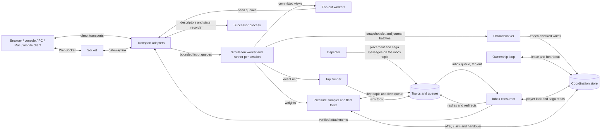

The game image carries one module registry keyed by gameBuild and artifact kind, native or portable. PlaceSession is refused with build-unknown when no entry matches, and with artifact-unavailable when the profile's server artifact cannot be loaded; the saga then retries elsewhere. Runtime module loading does not exist in this version.

Process states are those of "Engine node states": starting → ready → draining → drained → exit, starting → successor → ready for a class A successor, and retired for a ready or draining process that meets stale-incarnation while holding sessions. Readiness follows RegisterEngine, and for a successor the close of its handoff. Heartbeat runs every 5 seconds with usedUnits, usedMemoryBytes, usedEgress, the pressure state and the session list, which acknowledges that a placement took effect. Liveness derives from the age of the ownership loop, not from the existence of the process. Lease renewal and heartbeat never run on a simulation worker, so a slow tick cannot cost a lease.

The queue channel, which carries every service queue message, delivers PlaceSession, EntitlementUpdated and Drain through the engine's inbox queue. The Engine answers each by publishing PlacementReply to the Inspector work topic, whose round-robin group inspector hands it to one Inspector instance; the reply carries the outcome and the messageId it answers. Each message is idempotent by messageId and epoch, so a repeated PlaceSession returns the first answer and creates no second session. Inspector republishes an unanswered message after 5 seconds with the same messageId, arguments and epoch. A reply is a hint, not an acknowledgement: the heartbeat session list is the acknowledgement, and the order of messages carries no meaning. EntitlementUpdated reaches the session object as OnEntitlementChanged at the next tick boundary, never mid-tick. Drain(mode) starts the drain runbook (see "Clustering, regions and deployment").

### 11.2 Per-session isolation

A session is the unit of placement, isolation and failure. Each session owns its simulation worker, runner instance, input queues, event ring, baseline rings, offload slot and an arena of plain records sized to maxPlayers. No mutable state is shared between two sessions. A native module keeps no process-wide mutable state; a sandboxed instance is never shared, so the sandbox enforces what a native build only promises.

Faults stay inside their session. A sandbox trap, a native panic and state-invalid from Encode or Snapshot each end that session with faulted, and every other session keeps its tick. Containment of a native build covers only failures the host can intercept. A native module that corrupts process memory is outside what the Engine can contain, which is why the sandboxed runner exists.

Resources are charged before a session exists. Placement reserves the session weight in capacity units and the memory estimate in bytes through engine_reserve. A sandboxed session adds its full sandboxMemory in bytes, never converted to units. Per-session bounds, all starting values: input queue 128 per player; event ring 1024 entries of at most 4 KiB; baseline ring 32 ticks per interest class; 64 ledger requests in flight; one offload slot. A full bound drops and counts; it never grows and never blocks the tick.

Fan-out workers serve every session of the process. Each job encodes one committed view for one interest class, and its duration is charged to that session's encode budget. A session whose encoding falls behind loses its own pending views (see "Tick loop and deadline accounting"). It never delays another session's Tick, which runs only on that session's own worker.

### 11.3 Session states in the Engine


The terminal states are ended, failed and faulted. A handed-off, moved or superseded copy leaves the process without ending the session, because another incarnation or engine owns it. moving is the source's frozen copy between the freeze and the handover; moved is the frozen copy the source retains after the handover (see "Session moves under pressure"). The words orphaned, migrating and recovering name no session state. Inspector writes orphaned into the placement field of the session index, and lease_handover writes migrating. Clients see recovering for a session whose placement is orphaned or migrating or whose adopter is in loading, which covers a move between the source's freeze and the target's first tick.

Only the owner advances the session state while a live lease exists. Inspector writes failed only for a session without a live lease, such as one whose owner missed the 30-second report deadline. failed and faulted are reported through ReportSessionEnded with their reason; faulted carries an abandoned result under the profile's abandon policy. The room and every consumer see a reason, never a silent end. A terminal session is never adopted, because lease_release with a final state removes its snapshot and journal.

### 11.4 Lease renewal and suspension

Default lease: **15 seconds**; renew every 5 seconds; self-fence at 12 seconds on the owner's monotonic clock. The ownership loop renews with lease_renew and records the instant of the last success. Every simulation worker compares that instant with its own clock reading at the start of each tick. A process paused past the deadline therefore suspends on its first tick after resuming, without an external signal. The 3-second margin covers clock skew and renewal latency; it is a margin, not a grace period for a second owner.

A suspended session refuses inputs with session-suspended, stops outbound state, keeps forwarding audio, never video, and keeps its RAM. The worker calls no Tick and issues no store write for it. When lease_renew or lease_reacquire succeeds, the session resumes within one tick from the tick at which it suspended. The deadline origin is rebased to the resume instant, so the suspended interval counts as neither lag nor skipped ticks. A store outage costs time, never game state.

A lease-lost answer to lease_reacquire means another engine adopted the session at a higher epoch. The copy is discarded as superseded and logged at error, and no result, event or snapshot leaves it. A stale-epoch answer to any write has the same consequence. Outside traceless mode an operator may configure a local path for a forensic snapshot of the discarded copy. In traceless mode the start-time gate refuses such a path (see "Anonymous traceless mode"). After a store restart that lost the dataset, the engine runs index_restore for every session it holds and re-registers.

### 11.5 Tick loop and deadline accounting

Each simulation worker drives its session with a fixed-timestep scheduler at the profile's tick rate, 1 to 60 Hz. The period is 1 ÷ tickRate. Tick n is due at origin + (n − n0) × period on the host's monotonic clock. The origin and n0 are set at session start, at a rate step and at a resume after suspension. The host reads the clock once per tick; the session object never reads a clock and never receives elapsed time.

| Phase | Work | Budget at 60 Hz |
| --- | --- | --- |
| Drain | move due inputs and host events into the tick's delivery list | 0.5 ms |
| Simulate | host events, OnInput in canonical order, Tick, Commit; Snapshot and Digest on a snapshot tick | 8 ms |
| Interest and encode | Interest per receiver, Encode per interest class against the committed view, on fan-out workers | 3 ms |
| Enqueue | frames into per-connection send queues | 0.5 ms |
| Slack | memory reclamation and scheduler jitter | at least 4 ms |

Budgets are starting values for load tests, not measured capacity. The testkit fails a module whose Tick exceeds 8 ms p99 at 60 Hz. Alert when tick duration p99 exceeds 80% of the period.

Lag is the start time of a tick minus its deadline. An overrun is a simulate phase that ends after the next tick's deadline. When deadlines have passed, the worker runs up to 3 ticks back to back. If deadlines are still passed, a server-authoritative session skips to the present: the tick counter advances to the tick now due, and each skipped tick number is counted and never simulated. A client that predicted a skipped tick is corrected by the next StateUpdate. A lockstep session never skips a tick; it runs late and keeps every runner in step.

Default degradation rule: more than 10% skipped ticks over 5 seconds lowers the rate one step; 60 seconds without overruns raises it one step. A lockstep session counts overruns instead of skipped ticks. The ladder is 60 → 30 → 20 → 10 Hz. A rate between ladder values steps to the next lower value, and a rate at or below 10 Hz has no lower step. Recovery never exceeds the profile's tickRate. A step applies at a tick boundary as a RateChanged host event, so every runner changes at the same tick. A warning is logged; a session is never ended for lag.

Tick and Encode never share mutable state. Commit at the end of Tick publishes an immutable ReadView, and fan-out workers encode it while the next Tick mutates the working state. A session holds at most one view in encoding and one pending. A newer pending view replaces an older unsent one and counts as an encode skip. A skip costs latency, not correctness, because each receiver's next delta targets its own last acknowledged tick. Track tick duration per profile, lag, overrun streaks, skipped ticks, encode skips and rate steps, with labels free of identifiers.

### 11.6 Input application and acceptance window

Inputs carry sequence, generation, target tick and payload, and each belongs to one attachment keyed by sessionId. Adapters deliver each frame with its arrivalTick, the tick the session simulates next at receipt. Default input queue: **128 per player**. Acceptance is evaluated against arrivalTick, not against the tick at which the worker drains the queue. A stalled worker therefore never turns a punctual input into a late one.

| Input condition | Outcome |
| --- | --- |
| Target tick in [arrivalTick, arrivalTick + 8] | buffered and applied at its target tick |
| Target tick in [arrivalTick − 2, arrivalTick − 1] | applied at the current tick under late-input policy apply (default); dropped as late under policy drop |
| Target tick outside [arrivalTick − 2, arrivalTick + 8] | dropped as outside-window |
| Target tick skipped by the lag policy | applied at the first simulated tick after the skip |
| Sequence at or below the player's watermark | dropped as duplicate |
| Generation of a stale attachment | discarded as stale-generation |
| Sender without a seat, or input-muted | dropped as no-input-right |
| Input queue full | arriving frame dropped as queue-full; buffered inputs kept |
| Session suspended | refused with session-suspended |
| Session frozen for a move (moving or moved) | discarded; input redundancy and the client's replay stream resend it to the target |

Before each Tick the session object receives host events in their sequence, then inputs in sequence order per seat with seats ascending. Every runner reproduces this canonical order, and the journal records it. Unreliable-lane frames repeat the last 3 unacknowledged inputs; the copies are dropped as duplicates and never applied twice.

After the drain the worker computes each receiver's ackInputSequence. It is the highest sequence s such that every input of the attachment up to s has a final outcome, applied or dropped. A buffered early input therefore holds the value below its own sequence, even after a higher sequence was dropped. Each StateUpdate also carries the observed input lead and the inputs dropped since the previous update. Drops are reported to the affected player only; metrics count them by reason.

A lockstep server runner validates seat, sequence and window the same way. It relays one TickFrame per tick once every seat's input arrived or the stall deadline passed. Default lockstepInputDelay: **3 ticks**; stall deadline: 6 ticks. A missing input is replaced by an empty input and its seat is marked lagging. Frame content and digest checks are specified in "Portable session object, client prediction and state synchronization".

### 11.7 Service queue inbox

Each Engine consumes exactly two queues of the queue role, both bound fan-out and both consumed by its engineId alone. They are its inbox queue, bound to its inbox topic {bus:G:engine:E}, and its fleet queue, bound to the fleet topic {bus:G:fleet}. It declares both topics, both queues and both bindings at start, before RegisterEngine, so no producer reads the registry entry of an engine whose inbox does not exist yet. The inbox carries PlaceSession, EntitlementUpdated, Drain, PlayerJoining, PlayerLeaving, PlayerRegrouped and ClaimAssigned from Inspector, MigrationClaimed and redirects from engines, and a pruned engine's messages from the reconciler. The fleet queue carries SessionPressure and CapacityAvailable; every message on it is a hint, acknowledged on receipt. The Engine publishes only to topics of the topic role, never to a queue: the Inspector work topic, the inbox topics of other engines, the fleet topic and, with a declared consumer, the sink topic. Both roles are specified in "Integration bus"; this subsection fixes what the Engine does with each delivery.

Delivery on the inbox queue is at least once within a 10-minute horizon, and order is optional. No order holds between any two messages, two messages with the same key from the same producer included. Duplicates, reordering and redelivery after a consumer restart are normal operation, never faults. The consumer derives every effect from messageId, fence and epoch, never from arrival order or from the order a reference adapter happens to deliver in. A message past its expiresAt or older than its topic's horizon is acknowledged unread and counted as expired, never applied.

The consumer acknowledges a message only after its outcome is final: applied at a tick boundary, refused with a code, redirected or dropped by fence. A message that cannot succeed yet is nacked with a delay of 0 to 60 seconds, as the redirect and handoff rules below state. A message that can never succeed, of an unknown type or version, with an invalid schema or from a producer kind the inbox topic does not admit, is dead-lettered at once and never nacked in a loop. An unsettled delivery returns with deliveryCount + 1 after the 10-second visibility timeout, and so do the held deliveries of a crashed or restarted process. After 10 deliveries the adapter moves the message to the inbox queue's dead-letter queue, and the Engine logs it at error and counts it.

Every Consume renews the inbox queue's idle expiry, so the queue and its binding expire 60 seconds after the engine's last Consume. The reconciler consumes the inbox queue of a pruned engine to exhaustion before that expiry, the one case in which another process consumes it (see "Inspector"). A Consume answered queue-unknown, such as after a store restart in the ephemeral profile, makes the Engine declare its topics, queues and bindings again at once. Lag of the inbox and fleet queues feeds metrics and alerts only; it is never a pressure dimension or a correctness input.

A message for a session this engine does not hold is redirected, never applied. The consumer republishes it with the same messageId and hop + 1 to the inbox topic of the holder the session index names, or of the claim target while placement is migrating. It acknowledges the delivery only after that Publish is accepted, so a crash between the two steps yields a redelivery, never a lost message. When the placement is orphaned it nacks the message with a 1-second delay instead. A fourth redirect dead-letters the message, so no message circles between engines. A source whose session is in moving holds the session's messages until the handover and then redirects them to the claim target (see "Session moves under pressure").

PlacementReply, MigrationClaimed and SessionMoved, which the Engine publishes, carry messageId = producerId + producerIncarnation + producerSequence; SessionPressure carries messageId = offerId. A retry or republish reuses that messageId and never mints a second one for the same step. Publish answers per message and a batch is not atomic: a refused message, and every message of a batch answered unavailable, is published again with backoff and the same messageId. A message above the 16 KiB cap is a defect, logged at error, never split. During a class A handoff window both incarnations consume the inbox queue as competing processes of one consumer identity. A message for a session the receiving incarnation does not own at that instant is nacked with a 100 ms delay.

Sink facts leave the Engine only with an event sink consumer declared. The tap flusher publishes them to the sink topic of the engine's own region, 16 shard streams in the coordination-store stream adapter, in batches of at most 256 facts, never on a simulation worker. Each fact is one message of at most 4 KiB in the sink-fact envelope, whose eventId is its idempotency key. Refused facts, and every fact of a batch answered unavailable, are published again with unchanged eventIds. At start, before RegisterEngine, the Engine declares the sink topic and binds the round-robin group of every declared consumer, named after its service. A fact published before that consumer's first start therefore waits for it within the 10-minute horizon. The Engine consumes no queue of the sink topic. Without a declared consumer the sink topic does not exist and the Engine publishes nothing to it (see "Integration bus").

In the Minimal profile and in traceless mode the coordination-store stream adapter is the only adapter of both roles. The inbox, fleet and Inspector work topics, their queues and their dead-letter queues are expiring keys of the one store, and no sink topic exists. In traceless mode a dead-lettered inbox message is logged with its type, a keyed digest of its messageId and its reason only. In the Standard profile and the Full profile a broker family selected for the service topics carries the inbox, fleet and Inspector work topics and their queues. The player lock, the saga record and every outcome stay in the store. A broker outage therefore fails new sagas closed with retryable-unavailable at Inspector and never corrupts one, while attachments already admitted continue. No optional service consumes an inbox or fleet queue; optional services bind their groups on the sink topic (see "Integration bus").

### 11.8 Saga verification before attachment

An Engine admits a rights-granting step only after it has verified, under the player's lock, that the shared store matches every message id it received for that player. Inspector publishes PlayerJoining before it writes the store, and the queue is unordered, so a message may arrive before, during or after the saga it announces. The Engine never acts on a message alone: the message is a trigger and the store is the truth. A valid admission ticket is necessary, not sufficient.

1. Park. The consumer parks each PlayerJoining, PlayerLeaving and PlayerRegrouped in the pending set, keyed by messageId. An Attach carrying a valid admission ticket counts as a delivery of the messageId or claimId the ticket binds and is parked the same way.
2. Lock. The consumer calls lock_acquire for the player as holder kind engine with its engineId and incarnation. lock-held is the normal answer while Inspector runs its saga; the consumer retries with backoff from 25 ms doubling to 200 ms with full jitter, for at most the 6-second lock wait.
3. Read. Under the lock the consumer calls saga_read for the session and reads the player's member field of the room. It writes nothing under the lock, and its hold targets less than 10 ms.
4. Release. The consumer calls lock_release with its fence and then evaluates the verification rule on what it read. The lock exists for one reason: Inspector's steps touch {player:P} and {room:R}, which no single procedure reads together, and the lock makes both reads see the state between two sagas, never the middle of one.
5. Apply. On a pass the decided state takes effect at the next tick boundary. On a failure the consumer re-reads with backoff for at most the 6-second verification wait.

The verification rule is evaluated per player P and session S. A is the applied fence, the highest fence the engine has applied for P in S. Rcv is the set of message ids received for (P, S) with a fence above A. Cmt, Abt and Pnd are the committed, aborted and pending entries saga_read returns for S with a fence above A. The verification passes when Pnd is empty, every id in Rcv is in Cmt or Abt, the highest-fence entry of Cmt is in Rcv, and the member field carries that entry's sagaMessageId, or is absent when that entry is a leave.

On a pass the engine sets A to the highest fence in Cmt and applies only that entry's state, never an intermediate one. A join or admit makes the attachment admitted, a leave detaches it and a regroup changes role and seat. An older committed entry the engine never received is superseded and needs no delivery. When it arrives later, its fence is at or below A and it is acknowledged without effect. A strict match that waits for every superseded message is not this rule, because one dead-lettered old message would block a player forever.

Rights are granted and removed asymmetrically. A step that grants rights waits for a pass: a join, an admit, or a regroup to a role with a seat or publish rights. A step that removes rights is a leave or a regroup to a lesser role. Once committed, it is applied at the next tick boundary as soon as saga_read shows it as the highest entry, even when its message never arrived. Removal is safe without the message; admission is not. A message with a fence at or below A is a duplicate or superseded and is acknowledged without effect.

No transport state exists before a pass. Only after the pass does the Engine accept the Attach bound to that message id and assign the seat. Only then does it create the attachment's transport state: the WebSocket or TCP stream binding, the secure UDP keys, the WebRTC peer connection and ICE agent and any relay allocation. Until then the Attach is held unanswered for at most the verification wait, and no OnJoin is delivered (see "Transports and wire codec").

A failed check re-reads with backoff from 50 ms doubling to 400 ms, for at most the 6-second verification wait from the first receipt. The wait exceeds the 5-second lock lease, so a live Inspector saga always commits, aborts or self-fences inside it. When the wait lapses with a rights-granting message unmatched, the engine acknowledges the message and refuses every Attach bound to it with saga-incomplete. It keeps nothing: no seat, no key, no transport state and no relay allocation, so a half-open attachment is impossible. A message refused this way never enters the applied set, so the republish of a client retry is processed afresh.

Default pending set: **4096 messages** per engine; when it is full, the oldest is refused with saga-incomplete. The engine keeps an applied-id set of 65,536 ids for 10 minutes as a fast path for duplicates. The fence comparison is the correctness rule and the set is a cache, so evicting it changes no outcome.

Order between steps comes from the fence, not from the queue. A leave delivered before its join passes on its own: the leave is the highest committed entry, the player ends detached and no transport is ever created. The late join is then dropped by fence. A join delivered while the player's earlier leave is still pending waits for that saga to commit or abort. Two joins of one player from two connections resolve the same way: the higher fence wins, and the engine detaches the lower one's attachment with superseded or never creates it.

Removal by presence expiry publishes no message: the resume window governs the seat (see "Client connection and presence"), and a later join starts a new saga. A group change inside a session, by CreateGroup, MoveToGroup or DissolveGroup, is Engine-local and runs no saga, because the Engine is the only authority over the group graph. A re-attach with a valid resumeToken to an attachment the engine still holds within the resume window runs no saga either; it neither creates a seat nor grants a right.

An engine that loads a session by allocation, adoption, move or class A import builds membership from the store, not from messages. For every member of the room it runs saga_read for the session without the lock. A committed highest entry is applied and becomes the applied fence. An entry at or below the snapshot's applied fence for that player was applied before. A pending entry keeps the player pending until a redirected or republished message passes the rule.

Each join costs the Engine about 4 store calls, each confined to one tag. A store outage stops new attachments with saga-incomplete after the verification wait, while attachments already admitted continue and the tick never waits on the store. No optional service changes this subsection. With Profiles present the principal is a member instead of a guest, and the saga and the rule stay the same.

### 11.9 Offload worker

The offload worker makes a session continuable by another process; it never makes the store authoritative. Its unit is a versioned snapshot envelope.

| Envelope part | Content |
| --- | --- |
| Identity | sessionId, ownerEpoch, gameBuild, schemaHash, snapshotSchemaHash |
| Position | tick, snapshotRevision, occurredAt |
| Membership | roster, group graph, mute matrix |
| Continuity | per-player sequence watermarks, per-player applied saga fences, resume token digests |
| Integrity | checksum, stateDigest |
| State | Snapshot bytes in the canonical state codec |

The simulation worker calls Snapshot and Digest at a tick boundary after Commit. It hands the bytes to the session's offload slot, and the offload worker assembles, compresses and writes the envelope with snapshot_commit. A newer snapshot replaces an unwritten older one, so a slow store costs freshness, not memory. At most 64 writes are in flight per node, and the tick never waits on the store.

Default snapshot interval: **5 seconds** (1 to 300 seconds per profile). A snapshot is also taken after every membership change and synchronously at the frozen tick of every move, for pressure, drain or rollout. Membership changes are joins, leaves and role, team, group or mute changes. Default journal batch: **100 ms** (50 to 1000 ms).

| Durability class | Default for | Writes | Crash loss bound |
| --- | --- | --- | --- |
| snapshot-only | 60 Hz profiles | snapshots on interval, membership change and drain | one snapshot interval |
| snapshot-and-journal | turn-based and social profiles | the same snapshots plus one journal batch per batch interval | one journal batch |

A journal batch records, per simulated tick, the tick number, the host-event records and the accepted inputs in canonical order. Recording tick numbers rather than a count makes skipped ticks and rate steps replay exactly. Host events travel in the journal because inputs without their control decisions, scheduled tokens and entitlement changes would diverge on replay. Entries at or below the committed snapshot tick are ignored on replay and may be trimmed.

Snapshot target: 64 KiB; hard cap: **256 KiB**, measured on the uncompressed Snapshot bytes before the write. The envelope adds at most 64 KiB at 256 seats, so a stored object stays within 320 KiB before compression. Compression applies after the cap check to every envelope above 16 KiB. A snapshot above the target logs at warn. Above the cap it is not written: snapshot-too-large counts against the module, an error is logged and the last committed snapshot stays the recovery point. Nothing is silently truncated.

A snapshot holds exactly the effects of every tick up to its tick. snapshot_commit succeeds only when the caller's epoch equals the index epoch and its snapshotRevision exceeds the stored one. On stale-revision a newer write already landed, and the older write is dropped and counted. stale-epoch supersedes the copy, and journal_append carries the same epoch check. An owner takes its next snapshotRevision from the index whenever it acquires, reacquires or takes back a lease.

No write leaves a suspended session, or a class A successor before its lease_transfer is acknowledged; the slot keeps only the newest pending snapshot. No write leaves a source after its lease_handover either: while placement is migrating, snapshot_commit and journal_append refuse every caller with session-moving, and after the target's acquisition with stale-epoch. Session keys live 10 minutes after the last owner write. On a clean end Inspector's lease_release deletes the snapshot, journal and players keys, and the session index expires 10 minutes later. Arithmetic: 1000 snapshot-only sessions at 64 KiB every 5 seconds write about 12.5 MiB/s, while per-tick snapshots at 60 Hz would write about 3.7 GiB/s. Alert on offload queue age above 10 seconds.

In the Minimal profile a snapshot survives an Engine crash but not a simultaneous loss of the ephemeral store. In traceless mode the offload worker writes only store keys with an expiry. snapshot-and-journal stays permitted there, because the journal is a store stream, never a directory. No optional service changes the offload path.

### 11.10 Restart class A: planned handoff

Class A replaces the Engine process on the same host without ending sessions. For the transports marked preserved below, it also keeps connections open. It requires a successor on the same host with the same engineId, drain.mode=handoff and a local handoff socket that carries open descriptors. In this version class A exists on bare hosts and in the single-host compose deployment. It is not available on the container orchestrator, where migrate mode is the documented path (see "Clustering, regions and deployment").

| Message | Direction | Carries | Result codes |
| --- | --- | --- | --- |
| ready-to-adopt | successor → predecessor | engineId, incarnation, gameBuild, loadable artifact kinds | accepted, build-unknown |
| listeners | predecessor → successor | listening descriptors, admission nonce set | ok, rejected |
| batch | predecessor → successor | the admission nonces consumed since listeners was sent; per session: envelope, frozen tick, offset to the next deadline, applied saga fences, pending messageIds, transport state records, connected descriptors | transferred, restore-failed, transfer-failed |
| datagram | predecessor → successor | one datagram of a transferred session with its source address | none |
| late-connection | predecessor → successor | a connection accepted for a session after its batch | transferred, rejected |
| sockets-released | predecessor → successor | none | ok |
| complete | successor → predecessor | none | ok |
| abort | either direction | reason | none |

1. The successor loads the module registry, connects to the store and calls RegisterEngine with the predecessor's engineId, incarnation + 1 and state successor. This opens the 30-second handoff window, and the successor sends ready-to-adopt. The predecessor marks itself draining and keeps heartbeating with its full session list for the whole handoff.
2. The predecessor sends listeners with every listening descriptor and the admission nonce set. A ticket consumed before the handoff thus stays consumed. Both processes hold the listeners; only the predecessor reads them until step 5.
3. Per batch (default 64 sessions, a starting value), the predecessor freezes each session at a tick boundary after Commit. It stops reading that session's connections, exports their state records and sends batch, which carries the nonces consumed since listeners was sent. The successor merges them into its nonce set before it resumes the batch's sessions, so a ticket the predecessor admitted during the handoff is never admitted twice. It then calls Restore(bytes, 0), re-arms the transports and resumes the tick counter in RAM at once.
4. The successor calls lease_transfer for every session of the batch, with the same epoch and its own incarnation, and awaits the acknowledgement within the 500 ms ownership-write budget. Until then the predecessor's incarnation holds and renews that lease. The successor defers snapshot_commit, journal_append and ReportSessionEnded for the session until the acknowledgement. Meanwhile the predecessor forwards datagrams of transferred sessions and passes late connections over the handoff socket.
5. When every session is transferred, the predecessor stops reading every descriptor and sends sockets-released, and the successor starts reading. Datagrams arriving in the gap wait in the kernel receive buffer. That bounds the gap to the switch time and does not promise zero loss under saturation.
6. The successor's next heartbeat closes the window; it reports ready to the orchestrator and sends complete. The predecessor scrubs and releases its copies as in "Session end and cleanup" and exits with code 0.

Fencing is unaffected by class A. Both incarnations share the engineId and the epoch, and the epoch never changes. Exactly one of them reads the sockets and writes the store for a given session at any instant. One incarnation renews every lease throughout and the heartbeat lists every session, so the adoption condition is never met during a handoff. Clients observe no epoch change, no leave and no join. Both incarnations consume the inbox queue during the window, as "Service queue inbox" states, and neither offers nor claims a move. A claimed move of the predecessor finishes before the first batch, which costs at most the 5-second ready deadline plus the 5-second handover bound.

Any failed step aborts the handoff, and readiness never moves. The predecessor keeps every frozen copy and descriptor until it receives complete. A batch whose transfer fails or times out goes back untouched: the successor wrote nothing for it, and the predecessor resumes those sessions with their connections intact. A session the successor already resumed is taken back through lease_transfer and restored from the frozen copy, losing the ticks the successor ran. The predecessor commits a snapshot for it at its first tick and never reuses a transport state record the successor advanced. Those connections close with restart reason, and clients re-attach with their resume tokens; the successor exits non-zero.

Per-session freeze target: 2 ticks. Node target: 2 seconds per 1000 sessions; hard bound: **20 seconds**, enforced. Both targets stay unmeasured until the 1000-session handoff measurement, and only the hard bound fails a handoff. When it expires, the predecessor sends no further batch and moves every remaining session through migrate mode with MigrateSession before it exits. One handoff per engineId runs at a time; a second successor is refused with duplicate-incarnation.

| Transport | Planned restart, same host | Crash |
| --- | --- | --- |
| WebSocket through Socket, TLS terminated at Socket (gateway adapter) | Preserved; Socket re-establishes its gateway link to the successor within one tick | Reconnect with resume token through Socket |
| TCP with length-prefixed frames, plaintext or TLS terminated upstream | Preserved; descriptor and buffered partial frame passed | Reconnect with resume token |
| TCP with TLS terminated inside the Engine | Not preserved; closed with restart reason; reconnect target under 2 seconds | Reconnect with resume token |
| Secure UDP | Preserved; keys, packet counters and replay windows pass as plain data in the state record | Reconnect with resume token |
| WebRTC data channels | Not preserved; channels reopen; envelope sequence numbers make the gap explicit and replays idempotent | Reconnect with resume token |
| WebRTC RTP media | Not preserved at transport level; server-initiated ICE restart by the successor inside the 30-second consent window; media gap target 100–500 ms, an unmeasured starting value | ICE restart on the adopter after reconnect |
| TURN allocations on the embedded relay | Not preserved; the client re-allocates during the ICE restart | Re-allocate |
| QUIC-based optional adapter | Not preserved; no state export exists; reconnect with connection resumption and resume token, target 1 round trip | Reconnect with resume token |

Session continuity holds for every row and both restart classes: no participant is removed, state loss stays within the declared bound and the resume token is accepted. Transport continuity holds only where a row says preserved. This table is the whole promise, not a summary of a stronger one. For WebRTC media the restart requirement is met at session level and not at transport level in this version. That is a product decision with the ICE-restart baseline as its default (see "Open questions"). Migration of WebRTC transport state and relay allocations is not part of this version.

### 11.11 Restart class B: crash re-adoption

Class B continues a session on another engine after its owner crashed, hung past the lease or lost the store behind a partition. Adoption is possible only after the lease key expired and the owner's engine key expired or its heartbeat no longer lists the session. It is never earlier. Inspector's reconciler checks every 5 seconds and runs the Adopt saga: engine_reserve → lease_acquire, which increments the epoch → PlaceSession with placementKind adopt → snapshot load. A client rejoin that finds an expired lease starts the same saga at once, but only in an Inspector process that has passed the post-outage guard of "Inspector". Otherwise the rejoin answers retryable-unavailable and the reconciler adopts.

Before accepting an adopt placement, the engine reads the snapshot envelope header. It refuses with upgrade-required when the snapshotSchemaHash differs and the module has no Upgrade. It refuses with build-unknown or artifact-unavailable when it cannot host the build. Each refusal runs the saga's compensation, and the reconciler prefers an engine running the old build. An accepted adoption enters loading and runs these steps.

1. Read the index, the snapshot and, for snapshot-and-journal, the journal entries above the snapshot tick. A missing snapshot moves the session to failed.
2. Verify the checksum, and call Upgrade(oldSnapshotSchemaHash, bytes) when the hashes differ. A checksum mismatch or a refused Upgrade moves the session to failed.
3. Call New, then Restore(bytes, gapTicks). gapTicks is informational: the wall time from the store-recorded commit time of the last restored write to the adopter's first Tick, times tickRate, floored at zero. It is the one sanctioned cross-process wall-clock difference (see "Time and clocks").
4. Compare Digest with the stateDigest of the envelope; a mismatch moves the session to failed. Replay the journal tick by tick, then advance each sequence watermark past the replayed inputs.
5. Build membership from the committed saga entries and the snapshot's applied fences, as "Saga verification before attachment" states. The reconciler consumes the dead engine's inbox queue to exhaustion and republishes each message with its messageId to the adopter's inbox topic, so a join committed after the last snapshot is neither lost nor applied twice.
6. Take the next snapshotRevision from the index and enter active. Commit a snapshot at the first tick and report to Inspector, which updates placement so Socket routes to the adopter.

The first Tick after adoption carries the last restored tick plus one. gapTicks informs game timers and never jumps the tick counter. Clients reconnect with their resume token and keep their seat within the resume window. They receive a resync, a full snapshot of their interest classes at the current tick, and never a leave and a join. Default resume window: **120 seconds** (0 to 3600 seconds per profile). Clients refuse frames whose epoch is lower than the highest they have seen.

Loss bound: one snapshot interval, or one journal batch for snapshot-and-journal. A snapshot refused at the cap extends the bound to the last committed one. Crash re-adoption target: 25 seconds from crash to active elsewhere, which is lease expiry plus one reconciler period plus load time. It is a target to measure, not a guarantee. A predecessor still running behind a partition suspends at its self-fence deadline before its lease expires.

Class B works identically in the Minimal profile, where snapshot and journal live in the ephemeral store until the adopter reads them. Store loss alone loses no session, because live engines rebuild indexes with index_restore; an engine crash together with store loss does. With an event sink consumer declared, the adopter continues SessionEvent seq under the new epoch (see "Integration bus"). Consumers deduplicate by sessionId + ownerEpoch + seq without collision.

### 11.12 Session moves under pressure

A move transfers one active session whole to another engine through a fenced stop-and-copy from the offloaded state. A growing room on a full node is the case it exists for: the loaded engine publishes an unordered pressure message, a free engine claims the session and adopts it from the store. One protocol serves pressure, drain and rollout. MigrateSession, migrate mode and retirement use the same transfer with a target Inspector assigns at once and no claim delay (see "Clustering, regions and deployment"). The session lease is the lock of a move and the epoch is its fence; the fleet topic and the reconciler are hints and fallbacks, never authority.

Session weight follows occupancy: occupied seats and viewer slots, media down-tracks and relay allocations at the moment of measurement (see "Engine node, lease, epoch, placement and capacity"). Placement charges a new session at its room's occupancy plus a growth reserve of 25% of the occupied seats, at least 2 seats. It never charges at maxPlayers, because a reservation at maxPlayers would idle most of a fleet. Growth beyond the reserve is what a move handles.

The pressure sampler reads, every second and per session, the weight in units, memory bytes, egress, media units and attachment count. Per node it reads the used fractions of capacityUnits, egressMbps, mediaUnits and memoryBytes. It reads counters the simulation worker publishes at tick boundaries and never runs on a simulation worker, so sampling costs no tick. A session's growth is its weight now minus its weight 30 seconds ago. A session is growing when that growth is at least max(2 units, 10% of its weight), or when it deferred or refused a join in the last 30 seconds. Projected weight is the weight plus twice the 30-second growth, capped at the weight at maxPlayers plus maxSpectators.

Each node has a pressure state, normal or pressured. A node moves normal → pressured when any dimension stays at or above 80% for 10 consecutive seconds. It moves pressured → normal when every dimension stays below 70% for 30 consecutive seconds. The 10-point band and the two dwell times are the hysteresis; the 90% placement refusal stays the admission limit, not the pressure trigger. The heartbeat carries the state, and placement prefers a normal engine over a pressured one for a new session.

| Eligibility condition | A session may move only when |
| --- | --- |
| Session state | active; never allocating, loading, suspended, ending, handing-off, moving or moved |
| Profile | its migratable flag is true, the default |
| Offload | its last snapshot committed within the snapshot interval plus 5 seconds, and its Snapshot bytes were within the 256 KiB cap |
| Cooldown | 120 seconds passed since its last completed move, and 30 seconds since its creation |
| Engine | neither draining, nor in a class A handoff window, nor a successor incarnation |

Both durability classes are eligible, because the final snapshot is taken at the frozen tick and no journal batch is lost. A lockstep session is eligible, because every runner restores the full snapshot after re-attach. A session with a sandboxed runner, media or an active recording is eligible when the target satisfies the requirements the offer lists. A game opts out only through the migratable flag of its profile.

A pressured node without an open offer nominates at most one session per 15 seconds. It nominates the eligible growing session with the highest growth, ties broken by higher weight and then lower sessionId. When the growing session is ineligible, the node nominates instead the eligible session whose weight most closely covers its excess above 70%, so the growing session gains room on its own node. After an offer lapses unclaimed, the node backs off for that session 30 seconds, doubling to 120 seconds.

To offer the nominated session, the source calls migration_offer({session:S}, epoch, offerId, excluded) → ok; stale-epoch, offer-open, cooldown, not-eligible. It writes offerId, offerUntil = now + 10 seconds and the excluded engines into the session index. excluded holds the previous owner for 300 seconds after a move and every engine whose claim on this session failed in the last 120 seconds. The source then publishes SessionPressure to the fleet topic with messageId = offerId and expiresAt = offerUntil. The fan-out bindings hand a copy to the fleet queue of every engine and every Inspector instance of the region. SessionPressure carries sessionId, ownerEpoch, sourceEngineId, weight, projectedWeight, growth per minute, memoryBytes including sandboxMemory, egress, mediaUnits, relay allocations, requirements, snapshotBytes, durabilityClass, excluded and offerUntil. The requirements are gameBuild, artifact kind, transports, media capabilities, capacity class, clusterId preference and enabled extension libraries. The message is a hint; the index fields are the authority, and a claim against an offer the index does not hold fails.

An engine considers an offer it consumed from its fleet queue for a claim only when it is not pressured, not draining, not in a handoff window, holds no open offer of its own and is not excluded. It must also satisfy every requirement, and its usage after reserving the projected weight must stay at or below 70% in every dimension, which keeps a target out of pressured state by construction. It waits a claim delay of 1000 ms × its highest post-reservation usage fraction plus 0 to 50 ms of jitter, so the freest eligible engine claims first. It then calls engine_reserve on its own {engine:E} for the projected units and memory bytes. Finally it calls migration_claim({session:S}, epoch, offerId, engineId, incarnation, reservationId) → claimId; claim-lost, offer-expired, stale-epoch.

The first fenced claim wins: migration_claim is a compare-and-set that succeeds only while the epoch equals the index epoch, placement is placed, the offer is live and no claim exists. A losing engine releases its reservation at once. The winner publishes MigrationClaimed to the source's inbox topic. The source also reads the index every 250 ms while its offer is open, so a lost MigrationClaimed delays the move by at most 250 ms. An engine named by ClaimAssigned, the reconciler's assignment after 3 seconds unclaimed, proceeds as a claimant, or calls migration_cancel with claim-declined when its own state changed.

Transfer, as five steps, each ending with the condition that permits the next:

1. Prepare. The claimant enters loading, loads the game build and the declared artifact, reserves the sandbox instance and prefetches the latest committed snapshot. It calls migration_ready({session:S}, claimId) within 5 seconds of the claim; a claim not ready by then lapses, and the source cancels it through migration_cancel and re-offers with the claimant excluded. Nothing reaches clients in this step, and the source keeps ticking.
2. Freeze. At the first tick boundary after it reads the ready claim, the source sends SessionMoving(sessionId, ownerEpoch, reason, expectedPauseMs) on the reliable-ordered lane of every attachment, with reason pressure or drain. It enters moving, stops ticking, flushes the session's tap ring with a 250 ms deadline and commits the final snapshot synchronously at the frozen tick. It then calls lease_handover({session:S}, epoch, claimId, snapshotRevision) → ok; stale-epoch, claim-lost, which deletes the lease, sets placement migrating, records handoverRevision and extends the claim by 5 seconds. On ok the source enters moved. On claim-lost the source still holds the lease, returns to active at the same epoch and resumes from its frozen state, and its attachments continue: its first StateUpdate returns each moving attachment to attached. Handover deadline: 2 seconds from the freeze. When the final snapshot_commit or lease_handover is not acknowledged within it, the source calls migration_cancel with outcome lapsed and reads the session index. Placement placed at epoch e without a claim returns the source to active at epoch e; placement migrating means the handover landed, and the source enters moved. While the store stays unavailable the session stays frozen and the source retries, and at the self-fence deadline the session enters suspended like any unrenewed lease.
3. Adopt. The target calls lease_acquire({session:S}, claimId), which admits a migrating session only from the engine its live claim names and increments the epoch from e to e + 1. It loads the snapshot at handoverRevision and calls Restore with gapTicks equal to the ticks elapsed since the freeze. It builds membership from the store as "Saga verification before attachment" states and resumes the tick counter at the frozen tick, so its first Tick carries the frozen tick plus one. It calls migration_complete({session:S}, e + 1, claimId), which sets placement placed and the holder, clears the offer and the claim and records previousOwner and cooldownUntil. Then it calls engine_confirm and publishes SessionMoved(sessionId, ownerEpoch e + 1, holderEngineId, claimId) to the Inspector work topic, whose round-robin group inspector hands it to one Inspector instance.
4. Re-attach. Inspector re-tickets every room member holding a seat or viewer slot with a ticket bound to claimId and pushes AttachRedirect through Socket (see "Inspector"). The target accepts such a ticket only after it has read that the session index names it as holder at its epoch for that claimId. It admits only a player in its roster, matched by the resume token digest, keeps the seat, increments the attachment generation and sends a full snapshot of the receiver's interest classes. A re-attach through AttachRedirect does not count toward the reconnect limit.
5. Retire. The source keeps a tombstone (sessionId → target, epoch e + 1) for 60 seconds from the instant it drops the frozen copy, which answers Attach and datagrams for the session with session-moved and redirects queue messages for it. It keeps listing the session in its heartbeat while it holds the frozen copy, which entitles it to re-acquire after a lapsed claim. On re-acquisition the source drops its tombstone and publishes SessionMoved naming itself as holder at its new epoch, so Inspector re-tickets the members to it. It releases the session's units and drops the copy when the index shows migration_complete or 30 seconds after the handover, whichever comes first.

A load failure on the target refuses the move: a snapshot revision other than handoverRevision, a checksum or snapshotSchemaHash mismatch or an artifact failure. The target then calls lease_release with placement orphaned and the reason, the reconciler adopts the session elsewhere, and the target is excluded for 120 seconds. A target never writes before its lease_acquire, and a source never writes after its lease_handover, so two owners never coexist. Inputs that reach the source after the freeze are discarded; input redundancy and the client's replay stream resend them to the target.

Default freeze-to-first-tick: 500 ms target; hard bound: **5 seconds**, enforced by the claim extension at the handover. Default client-visible pause: **2 seconds** target, the figure of migrate mode. Both targets are unmeasured starting values until the move measurement, not advertised capacity. Session continuity holds across a move as across class B: no participant is removed, the tick counter resumes at the frozen tick, gapTicks reports the elapsed wall time, every seat is kept and the epoch advances exactly once.

No transport state moves between hosts in a move, whatever the restart table says for class A. A WebSocket attachment re-attaches on a new gateway stream, which Socket routes by the new placement. A TCP attachment opens a new stream to the target, and a secure UDP attachment derives new keys from the fresh attachment secret of its redirected ticket. A WebRTC attachment opens a new peer connection to the target, and a relay allocation is re-allocated there. Media pauses for the same interval as the state.

Between the offer and the freeze, existing players of the source continue, and the source verifies and admits joins while its node stays below the 90% refusal threshold. At or above that threshold, Inspector answers JoinRoom and Admit for a new member with session-moving and a 1-second retry hint, never capacity-exhausted while a move is possible. In moving, the source answers Attach for the session with session-moving and holds the session's queue messages until the handover. After the handover it redirects them to the claim target with the same messageId. A join the source verified before the freeze travels in the snapshot roster with its applied fence, so its ticket holder is re-ticketed even when it never attached. A rejoin of a player holding a seat is never refused for capacity, because its weight is charged already.

When an offer lapses unclaimed and the reconciler found no free engine as candidate, the source calls migration_cancel with outcome bound, which sets pressure=bound in the session index. The source then refuses with capacity-exhausted any attachment that would raise its node above the 90% refusal threshold, and Inspector refuses new members of that session with capacity-exhausted and a 30-second retry hint. Every existing player continues, and the session never ends for capacity. The source re-offers with the nomination backoff while it stays pressured, and at once when the fleet tailer consumes CapacityAvailable from its fleet queue. pressure=bound clears on a completed move or when the source node returns to normal.

Drain and a class A restart stop pressure offers and claims. A draining engine, an engine in a class A handoff window and a successor incarnation neither offer nor claim. Drain cancels the node's unclaimed offers and lets a claimed move finish before a handoff starts. A class A handoff keeps the engineId and the epoch and needs no move.

Each failure during a move compensates as the failure table of "Session move" states; the Engine-side steps above are what that table's compensations run.

Move metrics and logs are kept per engine. Track the pressure state per dimension, a session growth histogram, offers published, claims won and lost and offer-to-claim latency. Track freeze-to-first-tick and client pause histograms per profile, moves completed and aborted by reason, capacity-exhausted refusals per game and bound sessions as a gauge. Count a ping-pong when a session moves back to an engine that owned it in the last 10 minutes. Alert on bound sessions above zero for 60 seconds, a move abort rate above 10% over 10 minutes, client pause p99 above 2 seconds and any ping-pong. Log every step at debug with sessionId, claimId and engineIds, a completed move at info with its duration and pause, and capacity-exhausted, an unclaimed offer and an aborted move at warn. Log a restore failure after lease_acquire and any ping-pong at error. Metric labels carry region, engine, game and reason only, never a sessionId.

The Minimal profile carries the whole procedure, because offers, claims and moves need only engines and the coordination store. A single-engine installation degrades to capacity-exhausted for new members of a bound session. With Statistics present, session facts continue their seq under the new epoch, as after an adoption. With Recording present, the recorder seals its open segment at the freeze and opens the next one on the target, so the manifest shows a pause, not a gap. The target must link the same extension libraries, which the requirement list enforces. With Payment present, the re-minted tickets carry the feature list from the current entitlement projection. In traceless mode a move writes nothing outside expiring store keys, and no file appears on either engine.

### 11.13 Game module interface

A game developer implements two interfaces, GameModule and GameSession, specified as abstract operations. GameSession is the session object: a pure simulation whose state lives in the generated state container of its state schema. One source builds three artifacts under one schemaHash: the native server build, the portable build for a sandboxed target and optional custom client session code. WebAssembly is the reference portable target. Boundary payloads cross as bytes of the positional codec, so the contracts define the boundary, not a language. Determinism and prediction are specified in "Portable session object, client prediction and state synchronization"; this subsection fixes what the Engine calls, when and where.

| Operation | Inputs → outputs | Errors | Contract |
| --- | --- | --- | --- |
| Describe | none → GameProfile | none | constant per build; carries tick rate, seat and spectator limits, late-join, input window and late-input policy, snapshot interval, durability class, sync model, artifacts per runner kind, sandboxMemory, groups, media policy, host controls and migration, the migratable flag for session moves, abandon policy, service requirements, spectator delay, achievement definitions, maxInterestClasses, the recording fields recordingAllowed, maxRecordingScopes, dataTap and timelineCustom, and the extension message domain |
| New | sessionContext → GameSession | none | called on allocation, adoption and class A import; touches nothing outside the new instance |

Lifecycle. On allocation the host calls New, then Init, then per tick the host events, OnInput, Tick and Commit, and finally End. On adoption and on a class A successor it calls New, then Upgrade when needed, then Restore. Init is not called there, because the complete canonical state holds the Init arguments, seeds included. Close is the host's release of the instance on every exit path, not a module operation. The module never calls End: it commands EndAt(tick), and the host calls End at that tick.

| Operation | Inputs → outputs | Errors | Preconditions and postconditions |
| --- | --- | --- | --- |
| Init | seed, serverSeed or none, tickRate, roster, options, role → ok | invalid-options | once, before the first Tick of an allocated session; invalid-options moves the session to failed |
| Tick | tick → ok | none; a trap ends the session with faulted | every host event and input of the tick delivered first; step is 1 ÷ tickRate |
| Commit | none → ReadView | none | after Tick; the view is immutable; cost proportional to changed state |
| Snapshot | none → bytes | state-invalid | at a tick boundary; canonical bytes with a completeness header, complete on the server; at most 256 KiB |
| Restore | bytes, gapTicks → ok | incompatible-build, snapshot-partial | replaces the whole state; requires a complete snapshot on the server |
| Upgrade | oldSnapshotSchemaHash, bytes → bytes | refusal, reported as upgrade-required | optional; called before Restore when the hashes differ |
| Digest | none → 128-bit digest | none | digest of the Snapshot bytes at the current tick |
| End | reason → result | none | host only, at a tick boundary; the result carries its digest and point deltas |

Each host event applies at a stamped tick and is delivered before that tick's Tick in canonical order. Each is also a HostEvent record that entitled clients receive through HostEvents and that the journal stores.

| Host event | Inputs → outputs | Delivered |
| --- | --- | --- |
| AdmitPlayer | profile, role → accept or reject | at a player's first Attach; reject refuses the attachment with the module's reason |
| OnJoin | player, seat, isRejoin → accept or reject(reason) | at the tick boundary at which the attachment becomes live |
| OnLeave | player, reason | at the tick boundary after a leave, a kick or resume-window expiry |
| OnInput | seat, sequence, tick, payload | after the tick's host events, by sequence per seat, seats ascending |
| OnControl | controller, command → allow or veto(reason) | before a controller command takes effect; the decision is part of the record |
| OnGroupChanged | player, groups | at the tick boundary of the group change |
| OnEntitlementChanged | player, features | at the tick boundary after EntitlementUpdated |
| OnInventoryResult | requestId, outcome | at a tick boundary after the item ledger answered or timed out |
| OnScheduled | token | at the tick a Schedule command named |
| RateChanged | tickRate | at the tick boundary of a rate step |

| Operation | Inputs → outputs | Errors | Contract |
| --- | --- | --- | --- |
| Interest | receiver → all or entity ids with priorities | none | fan-out worker, last committed view; per tick or at the declared interval |
| Encode | view, interestClass, baselineTick or none → bytes | state-invalid | fan-out worker, reads only the view; state-invalid ends the session with faulted |
| Decode | bytes → StateUpdate | malformed | fan-out worker; the inverse of Encode |
| ApplyDelta | update → ok | baseline-missing, schema-mismatch | simulation worker; consumes the output of Decode |

Threading contract. Init, Upgrade, Restore, every host event, OnInput, Tick, Commit, ApplyDelta, Digest, Snapshot and End run serialized on the session's simulation worker. That serialization is the precondition of the canonical delivery order. Interest, Encode and Decode run on fan-out workers against the last committed view and never touch the working state. No operation blocks on I/O.

| Session context operation | Kind | Effect |
| --- | --- | --- |
| Roster, Groups | query | views delivered at the last tick boundary |
| Inventory(player), Entitlements(player) | query | cached views; empty without Inventory; role defaults without Payment |
| CreateGroup, MoveToGroup, DissolveGroup, SetMute, SetVisibility | command | applied at the next tick boundary as a host event |
| SetInterest, TagEntity | command | used from the next encode |
| Send(player, lane, payload), Broadcast(group, lane, payload) | command | enqueued after Commit under group visibility |
| Emit(event) | command | appended to the event ring; one branch and no allocation without a declared consumer |
| Schedule(tick, token) | command | OnScheduled(token) at that tick |
| Consume, Grant → requestId | command | item ledger request off the tick; answer as OnInventoryResult; inventory-absent without Inventory |
| Kick(player, reason), TransferHost(player), EndAt(tick) | command | applied at the next tick boundary, or at the named tick for EndAt |
| Log(level, fields), Metric(name, value) | command | typed fields only; forbidden field types refused at construction |

Nothing else is public. Commands take effect only through a later host event at a defined tick, so no command returns data in the tick that issued it. A requestId is a handle, not an answer. On a client runner commands are discarded and queries answer from the replay stream, which lets one session code run on every runner.

The session object never reads a clock, opens a socket, file or store connection, spawns a thread, blocks or calls a platform facility. It keeps no mutable state outside its instance, and no unordered iteration affects its state. Entity ids come from a counter in the state, never from an address or a randomized hash. Randomness comes only from Random(key) and SecretRandom(key) of the session library. NaN and infinity never enter the state container. Scratch data outside the container is a cache that Restore rebuilds, never state. A sandboxed artifact cannot make the forbidden calls, because the runner imports none of those facilities; the determinism test, not the host, holds a native build to them.

Runner contract: Load(artifact, limits) → instance, with load-failed, limit-exceeded or schema-mismatch; Call(operation, arguments, deadline) → result, with trapped or over-deadline; Unload(). The runner is the only code that calls the boundary. Sandboxed server runner defaults, unmeasured starting values until the sandbox measurement of "Testing strategy and acceptance gates": sandboxMemory 64 MiB (16 to 512 MiB per profile), reserved in full at placement. The fuel ceiling per call is 10 times the tick budget, 80 ms equivalent at 60 Hz, calibrated against the sandbox's fuel unit at process start. Instantiation from a pre-compiled artifact takes at most 5 ms, and boundary crossings cost at most 0.1 ms per tick. Instances are never shared between sessions and are released in Close.

A trap at the memory limit, at the fuel ceiling, on invalid access or on an unreachable instruction ends that session with faulted. A Tick over budget that stays below the fuel ceiling is an ordinary overrun under the lag policy. A module that violates a bound is degraded and reported, never silently truncated. The Engine hosts native and sandboxed sessions side by side from one registry. A module written for the Minimal profile runs unchanged with Inventory, Payment or Profiles present, because only the answers behind the same operations change.

### 11.14 Session end and cleanup

A session ends in exactly the five ways "Session, players, teams, groups, observer and session events" lists. They are EndAt(tick), an EndSession control from the host or a moderator's control ticket allowed by OnControl, the empty-session timeout, maxSessionSeconds, and OperatorEndSession on the operator endpoint, which ends it with reason operator. A fault ends a session without End. A session is empty when no SessionPlayer of role player or observer is in joining, active or disconnected; spectators alone never hold it open. Defaults: empty-session timeout 60 seconds after the session becomes empty; maxSessionSeconds 4 hours (up to 24 hours). The host calls End at the tick EndAt named, and at the next tick boundary for the other ways. A fault skips End and yields an abandoned result under the profile's abandon policy.

1. The host calls End(reason) and the session enters ending. End returns the result, its digest and the point deltas.
2. The engine calls ReportSessionEnded(sessionId, engineId, epoch, finalState, resultDigest, pointDeltas), which Inspector makes idempotent through its settled set.
3. On acceptance the engine sends the result as SessionResultNotice on the reliable-ordered lane of every live attachment. When a consumer is declared, it also emits SessionResult with the accepted sessionId and ownerEpoch.
4. Inspector's lease_release with the final state, run inside ReportSessionEnded, deletes the snapshot, journal and players keys; the index, which holds no playerId, expires 10 minutes later. The session enters ended, and the Engine stops renewing on acceptance.
5. Attachments close with session-ended after their reliable queue drains, or after 5 seconds by default. Close then releases every per-session resource.

No result reaches clients or the sink before acceptance, so a suspended or fenced engine never emits one. When the store is unavailable at step 2, the session keeps its final state and result in RAM. It retries with a 1-second hint and full jitter up to 10 seconds, for the final-state retention of 10 minutes. A lease-lost answer means an adopter owns the outcome, and the copy is dropped without a result. Expiry of the retention logs result-lost at error and increments a counter.

Close runs on every exit path: ended, failed, faulted, handed-off, moved and superseded, a failed Restore, a lapsed move claim and an ending copy whose final-state retention expired included. It unloads the runner instance and returns arenas, rings, queues and encode buffers to their pools. It releases media tracks and relay allocations of the session's attachments and stops every timer tied to the session. Outstanding ledger requests are cancelled without delivering their answers. Every worker, timer, subscription, request and track has a registered release, and the freed capacity appears in the next heartbeat.

Pooled buffers are zero-filled before they return to a pool in every profile. In traceless mode the scrub covers every byte the session held, sandbox linear memory included. It reaches snapshot and journal buffers, encode and baseline rings, the event ring, input and send queues, roster and mute records, transport state records and media buffers. Nothing about the session reaches a local disk: no forensic snapshot, replay file or spool exists. The pool scrub counter increments once per session leaving the process. Zero-filling is best effort against memory inspection, because a managed runtime may keep copies the host cannot reach; the counter, not a memory dump, is the test.

With an event sink consumer declared, the flusher publishes the session's remaining ring entries before the ring is released. If the sink stays unavailable past the 60-second gap threshold, the integration is marked gapped and the ring is released. With Recording present, open segments are finalized before Close, and drained waits for openRecordingSegments to reach zero. In the Minimal profile Inspector settles guest points from pointDeltas; with Profiles present, member points settle outside the Engine. No optional service delays the lease release or the deletion of the session keys.

### 11.15 Conformance

1. A sandbox trap or native panic in one session ends that session with faulted while every other session of the process keeps its tick.
2. A faulted session is reported through ReportSessionEnded with finalState faulted and an abandoned result.
3. Lease renewal and heartbeat stay on schedule while a session's Tick overruns its budget.
4. An owner paused past the 12-second self-fence deadline suspends on its first tick after resuming, without an external signal.
5. A suspended session refuses inputs with session-suspended, sends no state, keeps forwarding audio, forwards no video and issues no store write.
6. A suspended session resumes from its suspended tick within one tick after lease_renew or lease_reacquire succeeds, with no skipped tick counted.
7. A copy whose lease_reacquire returns lease-lost or whose write returns stale-epoch emits no result, event or snapshot afterwards.
8. A repeated PlaceSession with the same messageId and epoch, delivered any number of times in any order, returns the first answer and creates no second session.
9. A server-authoritative session behind schedule runs at most 3 catch-up ticks back to back, then skips to the present tick and counts every skipped tick.
10. A lockstep session never skips a tick number under overload.
11. More than 10% skipped ticks over 5 seconds lowers the rate one ladder step through a RateChanged host event at a tick boundary, and no session is ended for lag.
12. 60 seconds without overruns raises the tick rate one step, never above the profile's tickRate.
13. Encode never observes working state that a later Tick mutates, as the testkit's Commit isolation test demonstrates.
14. An input whose target tick lies in [arrivalTick − 2, arrivalTick + 8] is applied exactly once, and any other input is dropped and counted.
15. An input whose target tick was skipped by the lag policy is applied at the first simulated tick after the skip.
16. Host events and inputs reach the session object before Tick in canonical order: host events by sequence, then inputs by sequence per seat with seats ascending.
17. ackInputSequence stays below the sequence of a buffered input whose outcome is pending, even after a higher sequence was dropped.
18. A store latency of 5 seconds keeps the session's p99 tick duration below 80% of the period and within 10% of the same session's p99 with the store responding normally.
19. A newer snapshot replaces an unwritten older one in the session's slot, and at most 64 writes are in flight per node.
20. A Snapshot above 256 KiB uncompressed is not written, counts as snapshot-too-large and leaves the last committed snapshot as the recovery point.
21. A snapshot_commit carrying a lower epoch than the index is rejected with stale-epoch and counted.
22. An owner crash loses at most one journal batch for snapshot-and-journal and at most one snapshot interval for snapshot-only.
23. An adopted session matches its stateDigest after Restore and reaches the Digest of an uninterrupted run at the last journaled tick.
24. The first Tick after adoption carries the last restored tick plus one, whatever gapTicks is.
25. Clients presenting their resume token within the resume window keep their seat after adoption and observe a resync, never a leave and a join.
26. A snapshot with a different snapshotSchemaHash and no Upgrade is refused with upgrade-required and never runs on mismatched state.
27. No session is adopted during a class A handoff of 1000 sessions stretched to 19 seconds.
28. A class A handoff preserves every WebSocket-through-Socket, TCP and secure UDP connection and leaves the epoch unchanged.
29. A class A batch whose lease_transfer fails is resumed by the predecessor with its connections intact, and the successor writes nothing to the store for it.
30. An admission ticket consumed on the predecessor is refused by the successor for the rest of its lifetime.
31. When the 20-second handoff bound expires, every untransferred session moves through migrate mode before the predecessor exits.
32. A WebRTC media session crossing a class A restart keeps its seat and resumes media through a server-initiated ICE restart inside the consent window.
33. A result reaches clients and the event sink only after Inspector accepted ReportSessionEnded.
34. A session ending during store loss settles exactly once when the store returns within 10 minutes and logs result-lost at error otherwise.
35. A clean session end removes the snapshot, journal and players keys within 1 second, and the session index stays readable until it expires 10 minutes later.
36. After 10,000 session lifecycles the gauges of live sessions, attachments and pooled buffers return to baseline and the heap stays within 5% of its baseline.
37. In traceless mode the pool scrub counter equals the number of closed sessions and no file appears under any writable path of the Engine container.
38. Without a declared consumer, Emit allocates nothing and the Engine appends nothing to any stream.
39. A sandboxed session that exceeds its sandboxMemory or fuel ceiling ends with faulted, and its memory reservation is free in the next heartbeat.
40. A sandboxed artifact that imports a clock, socket or thread facility fails Load with load-failed.
41. Every statement of this list about the service queue, sagas and moves holds with the testkit's shuffling adapter, which reorders every batch and duplicates 10% of messages, against the real coordination store.
42. A PlayerJoining delivered before saga_commit creates no seat and no transport state until the commit and the release, and the attachment is admitted within one backoff step of the release.
43. No stream binding, secure UDP key, WebRTC peer connection, ICE agent or relay allocation exists for an attachment whose verification has not passed.
44. A leave delivered before its join leaves the player detached, no transport state is ever created, and the late join is dropped by fence.
45. One PlayerJoining delivered 100 times in random order beside its ticket yields one seat, one attachment and one applied fence.
46. With Inspector killed after publish and before saga_prepare, the Attach is refused with saga-incomplete within the verification wait plus one backoff step, and nothing remains allocated for it.
47. With Inspector killed after saga_commit and before lock_release, the engine admits the attachment after the 5-second lock lease expires.
48. An engine killed while holding a player lock delays the next saga of that player by at most the 6-second lock wait.
49. A ticket bound to an aborted or unknown message id is refused with saga-incomplete.
50. A committed leave or a regroup to a lesser role whose message never arrived takes effect at the next tick boundary after saga_read shows it as the highest entry.
51. 1000 joins, leaves and regroups for 50 players, shuffled and duplicated, leave the engine roster equal to the store's committed state at quiescence.
52. A redelivery 10 minutes after application, after the applied-id set evicted it, is dropped by fence without effect.
53. An adopter of a dead engine whose inbox held 20 unacknowledged joins admits every committed one exactly once after the reconciler republishes them.
54. A message for a session the engine does not hold is redirected with the same messageId to the holder the session index names and acknowledged only after that Publish is accepted, and a fourth redirect dead-letters it.
55. A message delivered 10 times without acknowledgement moves to the inbox queue's dead-letter queue and is logged at error.
56. A node enters pressured state only after 10 consecutive seconds at or above 80% in some dimension and leaves it only after 30 consecutive seconds below 70% in every dimension.
57. A pressured node publishes at most one offer per 15 seconds, and its offer names the eligible growing session with the highest growth.
58. A session with migratable=false, or one inside its 120-second cooldown, is never offered, and another eligible session moves instead.
59. With engine A at 85% of units hosting a 40-seat room gaining 4 players per second and engine B empty, the room moves to B with no player removed, every seat and resume token kept and the restored digest equal to the digest of the final snapshot.
60. Ten idle engines racing one offer yield exactly one successful migration_claim, every loser releases its reservation within 1 second, and the winner's post-reservation usage fraction was within 0.05 of the lowest post-reservation usage fraction among the eligible engines.
61. No engine claims an offer when its usage after reserving the projected weight would exceed 70% in any dimension.
62. Load oscillating around 80% for 30 minutes yields no ping-pong and at most one move per session per 120 seconds.
63. A single full engine with a growing room refuses new members with capacity-exhausted, keeps every existing player's tick and never ends the session for capacity.
64. A new engine registering while a session is bound receives that session within one offer round after CapacityAvailable.
65. Joins published during a move are redirected and admitted exactly once on the target.
66. A claimant killed before migration_ready leaves the session on the source with no client pause.
67. A target killed after lease_handover and before lease_acquire lets the source resume at epoch e + 1 within 5 seconds plus one tick.
68. A target killed after lease_acquire leads to an adoption from the handover snapshot with no state loss beyond the freeze.
69. A source write after lease_handover is refused with session-moving, and after the target's acquisition with stale-epoch.
70. The first Tick on the target carries the frozen tick plus one, and the epoch advances exactly once per completed move.
71. A drain started while a claim is ready lets the move complete before the handoff, and a node in a class A handoff window never offers or claims.
72. A lockstep session and a session with secure UDP, WebRTC and WebSocket attachments move with every runner restored and every attachment re-established through AttachRedirect or the fallback Admit.
73. A store failover injected at each step of a move either completes or aborts the move, never with two owners.
74. Every move reports its freeze-to-first-tick and client pause per profile against the 500 ms and 2-second targets, and no freeze exceeds the 5-second bound.
75. In traceless mode a move writes no file on either engine, and every key it writes carries a positive expiry.
76. A store outage injected between the freeze and lease_handover returns the source to active at epoch e within the handover deadline plus one tick, or suspends it at the self-fence deadline.
77. A session whose ReportSessionEnded stays unaccepted for 10 minutes logs result-lost, runs Close once and frees its charge in the next heartbeat.
78. An allocating session whose runner instance cannot be created enters failed, runs Close once and frees its reservation in the next heartbeat.
79. An admission ticket consumed on the predecessor after listeners was sent and before its session's batch is refused by the successor for the rest of its lifetime.
80. An Engine declares its inbox topic, inbox queue, fleet queue and their fan-out bindings before RegisterEngine, and a Consume answered queue-unknown makes it declare them again before its next Consume.
81. An inbox message past its expiresAt or its topic's 10-minute horizon is acknowledged unread, counted as expired and has no effect.
82. An inbox message of an unknown type or version, or from a producer kind the inbox topic does not admit, is dead-lettered on its first delivery and never nacked.
83. One SessionPressure reaches the fleet queue of every engine and every Inspector instance of the region, and one PlacementReply or SessionMoved reaches one queue of the round-robin group inspector, and a duplicate after a visibility lapse is absorbed by its messageId.
84. A sink batch whose Publish accepts only part of its facts is completed by publishing the rest again with unchanged eventIds, and each fact takes effect once per round-robin group.
85. In traceless mode every topic and queue of the Engine is an expiring coordination-store key, and a dead-lettered message is logged with its type, a keyed digest of its messageId and its reason only.

## 12. Transports and wire codec

The Engine owns every transport adapter that reaches a session, the simulation-plane codec and the per-receiver sequencing, acknowledgement and baseline state. Socket owns the Client connection, Hello negotiation and the gateway adapter, which terminates TLS for WebSocket clients and relays their attachment streams to the owning Engine (see "Socket"). This section defines the adapter interface, lanes, negotiation, ticket consumption, the attachment gate, re-attachment after a session move, frame budgets, the binary frame layout, sequencing, acknowledgement, snapshots and deltas, interest management, replay windows and rate limits. It does not define the session object boundary, prediction or lockstep, which belong to "Portable session object, client prediction and state synchronization", nor media routing and the media frame envelope, which belong to "Audio and video". The service queue, the player lock, the join saga and the move procedure belong to "Integration bus", "Inspector" and "Engine runtime". This section defines only the point where their outcome becomes a transport connection.

Every rule here holds in the Minimal profile: Socket, Inspector, Engine and one coordination store, guests only, no optional service. The five required adapters, the optional QUIC-based adapter and the embedded relay all run in the Minimal profile. The attachment gate and session moves run there on the coordination-store stream adapter of the service queue and need no other component. No optional service changes a byte on the wire; the subsection "Optional services, traceless mode and restarts" states what changes around it.

### 12.1 Lanes and reliability classes

Every adapter exposes up to three logical lanes. A lane is a delivery promise, not a socket: one transport connection carries every lane of one attachment, and the gateway carries several attachments as streams of one WebSocket.

| Lane | Delivery promise | Delivery class | Carries |
| --- | --- | --- | --- |
| reliable-ordered | Exactly once per transport connection, in send order | control: closed JSON envelope | Control, joins, group changes, chat, HostEvents, TickFrame, DigestReport, Desync, SessionMoving, signaling |
| reliable-unordered | Exactly once per transport connection, in any order | bulk: JSON or binary | Full-class updates, fragments, video chunks of the frame envelope |
| unreliable-sequenced | At most once; never delivered after a frame of the same kind with a higher sequence | tick: positional binary | State deltas, inputs, audio frames |

A transport lacking a lane maps it to the next stronger lane: unreliable-sequenced → reliable-unordered → reliable-ordered. AttachAck advertises the mapping in its lane map. Relabeling a reliable lane as unreliable is forbidden; do not relabel WebSocket as unreliable or claim browser UDP support. A frame keeps its logical lane in its header when it travels on a stronger carrier, so sequencing and coalescing follow the logical lane, not the carrier.

The session channel (Attach, AttachAck, HostEvents, TickFrame, DigestReport, Desync, SessionMoving, Detach and the signaling messages) uses the control delivery class on the reliable-ordered lane. The simulation channel uses the tick and bulk classes with binary frames. Delivery classes and channels are catalog data (see "Contracts and code generation"); a message travels only in the class its definition declares, never in a class chosen by the sender at run time.

### 12.2 Adapter interface

The interface has two abstract objects: a Listener per adapter and a Transport connection per accepted connection. A Transport connection belongs to one attachment of one SessionPlayer; it is not the Client connection that Socket holds for the control plane (see "Client connection and presence").

| Listener operation | Inputs → outputs | Errors | Preconditions and postconditions |
| --- | --- | --- | --- |
| Capabilities | none → lanes offered, maximum payload per lane, media support, platform tags, exportable flag | none | Constant for the life of the listener; registered with RegisterEngine as the engine's transports |
| Listen | config → bound address | bind-failed, certificate-invalid | Precedes Accept; the bound address is the one tickets advertise |
| Accept | none → Transport connection | handshake-failed, version-mismatch, ticket-invalid, epoch-stale, saga-incomplete, superseded, session-moving, session-moved, capacity-exhausted, late-join-closed, room-full | Returns only after the transport handshake, a verification pass for the ticket's bound id and an accepted Attach; a refused or unverified Attach never yields a connection |
| Export | none → handoff record | not-exportable | Planned restart only; both processes hold the descriptors and only the predecessor reads |
| Import | handoff record → ok | handshake-failed | Successor only; reading starts after sockets-released |
| Close | none → ok | none | Idempotent; Accept returns no further connection |

| Connection operation | Inputs → outputs | Errors | Preconditions and postconditions |
| --- | --- | --- | --- |
| Generation | none → counter | none | Increments on every reconnect, transport switch or move re-attachment of the same player; never a membership revision |
| Send | lane, payload, deadline → accepted or dropped | closed, queue-full on reliable lanes, payload-too-large | Never blocks; accepted means the frame entered the bounded send queue, not that it was delivered |
| Receive | none → lane, payload, sequence, arrivalTick | closed | Inputs enter the session's input queue of 128 per player; other frames enter their consumer's bounded queue |
| Backpressure | none → queued bytes and frames per lane, oldest frame age, estimated round trip, estimated loss | none | Read by fan-out workers for layer selection and degradation |
| MTU | lane → bytes | none | Default 1200 bytes; raised only by an adapter that probes the path |
| Export | none → state record | not-exportable | Called only after the adapter stopped reading |
| Import | state record → ok | handshake-failed | Successor only; the generation is unchanged |
| Close | reason → ok | none | Idempotent; sends Detach with the reason while the transport is writable |

An unreliable frame whose deadline passes before transmission is dropped and counted, never sent late. Payload-too-large is returned before the frame enters a queue, so an oversized frame never displaces a valid one. Exactly one process reads a given socket at any instant during a handoff (see "Engine runtime"). The transport conformance driver scripts these operations and their closed error sets against every adapter (see "Testing strategy and acceptance gates").

### 12.3 Required adapters and capability matrix

Five adapters are required in this version: WebSocket, TCP, secure UDP, WebRTC data channels and WebRTC RTP. Engine conformance requires all five, and Socket conformance requires the gateway form of WebSocket. The catalog's transport enum holds websocket, tcp, secure-udp, webrtc-data, webrtc-rtp and quic; quic carries optional=true, and no conformance statement requires it.

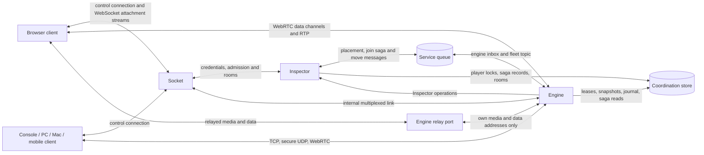

| Adapter | Lanes and mapping | Frame unit and MTU | Platforms | Planned restart, same host |
| --- | --- | --- | --- | --- |
| WebSocket through Socket | One ordered stream; reliable-unordered and unreliable-sequenced map onto it with coalescing | One binary WebSocket message per frame behind a 2-byte stream id; MTU 1200 bytes | browser, console, pc, mac, mobile | Preserved; Socket re-establishes its link to the successor within one tick |
| TCP | Stream 0 reliable-ordered, stream 1 reliable-unordered; unreliable-sequenced maps onto stream 1 with coalescing | 4-byte length and 1-byte stream id per frame; MTU 1200 bytes | console, pc, mac, mobile | Preserved when plaintext or TLS terminated upstream; not preserved with TLS inside the Engine |
| Secure UDP | All three lanes native | Records inside authenticated datagrams of at most 1200 bytes; MTU 1152 bytes | console, pc, mac, mobile | Preserved; keys, counters and replay windows travel in the state record |
| WebRTC data channels | Channel 0 ordered and reliable, channel 1 unordered with zero retransmits; reliable-unordered maps onto channel 0 | One data-channel message per frame; MTU 1200 bytes | browser, pc, mac, mobile | Not preserved; channels reopen and frame sequences make the gap explicit |
| WebRTC RTP | No data lane; media only | RTP packets within the 1200-byte datagram cap | browser, pc, mac, mobile | Server-initiated ICE restart; state migration outside this version |

These transports are alternatives only where their capabilities intersect. Socket is on the 60 Hz path for WebSocket clients only, and its capacity class includes their relay throughput. The Engine's own WebSocket listener is plaintext and serves only connections whose TLS was terminated upstream, by Socket or by an operator's terminator. TLS terminated inside the Engine is never preserved across a restart and closes with reason restart. The restart column restates the per-transport table of "Engine runtime" and promises nothing stronger. For WebRTC media the restart requirement is met at session level, not at transport level, in this version. That reading is a product decision listed in "Open questions" with the ICE-restart baseline as its default.

### 12.4 Adapter framing

Every adapter delivers frames as byte strings. A frame whose first byte is 0x7B is a closed JSON control envelope in UTF-8 with no leading whitespace and no byte order mark. Every other frame is a binary frame whose first byte is the lane-and-flags byte, whose lane value 3 is never sent, so the two forms cannot collide. Every multi-byte integer in adapter framing and in binary frames is little-endian; signed fields use two's complement.

| Adapter | Framing unit | Lane identification | Limits |
| --- | --- | --- | --- |
| WebSocket through Socket | Binary WebSocket message: stream id 2 bytes, then one frame | Stream 0 is the control connection; streams 1 to 65535 are attachments the client numbers; the frame header names the logical lane | Frame at most 256 KiB |
| TCP | Length 4 bytes covering the stream id and the frame, stream id 1 byte, frame | Stream 0 reliable-ordered, stream 1 reliable-unordered; one attachment per connection | Length at most 256 KiB + 1 byte |
| Secure UDP | Datagram of records (see "Secure UDP protocol") | Lane byte of each record | Datagram at most 1200 bytes |
| WebRTC data channels | One binary message per frame | Negotiated channel id 0 ordered reliable, id 1 unordered with maxRetransmits=0 | Message at most 64 KiB |
| WebRTC RTP | RTP packet | Media tracks (see "Audio and video") | Packet within 1200 bytes |

A gateway stream opens with Attach as its first frame, or with the first SignalDescription when it is a WebRTC attachment's signaling stream, and closes after a Detach in either direction. Socket relays an attachment stream's frames unchanged and never decodes a binary frame; it applies only the stream id, the parser ceiling and the rate limits. A length or message above its limit closes the transport connection with payload-too-large before the body is read.

### 12.5 Platform matrix

The platform tags are browser, console, pc, mac and mobile. A mobile browser is a browser; a native mobile application is mobile.

| Platform | Adapters reachable | Binding order in this version | Media path |
| --- | --- | --- | --- |
| browser | WebSocket through Socket, WebRTC data channels, WebRTC RTP; the optional QUIC-based adapter where the profile enables it and the runtime offers it | WebRTC data channels, then WebSocket | RTP |
| console | TCP, secure UDP and WebSocket through vendor code outside the open repository | TCP, then secure UDP when its listener is enabled, then WebSocket | Frame envelope |
| pc, mac | All five required adapters; the optional QUIC-based adapter where the profile enables it | WebRTC data channels, then TCP, then secure UDP when its listener is enabled, then WebSocket | RTP or frame envelope |
| mobile | As pc and mac for a native application | As pc and mac | RTP or frame envelope |

A client tries only the transports its ticket allows, in its binding order, and falls back without user action. A fallback is a transport switch: the resume token keeps the seat and the generation history, so the session survives it. No public console vendor documentation covers WebRTC, so the reference bindings offer no WebRTC adapter on consoles. The optional QUIC-based adapter enters a binding order only where the profile enables it, at the position the operator configures.

### 12.6 Optional QUIC-based adapter

The QUIC-based adapter has two forms: the browser WebTransport form and native QUIC. Reliable lanes use streams and the unreliable-sequenced lane uses datagrams, so it offers all three lanes. Its properties are one handshake for transport and encryption, connection resumption and no head-of-line blocking between streams. Attach is the first message on the first bidirectional stream, and the adapter's protocol token mirrors the negotiated protocol integer for proxies.

MTU(unreliable-sequenced) is the smaller of 1200 bytes and the datagram size the connection reports. The adapter is not exportable: a planned restart closes it with reason restart, and the client reconnects with resumption and its resume token, with a target of 1 round trip. Reach across the major browser engines is verified against release notes dated 2026-03-24. Three interoperability caveats remain unverified: the HTTP/2 fallback outside one browser engine, interoperability of draft 16 of the WebTransport over HTTP/3 protocol with released browsers, and a congestion-control option missing in one browser engine. The caveats leave conformance untouched because the adapter is optional. The adapter is an operator choice per game profile and never a required or default transport of any platform.

### 12.7 Secure UDP protocol

Secure UDP is the Engine's authenticated datagram protocol. Inspector generates a 256-bit attachment secret at Admit. The secret reaches the client in plaintext inside the Admit reply over the TLS control connection, never inside the ticket body. It reaches the Engine encrypted inside the signed admission ticket under the installation ticket-encryption key (see "Security and privacy"). That key is a symmetric member of the installation key set that every Engine receives through the credential issuer role and that rotates with the signing keys. Per-direction keys come from a key derivation function over the secret, the direction, a key generation counter and two 128-bit random values: clientRandom, which the client draws for each Attach, and serverRandom, which the Engine draws for each accepted Attach and sends in the attach datagram that carries AttachAck. The key generation starts at 0 and increases by one at every rekey. The header's key phase bit is the low bit of that counter, and the receiver derives the next generation's keys when the bit flips. Every accepted Attach therefore starts fresh keys with both packet counters at 0, including a re-attach to an adopter after a crash and an Attach by a client that lost its counters. The algorithms are constants of the protocol integer in the contracts catalog.

| Offset | Size | Field | Protection | Rule |
| --- | --- | --- | --- | --- |
| 0 | 1 byte | typePhase | Authenticated, clear | Bits 0–1 type (0 attach, 1 data, 2 close, 3 path), bit 7 key phase, other bits zero |
| 1 | 4 bytes | packetCounter | Authenticated, clear | Low 32 bits of the 64-bit per-direction counter |
| 5 | 2 bytes | ticketLength | Authenticated, clear | Client attach datagram only; the signed ticket follows |
| after the ticket | 16 bytes | clientRandom | Authenticated, clear | Client attach datagram only; 128 fresh random bits per Attach |
| 5 | 16 bytes | serverRandom | Authenticated, clear | Engine attach datagram only; 128 fresh random bits per accepted Attach |
| 5 or after the attach fields | 4 bytes | ackCounter | Encrypted | Low 32 bits of the highest counter received |
| next | 16 bytes | ackBits | Encrypted | 128 bits; bit i set means counter ackCounter − 1 − i was received |
| next | n bytes | records | Encrypted | Per record: lane byte 1, reliableSequence 4, length 2, frame bytes |
| last | 16 bytes | tag | Not applicable | 128-bit authentication tag over the whole datagram |

The client's first datagram is the Attach: the ticket and clientRandom in clear, the Attach envelope encrypted under an attach key derived from the secret and clientRandom only. A client retransmits its Attach datagram byte for byte, so the attach key never encrypts a second plaintext. The Engine verifies the ticket signature, waits for the verification pass of the ticket's bound id (see "Attachment gate and saga verification"), then decrypts the secret, derives the attach key and verifies the tag before it answers. It then draws serverRandom and answers with an attach datagram under the first server-to-client key. No key therefore travels on the wire, no key exists for an unverified attachment and a forged Attach costs one signature check. A secure UDP ticket is issued only when the Attach datagram fits 1200 bytes; otherwise Admit omits secure-udp from the ticket's allowed transports. A re-attach presents the original ticket, valid in signature though expired or consumed, with the resume token inside the encrypted body.

The record lane byte uses bits 0–1 for the lane and bit 2 for continues, which marks a reliable message split over consecutive reliableSequence values; the receiver reassembles at most 256 KiB. reliableSequence is 0 on unreliable-sequenced records. A reliable record whose counter is absent from an acknowledgement covering a later counter, or unacknowledged after a retransmission timeout derived from the measured round trip, is retransmitted under a new counter, never under the old one. With one record per datagram the fixed overhead is 48 bytes, so MTU is 1152 bytes on every lane.

The receiver reconstructs the 64-bit counter as the value nearest the highest counter received. Replay window: 128 packets; a datagram older than the window, already received, or failing its tag is dropped and counted without a reply. Rekey every 2^30 packets or 1 hour on the sender's monotonic clock, whichever comes first, by moving to the next key generation. The receiver keeps the previous generation's keys for 128 packets after the first datagram of the new generation. An authenticated datagram from a new source address starts path validation. The Engine sends a path datagram, type 3, whose encrypted records field is 64 random challenge bits, to the new address and keeps sending session traffic to the validated address. It moves the return address only after an authenticated path datagram from the new address echoes the challenge, and until then it sends the new address at most 3 times the bytes received from it. An unauthenticated datagram never starts path validation, so a rewritten or replayed source address cannot redirect state traffic toward a victim.

No forward secrecy exists in this version; keys live as long as the attachment. A security review gates public exposure, not conformance. Until it passes, the listener defaults to disabled (transports.secureUdp.enabled=false), the reference bindings rank secure UDP after TCP and WebRTC data channels, and the validate command prints a warning when an operator enables it. The transport conformance driver runs against secure UDP in the test environment like every other adapter.

### 12.8 WebRTC adapters and signaling

WebRTC data channels and WebRTC RTP share one peer connection per attachment. Both data channels are negotiated out of band with fixed identifiers, 0 and 1, so no in-band channel announcement exists. Signaling travels on the client's control connection. SignalDescription and SignalCandidate are session-channel messages on a gateway attachment stream that opens with the first SignalDescription and carries nothing else. Socket relays them opaquely to the owning Engine by placement and back by connectionId. They are the only signaling messages of the peer connection, for its first negotiation, every renegotiation and every ICE restart; track publication and subscription belong to "Audio and video". Socket never interprets a session description.

The first SignalDescription carries the admission ticket, which the Engine verifies without consuming it, and binds the peer connection's ICE credentials to the ticket nonce. The Engine creates the peer connection, its ICE agent and its media tracks only after the ticket's bound id passes verification, and leaves the first SignalDescription unanswered until then (see "Attachment gate and saga verification"). The first message on channel 0 is Attach, which consumes the ticket. The ticket's ICE server list names the owning engine's relay first when enabled, then operator-configured external relays with their own credential mode.

A planned restart closes both data channels and keeps the session: the successor or adopter answers the reconnect with a server-initiated ICE restart through SignalDescription inside the 30-second consent window. The ICE-restart media gap target of 100 to 500 ms is an unmeasured starting value until the browser-in-the-loop test measures it. Media state migration is outside this version, and data channels reopen with frame sequences making the gap explicit and replays idempotent.

### 12.9 Embedded relay

The Engine exposes an optional relay listener on UDP and TCP (turn.enabled, default false). TLS on the TCP listener (turn.tls) and DTLS on the UDP listener (turn.dtls) are options; DTLS on the UDP listener serves native clients and is an adapter feature outside conformance. The relay is enabled per installation and allowed per game profile; that scope is a product decision listed in "Open questions" with this default.

Credentials use the time-limited long-term credential mechanism. The username is expiry:ticketId and the password is a keyed hash of the username under the region's relay secret. Lifetime equals the ticket lifetime plus maxSessionSeconds, at most 24 hours, because every refresh re-authenticates with the original username. This lifetime is a starting value, not a security guarantee.

The relay accepts an allocation only with a credential issued by this installation, only toward this engine's own media and data addresses, and only for a ticketId whose bound id passed verification. An Allocate request for an unverified ticketId is held unanswered, so the client's request retransmission covers the wait. Each allocation is charged 0.2 units per Mbit/s of its configured ceiling; default cap 4 Mbit/s, so 0.8 units. Relay bytes count against the engine's egress budget up to a relay share of **30%**. Above the share new allocations are refused with relay-capacity and Inspector excludes the engine from media placement. An allocation is bound to an attachment and released with it; the allocation table holds at most 4096 entries per engine. Allocations are not preserved across a restart: the client re-allocates during the ICE restart. Disabling the relay removes the listener, the advertisement and the credential together.

### 12.10 Negotiation

Negotiation has two messages per plane. Hello is the first message on a Client connection; Attach is the first message of every attachment. Hello carries no ticket, because an open connection browses, issues a guest and authenticates before any ticket exists.

| Message | Fields | Answer |
| --- | --- | --- |
| Hello | protocol (integer, 1 for this contract), supported (ordered list), schemaHash, clientBuild, optional credential | HelloAck with the chosen protocol, Socket's supported range and the region directory revision; or close with version-mismatch |
| Attach | protocol, supported, schemaHash, clientBuild, nextInputSequence, ticket or resumeToken or both | AttachAck; or close with version-mismatch, ticket-invalid, epoch-stale, saga-incomplete, superseded, session-moving, session-moved, capacity-exhausted, late-join-closed, room-full or rate-limited |
| AttachAck | protocol, ownerEpoch, generation, serverTick, tickRate, lane map with MTU per lane, snapshotSchemaHash, syncModel, Init arguments (seed, tickRate, roster, options, role predicted), resumeToken | None |

The chosen protocol is the highest integer present in both lists; no common integer yields version-mismatch. A version outside the range is rejected before any other message of the connection is decoded. Attach is the first message on a direct transport connection, which therefore negotiates without a control Hello, and the first message of an attachment stream on the gateway. The WebSocket subprotocol token and the optional adapter's protocol token mirror the chosen integer for proxies; Hello and Attach are the authority, not the tokens.

AttachAck never carries serverSeed. Counters, epochs, ticks, generations and sequences are decimal strings in these messages, and the binary header carries only their low 32 bits (see "Sequencing and generations"). When the Attach schemaHash differs from the Engine's, both ends use the self-describing map encoding of the same records for every positional payload, and the client never predicts. Header, acknowledgement block and fragment layouts are fixed by the protocol integer and never fall back.

### 12.11 Ticket consumption and resume

An admission ticket binds playerId, sessionId, roomId, seat, role, ownerEpoch, the owning engine's addresses per allowed transport, the lane map, the TURN credential when the relay is enabled, the feature list from the entitlement source, the encrypted attachment secret when secure UDP is allowed, the bound id, a nonce and a 60-second expiry. The bound id is the messageId and fence of the join or admit saga whose commit preceded the minting, or the claimId of the move for a ticket delivered by AttachRedirect. Inspector mints no ticket before that commit (see "Inspector"). A control ticket has the same shape with a control grant instead of a seat.

The named engine verifies a ticket offline, in this order: signature under the installation key set by kid, expiry, engineId equal to its own, sessionId held, transport of arrival among the allowed transports, ownerEpoch equal to the session's current epoch, nonce absent from the nonce set. The engine then waits for the verification pass of the bound id, inserts the nonce and admits the seat and role the ticket names, subject to the capacity and late-join rules of "Session, players, teams, groups, observer and session events". A failed check closes with ticket-invalid, except an epoch mismatch, which closes with epoch-stale. When the Attach also carries a resumeToken, a ticket that fails only on expiry, nonce or epoch falls through to the resume check below instead of closing. No ticket check reads the coordination store; the verification of a bound id reads it once, and an id the engine already passed reads nothing. Admission with a valid ticket whose bound id passed therefore succeeds while the store is unavailable, and new tickets cannot be issued then.

The nonce set is per engine and in memory. Each entry lives until its ticket expires, so a ticket is single use per engine and the set is bounded by the issuance rate times 60 seconds. AttachAck of a first admission carries a 256-bit random resume token; the engine stores only its digest, which the snapshot envelope carries to an adopter. An Attach whose ticket is expired or consumed and whose resumeToken digest matches a SessionPlayer inside the resume window re-attaches, increments the generation and closes the previous transport connection of that attachment with superseded. Neither a valid ticket nor a valid resume token yields ticket-invalid. A resume-token re-attach of an admitted SessionPlayer runs no saga and waits for no verification. Default resume window: **120 seconds**; 0 to 3600 seconds per game profile.

### 12.12 Attachment gate and saga verification

An attachment exists only after the coordination store holds the committed outcome of the saga that grants it. The service queue between Inspector and the Engine is unordered and at-least-once, so PlayerJoining is a trigger, not authority: the Engine admits nothing on a message alone. The per-player lock, the saga record and the compensation table belong to "Inspector", the verification rule to "Engine runtime" and the queue contract to "Integration bus". This subsection fixes where the verification sits on each transport and what exists before it passes.

The first presentation of a ticket counts as the delivery of its bound id: an Attach on a gateway stream or a direct transport, the first SignalDescription, a secure UDP Attach datagram and a relay Allocate request. When the Engine has not yet passed that id, the presentation starts the verification at once, whether or not PlayerJoining arrived. The verification is lock_acquire on the player's lock with the waiter backoff, saga_read, the comparison of the verification rule and lock_release. The Engine writes nothing under the player lock; its hold is a read. For a ticket bound to a claimId the verification is the target's read of the session index naming its claim, once per move, and takes no player lock. Until the pass the presentation is held unanswered and the Engine creates no transport state for it.

| Adapter | Held before the pass | Created only after the pass |
| --- | --- | --- |
| WebSocket through Socket | Unbound gateway stream at Socket holding its Attach | Stream binding to the seat; lanes; send queues; AttachAck |
| TCP | Accepted byte stream holding only its Attach | Transport connection; lanes; send queues; AttachAck |
| Secure UDP | One parked Attach datagram per ticket nonce, undecrypted | Decrypted attachment secret; per-direction keys; counters; replay window; AttachAck |
| WebRTC data channels and RTP | The first SignalDescription, unanswered | Peer connection; ICE agent and ICE credentials; data channels; media tracks |
| Embedded relay | The Allocate request, unanswered | Relay allocation and its egress charge |
| Optional QUIC-based adapter | Accepted connection holding only its Attach stream | Lanes; send queues; AttachAck |

A pass whose applied state admits the player lets the Engine consume the ticket, assign the seat and only then create the transport state, so Accept never returns a Transport connection for an unverified id. When the highest committed entry of the player is a leave, or a join or admit bound to another connection, an Attach bound to an earlier message id is refused with superseded and creates nothing. A later regroup leaves the earlier join valid. A ticket bound to a message id the store holds as aborted, or never held, is refused with saga-incomplete. A held TCP connection or QUIC stream that sends any frame besides its Attach before AttachAck closes with handshake-failed. On a held gateway stream Socket drops and counts such a frame, so it never reaches the Engine and the stream stays held (see "Socket").

A presentation still held when the verification wait lapses is refused with saga-incomplete and leaves nothing behind. Default verification wait: **6 seconds** from the first receipt of the bound id; re-read backoff from 50 ms doubling to 400 ms. The gateway stream, the TCP connection and the QUIC connection close with saga-incomplete; the held SignalDescription is answered with saga-incomplete through Socket; the held Allocate request is refused with the relay's retryable error. A parked secure UDP Attach datagram is dropped without reply and no key is derived for it, because an unauthenticated answer would be a reflection vector. A binding whose secure UDP Attach stays unanswered for the verification wait plus 1 second treats it as saga-incomplete.

A refused id never enters the applied set, so a client retry with the same request id is verified afresh. The engine's pending set holds at most 4096 held presentations and messages; when it is full, the oldest is refused with saga-incomplete. One bound id delivered many times beside its ticket yields one seat, one attachment and one generation; a message with a fence at or below the player's applied fence is acknowledged without effect. No half-open attachment exists: a refused presentation leaves no seat, no key, no peer connection and no relay allocation.

### 12.13 Session moves and re-attachment

A session that outgrows its node moves whole to a free engine, which adopts it from the offloaded state (see "Engine runtime" and "Clustering, regions and deployment"). No transport state moves between engines, so every attachment re-attaches to the target. The move adds one session-channel message, SessionMoving, and one control-plane push, AttachRedirect; it changes no frame layout, lane or negotiation field.

At the first tick boundary after the claim is ready, the source sends SessionMoving(sessionId, ownerEpoch, reason, expectedPauseMs) on the reliable-ordered lane of every attachment of the session and then stops ticking. reason is pressure or drain. Inputs reaching the source after the freeze are discarded without an outcome, so ackInputSequence never covers them, and input redundancy and the client's replay stream resend them to the target. From the freeze until it drops the frozen copy, the source answers every Attach for the session with session-moving and creates no transport state. The target answers an Attach with session-moving until the session index names its claim as holder, never earlier.

AttachRedirect(sessionId, ownerEpoch, ticket) reaches each member's Client connection through Socket's projection fan-out after Inspector checked that the session index names the target at the new epoch. Its ticket is bound to the claimId and names the target's addresses, lane map, relay credential and a fresh secure UDP attachment secret. The target admits it only for a SessionPlayer of its restored roster whose resume token digest matches the Attach; any other Attach with that ticket closes with ticket-invalid. The target keeps the seat, increments the generation, answers AttachAck with the new ownerEpoch and a serverTick continuing from the frozen tick, and sends a full-class update of the receiver's interest class. A re-attach through AttachRedirect does not count toward the reconnect limit.

| Adapter | Re-attachment after a move |
| --- | --- |
| WebSocket through Socket | New gateway stream; Socket routes it by the new placement |
| TCP | New connection to the target's address |
| Secure UDP | New attachment under the fresh attachment secret; the source's keys are never reused |
| WebRTC data channels and RTP | New peer connection to the target with new ICE credentials and, when the relay is used, a new allocation on the target's relay |
| Optional QUIC-based adapter | New connection to the target; resumption toward the source does not apply |

Socket routes a new gateway stream and every SignalDescription by the placement the session index names when the stream opens or the message arrives. An attachment routed to the source after the freeze receives session-moving or session-moved, and the binding follows its AttachRedirect. A binding without an AttachRedirect 5 seconds after SessionMoving calls Admit itself, which answers session-moving until placement is placed and then returns a ticket for the target.

The source keeps a tombstone for 60 seconds from the instant it drops the frozen copy, which happens when it reads migration_complete or 30 seconds after lease_handover, whichever comes first. During it the source answers an Attach for the session with session-moved, closes each remaining transport connection of the session with session-moved and refuses relay allocations for the session. An authenticated secure UDP datagram receives a close record with session-moved while the source still holds that attachment's keys, and is dropped without reply after it released them.

Input sequences continue across the move, while the state frame sequence and every per-lane frame sequence restart at 1 with the new generation. Frames still in flight from the source carry the old generation and are discarded, never applied. A member whose join the source verified before the freeze travels in the snapshot roster with its applied fence and receives an AttachRedirect ticket even when it never attached. Default client-visible pause: **2 seconds**, a target and an unmeasured starting value, not a guarantee.

When no engine claims a growing session, the session is bound and keeps running on its node. An Attach by a new member that would raise the node above the 90% refusal threshold is refused with capacity-exhausted. An Attach by resume token of a seat holder is never refused for capacity, because its weight is charged already.

### 12.14 Frame budgets and envelope budgets

The datagram payload cap is **1200 bytes**: no datagram the Engine builds exceeds it, and the Engine never relies on IP fragmentation. MTU(lane) is the frame size a Transport connection accepts after its own framing. The shared frame budget is 1152 bytes, the smallest MTU among the required adapters, because one encoded payload serves every receiver of an interest class whatever its transport. An adapter that probes and reports a larger MTU may carry larger frames only for frames encoded for that connection alone.

| Budget | Default | Rule |
| --- | --- | --- |
| Shared binary frame | 1152 bytes | Header, acknowledgement block and payload of any frame encoded once for several receivers |
| Datagram | 1200 bytes | Secure UDP datagram, data-channel message on channel 1, RTP packet |
| Control message | 64 KiB | Encoded JSON control envelope; above it payload-too-large |
| Parser ceiling | 256 KiB | Any single frame or reassembled message; enforced on the length before decoding |
| Send queue | Reliable 256 KiB; unreliable 64 frames | Drop oldest on the unreliable lane; reliable above cap for 5 seconds closes with slow-consumer |

Framing cost decides the codec: a 150-byte JSON envelope at 60 Hz to 16 players is 150 × 8 × 60 × 16 ≈ 1.15 Mbit/s of framing per session before payload, against 92 kbit/s for the 12-byte binary header. Budgets are starting values, not advertised capacity; operators set tighter game-specific limits before public exposure.

### 12.15 Control envelope and JSON debug envelope

The control envelope is the closed object {messageId, type, version, occurredAt, correlationId, data} with an explicit required list (see "Identifiers, time, counters and envelopes"). regionId belongs to connection context, not to the envelope. Dispatch is exact on **type + version + authorized channel**, never on version alone. Unknown fields are rejected, and counters are decimal strings of at most 19 digits.

The JSON debug envelope is the canonical JSON rendering of one binary frame, used by conformance vectors, the testkit and the replay file of the per-session debug flag. It is the closed object {lane, kind, generation, sequence, tick, ack, data}. lane is the lane name, kind the catalog message name, generation, sequence and tick the reconstructed full values as decimal strings, ack the decoded acknowledgement block or absent, and data the decoded record. No adapter carries it, and no Engine emits it on a transport. Decoding a binary frame and rendering it must reproduce the vector's debug envelope exactly, and encoding the debug envelope must reproduce the vector's bytes. In traceless mode the core writes no debug envelope, because it holds payloads.

### 12.16 Binary frame layout

Every binary frame starts with a 12-byte header. InputFrame and StateUpdate follow it with an acknowledgement block; every other kind starts its payload at offset 12.

| Offset | Size | Field | Rule |
| --- | --- | --- | --- |
| 0 | 1 byte | laneFlags | Bits 0–1 logical lane (0 reliable-ordered, 1 reliable-unordered, 2 unreliable-sequenced, 3 never sent); bit 2 resync, set only on InputFrame; bits 3–7 zero |
| 1 | 2 bytes | kind | Message kind; 0x0001–0x7FFF core, 0x8000–0xFFFE the game's extension domain; 0x0000 and 0xFFFF invalid |
| 3 | 1 byte | generationLow | Low 8 bits of the attachment generation |
| 4 | 4 bytes | sequence | Low 32 bits; meaning per kind |
| 8 | 4 bytes | tick | Low 32 bits of the tick the frame refers to |

| Kind | Direction and lane | sequence | tick | Payload |
| --- | --- | --- | --- | --- |
| InputFrame | Client to Engine, unreliable-sequenced | Newest input sequence in the frame | Target tick of the newest input | Acknowledgement block of 8 bytes, inputCount, input entries |
| StateUpdate | Engine to client; deltas unreliable-sequenced, full-class updates reliable-unordered | Engine's state frame sequence for the attachment, one space over both lanes | Tick of the state | Acknowledgement block of 16 bytes, update prefix, entity payload |
| Fragment | Either direction, reliable-unordered | Sender's per-lane frame sequence | Tick of the inner frame | Fragment block, fragment bytes |
| AudioFrame, VideoChunk | Either direction; unreliable-sequenced and reliable-unordered | Per track, defined in "Audio and video" | Media timestamp tick | Frame envelope of "Audio and video" |
| Extension kinds | As the extension domain declares | Sender's per-lane frame sequence | Session tick | Positional layout of the message |

Kind values are assigned in the contracts intermediate representation and covered by schemaHash. A frame with a nonzero reserved bit, lane value 3 or an invalid kind is discarded and counted, never interpreted.

| InputFrame offset | Size | Field | Rule |
| --- | --- | --- | --- |
| 12 | 4 bytes | ackSequence | Highest StateUpdate sequence received |
| 16 | 4 bytes | ackBits | Bit i set means StateUpdate sequence ackSequence − 1 − i was received |
| 20 | 1 byte | inputCount | 0 to 3; 0 is an acknowledgement-only frame |
| 21 | n bytes | entries | Newest first; entry i has sequence header sequence − i; per entry tickBack 1 byte (header tick minus target tick), length 2 bytes, payload |

| StateUpdate offset | Size | Field | Rule |
| --- | --- | --- | --- |
| 12 | 4 bytes | ackSequence | Highest input sequence received from this attachment |
| 16 | 4 bytes | ackBits | Bit i set means input sequence ackSequence − 1 − i was received |
| 20 | 4 bytes | ackInputSequence | Cumulative final-outcome acknowledgement |
| 24 | 1 byte | inputLead | Signed; targetTick − serverTick at arrival of the receiver's most recent input |
| 25 | 1 byte | droppedInputs | Inputs dropped since the previous update; saturates at 255 |
| 26 | 2 bytes | reserved | Zero |
| 28 | 1 byte | interestClass | Class the payload was encoded for |
| 29 | 1 byte | baselineAge | 0 for a full-class update; otherwise 1 to 32 ticks before tick |
| 30 | 1 byte | partIndex | 0 to partCount − 1 |
| 31 | 1 byte | partCount | 1 to 255 |
| 32 | n bytes | entities | Changed entities with change masks, removal entries and ownership changes, in the positional layout of the state schema |

| Fragment offset | Size | Field | Rule |
| --- | --- | --- | --- |
| 12 | 4 bytes | groupId | Sender-assigned, increasing per attachment |
| 16 | 2 bytes | fragmentIndex | 0 to fragmentCount − 1 |
| 18 | 2 bytes | fragmentCount | At least 2 |
| 20 | n bytes | bytes | Concatenated in index order they form one complete inner frame with its own header |

The positional payload uses the fixed field order of the intermediate representation, declared integer ranges at minimal bit width, float32 by default and change masks per entity. The codec is symmetric: the same generated code decodes the bytes into the same records on every binding, so the Engine's Encode and a client's Decode are one codec in two directions. A binary frame above the frame budget travels as Fragment frames. A fragmented frame is always a reliable-unordered frame, and a receiver holds at most one incomplete group per attachment, discarding it when a fragment of a newer group arrives.

### 12.17 Sequencing and generations

The 4-byte sequence and tick fields carry the low 32 bits of the 64-bit values of "Identifiers, time, counters and envelopes". A receiver reconstructs the high bits as the value nearest its reference: the newer of the last full value received and the last reconstructed value it accepted. Full values arrive in Attach (nextInputSequence), AttachAck (serverTick), every HostEvents message and every resync. A frame whose reconstructed value falls outside the field's reconstruction window of "Identifiers, time, counters and envelopes" is discarded and counted, never wrapped. A receiver that lost its reference requests a resync and re-reads the full values.

No tick or sequence wraps inside a session. maxSessionSeconds caps a session at 24 hours, 5,184,000 ticks at 60 Hz, and the input queue caps sequences at 128 per tick, both far below 2^32. Input sequences belong to the SessionPlayer and continue across reconnects, adoptions and moves; the state frame sequence and every per-lane frame sequence restart at 1 with each generation.

The generation byte only discards frames of a stale attachment: a receiver discards a frame whose generationLow differs from the low 8 bits of its current generation. The full generation is exchanged in Attach and AttachAck, and the reconnect limit keeps at most one stale generation alive inside any 256-step window. Binary frames carry no epoch. An adopter's or a move target's new epoch reaches the client only through a new attachment and its AttachAck, so a fenced predecessor's or a move source's frames die with its generation. A generation is not a membership revision: reconnect rotates the former without granting new membership.

### 12.18 Acknowledgement and input acceptance

A client attachment sends at least one InputFrame for every StateUpdate tick it receives, with inputCount 0 when it has no new input, and at most one frame per server tick without inputs. A spectator or observer attachment sends only acknowledgement-only frames; an entry from it is dropped and counted. Every InputFrame on an unreliable lane repeats the last 3 unacknowledged inputs, newest included. Client bindings never coalesce InputFrames, because redundancy covers loss, not queue replacement.

The Engine accepts an input when its target tick lies in [arrivalTick − 2, arrivalTick + 8], where arrivalTick is the serverTick at the input's arrival. Early inputs are buffered to their target tick; late inputs inside the 2-tick window apply at the current tick or are dropped under the module's late-input policy. Duplicates are dropped by sequence against the SessionPlayer's sequence watermark, so a redundant copy never applies twice. Every drop is counted per player and reported in droppedInputs; inputs of an input-muted player are dropped the same way. The +8 edge bounds the client's input lead (see "Portable session object, client prediction and state synchronization").

ackInputSequence is cumulative: the highest sequence s of the attachment such that every input at or below s has a final outcome, applied or dropped, at that tick. An early input buffered toward a later target tick holds the value below its own sequence, even when a higher sequence was already dropped. ackSequence and ackBits report arrival, not outcome; ackInputSequence alone tells the client which inputs it may discard. inputLead and droppedInputs give every StateUpdate the prediction fields at a fixed place.

The Engine counts a tick as acknowledged by a receiver when every part of that tick's StateUpdate is acknowledged through ackSequence and ackBits. A full-class update counts as acknowledged when its own state frame sequence is acknowledged, whatever lane carried it. An InputFrame with the resync bit asks for a full-class update.

### 12.19 Snapshot, delta and interest management

The module answers Interest(receiver) with all, or with entity ids and priorities. Interest is recomputed every tick unless the profile declares an interest rate, whose default is 10 Hz. The runtime intersects the answer with group visibility and the snapshot-hidden set (see "Session, players, teams, groups, observer and session events"). Receivers sharing one Interest answer, one visibility set and one snapshot-hidden set form one interest class, so classes are coarser than seats.

Per session the runtime keeps a ring of the last 32 encoded ticks per interest class, for at most maxInterestClasses classes (default 8, 1 to maxPlayers + 2), plus a per-receiver acknowledged index. A receiver whose combination would exceed the cap is encoded on its own against a depth-1 ring: its acknowledged baseline plus one candidate tick, the oldest sent tick awaiting acknowledgement. The candidate becomes the baseline when acknowledged, and the next sent tick becomes the candidate. The baseline ring is per class, never per receiver.

Each tick sends a delta against the receiver's last acknowledged tick. A full-class update on the reliable-unordered lane replaces it on join, on resync, on a change of the receiver's interest class and when no acknowledgement arrived within 32 ticks. A delta targets only a baseline the receiver acknowledged, so between a full-class update and its acknowledgement the receiver receives no delta. A payload is encoded once per interest class, baseline and codec, and every receiver sharing them gets the same bytes behind its own header and acknowledgement block.

A delta that does not fit the frame budget is split into interest-ranked parts, highest priority first, each applicable against the same baseline. The receiver applies a tick only when every part arrived and discards an incomplete tick when a later tick completes. A full-class update above the frame budget travels as Fragment frames. An entity leaving a receiver's interest is an explicit removal entry, never silence, and serverOnly fields never appear in any update.

A client that receives a delta whose baseline it lacks discards it with baseline-missing and sets the resync bit; the Engine answers with a full-class update within 32 ticks. A spectator receives only the public class, delayed by spectatorDelay through the delayed send ring. A late joiner or resuming client receives a full-class update and then the HostEvents of later ticks from the event ring.

### 12.20 Send queues, backpressure and coalescing

Send never blocks a tick. Each Transport connection has a reliable queue of 256 KiB and an unreliable queue of 64 frames that drops the oldest frame. A reliable queue above its cap for 5 seconds closes the connection with slow-consumer and leaves the attachment suspended, so the reconnect resyncs. Audio has priority over video in every queue.

Backpressure degrades in a fixed order: drop the oldest unreliable frames, then send state to that receiver every 2nd and then every 4th tick, then lower video layers, then delay control messages, then close with slow-consumer. A degraded receiver keeps its acknowledged baseline, so recovery needs no full-class update.

Where lanes collapse onto one ordered stream, on WebSocket and TCP, the Engine coalesces unreliable-lane frames in the attachment's send queue. Socket relays gateway frames without reordering or dropping them and applies the 256 KiB reliable cap to its own queue per Client connection. A StateUpdate of a newer tick replaces queued StateUpdates of older ticks for the same attachment, and parts of one tick stay together. A media frame replaces only an older queued frame of the same kind and track. A coalesced frame was never sent, so it is never acknowledged and never becomes a baseline.

### 12.21 Replay windows and duplicate suppression

Each layer suppresses replays with its own bounded window; no layer relies on another for this.

| Window | Default | Scope | Outcome |
| --- | --- | --- | --- |
| Ticket nonce set | Ticket lifetime, 60 seconds | Per engine, in memory | A reused ticket yields ticket-invalid unless its resume token is valid |
| Secure UDP replay window | 128 packets | Per attachment and direction | Old, repeated or unauthenticated datagram dropped without reply |
| Input duplicates | Sequence watermark | Per SessionPlayer, carried in the snapshot envelope | Repeated input never applies twice, including after adoption |
| Generation | Current generation | Per attachment | Frames of an older generation discarded |
| Fragment groups | One incomplete group | Per attachment | Duplicate fragments ignored; older group discarded |
| Event ring | 1024 entries | Per session | HostEvents catch-up after a snapshot tick; beyond it a full-class update |
| Client replay stream | 128 inputs and 1024 host events | Per client runner | Defined in "Portable session object, client prediction and state synchronization" |
| Applied fence | Highest applied fence per player | Per session, carried in the snapshot envelope | A saga message at or below it is acknowledged without effect |
| Applied-id set | 65,536 ids for 10 minutes | Per engine, in memory | Fast path for redelivered message ids; eviction changes no outcome, because the fence decides |
| Move tombstone | 60 seconds from dropping the frozen copy | Per session, on the source | Attach and datagrams answered with session-moved or dropped |

A captured Attach replayed from another address fails on its nonce, so a secure UDP Attach cannot be reflected toward a victim twice. An adopter restores the sequence watermarks before its first tick, so replayed journal inputs and client redundancy are ignored.

### 12.22 Rate limits, ceilings and timeouts

Every limit below is a starting budget, not advertised capacity. Exceeding a rate limit refuses the operation with rate-limited and counts it; one refusal never closes the connection, and 100 refusals within 1 minute close the control connection with rate-limited.

| Limit | Default | Scope | Enforced by |
| --- | --- | --- | --- |
| Control messages | 20 per second | Per Client connection and per direct Transport connection | Socket on the control connection and gateway streams; Engine on direct transports |
| Room operations | 5 per minute | Per principal | Inspector |
| Guest issuance | 60 per minute | Per address digest | Socket, in memory |
| Reconnects | 3 per minute | Per principal, keyed by the resume token's playerId | Owning Engine |
| Inputs | 128 queued per player | Per SessionPlayer | Engine; overflow dropped and counted |
| Concurrent connections | 2 per principal | Per principal and region | Inspector, at the connect report |

A reconnect is an Attach by resume token after the attachment's previous transport connection closed. A transport switch while the previous connection is still open does not count, and neither does a re-attach with the ticket of an AttachRedirect or of a move's fallback Admit. Parser ceilings apply before decoding, and a version outside the supported range is refused before any payload is parsed. Every attachment carries at least one frame per second in each direction while live. Default idle timeout: **15 seconds** without a valid frame; the receiver then closes the Transport connection with idle-timeout and the attachment enters suspended for the resume window.

### 12.23 Optional services, traceless mode and restarts

No optional service changes a frame, a lane or a negotiation field. Profiles adds member credentials to Hello and Authenticate; without it every credential is a guest credential. Payment fills the ticket's feature list through the entitlement source; without it the list holds role defaults, and a ticket re-minted for a move carries the feature list of the current entitlement projection. Moderator control tickets exist only with Profiles and attach exactly like admission tickets.

Recording receives media after the forward decision through the media tap and may record the replay stream through the data tap. Neither changes what a participant receives, and without Recording no capture buffer exists. Statistics receives misprediction, desync and drop counters as session events through the integration bus; without it they stay process metrics (see "Integration bus"). No optional service takes part in the attachment gate or in a move. With or without them the verification reads only the coordination store. A broker family selected for the service topics carries only messages, while the player lock, the saga record and every outcome stay in the store. During a move Recording seals its open segment at the freeze and opens the next one on the target, so no participant sees a difference.

In traceless mode the transports and the relay keep no address-derived state beyond process memory and the connection generation. Rate limiters and region selection key client addresses by a keyed digest rotated every 24 hours, with entries expiring within 24 hours. Debug envelopes and replay files are never written, and log lines carry no address, token, playerId or payload (see "Anonymous traceless mode"). The coordination-store stream adapter is the only legal service queue adapter in traceless mode, and a move writes nothing outside expiring store keys.

Export and Import serve the planned-restart handoff only; the last column of the capability matrix lists which connections survive it. A move calls neither: it exports no transport state, and every attachment re-attaches to the target as "Session moves and re-attachment" states. A crash ends every transport connection of the engine, and clients reconnect through any Socket with their resume token and receive a full-class update from the adopter (see "Engine runtime").

### 12.24 Primary references

- [WebTransport over HTTP/3, draft-ietf-webtrans-http3-16](https://datatracker.ietf.org/doc/html/draft-ietf-webtrans-http3-16) — the draft whose interoperability with released browsers the optional QUIC-based adapter leaves unverified.

### 12.25 Conformance

1. An Engine implements WebSocket, TCP, secure UDP, WebRTC data channels and WebRTC RTP, and passes the transport conformance session on each.
2. No conformance level fails an Engine that lacks the QUIC-based adapter.
3. A transport lacking a lane carries it on the next stronger lane, and AttachAck's lane map names that mapping.
4. No adapter delivers a reliable-lane frame as unreliable.
5. Send returns within its deadline under a full queue and never blocks the tick.
6. Send of a frame larger than MTU(lane) returns payload-too-large and enqueues nothing.
7. An unreliable frame whose deadline passed before transmission is dropped and counted.
8. A reliable queue above 256 KiB for 5 seconds closes with slow-consumer, and the reconnect receives a full-class update.
9. The 65th queued unreliable frame displaces the oldest one.
10. A frame whose first byte is 0x7B is parsed as a JSON control envelope, and a binary frame with lane value 3 is discarded and counted.
11. A frame with a nonzero reserved bit or an invalid kind is discarded and counted.
12. A TCP or gateway frame longer than 256 KiB closes the connection with payload-too-large before its body is read.
13. A JSON control message above 64 KiB is refused with payload-too-large.
14. Hello without a common protocol integer closes with version-mismatch before any other message is decoded.
15. An open Client connection completes Hello, IssueGuest and Authenticate without presenting a ticket.
16. The first frame of a direct transport connection that is not Attach closes the connection with handshake-failed.
17. An Attach with a ticket naming another engine, another session or a transport outside its allowed list closes with ticket-invalid.
18. An Attach whose ticket epoch differs from the session's epoch closes with epoch-stale.
19. A ticket presented twice to the same engine within its lifetime admits once and then yields ticket-invalid unless a valid resume token accompanies it.
20. An Attach with a valid ticket whose bound id the Engine passed before the coordination store became unavailable succeeds during the outage, and an Attach whose bound id the Engine never passed is refused with saga-incomplete after the verification wait.
21. An Attach with an expired ticket and a resume token inside the resume window re-attaches the same seat, increments the generation and closes the previous connection with superseded.
22. A fourth reconnect by one principal within one minute is refused with rate-limited.
23. AttachAck never contains serverSeed.
24. A client whose schemaHash differs from the Engine's receives map-encoded payloads with unchanged headers and never runs prediction.
25. A secure UDP Attach with a forged tag receives no reply.
26. A secure UDP datagram repeated within the replay window, or older than 128 packets, is dropped without reply.
27. A retransmitted secure UDP record carries a new packet counter.
28. A secure UDP sender moves to the next key generation before its packet counter advances by 2^30 under one key generation and within 1 hour of the previous rekey.
29. A secure UDP sender's key phase bit equals the low bit of its key generation, and its keys at key generation 2 differ from those at key generation 0.
30. Two attachments derived from one attachment secret never encrypt under the same key and packet counter.
31. An authenticated secure UDP datagram from a new source address moves the return address only after an authenticated path datagram from that address echoes the Engine's challenge, and an unauthenticated datagram never starts path validation.
32. A rewritten source address on an authenticated datagram never moves the return address without a valid challenge response.
33. Before path validation of a new source address completes, the Engine sends that address at most 3 times the bytes it received from it.
34. The secure UDP listener is disabled when transports.secureUdp.enabled is unset, and the validate command warns when it is enabled.
35. No Engine-built datagram exceeds 1200 bytes, and no frame encoded for several receivers exceeds 1152 bytes.
36. A full-class update above the frame budget arrives as Fragment frames that reassemble to the exact inner frame.
37. A delta split into parts is applied only when every part arrived, and an incomplete tick is discarded once a later tick completes.
38. A receiver's delta always targets a tick that receiver acknowledged.
39. A receiver without an acknowledgement for 32 ticks receives a full-class update on the reliable-unordered lane.
40. An InputFrame with the resync bit receives a full-class update within 32 ticks.
41. A receiver whose interest class changes receives a full-class update of its new class.
42. An entity leaving a receiver's interest arrives as an explicit removal entry.
43. No StateUpdate contains a serverOnly field.
44. A session with more receiver combinations than maxInterestClasses holds at most maxInterestClasses rings of 32 ticks and a depth-1 ring per further receiver.
45. An input targeted at arrivalTick − 3 or arrivalTick + 9 is dropped and counted, and one at arrivalTick + 8 is buffered and applied at its target tick.
46. An input received three times through redundancy applies once.
47. ackInputSequence never advances past a buffered early input, even when a higher sequence was dropped.
48. droppedInputs equals the inputs dropped since the previous update, saturated at 255.
49. Every InputFrame on an unreliable lane carries the last 3 unacknowledged inputs, newest first.
50. A spectator attachment's input entries are dropped and counted.
51. A frame whose generationLow differs from the current generation is discarded.
52. A low-32-bit tick or sequence reconstructs to the value nearest the receiver's reference, and a value outside its reconstruction window is discarded without wrapping.
53. On WebSocket and TCP the Engine replaces a queued older StateUpdate with a newer tick's StateUpdate and never separates the parts of one tick, while Socket drops no relayed frame below its queue cap.
54. Under backpressure audio frames leave the queue before video frames.
55. A gateway attachment survives a planned restart with the same generation, and a WebRTC data-channel attachment reopens its channels under a new generation after a server-initiated ICE restart.
56. A Transport connection without a valid frame for 15 seconds closes with idle-timeout and leaves the attachment suspended.
57. Decoding each positional conformance vector reproduces its JSON debug envelope, and encoding the envelope reproduces its bytes.
58. A relay allocation with a credential from another installation, or toward another engine's address, is refused.
59. With relay bytes above 30% of engine egress, a new allocation is refused with relay-capacity.
60. With turn.enabled=false no relay listener, ICE server entry or relay credential exists.
61. With turn.enabled=true and turn.tls=true the TCP relay listener completes a TLS handshake before it answers any allocation request and refuses a plaintext Allocate, and with turn.tls=false it accepts plaintext TCP allocations only.
62. In the Minimal profile a 4-guest session over every required adapter completes without any optional service, with frame layouts, lanes and negotiation fields identical to those of a deployment with every optional service declared.
63. In traceless mode no transport or relay state derived from a client address leaves process memory, and no debug envelope or replay file is written.
64. An Attach, a first SignalDescription, a secure UDP Attach datagram or a relay Allocate request bound to an id that has not passed verification creates no seat, no send queue, no derived key, no peer connection, no ICE agent and no relay allocation.
65. A PlayerJoining delivered before saga_commit creates no transport state until the commit and the lock release, and the held Attach receives AttachAck within one re-read backoff step of the pass.
66. A first presentation of a ticket whose PlayerJoining never arrived starts the verification and is admitted when the store holds the committed entry.
67. The Engine writes nothing to the coordination store while it holds a player lock for verification.
68. A ticket bound to a message id the store holds as aborted, or never held, is refused with saga-incomplete and leaves no transport state.
69. When the verification wait lapses, a held gateway stream, TCP connection or QUIC connection closes with saga-incomplete, a held SignalDescription is answered with saga-incomplete and a parked secure UDP Attach datagram receives no reply.
70. A client retry with the same request id after a saga-incomplete refusal is verified afresh and yields exactly one attachment.
71. One PlayerJoining delivered 100 times in random order beside its ticket yields one seat, one attachment and one generation.
72. A leave committed above a join leaves the player detached, and an Attach bound to that join is refused with superseded without creating transport state.
73. Of two joins by one player from two connections, the join with the lower fence either never creates transport state, or is detached with superseded at the tick boundary after the higher fence passes.
74. A held TCP connection that sends a frame besides its Attach before AttachAck closes with handshake-failed, while on a held gateway stream such a frame never reaches the Engine.
75. A full pending set refuses its oldest held presentation with saga-incomplete.
76. A session move sends SessionMoving on the reliable-ordered lane of every attachment before the source stops ticking.
77. From the freeze until the source drops the frozen copy it answers an Attach for the session with session-moving, and for 60 seconds from that instant with session-moved, including when the target crashes after lease_acquire.
78. The target answers an Attach with session-moving until the session index names its claim as holder.
79. A re-attach through AttachRedirect keeps the seat, increments the generation, receives AttachAck with the new ownerEpoch and a serverTick continuing from the frozen tick, and receives a full-class update.
80. An AttachRedirect ticket presented with a resume token that matches no SessionPlayer of the target's roster closes with ticket-invalid.
81. A re-attach through AttachRedirect does not count toward the reconnect limit.
82. An input sent to the source after the freeze applies exactly once on the target through input redundancy or the replay stream.
83. A frame from the source that arrives after the re-attach is discarded by generation.
84. A WebSocket, TCP, secure UDP, WebRTC data-channel and WebRTC RTP attachment of one session each re-attach to the target after a move, and the target's secure UDP keys differ from the source's.
85. A binding without an AttachRedirect 5 seconds after SessionMoving calls Admit and attaches to the target once placement is placed.
86. A new member's Attach that would raise a bound session's node above 90% is refused with capacity-exhausted, while a seat holder's resume-token Attach on that node is admitted.
87. Every statement of this list about the attachment gate and session moves holds with the testkit's shuffling adapter, which reorders every batch and duplicates 10% of messages, in the Minimal profile and with every optional service declared.
88. One rate-limited refusal leaves the connection open, and 100 refusals within 1 minute close the control connection with rate-limited.

## 13. Portable session object, client prediction and state synchronization

The session object is the game session a developer implements: a pure simulation that holds its state in a generated state container and touches the world only through the host/session boundary. This section defines that boundary, the determinism the object must keep, the runners that host it, the two sync models, the client prediction protocol and the state synchronization operations. It does not define the tick scheduler, lag policy or offload of the owning Engine, the binary frame layout or the group and mute rules. Those belong to "Engine runtime", "Transports and wire codec" and "Session, players, teams, groups, observer and session events".

Every rule in this section holds in the Minimal profile: Socket, Inspector, Engine and one coordination store, guests only, no optional service. Prediction, lockstep, the sandboxed server runner, snapshots, deltas and digests need no optional service. Socket is unchanged by this section, and Inspector changes only in that an engine may refuse a placement whose artifact it cannot load. The subsection "Optional services and the Minimal profile" states each change an optional service or traceless mode makes; no other subsection depends on one.

### 13.1 Session object

A session object is the GameSession that the game module's New(sessionContext) returns (see "Engine runtime"). Its state lives in the generated state container of the game's state schema; scratch data outside the container is a cache that Restore rebuilds, never state. It holds no reference to the engine host, a socket, a store, a wall clock, a thread or a platform facility. Everything it knows arrives as an operation argument, and everything it wants done leaves as a command the host may discard.

One source builds into three artifacts under one schemaHash. The native server build is linked into the game image. The portable build is compiled to a sandboxed target that every runner kind can load; WebAssembly is the reference portable target. Custom client session code, where the developer chooses to write it, implements the same boundary in a client language and reuses the generated state container and codec. The portable artifact is bundled in the game image and instantiated per session from that single build; it is not a runtime plugin.

The game profile declares which artifacts exist and which artifact each runner kind uses, per platform tag for the client runner. An engine that cannot load the profile's declared server artifact refuses PlaceSession with artifact-unavailable, and Inspector's adoption saga retries on another engine (see "Inspector"). A refused placement never starts the session on a different artifact kind than the profile declares.

### 13.2 Host to session operations

The host is the only caller of the boundary, and it calls every operation below on the session's simulation worker, serialized, except Encode, Decode and Interest, which run on fan-out workers against the last committed view. No operation blocks on I/O. Init receives role authority, predicted or shadow; the role changes nothing in the state, only what the host does with commands.

Host events and stepping:

| Operation | Inputs and outputs | Errors | Rule |
| --- | --- | --- | --- |
| Init | seed, serverSeed or none, tickRate, roster, options, role → ok | invalid-options | Called once before any other operation; serverSeed is none on every client instance |
| Tick | tick → ok | none | The step is 1 ÷ tickRate; the session never receives elapsed time |
| OnInput | seat, sequence, tick, payload | none | Delivered before the Tick of its tick, after that tick's host events |
| OnJoin | player, seat, isRejoin → accept or reject(reason) | none | Host event; a rejoin inside the resume window keeps the seat |
| OnLeave | player, reason | none | Host event |
| AdmitPlayer | profile, role → accept or reject | none | Host event at admission |
| OnControl | controller, command → allow or veto(reason) | none | Host event; the record carries controller, command and decision |
| OnGroupChanged | player, groups | none | Host event at a tick boundary |
| OnEntitlementChanged | player, features | none | Host event; the Minimal profile never produces it |
| OnInventoryResult | requestId, outcome | none | Host event; in the Minimal profile the null item ledger produces it at the next tick boundary with outcome inventory-absent for every Consume and Grant |
| OnScheduled | token | none | Host event at the tick a Schedule command named |
| RateChanged | tickRate | none | Host event at a tick boundary; every runner adopts the same step |
| End | reason → result | none | Called by the host only; the session commands EndAt and never calls End |

State operations:

| Operation | Inputs and outputs | Errors | Rule |
| --- | --- | --- | --- |
| Commit | none → ReadView | none | Publishes an immutable view at the end of Tick; Encode never reads working state |
| Interest | receiver → all, or entity ids with priorities | none | Intersected by the runtime with group visibility and the mute matrix |
| Encode | view, interestClass, baselineTick or none → bytes | state-invalid | No baseline means a full-class update |
| Decode | bytes → StateUpdate | malformed | serverOnly fields are absent from the result |
| ApplyDelta | StateUpdate → ok | baseline-missing, schema-mismatch | baseline-missing when the instance's tick is below the update's baseline tick |
| Snapshot | none → bytes | state-invalid | Canonical encoding of every entity and field the instance holds; at most **256 KiB** |
| Restore | bytes, gapTicks → ok | incompatible-build, snapshot-partial | snapshot-partial only when the caller requires a complete state |
| Digest | none → 128-bit digest | none | Digest of the Snapshot bytes at the current tick |
| Upgrade | oldSnapshotSchemaHash, bytes → bytes | upgrade-required | Optional; called before Restore of a snapshot from another state schema |

A StateUpdate holds tick, interestClass, baselineTick or none, the changed entities with change masks, the removed entity ids and the ownership changes. Encode and Decode are one generated codec in two directions: Decode(Encode(view, c, b)) is the StateUpdate that ApplyDelta consumes. ApplyDelta of a full-class update into an empty session followed by Encode without baseline reproduces the same bytes. This symmetry is a property of the generator, not of developer discipline.

Snapshot bytes carry a completeness header. A server instance holds the whole state, serverOnly fields included, and its header says complete. A client instance holds a partial world, and its header says partial with the covered interest classes and a serverOnly-stripped flag. Server adoption, lockstep late join and lockstep desync require a complete snapshot; every other Restore accepts a partial one.

gapTicks is the number of ticks at the profile's tick rate that elapsed after the restored state's last tick without being simulated. On server adoption the host counts it from the snapshot's commit, after journal replay, to the adopter's first Tick. On a session move the target counts it from the freeze to its first Tick. Every other caller passes 0: the client's shadow-to-predicted copy, lockstep late join, lockstep desync restore and the same-host successor of a planned restart, which resumes at the frozen tick. A session may use gapTicks for game timers, never as a jump of the tick counter.

Canonical delivery order: every host event is stamped with the tick at which it applies and delivered before that tick's Tick. Host events come first in their seq order, then inputs in sequence order per seat with seats ascending. The serialized threading contract is the precondition of this order, and every runner kind reproduces it. A runner that reorders host events and inputs inside a tick is non-conformant even when the resulting digest happens to match.

### 13.3 Capabilities granted to the session

The session context is the whole capability set; nothing else is public. Queries are Roster, Groups, Inventory and Entitlements, and each answers from a view the host delivered at a tick boundary. Commands are CreateGroup, MoveToGroup, DissolveGroup, SetMute, SetVisibility, SetInterest, TagEntity, Send, Broadcast, Emit, Schedule, Consume, Grant, Kick, TransferHost, EndAt, Log and Metric.

The host records a command and applies it only through a later host event at a defined tick, so no command returns data in the tick that issued it. Consume and Grant return a requestId derived from the issuing tick and the command's index within that tick, so the identifier is the same on every runner. Schedule(tick, token) falls due as a scheduled host event delivered through OnScheduled(token). A host of role predicted or shadow discards every command and answers queries from the replay stream; this is what lets one session code run on every runner.

Randomness is part of the session library, not a host call. Random(key) returns 64 bits as a counter-based function of seed, tick, key and the index of the draw for that key within the tick. SecretRandom(key) is the same function of serverSeed and returns zero on a runner without it. An entity's draws therefore depend neither on how many other entities drew nor on which runner simulates, and a hidden roll stays unpredictable to clients while movement stays reproducible. The algorithm and its vectors are conformance vectors of "Contracts and code generation".

### 13.4 Forbidden to the session

The session object never blocks, never spawns a thread or task and never reads anything but its arguments and its own state. It never reads a clock, an environment variable, a file, a socket, a store or a platform facility. It never derives state from an allocation address, a randomized hash, the iteration order of an unordered collection, thread timing or its own role. It never calls a random source other than Random and SecretRandom, and never computes a transcendental function from the host platform's math library.

The portable artifact imports exactly the boundary and the session library; a runner refuses an artifact that imports any other host function with load-failed. A native build and a custom client session cannot be checked that way, so the determinism test of "Determinism test" is their evidence. A command issued on a client is a request the host discards, not a side channel: a session object cannot reach the network, the Engine or another session through any command.

### 13.5 Determinism

A session object is deterministic when the same Init and the same ordered host events and inputs per tick produce the same Digest at every tick on every runner. Determinism is the developer's obligation; the boundary, the random source and the generated container make it attainable, not automatic.

Every value that reaches the container follows the rule of its concern.

| Concern | Rule |
| --- | --- |
| Time | The fixed timestep and the tick number; never a clock |
| Iteration | Entity-id or sequence order whenever iteration affects state; never the order of an unordered collection |
| Entity ids | A counter inside the state; never an address or a randomized hash |
| Arithmetic | Integer or fixed-point, or floating point limited to the operations the portable target defines bit-exactly: addition, subtraction, multiplication, division, square root, minimum, maximum and conversions; an operation the target defines with implementation-dependent results is outside that list |
| Transcendental functions | The session library's deterministic implementations, which every language target emits with vectors |
| NaN and infinity | Never in the container |

Encode and Snapshot reject NaN and infinity with state-invalid. On the server, state-invalid ends the session with faulted, because a state that cannot be encoded can be neither synchronized nor offloaded. On a client, the runner discards the predicted instance, raises prediction-suspended and rebuilds the instance from the shadow. No allocation address, collection order, thread timing or role reaches the state.

Bit-exact floating point on the portable target rests on the target's own specification, which defines deterministic results for the basic operations with NaN payloads excepted; the state container never holds a NaN. A native build and a custom client session agree bit-exactly with the portable build only for integer and fixed-point state. A native compiler may fuse or extend floating-point operations, and a custom client session may compute in a language whose only numeric type is double precision. The numerics rules bound that risk; they do not prove its absence, so a game that keeps floating-point state and needs provable determinism runs the sandboxed server runner as its authority.

### 13.6 Determinism test

The testkit runs one replay file on two runners and compares Digest every 30 ticks and at the end. A replay file holds seed, serverSeed, tickRate, roster, host events and inputs by tick. The required file spans 600 ticks with 16 players. A mismatch report names the first diverging tick and the entity whose canonical bytes differ.

| Runner pair | Requirement | Condition |
| --- | --- | --- |
| Portable against portable | Required | Every state schema |
| Same portable artifact on two platforms | Required | Every state schema |
| Sandboxed server runner against the client runner of every binding that hosts the portable artifact | Required | Full-visibility replay profile |
| Native server build against portable | Required | State schema without floating-point fields; advisory otherwise |
| Custom client session against the sandboxed server runner | Required | State schema without floating-point fields and full-visibility replay profile; advisory otherwise |

A client digest is comparable with a server digest only under full visibility. The replay file's profile declares interest all, a state schema without serverOnly fields, no sealed group and no snapshot-hidden data, and the session draws no SecretRandom. The testkit's client conformance replay file satisfies these conditions. Outside them a client digest is never compared with the server's, because two digests are comparable only between instances holding the same entity set and field set.

The Engine writes a replay file only under the per-session debug flag of "Observability and logging". The Recording data tap is the one other writer of the replay stream, under the room's recording setting (see "Recording"). Neither writer exists in traceless mode, because a replay file holds payloads.

### 13.7 Runners

A runner hosts exactly one session object and is the only code that calls the boundary. Every runner kind implements one contract, so the Engine and the bindings drive native, sandboxed and custom sessions identically.

| Operation | Inputs and outputs | Errors |
| --- | --- | --- |
| Load | artifact, limits → instance | load-failed, limit-exceeded, schema-mismatch |
| Call | operation, arguments, deadline → result | trapped, over-deadline |
| Unload | none | none |

load-failed covers an invalid artifact and an import outside the boundary. limit-exceeded covers declared limits the runner cannot grant. schema-mismatch covers an artifact whose schemaHash differs from the game build's. trapped carries the cause: memory limit, fuel ceiling, invalid access or unreachable instruction. over-deadline reports a call that returned after its deadline without trapping, which the host treats as an overrun, never as a fault.

| Runner kind | Hosts | Limits | Fault outcome |
| --- | --- | --- | --- |
| Native server runner | The native build, linked into the Engine process, one simulation worker per session | Tick budget measured by the host | A panic ends that session with faulted |
| Sandboxed server runner | The portable artifact, one instance per session inside the Engine | sandboxMemory, fuel ceiling per call, instantiation budget | A trap ends that session with faulted |
| Client runner, portable | The portable artifact inside the platform's sandbox runtime | The platform's memory limit; no fuel ceiling and no deadline | A stalled or trapped instance is rebuilt from the shadow and counted as a prediction fault |
| Client runner, custom | Custom client session code in the client language | The platform's memory limit | Same as the portable client runner |

The Engine hosts sandboxed and native sessions side by side from one module registry keyed by gameBuild and artifact kind. A trap or a native panic ends that session with faulted and never the process; every other session on the engine keeps its tick. The faulted session reports to Inspector with an abandoned result under the profile's abandon policy, so the room sees a reason, never a silent end. A Tick that exceeds its budget without reaching the fuel ceiling is an ordinary overrun under the lag policy of "Engine runtime".

### 13.8 Sandboxed hosting and fault containment

The sandboxed server runner instantiates the portable artifact per session under a linear memory limit, sandboxMemory. Default sandboxMemory: **64 MiB**; 16 to 512 MiB per profile. Placement reserves the full sandboxMemory in bytes against the node's memoryBytes and never converts it to capacity units (see "Engine node, lease, epoch, placement and capacity"). Placement refuses a session whose reservation raises the node above 90% of memoryBytes.

Default fuel ceiling: **10 times the tick budget** per call, 80 ms equivalent at 60 Hz. The runner calibrates that ceiling against the sandbox's own fuel unit at process start, so the ceiling follows the instance type rather than a fixed instruction count. Instances come from a pre-compiled artifact in at most 5 ms, are never shared between sessions and are released in the session's Close on every exit path, a failed Restore included. Every boundary payload crosses the sandbox as bytes of the positional codec, at most 0.1 ms per tick, so the boundary is defined by the contracts and not by a language.

These sandbox figures are starting values for the server runner only, unmeasured until the sandbox runtime is measured per instance type; they are not capacity guarantees. A memory or fuel exhaustion inside one session ends that session alone. The client runner has no fuel ceiling and no deadline: a browser sandbox offers no fuel metering and no in-thread deadline, only termination of the hosting worker. A predicted instance that does not return within the frame is therefore abandoned with its worker, re-instantiated from the shadow and counted as a prediction fault.

Hosting the portable artifact on a client needs a sandbox runtime for that platform, a prerequisite the generator cannot emit. A browser provides one; a PC or Mac client embeds one. A mobile or console platform that forbids just-in-time compilation runs only an ahead-of-time compiled form of the artifact or an interpreter. A target with no embeddable runtime in this version hosts a custom client session only, and the custom client session is the path available on every platform.

### 13.9 Sync models

The game profile declares syncModel: server-authoritative with client prediction, the default, or deterministic lockstep. The profile also declares prediction, on or off, for server-authoritative profiles. Default prediction: on for profiles at 20 Hz and above; off below 20 Hz, where the client presents interpolated authoritative state only.

| Property | Server-authoritative with client prediction | Deterministic lockstep |
| --- | --- | --- |
| Authority | The server runner; a client's predicted state is presentation | The server runner validates inputs and keeps result authority |
| Downstream traffic | One StateUpdate per tick and interest class, plus HostEvents | One TickFrame per tick with every seat's input and that tick's host events |
| Client simulation | Its own predicted entities, from the last authoritative state | The whole session from the same inputs |
| Hidden information | serverOnly fields, SecretRandom, snapshot-hidden data and sealed game data | None by construction |
| Slow client | Affects only its own corrections | Substituted with an empty input after the stall deadline and marked lagging |
| Tick skipping under lag | Permitted; the next update corrects a client that simulated skipped ticks | Never; the session runs late instead |
| Divergence handling | Reconciliation on every StateUpdate | DigestReport every 30 ticks; Desync and a full Snapshot |
| Late join | Full-class update of the receiver's interest classes through ApplyDelta | Complete Snapshot through Restore |
| Bandwidth driver | Changed entities per interest class | Inputs per seat |

In server-authoritative mode the server runner applies inputs, sends one StateUpdate per tick and interest class and never accepts state from a client. Skipped ticks under the lag policy exist only in this mode. Inputs are the only client data the server consumes.

In lockstep mode every runner simulates the whole session from the same inputs. The server runner validates each input for seat, sequence and acceptance window and relays one TickFrame (tick, inputs per seat, the HostEvent records of that tick, lagging seats) on the reliable-ordered lane. It never relays a frame before every seat's input for that tick arrived or the stall deadline passed. It keeps simulating for late-join snapshots, result authority and divergence checks, and it never skips a tick.

Default lockstepInputDelay: **3 ticks**; 1 to 8 per profile, so an input for tick t is sent at tick t − 3. Default stall deadline: **6 ticks** after the frame fell due. A seat whose input is still missing then is substituted with an empty input and marked lagging. Lockstep therefore never waits indefinitely on one client. Every runner sends DigestReport(tick, digest) every 30 ticks. The server compares it with its own Digest and answers a diverged runner with Desync(tick, expected) followed by SessionSnapshot carrying a complete Snapshot, which the runner restores with gapTicks 0 before its next Tick.

A lockstep profile has no hidden information. Init receives no serverSeed, a SecretRandom draw is a conformance failure the testkit's lockstep harness reports, Interest answers all and serverOnly fields are a schema error. A sealed group isolates media and chat only and never game data, because the validator refuses snapshot-hidden data for a lockstep profile. Without these rules a lockstep game would diverge by construction and receive Desync every 30 ticks; a hidden-information mechanism for lockstep is outside this version.

A lockstep profile may set rollback=true; the default is false. A runner with rollback then predicts a missing remote input as a repeat of that seat's last input and reconciles through the restore-and-replay path of "Reconciliation" from the last confirmed tick, under the same replay depth bound. A peer mode without a server runner is outside this version. TickFrame and DigestReport carry no server-only field, so a relay role can replace the server runner in a later version.

### 13.10 Shadow and predicted instances

A predicting client runner holds two instances of the session object. The shadow, initialized with role shadow, receives authoritative state only, through ApplyDelta or Restore. The predicted instance, initialized with role predicted, is the state the player sees for predicted entities. Both start from the Init arguments in AttachAck: seed, tickRate, roster, options and role predicted, never serverSeed.

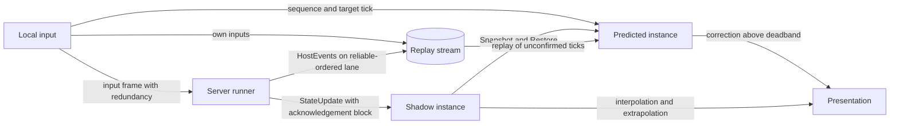

The runner's prediction states follow; a spectator or observer runner has no input rights, holds only the shadow and stays in interpolating.

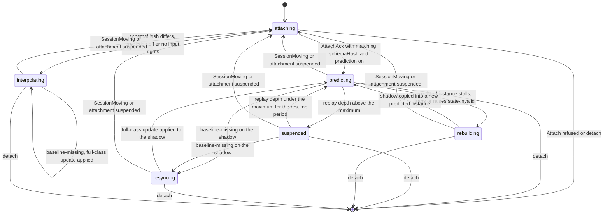

suspended and rebuilding raise prediction-suspended. In suspended the predicted instance runs no Tick, so a stall or trap cannot occur there. A baseline-missing in suspended moves the runner to resyncing, and in interpolating the runner stays in interpolating while the shadow imports the full-class update. A SessionMoving or a suspended attachment in any state returns the runner to attaching with its replay stream kept, and the re-attach's AttachAck and full-class update decide the next state as at first attach (see "Client connection and presence"). An Attach or re-attach refused with any code of the Attach row of "Transports and wire codec", such as saga-incomplete, ticket-invalid, epoch-stale or late-join-closed, ends the runner in attaching and releases both instances. A detach in attaching does the same. A client whose schemaHash differs uses the map codec and never predicts; prediction requires the positional codec of the same state schema.

### 13.11 Clock and input lead

The client estimates the server tick at attach as the AttachAck server tick plus half the measured round trip. It re-estimates the tick on every StateUpdate as the update's tick plus half the smoothed round trip. The round trip is measured from the send time of each own input to the first StateUpdate whose ackSequence or ackBits covers it, smoothed over the last 8 samples. ackSequence and ackBits report arrival, so the sample excludes the input's buffered lead; ackInputSequence reports outcome and never serves as a round-trip sample.

The estimate slews by at most 1 tick per 10 ticks and snaps only at attach and after a resync. The StateUpdate tick plus half the smoothed round trip is the ongoing clock source, and the server's observed inputLead is the correction source for the lead. A RateChanged host event re-bases both at its tick boundary, so the client and the server keep the same step.

The client targets each input at estimatedServerTick + oneWayTicks + inputLead, where oneWayTicks is half the smoothed round trip in ticks. inputLead is the arrival lead, the value the server's inputLead field reports. Default inputLead: **3 ticks**; it stays within 1 to 8 ticks, where 8 is the future edge of the acceptance window [arrivalTick − 2, arrivalTick + 8] of "Transports and wire codec". The acceptance window bounds the arrival lead, not the client's offset from its estimate. An input arriving beyond that edge is dropped by the server, and a prediction built on it is wasted. When the observed lead is above 3, the client slews the lead toward 3 by at most 1 tick per 10 ticks. When the observed lead is below 1, it raises the lead by the deficit at once.

### 13.12 Local application and the replay stream

The client assigns each input a sequence and a target tick, then applies it in the predicted instance at that tick: OnInput, then Tick, in the order the server uses. It stores the input in the replay stream. The replay stream is a ring of 128 own inputs plus 1024 host-event records received through HostEvents for ticks after the last authoritative tick, each with its tick.

On unreliable lanes every input frame repeats the last 3 unacknowledged inputs. The input frame's acknowledgement block also acknowledges the StateUpdate ticks the client received. A duplicate of an input already applied is dropped by sequence on the server, so redundancy never applies an input twice.

The Engine sends HostEvents(tick, records) on the reliable-ordered lane for every tick that holds at least one record visible to the receiver, before that tick's StateUpdate. A record for a tick at or below the last authoritative tick is already reflected in the shadow and leaves the replay stream. Without HostEvents a client runner cannot reproduce a server tick, so the message belongs to the required core.

### 13.13 Acknowledgement

Each StateUpdate carries an acknowledgement block with three prediction fields. ackInputSequence is cumulative: every own input with sequence at or below it has a final outcome at that tick, applied or dropped. An early input buffered toward a later target tick holds the value below its own sequence, even when a higher sequence was already dropped. inputLead is the signed lead observed for the receiver's most recent input, targetTick − serverTick at arrival. droppedInputs counts the receiver's inputs dropped since the previous update.

The client learns each input's outcome only through ackInputSequence and droppedInputs. A client-side guess about an input's fate is a hint; the acknowledgement block remains authoritative.

### 13.14 Reconciliation

On every StateUpdate the client runner performs these steps in order:

1. Apply the update to the shadow with ApplyDelta. An update whose tick is not above the shadow's tick is stale: discard and count it. On baseline-missing, acknowledge with the resync flag; the server answers with a full-class update within 32 ticks, and the runner holds the predicted instance until it arrives.
2. Acknowledge the update's tick in the next input frame.
3. Drop replay-stream inputs whose sequence is at or below ackInputSequence, and host-event records at or below the update's tick.
4. Capture the presentation state of the predicted entities, then copy the shadow into the predicted instance through Snapshot and Restore with gapTicks 0.
5. Replay ticks lastAuthoritativeTick + 1 to predictedTick, delivering each tick's host events and own inputs before its Tick. An unacknowledged input whose target tick is already authoritative is replayed at the first replayed tick when it is at most 2 ticks late, the server's late window; otherwise it is discarded as expected-lost.
6. Compare the re-predicted state of each predicted entity with the presentation state captured in step 4, using the metric the state schema declares for its entity type, and update the presentation offset.

Inverting deltas to roll one instance back is never a substitute for step 4: change-mask deltas are not invertible. The shadow-to-predicted copy is the same Snapshot and Restore pair the server uses, applied to a partial snapshot. The runner writes an entity's state into either instance only through ApplyDelta or Restore; it never patches state directly.

### 13.15 Correction thresholds and smoothing

The default metric is distance over the fields tagged position; the state schema may declare another metric per entity type. Default correction deadband: **0.01**; default snap threshold: 1.0 per entity type; default smoothing: 6 ticks, 0 to 30 per entity type. An error at or below the deadband is invisible and changes nothing.

An error above the snap threshold snaps the presentation to the re-predicted state. An error between the deadband and the snap threshold becomes a presentation offset that decays over the smoothing ticks to below the deadband. The offset lives in the runner's presentation layer, never in the session state, so smoothing changes no digest.

Every correction above the deadband counts toward the misprediction rate the binding exposes per minute, and a snap counts separately. Defaults are starting values per entity type, not accuracy guarantees.

### 13.16 Remote entities and the prediction horizon

The runner presents predicted entities from the predicted instance and every other entity from the authoritative updates. Remote entities render by interpolation between the two most recent authoritative updates. Default interpolation buffer: **2 updates**. When no newer update arrived, the runner extrapolates at most 6 ticks, then freezes the entity at its last authoritative pose and flags it stale. A remote entity's simulated values in the predicted instance are discarded at the next reconciliation and never presented.

The replay depth is predictedTick − lastAuthoritativeTick, about the round trip in ticks plus the input lead. Default maximum replay depth: **0.25 × tickRate**, 15 ticks at 60 Hz; 0.1 to 0.4 × tickRate per profile. Above the maximum the runner suspends prediction, presents the interpolated authoritative state, raises prediction-suspended and resumes after 1 second under the maximum.

Client runner starting budgets, unmeasured: the shadow copy through Snapshot and Restore 0.2 ms and a replayed Tick 0.5 ms. A 15-tick replay therefore takes about 7.7 ms of the 16.7 ms frame at 60 Hz, leaving about half the frame for rendering. A profile whose measured maximal replay exceeds 8 ms lowers its replay depth within 0.1 to 0.4 × tickRate, never its tick rate. The binding conformance test measures both figures on the reference client; they are budgets, not guarantees.

### 13.17 Misprediction and loss

A misprediction has three declared sources. A predicted tick beyond the last authoritative tick runs without host events, because the client discards its own commands. A host event filtered out by group visibility never reaches the receiver. A remote input that differs from the client's assumption changes the authoritative outcome. Each source is corrected at the next reconciliation and never persists as a divergence.

A lost StateUpdate costs latency, not correctness: the server's per-receiver delta still targets the last acknowledged tick. A lost input is covered by redundancy, applied late inside the 2-tick window, or dropped and reported in droppedInputs. A lost HostEvents message is retransmitted by the reliable-ordered lane; until it arrives the affected ticks mispredict and are corrected. A client never infers loss from silence alone; ackInputSequence and the update tick are the evidence.

### 13.18 Snapshot and delta codec

Snapshot bytes, StateUpdate bytes and the state digest are one canonical codec. Server adoption, a lockstep Restore and a client's full-class import are therefore one code path with three callers. The positional layout is identified by schemaHash, and stored snapshots by snapshotSchemaHash, so a change to the core protocol or to a tick-message layout leaves stored snapshots restorable (see "Contracts and code generation").

Per session the runtime keeps a ring of the last 32 encoded ticks per interest class for at most maxInterestClasses classes, default 8, and a per-receiver acknowledged index. A receiver beyond the class cap is encoded on its own against a depth-1 ring holding its acknowledged baseline and one candidate tick. Each tick sends a delta against the receiver's last acknowledged tick. The server sends a full-class update on the reliable-unordered lane when no acknowledgement arrived within 32 ticks, on join and on a resync flag.

A delta that does not fit the 1152-byte shared frame budget is split into interest-ranked partial frames. A full-class update above that budget travels as Fragment frames (see "Frame budgets and envelope budgets" in "Transports and wire codec"). Snapshot target: 64 KiB; hard cap 256 KiB on the Snapshot bytes, checked uncompressed before the write, with snapshot-too-large counted against the module. A module that exceeds a bound is degraded and reported, never silently truncated.

### 13.19 Partial worlds and interest

A client holds a partial world: the entities of its interest classes after group visibility and the mute matrix, and nothing else. serverOnly fields are stripped from every update. A full-class update replaces every entity of that class in the shadow; a delta changes, adds or removes entities explicitly. An entity that leaves the receiver's interest is removed by an explicit entry, never by silence.

Interest classes are coarser than seats: a class is the set of receivers that share one Interest answer, one visibility set and one snapshot-hidden set. A client's Snapshot is partial and names its covered classes, so a partial client digest is never compared with the server's complete digest.

### 13.20 Late join and resume

A late joiner or a resuming client initializes its instances from the AttachAck Init arguments. In server-authoritative mode it receives a full-class update of its interest classes on the reliable-unordered lane and imports it with ApplyDelta into the empty shadow. It then receives the HostEvents of the ticks after the update's tick from the session's event ring of 1024 entries.

In lockstep mode a late joiner receives a complete Snapshot, restores it with gapTicks 0 and simulates the TickFrames that follow its tick. A Restore of a partial snapshot by a lockstep late joiner fails with snapshot-partial. Server adoption likewise requires a complete snapshot and counts gapTicks as "Host to session operations" defines; the snapshot envelope's stateDigest must equal the Digest after Restore, or loading fails.

### 13.21 Entity ownership and authority

An entity is owned by one seat or by the server, through the ownerSeat field of its state schema. A client predicts the entities it owns whose type is tagged predicted, and every entity whose type is tagged predictAll. Ownership changes travel in the StateUpdate at a tick boundary. A client whose ownership ends stops predicting the entity at that tick, and a client that gains ownership starts at the same tick.

Ownership is a hint for prediction, not authority. In server-authoritative mode the server never applies a client's state to any entity, owned or not; inputs are the only client data. In lockstep mode no entity state travels upstream at all, only inputs and digests.

### 13.22 Generated bindings

The state schema is an authored source per game in its extension domain: entity types with ordered fields and types, the ownerSeat field, the entity-type tags predicted, predictAll and interpolated, the field tags serverOnly and position, the correction metric and thresholds per entity type and the delta layout of change masks. The contract representation carries it, and schemaHash covers it. Every language target of "Contracts and code generation" emits the same parts for it.

| Emitted part | Contents |
| --- | --- |
| State container | Entity records with Encode, Decode, ApplyDelta, Snapshot, Restore and Digest |
| Session library | Random, SecretRandom and the deterministic math functions with their vectors |
| Codec | Positional codec, map-codec fallback and the frame acknowledgement block |
| Client runner | Replay stream, shadow and predicted instances, clock and lead control, reconciliation, interpolation and extrapolation, correction smoothing, counters and lockstep frames |
| Runner contract | Load, Call and Unload for the portable artifact and for a custom client session |

The client runner exposes abstract operations to the game client. SubmitInput(payload) returns the assigned sequence and target tick. Advance(frameTime) runs due ticks and returns the presentation view with the offsets and stale flags applied. Receive(message) consumes AttachAck, StateUpdate, HostEvents, TickFrame and Desync. Counters returns the misprediction rate per minute, snaps, prediction faults, the replay depth, the input lead and the suspended flag.

The sandbox runtime that hosts the portable artifact is not emitted; it is the per-platform prerequisite of "Sandboxed hosting and fault containment". "No hand-written code per client" is therefore a claim about the binding, never about the runtime. A developer's custom client session implements the boundary in the client language, reuses the generated state container and codec and writes Tick, OnInput and the host-event handlers. The runner treats it exactly like the portable artifact, and its mispredictions are corrected, never trusted.

### 13.23 Responsibilities

| Concern | Developer | Engine and bindings |
| --- | --- | --- |
| Simulation | Tick, OnInput and host-event handlers; determinism of all of them | Canonical delivery order, fixed step and rate steps |
| State schema | Entity types, tags, ownership, metric and thresholds | State container, codec, digest and snapshot operations |
| Interest | Interest answers per receiver | Intersection with visibility and mute, interest classes, baseline rings |
| Sync model | syncModel, prediction, rollback and limits per profile | Lockstep frames, stall handling, digest comparison and Desync |
| Network | None | Transport, sequencing, redundancy, acknowledgement and resync |
| Prediction | Optional custom client session | Clock and lead control, replay stream, rewind and replay, smoothing, interpolation and extrapolation |
| Hosting | Artifact choice per runner kind and platform tag | Native and sandboxed runners, memory and fuel limits, fault containment |

A developer writes no network, sequencing or reconciliation code on either side.

### 13.24 Optional services and the Minimal profile

The Minimal profile carries prediction, lockstep and the sandboxed server runner without any optional service. Digests, the input lead and the misprediction counters are process metrics there and carry no identifier.

With Recording present, the data tap may record the replay stream (seeds, host events and inputs) instead of snapshots, and playback runs the portable artifact in the client runner. With Statistics present, misprediction and desync rates reach the trace as session events through the tap (see "Statistics service"). Without either service they remain process metrics only.

In traceless mode no replay file is written by any writer, and the determinism test runs in the testkit only (see "Anonymous traceless mode"). Prediction, lockstep and every runner kind behave exactly as in the Minimal profile.

### 13.25 Primary references

- [WebAssembly Core Specification, numerics](https://webassembly.github.io/spec/core/exec/numerics.html) — deterministic results for basic floating-point operations, NaN payloads excepted.

### 13.26 Conformance

1. A portable artifact that imports a host function outside the boundary is refused with load-failed.
2. An engine that cannot load the profile's declared server artifact refuses PlaceSession with artifact-unavailable.
3. A runner delivers a tick's host events in seq order, then inputs in sequence order per seat with seats ascending, before that tick's Tick.
4. A command issued on a predicted or shadow instance has no effect outside that instance.
5. A command issued on the authority instance takes effect only through a host event at a later tick.
6. Random(key) returns the same value for the same seed, tick, key and draw index on every runner, independent of other keys drawn in that tick.
7. SecretRandom returns zero on every client runner.
8. Decode(Encode(view, c, b)) applied with ApplyDelta reproduces the encoded state, and a full-class update applied to an empty instance re-encodes to identical bytes.
9. Encode or Snapshot of a state holding NaN or infinity fails with state-invalid.
10. A state-invalid on the server ends that session with faulted, and on a client it rebuilds the predicted instance from the shadow and raises prediction-suspended.
11. The portable artifact on the sandboxed server runner and on the client runner of every binding hosting it produce identical digests at every 30th tick and at the end of the full-visibility replay file.
12. The native build and every custom client session match the portable digests for a state schema without floating-point fields.
13. A digest mismatch report names the first diverging tick and the entity whose canonical bytes differ.
14. A sandboxed session that exceeds its memory limit or fuel ceiling ends with faulted while every other session on the engine keeps its tick.
15. Placement reserves sandboxMemory in bytes against memoryBytes and refuses a session that would raise the node above 90% of memoryBytes.
16. Restore of a partial snapshot fails with snapshot-partial for server adoption, lockstep late join and lockstep desync, and succeeds for the client's shadow-to-predicted copy.
17. Restore on server adoption and on a move target receives gapTicks counted from the snapshot's commit or the freeze to the first Tick, and every other caller passes 0.
18. With a single seat, no host events in the predicted range, interest all and a 150 ms round trip without loss, a client runner whose inputs arrive within the acceptance window reports zero corrections above the deadband over 600 ticks.
19. An input 2 ticks late is applied once on the server and replayed once on the client, never twice.
20. An input more than 2 ticks late and unacknowledged is discarded on the client as expected-lost.
21. ackInputSequence never advances past a buffered input whose sequence is lower than a dropped one.
22. The observed arrival lead stays within 1 to 8 ticks for every round trip under which the replay depth stays within the maximum replay depth, and an observed lead below 1 raises inputLead by the deficit in one step.
23. A correction above the snap threshold snaps the presentation, and a correction between the deadband and the snap threshold decays below the deadband within the smoothing ticks.
24. Smoothing changes no digest of the predicted or shadow instance.
25. A remote entity without a newer update extrapolates at most 6 ticks and is then frozen and flagged stale.
26. A client whose replay depth exceeds the maximum suspends prediction, raises prediction-suspended and resumes within 1 second after the depth falls under the maximum.
27. A delta against a baseline the shadow lacks yields baseline-missing and a full-class update within 32 ticks.
28. An entity leaving a receiver's interest arrives as an explicit removal entry.
29. No StateUpdate or HostEvents record carries a serverOnly field or a record hidden from the receiver.
30. A client whose schemaHash differs uses the map codec and never predicts.
31. In server-authoritative mode the server never applies client-supplied state to any entity.
32. A client that loses ownership of an entity stops predicting it at the tick of the ownership change.
33. A late joiner receives a full-class update of its interest classes followed by the HostEvents of later ticks, and its shadow digest equals a reference shadow fed the same updates.
34. A lockstep server never relays a TickFrame before every seat's input arrived or the stall deadline passed, and never skips a tick.
35. A lockstep seat missing its input past the stall deadline is substituted with an empty input and marked lagging.
36. A lockstep runner with a diverged digest receives Desync and a complete Snapshot and restores it before its next Tick.
37. A lockstep profile that declares serverOnly fields or snapshot-hidden data is refused by the validator, and a SecretRandom draw in a lockstep session fails the lockstep harness.
38. A client predicted instance that does not return within the frame is abandoned with its worker, rebuilt from the shadow and counted as a prediction fault.
39. In traceless mode no replay file exists after a session with the debug flag requested.
40. A detach in rebuilding ends the runner and releases both instances without completing the rebuild.
41. A detach in resyncing ends the runner and releases both instances without waiting for the full-class update.
42. A baseline-missing in suspended moves the runner to resyncing, and the full-class update that follows returns it to predicting.
43. A baseline-missing in interpolating yields a full-class update within 32 ticks, and the runner stays in interpolating.
44. A SessionMoving or a suspended attachment in any prediction state returns the runner to attaching, and the re-attach's AttachAck and full-class update lead to predicting or interpolating under the same conditions as a first attach.
45. An Attach or re-attach refused with any code, and a detach in attaching, end the runner in attaching and release both instances.
46. Between resyncs the server-tick estimate never moves by more than 1 tick per 10 ticks, and it snaps only at attach and after a resync.
47. An observed lead above 3 moves inputLead toward 3 by at most 1 tick per 10 ticks.
48. With the default interpolation buffer of 2 updates, a remote entity renders by interpolation between the two most recent authoritative updates.
49. A server-authoritative profile below 20 Hz without a prediction value presents interpolated authoritative state only, and one at 20 Hz and above without a prediction value predicts.
50. A lockstep runner with rollback=true predicts a missing remote input as a repeat of the seat's last input and reconciles from the last confirmed tick within the maximum replay depth.

## 14. Audio and video

Engine owns audio and video for every session whose lease it holds. The media router is a selective forwarding unit inside the Engine process, with one forwarding graph per session. The router forwards encoded media, rewrites packet headers per subscriber and selects video layers; it never decodes, mixes or transcodes. Groups, mute rules and observer visibility belong to "Session, players, teams, groups, observer and session events". Lanes, framing and the embedded relay belong to "Transports and wire codec"; capture and normalization belong to "Recording".

Every rule in this section holds in the Minimal profile: Socket, Inspector, Engine and one coordination store, guests only and no optional service. Audio, video, groups, both mute kinds, observers, both media paths and the embedded relay need no optional service. Only recording is absent. The subsection "Minimal profile, optional services and traceless mode" states each change an optional service makes.

### 14.1 Forwarding unit and media graph

Each session has one forwarding graph: publishers → tracks → groups → subscribers. A publisher is a SessionPlayer that sends at least one track. A subscriber is a player, observer, spectator or recorder that holds at least one down-track. The graph lives in the memory of the owning Engine, so a regroup or mute change needs no cross-process signaling. It takes effect on the first packet after the tick boundary that applies it.

The router runs on its own bounded worker set, never on a simulation worker. A slow tick never delays a packet, and a packet burst never delays a tick. The simulation worker swaps in the mute bitset and the group graph as an immutable copy at each tick boundary, so packet workers share no lock with the tick. The per-packet path is hot-path code under the allocation discipline of "Performance and memory budgets".

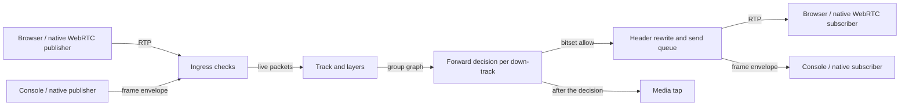

All media of one session passes through its owning Engine. A media-only engine class that hosts the graph for sessions placed elsewhere is a documented extension outside this version. Cascading one session's media across engines or regions is also outside this version. Server-side mixing is a product decision (see "Open questions").

### 14.2 Tracks and down-tracks

A track is one encoded media stream of one publisher: trackId, sessionId, publisher, medium, codec, layers, path, label and state. The medium is audio or video, and the path is rtp or frame. trackId is opaque and session-scoped. label is a bounded string the client chooses and the Engine never interprets. publisher is a seat, or the viewerIndex of an observer that publishes through a forward rule.

A video track carries one layer or a simulcast set of up to 3 layers; a simulcast set counts as one track. Default limits: **64 audio publishers** and 16 video publishers per session; 3 published tracks and 64 subscriptions per player. The profile's media policy may lower each limit and never raise one. A profile without a media policy carries no media and no media charge.

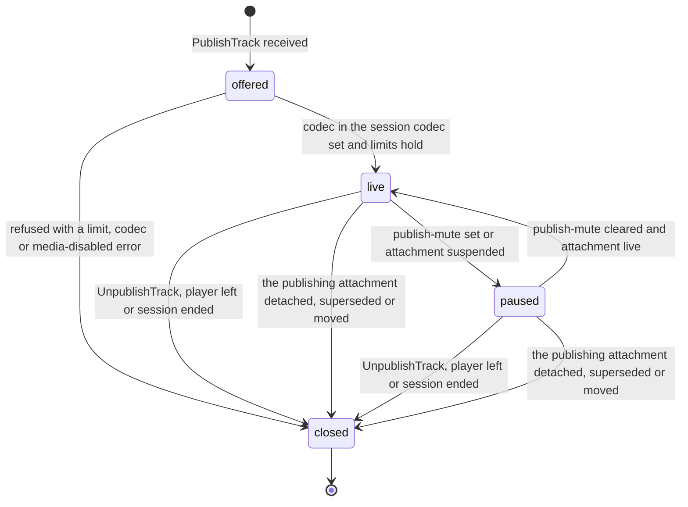

PublishTrack beyond a session limit fails with publisher-limit. Beyond the player limit it fails with track-limit, and for a medium the profile disables with media-disabled. Only a live track forwards packets. A paused track keeps its trackId and down-tracks while the router drops its packets. A track also closes when its publishing attachment is detached, superseded, moved to another Engine or suspended past the resume window, and its down-tracks are released at the next tick boundary. Track records are bound to the transport, not to the snapshot envelope: after an adoption or a session move the client binding republishes its tracks under the same labels.

A down-track is one (subscriber, track) pair: the unit of forwarding cost, media charge and layer selection. The router derives the down-track set at every bitset swap. A down-track exists when the forward decision allows the pair, the subscriber decodes the codec and every budget holds. By default a subscriber holds every track it may receive, audio before video and then by ascending publisher seat, up to 64. SetSubscriptions(trackIds, maxLayer) narrows that set or caps a video layer; it never widens it beyond the forward decision. A SetSubscriptions naming more than 64 tracks fails with subscription-limit and leaves the previous set in force.

TrackAdded and TrackRemoved tell a subscriber which down-tracks it holds. A subscriber learns of a track only through its own down-track. A sealed group's tracks are therefore never announced outside the group and its observers. A forward-mute change appears only on the target side; the publisher receives nothing about it.

### 14.3 Forward decision

The router checks each received packet once at ingress and once per down-track at egress. Rules are never evaluated per packet: the bitset is recomputed from them on every membership revision and every SetMute. The bitset is still consulted per packet, so a packet in flight across a swap obeys the new rules.

| Stage | Check | Outcome when the check fails | Counted as |
| --- | --- | --- | --- |
| Ingress | Track is live and belongs to the sending attachment | Packet dropped | closed |
| Ingress | Publisher is not publish-muted for the medium | Packet dropped | publish-muted |
| Ingress | Packet is inside the 200 ms media jitter buffer | Packet dropped | stale |
| Egress | Down-track exists for the subscriber | Not forwarded | not counted |
| Egress | Bitset allows (source seat, target seat, medium); for a viewer, a subscribed group allows and no sparse deny entry applies | Not forwarded | forward-denied |
| Egress | Packet belongs to the selected layer | Not forwarded | layer |
| Egress | Send queue accepts the packet | Oldest audio frame dropped, or video layer lowered | queue |

The bitset encodes sealed groups. No allow rule and no Interest answer of the module widens media across a sealed boundary, so sealed isolation is an Engine invariant a module bug cannot break. Drop counters are kept per session and reason. Metric labels never carry a seat, a player or a track.

A suspended session keeps forwarding audio under its last bitset and pauses video while it refuses inputs and controls (see "Engine runtime"). No regroup or mute change reaches the bitset until the lease returns. A session in ending refuses PublishTrack with session-ending and closes every track at ended.

### 14.4 Mute matrix in the media plane

Publish-mute stops a source. The router sends MediaNotice with code publish-muted, pauses the publisher's tracks of that medium and drops every packet still received, every layer included. Clearing it sends MediaNotice with code publish-unmuted and returns the tracks to live. The client binding stops capture on publish-muted; the router never relies on it. Publish-mute is the only mute a source learns about.

Forward-mute is never revealed to the source. The router terminates feedback on every leg: receiver reports, loss and bandwidth feedback on a publisher's leg describe that leg only. Keyframe requests reach a publisher as the router's own, coalesced and naming no subscriber. Each down-track has its own sequence space, contiguous across a pause or a denied interval so that no loss recovery requests the gap. It also has its own timestamp offset, under which timestamps advance by the elapsed media time of the pause. A publisher's layer set, feedback and notices depend on its own leg, the group graph and visible roles, never on a forward-mute rule.

A game uses forward-mute to hide who hears whom. A module forward-denies a villager's audio to one dead player, and the villager's client sees no change. The dead player receives TrackRemoved at the next tick boundary and no later packet. A moderator's SetMute through a control ticket has the same media effect as the module's.

### 14.5 Observer and hidden subscribers

Observers receive and are not received. An observer receives the media its subscribed groups receive, sealed groups included. PublishTrack from an observer fails with forbidden unless a forward rule (observer, target group, medium) exists. A forward-rule track reaches the target group and that group's observers, nobody else. Spectators never publish.

A hidden subscriber is a hidden observer, a hidden spectator or a recorder. It leaves no trace in what participants receive: no TrackAdded, no roster entry, no attributable feedback and no change to any layer set. A hidden observer's forward-rule track is announced with publisher role observer and no seat or playerId, so the group hears a voice without a roster entry. A keyframe request for a hidden subscriber names no subscriber and counts against the track's keyframe limit. It reveals at most that some receiver needs a keyframe.

The teacher of an online classroom is a hidden observer subscribed to every pair group. The teacher hears and sees each pair, and no pair learns of it. A forward rule (teacher, pair 3, audio) lets the teacher speak into pair 3 only. Removing the rule closes that track's down-tracks at the next tick boundary. After SetVisibility makes the teacher visible, its tracks carry its playerId from that tick.

A spectator receives the public group's media only. A spectator with spectatorDelay above 0 receives no media, because the router never delays media to match delayed state. At full occupancy the cap of 1024 spectators exceeds every media budget. Spectator down-tracks are therefore created last and only while the budget holds; a refused spectator receives MediaNotice with code down-track-budget.

### 14.6 Codec policy

The profile names codecs; this specification fixes their properties. One mandatory low-latency speech codec runs at 48 kHz with 20 ms frames and 16 to 64 kbit/s. One mandatory royalty-free baseline video codec carries video. Every client binding that handles audio implements the speech codec, and every binding that handles video implements the baseline codec. Codec identifiers are media type registry names, carried as strings in the contracts.

Each attachment declares the codecs it decodes in its first signaling or media message: the first SignalDescription on the RTP path, MediaCapabilities on the frame-envelope path. At each video PublishTrack the router computes the session codec set. It holds the baseline codec plus each additional codec the profile lists that every attachment then publishing or receiving video decodes. A publisher encodes only in that set, and PublishTrack with no codec in common fails with codec-unsupported. A later subscriber that cannot decode a track gets no video for that pair and MediaNotice with code codec-unsupported; the publisher is not asked to change.

The Engine never transcodes. The recording normalizer is the only component that transcodes, and only for a recording. videoEnabled=false in a profile removes video tracks, video down-tracks and the video charge together; audioEnabled=false does the same for audio.

Media is encrypted per hop, not end to end. On the RTP path every leg is SRTP keyed by DTLS, and the router re-encrypts per leg to rewrite headers. On the frame-envelope path a frame is as protected as its transport: authenticated encryption on secure UDP, TLS where the operator terminates it. End-to-end media encryption is outside this version, because the router reads payload descriptors to find frame boundaries, keyframes and layers.

### 14.7 Simulcast and layer selection

Simulcast sends up to 3 layers of one video track: 180p, 360p and 720p, never above the media policy's maxResolution (default 720p). It is enabled when more than 4 visible receivers share a group with the publisher. The count reads the group graph and roles only; hidden subscribers and forward-mute rules never enter it. The router sends LayerRequest(trackId, layers) when the count crosses 4 in either direction, at most once per 2 seconds per track. On the frame-envelope path each layer is a separate track of one simulcast set.

Each down-track carries one selected layer: the highest whose measured bitrate fits the subscriber leg's bandwidth estimate after its audio. Two caps bound the choice: the subscriber's maxLayer and the down-track's resolution cap. That cap is the highest group resolution among the groups that allow the pair, bounded by maxResolution. The estimate comes from congestion feedback on the RTP path and from Backpressure() on the frame-envelope path.

A layer switch takes effect at the first keyframe of the target layer. Default keyframe request limit: **one per 2 seconds** per track. Requests from several subscribers inside one interval coalesce into one, which bounds keyframe storms on join. A down-switch under congestion pauses that down-track's video until the lower layer's keyframe arrives, rather than exceeding the estimate. An up-switch happens at most once per 2 seconds per down-track.

Audio has priority over video in every queue. Degradation for one subscriber lowers the video layer step by step, then pauses video, then lets the audio queue drop its oldest frames on overflow. The router never drops audio by policy while any video reaches that subscriber. This order is the video-layers step of "Performance and memory budgets"; game-state thinning for the same receiver runs independently.

Scalable coding is an alternative layer source, not a requirement. When a negotiated codec carries spatial or temporal layers in one stream, the router drops packets above the selected layer instead of switching streams. Selection, keyframe and priority rules stay the same. No conformance level requires scalable coding; the baseline codec uses simulcast.

### 14.8 RTP path

Browsers and native WebRTC stacks use RTP over the WebRTC RTP adapter. A browser attachment uses one peer connection for its data channels and its media. Both share one ICE transport, one DTLS association and one bandwidth estimate. The Engine is the remote peer of every leg, and no media flows between clients.

SignalDescription and SignalCandidate are the only signaling messages of the RTP path. They are session-channel messages in both directions on a gateway attachment stream of the client's control connection, and they set up, renegotiate and restart the peer connection. The first SignalDescription opens the stream and carries the admission ticket; the Engine leaves it unanswered until the ticket's bound id passes verification (see "Transports and wire codec"). Socket relays both opaquely and never parses a session description (see "Socket"). The client offers when it publishes; the Engine offers when down-tracks change and when it restarts ICE. On collision the client rolls back, answers the Engine's offer and offers again.

The admission ticket's ICE server list names the owning engine's relay first and operator-configured external relays after it. Relay credentials and accounting belong to "Transports and wire codec". ICE candidates carry client addresses, which stay in process memory, appear in no log line in traceless mode and in no line above debug in mode=standard.

Loss recovery stays on the leg where the loss happened. A subscriber's video retransmission request becomes a router-originated request on an RTP publisher's leg, naming no subscriber. For a frame-envelope publisher the router sends a keyframe request under the rate limit instead. Audio is never retransmitted; the receiver conceals a lost 20 ms frame.

A planned restart keeps the session, its seats and its trackIds, because the track table travels in the handoff record. RTP media resumes through an ICE restart the successor starts inside the 30-second consent window. Default media gap target: **100 to 500 ms**, an unmeasured starting value until the browser-in-the-loop test measures it. After a crash the client re-attaches and sends a SignalDescription with an ICE restart for its tracks. The adopter rebuilds the track table from it and re-derives down-tracks from the restored group graph and mute matrix (see "Engine runtime").

### 14.9 Frame-envelope path

Clients without a WebRTC stack use the frame envelope. AudioFrame and VideoChunk are message kinds of the binary realtime frame, whose header supplies lane, generation and sequence (see "Transports and wire codec"). AudioFrame adds trackId, a timestamp in the codec clock and one 20 ms codec frame. VideoChunk adds trackId, layer, frameId, chunkIndex, chunkCount, a keyframe flag, a timestamp and one chunk. Each fits the 1200-byte datagram cap with its headers; video chunking is the frame envelope's own.

Audio frames use the unreliable-sequenced lane, because 20 ms speech frames cannot wait for retransmission. Video chunks use the reliable-unordered lane, which carries keyframes of tens of kilobytes. KeyframeRequest(trackId, layer) is a reliable-ordered control message in both directions, rate-limited toward publishers.

| Adapter | Audio lane | Video lane | Media rule |
| --- | --- | --- | --- |
| Secure UDP | unreliable-sequenced | reliable-unordered | Full frame-envelope path |
| TCP | mapped onto a reliable lane | reliable lane | AudioFrame coalesced per track on backlog |
| WebSocket through Socket | one ordered stream | one ordered stream | AudioFrame coalesced per track; bytes count in Socket's relay throughput |
| WebRTC data channels | channel 1, unordered, zero retransmits | channel 0, ordered reliable | Native clients without an RTP stack only |
| QUIC-based optional adapter | datagrams | streams | Optional; never required for media conformance |
| WebRTC RTP | RTP packets | RTP packets | RTP path, not the frame envelope |

Where the unreliable-sequenced lane maps onto a reliable lane, AudioFrame travels on the mapped lane under the collapsed-lane rule, applied per track. When the send queue holds more than one AudioFrame of one track, only the newest is kept. The stream's head-of-line delay remains: audio quality there is bounded by the stream, not repaired by the Engine. The lane map in AttachAck tells the client which rule applies. Relabeling a reliable lane as unreliable is forbidden.

The router re-packetizes between the paths, so a console player hears a browser player when codecs match. Toward the frame envelope it reassembles whole frames, waiting at most the 200 ms media jitter buffer. An incomplete frame is then discarded, counted and followed by a keyframe request. Toward RTP it packetizes each frame into packets of at most 1200 bytes in the down-track's own sequence space. Payload bytes are copied, never decoded; a codec mismatch fails at negotiation with codec-unsupported.

### 14.10 Processor and bandwidth budgets

Media uses the capacity unit of simulation, 1% of one reference core (see "Engine node, lease, epoch, placement and capacity"). The charges derive from 13 to 18 µs per forwarded packet. An audio track sends 50 packets per second and a 720p track about 200. The derived 0.075% and 0.36% of a core are rounded up as margin.

| Item | Charge | Derivation | Worked example |
| --- | --- | --- | --- |
| Audio down-track | 0.1 units | 50 packets/s × about 15 µs = 0.075% of a core | 10 players all talking: 90 down-tracks, 9 units |
| Video down-track, any layer | 0.4 units | 200 packets/s × about 18 µs = 0.36% of a core | 1 teacher video to 29 receivers: 29 down-tracks, 11.6 units |
| Recorder down-track | as its medium | one per recorded publisher per scope | 10 audio publishers in 2 scopes: 20 down-tracks, 2 units |
| Relay allocation | 0.2 units per Mbit/s of ceiling | default 4 Mbit/s ceiling | 0.8 units per allocation |

A video down-track is charged at the 720p figure at any layer, because the layer changes after placement and the charge does not. A 30-seat classroom with one teacher video and 30 audio publishers holds 870 audio and 29 video down-tracks. That is 87 + 11.6 ≈ **99 units**, about one reference core.

Egress saturates before the processor. A 720p down-track costs 1.5 to 2.5 Mbit/s; an audio down-track costs 16 to 64 kbit/s of payload. The classroom therefore sends 57 to 128 Mbit/s before packet overhead. A small capacity class with 50 Mbit/s cannot hold it although the processor cost fits, so placement checks egress as well as units.

The media policy declares a down-track budget per medium: audioDownTracks and videoDownTracks. The placement charge is audioDownTracks × 0.1 + videoDownTracks × 0.4 units, against capacityUnits and mediaUnits, fixed for the session's lifetime. Recorder down-tracks are charged on top. The validator refuses a profile that enables a medium without a budget and prints the worst case from maxPlayers and the publisher limits.

At runtime a down-track beyond its medium's budget is not created, and the subscriber receives MediaNotice with code down-track-budget. Allocation order: players and observers before spectators, audio before video, then ascending publisher seat. Egress is measured, not reserved. mediaFull and the 90% egress refusal keep media sessions off a saturated engine.

Every figure here is a starting value, not advertised capacity. Operators re-measure media units, egress and relay share per instance type before publishing a number.

Expose per session and engine: down-tracks by medium, forwarded and dropped packets by reason, egress bytes, layer switches, keyframe requests sent and coalesced, codec-unsupported pairs and relay bytes. Metric labels are region, engine, game and capacityClass only. Debug lines carry sessionId, as a keyed digest in traceless mode, and seat, never payload or addresses.

### 14.11 Recording tap points

A recorder is a hidden subscriber bound to one group, its recording scope, with observer allow-list semantics. It receives a packet exactly when a viewer subscribed to the scope would. Rules targeting the group or the recorder apply; rules targeting one member's seat do not. The tap sits after the forward decision, so a recording never holds audio that nobody in its scope heard. Tapping at ingress is forbidden.

A recorder takes the highest layer the recording policy allows and follows the keyframe rules. It never changes a layer set and never appears in an announcement. Packets reach the tap through a bounded capture queue. A full queue drops and the manifest records a gap; the tap never blocks forwarding or a tick.

A recording indicator SessionEvent precedes the first captured frame. The tap records the shared clock mapping per segment: from sender reports on the RTP path, from frame timestamps against the Engine's media clock on the frame-envelope path. Segments, spool, drivers, manifests, the event tap and the optional data tap are specified in "Recording". The null media tap allocates no capture buffer.

### 14.12 Minimal profile, optional services and traceless mode

The Minimal profile carries the whole media feature: both paths, groups, both mute kinds, observers, spectators, simulcast and the embedded relay. The media tap is the null adapter and no capture buffer exists. Inspector refuses recording=true with feature-unavailable. openRecordingSegments stays zero, so drain never waits on media.

With Recording present, a room whose owner set recording=true gets recorders. Each recorder adds its down-tracks to the media charge, and drain waits for open recording segments. With Profiles present, moderators and admins reach SetMute through control tickets. Statistics, Payment and Inventory change nothing here, and media bytes never pass through the event sink.

In traceless mode no media byte leaves Engine memory except toward participants the forward decision entitles. Recording is refused at start, so no recorder, spool or manifest exists. Client addresses from ICE candidates and relay allocations stay in process memory. Media buffers are zero-filled before they return to a pool, as best effort against memory inspection (see "Anonymous traceless mode").

### 14.13 Conformance

1. A regroup issued during tick t changes media forwarding from the first packet after the following boundary and not before.
2. No audio or video packet from a sealed group's member reaches a non-member other than an observer of that group or a recorder scoped to it.
3. No module Interest answer and no allow rule makes a media packet cross a sealed boundary.
4. A publish-muted publisher receives MediaNotice publish-muted, and no packet of any layer it still sends is forwarded.
5. A forward-mute change produces no message, feedback change or LayerRequest on the publisher's attachment.
6. A forward-denied target receives TrackRemoved at the next tick boundary and no later packet of that track.
7. A subscriber receives TrackAdded only for tracks it holds a down-track for.
8. A hidden observer of a sealed group receives its audio and video, and no member receives TrackAdded, a roster entry or feedback naming the observer.
9. PublishTrack from an observer without a forward rule for the medium fails with forbidden, and PublishTrack from a spectator always fails.
10. A hidden observer's forward-rule track reaches only its target group and that group's observers, announced without a playerId.
11. Adding a hidden observer or a recorder never changes any publisher's layer set.
12. A video track enables simulcast when more than 4 visible receivers share a group with its publisher, and no layer exceeds maxResolution.
13. A publisher receives at most one router keyframe request per track per 2 seconds, however many subscribers request one.
14. A congested down-switch pauses video until the lower layer's keyframe rather than exceeding the estimate.
15. Under backpressure a subscriber loses video layers and then video before the router drops any audio frame by policy.
16. A subscriber that cannot decode a video codec receives MediaNotice codec-unsupported and no video for that pair, and the publisher keeps its codec.
17. PublishTrack beyond 64 audio or 16 video publishers fails with publisher-limit, and a player's fourth track fails with track-limit.
18. A browser on the RTP path and a console on the frame-envelope path hear each other when their codecs match.
19. On a TCP or WebSocket attachment a backlog of AudioFrame messages of one track is coalesced to the newest.
20. Every AudioFrame and VideoChunk the Engine sends fits 1200 bytes with its headers.
21. A frame still incomplete after the 200 ms media jitter buffer is discarded, counted and followed by a keyframe request within the rate limit.
22. A down-track beyond the declared budget is not created, and its subscriber receives MediaNotice down-track-budget.
23. Spectator down-tracks are created only after every player and observer down-track that fits, and a delayed spectator receives no media.
24. A session's media charge equals audioDownTracks × 0.1 + videoDownTracks × 0.4 units plus recorder down-tracks for its whole lifetime.
25. The validator refuses a profile that enables a medium without a down-track budget.
26. A suspended session keeps forwarding audio only under its last bitset, forwards no video and applies no mute or group change before the lease returns.
27. A planned restart preserves trackIds and seats and resumes RTP media through a server-initiated ICE restart inside the consent window.
28. After a crash, a client re-attaching with its resume token and an ICE-restart SignalDescription receives media under the restored group graph and mute matrix.
29. A group recording holds no packet that the forward decision for a viewer of its scope would not forward.
30. A full capture queue produces a manifest gap without delaying any forwarded packet.
31. In the Minimal profile a session with 4 guests, audio, video and groups allocates no capture buffer and writes no media byte outside process memory.
32. In traceless mode no log line at info or above carries a client address or ICE candidate.
33. A publisher whose attachment is superseded has every track closed and its down-tracks released within one tick boundary.
34. After a session move every publisher's tracks are republished on the target under the same labels, and down-tracks are re-derived from the restored group graph and mute matrix.

## 15. Profiles service

Profiles owns durable principals: members, their roles and personal fields, bans, audit records, guest claims, durable room profiles and the key material for member credentials. It is optional. The Minimal profile runs without it, every principal there is a guest issued by Inspector and nothing in this section exists. Profiles never writes a coordination-store key; every fact Inspector must hold travels through a projection operation of "Inspector". It does not own rooms, sessions, admission, quotas or guest points, which stay with Inspector, and it does not own history or achievements, which Statistics derives from the trace. It does not own friend requests, friendships, member blocks, conversations, invites or feed items, which Social and Feed hold.

The rules on kinds, roles, permissions, migration, bans and erasure are fixed in "Profile, roles, permissions and quotas". This section specifies the service that carries them out: what it stores, which operations it exposes, which facts it consumes and produces, how the installation behaves without it and how it is secured. Profiles runs as its own image or inside the statistics bundle image beside the events library; production runs it alone, because member sign-in must stay available while analytics lags.

### 15.1 Responsibilities and boundaries

Each concern has one owner. The table names what Profiles holds and what stays with another service, so no fact has two writers.

| Concern | Profiles owns | Owned elsewhere |
| --- | --- | --- |
| Member identity | member aggregate: username, role, email, personal fields, formerGuestIds | guest records: Inspector |
| Credentials | member sign-in, renewal, member signing keys | guest credentials: Inspector unless guestIssuer=profiles; tickets: Inspector |
| Sanctions | ban facts, audit records | enforcement: Inspector and Socket |
| Rooms | durable room profile | live room key and room lifecycle: Inspector |
| Points | member point balance | guest points: Inspector; settlement ledger: Statistics |
| History and achievements | none | Statistics |
| Social graph | member identity behind every friend, request, conversation and invite; ResolveNames | friend requests, friendships, member blocks and social settings: Social; feed items: Feed |
| Erasure | tombstones, ProfileErased | data removal in each service that holds the profileId |

Profiles is the only service that holds email or a personal field. No credential, ticket, sink fact, outbox entry, coordination-store key or log line carries them. A reply holds them only for ReadProfile on the caller itself or for an audited moderator read.

### 15.2 Storage through repositories

Profiles reaches storage only through the repository contracts of "Persistence abstraction". ProfileRepository holds the member aggregate: profileId, kind, username, role, email, personal fields, points, formerGuestIds, the password verifier, the digests of live renewal tokens, claim records and the applied-settlement records that make point application idempotent. RoomProfileRepository holds durable room profiles. BanRepository holds ban facts with their revision. AuditRepository is append-only: Put with an existing id and Delete are refused with append-only.

Aggregate-specific queries are FindByEmail, FindClaimByGuest(guestPlayerId), FindBans(targetProfileId) and ListAudit(filter, page). Email is unique by a store constraint, not by a check before insert; claim records are unique on guestPlayerId; applied-settlement records are unique on profileId + sessionId. Every write carries expectedRevision and fails with stale-revision on a concurrent change. Every page holds at most 100 entries with an opaque cursor.

Each state change, its AuditRecord when the action is audited, its outbox entries and its idempotency record commit in one unit of work. A side effect is therefore published if and only if the change commits. Reference adapters are the relational store and the document store; the document store requires a replica set, because the unit of work spans several documents. Migrations are forward-only, owned by the profiles library in their own namespace and applied at start under a store-side advisory lock.

### 15.3 Sign-in and member credentials

SignIn(method, proof) → member credential, renewal token. The password method takes email and password; the external method takes an assertion from an identity provider the operator configured, and Profiles validates issuer, audience, signature, expiry and nonce. Errors are invalid-credentials, banned, erased and rate-limited. One code covers an unknown email and a wrong password, so a reply never reveals whether an email is registered.

RenewCredential(renewalToken) → member credential, renewalToken. Renewal re-reads the stored role and the ban state, never the previous credential. Each renewal rotates the token; presenting a rotated token again revokes every token of that sign-in with revoked, because reuse means the token leaked. SignOut(renewalToken) revokes the same family. Default member credential lifetime: **1 hour**; renewal token lifetime: 30 days, rotated on every use. These are starting values, not security guarantees.

Profiles signs member, moderator and admin credentials with its own key set and rotates the signing key every 24 hours. A new key signs nothing until every region of the installation directory has acknowledged its PublishSigningKey, so no region receives a credential it cannot verify. A retired key is announced through RetireSigningKey only after the longest configured credential lifetime plus 1 hour. The private key material never leaves Profiles; only verification material is published.

With guestIssuer=profiles, Inspector answers IssueGuest with issuer-delegated and Profiles signs guest credentials under the content and lifetime rules of "Profile, roles, permissions and quotas". The validate command refuses guestIssuer=profiles without Profiles declared.

### 15.4 Public operations

Clients reach these operations only through the Profiles route of "Socket". Every state-changing operation on an authenticated connection carries an idempotencyKey under the rules of "Identifiers, time, counters and envelopes". RegisterMember, SignIn and RenewCredential from an open connection carry none, because that section scopes a key to a principal. A repeated RegisterMember creates no second member or claim, because email and claim records are unique by store constraint. A repeated SignIn issues one more renewal token family. A RenewCredential repeated after a lost reply presents a rotated token and revokes that sign-in, so the client signs in again. Profiles checks every moderator and admin operation against the stored role at the time of the call; the role inside a credential is a hint, not authority.

| Operation | Caller | Result | Errors |
| --- | --- | --- | --- |
| RegisterMember(registration, guestCredential or none) | open or guest connection | member credential, renewal token, claim state | email-taken, invalid-proof, already-claimed, expired, revoked, rate-limited |
| CompleteClaim(guestCredential) | member | claim state | invalid-proof, already-claimed, expired |
| SignIn(method, proof) | open connection | member credential, renewal token | invalid-credentials, banned, erased, rate-limited |
| RenewCredential(renewalToken) | open connection | member credential, renewal token | revoked, banned, erased |
| SignOut(renewalToken) | member | ok | none |
| ReadProfile(targetProfileId, reason, regionId or none) | member on itself; moderator on others | profile view | forbidden, not-found, erased, audit-unavailable |
| UpdateProfile(fields, expectedRevision) | member on itself | revision | stale-revision, field-invalid, email-taken |
| ResolveNames(playerIds) | any authenticated connection; Social and Feed services | username per member id | ids-too-many |
| SetRole(profileId, role) | admin | revision | forbidden, role-invalid, not-found, last-admin, audit-unavailable |
| Ban(target, scope, roomId or none, until or none, reason) | moderator or admin | revision | forbidden, not-found, audit-unavailable |
| Unban(target, scope, roomId or none) | moderator or admin | revision | forbidden, not-found, audit-unavailable |
| ListAudit(filter, page) | admin | bounded page | forbidden |
| EraseProfile() | member on itself | ok | erased |

ResolveNames accepts at most 100 playerIds and answers the username of each member id; a guest id, an unknown id and an erased id answer none. It returns no other field and appends no audit record, because a username is the display name every room roster already shows. Clients use it to label leaderboard rows and history entries, which carry playerIds only (see "Statistics service").

When Statistics is declared, ReadProfile for a moderator includes the target's latest 100 session summaries, fetched through Statistics' ReadHistory with the Profiles service credential. If Statistics does not answer within 2 seconds, the view carries historyUnavailable=true instead of failing; the audit record names the view either way.

When Payment or Inventory is declared, the moderator view also holds the target's billing and items. Profiles calls ReadBilling(targetProfileId) on Payment and ReadInventory(targetProfileId, every game, first page) on Inventory with its service credential under a 2-second budget each. A lapsed budget sets billingUnavailable=true or inventoryUnavailable=true instead of failing. For a guest target, ReadProfile names the regionId in which the guest was observed, and Profiles calls ReadGuest(playerId, regionId) on that region's Inspector under the same budget. ReadGuest answers the username, the regional points and the effective quota with current counts, and a lapsed budget sets guestUnavailable=true. One AuditRecord covers the whole view, whatever parts it holds.

The first admin is created only by the operator command of the profiles library, which runs inside the Profiles process with no network exposure and appends an AuditRecord with actor operator.

### 15.5 Member identity for Social and Feed

Social and Feed keep no copy of member identity. Each checks that a profileId names an existing member through ResolveNames with its own service credential. An answer other than none is a member, and a guest id, an unknown id and an erased id answer none, so neither service ever records a guest. Social caches the answer for 60 seconds and Feed for 10 minutes (see "Social service" and "Feed service"). A member erased within that span is removed by each service's own handling of ProfileErased, never by a cache entry. ResolveNames through a service credential appends no audit record and returns no field beyond the username, like a client call.

Friend identity is the member profileId: a friend request, a friendship, a conversation participant, an invite and a feed recipient all name it. None names an email, a personal field or a guest playerId. Profiles holds no friend list and no member block list. A Block is a sanction one member applies to another, owned by Social and not a ban. It never reaches BanRepository, is never projected through ProjectBan and is not the room block of BlockInRoom. A Ban is a sanction that Profiles owns and changes no friendship and no Block. A member under an installation-scope ban reaches no Social or Feed operation in a region once that region acknowledged ProjectBan. Socket closes its connections there with banned, and Profiles renews no credential for it.

The validate command refuses Social or Feed without Profiles declared. Social and Feed consume ProfileErased through their own round-robin groups and remove every record naming the member within 24 hours; Profiles calls neither of them.

### 15.6 Calls to Inspector and the outbox

Profiles changes Inspector state only through operations that Inspector exposes to declared services. Each call starts as an outbox entry in the unit of work of the change that caused it. The relay delivers each entry at least once to every region of the installation directory and retries a region that has not acknowledged, with backoff from 1 second up to 5 minutes and full jitter, until it does. The relay never drops an entry; an entry older than 10 minutes is reported at warn with a counter.

| Outbox entry | Delivered to | Caused by |
| --- | --- | --- |
| ProjectBan, RevokeBan | Inspector of every region | Ban, Unban, EraseProfile |
| PublishSigningKey, RetireSigningKey | Inspector of every region | key rotation |
| ClaimGuest | Inspector of every pending region | RegisterMember, CompleteClaim |
| CloseRoom | Inspector of the room's region | EraseProfile for every open owned room |
| GuestClaimed, ProfileErased, RoleChanged | event sink | the same unit of work |

Projection calls are idempotent by revision, so a redelivery changes nothing at or below the stored revision. A region enforces a ban or accepts a key from its own acknowledgement, never earlier and never through a cross-region read. A region outage therefore delays enforcement in that region only.

### 15.7 Events consumed and produced

Profiles consumes from the event sink as its own consumer group (see "Integration bus"). Inspector's RoomChanged facts maintain the durable room profile: creation writes the RoomProfileRepository entry, a settings change updates it under its revision and close marks it closed. Inspector stays the only writer of the live room key, and a closed room profile never reopens.

Member points come from exactly one source, chosen by the declared configuration and never by observing which fact arrives. With Statistics declared, Profiles applies PointsSettled; otherwise it applies Inspector's SessionSettled. Each application adds the member deltas in one unit of work keyed by profileId + sessionId, so a redelivered or duplicated fact adds nothing. A delta for a playerId that is not a member is ignored, because guest points belong to Inspector.

Profiles produces GuestClaimed, ProfileErased and RoleChanged. Each uses the sink-fact envelope with eventId "p." + producerId + "." + producerSequence and one durable producerId per Profiles installation, so a restart never reuses a sequence. If Profiles stays unavailable beyond the 10-minute sink horizon, facts trimmed from the stream are a gap. Profiles logs it at error with a counter, and the member points of those sessions are lost rather than invented.

### 15.8 Absence and degradation

Absent, Profiles leaves the Minimal profile rules in force: every principal is a guest, Inspector issues every credential and quotas come from the quotas configuration group. RegisterMember, CompleteClaim, SignIn and every other operation above answer feature-unavailable from Socket without a network call. Payment, Inventory, Social and Feed cannot be declared, because the validate command refuses each of them without Profiles. A game profile with requiresProfiles=true is refused at CreateRoom with feature-unavailable.

A declared but unreachable Profiles is degraded, never absent. SignIn, RegisterMember and RenewCredential answer retryable-unavailable. Member credentials already issued verify offline until they expire, at most 1 hour by default, so members in sessions keep playing and members whose credential expires cannot rejoin until Profiles returns. Guest issuance continues through Inspector unless guestIssuer=profiles, in which case no new guest can be issued during the outage.

Projected bans and signing keys stay enforced in every region until their lifetimes end, because enforcement reads only Inspector's keys. No Engine, Inspector or Socket path waits on Profiles, and no session ends because Profiles is down. In traceless mode a declared Profiles fails start (see "Anonymous traceless mode").

### 15.9 Security

The password verifier is the output of a salted memory-hard password-hashing function with cost parameters in configuration; the password itself is never stored, logged or placed in an outbox. Failed sign-ins are limited per email digest and per address digest: default 5 failures per 15 minutes, then rate-limited for 15 minutes. These are starting values for abuse tests, not lockout guarantees. Registration shares the 60 issuances per minute per address digest limit of guest issuance.

Every call from Profiles to Inspector carries the Profiles service credential; Inspector refuses a projection or ClaimGuest from any other caller with forbidden. Client traffic reaches Profiles only through Socket, so Profiles never accepts a client connection directly. A guest credential presented as claim proof is held in memory for one request and never written to the Profiles store or its outbox.

Logs follow "Observability and logging": lines carry profileId only as a keyed digest above debug and never carry email, personal fields, passwords, tokens or addresses. Every ReadProfile on another principal, SetRole, Ban, Unban and erasure appends an AuditRecord in the same unit of work, under the security and abuse retention class of 6 to 12 months with pseudonymous identifiers. An action whose audit append fails is refused with audit-unavailable, so no unaudited moderator action exists.

### 15.10 Conformance

1. With Profiles absent, every Profiles operation answers feature-unavailable and no network call leaves Socket.
2. The validate command refuses a configuration declaring Payment or Inventory without Profiles.
3. The validate command refuses guestIssuer=profiles without Profiles declared.
4. Two concurrent RegisterMember calls with the same email create one member and one email-taken reply.
5. SignIn answers the same invalid-credentials code for an unknown email and for a wrong password.
6. A sixth failed SignIn for one email within 15 minutes answers rate-limited.
7. RenewCredential issues a credential carrying the stored role, not the role of the previous credential.
8. Presenting a rotated renewal token revokes every renewal token of that sign-in.
9. A credential signed by a new key verifies in every region, because the key signs only after every region acknowledged PublishSigningKey.
10. ResolveNames with 101 playerIds fails with ids-too-many, and a guest id in the request answers none.
11. ReadProfile by a moderator returns historyUnavailable=true and still appends its AuditRecord when Statistics does not answer within 2 seconds.
12. A Ban whose AuditRecord append fails changes no ban and enqueues no ProjectBan.
13. A ProjectBan outbox entry is retried for a region that has not acknowledged until it acknowledges.
14. With Statistics declared, a SessionSettled fact adds no member points.
15. With Statistics absent, a SessionSettled fact delivered twice adds the member delta once.
16. A delta for a guest playerId in PointsSettled or SessionSettled changes no Profiles record.
17. A room settings fact with a revision at or below the stored room profile revision changes nothing.
18. A sink gap beyond the 10-minute horizon is logged at error with a counter and no points are invented.
19. With Profiles unreachable, a member already in a session keeps playing until its credential expires.
20. With Profiles unreachable, a projected ban stays enforced in every region that acknowledged it.
21. No Profiles log line at info or above contains an email, password, token, address or raw profileId.
22. Start with mode=traceless and a declared Profiles address fails.
23. A moderator's ReadProfile of a member with Payment and Inventory declared returns that member's subscriptions, purchases and balances, and appends exactly one AuditRecord.
24. A moderator's ReadProfile of a guest playerId with a regionId returns the guest's username, regional points and quota from that region's Inspector and appends exactly one AuditRecord.
25. ReadProfile by a moderator returns billingUnavailable=true and still appends its AuditRecord when Payment does not answer within 2 seconds.
26. The validate command refuses a configuration declaring Social or Feed without Profiles.
27. ResolveNames with Social's or Feed's service credential answers none for a guest id, an unknown id and an erased id, and appends no AuditRecord.
28. A Ban changes no friendship or Block, and a Block in Social writes no ban fact and sends no ProjectBan.
29. A member under an installation-scope ban loses its Social and Feed routes in a region once that region acknowledged ProjectBan.

## 16. Statistics service

Statistics owns the event trace, analytics, session summaries, the settlement ledger, achievements, seasons and leaderboards. It is the service of the events library. The statistics bundle image composes the profiles and events libraries in one process for small operators, and production runs the Profiles and Statistics images separately because they fail differently. Statistics is optional. In the Minimal profile no consumer is declared, the event sink is the null adapter and the Engine appends nothing anywhere, so no trace, ledger or board exists.

Statistics derives everything from facts: SessionEvents, SessionResult and Inspector's placement facts from the event sink, and GuestClaimed and ProfileErased from Profiles. It never calls an Engine and never blocks a tick. It writes the coordination store only for its own leaderboard projections, never an Inspector key. Statistics may run without Profiles; it then keys every record by the pseudonymous guest playerId.

### 16.1 Event trace

Statistics reads the event sink as its own consumer group with explicit acknowledgement (see "Integration bus"). The ingester writes facts to the analytics store in batches of 10,000 to 100,000 rows or every 1 second per table, whichever comes first. It acknowledges a fact only after the batch holding it is durable in the analytics store. A fact delivered 10 times without success moves to the dead-letter stream and is logged at error.

The events table is one wide table with typed envelope columns and one structured payload column: eventId, type, version, occurredAt, regionId, producerId, producerSequence, gameId, sessionId, ownerEpoch, tick, seq, kind, actor and correlationId. actor is a pseudonymous playerId or none. Rows are ordered by gameId + sessionId + ownerEpoch + tick + seq. The table is partitioned by day when privacy.retentionDays is below 90 and by month otherwise, so expiry drops whole partitions.

eventId is the deduplication key. The analytics store removes duplicates during background merges at an unspecified time, so readers tolerate duplicates until then. Any count that feeds a settlement, a board or an achievement is taken from the ledger, never from the events table. Default analytics retention: **30 days** through privacy.retentionDays, configurable from 1 to 3650 days. Expired rows can remain until the next merge; the retention is a deletion target, not an instant purge.

A gap fact from an Engine, or a sink unavailability that trimmed facts before Statistics read them, marks the session's trace partial in its summary. Statistics never fills a gap with invented events. Freshness target for analytics reads: under 5 seconds from publication. It is a target to measure, not a guarantee.

### 16.2 Analytics and session summaries

Analytics is an operator surface, not a client one. Reports are named, parameterized read-only queries declared in the Statistics configuration and validated at start. RunReport(reportId, parameters) → rows, at most 10,000 rows per answer, is callable by an admin principal through the Statistics route of "Socket" or with an operator service credential. No client-supplied query text is ever executed.

A SessionSummary exists per session: sessionId, roomId, gameId, regionId, startedAt, endedAt, finalState, participant playerIds, resultDigest, tracePartial and revision. Statistics builds it from placement facts and SessionEvents and stores it through SessionSummaryRepository. A member reads its own history through ReadHistory(profileId, page) in pages of at most 100 summaries; Profiles reads another principal's history with its service credential for an audited ReadProfile. Any other caller receives forbidden.

### 16.3 Settlement ledger

The Engine emits exactly one SessionResult per session, after Inspector accepted ReportSessionEnded for that ownerEpoch (see "Engine runtime"). Statistics reads from it sessionId, ownerEpoch, gameId, regionId, finalState, resultDigest and, per player, playerId, point delta, the module's integer statistics by key and the item rewards that Inventory consumes. Statistics settles each result into an append-only ledger through SettlementRepository.

Settlement is idempotent on sessionId and the first settlement wins. A duplicate with the same payload is acknowledged without effect. A result with a different payload or ownerEpoch for a settled sessionId is logged at error as result-conflict with a counter and never applied. Inspector's placement fact for a session marked failed produces an abandoned settlement under the game profile's abandon policy; an abandoned settlement never carries an invented zero score.

Each settlement receives settlementSeq, a Counter that the ledger assigns in commit order, and settledAt, the store clock inside the same unit of work. The ledger entry, the achievement progress it changes and the outbox entries for PointsSettled and AchievementUnlocked commit together. A settlement unit of work that runs longer than 30 seconds is aborted and retried from the sink, so no settlement commits more than 30 seconds after its settledAt.

Corrections are new ledger entries, never edits. CorrectSettlement(sessionId, deltas, reason) is an admin operation that appends a correction with its own settlementSeq, applies its deltas and appends an AuditRecord through Statistics' own AuditRepository. The original entry stays unchanged, so the ledger always explains every total.

### 16.4 Points and achievements

PointsSettled carries settlementSeq, sessionId and the point delta per playerId. Profiles applies the deltas of members idempotently by profileId + sessionId; Inspector keeps settling guest points from ReportSessionEnded in every deployment (see "Profiles service"). A playerId claimed by a member before the fact was built is replaced by the member id, using the claim mapping Statistics holds after GuestClaimed. No delta is applied twice and none is applied by two writers.

Achievement definitions are game content declared by the module's Describe: achievementId, metric, aggregation sum, best or count, threshold and optional reward skus. Statistics evaluates them at settlement from the settled per-player statistics, across every session of the game. Progress per playerId + achievementId is stored with the ledger, keyed by sessionId so a redelivered settlement adds nothing. An unlock happens once per playerId + achievementId and enqueues AchievementUnlocked, which Inventory consumes for the reward skus and Feed for its items.

AchievementUnlocked carries eventId, playerId, gameId, achievementId, settlementSeq, settledAt and the reward skus. settlementSeq and settledAt are those of the settlement that crossed the threshold, so the fact states when the unlock happened, not when it was relayed. The claim replacement above applies to its playerId too, so a fact built after GuestClaimed names the member id. An unlock the guest already received is re-keyed with it and never unlocks again for the member, so a claimed unlock never yields a second fact.

### 16.5 Leaderboard definitions

A board is declared in the Statistics configuration and validated at start. metric, sortOrder, aggregation, tiePolicy and scope are fixed for a boardId. Changing any of them requires a new boardId, because rows computed under the old rule cannot be compared with rows under the new one. A change to schedule, resetPolicy, includeGuests or visibility takes effect at the next season. A change to feedBands takes effect at the next board_apply, because it changes no row and no rank.

| Field | Values | Default |
| --- | --- | --- |
| boardId, gameId | opaque IDs | required |
| metric | points or a statistic key the module declares | points |
| sortOrder | descending or ascending | descending |
| aggregation | sum, best or latest | sum |
| tiePolicy | shared or first-achiever | shared |
| scope | game, or region with a regionId | game |
| includeGuests | true or false | true |
| visibility | public or authenticated | public |
| schedule | none, weekly, monthly or days from 1 to 365, with an anchor timestamp | none |
| resetPolicy | reset or carry | reset |
| feedBands | strictly ascending positive ranks, or empty to disable StandingChanged for the board | 1, 3, 10, 100 and 1000 |

A game-scoped board ranks every settlement of the game in every region. A region-scoped board ranks only settlements whose regionId equals the board's regionId. A public board is readable by an open connection without a principal; an authenticated board requires one. feedBands is read only when Feed is declared, under the rule of "Standing changes"; without Feed it is inert.

### 16.6 Sort and rank semantics

A metric value is an integer from −(2^53 − 1) to 2^53 − 1. A value outside that range, or a missing value for a player, skips that player on that board for that settlement, with an error log and a counter. Other boards and players settle normally. The bound exists because the coordination store orders rows by a 64-bit floating-point score, which represents exactly every integer in that range. Fractional scores are scaled to integers by the module.

Each row holds playerId, value and achievedSeq. Aggregation fixes both fields as the table states.

| Aggregation | value | achievedSeq |
| --- | --- | --- |
| sum | sum of the player's metric values and correction deltas in the season | highest settlementSeq among the settlements that changed value |
| best | largest value for descending, smallest for ascending | lowest settlementSeq among the settlements that reached that value |
| latest | value of the player's settlement with the highest settlementSeq | that settlementSeq |

Each rule commutes, so every region's copy reaches the same rows whatever order settlements arrive in. The order key of a row is orderedScore, then achievedSeq, then playerId, all ascending. orderedScore is −value for a descending board and value for an ascending one. achievedSeq compares as a number and playerId bytewise. The order key is unique per row, so the order of a board is total and identical in every region at the same watermark.

Rank depends on tiePolicy. Under first-achiever, rank is 1 + the number of rows before the row in order-key order, so every rank is unique and the earlier achiever ranks higher. Under shared, rank is 1 + the number of rows with a strictly lower orderedScore, so equal values share a rank and the next rank skips by the size of the tie (1, 2, 2, 4). Under shared, rows inside a tie are still listed in order-key order, so pages stay stable; the listing order is not a rank.

A player with no settlement in the season has no row and no rank. A row never disappears during its season except by erasure or claim re-keying. A sum row whose value returns to 0 keeps its row, because a value of 0 earned in play is not an absent value.

### 16.7 Live projection

Live boards are a projection in the coordination store under the aggregate tag {board:B}, where B is boardId + "." + seasonId. One tag holds the sorted rows, the row hash, the applied set of eventIds and the meta hash (definition fields, state, watermark, watermarkAt). The row hash maps playerId → value, achievedSeq and, with Feed declared, the previousRank, rank and settlementSeq of the row's latest application. Statistics is the only writer, through its own store-side procedures loaded under a versioned library name: board_apply and board_swap. Inspector only reads these keys.

board_apply(eventId, playerId, metricValue, settlementSeq) is one single-tag procedure. It returns applied without change when the applied set already holds eventId; otherwise it adds eventId, recomputes value and achievedSeq under the board's aggregation and rewrites the row's order key. Each settlement is applied once per board and region, so a redelivered fact changes nothing. A correction on a sum board applies as a further board_apply of its delta. A correction on a best or latest board triggers a rebuild of that season in every region, because a replacement cannot be applied commutatively.

With Feed declared, board_apply also returns the row's previousRank, none for a new row, and rank, both computed in the same procedure under the board's tiePolicy. It stores the pair with the settlementSeq in the row hash, so a redelivered application of the same settlement returns the stored pair instead of a recomputed one. The board writer publishes StandingChanged from that pair under the band rule and the single rank source copy of "Standing changes". It completes a settlement's board work only after the sink accepted the publish. A crash between board_apply and the publish therefore republishes the same eventId with the same values. Without Feed, board_apply returns and stores no rank pair and no StandingChanged exists.

A rebuild and board_swap publish no StandingChanged, because a rebuilt copy repairs a projection and moves no standing. A settlement whose board work a store loss interrupted is retried by the board writer. It publishes when board_apply returns a stored pair for that settlement and publishes nothing when the rebuilt row holds none. That can lose one fact and never duplicates one.

A game-scoped board is written into every region's keyspace as a fan-out of the same board_apply calls, because keyspaces have no cross-region access. A region-scoped board is written to its region only. Each region's copy converges to the ledger independently and carries its own watermark: the highest settlementSeq at or below which every settlement of the season has been applied to that copy. Target: under 250 ms from settlement to a region's copy. It is a target to measure, not a guarantee.

A board key's lifetime is the season end + 7 days. For a season without end, every board_apply and a daily refresh renew it to 7 days ahead, so an idle board never expires while Statistics runs. Each row costs one sorted entry and one hash field, and each applied settlement one set member until the key expires. Statistics exposes rows and applied settlements per board as gauges for store sizing.

### 16.8 Reading boards

ReadBoard(boardId, seasonId or current, page) is an Inspector operation reached through "Socket". The page is either offset and limit or aroundPlayerId and limit, with limit at most 100. Each row holds rank, playerId, value and achievedAt, the settledAt of the row's achievedSeq. The answer holds the region's watermark and watermarkAt, so a client sees how current the copy is.

Inspector answers from the local region's copy only. An unknown boardId, or a board whose key does not exist in the region, answers feature-unavailable. An authenticated board read on an open connection answers unauthenticated. An offset page is consistent with itself, not with the page before it; aroundPlayerId is the stable way to show a player its position.

Rows carry playerIds, never usernames, so a board holds no display name and erasure has fewer copies to reach. Clients label rows through Profiles' ResolveNames for members and show guests under the pseudonym the bindings derive from the playerId. Without Profiles, every row is a guest pseudonym.

### 16.9 Seasons

A schedule of none gives one season without end. weekly gives seasons of 7 days from the anchor. monthly gives calendar months from the anchor's day of month, clamped to the last day of a shorter month and returning to the anchor day afterwards. days N gives seasons of N × 24 hours. Every boundary is computed in UTC, and every season is the half-open interval [start, end).

A settlement belongs to the season of each board whose interval contains its settledAt. A result settled after a season's end therefore lands in the next season, even when the session ended before the boundary. The next season's key opens at the boundary, so no settlement waits for the close procedure.

A season closes through this procedure, run by the Statistics instance holding the store-side close lock of that board:

1. At end, mark the season closing in SeasonRepository and open the next season, empty under reset.
2. Wait 60 seconds after end, which exceeds the 30-second settlement deadline, so every settlement with settledAt before end has committed.
3. Compute the final standings from the ledger, not from the projection, under the board's aggregation, order key and tiePolicy, and store them through SeasonRepository with the ledger watermark used.
4. Under carry, append one carry settlement per row to the next season with the final value, applied like any other settlement.
5. Mark the season closed and enqueue SeasonClosed(eventId, boardId, seasonId, gameId, end) in the same unit of work as step 3's standings.

Standings computed from the ledger are identical for every region of a game-scoped board, whatever a region's projection lag. The closed season's projection stays readable through ReadBoard until end + 7 days and then expires. ReadStandings(boardId, seasonId, page) answers from SeasonRepository at any time after close, in pages of at most 100 rows. Feed reads the first page with its service credential after SeasonClosed for its season-final items (see "Season-final items").

### 16.10 Rebuild, claims and erasure

A projection is rebuilt from the analytics store at a watermark into a fresh key, then swapped in. The analytics store keeps a settlements table that the outbox feeds with every ledger entry. That table follows the history retention, not privacy.retentionDays, so a season longer than the event retention can still be rebuilt. The rebuild deduplicates by settlementSeq itself instead of trusting background merges.

The rebuild reads every settlement of the season up to watermark W, computes the rows into a fresh key under the same tag, applies the settlements above W from the ledger, then calls board_swap. board_swap atomically renames the fresh key over the live one. Readers see the old copy or the new one, never a mixture. The rebuild runs per region.

Statistics checks every board key of every open season in every region every 60 seconds and rebuilds a missing one. After a coordination-store loss, ReadBoard answers feature-unavailable for a board until its rebuild completes. No board is ever authoritative in the coordination store: the ledger is the authority, and the projection is rebuildable from it.

GuestClaimed re-keys the guest's ledger entries, summaries, achievement progress and events to the member id in one job idempotent on claimId, then rebuilds the open seasons of every board holding a guest row. ProfileErased replaces the member id and every former guest id by one random tombstone id within 24 hours in the ledger, summaries, standings, events and boards, and keeps no mapping back. Board rows of a tombstone id remain, so ranks of other players do not shift. A fact built after the replacement names the tombstone id, which ResolveNames answers as none, so Feed creates no item for it. The re-keying of a claim and the replacement of an erasure publish no AchievementUnlocked and no StandingChanged.

### 16.11 Storage through repositories

SessionSummaryRepository holds summaries. SettlementRepository holds the ledger, corrections, achievement progress and unlocks, all append-only except progress, which is revision-checked. SeasonRepository holds season instances, their state and final standings. AuditRepository holds correction audit records. OutboxRepository holds PointsSettled, AchievementUnlocked, SeasonClosed and the settlements-table feed. These repositories use the relational or the document store reference adapter.

The analytics store is written only by the ingester, append-only, with no Put by revision. The coordination store holds only the board projections, each with a lifetime. Migrations follow "Persistence abstraction": forward-only, in the events library's own namespace, under a store-side advisory lock.

### 16.12 Public operations

| Operation | Caller | Result | Errors |
| --- | --- | --- | --- |
| ReadBoard(boardId, seasonId or current, page) | any connection for a public board; authenticated for others; served by Inspector | rows, watermark | feature-unavailable, unauthenticated |
| ReadStandings(boardId, seasonId, page) | authenticated connection; Feed service | rows | not-found, season-open, unauthenticated |
| ReadHistory(profileId, page) | member on itself; Profiles service | summaries | forbidden |
| ReadAchievements(profileId) | member on itself; Profiles service | unlocks and progress | forbidden |
| RunReport(reportId, parameters) | admin; operator service credential | at most 10,000 rows | forbidden, report-unknown, parameters-invalid |
| CorrectSettlement(sessionId, deltas, reason) | admin | settlementSeq | forbidden, not-found, audit-unavailable |

### 16.13 Events consumed and produced

Statistics consumes every session fact, SessionResult and Inspector's placement facts from the event sink, GuestClaimed and ProfileErased from Profiles, and SubscriptionChanged and PurchaseChanged from Payment. It acknowledges each fact after its effect is durable and acts idempotently by eventId. It produces PointsSettled, AchievementUnlocked and SeasonClosed through its outbox with the sink-fact envelope and one durable producerId.

With Feed declared, Statistics is Feed's only source. Feed consumes AchievementUnlocked, StandingChanged and SeasonClosed through its own round-robin group (see "Source facts"). StandingChanged is the one fact that exists only for Feed. The board writer publishes it directly to the sink after board_apply rather than through the outbox, because it completes a settlement's board work only after the sink accepted the publish. The fact carries the sink-fact envelope under Statistics' durable producerId and the eventId of "Standing changes". Statistics never computes a feed item, never reads Feed's repositories and never waits on Feed.

If Statistics stays unavailable beyond the 10-minute sink horizon, trimmed facts are a gap. The affected traces are marked partial, a SessionResult lost to the gap is logged at error as result-lost with a counter and its points never reach a member, because Profiles reads PointsSettled only. Guest points are unaffected, because Inspector settles them without the sink.

### 16.14 Absence and degradation

Absent, Statistics leaves no history, analytics, durable boards, seasons or achievements. ReadBoard answers feature-unavailable, and so do the other operations above. Points still settle: guest points through Inspector in every deployment and, with Profiles present, member points through Inspector's SessionSettled. Results reach clients on the reliable-ordered lane and are otherwise forgotten. Feed cannot be declared, because the validate command refuses Feed without Statistics; Social works unchanged.

A declared but unreachable Statistics is degraded, never absent. Engines and Inspector keep publishing; the sink holds facts for its 10-minute horizon. Boards stay readable from the projection with an older watermark, member points lag until PointsSettled is relayed and Feed receives no new source fact until Statistics returns. An unreachable analytics store stalls ingestion only: the ingester stops acknowledging, the sink retains, and settlement continues, because the ledger lives in another store. In traceless mode a declared Statistics fails start.

### 16.15 Security and privacy

Statistics holds no email, username, personal field, address or credential. Events carry pseudonymous playerIds, and payloads come from the closed schemas of the message inventory, so a module cannot place free text into the trace beyond its declared extension messages. Operators keep custom event payloads free of personal data; the ingester refuses a payload above 4 KiB like the Engine's ring.

Statistics reads the sink and writes its board keys with its own service credential; it holds no right on Inspector keys. It serves ReadStandings to Feed's service credential, and its facts for Feed carry playerIds, identifiers and integers only, never a username. Admin operations require a credential with role admin signed by Profiles. Statistics cannot read the stored role, so a demoted admin keeps access for at most its remaining credential lifetime, 1 hour by default. Every correction is audited. Logs follow "Observability and logging" and carry sessionId and playerId only as keyed digests above debug.

### 16.16 Conformance

1. With no consumer declared, a 10-minute Minimal profile session leaves no row in any analytics, relational or document store.
2. A fact is acknowledged to the sink only after the batch holding it is durable in the analytics store.
3. A fact delivered 10 times without success moves to the dead-letter stream and is logged at error.
4. A gap fact marks the session's trace partial and no event is invented for the missing seq range.
5. Two SessionResults with the same payload for one sessionId produce one ledger entry.
6. A SessionResult with a different payload for a settled sessionId is logged as result-conflict and changes no total.
7. A session marked failed by Inspector produces an abandoned settlement with no invented zero score.
8. A ledger entry and its PointsSettled outbox entry commit together or not at all.
9. A correction appends a new ledger entry and an AuditRecord and leaves the original entry unchanged.
10. A PointsSettled delta for a claimed guest playerId names the member id.
11. An achievement unlocks once per playerId and achievementId under redelivered settlements.
12. On a descending sum board, applying the same settlements in two different orders yields identical rows and ranks.
13. Under first-achiever, two rows with equal values rank the lower achievedSeq first with distinct ranks.
14. Under shared, values 10, 8, 8 and 5 on a descending board rank 1, 2, 2 and 4.
15. On a best board with ascending sortOrder, a later equal value leaves achievedSeq unchanged.
16. A metric value of 2^53 skips that player on that board and is logged at error.
17. A redelivered settlement passed to board_apply leaves the row unchanged and answers applied.
18. A game-scoped board settles into every region's copy, and each region's ReadBoard answers its own watermark.
19. ReadBoard with limit 101 is refused with message-invalid, and a public board is readable by an open connection.
20. A result settled 1 second after a season's end appears only in the next season.
21. Final standings of a game-scoped board are identical when computed while one region's projection lags.
22. Under carry, the next season starts with one carry settlement per final row.
23. After a coordination-store restart in the ephemeral profile, a missing board key is rebuilt within 60 seconds plus the rebuild time.
24. A reader during board_swap sees either the complete old copy or the complete new copy.
25. Within 24 hours of ProfileErased, no ledger entry, summary, standings row, event or board row holds the member id or a former guest id.
26. ReadHistory for another principal by a member fails with forbidden.
27. With Statistics absent, ReadBoard answers feature-unavailable and guest points still settle through Inspector.
28. With the analytics store unavailable, settlements continue and ingestion resumes without loss within the sink horizon.
29. Start with mode=traceless and a declared Statistics address fails.
30. With Feed absent, no StandingChanged reaches the sink and board_apply stores no rank pair, whatever a board's feedBands.
31. With Feed declared and the default feedBands, a move from rank 12 to rank 4 publishes one StandingChanged with previousRank 12, rank 4 and band 10, and a move from 9 to 5 publishes none.
32. A redelivered board_apply of one settlement returns the stored rank pair, and a board writer killed before the publish republishes the same eventId with the same values.
33. A settlement on a game-scoped board held in three regions publishes StandingChanged only from the copy in the settlement's regionId.
34. A rebuild followed by board_swap publishes no StandingChanged.
35. AchievementUnlocked carries the settlementSeq and settledAt of the unlocking settlement and, after GuestClaimed, the member id.
36. ReadStandings answers Feed's service credential, and SeasonClosed carries eventId, boardId, seasonId, gameId and end.

## 17. Payment service

Payment owns subscriptions, one-time purchases and the entitlements derived from them. It is a provider-agnostic core with one adapter per payment provider, linked into the commerce image at build time and enabled by configuration. Payment is optional and requires Profiles, because a purchase needs a durable principal; the validate command refuses Payment without Profiles. Guests cannot buy, so a guest-only installation, the Minimal profile included, has no Payment.

Payment never touches a card number, bank account or provider password: checkout and billing management happen on pages the provider hosts. Payment does not own items, balances or consumption, which belong to Inventory, and it does not own quotas or admission, which stay with Inspector. The Engine never calls Payment. Every other service reads the derived entitlement set, never a raw provider status.

### 17.1 Provider adapter contract

Each adapter implements the operations below as abstract operations; the core calls nothing else. Required operations exist in every adapter; optional ones exist when Capabilities lists them. A provider's own status names never leave the adapter.

| Operation | Inputs | Outputs | Errors |
| --- | --- | --- | --- |
| Capabilities() | none | provider name, object kinds, supported periods, optional operations | none |
| VerifyWebhook(raw, headers) | raw body, headers | list of ProviderEvent | signature-invalid, payload-invalid |
| FetchSubscription(objectRef) | provider object reference | ProviderSubscription | not-found, provider-unavailable |
| FetchPurchase(objectRef) | provider object reference | ProviderPurchase | not-found, provider-unavailable |
| Normalize(object) | ProviderSubscription or ProviderPurchase | normalized state and access fields | none |
| CreateCheckout(planId or sku, profileId, returnUrl, idempotencyKey), optional | plan or product, principal | checkout URL | capability-missing, provider-unavailable |
| CreatePortal(profileId, returnUrl), optional | principal | portal URL | capability-missing, provider-unavailable |
| Acknowledge(objectRef), optional | provider object reference | ok | not-found, provider-unavailable |
| Cancel(objectRef), optional | provider object reference | ok | not-found, provider-unavailable |

A ProviderEvent holds providerEventId, occurredAt, objectRef, objectKind subscription or purchase, revision and kind. A ProviderSubscription holds objectRef, profileRef, planRef, the provider state, periodStart, periodEnd, trialEnd, graceEnd, endsAt and revision. A ProviderPurchase holds objectRef, profileRef, skuRef, quantity, the provider state, purchasedAt, consumedAt, refundedAt and revision. revision is the provider's own version or timestamp for the object; the adapter maps it to a Counter that increases with every provider change.

VerifyWebhook is a pure function of its inputs and the adapter's secrets; it never fetches and never writes. Fetch operations have no side effects at the provider. Normalize is a total function: every provider state maps to exactly one normalized state through the adapter's decision table. An unmapped state is a build-time failure of the adapter's conformance vectors, never a runtime default. Acknowledge exists for stores that revoke purchases left unacknowledged; Cancel exists for providers that let a merchant cancel a subscription.

An adapter for a provider without a native renewal scheduler declares the periods it schedules itself in Capabilities and owns that schedule; the core still sees only ProviderEvents and fetches. Tax, merchant-of-record handling, store fees and currency conversion are provider and adapter concerns, surfaced only as data in the pricing region and price references.

### 17.2 Plans and periods

A plan is declared in the Payment configuration: planId, period, periodDays when the period is days, price references per provider and pricing region, trialDays, graceDays, entitlements as feature keys with values, and state offered or retired. period is weekly, monthly or days with periodDays from 1 to 365. Defaults: trialDays 0, configurable from 0 to 365; graceDays 3, configurable from 0 to 30. These are starting values for the operator's pricing, not recommendations.

Core feature keys are rooms.owned and rooms.joined with integer values, rooms.joined at least 1, and recording.enabled and media.video with boolean values. A game declares further keys under game.<gameId>.<key> with an integer or boolean type. The validate command refuses an unknown core key, a value of the wrong type, a negative integer and a plan whose period a configured provider for that plan does not list in Capabilities. The plan configuration therefore fails start instead of failing at checkout.

weekly is 7 × 24 hours. monthly is one calendar month from the anchor day, clamped to the last day of a shorter month and returning to the anchor day afterwards. days is periodDays × 24 hours. All period arithmetic runs in UTC. The provider's fetched period boundaries are the truth for a live subscription. The plan period fixes what checkout requests, and a fetched period that differs is stored as fetched and logged at warn.

A retired plan accepts no new checkout and keeps serving every subscription that references it. A plan is never removed from configuration while a subscription in a non-terminal state references it; the validate command refuses that removal. Changing a plan's entitlements takes effect for every subscription of the plan at its next recomputation.

### 17.3 Subscription lifecycle

A Subscription has subscriptionId, profileId, planId, provider, objectRef, state, periodStart, periodEnd, trialEndsAt, graceEndsAt, endsAt, providerRevision and revision. The state is normalized by the adapter's decision table from the fetched object, never copied from a webhook payload. Every provider is at-least-once and unordered, so the machine below describes states, not the order events arrive in.

```mermaid
stateDiagram-v2
  state "cancel-scheduled" as cancelscheduled
  [*] --> pending: checkout started or object first fetched
  pending --> trialing: provider reports a trial
  pending --> active: first payment confirmed
  pending --> expired: first payment never completed
  trialing --> active: trial converted to paid
  trialing --> expired: trial ended unpaid
  active --> grace: renewal payment failed
  grace --> active: payment recovered
  grace --> hold: grace period ended unpaid
  hold --> active: payment recovered
  hold --> expired: provider reports the hold ended unpaid
  active --> cancelscheduled: cancellation at period end requested
  trialing --> cancelscheduled: cancellation at trial end requested
  cancelscheduled --> active: cancellation withdrawn
  cancelscheduled --> canceled: endsAt reached
  active --> paused: provider paused billing
  paused --> active: provider resumed billing
  paused --> expired: provider reports the pause ended without resumption
  active --> expired: refund, revocation or immediate cancellation
  trialing --> expired: refund, revocation or immediate cancellation
  grace --> expired: refund, revocation or immediate cancellation
  hold --> expired: refund, revocation or immediate cancellation
  paused --> expired: refund, revocation or immediate cancellation
  cancelscheduled --> expired: refund, revocation or immediate cancellation
  canceled --> [*]
  expired --> [*]
```

canceled and expired are terminal. A new subscription after a terminal state is a new Subscription with a new subscriptionId, even at the same provider. A fetched object that maps to a non-terminal state for a Subscription in canceled or expired therefore creates a new Subscription with a new subscriptionId and leaves the terminal one unchanged, whatever its revision. hold and paused end only when a fetched object reports their end; Payment runs no local timer for either, so a provider's hold or pause length is data, not a Payment default. Access depends on the state alone, as the table states.

| State | Access | Entitlement until |
| --- | --- | --- |
| pending | none | none |
| trialing | full | trialEndsAt |
| active | full | periodEnd + graceDays |
| grace | full | graceEndsAt, or periodEnd + graceDays when the provider reports none |
| hold | none, recoverable | none |
| cancel-scheduled | full | endsAt |
| paused | none | none |
| canceled, expired | none | none |

active grants access until periodEnd + graceDays, not periodEnd, so a renewal event arriving late never cuts a paying subscriber's access. grace keeps access and hold revokes it, whatever name the provider uses for either. A subscription that reaches until without a newer fetched state loses its entitlements at until. The reconciliation sweep refetches the subscription first, so this happens only when the fetched object shows no renewal.

### 17.4 Webhook ingestion and idempotency

Every webhook is a trigger, and the fetch is the truth. Payment exposes one webhook endpoint per configured provider on its own listener; webhooks never pass through Socket. Default raw body cap: **1 MiB**; a larger body is refused before verification. The procedure for each delivery is:

1. Verify the delivery with VerifyWebhook; on signature-invalid refuse it, count it and write nothing.
2. Insert each ProviderEvent into the inbox, unique on provider + providerEventId; a row that already exists changes nothing.
3. Answer the provider with success only after the inbox insert committed, and never before.
4. A worker claims inbox rows with a lease, fetches the object with FetchSubscription or FetchPurchase and normalizes it.
5. In one unit of work, apply the object only when its revision is higher than the stored providerRevision and under the terminal-state rule of the lifecycle above, recompute the profile's entitlements and enqueue the resulting outbox entries.
6. Mark the inbox row done; an object whose revision is not higher is a no-op, logged at warn as webhook revision ignored.

The inbox stores only the ProviderEvent fields, never the raw body or headers, because provider payloads can hold personal data Payment does not need. A fetch that fails with provider-unavailable is retried with backoff from 1 second up to 5 minutes with full jitter, up to 10 attempts. The row then enters failed and is logged at error. Business handlers are idempotent on their own, independent of inbox deduplication: the revision guard makes a reordered or repeated object a no-op.

A reconciliation sweep runs every hour. It fetches every subscription whose entitlement until falls within the next 24 hours and that has received no provider event since its last renewal, and feeds the result through step 5. Providers retry webhooks for windows from hours to days and some deliver once, so the sweep, not webhook delivery, bounds how long a lost renewal can stay unnoticed. Interval and window are starting values.

A client-reported purchase is a trigger too. SubmitPurchase(provider, objectRef) inserts an inbox row with providerEventId "client." + a digest of objectRef and then follows steps 4 to 6. The client's claim about the object is never applied; only the fetched object is.

Each fetched object names its principal through profileRef, which checkout sets. An object whose profileRef is missing or names no known profile is stored as unmatched, logged at warn and grants nothing. An object whose profileRef names another profile than the SubmitPurchase caller is refused with forbidden. An objectRef already bound to a profile is never rebound by a later submission.

### 17.5 Purchases and micro-transactions

A Purchase has purchaseId, sku, quantity, profileId, provider, objectRef, state, purchasedAt, consumedAt, refundedAt, providerRevision and source. Its states are pending → completed → refunded, or pending → canceled. Products are declared in the Payment configuration: sku, price references per provider and pricing region, and the Inventory grants the product delivers as item sku and quantity pairs. Payment computes no price, tax or currency conversion.

When a purchase reaches completed, Payment enqueues ApplyPurchase for Inventory in the same unit of work. The outbox relays it to Inventory's service operation with the Payment service credential and retries until Inventory acknowledges, so a purchase survives an Inventory outage of any length. Where the adapter offers Acknowledge, Payment acknowledges the purchase after that unit of work commits, inside the store's deadline. A failed acknowledgement is retried and logged at error when the deadline is within 24 hours.

A refund moves the purchase to refunded and enqueues ApplyRefund in the same unit of work. Inventory then appends a compensating revocation. A refunded consumable that was already consumed leaves a negative balance, which the module may handle; Payment never refuses a refund because items were used. consumedAt and refundedAt are copied from the fetched object.

### 17.6 Entitlements

The Entitlement set of a profile is {feature, value, until, source} per feature. Payment derives it from every subscription in a state that grants access, using the plan's entitlements and the until of the state table. When several subscriptions grant one feature, the integer value is the largest and the boolean value is true if any grants it. until is the latest until among the grants of that value. EntitlementRepository stores the derived set with a revision per profile.

Each recomputation that changes the set enqueues ProjectEntitlement(profileId, entitlements, revision) for every region of the installation directory, retried until each region acknowledges. Inspector stores each entry with a lifetime of until + 24 hours, and treats an entry past its until as absent. A feature that lost access is removed by a projection with a higher revision that omits it. Payment is the only entitlement source, so every entry carries source payment and one revision per profile orders every projection.

Inspector's Quota reads the projected value of each feature, already merged by Payment, and an entitlement value overrides the role value for its principal (see "Profile, roles, permissions and quotas"). Inspector falls back to role defaults only when no projection exists, logging a warning for a member. The admission ticket carries the feature list, so the Engine reads features without calling Payment. A change during a session reaches the Engine through EntitlementUpdated and the session object through OnEntitlementChanged at the next tick boundary (see "Engine runtime").

A Payment or Profiles outage never downgrades a subscriber whose entitlement has not reached until. The projection is the last known entitlement, and it lives in Inspector's keys under its own lifetime.

### 17.7 Public operations

Clients reach these operations only through the Payment route of "Socket". Every operation requires a member principal; a guest receives forbidden. returnUrl must match the configured allow list exactly, so Payment never redirects a member to an arbitrary site.

| Operation | Result | Errors |
| --- | --- | --- |
| ListPlans(pricingRegion) | offered plans with price references and feature keys | none |
| ListProducts(pricingRegion) | products with price references and item grants | none |
| StartCheckout(provider, planId or sku, returnUrl) | checkout URL | plan-unknown, plan-retired, provider-unknown, capability-missing, return-url-invalid, retryable-unavailable |
| OpenPortal(provider, returnUrl) | portal URL | provider-unknown, capability-missing, return-url-invalid, retryable-unavailable |
| SubmitPurchase(provider, objectRef) | purchase state | provider-unknown, forbidden, retryable-unavailable |
| ReadBilling(targetProfileId or none) | own subscriptions, purchases and entitlements; the target's for the Profiles service | forbidden |

StartCheckout records a pending Subscription or Purchase before calling CreateCheckout, keyed by the command's idempotencyKey, so a retried checkout returns the same URL instead of opening a second checkout. ReadBilling answers for the caller, and for a moderator or admin only inside an audited ReadProfile, which Profiles composes by calling ReadBilling(targetProfileId) with its service credential under a 2-second budget, returning billingUnavailable=true on timeout (see "Profiles service"). A ReadBilling naming another target from any caller other than the Profiles service is refused with forbidden, so no unaudited view of another principal's billing exists.

### 17.8 Storage through repositories

SubscriptionRepository holds subscriptions, PurchaseRepository purchases and EntitlementRepository the derived sets. The inbox uses InboxRepository, the counterpart of the outbox contract of "Persistence abstraction": Append with a unique key, ClaimBatch with a lease and Ack. OutboxRepository carries ProjectEntitlement, ApplyPurchase, ApplyRefund and the sink facts. Idempotency records for client commands commit in the unit of work of their effect.

Every write carries expectedRevision. The reference adapters are the relational and the document store. Migrations are forward-only, in the payment library's namespace, under a store-side advisory lock.

### 17.9 Events consumed and produced

Payment produces SubscriptionChanged and PurchaseChanged to the event sink for analytics, and the projection and Inventory calls named above through its outbox. It consumes ProfileErased from Profiles. Payment subscribes through its own round-robin group to lifecycle facts and SessionResult and acts idempotently by eventId. In this version no such fact changes a subscription, purchase or entitlement, so no session ever waits on Payment. Rewards from session results belong to Inventory (see "Inventory service").

On ProfileErased, Payment calls Cancel for every subscription in a state that grants access when the adapter offers it. Otherwise it logs at warn with a counter, and the operator cancels at the provider. It projects an empty entitlement set, replaces the profileId by the tombstone id in its records and keeps the financial records (amounts, provider references and dates) under the operator's retention policy. Payment holds no email or personal field to delete.

### 17.10 Absence and degradation

Absent, Payment leaves the entitlement source answering role defaults. No member with subscription exists, and every operation above answers feature-unavailable from Socket. Rooms, sessions and Inventory work unchanged, and Inventory receives no purchase grants. In traceless mode a declared Payment fails start.

A declared but unreachable Payment is degraded. Providers retry their webhooks under their own policies, and the inbox absorbs them when Payment returns. Projected entitlements stay valid until their until, checkouts answer retryable-unavailable and no Engine, Inspector or Socket path waits. An unreachable provider leaves its inbox rows waiting and its subscriptions on their last fetched state; the grace margin in until covers a provider outage up to graceDays.

### 17.11 Security

Each adapter verifies every webhook signature before anything is written, with the provider's timestamp tolerance where the provider signs a timestamp, 5 minutes by default. Webhook secrets live in the secret configuration and support two active secrets during rotation. A delivery that fails verification is counted per provider; a sustained rate is an alert, not a reason to accept unsigned deliveries.

Payment never receives, stores or forwards card numbers, bank details or provider account passwords. ProjectEntitlement and ApplyPurchase carry the Payment service credential, and Inspector and Inventory refuse them from any other caller. Client-submitted object references are triggers only. Logs carry objectRef and profileId only as keyed digests above debug and never carry a raw body, header, URL token or amount tied to a profile.

### 17.12 Conformance

1. The validate command refuses Payment without Profiles declared.
2. The validate command refuses a plan whose period a configured provider does not list in Capabilities.
3. A webhook failing signature verification writes no inbox row and is counted.
4. Payment answers a webhook with success only after its inbox insert committed.
5. A webhook delivered twice produces one inbox row and one state change.
6. Two webhooks delivered in reverse order leave the subscription at the state of the higher fetched revision.
7. A fetched object whose revision is not higher than the stored one changes nothing and is logged at warn.
8. A subscription in grace keeps its entitlements and one in hold has none.
9. An active subscription keeps its entitlements until periodEnd + graceDays when no renewal event arrives.
10. The reconciliation sweep restores an active state from a fetch when the renewal webhook was lost.
11. A SubmitPurchase whose fetched object names another profile is refused with forbidden.
12. A fetched object with no known profileRef grants nothing and is stored as unmatched.
13. A completed purchase reaches Inventory exactly once in effect after a 30-minute Inventory outage.
14. A refund of a consumed consumable leaves a negative balance and never fails.
15. Two subscriptions granting rooms.owned 5 and 10 project the value 10.
16. A ProjectEntitlement with a revision at or below the stored Payment revision changes nothing.
17. Inspector refuses a ProjectEntitlement carrying any credential other than the Payment service credential with forbidden.
18. With Payment unreachable, a subscriber keeps subscriber quotas until its entitlement's until.
19. A retried StartCheckout with the same idempotencyKey returns the same checkout URL.
20. StartCheckout with a returnUrl outside the allow list fails with return-url-invalid.
21. A guest calling any Payment operation receives forbidden.
22. With Payment absent, Quota answers role defaults and every Payment operation answers feature-unavailable.
23. The inbox never stores a raw webhook body or header.
24. Start with mode=traceless and a declared Payment address fails.
25. A weekly plan's subscription with no renewal event loses its entitlements at periodStart + 7 × 24 hours + graceDays.
26. A monthly plan anchored on the 31st requests its next period end on the last day of a 30-day month and returns to the 31st afterwards.
27. An adapter that declares a self-scheduled weekly period produces one ProviderEvent per renewal whose fetched period equals the plan period, and a missed self-scheduled renewal ends access at periodEnd + graceDays.
28. A fetched active state with a higher revision for an expired Subscription creates a second Subscription and leaves the first expired.
29. A refund fetched for a Subscription in trialing, grace, hold, paused or cancel-scheduled moves it to expired and removes its entitlements under a higher revision.
30. A Subscription in hold or paused stays in that state while no fetched object reports the end of the hold or pause.
31. ReadBilling naming another target from a member or moderator client fails with forbidden.
32. A Payment consumer group that receives a SessionResult twice acknowledges it both times and changes no subscription, purchase or entitlement.

## 18. Inventory service

Inventory owns items beyond a session: item definitions, grants, consumptions, revocations and balances. It derives no entitlement, because Payment is the only entitlement source. It is a separate library from Payment, because grants come from purchases, gameplay, session results, achievements and operators alike, and a Payment outage must never block consuming a granted item. Inventory is optional and requires Profiles, because a grant keyed by an expiring guest id would vanish with the credential; the validate command refuses Inventory without Profiles.

The Engine reaches Inventory only through the item ledger role, off the tick path. In the Minimal profile the item ledger is the null adapter: it answers an empty view and inventory-absent on every mutation at the next tick boundary, so a module written for the Minimal profile runs unchanged when Inventory is present. Inventory holds no personal field; it keys every record by the member profileId.

### 18.1 Item definitions

Item definitions are game content in an item catalog per gameId, declared in the Inventory configuration and validated at start. A definition holds sku, kind, stackMax and tradable. kind is consumable, durable or currency. stackMax is at least 1 for consumable and currency items and exactly 1 for durable items.

A definition carries no feature key, so no item changes a quota or the feature list of a ticket. A game that sells a feature declares it as a plan entitlement under game.<gameId>.<key> (see "Payment service"). tradable is stored and published; no operation in this version moves an item between principals. A sku never changes kind, and a sku is never removed while a balance for it exists; the validate command refuses both changes.

Skus are unique per gameId, so two games in one installation never share an item. A request naming a sku that the game's catalog lacks is refused with sku-unknown before anything is recorded.

### 18.2 Grants, consumptions and revocations

Records are append-only and idempotent on their ids. A grant holds grantId, profileId, gameId, sku, quantity, source, sourceKey, grantedAt and expiresAt or none. A consumption holds consumptionId, grantId and quantity. A revocation holds revocationId, grantId, quantity and reason. Each record is created once per idempotency key; a replay of the key returns the recorded outcome.

The balance of a profile and sku is the quantity of its unexpired grants minus their consumptions and revocations. It is a projection kept in the same unit of work as every append, with a revision, so a reader never sees a record without its balance. Consumption draws from grants in order of earliest expiresAt, grants without expiry last, then earliest grantedAt. A consumption that spans several grants writes one consumption record per grant under the same request key.

stackMax bounds gameplay grants only: item ledger Grant, session result rewards and achievement rewards answer stack-full when the balance would exceed it. Purchase and operator grants are always recorded, because money or an audited operator decision stands behind them. A revocation may take a balance below zero, which only a refund of an already consumed item produces.

A grant past its expiresAt stops counting at that instant. An expiry sweeper runs every 60 seconds, recomputes the balances of expired grants and publishes InventoryChanged for each one changed. The sweeper interval is a starting value; Consume compares expiresAt against the current time itself, so the sweeper never lets an expired grant be spent.

### 18.3 Item ledger operations

The item ledger role is request and response over the internal service channel, authenticated with the Engine service credential. Every operation is idempotent by its key and answers unavailable when the 5-second request timeout elapses. Consume and Grant run in one unit of work each.

| Operation | Inputs | Result | Outcomes |
| --- | --- | --- | --- |
| View | profileId, gameId | state ready or absent; at most 256 entries of sku, balance and revision; truncated flag | unavailable |
| Consume | profileId, gameId, sku, quantity, key | outcome, new balance of the sku | ok, insufficient, sku-unknown, inventory-absent, idempotency-conflict, unavailable |
| Grant | profileId, gameId, sku, quantity, key | outcome, new balance of the sku | ok, stack-full, sku-unknown, inventory-absent, idempotency-conflict, unavailable |

View answers absent for a guest playerId, and Consume and Grant answer inventory-absent for one, because a guest has no inventory. Consume answers insufficient when the unexpired balance is below the quantity and records nothing. View lists entries ordered by sku and sets truncated when more than 256 skus hold a nonzero balance.

The Engine calls the role only from its item ledger worker, never from the tick (see "Engine runtime"). At admission it requests the view with a 2-second budget, and OnJoin proceeds with the view marked pending when the budget lapses. The module's Inventory(player) returns the cached view. Consume and Grant return a requestId at once, and the outcome arrives through OnInventoryResult(requestId, outcome) at a later tick boundary; at most 64 requests per session are in flight.

The Engine derives each key from sessionId, the ownerEpoch at issue and the session-scoped requestId. The snapshot carries the requests still pending with their issued keys, so an adopter resends those under their original keys and issues every new request under its own epoch. An adopter that resends a pending request therefore receives the recorded outcome instead of applying it twice, and a request it simulates again at a tick and index the predecessor already used gets a new key. The ledger stores a payload hash per key and answers a different payload under a used key with idempotency-conflict, never with the recorded outcome. The reply's new balance refreshes the cached view at once. Nothing on the tick path waits for the ledger, and a refused grant is visible to the module as its outcome, never dropped with a counter.

### 18.4 Sources of grants

Every grant names its source and a sourceKey that makes it idempotent. The table lists each source, the fact or call that triggers it and whether stackMax applies.

| Source | Trigger | sourceKey | stackMax |
| --- | --- | --- | --- |
| gameplay | item ledger Grant from a session object | the request key | applies |
| result | item rewards in a SessionResult from the event sink | eventId + playerId + sku | applies |
| purchase | ApplyPurchase from Payment's outbox | purchaseId + sku | never |
| achievement | AchievementUnlocked from Statistics' outbox | eventId + sku | applies |
| operator | GrantItems by an admin | the command's idempotencyKey | never |

A result reward for a guest playerId records nothing, because a guest has no inventory, and the module sees that through the absent view before it awards. A result reward refused with stack-full is recorded as a refused grant and published in InventoryChanged, so the refusal is visible. ApplyRefund from Payment appends a revocation for the purchase's grants with reason refunded. RevokeGrant(grantId, quantity, reason) is the admin operation for every other revocation.

### 18.5 Items and entitlements

Inventory is not an entitlement source and never calls ProjectEntitlement. Features come only from Payment's projection, and an item reaches the module only as a balance, so a durable item is a held balance, not a quota. The module reads features through Entitlements(player) and balances through Inventory(player), never by calling a service.

### 18.6 Change notification

Inventory pushes InventoryChanged(profileId, gameId, sku, balance, revision) over the internal service channel to the item ledger worker of each Engine holding a session of the profile, idempotent by revision, after every committed change. A View call registers the calling Engine for that profileId and gameId, and a registration lapses 1 hour after the Engine's last View for them. The item ledger worker repeats View every 30 minutes for each seated member, and an adopter requests the view of every seated member when it restores a session, so the Engine holding the session stays registered. These intervals are starting values.

The pushes travel through Inventory's outbox and are retried until the Engine acknowledges or the registration lapses. An Engine acknowledges a push for a profile it no longer seats without effect. A push whose revision is not higher than the cached entry's is ignored, so a reply and a push for the same change apply once, and the view refreshes at the next tick boundary. A purchase made during a session therefore reaches the module without a second View call. Inventory also publishes the same fact to the event sink of every region; the sink copy serves analytics consumers only, and no Engine reads it.

### 18.7 Public operations

Clients reach Inventory only through the Inventory route of "Socket", and every operation requires a member principal. Admin operations require a credential with role admin signed by Profiles, so a demoted admin keeps access for at most its remaining credential lifetime of 1 hour. Each appends an AuditRecord through Inventory's own AuditRepository in the same unit of work.

| Operation | Caller | Result | Errors |
| --- | --- | --- | --- |
| ReadInventory(targetProfileId or none, gameId or every game, page) | member on itself; Profiles service for an audited ReadProfile | entries with balance and expiry | forbidden |
| GrantItems(profileId, gameId, sku, quantity, reason) | admin | grantId | forbidden, sku-unknown, not-found, audit-unavailable |
| RevokeGrant(grantId, quantity, reason) | admin | revocationId | forbidden, not-found, audit-unavailable |
| ApplyPurchase(purchaseId, profileId, grants, revision) | Payment service | ok | forbidden, sku-unknown |
| ApplyRefund(purchaseId, revision) | Payment service | ok | forbidden, not-found |

ReadInventory answers for the caller, and for a moderator or admin only inside an audited ReadProfile, which Profiles composes by calling ReadInventory(targetProfileId) with its service credential under a 2-second budget, returning inventoryUnavailable=true on timeout (see "Profiles service"). A ReadInventory naming another target from any caller other than the Profiles service is refused with forbidden. ApplyPurchase and ApplyRefund are idempotent by purchaseId and revision. A refund that arrives before its purchase is stored and applied when the purchase arrives, so a reordered relay still ends refunded. A GrantItems for an erased profileId answers not-found.

### 18.8 Storage through repositories

InventoryRepository holds grants, consumptions, revocations and the balance projection with its revision. OutboxRepository carries the InventoryChanged pushes and sink facts, and AuditRepository holds operator audit records. Idempotency records for item ledger keys, client commands and Payment calls commit in the unit of work of their effect. Every page holds at most 100 entries with an opaque cursor.

The reference adapters are the relational and the document store. Migrations are forward-only, in the inventory library's namespace, under a store-side advisory lock. The Engine never touches InventoryRepository; its only path is the item ledger role.

### 18.9 Events consumed and produced

Inventory consumes SessionResult from the event sink as its own consumer group, AchievementUnlocked from Statistics, ApplyPurchase and ApplyRefund from Payment and ProfileErased from Profiles. Session result rewards therefore work without Statistics. Inventory acts idempotently by eventId or purchaseId and acknowledges a fact only after its unit of work commits.

Inventory produces InventoryChanged, as pushes to registered Engines and as sink facts for analytics. On ProfileErased it deletes every grant, consumption, revocation and balance of the profile in one unit of work and publishes no further fact for that profileId. A late fact naming the erased profile records nothing.

If Inventory stays unavailable beyond the 10-minute sink horizon, SessionResult rewards trimmed from the stream are a gap, logged at error with a counter. Purchases are never lost this way, because Payment's outbox retries ApplyPurchase until Inventory acknowledges. Achievement rewards follow the same rule, because Statistics' outbox keeps AchievementUnlocked until it is relayed.

### 18.10 Absence and degradation

Absent, the item ledger is the null adapter. View answers absent and Consume and Grant answer inventory-absent at the next tick boundary; quotas and features are unchanged, because Inventory is not an entitlement source. A game profile with requiresInventory=true is refused at CreateRoom with feature-unavailable. Payment's completed purchases have no item to deliver, so the validate command refuses a product declaring item grants when Inventory is absent.

A declared but unreachable Inventory is degraded. View lapses into pending after 2 seconds, Consume and Grant answer unavailable after 5 seconds and the module decides what to do with each outcome. No tick waits and no session ends because Inventory is down. In traceless mode a declared Inventory fails start.

### 18.11 Security

The item ledger accepts calls only with the Engine service credential, and the Engine passes the playerId of the seated SessionPlayer that its ticket authenticated, never an identifier from a client payload. Gameplay grants are bounded by stackMax, by the 64 requests in flight per session and by the catalog of the session's gameId. ApplyPurchase and ApplyRefund accept only the Payment service credential.

A currency item is game content, not money: no operation converts a currency balance into a payment or a refund. Members read only their own inventory, and a moderator or admin reads another's only through an audited ReadProfile. Logs carry profileId only as a keyed digest above debug, and every operator grant and revocation is audited under the security and abuse retention class.

### 18.12 Conformance

1. The validate command refuses Inventory without Profiles declared.
2. The validate command refuses a durable definition with stackMax other than 1 and a change of a sku's kind.
3. With Inventory absent, Consume completes with inventory-absent at the next tick boundary and the module receives an empty view.
4. View for a guest playerId answers absent and Grant for it answers inventory-absent.
5. A Consume replayed with the same key returns the recorded outcome and lowers the balance once.
6. A Consume above the unexpired balance answers insufficient and records nothing.
7. A Consume spanning two grants draws first from the grant with the earliest expiresAt.
8. A grant past its expiresAt cannot be consumed even before the expiry sweeper runs.
9. An item ledger Grant beyond stackMax answers stack-full and records no grant.
10. An ApplyPurchase beyond stackMax is recorded in full.
11. An item ledger request unanswered for 5 seconds completes with unavailable at a tick boundary, and no tick waits for it.
12. A request resent by an adopter with a key restored from the snapshot returns the recorded outcome.
13. A SessionResult delivered twice grants each reward once.
14. A purchase completed during a 30-minute Inventory outage is granted once after Inventory returns.
15. An ApplyRefund arriving before its ApplyPurchase leaves the purchase refunded once both arrive.
16. A refund of a consumed consumable leaves a negative balance.
17. Granting a durable item changes no Quota answer and no ticket feature list.
18. Inventory sends no ProjectEntitlement in any deployment.
19. An InventoryChanged push with a revision at or below the cached entry leaves the Engine's view unchanged.
20. GrantItems and RevokeGrant by a non-admin fail with forbidden, and each successful call appends one AuditRecord.
21. After ProfileErased, no grant, consumption, revocation or balance of the profile remains.
22. Start with mode=traceless and a declared Inventory address fails.
23. A request issued by an adopter at a tick and index the predecessor already used never receives the predecessor's recorded outcome.
24. A Consume or Grant with a used key and a different payload answers idempotency-conflict and records nothing.
25. A purchase completed during a session reaches the seated member's cached view through an InventoryChanged push, and no Engine reads InventoryChanged from the event sink.
26. ReadInventory naming another target from a member or moderator client fails with forbidden.

## 19. Social service

Social owns friend requests, friendships, blocks, social settings, last seen, direct conversations and room invites. It is optional: one library and one image, both named social. Social requires Profiles, because a friendship, a conversation and an invite need a durable identity, and the validate command refuses Social without Profiles. In the Minimal profile nothing in this section exists, and in traceless mode a declared Social fails start like every optional service (see "Anonymous traceless mode"). An installation declaring Social beside Profiles runs the Standard profile or, with every optional service declared, the Full profile.

Social serves member principals only: member, subscriber, moderator and admin. A guest receives member-required from every Social operation, and no guest playerId enters a Social record. Social is installation-scoped like Profiles. It runs in one region of the installation directory, its home region, which social.homeRegion names. Its own coordination keys exist only in that region's keyspace, and it reaches the Inspector of every region through operations that Inspector exposes to declared services.

Session chat stays in the Engine under the rules of "Session, players, teams, groups, observer and session events" and never enters Social. Social never writes an Inspector key, never calls an Engine and consumes no queue of a service topic of "Integration bus". Of the service topics it publishes only to the delivery topic of every region, and its facts reach the sink topic of its home region through its outbox. It fills no extension role of "Optional services and extension roles", because no mandatory-core path calls Social. The presence tracking it needs is a switch that the validate command derives from its declaration.

### 19.1 Responsibilities and boundaries

Each concern has one owner, so no fact has two writers.

| Concern | Social owns | Owned elsewhere |
| --- | --- | --- |
| Social graph | friend requests, friendships, blocks, social settings | member identity: Profiles |
| Presence | last seen; presence pushes to friends | presence state and its revision: Inspector |
| Conversations | direct conversations, their index, unread counts, content keys | session chat: Engine |
| Message and invite content | journal entries in the versioned journal store | none |
| Room access by invite | invites and their lifecycle | grants in the room key and the admission decision: Inspector |
| Display names | none | ResolveNames: Profiles |
| Feed items | none; the audience answer and three facts | Feed |

Social is the only writer of the social graph and of the journal. Presence reads and grants are Inspector operations that Social calls with its service credential. Deliveries to principals are DeliverToPrincipals messages that Social publishes to the delivery topic under the same credential. Inspector therefore stays the only writer of its keys and the only service that addresses Socket's connections.

### 19.2 Entities and storage

Repositories of "Persistence abstraction" in the relational or the document store hold the social graph, the conversation and invite indexes, the content key ring and one JournalShard record per shard. The versioned journal store holds the content of chat messages and invites, by the user's decision, with a git repository as its required reference adapter (see "Versioned journal store"). Social stores last seen and never stores presence.

| Entity | Identity and fields | States and invariants |
| --- | --- | --- |
| SocialProfile | profileId; settings; friendCount, blockCount, lastSeenAt, revision | one per member, created at its first Social operation or fact; settings change only through UpdateSocialSettings under expectedRevision |
| FriendRequest | requestId, fromProfileId, toProfileId, createdAt, expiresAt, revision | pending, then accepted, declined, canceled or expired; at most one pending request per ordered pair; deleted 30 days after its terminal transition |
| Friendship | pairKey (lower profileId + higher profileId), since, revision | one record per unordered pair under a unique constraint |
| Block | blockerId, blockedId, createdAt | one direction; at most 1000 per blocker |
| Conversation | conversationId, pairKey, shard, generation map, headPosition, gap list; per participant slot 0 or 1: profileId, readPosition, unreadCount, countedUpTo, lastActivityAt | direct, exactly two participants; active, or erased-participant once one participant was erased; one conversationId per pairKey |
| JournalEntry | position; clear header: format, position, keyRef (slot + UTC month), nonce; ciphertext of entryId, kind, authorId, createdAt, body | kinds message, invite, invite-state, tombstone and gap; never edited, never removed from history |
| Invite | inviteId, conversationId, entry position, inviterId, inviteeId, roomId, regionId, gameId, roomVisibility, expiresAt, revision | pending, then accepted, declined, canceled or revoked; expired is derived; the invite index is a projection of the invite's entries |

conversationId and inviteId are random 128-bit identifiers, never derived from profileIds, so nobody holding two profileIds can link them to a conversation after erasure. Positions are contiguous per conversation from 1, at most 2^32 − 1.

The social library owns one repository per entity above, ConversationKeyRepository, JournalShardRepository (current generation, lastHead, lastIndexedHead) and its own AuditRepository, OutboxRepository, InboxRepository and IdempotencyRepository. Pending requests are unique per ordered pair, friendships and conversations per pairKey, each by a store constraint, not by a check before insert. All of them live in one store, so every rule below that names one unit of work holds under "Unit of work". Migrations are forward-only, in the social library's own namespace.

| Setting | Values | Default |
| --- | --- | --- |
| presenceVisibility | friends or nobody | friends |
| lastSeenVisibility | friends or nobody | friends |
| activityVisibility | none, game or joinable | game |
| messagesFrom | friends or members | friends |
| invitesFrom | friends or members | friends |
| feedVisibility | friends or nobody | friends; read by Feed |

A message body is a closed object: text of at most 4 KiB of UTF-8, and replyToPosition or none. Attachments, group conversations, read receipts and typing indicators are outside this version.

### 19.3 Public operations

Every client-facing operation reaches Social through the optional service route of "Socket". Each requires an authenticated member principal taken from the call context and refuses a data field naming another caller with forbidden. Every state-changing operation carries an idempotencyKey under the rules of "Identifiers, time, counters and envelopes". Social keeps an idempotency record per caller + type + idempotencyKey for 10 minutes through its IdempotencyRepository, so a retry returns the first result. Every operation may also answer member-required, rate-limited with a retry hint and retryable-unavailable.

| Operation | Result | Further errors |
| --- | --- | --- |
| SendFriendRequest(toProfileId) | requestId and state pending, or accepted when the target's request to the caller is pending | not-found, self, already-friends, request-pending, blocked, requests-full, friends-full |
| AcceptFriendRequest, DeclineFriendRequest, CancelFriendRequest(requestId) | the new state; since on accept | not-found, not-pending, friends-full |
| RemoveFriend(profileId) | ok | not-friends |
| ListFriends(page), ListFriendRequests(direction, page) | at most 100 rows; ListFriends adds presence entries and lastSeenAt as GetPresence answers them | none |
| Block, Unblock(profileId); ListBlocks(page) | ok; at most 100 rows | not-found, self, blocks-full, not-blocked |
| GetSocialSettings(), UpdateSocialSettings(settings, expectedRevision) | settings and revision | stale-revision, settings-invalid |
| GetPresence(profileIds) | for at most 100 ids: entries per region and lastSeenAt when visible | none; an id the caller may not see reads offline |
| SendMessage(toProfileId or conversationId, body) | conversationId, position, createdAt | not-found, blocked, not-friends, body-too-large, journal-busy |
| ListConversations(page) | at most 50 rows by lastActivityAt, each with headPosition, readPosition and unreadCount | none |
| ReadConversation(conversationId, fromPosition or head, direction, limit) | at most 100 entries, headPosition, retentionFloor | not-participant, stale-replica |
| MarkRead(conversationId, position) | readPosition, unreadCount | not-participant, position-invalid |
| DeleteMessage(conversationId, position) | the tombstone's position | not-participant, not-author, not-found |
| SendInvite(toProfileId, roomId, regionId, lifetime or default) | inviteId, conversationId, position, expiresAt | not-found, blocked, not-friends, region-unknown, room-unknown, room-closed, forbidden, invites-full, journal-busy |
| AcceptInvite, DeclineInvite, CancelInvite(inviteId); ListInvites(direction, page) | roomId, regionId and inviteId on accept; the new state; at most 50 rows | not-found, not-pending, expired |

Social checks that a target profileId names an existing member through Profiles' ResolveNames under its service credential, cached for 60 seconds; an unknown id answers not-found. not-friends answers SendMessage and SendInvite only when the recipient's messagesFrom or invitesFrom is friends and no friendship exists. A moderator or admin reads a conversation through ModerateConversation(conversationId, reason) → entries. It appends an AuditRecord in the same unit of work and fails with audit-unavailable otherwise, the rule of "Profile, roles, permissions and quotas"; a lower role receives forbidden. No other operation reads a conversation the caller is not a participant of.

### 19.4 Friend requests and friendships

A friend request is pending from SendFriendRequest until a decision or its expiry. Default request lifetime: **30 days**; a starting value. A member holds at most 100 outgoing and 500 incoming pending requests, and a further request answers requests-full. Every transition increments the request's revision and pushes FriendRequestChanged to both parties, except a decline (see "Privacy and blocking").

```mermaid
stateDiagram-v2
  [*] --> pending: SendFriendRequest accepted
  pending --> accepted: target accepts, or target's crossing request arrives
  pending --> declined: target declines
  pending --> canceled: sender cancels
  pending --> expired: lifetime passed without a decision
  pending --> [*]: deleted by Block or erasure of either member
  accepted --> [*]: record deleted after its retention span
  declined --> [*]: record deleted after its retention span
  canceled --> [*]: record deleted after its retention span
  expired --> [*]: record deleted after its retention span
```

SendFriendRequest toward a member whose request to the caller is pending accepts that request instead. One unit of work writes both requests accepted and the Friendship, so two crossing requests yield exactly one friendship. Accepting checks friendCount below maxFriends on both SocialProfiles under expectedRevision and answers friends-full otherwise. Default maxFriends: **500**, configurable from 1 to 5000. The unique pairKey makes two concurrent accepts insert one record, and the losing unit of work answers the committed state.

A friendship runs none → friends → none: RemoveFriend by either member, Block and erasure delete the record. RemoveFriend decrements both counts, revokes the pair's pending invites and publishes FriendshipEnded with reason removed. Friendship is symmetric; no follower relation exists in this version. A new friendship of the same pair is a new record with a new since, never a restored one.

### 19.5 Privacy and blocking

Presence, activity and last seen are visible to friends only, and only as the subject's settings allow. A non-friend, and every viewer when presenceVisibility is nobody, reads offline without last seen. That answer is indistinguishable from an offline friend whose last seen is hidden. activityVisibility game reveals the gameId of an in-session state. joinable also reveals roomId and regionId when the room is public or unlisted, never for a private room.

Block deletes the pair's friendship and pending requests in both directions in one unit of work and revokes the pair's pending invites. It publishes BlockAdded and, when a friendship existed, FriendshipEnded with reason blocked. The conversation stays readable to both participants and closes to new entries from the blocked member. The blocked member's SendFriendRequest, SendMessage, SendInvite and GetPresence toward the blocker answer exactly what an unknown profileId answers, not-found or offline, so a block is never revealed. The blocker's own attempts toward the blocked member answer blocked. Unblock restores nothing. In the same way a decline is never pushed to the sender, who reads the request as pending until it expires.

### 19.6 Presence tracking in Inspector

Inspector tracks presence per principal only when presence tracking is on, which the validate command sets exactly when Social is declared. Without Social none of the fields, keys and facts of this subsection exists, so the Minimal profile and traceless mode are unchanged.

Each live control connection of a principal holds a field of {profile:P}:conns: connectionId → generation, socketId, status and activity. Its 60-second expiry is renewed every 20 seconds by the relayed presence heartbeat of "Client connection and presence". status is available or away. It starts available at the connect report and changes only through SetPresenceStatus(status) on that connection, an Inspector operation reached through "Socket". The reference bindings send away after 5 minutes without local input or when the application moves to the background, and available at the next input.

activity is the roomId, gameId and room visibility of the connection's membership in a room whose session is active, when that membership's role is player or spectator, and none otherwise. An observer membership never sets it, so a hidden teacher never appears in a session. Inspector writes activity at the commit of every join, admit, leave and regroup saga and at every renewal, from the room facts its room procedures return.

The presence hash {profile:P}:presence holds state, revision, since, gameId, roomId, roomVisibility and lastActiveAt, and shares the lifetime of {profile:P}:conns. The procedure that writes a conns field recomputes it. The state is offline when no live field is left, in-session when a field carries an activity, away when every field's status is away and online otherwise. revision increments whenever state, gameId or roomId changes. It starts at the store clock in milliseconds × 1024 when the hash is created, so a revision never repeats after the hash expired. That is the rule of the player lock's fence counter in "Player lock and join saga". lastActiveAt is the time of the latest connect report, renewal or close.

```mermaid
stateDiagram-v2
  state "in-session" as insession
  [*] --> online: first connect report of the principal
  online --> away: every live connection reports away
  away --> online: a connection reports available or a new one connects
  online --> insession: a connection's membership enters an active session as player or spectator
  away --> insession: a connection's membership enters an active session as player or spectator
  insession --> online: no live connection carries an activity and a live field is available
  insession --> away: no live connection carries an activity and every live field is away
  online --> offline: last live field closed or expired
  away --> offline: last live field closed or expired
  insession --> offline: last live field closed or expired
  offline --> online: a connect report
  offline --> [*]: presence hash expired
```

Every change publishes PresenceChanged(playerId, regionId, state, gameId, roomId, roomVisibility, revision, lastActiveAt) to the sink topic of Inspector's own region. A clean close reaches Inspector as a ReportPresence entry with state closed, and profile_disconnect drops the field at once. A connection lost with its Socket expires instead. {presence:G:n}, 16 sorted sets per region by playerId hash, scores each tracked principal by the expiry of its latest field, rescored at every renewal. The reconciler of "Inspector" pops at most 1000 principals per shard and run whose score passed, runs presence_sweep on their {profile:P} and publishes the offline fact. Offline therefore follows a lost Socket within the 60-second field expiry plus one reconciler period, with lastActiveAt at the last renewal, at most 20 seconds before the loss.

ReadPresence(profileIds) → the presence hash per id, at most 500 ids, is an Inspector operation callable only with Social's service credential and reads the region's own keyspace only. Inspector serves no presence read to a client, so every client read passes Social's visibility rules.

### 19.7 Online status and last seen

Social consumes PresenceChanged from the sink topic of every region through its round-robin group social, one queue per Social instance, so each fact reaches one instance. Delivery is at-least-once with order optional, and the revision, never the arrival, orders presence. An offline fact sets lastSeenAt to the maximum of the stored value and the fact's lastActiveAt truncated to the minute. That rule is idempotent and order-independent, so a duplicate or a late fact never moves last seen backward.

Every fact is pushed as FriendPresence to the subject's friends allowed to see it. Pushes are coalesced per subject to at most one fan-out per 10 seconds, carrying the newest fact per region. The FriendPresence revision is the pair (the subject's SocialProfile revision, the presence revision), compared in that order. A principal slot drops a revision not above the delivered one (see "Delivery to principals"). A settings change raises the first member, so the pushes it causes are never dropped. UpdateSocialSettings that sets presenceVisibility to nobody pushes offline to every friend at once, and setting it back to friends pushes the current state.

The read path does not depend on the facts. ListFriends and GetPresence call ReadPresence on the Inspector of every region with a 1-second budget per region. They list one entry per region where the subject has a live presence: regionId, state, gameId and roomId as activityVisibility allows, and revision. A region that did not answer within the budget reads unknown. lastSeenAt is returned only when no region holds a live entry and none is unknown. It is then the maximum of the stored value and the lastActiveAt of an offline presence hash still alive in a region.

A missed fact therefore delays a push and never corrupts a read. The binding shows the strongest state across regions: in-session above online above away above offline. These figures are starting values, not freshness guarantees.

### 19.8 Delivery to principals

DeliverToPrincipals(deliveries) is an Inspector projection operation reserved to Social and Feed and carried as a message, never as a call. Social and Feed publish it with their service credentials to the delivery topic {bus:G:deliver} of a region, which exists only when Social or Feed is declared. Every Inspector instance of the region binds one queue to that topic, round-robin in the group inspector, so each message reaches one instance. A message carries at most 256 deliveries of (playerId, projection type, slotKey, revision, body of at most 8 KiB) within the 16 KiB message cap of "Integration bus". It answers nothing: Inspector counts the delivered connections per delivery in its metrics, and Social and Feed receive no count. Inspector reads each recipient's {profile:P}:conns fields and groups the live ones by socketId. For each Socket it publishes DeliverProjection of "Socket" with roomId none, the playerId, the slotKey and the revision to that Socket's topic {bus:G:socket:S}. That topic's one queue, bound fan-out, is consumed only by that Socket. A recipient without a live field costs one read and no message.

Socket writes the projection into the principal slot (projection type + slotKey) of every local connection authenticated as that playerId. Principal slots are separate from the projection slots that "Fanout and backpressure" keeps per room and projection type. A connection holds at most one undelivered projection per slot and at most 64 principal slots. A newer revision replaces an older undelivered one, and a revision not above the last delivered one is dropped. When a 65th slot is needed, the oldest undelivered slot is dropped and a ProjectionsDropped notice with the count tells the binding to read back.

Delivery is a hint, and no decision waits for it. The delivery topic and every Socket topic have a 60-second horizon, and a message older than it is acknowledged unread and counted as expired. Social and Feed never republish a DeliverToPrincipals message, Inspector never republishes a DeliverProjection, and both consumers may acknowledge on receipt. A duplicate, a redelivery after a visibility lapse or a message handled by two members of the group inspector reaches a slot with a revision not above the one it holds or delivered. The client therefore sees each revision at most once and never an older one after a newer, whatever the order of arrival. A principal may hold connections in several regions, and keyspaces have no cross-region access. Social and Feed therefore publish every delivery to the delivery topic of every region of the installation directory, batching at most 256 deliveries or 50 ms per region into messages of at most 16 KiB. One presence fan-out costs at most maxFriends × regions conns reads.

| Projection type | slotKey; revision | Recipients |
| --- | --- | --- |
| FriendRequestChanged | requestId; the request's revision | both parties, a decline excepted |
| FriendshipChanged | pairKey; the repository store's clock in ms at the transition | both members |
| FriendPresence | subject profileId + regionId; the pair (SocialProfile revision, presence revision), compared in that order | the subject's friends allowed to see it |
| ConversationEntry | conversationId; position | the recipient and the author's other connections |
| InviteChanged | inviteId; the invite's revision | invitee and inviter |
| FeedUpdated | recipient profileId; the feed revision | the recipient (see "Feed service") |

The FriendshipChanged revision is a clock, not a counter, so a later friendship of the same pair is never stale. A block suppresses every projection from the blocked member toward the blocker.

### 19.9 Conversations and read-back

A conversation exists per pair of members from the pair's first message or invite. Its shard is the first 16 bits of its conversationId modulo the shard count (see "Journal writer and batching"). Its gap list records ranges a restore lost (see "Generations, mirrors and restore").

An entry is durable before any push, so a recipient without a live connection loses nothing. ListConversations returns headPosition, readPosition and unreadCount per conversation, and ReadConversation pages from any position in either direction. The binding compares a pushed position with its local head and reads forward from the head when they are not adjacent. A dropped or replaced push therefore costs one read, never a missing message.

unreadCount is the number of the peer's message entries above readPosition. The journal writer increments it in the unit of work that indexes each batch, once per entry whose position is above countedUpTo. MarkRead sets readPosition to max(readPosition, position) and recounts the peer's message entries above it among the newest 1000 entries. Clients show at most 999. No read receipt reaches the peer in this version.

DeleteMessage by the author appends a tombstone that hides the entry from both participants. It erases nothing until the content key of the entry's month is destroyed (see "Content keys, retention and erasure"). ReadConversation answers a hidden entry as deleted, an entry under a destroyed key as expired or erased, and a gap entry as gap, so positions stay contiguous for the reader.

### 19.10 Invites and room grants

The room setting roomInviters (owner by default, or members) and the room's visibility decide who may invite. With Social declared, visibility gains the value private beside public and unlisted (see "Capacity and visibility"). CreateRoom and UpdateRoom refuse private with feature-unavailable when Social is not declared, and ListRooms never lists a private room. SendInvite runs four steps.

1. Check. Social verifies that the invitee is an existing member, that no block exists in either direction, that the invitee's invitesFrom admits the caller and the caller's rate. It also verifies that the invitee holds fewer than 50 pending invites and that regionId is in the installation directory.
2. Project. Social calls ProjectInvite(roomId, inviterId, inviteeId, inviteId, until) on the Inspector of that region only. room_grant on the room's tag answers room-unknown, room-closed or invites-full at 256 live grants. It answers forbidden when the inviter is neither the owner nor a member, or is a member of a private room whose roomInviters is owner. For a private room it writes the {room:R}:grants field inviteeId:inviteId → until, inviterId with an expiry at until, beside any other pending invite of the invitee into that room. For a public or unlisted room it writes nothing, because roomId and regionId already admit the invitee. It answers gameId and visibility.
3. Append. Social appends the invite entry to the pair's conversation, creating the conversation when absent, and waits for the durable acknowledgement.
4. Push. The batch that committed the entry pushes InviteChanged to the invitee and to the inviter's other connections and writes the invite index row.

A failure after step 2 leaves a grant whose inviteId no client received. It is unusable, because room_join requires the matching inviteId, and it expires at until. Default invite lifetime: **1 hour**, from 1 minute to 24 hours and never beyond the room's remaining idle lifetime; a starting value.

```mermaid
stateDiagram-v2
  [*] --> pending: invite entry durable
  pending --> accepted: invitee accepts
  pending --> declined: invitee declines
  pending --> canceled: inviter cancels
  pending --> revoked: Block, RemoveFriend or erasure of either member
  pending --> expired: expiresAt passed without a terminal entry
  accepted --> [*]: invite-state entry durable
  declined --> [*]: invite-state entry durable
  canceled --> [*]: invite-state entry durable
  revoked --> [*]: invite-state entry durable
  expired --> [*]: derived at read time, no entry written
```

AcceptInvite appends an invite-state entry accepted and answers roomId, regionId and inviteId. AcceptInvite, DeclineInvite, CancelInvite, Block, RemoveFriend and erasure may race to end one invite. The journal writer therefore holds each pending invite's state and refuses a second terminal invite-state entry for the same inviteId with not-pending before the push. The first terminal entry by position is the invite's state. The client then calls JoinRoom(roomId, inviteId) through a Socket of that region, and JoinRoom ignores the inviteId for a public or unlisted room. For a private room, room_join admits only the owner, a principal already holding a member field or a principal holding a live grant with the matching inviteId. It deletes that grant in the same procedure and records the consumed grant in the member field. The compensating room_leave of "Player lock and join saga", conditioned on the saga's messageId, restores the grant while until has not passed, so an aborted join never consumes an invite.

A JoinRoom of a private room without a valid grant answers invite-required. A grant is single use: after LeaveRoom the invitee needs a new invite for a private room. Decline, cancel and revocation append invite-state entries and call RevokeInvite(roomId, inviteeId, inviteId) through Social's outbox, retried until the region acknowledges or until passes. RevokeInvite deletes the grant only when its inviteId matches and is idempotent. Expiry writes no entry: an invite whose expiresAt passed without a terminal entry reads as expired, and its grant field expires in the store at the same instant. Grants are the only invite state Inspector holds.

### 19.11 Versioned journal store

The versioned journal store is an abstract role: an append-only store of streams grouped into shards. Every committed batch produces a new shard head, a head identifies the whole history below it, and no operation changes or removes a committed entry. A stream is one conversation and a shard one append domain. Social is the role's only user in this version.

| Operation | Inputs → outputs | Errors and rules |
| --- | --- | --- |
| Append | shard, expectedHead, batch → newHead and the position of every entry | head-moved with the current head, position-conflict, entry-too-large above 8 KiB, batch-too-large above 1 MiB, shard-sealed, unavailable; all or nothing; each stream continues its last position without a gap, except a gap entry covering a declared range |
| Read | stream, fromPosition, direction, limit, minHead or none → at most 100 entries with the head that committed each, the stream's last position, a cursor | stream-unknown; stale-replica when the reading copy is still below minHead after one catch-up within 1 second; unavailable |
| StreamHead, ShardHead | stream or shard → last position or head | unavailable |
| Tombstone | stream, targetPosition or none, reason → position | an append through the same batch path; hides its target from readers and never removes its bytes |
| History | shard, fromHead, limit → at most 1000 commit records (head, parent, committedAt, entry count, batchId), newest first | the audit trail of the shard |
| Verify | shard, fromHead, toHead → ok or diverged | recomputes every content address between the two heads and checks that no commit between them changed or removed a committed entry |
| Seal | shard → last head of the current generation, first head of the next | the chain of custody spans generations |
| Retire | shard, generation → retired | retention-active while a content key of a month the generation holds is alive; the only removal of journal bytes |

Reference adapters are the git repository below, required by the user's decision, and an in-memory adapter for tests. Both pass one contract suite: append then read; head-moved under a concurrent append; all-or-nothing batches; contiguous positions; position-conflict for a batch path already in the parent's tree and for a position that does not continue its stream; Verify reporting diverged for a commit that changes or deletes a committed entry; a tombstone that hides without removing; a rewritten history detected by Verify; a lagging copy that answers stale-replica or catches up; and Retire refused while retention is active. An adapter is acceptable for the role only when that suite passes, the rule of "Abstract roles and reference adapters".

### 19.12 Git reference adapter

Each shard generation is one bare git repository on a repository host, reachable over the git protocol from Social's private network and named by shard number and generation. The host refuses non-fast-forward updates and deletion of the journal ref for every credential. Social's journal credential may push and fetch only, so no history can be rewritten through the protocol. A separate administrative credential of the repository host and the mirrors, social.journalAdminCredential, serves only Seal, to create the next generation's repository, and Retire, to delete a sealed one. It can never update or delete refs/heads/journal of a live repository. That refusal is host configuration, never a promise of the writer. The validate command checks it with a non-fast-forward push to a probe repository, which must be refused. Social runs the same probe again at start and refuses to start when the host accepts the push.

The only written ref is refs/heads/journal, and a head is its commit identifier. An entry at position p of conversation c is one blob at conversations/aa/bb/c/p1/p2/p3/p4. aa and bb are the first two bytes of the conversationId and c is the whole conversationId, both in hexadecimal. p1 to p4 are the four bytes of p as a 32-bit integer in hexadecimal. A position-level tree therefore holds at most 256 entries, and a conversation-level tree about n ÷ 65,536 entries for n conversations in the generation. A commit rewrites at most 8 trees per conversation it touches.

A blob holds the clear header and the ciphertext. No path or blob names a participant, and no conversation metadata is stored in the repository. One commit per append batch: its parent is expectedHead, and its tree is the parent's tree plus the batch's blobs. Its author and committer are one fixed service identity without personal data. Its time is the commit time in UTC, and its message holds the batchId and the entry count only. Append refuses with position-conflict when any path of the batch already exists in the parent's tree. It refuses the same way when a position is not its stream's last position + 1 and no gap entry declares the range. Verify of this adapter also checks that every commit between the two heads only adds paths compared with its parent.

Append builds the commit in the writer's local clone at expectedHead and pushes it as a fast-forward of refs/heads/journal. The host's ref update is the compare-and-set: a refusal is head-moved, and the writer acknowledges only after the host accepted the push. The host may pack objects but never prunes a reachable object or rewrites a ref. A refused commit never leaves the writer's clone, so nothing on the host is unreachable.

### 19.13 Journal writer and batching

One writer appends to a shard at a time. Its lease is the key {social:journal:N} in the home region's keyspace (holder instance, incarnation, acquiredAt). Default writer lease: **15 seconds**, renewed every 5 seconds. The holder stops all writes 12 seconds after its last successful renewal on its own monotonic clock, the rule of "Store-time expiry, safety margin and self-fencing". The lease is the efficiency mechanism and the host's fast-forward-only ref update is the correctness mechanism. A paused or partitioned former writer's push is refused with head-moved, because its expectedHead is no longer the host's head. Two writers never both commit on one parent, and a lease key lost with the store costs throughput, never history.

Live Social instances balance the shards. Each holds at most ceil(shardCount ÷ live instances) + 1 leases and re-reads the lease keys every 5 seconds. An instance that receives an append for a shard it does not hold forwards it over the internal service channel to the holder. not-owner names the current holder, and after 2 redirects the operation answers retryable-unavailable. The shard count is a power of two from 16 to 4096, **64** by default, fixed when the installation is created; changing it is outside this version.

On acquisition the writer fetches the head and runs Verify from the lastHead of the shard's JournalShard record to the host's head. When the host's head is an ancestor of lastHead, the shard was restored behind the index. The writer then appends the gap entries of "Generations, mirrors and restore" for the lost positions, logs journal-gap-appended and sets lastHead to the new head. When the host's head neither descends from lastHead nor is its ancestor, the writer refuses to write and logs journal-history-diverged at error. Otherwise it rebuilds its entryId window from the entries of the last 10 minutes of History and indexes every commit above lastIndexedHead.

The writer collects appends for at most 100 ms, 256 entries or 1 MiB, whichever comes first, assigns positions from each conversation's head and commits the batch as one commit. A shard's append queue holds at most 4096 entries; beyond it SendMessage and SendInvite answer journal-busy, which is retryable. After the host accepts the push, the writer acknowledges every append with its position and publishes ConversationEntry and InviteChanged in DeliverToPrincipals messages to the delivery topic of every region (see "Delivery to principals"). It then writes the batch's index changes with lastHead and lastIndexedHead in one unit of work and pushes the commit to every mirror.

entryId is the first 128 bits of a cryptographic hash over authorId + the command's idempotencyKey. The writer's window holds entryId → position for every entry of the last 10 minutes, at most 65,536 per shard, and answers a duplicate with the first position. When the window holds 65,536 entries, the writer answers journal-busy and never evicts an entry younger than 10 minutes. A retry after a crash between the push and the reply therefore appends nothing. Append acknowledgement target: 250 ms p99, an unmeasured starting value until the journal measurement of the conformance tests.

### 19.14 Content keys, retention and erasure

A content key is a random 256-bit key per conversation, participant slot and UTC month. It is created at the slot's first entry of that month and stored only in ConversationKeyRepository, wrapped under an operator-supplied key-encryption key. The wrapped key commits to ConversationKeyRepository before any entry sealed under it is pushed to the repository host; without that commit the writer refuses the append with retryable-unavailable. Social holds the key-encryption key in memory only, rotates it every 90 days and keeps a retired one while any key it wraps exists.

An entry's entryId, kind, authorId, createdAt and body are sealed with authenticated encryption under its author's key for the month. The nonce is a random 96-bit value, and conversationId + position + keyRef are the associated data, so an entry copied to another position or conversation fails to open. The clear header holds format, position, keyRef and nonce only. An erased tombstone and a gap entry have a clear header and no ciphertext.

Retention: social.chatRetentionDays, default **365**, configurable from 1 to 3650. A daily job destroys every key whose month ended longer ago. An entry under a destroyed key reads as expired, and ReadConversation reports the lowest readable position as retentionFloor. No retention run rewrites a commit.

Erasure follows ProfileErased. Within 24 hours Social destroys every key of the erased member's slot in every conversation and appends a tombstone of reason erased to each such conversation. It deletes the member's SocialProfile, friendships, requests, blocks in both directions, invite index rows and participant rows, and revokes its pending invites through RevokeInvite. In the same unit of work it replaces each such Conversation's pairKey and the erased slot's profileId with none, which the unique constraint on pairKey excludes. The conversation then enters erased-participant. It then logs an erasure certificate at info with counts only. The peer's own entries stay readable to the peer under the peer's keys, while the erased member's entries and invites become unreadable for everyone.

Key backups are kept at most 30 days, so the last copy of a destroyed key disappears 30 days after its destruction. The journal and its mirrors may be kept without limit, because they hold ciphertext, random conversationIds, positions, slots, months and commit times only. No erasure rewrites a commit, and every mirror stays a valid prefix of the primary.

### 19.15 Generations, mirrors and restore

A shard's current generation is sealed and the next opened when its repository's packed size exceeds 2 GiB or at the writer's first append of a new UTC year. Seal ends the generation with an empty commit naming its last head, and the next generation's first commit names that head, so the chain of custody spans repositories. The conversation's generation map routes each position range to its repository. Retire deletes a whole sealed repository from the host and every mirror only when every key month it holds was destroyed and the 30-day key backup span passed. It never touches a live repository.

After each batch the writer pushes the commit to every configured mirror. At least one mirror is required outside development: the validate command refuses a production configuration without one, and mirror lag above 60 seconds alerts. A mirror is a prefix of the primary at a known head, which Verify proves.

A shard restored from a mirror behind the index has lost the entries between the mirror's head and each affected conversation's headPosition. The writer finds them at acquisition, appends one gap entry per affected conversation covering exactly the lost positions and never reuses a position. A client holding a lost entry therefore keeps a position the journal reports as a gap. The operator backs up the repository store holding the graph, the index and the keys, with key backups under the 30-day bound.

### 19.16 Rate limits

Rate counters live in the home region's keyspace under {social:rate:P} with per-field expiry. Losing them with the store resets the limits and nothing else. These are starting values for abuse tests, not fairness guarantees.

| Limit | Default | Scope |
| --- | --- | --- |
| Messages | 60 per minute; 10 per 10 seconds per conversation | sender |
| Friend requests | 20 per hour | sender |
| Invites | 20 per 10 minutes | inviter |
| Presence reads | 6 per minute; each GetPresence and each ListFriends page counts once | caller |

A refusal answers rate-limited with a retry hint and changes nothing.

### 19.17 Events consumed and produced

Social consumes PresenceChanged from Inspector and ProfileErased from Profiles through its round-robin group social of "Integration bus", bound to the sink topic of every region, idempotently by eventId through its InboxRepository. It acknowledges a fact only after its effect committed, and nacks with a delay a fact whose effect cannot commit yet.

Social produces through its outbox, with the sink-fact envelope and producerId social, three facts on the sink topic of its home region that Feed consumes: FriendshipEnded(pairKey, profileIds, reason removed or blocked), BlockAdded(blockerId, blockedId) and SocialSettingsChanged(profileId, feedVisibility, revision). Erasure publishes none of them, because every consumer acts on ProfileErased itself. Social never publishes message bodies, invite contents or presence states to the sink. It serves Feed one internal operation, ReadAudience(profileId) → feedVisibility, revision and the friend profileIds, under Feed's service credential.

| Outbox entry | Delivered to | Caused by |
| --- | --- | --- |
| RevokeInvite | Inspector of the invite's region | decline, cancel, Block, RemoveFriend, erasure |
| FriendshipEnded, BlockAdded, SocialSettingsChanged | sink topic of the home region | the same unit of work |

ProjectInvite is a direct call in step 2 of "Invites and room grants", not an outbox entry, because its answer decides whether the invite exists. ProjectInvite, RevokeInvite, ReadPresence and ReadAudience are synchronous calls outside the topic role and the queue role, and no call travels as a queue message with a correlated reply. DeliverToPrincipals is the only Inspector operation Social reaches through a topic, and it is published directly, never through the outbox, because a hint is never republished. The relay rules of "Outbox" apply to every entry above.

### 19.18 Absence and degradation

Absent, Social leaves the core unchanged. No presence tracking, grant, private visibility or round-robin group social exists. Without Feed declared as well, no delivery topic exists, no principal slot is written and Socket's principal slots stay empty; with Feed declared, they carry FeedUpdated only. Social operations answer feature-unavailable from Socket without a network call, and private answers feature-unavailable at CreateRoom and UpdateRoom. Feed without Social holds the member's own items only (see "Feed service").

A declared but unreachable Social is degraded, never absent. Rooms, sessions and admission never wait on Social, because the core never calls it; a private room's grants keep working until they expire.

| Failure | Behavior | Observable result |
| --- | --- | --- |
| Repository host unreachable | appends queue up to 4096 per shard, then journal-busy; reads served from clones at their head | sends answer journal-busy; reads answer stale-replica only beyond a clone's head |
| Writer crashes after the push, before the reply or the index write | the next holder rebuilds the entryId window and indexes every commit above lastIndexedHead | a retry returns the first position; unread counts converge within one lease lifetime |
| Writer crashes before the push | nothing is durable and nothing was acknowledged | the retry appends exactly once |
| Writer paused past its self-fence | it stops at 12 seconds; any later push is refused with head-moved | no fork; no entry acknowledged twice |
| Home-region coordination store lost | leases and rate counters vanish; instances reacquire after expiry | appends pause for at most one lease lifetime; the fence is unchanged |
| Repository store unavailable | graph, index and key operations answer retryable-unavailable; the writer appends only with content keys it holds in memory and defers index writes within the queue bound | no acknowledged entry is lost; unread counts lag until recovery |
| Mirror unreachable | appends continue; the mirror lags | alert after 60 seconds of lag |
| One region's Inspector unreachable | deliveries to that region wait in its delivery topic and are acknowledged unread beyond the 60-second horizon; its presence reads as unknown; ProjectInvite for its rooms answers retryable-unavailable | clients of that region repair by read-back |
| One region's delivery topic refuses Publish with unavailable | the batch for that region is dropped and never republished | clients of that region repair by read-back |
| Profiles unreachable | target checks use the 60-second cache; an uncached target answers retryable-unavailable | new friendships and conversations with uncached members wait |

### 19.19 Security

Inspector refuses ReadPresence, ProjectInvite and RevokeInvite from any caller without Social's service credential with forbidden. Only Social's and Feed's service credentials publish to the delivery topic, checked by the adapter's access control with per-service rights where the family offers them. Neither holds publish rights on any other service topic. Inspector's consumer of the delivery topic accepts only DeliverToPrincipals from the producer kinds social and feed, and dead-letters and counts any other message. No client reaches the repository host. A message body or invite content exists in clear only in process memory, on its way from the sender to the journal, and inside the DeliverToPrincipals and DeliverProjection messages that carry it to each recipient. Such a message lives within the 60-second horizon of its topic or, dead-lettered, within the dead-letter retention, and no log line, metric or dead-letter listing prints its body.

Logs follow "Observability and logging": lines carry profileId, conversationId and inviteId only as keyed digests above debug and never carry a body, an invite content or a key. Social adds to "Traces in standard mode" the graph, index and wrapped keys in the repository store and ciphertext journals on the repository host and its mirrors. It also adds leases and rate counters with expiry in the home region's coordination store, and delivery-topic and Socket-topic messages with their dead-letter queues under the horizons and retention of "Integration bus".

### 19.20 Conformance

These tests run against the real repository host and coordination store, with the shuffling adapter of "Testing strategy and acceptance gates" on the sink topic and the delivery topic.

1. Two crossing friend requests yield one Friendship and both requests accepted, and 100 concurrent accepts of one request insert one record.
2. An accept at maxFriends on either side answers friends-full and writes nothing.
3. A member blocked by the target receives for a friend request, a message, an invite and a presence read exactly the answers an unknown profileId receives.
4. Block deletes the friendship and the pending requests, revokes pending invites and publishes FriendshipEnded and BlockAdded once each under redelivery.
5. A friend connecting is pushed online, and a killed Socket yields offline within 60 seconds plus one reconciler period, with lastSeenAt equal to the last renewal truncated to the minute.
6. An observer membership never yields in-session, and activityVisibility joinable never reveals a private room.
7. With presenceVisibility nobody, and for every non-friend, GetPresence answers offline without last seen.
8. A principal online in one region and offline in another reads one entry and no last seen, and a region past its 1-second budget reads unknown.
9. SendMessage retried 100 times with one idempotencyKey, including across a writer killed between the push and the reply, yields one entry at one position.
10. Two writers forced onto one shard after a lease-store failover never commit two children of one parent, and the loser's push is refused with head-moved.
11. A message to an offline recipient is counted in unreadCount, returned by ReadConversation and cleared by MarkRead.
12. Three connections of the recipient in two regions each receive ConversationEntry, and a connection with 64 undelivered principal slots receives ProjectionsDropped.
13. The repository host refuses a non-fast-forward push and a deletion of refs/heads/journal, and Verify reports diverged for a rewritten history.
14. Within 24 hours of ProfileErased no content key of the erased member's slot exists, a scan of every object of every generation finds none of its plaintexts, its entries read as erased and the peer's entries stay readable.
15. An entry under a key month past retention reads as expired, retentionFloor advances and no commit identifier changes.
16. A private room refuses JoinRoom without a grant with invite-required, admits the invitee with the matching inviteId once and refuses a second JoinRoom with the same inviteId after LeaveRoom.
17. A quota-exceeded abort after room_join restores the grant.
18. ProjectInvite from a principal that is neither owner nor member answers forbidden, and a 257th live grant answers invites-full.
19. The grant of a declined, canceled or revoked invite is deleted, and the grant of an expired invite expires at expiresAt.
20. With the repository host unavailable for 60 seconds, sends answer journal-busy after the queue bound, reads continue from clones and appends resume without a position gap.
21. A shard restored from a mirror behind the index appends gap entries covering exactly the lost positions and reuses none.
22. Reads across a generation boundary return contiguous positions, and Retire is refused while a key month of the generation lives.
23. A guest receives member-required from every Social operation.
24. Without Social, private answers feature-unavailable, no conns status, presence hash, presence index or grant is written, and Social routes answer feature-unavailable.
25. Start with mode=traceless and a declared Social fails, and the validate command refuses Social without Profiles.
26. The validate command refuses a production configuration without a mirror and a repository host that accepts the non-fast-forward probe push, and Social, re-running the probe at start, refuses to start when the host accepts it.
27. No Social log line at info or above contains a message body, an invite content, a key or a raw profileId.
28. One DeliverToPrincipals message duplicated, reordered and handed to two members of the group inspector yields each revision at most once per principal slot, and a delivery-topic message older than 60 seconds reaches no Socket.
29. Inspector dead-letters a delivery-topic message whose type is not DeliverToPrincipals or whose producer kind is neither social nor feed, and delivers none of its projections.
30. Without Social and Feed, the Minimal profile and traceless mode included, no delivery topic and no round-robin group social exist.

## 20. Feed service

Feed turns achievement and leaderboard facts from Statistics into feed items for members: a member's own items and, with Social declared, the items of its friends. It is optional: one library and one image, both named feed. Feed requires Statistics, its only source, and Profiles, because a recipient needs a durable identity; the validate command refuses Feed without both. In the Minimal profile nothing in this section exists, and in traceless mode a declared Feed fails start (see "Anonymous traceless mode"). Social is not required: without it every feed holds the member's own items only.

Feed is installation-scoped and runs in one region of the installation directory, its home region, which feed.homeRegion names; with Social declared it must equal social.homeRegion. It reaches clients only through the optional service route of "Socket" and through the DeliverToPrincipals messages of "Delivery to principals", which it publishes to the delivery topic of every region. It holds no coordination-store key of its own, never calls an Engine, consumes no queue of a service topic and publishes to no service topic other than the delivery topic. Feed stores items through repositories and never in the versioned journal store, because items are derived data that trimming and privacy deletion must remove.

Items exist for member principals only. A fact naming a playerId that Profiles' ResolveNames, cached for 10 minutes, does not report as a member is acknowledged without an item. A feed is a notification surface, not a record: it never backfills a lost fact, never invents an item and never states more than its source fact states.

### 20.1 Responsibilities and boundaries

Feed owns items and the state that produces them; every fact an item quotes has its owner elsewhere.

| Concern | Feed owns | Owned elsewhere |
| --- | --- | --- |
| Achievements and standings | none; it reads their facts | Statistics |
| Ranks | none; an item quotes the rank Statistics computed | the board writer of Statistics |
| Audience | none; it asks ReadAudience at fan-out | the friend graph and feedVisibility: Social |
| Feed items | items, feed state, fan-out jobs, exclusion records | none |
| Real-time delivery | the FeedUpdated body | addressing connections: Inspector; principal slots: Socket |
| Display names | none | ResolveNames: Profiles |

Feed never reads Social's or Statistics' repositories. It reaches them only through the operations they serve to its service credential, so each graph and each ledger keeps one owner.

### 20.2 Source facts

Feed consumes three Statistics facts through its round-robin group feed of "Integration bus", bound to the sink topic of every region with one queue per Feed instance, each idempotently by eventId through its InboxRepository. It acknowledges a fact only after its own item and job committed.

| Fact | Producer and rule | Fields Feed reads |
| --- | --- | --- |
| AchievementUnlocked | Statistics' outbox, once per playerId + achievementId | eventId, playerId, gameId, achievementId, settlementSeq, settledAt |
| StandingChanged | Statistics' board writer, under the rule of "Standing changes" | eventId, boardId, seasonId, gameId, playerId, previousRank or none, rank, band, value, settlementSeq, settledAt, regionId, watermarkAt |
| SeasonClosed | Statistics' outbox at a season's close | eventId, boardId, seasonId, gameId, end |

AchievementUnlocked and SeasonClosed are the facts of "Statistics service". StandingChanged exists only for Feed: Statistics publishes it only when Feed is declared, so an installation without Feed carries no such fact on its sink.

### 20.3 Standing changes

board_apply returns, beside its existing answer, the row's previousRank, none for a new row, and rank. Both are computed in the same procedure under the board's tiePolicy (see "Sort and rank semantics"). It stores them with the settlementSeq in the row hash, so a redelivered application of the same settlement returns the stored pair. A board definition gains the field feedBands, default 1, 3, 10, 100 and 1000; an empty list disables StandingChanged for that board. band(r) is the smallest band at or above r, and none above the largest.

Statistics publishes StandingChanged after board_apply only when band(rank) exists and one of three holds: previousRank is none, band(previousRank) is none, or band(rank) is smaller than band(previousRank). With the default bands, a move from rank 12 to rank 4 crosses from band 100 to band 10 and publishes. A move from 4 to 3 enters band 3 and publishes, and a move from 9 to 5 stays in band 10 and publishes nothing. A player displaced by another player's settlement receives no fact, because one settlement could otherwise produce one fact per row of the board.

Only the board's rank source copy publishes: the board's region for a region-scoped board, and the copy in the settlement's regionId for a game-scoped board. One settlement therefore yields at most one fact per board and player, whatever the number of regions. eventId is the first 128 bits of a cryptographic hash over boardId + seasonId + settlementSeq + playerId. The board writer completes a settlement's board work only after the publish was accepted, so a crash republishes the same eventId with the same values.

A redelivery after a later settlement of the same player and board replaced the stored pair publishes nothing. That can lose one fact and never duplicates one. A rank is a regional observation at the copy's watermark, not a ledger fact: the item states it with watermarkAt, and a later correction or rebuild retracts no item.

### 20.4 Season-final items

On SeasonClosed, Feed reads the first page of the board's final standings, at most 100 rows, through ReadStandings under its service credential. The read is retried with backoff for up to 24 hours. Feed treats each member row whose rank is at or below feed.seasonFinalRows as a source fact; default **100**, from 0 to 100, and 0 disables season-final items. The sourceEventId of such a row is the first 128 bits of a hash over the SeasonClosed eventId + playerId.

Final standings come from the ledger, not from a projection, so a season-final item is identical whatever region's copy lagged. A standings read that still fails after 24 hours logs feed-fanout-expired at error with a counter, and no season-final item is created for that season.

### 20.5 Feed item schema

A FeedItem is immutable. Items carry profileIds and never display names, and the binding labels them through ResolveNames, as for boards.

| Field | Rule |
| --- | --- |
| itemId | first 128 bits of a cryptographic hash over sourceEventId + subjectId + recipientId |
| recipientId, subjectId | profileIds of members; equal for an own item |
| audience | own or friend |
| kind | achievement-unlocked, standing-improved or season-final |
| gameId | the source fact's gameId |
| occurredAt | the source's settledAt, or the season's end for season-final |
| sourceEventId | the source fact's eventId, or the derived id of a season-final row |
| createdAt | Feed's commit time |
| insertRevision | the FeedState revision of the inserting unit of work |
| data | a closed object per kind |

| Kind | Source | data |
| --- | --- | --- |
| achievement-unlocked | AchievementUnlocked | achievementId |
| standing-improved | StandingChanged | boardId, seasonId, rank, previousRank or none, band, value, watermarkAt |
| season-final | SeasonClosed and the first standings page | boardId, seasonId, finalRank, value |

data holds identifiers and integers only, so no item carries free text. A new kind requires a new closed schema in the message inventory, never an open field.

### 20.6 Fan-out and bounds

Fan-out happens on write and is bounded, because friendship is symmetric and capped at maxFriends and no follower relation exists. One source fact produces at most 1 + maxFriends items, 501 with the defaults. For a source fact about a member subject, Feed runs four steps.

1. Own item. In one unit of work Feed inserts the subject's own item unless one with that itemId exists and updates the subject's FeedState. When Social is declared it also inserts a FanoutJob unique on sourceEventId. The fact is acknowledged after the commit.
2. Audience. A fan-out worker claims the job with a 30-second lease and calls ReadAudience(subject) on Social. feedVisibility nobody ends the job without a friend item.
3. Friend items. The worker inserts friend items in units of work of at most 100 recipients, each bounded to 30 seconds, and marks the job done after the last batch. It skips a recipient when an exclusion record exists for the pair or for the subject. It also skips a recipient that already holds 10 friend items from this subject for the item's UTC day, counting the skip as feed-friend-cap.
4. Push. After each unit of work Feed publishes FeedUpdated for each recipient whose state changed (see "Read operations and real-time push").

```mermaid
stateDiagram-v2
  [*] --> pending: own item committed with Social declared
  pending --> claimed: a worker takes the job lease
  claimed --> pending: lease lapsed, or Social unavailable and retry scheduled
  claimed --> done: last friend batch committed, or feedVisibility nobody
  pending --> expired: job horizon passed
  claimed --> expired: job horizon passed
  done --> [*]: job deleted after the horizon
  expired --> [*]: job deleted after the horizon
```

While Social is unavailable the worker retries the job with backoff from 1 second doubling to 5 minutes. A job older than 24 hours expires with feed-fanout-expired at error and a counter, and its friend items are never created. A job is deleted 24 hours after creation in either terminal state, which outlives the 10-minute sink horizon, so a redelivered source finds its job and creates none. A recipient batch that commits after its lease lapsed inserts nothing new, because every insert is keyed by itemId.

Fan-out reads only the friend list at the time the job runs. A friendship formed after that run yields no item for the source, and no backfill exists. Per source fact the cost is one own-item unit of work, one ReadAudience call and at most ceil(maxFriends ÷ 100) friend units of work, 5 with the defaults. These are starting values for the load test, not throughput guarantees.

### 20.7 Ordering, idempotency and pagination

Deterministic itemIds under a unique key on recipientId + itemId make every redelivery, retry and second worker insert nothing new. FeedState counts only inserted rows, so a duplicate never raises unseenCount. A fact redelivered after a crash keeps its eventId, so it maps to one sourceEventId and one item per recipient.

A recipient's items are ordered by occurredAt descending, then itemId descending. That is source time, not arrival time, so the delivery order of the sink never changes the order of a feed. ReadFeed pages with an opaque cursor over that order, under the cursor rules of "Revisions, pages and cursors": an item present for the whole iteration is returned exactly once.

A late fact lands at its time position, possibly behind a cursor a reader already passed. FeedUpdated's revision tells the binding to read from the top again, so a late item is shown late, never lost. No order exists between the items of two subjects beyond occurredAt, and Feed never reorders an item after insert.

### 20.8 Feed state and retention

A recipient's feed holds at most feed.maxItems items, **200** by default and 50 to 1000. An insert beyond the cap deletes the oldest items of that feed in the same unit of work. Items live feed.retentionDays, 30 by default and 1 to 365: an hourly sweeper deletes older items, and a source whose occurredAt is already past retention creates none.

FeedState holds revision, seenRevision and unseenCount. revision is a Counter incremented by every unit of work that inserted at least one item for the recipient. unseenCount is the count of the recipient's retained items whose insertRevision is above seenRevision and is shown up to 99. Trimming and the sweeper never change revision, because they insert nothing.

### 20.9 Read operations and real-time push

Both operations reach Feed through the optional service route of "Socket", require an authenticated member principal and read only the caller's own feed. No operation reads another member's feed, a moderator's call included, because every item derives from facts that Statistics and Social already expose under their own rules.

| Operation | Result | Errors |
| --- | --- | --- |
| ReadFeed(cursor or none, limit) | at most 50 items, nextCursor, revision and unseenCount | member-required, cursor-invalid, message-invalid above 50 |
| MarkFeedSeen(revision) | unseenCount | member-required, revision-invalid when revision is above the stored one |

MarkFeedSeen sets seenRevision to max(seenRevision, revision) and recomputes unseenCount, so a repeated or late call never raises it again. Both operations may also answer retryable-unavailable.

FeedUpdated(revision, unseenCount, newest item) is a projection of type FeedUpdated with slotKey the recipient's profileId and the feed revision as its revision. Feed publishes it in DeliverToPrincipals messages to the delivery topic of every region of the installation directory, coalesced to at most one push per recipient per 5 seconds, and never republishes one. The principal slot keeps only the newest undelivered FeedUpdated, so a burst of items costs one delivery per connection. A binding that holds a lower revision, or receives ProjectionsDropped, reads from the top with ReadFeed. An offline recipient reads its items at the next ReadFeed; the push is a hint, and no item depends on it.

### 20.10 Privacy

Friend items exist only for friends at fan-out time and only while the subject's feedVisibility is friends; a member always sees its own items. FriendshipEnded and BlockAdded delete, in one unit of work, the friend items of each member about the other. The same unit of work writes two pair exclusion records (recipient + subject) living 24 hours, the fan-out job horizon. A friend batch checks them before every insert. The deletion runs once more 60 seconds later, which closes the race with a batch that committed concurrently within its 30-second bound.

SocialSettingsChanged with feedVisibility nobody deletes the subject's friend items in every feed and writes a subject exclusion carrying the settings revision. A later SocialSettingsChanged with a higher revision and feedVisibility friends deletes that exclusion, and a lower revision is ignored, so unordered settings facts converge. Re-friending within 24 hours of a pair exclusion restores friend items only for sources fanned out after the exclusion lapses.

ProfileErased deletes within 24 hours every item whose recipientId or subjectId is the member, its FeedState, its jobs and its exclusions. Feed keeps no mapping. Later facts name the tombstone ids of Statistics' erasure, which are never members, so they create no item.

### 20.11 Storage through repositories

The feed library owns FeedItemRepository, FeedStateRepository, FanoutJobRepository and FeedExclusionRepository, with its own InboxRepository and IdempotencyRepository, in the relational or document store through "Persistence abstraction". The in-memory adapter serves tests. Migrations are forward-only, in the feed library's own namespace.

| Repository | Aggregate and identity | Specific rule |
| --- | --- | --- |
| FeedItemRepository | FeedItem; recipientId + itemId | unique on recipientId + itemId; ordered by recipientId + occurredAt + itemId; deletion by recipientId + subjectId; counts by recipientId + subjectId + day; indexed by recipientId + insertRevision |
| FeedStateRepository | FeedState; recipientId | revision-checked; written in the unit of work of every insert |
| FanoutJobRepository | FanoutJob; sourceEventId | claims under a lease with polling that skips locked jobs |
| FeedExclusionRepository | pair or subject exclusion; recipient + subject, or subject | records with an expiry; a subject exclusion carries the settings revision |

Every insert, trim and FeedState change of one recipient commits in one unit of work. Feed has no outbox, because it produces no sink fact, and its DeliverToPrincipals messages are hints that are never republished.

### 20.12 Events consumed and produced

The round-robin group feed admits AchievementUnlocked, StandingChanged and SeasonClosed from Statistics, ProfileErased from Profiles and, when Social is declared, FriendshipEnded, BlockAdded and SocialSettingsChanged from Social. Its binding lists these types as a hint, and a queue behind an adapter that cannot filter acknowledges any other type at once. Every fact is applied idempotently by eventId and acknowledged after its effect committed. Feed produces no sink fact.

| Call or message | Served by | Used for |
| --- | --- | --- |
| ReadStandings(boardId, seasonId, page) | Statistics | season-final rows |
| ReadAudience(profileId) | Social | friend recipients and feedVisibility |
| ResolveNames(playerIds) | Profiles | the member check, cached for 10 minutes |
| DeliverToPrincipals(deliveries) | Inspector of every region, as a message on its delivery topic, never a call | FeedUpdated |

If Feed stays unavailable beyond the 10-minute sink horizon, each trimmed fact is a gap. Feed counts it as feed-gap at error and never backfills, because a lost notification is not reconstructed from the ledger in this version.

### 20.13 Absence and degradation

Absent, Feed leaves every other service unchanged. Statistics publishes no StandingChanged, board_apply's rank pair and feedBands stay inert, and ReadFeed and MarkFeedSeen answer feature-unavailable from Socket without a network call. A declared but unreachable Feed is degraded, never absent, and no Engine, Inspector or Socket path waits on it.

| Condition | Behavior | Observable result |
| --- | --- | --- |
| Feed declared but unreachable | facts wait in the queues of the group feed within the sink topic's 10-minute horizon | items appear late; beyond the horizon each lost fact counts as feed-gap at error, and no item is invented or backfilled |
| Statistics unreachable | no new source fact; reads continue | season-final reads are retried for 24 hours |
| Social absent | own items only; no job, ReadAudience call or exclusion | feeds hold the member's own items |
| Social unreachable | own items at once; jobs retried for 24 hours | friend items late or, past 24 hours, never |
| Repository store unavailable | no fact acknowledged | ReadFeed answers retryable-unavailable |
| Profiles unreachable | membership checks use the 10-minute cache; an uncached subject's fact is deferred with backoff | items for new members late |
| One region's Inspector unreachable | FeedUpdated to that region waits in its delivery topic and is acknowledged unread beyond the 60-second horizon | clients of that region see new items at their next read |
| One region's delivery topic refuses Publish with unavailable | the FeedUpdated batch for that region is dropped and never republished | clients of that region see new items at their next read |

### 20.14 Security

Feed calls ReadStandings, ReadAudience and ResolveNames and publishes DeliverToPrincipals with its own service credential. Statistics serves ReadStandings to Feed's credential, Social serves ReadAudience only to Feed's credential, and Inspector's consumer of the delivery topic accepts DeliverToPrincipals only from the producer kinds social and feed (see "Security" of "Social service"). A client reaches Feed only through Socket, and the principal comes from the call context, never from a data field.

Items hold profileIds, identifiers and integers only, so a feed carries no email, username, personal field or free text. Logs follow "Observability and logging": lines carry profileId and itemId only as keyed digests above debug. Feed adds to "Traces in standard mode" items, feed states, fan-out jobs and exclusion records in the repository store, under feed.retentionDays for items and 24 hours for jobs and exclusions.

### 20.15 Conformance

These tests run with the shuffling adapter of "Testing strategy and acceptance gates" on the sink topic and the delivery topic.

1. One AchievementUnlocked delivered 100 times in random order yields one own item and one item per friend.
2. A subject with 500 friends yields exactly 501 items, and one with feedVisibility nobody exactly one.
3. StandingChanged is published only on a crossing toward a better band, and a redelivered board_apply republishes the same eventId and values.
4. A settlement on a game-scoped board held in three regions yields one StandingChanged.
5. A player displaced by another player's settlement receives no StandingChanged, and an empty feedBands list disables the fact for its board.
6. An insert into a feed of 200 items deletes the oldest, a source past retention creates no item and the sweeper deletes expired items.
7. BlockAdded removes the pair's friend items within 60 seconds, and a fan-out job in flight inserts none for the pair afterwards.
8. feedVisibility nobody removes the subject's friend items from every feed, and a higher-revision friends setting restores fan-out for later sources while a lower one is ignored.
9. Within 24 hours of ProfileErased no item names the member.
10. A fact naming a guest playerId is acknowledged without an item.
11. ReadFeed orders by occurredAt then itemId, a late item appears on a read from the top, and limit 51 answers message-invalid.
12. An online recipient receives FeedUpdated within the 5-second coalescing window, and an offline recipient reads the items later.
13. With Social unavailable for 10 minutes own items appear at once and friend items after recovery, and a job older than 24 hours expires with a counter.
14. A recipient receives at most 10 friend items per subject per day, and the eleventh counts as feed-friend-cap.
15. Feed unreachable beyond the sink horizon counts every lost fact as feed-gap and invents no item.
16. On SeasonClosed, member rows at or below feed.seasonFinalRows yield one season-final item each, and feed.seasonFinalRows 0 yields none.
17. MarkFeedSeen with a revision above the stored one answers revision-invalid, and a repeated MarkFeedSeen leaves unseenCount unchanged.
18. With Social absent, a source fact creates exactly one own item and no FanoutJob.
19. No Feed log line at info or above contains a raw profileId.
20. The validate command refuses Feed without Statistics or without Profiles, start with mode=traceless and a declared Feed fails, and without Feed ReadFeed answers feature-unavailable and Statistics publishes no StandingChanged.
21. FeedUpdated reaches the delivery topic of every region, and with one region's Inspector stopped beyond the 60-second horizon no FeedUpdated older than the horizon reaches that region's connections after recovery, while ReadFeed returns every item.

## 21. Recording

Recording is the optional service that captures the session events, audio and video of a room whose owner asked for it. It has two deployable parts. The recording extension library is linked into the Engine image at build time; the recording-normalizer image hosts the normalizer, the playback authorizer and the sweeper. Recording is not a network service on the media path: capture happens inside the Engine where the frames already exist, so no media crosses a second network hop. The Engine captures and uploads; it never transcodes and never serves playback. Recording does not own rooms, membership, groups or mute state; Inspector and Engine own them (see "Room" and "Session, players, teams, groups, observer and session events").

The Minimal profile (Socket + Inspector + Engine + one coordination store, guests only, no optional service) has no Recording. Its media tap is the null adapter, no capture buffer and no spool directory exist, and recording=true is refused with feature-unavailable. Every rule below applies only when Recording is declared, and "Absence, the Minimal profile and traceless mode" states the disabled behavior in full.

### 21.1 Components and authority

Recording attaches through two extension roles (see "Integration bus"). The media tap receives forwarded media; the event sink carries timeline events and recording facts. Each component below owns exactly one concern, and none sits on the tick path.

| Component | Runs in | Owns | Never does |
| --- | --- | --- | --- |
| Recorder | Engine, one per recorded session | hidden subscribers per scope, timeline and data capture, the per-recording key | transcode, serve playback, block a tick |
| Spool | Engine node local storage | encrypted segments awaiting upload; **512 MiB per node** | hold plaintext or exceed its byte bound |
| Upload worker | Engine, one per process | moving sealed segments through the object store driver; manifest writes | write from the tick path |
| Normalizer | recording-normalizer image | renditions per target profile | run inside the Engine |
| Playback authorizer | recording-normalizer image | authorization checks and presigned URLs | stream media from the Engine |
| Sweeper | recording-normalizer image | retention, erasure, orphan cleanup, late sealing | extend a retention |

```mermaid
flowchart LR
  Router[Engine media router]
  Tap[Session Tap]
  Rec[Recorder]
  Spool[(Node spool)]
  Up[Upload worker]
  Obj[(Object store)]
  Man[(Manifest repository)]
  Sink[(Event sink)]
  Norm[Normalizer]
  Auth[Playback authorizer]
  Socket[Socket]
  Client[Client]
  Router -->|packets after forward decision| Rec
  Tap -->|session events| Rec
  Rec -->|encrypted segments| Spool
  Spool -->|sealed segments| Up
  Up -->|Put| Obj
  Up -->|incremental manifest| Man
  Up -->|SealedRecording| Sink
  Sink --> Norm
  Norm -->|Get segments, Put renditions| Obj
  Norm -->|rendition entries| Man
  Client <-->|playback routes| Socket
  Socket <-->|playback operations| Auth
  Auth -->|manifest read, Presign| Obj
```

An installation declares Recording in configuration, never by probing. When Recording is declared, every Engine image of the installation links the recording library; an Engine without it fails start with configuration-invalid. The validate command refuses an installation that enables the recording library without declaring the recording-normalizer image, because raw segments are encrypted and only the normalizer produces playable output. Object storage is per region: the recording configuration group names one bucket or root directory per region, and no recording object leaves its region.

### 21.2 Recording policy and consent

A recording is enabled per room by its owner through the room setting recording=true. The game profile can only limit it: recordingAllowed (default true) and maxRecordingScopes (default 1, at most 8) bound what a room may ask. dataTap (none by default, snapshots or replay-stream) is opt-in per game profile. A game profile never turns recording on. The owner's principal must hold the entitlement recording.enabled; without Payment the entitlement source answers the role default, which is true for every role. Inspector refuses CreateRoom and UpdateRoom with feature-unavailable when Recording is absent or recordingAllowed is false, and with forbidden when the owner lacks the entitlement.

The optional room setting recordingPolicy carries the owner's choices: scopes (group names, default the public group), mediaRetentionDays, timelineRetentionDays, renditionProfile, participantPlayback (default false) and erasure (delete by default, or redact). Each value is validated against the bounds of the recording configuration group at CreateRoom and UpdateRoom. Like every setting that placement consumes, recording and recordingPolicy apply to the next session, never to the running one. Inspector resolves the effective policy at StartSession and passes it in the settings of PlaceSession, so an adopter records under the same policy.

The recording setting is visible to every member before JoinRoom; joining a recorded room is the participant's informed choice, not a hidden default. A recording SessionEvent (kind recording, not a host event, payload recordingId, scope, state started, stopped or gapped, and reason) precedes the first captured frame. The Engine delivers it as RecordingNotice on the reliable-ordered lane of every attachment. A new attachment receives RecordingNotice directly after AttachAck, and the recorder stores no packet of a publisher that arrived before the notice was enqueued on that publisher's attachment. The recording setting is a notice to participants, not a secret held by the recorder.

### 21.3 Engine tap points

The media tap is one hidden subscriber per recording scope. A scope is bound to a group by name and has the allow-list semantics of an observer of that group. The router hands the recorder each packet after the forward decision, so a scope's recording contains exactly what a member of that group could hear and see. Forward-muted audio and media across a sealed boundary never reach it. The cost is one down-track per recorded publisher per scope, charged at placement with the media budget of "Engine node, lease, epoch, placement and capacity". The recorder takes the highest simulcast layer within both the group's maximum and the target profile's box. A layer switch by the router appears in the recording as it happened. Its keyframe requests share the limit of one per 2 seconds per track.

The event tap is the Session Tap. Declaring Recording declares a consumer, so the tap exists for recorded sessions. The timeline track of a scope holds the SessionEvents a member of that group observes: host events under group visibility, the recording, result and ended events, and gap entries. Custom events enter a timeline only when the game profile declares timelineCustom=true. Events about a hidden observer never enter a timeline of a group the observer watches, because no member of that group receives them.

The data tap exists only when the game profile declares dataTap. In snapshots mode it stores the snapshot envelope the offload worker already produces, at the snapshot interval. In replay-stream mode it stores the seeds, host events and accepted inputs per tick that the journal batch already holds. The data tap reuses bytes the Engine has produced and never calls the session object. A data track is session-wide, not scoped, and contains hidden state such as the server seed and snapshot-hidden entities. Its playback is therefore restricted to the room owner, moderators and admins. A replay-stream data track plays back by running the portable session artifact in a client runner (see "Portable session object, client prediction and state synchronization").

### 21.4 Capture, segments and the spool

The recorder writes raw per-track segments of **60 seconds**. Each segment holds the packets as received, with sequence numbers, media timestamps and capture times. Per segment it also records the shared clock mapping from the publisher's RTP sender reports. It records the mapping from the Engine's receive clock to session tick and UTC wall clock as well. Frame-envelope media has no sender reports and is aligned by receive time and tick. Segment duration is a target, not a promise that every uploaded object is independently decodable: a video segment may begin between keyframes, and the normalizer decodes across segment boundaries.

Every segment is encrypted with a per-recording key using authenticated encryption before it reaches the spool. The key exists in plaintext only in Engine memory. It leaves the Engine only inside the manifest, wrapped under the installation recording key, and the recorder writes the manifest with the wrapped key before any segment is uploaded. The installation recording key is a key pair: Engines hold the public wrapping half and only the recording-normalizer image holds the unwrapping half. A compromised Engine node therefore cannot decrypt recordings it did not capture. Keys carry a key id, and a retired unwrapping key stays available until the longest configured retention has passed.

The spool is node-local storage bounded at 512 MiB, and spool bytes never exceed that bound. A 720p down-track at 2.5 Mbit/s fills about 18 MiB per segment, so the default spool holds about 28 such segments. Sustained capture is bounded by upload throughput, not by spool size. When a new segment cannot be reserved, capture stops for the session whose recording opened most recently, with reason recording-spool-full, and older captures continue. A stopped capture does not resume within that session, and the manifest records a gap from the stop to the session end.

A segment moves through open → sealed → uploaded → listed. It seals at its 60-second boundary, at session end, at a class A freeze, at the freeze of a session move and at a migrate-mode transfer. The upload worker uploads sealed segments in order and lists each one in the manifest only after Put succeeded. A listed segment is deleted from the spool. Upload failures retry with a 1-second hint and full jitter up to 30 seconds. While the object store is unavailable, sealed segments accumulate in the spool until the spool-full rule applies. The tick never waits on the recorder, the spool or the upload worker.

### 21.5 Object store driver

The upload worker, the normalizer, the playback authorizer and the sweeper reach storage only through the object store driver. Keys derive from recordingId, epoch, track and segment index under a class prefix (media, timeline, data or rendition). A key never contains a username, address or profile field.

| Operation | Inputs | Outputs | Errors | Pre- and postconditions |
| --- | --- | --- | --- | --- |
| Put | key, stream, size, contentType | etag | unavailable, forbidden, too-large | size is known before the call; on success Get returns exactly those bytes; a retried Put with the same key and bytes yields the same object |
| Get | key, range or none | stream | not-found, unavailable, forbidden | the range lies within the object |
| Delete | key | ok | unavailable, forbidden | idempotent: a missing key answers ok |
| List | prefix, cursor | bounded page of keys | unavailable, forbidden | at most 1000 keys per page; stable under concurrent Put |
| Presign | key, method, lifetime | url | unsupported, forbidden | method GET for playback; lifetime at most 15 minutes |

Three reference drivers implement the contract: S3-compatible object storage, with path-style addressing configurable for self-hosted servers; one driver for each of two provider-native cloud object APIs; and the local file system. Large renditions use the driver's multipart upload internally, behind the same Put. The file system driver has no native signing, so its Presign returns a URL to the playback authorizer's object endpoint, signed under a playback URL key with the same expiry. The authorizer verifies that signature before it streams the file. The file system driver is legal only on a single host or on one shared file system mounted at the same path in every Engine and in the recording-normalizer image. Object lifecycle rules are a backstop, not authority: the sweeper deletes on retentionUntil. Drivers that support rules install one per class prefix at the maximum configured retention plus 1 day.

### 21.6 Manifest, epochs and gaps

A manifest per recording is the Recording entity: recordingId, sessionId, roomId, ownerProfileId, policy, keyId and wrapped key, epochs, tracks, segments, gaps, renditions, state, revision and retentionUntil. Participants appear as pseudonymous ids, per scope, with the intervals in which each belonged to the scope's group. A track names its kind (audio, video, timeline or data), scope, publisher, negotiated codec and clock rate. A segment entry holds key, track, epoch, index, start, end, checksum of the stored bytes and size. One recording exists per session, and every scope of the session belongs to it.

The upload worker writes the manifest incrementally through the RecordingManifestRepository of "Persistence abstraction". The repository uses the relational or document store when one is declared, and otherwise manifest objects beside the segments with the same revision semantics. Every write is Put with expectedRevision; stale-revision means re-read, merge the entry and retry. The aggregate-specific query BySession(sessionId) → manifest or not-found lets an adopter find the recording. The upload worker is the Engine's only repository traffic, it exists only with Recording, and it never runs on the tick path.

Every manifest write carries the writer's epoch. A writer whose epoch is below the manifest's current epoch is refused with stale-epoch, with one exception: a sealed segment stranded in a spool may still be listed. When an adopter takes a recorded session, it appends an epoch entry (epoch, engineId, openedAt, restoredTick) and continues the same recordingId under the new epoch. A lower-epoch media segment is accepted only for wall-clock intervals no higher-epoch segment of the same track covers. A lower-epoch timeline or data segment is accepted only for ticks at or below the adopter's restoredTick. A superseded copy's capture therefore never overrides the adopter's.

A gap is an interval in which the router forwarded packets to a scope, or the Session Tap produced events for it, that the recording does not hold. Spool-full stops, the open segment lost in a crash, a permanently failed upload, a checksum failure and an event-ring gap are gaps. An interval in which nothing was forwarded, such as a muted publisher, source silence or an ICE-restart gap, is not a gap. Each gap names track, start, end and cause. If bytes are truly lost, mark the recording partial and alert; never present a seamless complete recording.

```mermaid
stateDiagram-v2
  [*] --> open
  open --> sealing: session reached a terminal state
  open --> sealing: the sweeper finds no live session index for sessionId for the sealing grace of 10 minutes
  open --> [*]: DeleteRecording or erasure=delete
  sealing --> [*]: DeleteRecording or erasure=delete
  sealing --> sealed: every segment listed and no gap declared
  sealing --> partial: every segment listed or sealing grace expired, with a gap
  sealed --> partial: normalizer finds a listed segment failing its checksum
  sealed --> [*]: retention passed or recording deleted
  partial --> [*]: retention passed or recording deleted
```

The final owner moves the manifest to sealing when the session reaches a terminal state. When no Engine owns that transition, because Inspector marked the session failed, the session was lost with the store dataset or the owner crashed after reaching ended, the sweeper performs it. It moves an open manifest to sealing once no live session index for sessionId has existed for the sealing grace of 10 minutes, and it declares a gap from the last listed segment of each track. The final owner moves the manifest to sealed or partial once its own segments are listed, unless an earlier epoch has a crash gap that a stranded segment may still fill. In that case the sweeper seals it when no such gap remains or when the sealing grace of 10 minutes expires. Whoever seals publishes SealedRecording through the event sink, idempotent by recordingId + manifest revision. A segment arriving after sealed or partial is refused with recording-sealed and deleted from the spool. sealed and partial are both playable; partial is always shown as incomplete.

### 21.7 Restart, drain and adoption

A class A handoff keeps the epoch. The predecessor seals each session's open segments at the freeze, the successor opens the next segment index, and the successor's upload worker takes over the shared spool. A class A handoff therefore declares no gap beyond the packets the router itself did not forward. A crash loses only the open segment, which becomes a gap; its tail cannot be verified, so it is discarded, never repaired. Sealed segments left in the spool are uploaded by the next Engine incarnation on that node while the manifest is open or sealing. A node that never returns leaves its unlisted segments as gaps.

In migrate mode and in a plain drain, the Engine seals every open segment and uploads every sealed one before it reports drained. openRecordingSegments counts open segments plus sealed segments not yet listed, excluding those handed to a class A successor on the same spool. drained is never reported while that counter is above zero. At a session move, for pressure, migrate mode or MigrateSession, the source seals every open segment at the freeze and the target opens the next segment index under epoch e + 1. The interval from the freeze to the target's first tick is a pause, not a gap. An adopter after a crash on another node opens new segments under its epoch from its first active tick and declares the gap from the last listed segment to that tick.

### 21.8 Normalization pipeline

The normalizer consumes SealedRecording from the event sink as its own consumer group. One job per recording and target profile is idempotent by recordingId + profile + manifest revision. The media normalizer role does the media work. Its reference adapter is an ffmpeg 7.1 or later process in a job container, invoked once per rendition with bounded memory, scratch space and deadline.

The inputs of a rendition are the encrypted segments of its tracks and the track metadata (kind, scope, publisher, negotiated codec, clock rate). The per-segment clock mappings and capture times, the gap list, the epochs and the target profile complete them. Every rendition of a scope shares the recording origin, which is the earliest capture instant of the recording. Players of several renditions therefore start them at the same instant and they stay aligned.

1. Claim the job, load the manifest and refuse to start unless the state is sealed or partial.
2. Unwrap the per-recording key with the unwrapping key named by keyId.
3. Get each listed segment and verify its checksum; a mismatch becomes a gap with cause checksum-mismatch and moves a sealed manifest to partial.
4. Decrypt and depacketize each track into its elementary stream, concatenating segments in epoch and index order.
5. Regenerate timestamps: map each track onto the recording origin through its sender-report mapping, or through receive time and tick without one. Audio and video then share one clock, and timestamps never decrease.
6. After a gap, drop video frames until the next keyframe and extend that gap to the first decodable frame.
7. Process audio per the target profile: resample, apply loudness normalization when the profile asks, and pad gaps with silence.
8. Process video per the target profile: scale to fit the target box with padding and without cropping or stretching, set the frame rate, and pad gaps with black frames.
9. Encode or copy each stream into a container that holds the rendition's codecs and supports progressive playback.
10. Put the rendition, record its key, checksum, profile, duration and gap list in the manifest, then acknowledge the event.

The normalizer produces one rendition per scope and publisher, carrying that publisher's audio and video tracks. It produces one timeline rendition per scope: the scope's events in the control encoding, each with its tick and its offset from the recording origin. Data tracks are decrypted into one data rendition without media processing. Silence and black frames are padding marked in the rendition's gap list, not source content. The normalizer never fabricates frames that the gap list does not declare. A composite layout or an audio mix of several publishers is outside this version, together with the server-side mixing extension of "Audio and video".

### 21.9 Target profiles

A target profile states explicitly, per medium, whether streams are copied or transcoded. Audio resampling and loudness normalization require audio transcode; scaling and frame-rate normalization require video transcode. A copied stream keeps its codec, its frame timing and every resolution change it carried; only its timestamps are regenerated. A transcoded stream uses the mandatory speech codec or the mandatory baseline video codec of "Audio and video".

| Profile | Video | Audio | Use |
| --- | --- | --- | --- |
| standard (default) | transcode; fit within 1280 × 720 at most 30 fps; constant frame rate | transcode at 48 kHz mono; loudness normalization on | uniform playback across publishers, layers and devices |
| passthrough | copy | copy | archive at capture quality; no transcode cost |
| speech | none; video tracks omitted | transcode at 48 kHz mono; loudness normalization on | classroom and voice-chat review |

Loudness normalization uses two passes, measure then apply. Defaults: integrated loudness of −16 loudness units relative to full scale (LUFS), true peak of −1.5 decibels, loudness range of 11 loudness units. These are starting values, not guarantees. Operators define further profiles in the recording configuration group; the fit box is capped at 1920 × 1080 and the frame rate at 60 fps. Copy is legal only when every segment of a track carries one codec and the container accepts it. Otherwise the rendition fails with passthrough-incompatible, unless the profile declares fallback=transcode. The normalizer never transcodes silently.

### 21.10 Normalization failure handling

Failures are scoped to the smallest unit that failed. A track that cannot be decoded is excluded from its rendition and listed with cause input-undecodable. A rendition fails only when none of its tracks decodes. A rendition that fails or exceeds its deadline is retried up to 3 attempts with backoff. After the last attempt the rendition is failed in the manifest with its cause, and the raw segments are kept until retention for a manual retry. A failed rendition never fails the manifest.

The job deadline defaults to **2 × the recorded duration + 10 minutes**. A media normalizer process that exits abnormally, exhausts memory or scratch space, or passes the deadline ends that attempt with resource-exhausted or over-deadline. A normalizer that crashes leaves its event unacknowledged, and its round-robin group redelivers it after the 60-second visibility timeout. Outputs are written under an attempt key and recorded in the manifest only when complete, so a crashed attempt leaves an orphan, never a half rendition. An event delivered 10 times without acknowledgement moves to the dead-letter stream and the rendition is failed with cause poisoned. Raw media segments are deleted once every rendition of the recording is ready, unless recordingPolicy declares keepSegments=true.

### 21.11 Retention and erasure

Retention is set per policy from 1 to 3650 days. Default media retention is **7 days** and default timeline retention is 30 days. Data tracks follow timeline retention, and every rendition follows the retention of its source class. retentionUntil is fixed when the manifest is sealed and is never extended. The sweeper runs every hour, deletes every object of a class past its retentionUntil, then deletes the manifest. A recording past retention answers not-found to every playback operation.

The sweeper also deletes orphans: an object under a recording prefix that no manifest lists, 24 hours after its creation. With Profiles present, the sweeper consumes ProfileErased as a member of the round-robin group recording-normalizer. Under erasure=delete it deletes every recording whose participants include the erased profile. Under erasure=redact it deletes that member's tracks and renditions, regenerates the scope renditions without them and replaces the member's id by the tombstone id in every timeline. Either way the work completes within 24 hours of ProfileErased. ForgetGuest does not reach Recording, because Inspector produces no fact for it: a guest's appearance ends with retention or with DeleteRecording.

### 21.12 Playback authorization

The playback authorizer is the only component that grants access to a recording. Its operations reach it through Socket's optional service routes (see "Socket"), and every one returns a closed error set.

| Operation | Inputs | Outputs | Errors |
| --- | --- | --- | --- |
| ListRecordings | credential or recording token, roomId or none, page | bounded page of at most 100 manifest summaries | forbidden, unavailable |
| AuthorizePlayback | recordingId, credential or recording token, renditionIds or all | state, duration, gaps, and per rendition its kind, scope, url and expiresAt | not-found, forbidden, not-ready, audit-unavailable, unavailable |
| IssueRecordingToken | recordingId, credential of the owner | new recording token | not-found, forbidden |
| DeleteRecording | recordingId, credential or recording token | ok, idempotent | not-found, forbidden, audit-unavailable |

| Requester | With Profiles | Without Profiles |
| --- | --- | --- |
| Room owner | credential whose principal equals ownerProfileId, or the recording token; every rendition | recording token only; every rendition |
| Participant | only when participantPlayback=true; media and timeline renditions of scopes whose group it belonged to; never data | never |
| Moderator or admin | every recording; every access audited | not applicable |
| Anyone else | forbidden | forbidden |

A presigned URL is issued only after the check, for GET, with a lifetime of at most 15 minutes. A raw segment is never presigned, because playback serves renditions only. not-ready means no requested rendition exists yet. A moderator or admin access appends an AuditRecord through the AuditRepository in the same unit of work as the grant. When the append fails, access fails with audit-unavailable, so no unaudited view exists.

The recording token is a 256-bit random value minted by the recorder at open. The manifest holds only its digest. At session end the Engine sends it as RecordingToken on the reliable-ordered lane of the room owner's attachment, when one exists. While the owner's credential is valid, IssueRecordingToken mints a new token and replaces the digest, which also revokes every earlier copy. The token grants owner rights for one recording only and expires with the recording's retention.

### 21.13 Absence, the Minimal profile and traceless mode

Recording absent, the media tap is the null adapter. The router allocates no capture buffer, and no recorder subscriber or down-track charge exists. No spool directory is created and no RecordingNotice is sent. openRecordingSegments is identically zero. recording=true is refused at CreateRoom and UpdateRoom with feature-unavailable, and playback messages are answered by Socket with feature-unavailable without any network call. This is the production behavior of the Minimal profile, not a degraded state.

In traceless mode the start-time gate of "Anonymous traceless mode" refuses start when the recording extension is enabled, a spool path is configured or the recording-normalizer image is declared. The gate names the offending setting. Recording is therefore absent by construction, and no recording, manifest, spool or key material exists. A deployment with Recording and guests only, outside traceless mode, is legal. Its manifests hold pseudonymous guest ids, owner playback uses the recording token only, and no erasure event exists because no member exists.

Statistics, Payment and Inventory change nothing in this section beyond the entitlement recording.enabled, which Payment may grant per plan. Profiles adds member owners, participant playback by credential, moderator access with audit, and erasure. A declared but unreachable object store or manifest repository is a degraded dependency. Capture continues into the spool, and the spool-full rule bounds it. The recorder never blocks a tick, a lease renewal or a session end.

### 21.14 Defaults and observability

Defaults: segment 60 seconds; spool 512 MiB per node; upload retry 1 second with full jitter up to 30 seconds; sealing grace 10 minutes; presigned URL at most 15 minutes; media retention 7 days and timeline retention 30 days, from 1 to 3650 days; sweeper every hour; orphan grace 24 hours; erasure within 24 hours; 3 normalization attempts; delivery limit 10. These are starting values, not capacity or durability guarantees.

Log at info: recording opened and sealed, with recordingId, duration, track count and gap count. Log at warn: spool above 80%, recording-spool-full, upload retried, gap declared, rendition attempt failed. Log at error: checksum mismatch, stale-epoch on a manifest write, rendition failed after the last attempt, unwrap failure. Track spool bytes, segments sealed and listed, upload latency, gaps by cause, normalizer queue depth, job duration and authorizations by outcome. No log line carries a username, address, token or recording key.

### 21.15 Conformance

1. In the Minimal profile CreateRoom with recording=true is refused with feature-unavailable.
2. In the Minimal profile a session with 4 guests, groups, audio and video creates no spool directory and no capture buffer.
3. Start in traceless mode fails, naming the setting, when the recording extension is enabled or a spool path is configured.
4. CreateRoom with recording=true for a game profile declaring recordingAllowed=false is refused with feature-unavailable.
5. A change of recording or recordingPolicy during a session leaves the running session's capture unchanged and applies to the next session.
6. Every attachment of a recorded session receives RecordingNotice before the recorder stores any packet of that attachment's publisher.
7. A scope's media contains no packet that a member of the scope's group could not receive.
8. A forward-muted source's audio is absent from every scope whose group was denied it.
9. A recording of the public group contains none of a sealed group's media.
10. A timeline contains no event about a hidden observer for a scope whose group that observer watches.
11. A recorded publisher adds one down-track per recording scope to the session's media charge at placement.
12. A recorded 60 Hz session keeps its p99 tick duration below 80% of the period and within 10% of the same session's p99 with the object store reachable while the object store is unavailable for 10 minutes.
13. Spool bytes on a node never exceed 512 MiB.
14. When the spool is full, capture stops for the most recently opened recording with recording-spool-full while older recordings continue.
15. Every segment in the spool and in the object store is ciphertext that does not decrypt without the per-recording key.
16. An Engine node holding only the wrapping key cannot unwrap the key of a manifest.
17. A segment appears in the manifest only after its Put succeeded, with a checksum that matches its stored bytes.
18. A manifest write carrying an epoch lower than the manifest's epoch is refused with stale-epoch, except a stranded sealed segment filling a declared gap.
19. A lower-epoch media segment overlapping a higher-epoch segment of the same track is not listed.
20. A crash loses at most the open segment of each track, and the manifest declares that interval as a gap.
21. A sealed segment stranded by a crash is uploaded by the next Engine incarnation on that node and narrows the declared gap.
22. A class A handoff of a recorded session keeps the recordingId and the epoch and declares no gap.
23. An Engine never reports drained while openRecordingSegments is above zero.
24. A muted publisher or a silent interval produces no gap entry.
25. A manifest with at least one gap ends in partial, and one with none ends in sealed.
26. A segment arriving after the manifest is sealed or partial is refused with recording-sealed.
27. SealedRecording delivered twice produces each rendition once.
28. A listed segment failing checksum verification becomes a gap and moves a sealed manifest to partial.
29. Every rendition of one recording starts at the same recording origin, and audio and video of one publisher stay aligned within one video frame.
30. A standard-profile rendition of a publisher whose layer changed during capture has one constant resolution and frame rate.
31. A passthrough profile over a track with two codecs fails with passthrough-incompatible unless fallback=transcode is declared.
32. A rendition lists every padded interval in its gap list.
33. A normalizer killed mid-job leaves no rendition in the manifest, and the job completes on another normalizer after re-claim.
34. A rendition that fails 3 attempts is marked failed with its cause, and the manifest and the raw segments stay.
35. An object past retentionUntil is deleted within one sweeper period, and the recording then answers not-found.
36. With erasure=delete, every recording listing an erased member is gone within 24 hours of ProfileErased.
37. With erasure=redact, the erased member's tracks are gone and every timeline carries the tombstone id within 24 hours.
38. AuthorizePlayback by a principal who is neither owner, permitted participant, moderator nor admin is refused with forbidden.
39. A participant with participantPlayback=true receives no rendition of a scope whose group it never belonged to and no data rendition.
40. Without Profiles, AuthorizePlayback succeeds only with the recording token.
41. A presigned URL expires at most 15 minutes after issuance, and no raw segment key is ever presigned.
42. A moderator's AuthorizePlayback fails with audit-unavailable when its audit record cannot be appended.
43. IssueRecordingToken makes every earlier token of that recording invalid.
44. The Engine never transcodes media and never answers a playback request.
45. A recorded session marked failed by Inspector ends with its manifest partial within the sealing grace plus one sweeper period, with retentionUntil set.
46. A recorded session moved between nodes keeps one recordingId, seals a segment at the freeze, opens the next segment index under epoch e + 1 on the target and declares no gap for the move.

## 22. Anonymous traceless mode

Traceless mode is the privacy mode in which the mandatory core leaves no record that outlives a session and can identify a person. It runs on the Minimal profile: Socket, Inspector, Engine and one coordination store, guests only and no optional service. The mode is an explicit setting that tests can falsify, not a consequence of which services happen to be configured. This section defines a trace, lists what the core never writes and fixes the store profile, key lifetimes, logging and memory rules. It also names the traces that the core cannot control and states what each optional service adds when an installation runs in mode=standard.

### 22.1 Definition of a trace

A protected byte is a byte derived from a principal identifier, a username, a network address, a message payload or a media frame. Derived covers copies, encodings, compressed and encrypted forms, and every digest except one keyed under a key held only in process memory. Principal identifiers are playerIds and the profileIds of user profiles. Network addresses are client addresses and ports, forwarded-address headers and ICE candidates. Message payloads are control payloads, inputs, chat, host-event payloads and the session state computed from them.

Volatile memory is the process memory of Socket, Inspector and Engine, plus the memory of the coordination store running in its ephemeral profile. A transfer between two of these processes over a network link or the local handoff socket stays inside volatile memory, because no byte is staged on disk on the way. A participant entitled to a byte is a session participant who receives it under the visibility rules of "Session, players, teams, groups, observer and session events" and "Audio and video". Delivery to such a participant is the purpose of the installation, not a trace.

A trace is any of three things. First, a protected byte that exists outside volatile memory, other than at a participant entitled to it. Second, a protected byte in the coordination store under a key or hash field without a positive expiry. Third, a record that outlives its session and that the operator can attribute to a person with means reasonably likely to be used. An installation is traceless when Socket, Inspector and Engine run with mode=traceless and the core produces no trace.

The third clause holds by construction for the records that outlive a session. The guest record, the quota, settled and idempotency fields, the room keys and the session index hold no address, no device identifier and no personal field. A playerId is 128 random bits minted by Inspector, and a username is free text that the guest chose and that nobody verifies. The core holds no means to link either to a person; the treatment of the guest record is a product decision recorded in "Open questions".

The conformance list turns each clause into observable checks: file-system and store data directory diffs for the first, a key scan for the second, and log and metric scans for standard output. A memory dump is not a test, because a managed runtime may keep copies that the host cannot reach. The design claims data minimization by default, not defeat of a hostile operator who can copy memory on hosts it controls. Traces outside the core are listed in "Residual traces outside the core".

### 22.2 Data classes

The table classifies every protected class by where it may exist in traceless mode. A location outside the third column is a trace by the definition above.

| Data class | Examples | Permitted locations in traceless mode | Never |
| --- | --- | --- | --- |
| Credentials and secrets | guest credentials, admission and control tickets, resume tokens, attachment secrets, TURN credentials, signing keys and the ticket-encryption key | process memory; key material in {auth}:keys; resume token digests in {session:S}:players | disk, log lines, metrics, sink facts |
| Principal identifiers | playerId, guest profileId, ownerProfileId of a guest, the saga messageId derived from a playerId | process memory; Inspector keys with expiry, player locks and saga records included; service queue messages in coordination-store streams with expiry; delivery to room members | disk, log lines at any level, metric labels |
| Usernames | guest display names | process memory; the guest record; delivery to room members | disk, log lines, metrics |
| Network addresses | client address and port, forwarded headers, ICE candidates | memory of the Socket or Engine that received them; keyed digests in limiter memory | disk, store keys, snapshots, log lines, metrics |
| Payloads and session state | control and input payloads, chat, host events, snapshots, journal batches | process memory; entitled participants; snapshot and journal keys with expiry | disk, log lines, metrics |
| Media frames | audio and video packets | Engine memory; participants entitled by the mute matrix and groups | disk, store keys |

Never written to disk by the core: credentials, tickets, resume tokens, usernames, playerIds, client addresses, snapshots, journals, events, media and chat. No core process writes a file under any writable path at run time. The build artifact, the configuration and the certificates are read, never written. The one file-system object the core creates is the socket inode of the class A handoff, which holds no bytes on disk; the file-system diff ignores socket inodes and nothing else.

The join saga of "Inspector" mints the messageId of a client-started saga as a hash over playerId + roomId + kind + the client envelope's messageId, under no key. That messageId is therefore a protected byte by the definition above, not an opaque identifier. It may live in a player's saga record, in a room member field and in a service queue message, each under a positive expiry, and nowhere else outside process memory. A messageId built from producerId + producerIncarnation + producerSequence names no person and carries no such restriction.

### 22.3 Mode and configuration flags

The mode setting takes the values traceless and standard and has **no default**. A Socket, Inspector or Engine started without it fails start and names both values, so adding an optional service later never flips an installation silently. The mode is one installation-wide value, checked at run time as well as offline. SocketHeartbeat carries the Socket's mode, and RegisterEngine carries the Engine's mode and a digest of its placement group. Inspector refuses a registration whose values differ from its own with configuration-invalid; the refused process logs at error and stays not ready. The validate command takes every service's environment at once for the offline check and refuses a configuration in which the three services carry different values. mode=standard is a privacy mode, not a deployment profile, and a Minimal profile may run in it. The reference single-host compose file sets traceless; the reference orchestrator manifests require the value and supply none.

| Key | Values and default | Read by | Rule in traceless mode |
| --- | --- | --- | --- |
| mode | traceless or standard; no default | Socket, Inspector, Engine | required; equal on all three services |
| privacy.debugAllowed | true or false; default false | Socket, Inspector, Engine | debug logging and per-session debug flags refused unless true; a warning at start when true |
| logging.identifiers | digest or raw; default digest in traceless mode, raw in standard mode | Socket, Inspector, Engine | raw refused |
| integration.consumers and the optional service addresses | list of declared optional services; default empty | Socket, Inspector, Engine | must be empty |
| integration.recording | true or false; default false | Engine | must be false |
| offload.forensicPath, integration.recordingSpool, logging.debugPath | local paths; default unset | Engine | must be unset |
| queue.adapter | store-streams or broker; default store-streams | Socket, Inspector, Engine | must be store-streams |
| queue.brokerAddresses | list of addresses; default unset | Socket, Inspector, Engine | must be unset |

Every key whose value names a local path is typed as a path in the configuration schema, so the gate refuses every path-typed key by its type, not by a list maintained by hand. The journal of durabilityClass snapshot-and-journal is a coordination-store stream under a key with an expiry, never a directory. snapshot-and-journal therefore stays permitted in traceless mode, and the gate refuses only local-disk paths.

The service queue of "Integration bus" carries the join, leave, regroup, placement and move messages of the mandatory core and Inspector's projections to Socket in every deployment, through the topic role and the queue role. In traceless mode the only legal adapter of both roles is coordination-store streams, because every broker family may retain messages on disk under its own retention. The service queue is a core transport, not an optional service, so the gate refuses a declared broker family by name without refusing the queue itself.

The start-time gate runs before any listener binds. Each refusal logs configuration-invalid at error, names the offending key and exits non-zero.

| Condition refused in traceless mode | Checked by | Outcome |
| --- | --- | --- |
| An optional service declared, by consumer list or by address | Socket, Inspector, Engine | start refused |
| The Recording extension enabled | Engine | start refused |
| A path-typed key set | Engine | start refused |
| queue.adapter=broker, integration.sinkAdapter=broker, or any queue.brokerAddresses or integration.brokerAddresses entry | Socket, Inspector, Engine | start refused, naming the broker family |
| logging.identifiers=raw | Socket, Inspector, Engine | start refused |
| Debug logging or a per-session debug flag without privacy.debugAllowed=true | Socket, Inspector, Engine | start refused |
| Store persistence reported enabled, or the persistence query unanswered | each service at start; Inspector every 60 seconds | start refused; at run time, error log and StartSession refused |

### 22.4 Detection of absent services

Presence of an optional service is declared in configuration, never probed. A probe that failed would silently switch a role to its null adapter and hide a lost feature; a probe that succeeded could open a trace path nobody configured. Each mandatory service reads the same declarations and derives one adapter per extension role. A declared but unreachable service is a degraded dependency with the failure behavior of its own section; it is never treated as absent and never blocks the start of a mandatory service. In traceless mode every declaration is a start-time error, so every role runs its null adapter.

| Extension role | Real adapter when | Null adapter, the production behavior of the Minimal profile |
| --- | --- | --- |
| Credential issuer | Profiles declared | Inspector signs guest credentials only |
| Event sink | at least one consumer declared | compiled-in no-op; no tap allocated and no stream key written |
| Entitlement source | Payment declared | static per-role limits of the quotas configuration group |
| Media tap | Recording enabled | no capture buffer and no spool directory exist |
| Item ledger | Inventory declared | empty read-only view; inventory-absent at the next tick boundary |

The validate command refuses a configuration declaring Payment, Inventory, Social or Feed without Profiles, and Feed without Statistics. A game profile declaring requiresProfiles=true or requiresInventory=true is refused at CreateRoom with feature-unavailable in a deployment that lacks the service, instead of degrading silently. Socket answers a client message of an undeclared optional domain with feature-unavailable without any network call. recording=true is refused with feature-unavailable at CreateRoom and UpdateRoom when Recording is not enabled, which traceless mode guarantees.

Social and Feed fill no extension role, and no mandatory-core path calls either. Their effects on the core are switches that the validate command derives from their declarations. Social's declaration turns on presence tracking in Inspector, invite grants and the private room visibility. Social's or Feed's declaration turns on DeliverToPrincipals and the principal slots of Socket, and Feed's declaration turns on StandingChanged at Statistics. In traceless mode a declared Social or Feed refuses start like every optional service, so every switch stays off. The private visibility is refused with feature-unavailable at CreateRoom and UpdateRoom when Social is not declared, which traceless mode guarantees as well.

### 22.5 Coordination store profile

The coordination store is the only store of the Minimal profile, and traceless mode requires its ephemeral profile. It holds the player locks, the saga records and the service queue streams beside Inspector's keys, so the Minimal profile needs no broker. Persistence is disabled: the store takes no point-in-time snapshot of the dataset and keeps no append log. Replication is diskless on both sides, so neither a primary nor a replica stages the dataset in a file. The slow-query log and command monitoring are disabled, because both record command arguments. Memory is bounded, eviction is disabled, and the server log omits key names and values where the adapter offers that redaction.

The store requires authentication with one account per service, is never reachable by clients and sits on the private network of "Security and privacy".

Each service queries the persistence settings of every store node it reaches at start. Inspector repeats the query every 60 seconds. A node reporting a snapshot save point or an append log is a violation, and so is a node that does not answer the query: the check fails closed. A violation at start refuses start. A violation at run time logs at error and makes Inspector answer StartSession with retryable-unavailable while it lasts. It leaves running sessions and adoptions untouched, because ending them would remove no byte the store already wrote.

Eviction is never a memory guard for the coordination store, because the protocol reads the absence of a lock, lease or registry key as its expiry. Operators size the memory limit from the load test so that the declared capacity fits below it. At the memory bound the store refuses writes with an out-of-memory error, which every caller treats as store unavailability and fails closed; Inspector alerts when used memory exceeds 80% of the bound. Inspector also reads the store's eviction counter with the 60-second check and logs at error when it rises, which only a misconfigured policy allows.

A restart of the ephemeral store loses the whole dataset. Engines keep simulating, run index_restore for every session they hold and re-register, and guests whose signing key was generated at Inspector start re-register unless the operator supplies AUTH_SIGNING_KEY. That loss is the intended behavior of the profile: durable state exists only when an optional service holds it.

The same restart removes every player lock, saga record and service queue stream. An Engine holding a join message whose saga record vanished refuses its Attach with saga-incomplete after the verification wait, and the client retry runs the saga afresh. Attachments admitted before the restart continue. A recreated fence counter starts at the store clock in milliseconds × 1024, so no fence issued after the restart repeats one issued before it. A session move in flight completes or aborts under the store failover rule of "Engine runtime", never with two owners.

The reference images apply the profile through the settings below on the Redis-protocol store adapter (Valkey 9.0 or later as the default image, Redis 7.4 or later as the tested alternative). The settings are the images' means, not the test.

| Requirement | Reference setting |
| --- | --- |
| No dataset snapshot | save "" |
| No append log | appendonly no |
| Diskless replication | repl-diskless-sync yes on primaries; repl-diskless-load on-empty-db on replicas |
| No slow-query log | slowlog-log-slower-than -1 |
| No command monitoring | MONITOR denied to every service account by access-control rules |
| Bounded memory | maxmemory from the load test; maxmemory-policy noeviction |
| Server-log redaction | hide-user-data-from-log yes on the tested alternative; availability on the default image unverified |
| Authentication | one access-control user per service; the default user disabled |

A setting changed at run time without being written to the store's configuration file reverts on the next restart, so the checks read live values, never the file. The replica-side load setting and the redaction setting are unverified on the default image. The conformance suite therefore inspects every node's data directory and the store's own log for identifiers instead of trusting either setting.

### 22.6 Key lifetimes

Every key the core writes carries a positive expiry from the operation that creates it. A store-side procedure that creates a key sets its expiry in the same atomic step, and a hash field with its own lifetime gets its per-field expiry in the same step as its value. No renewal removes an expiry, and no operation of the core makes a key persistent. A key whose expiry is missing is a defect that the key scan detects, never a state the reconciler repairs.

The table gives the lifetimes in traceless mode by key family; "Inspector" holds the full key layout. Lifetimes are the defaults of the constants and derive from them where a derivation exists.

| Key family | Lifetime in traceless mode | Protected classes held |
| --- | --- | --- |
| {conn:C} | 60 seconds, renewed every 20 seconds | playerId |
| {room:R} meta, members, blocks | **1 hour** idle; member fields 60 seconds plus the resume window when seated | playerIds of members and blocked players |
| {session:S} lease | 15 seconds, renewed every 5 seconds | none |
| {session:S} index, offer and claim fields included | 10 minutes after the last owner write | none |
| {session:S} snapshot, journal, players | 10 minutes after the last owner write; deleted at a clean end | roster, session state, resume token digests, applied fences |
| {engine:E} and {region:G} | 15 seconds and 60 seconds, renewed by heartbeats and Reconcile | engine addresses and room ids; playerIds with a pending saga in {region:G} sagas |
| {player:P} lock | 5 seconds, never renewed | playerId in the key name |
| {player:P} saga fields and fence counter | 10 minutes after the last write; at most 64 fields | playerId, roomId, connectionId, saga messageIds |
| {bus:G:inspector}, {bus:G:engine:E}, {bus:G:fleet}, {bus:G:socket:S} and their dead-letter streams | entries trimmed to a 10-minute horizon, 60 seconds on the fleet and Socket topics, 1 hour on dead-letter streams; each queue 60 seconds after its consumer's last Consume; the work and fleet topics renewed by every Reconcile | playerId, connectionId and saga messageIds in PlayerJoining, PlayerLeaving and PlayerRegrouped; playerIds in DeliverProjection |
| {profile:P} meta and conns | guest credential lifetime, 7 days by default (1 hour to 30 days) | username, points |
| {profile:P} quota, idempotency, settled | 24 hours; 10 minutes after completion; 10 minutes | room ids, payload hashes |
| {profile:P} revoked after ForgetGuest | longest configured credential lifetime + 1 hour | none |
| {auth}:keys | longest configured credential lifetime + rotation period + 1 hour, 8 days + 1 hour by default | key material |

A clean session end deletes the snapshot, journal and players keys inside lease_release; the index, which holds no playerId, username or address, expires 10 minutes later. A crashed engine's session keys expire 10 minutes after its last write unless an adopter renews them. ForgetGuest drops a guest record before its lifetime ends. No key family outlives {auth}:keys. While Inspector runs only {auth}:keys, the keys of live engines, regions, rooms and principals, the saga records of the last 10 minutes and the service queue streams remain.

A session move writes only into keys of this table: the offer, claim, excluded, previousOwner, cooldownUntil and pressure fields of the session index, the final snapshot and the service queue messages of the move. The source's frozen copy and its 60-second tombstone live in Engine memory, never in a store key or a file. A player whose last saga ended leaves its saga fields and fence counter for 10 minutes after their last write, not for the guest record's lifetime.

No {events:G:n} key exists, because no consumer can be declared, no {bus:G:deliver} key exists, because neither Social nor Feed can be declared, and no {board:B} key exists, because Statistics cannot be declared. Social cannot be declared either, so {profile:P}:conns fields carry no status or activity, and no {profile:P}:presence hash, {presence:G:n} key, {room:R}:grants field, {social:journal:N} lease or {social:rate:P} counter exists. Idempotency records of Inspector live in {profile:P} under their 10-minute expiry, which "Identifiers, time, counters and envelopes" permits. The store holds no key without a lifetime in mode=standard either; traceless mode adds the ephemeral profile and the 1-hour room lifetime.

### 22.7 Logs, metrics and traces

The logging interface accepts typed fields only and refuses at construction any field typed as credential, token, address, username, email or payload. Free-text messages cannot interpolate identifiers. In traceless mode no log line at any level carries a playerId, username, address, token, ticket, attachment secret or payload. sessionId and roomId appear there only as keyed digests. correlationId stays, because it is random per unit of work and names no person (see "Identifiers, time, counters and envelopes"). engineId, incarnation, region, seat and sequence numbers stay, because none of them names a person.

Saga and move log lines follow the same policy. A saga messageId, a fence and a connectionId appear only as keyed digests, because the messageId derives from a playerId and the fence and connectionId belong to one player's saga. claimId, offerId and the engineIds of a move stay, because each is random or names an engine. A dead-lettered service queue message is logged at error with its type, topic, reason and keyed-digest messageId, never with its data, and the dead-letter reader prints only the same fields unless privacy.debugAllowed=true.

The keyed digest is the first 64 bits of HMAC-SHA-256 over the identifier's bytes, written as 16 lowercase hexadecimal characters. The key is 256 bits from a cryptographically secure source, drawn at process start and replaced every 24 hours. It lives in process memory only and is never written, logged, exported or shared between processes. Digests are therefore comparable within one process and one key period only; correlationId is the path for following one request across processes.

In traceless mode start is refused when debug logging or a per-session debug flag is configured without privacy.debugAllowed=true; with it, a warning prints at start. With that setting, debug lines add volume, not fields: they follow the same field policy, so no address or playerId appears even at debug. Distributed traces are sampled at 0% by default. A nonzero sample rate exports spans that follow the same field policy as log lines.

Metric labels come from the closed set of "Metrics and bounded labels" in "Observability and logging": the identity labels region, cluster, engine, game, profile and capacityClass, and the enum labels reason, state, transport, lane, medium, queue, topic, binding, group, procedure, operation, projection, kind and level. In traceless mode the identity labels are limited to region, engine, game and capacityClass. No label carries a sessionId, roomId, playerId, username or address, in either mode. Prediction counters, digests and lead figures of client runners stay in metrics without identifiers. Repeated warnings under a degraded dependency are coalesced to one line per key per 10 seconds with a count, as "Observability and logging" specifies.

Log lines go to standard output only; the orchestrator's capture of it is the operator's retention surface, and the captured lines hold no protected byte. In mode=standard, logging.identifiers=raw puts sessionId and roomId in clear at info, and addresses still never appear above debug.

### 22.8 Rate limiters and addresses

Rate limiters and region selection use the client address in process memory only. Each limiter keys its entries by a keyed digest of the address under the same kind of per-process key, rotated every 24 hours, and every entry expires within 24 hours. This is the only address-derived state of the core, and it never leaves process memory. Socket keeps the guest issuance, accept-rate and per-address limits; the Engine keeps the reconnect limit, which it keys by principal at Attach.

Inspector never receives a client address: no Inspector operation takes an address argument, and the guest issuance limiter runs in Socket. The Engine holds client addresses in the transport state record of each attachment, in memory. During a class A handoff that record crosses the local handoff socket from memory to memory. No address enters a snapshot envelope, a journal batch, a service queue message, a store key, a sink fact or a metric in either mode, nor a log line in traceless mode. In mode=standard an address appears only in debug lines. A session move therefore carries no address from source to target: the target learns each client address only from that client's own re-attach.

### 22.9 Memory handling

At session end the Engine zero-fills every buffer the session held before it returns to a pool. The scrub covers snapshot and journal buffers, encode and baseline rings, the event ring, input and send queues, roster and mute records, transport state records, media buffers and sandbox linear memory. The pool scrub counter increments once per session leaving the process, on every exit path, failed restore included. A move source counts its session when it drops the frozen copy, and a target counts a session whose restore it refused. Zero-filling is best effort against memory inspection in a managed runtime; the counter, not a memory dump, is what the conformance suite asserts.

Socket and Inspector hold protected bytes only for one request or one connection, and the digest keys and limiter tables vanish with the process. The coordination store frees the memory of expired keys without zero-filling it, which the residual list records.

### 22.10 Residual traces outside the core

These traces arise outside Socket, Inspector and Engine. The core cannot prevent them; the reference deployments reduce them, and operators document the rest.

| Residual trace | Source | Reference deployment setting |
| --- | --- | --- |
| Access logs | load balancer and ingress | off, or retained at most 7 days |
| Network flow logs | hosting provider | operator's statement; off where the provider allows |
| TLS session tickets and certificate transparency entries | TLS terminator and certificate authority | tickets in memory only; certificate entries name hostnames, not players |
| DNS resolver logs | client and provider resolvers | outside the installation |
| Orchestrator events and captured standard output | container orchestrator | operational retention class, 30 days at most |
| Store replication traffic and manual online backups | operator action | private network; no backup job in the reference manifests |
| External relay metadata | a TURN server outside the Engine | the Engine's embedded relay instead |
| Swap and core dumps | host operating system | core dumps disabled in the reference images; no swap in the reference manifests |
| Stored guest credential | client device | session-only storage by default in the reference bindings, persistent storage only with consent |
| Freed store memory | coordination store | volatile; lost on store restart |

### 22.11 Traces in standard mode

An installation that declares an optional service runs in mode=standard, as in the Standard and Full profiles. Each declared service adds exactly the records of its row, under the retention its own section states. Socket, Inspector and Engine keep every rule of this section except the five that mode=standard relaxes: raw identifiers at info, debug logging, local diagnostic paths, the store's persistence and an adapter of a broker family for the service topics or the sink topic.

| Source | Records added | Store | Default retention |
| --- | --- | --- | --- |
| Core in mode=standard | raw sessionId and roomId at info; debug lines; forensic snapshots and replay files when their paths are set | standard output; local paths; store disk when the operator enables persistence | operator's retention classes: security 6 to 12 months, operational 30 days, debug hours |
| Event sink | sink facts | coordination-store streams or a broker family | 10-minute horizon; dead-letter queues 24 hours |
| Service topics on a broker family | join, leave, regroup, placement, move, delivery and projection messages with playerIds and connectionIds | the broker or cloud queue and topic service | operator-set, at least the 10-minute horizon; dead-letter queues 24 hours |
| Profiles | members, personal fields, bans, audit records, guest claims | relational or document store | until erasure; audit records under the security class |
| Statistics | event trace, settlement ledger, seasons, live boards | analytics store; relational or document store; coordination store | privacy.retentionDays, default 30 days; boards season horizon + 7 days |
| Payment and Inventory | subscriptions, purchases, entitlements, grants, consumptions, provider inbox | relational or document store | as "Payment service" and "Inventory service" state |
| Recording | spool segments, uploaded segments, manifests | local spool; object store; manifest store | media 7 days, timelines 30 days; spool until upload |
| Social | social graph, conversation and invite indexes, wrapped content keys; ciphertext journal entries; writer leases and rate counters; presence fields, presence hashes, PresenceChanged facts and grants in Inspector | relational or document store; versioned journal store on a repository host and its mirrors; coordination store | content readable for social.chatRetentionDays, default 365 days, until its key is destroyed; ciphertext until Retire; leases, counters and Inspector keys with expiry |
| Feed | feed items, feed states, fan-out jobs, exclusion records | relational or document store | items feed.retentionDays, default 30 days; jobs and exclusions 24 hours |

Statistics and Recording may run without Profiles and then key every record by the pseudonymous guest playerId. Such records are pseudonymous, not anonymous: whoever holds a guest credential can link them. A Recording-with-guests deployment is legal only outside traceless mode, and the room's recording setting is visible to every member before join. Social and Feed never run without Profiles and keep no record of a guest playerId, so their records name members only.

### 22.12 Conformance

1. Socket, Inspector and Engine each fail start without the mode setting, and the error names traceless and standard.
2. The validate command, given the environments of all three services, refuses a configuration whose services carry different mode values.
3. Start in traceless mode with a Statistics address, or with any other optional service declared, fails with configuration-invalid naming the key.
4. Start in traceless mode fails with configuration-invalid when integration.recording=true or any path-typed key of the Engine is set.
5. Start in traceless mode with debug logging and privacy.debugAllowed unset fails, and with privacy.debugAllowed=true the process logs a warning at start.
6. Start in traceless mode with logging.identifiers=raw fails with configuration-invalid.
7. Start in traceless mode fails when any store node reports a snapshot save point or an append log, or does not answer the persistence query.
8. Enabling store persistence at run time makes Inspector log at error within 60 seconds and answer StartSession with retryable-unavailable, while running sessions keep their tick.
9. A scripted 10-minute session with 4 guests, audio and groups leaves no changed file under any writable path of any container except the handoff socket inode.
10. After that session every store node's data directory is empty.
11. Every key and every hash field written during that session, {auth}:keys and the {region:G} keys included, carries a positive expiry.
12. No log line of Socket, Inspector or Engine at any level, and no line of the store's own log, matches a playerId, username, address, token or payload pattern.
13. Every sessionId and roomId in a log line is a 16-character keyed digest, and two processes log different digests for the same session.
14. Every metric label belongs to the closed label set, and no label value matches an identifier or address pattern.
15. A clean session end removes the snapshot, journal and players keys within 1 second, and a crashed engine's snapshot expires within 10 minutes of its last write.
16. After the guest credential lifetime without activity, the store holds no key referencing the session or the guest.
17. The pool scrub counter equals the number of sessions that left the process, failed restores and dropped move copies included.
18. The store holds no {events:G:n} or {board:B} key, and no Engine allocates a tap.
19. No snapshot envelope, journal batch, service queue message, store key or sink fact contains a client address, in either mode.
20. No Inspector operation receives a client address in any argument.
21. A limiter entry keyed by an address digest expires within 24 hours, and a key rotation changes the digest of the same address.
22. A store at its memory bound refuses writes, and no lease, lock or registry key disappears before its lifetime ends.
23. In mode=standard a declared but unreachable optional service lets every mandatory service start, and its role answers with the degraded behavior of its own section, never the null adapter.
24. Start of Socket, Inspector or Engine in traceless mode with queue.adapter=broker, integration.sinkAdapter=broker, or an entry in queue.brokerAddresses or integration.brokerAddresses fails with configuration-invalid naming the key and the broker family.
25. Every player lock, saga field, fence counter, {region:G} sagas entry, service queue stream and dead-letter stream written during the scripted session carries a positive expiry.
26. A session moved between two engines in traceless mode leaves no changed file under any writable path, and every key the move writes carries a positive expiry.
27. No log line in traceless mode carries a saga messageId, fence or connectionId in clear, and a dead-lettered service queue message is logged without its data.
28. After a restart of the ephemeral store, an Attach bound to a join whose saga record vanished is refused with saga-incomplete, and the next fence issued for that player is higher than every fence issued before the restart.
29. An Engine started with mode=standard against an Inspector with mode=traceless is refused at RegisterEngine and never becomes ready.
30. Start in traceless mode with Social or Feed declared fails with configuration-invalid naming the key, and after the scripted session the store holds no {profile:P}:presence hash, {presence:G:n} key, {room:R}:grants field or {social:journal:N} key, and no conns field carries a status.
31. In traceless mode CreateRoom and UpdateRoom answer feature-unavailable for the private visibility, Social and Feed routes answer feature-unavailable from Socket without a network call, and no connection holds a principal slot.

## 23. Integration bus

The integration bus is the asynchronous messaging between services. Every asynchronous message travels through exactly two abstract roles, the topic role and the queue role, so that one contract maps onto as many queue and topic products as possible. A topic is a named publication point; a queue is a named delivery point bound to one or more topics and consumed by exactly one consumer identity. That identity may run as several processes that compete for its deliveries, as the two incarnations of an engine do during a class A handoff window. Producers publish only to topics and consumers read only from queues: no producer addresses a queue, and no consumer reads a topic. The bus carries no media bytes.

The event sink and the service queue are two uses of these roles, not transports of their own. The event sink is the event sink role of "Optional services and extension roles". It consists of an in-process Session Tap in Engine and Inspector over one abstract Sink, plus the outbox relays of optional services, publishing facts on the sink topic to the optional services that consume them. The service queue carries the asynchronous messages of the mandatory core in every deployment, the Minimal profile included: the join saga, placement, session moves and Inspector's projections to Socket, and with Social or Feed declared their deliveries to principals. Both uses keep their envelopes, topics and consumers and share one delivery contract, one adapter interface and one conformance suite. They may share one adapter instance but never a topic: the sink topic is one-way toward optional services, and no optional service consumes a queue of a service topic.

Facts that an optional service must push into Inspector-owned keys, such as bans, entitlements and signing keys, travel through the projection operations of "Inspector", never through the bus. In the Minimal profile the sink is the null adapter: the Engine appends no sink fact anywhere, Inspector publishes no sink fact and no sink topic exists.

### 23.1 Topic role

The topic role has three operations, and every adapter implements them identically. Producers call Publish. Each consumer calls DeclareTopic and BindQueue for the topics its queues read, and a producer may call DeclareTopic and BindQueue without a queue to declare a round-robin group, under the rules of "Access and declaration".

| Operation | Inputs and outputs | Errors and rules |
| --- | --- | --- |
| DeclareTopic | name, horizon, messageCap → ok | settings-conflict when the topic exists with other settings; unsupported; unavailable; a repeat with equal settings answers ok |
| BindQueue | topic, queue or none (none only with round-robin), mode, group or none, types or all → ok | topic-unknown; queue-unknown; group-required for round-robin without a group; mode-conflict when the queue is already bound to the topic with another mode or group; unavailable; idempotent |
| Publish | topic, messages → accepted or refused per message | topic-unknown; message-too-large above the topic's message cap; batch-too-large above 256 messages; unavailable |

mode is the binding mode, fan-out or round-robin, that "Binding modes" defines. types is a hint. An adapter that filters by type delivers only the listed types. Behind an adapter that cannot, the consumer acknowledges an unlisted type at once, so the filter changes cost and never an outcome. A batch is not atomic: the answer lists the accepted messages, and the producer republishes the rest with the same idempotency keys. Accepted means the message entered the adapter's retention for every binding in effect; unavailable means it may or may not have entered, so the producer retries with the same key. A topic without a binding accepts a message and delivers it nowhere, which every path of "Message paths" tolerates. Publish never runs on a simulation worker.

### 23.2 Queue role

The queue role has six operations, and every adapter implements them identically. Only the consumer identity that owns a queue calls them, with the one exception that "Access and declaration" names.

| Operation | Inputs and outputs | Errors and rules |
| --- | --- | --- |
| DeclareQueue | name, visibilityTimeout, maxDeliveries, idleExpiry → ok | settings-conflict; unsupported; unavailable; idempotent |
| Consume | queue, max, wait → at most max deliveries of (deliveryId, message, deliveryCount, publishedAt) | queue-unknown; unavailable; waits at most wait for the first delivery |
| Ack | queue, deliveryId → ok | delivery-unknown when the delivery lapsed and was handed out again or the queue expired, which the consumer treats as settled |
| Nack | queue, deliveryId, delay, reason → ok | delivery-unknown; delay 0 to 60 seconds; the message returns after the delay to the same queue or, for a group member, to any member of its group |
| DeadLetter | queue, deliveryId, reason → ok | delivery-unknown; the message moves to the dead-letter queue at once |
| Lag | queue or group → ready, inFlight, deadLettered, oldestReadyAge | queue-unknown; an observation, never a correctness input |

Every fan-out queue owns a dead-letter queue named after it, and every round-robin group owns one named after the group. A delivery stays held by the calling process until Ack, Nack, DeadLetter or the end of its visibility timeout. Every Consume renews the queue's idle expiry, and a consumer answered queue-unknown declares its queue and bindings again at once. deliveryId and deliveryCount are delivery metadata, never message fields. Lag serves metrics, alerts and autoscaling only, because some adapters report it approximately and late.

### 23.3 Binding modes

A binding has exactly one of two binding modes. A fan-out binding gives its queue a copy of every message. A round-robin binding makes its queue a member of the round-robin group that group names, a name scoped to the topic, and each message reaches exactly one member of each group. The adapter chooses that member under any fair rule, such as rotation, partition assignment or first claim, among the members that consume. No consumer relies on which member receives a message. A message therefore reaches every fan-out queue and one member of every round-robin group bound when the adapter accepted it. A binding receives only messages accepted after BindQueue returned, and nothing is replayed into a new binding. BindQueue with mode round-robin, a group and no queue declares the group without a member and may be called by a producer. The group then receives every message accepted after that call, and its first member consumes them.

Every adapter realizes a round-robin group as one shared delivery point whose consumers are its members, and a fan-out queue as a delivery point of its own. A member therefore owns no message: its unacknowledged deliveries return to the group after the visibility timeout, and its expiry strands nothing. Lag of a member reports its in-flight deliveries, and Lag of the group reports the whole group. A group lives while any member lives and for its topic's horizon after the last member expired. A group declared without a member lives for its topic's horizon after the declaration until a member binds. Messages published while every member is down or before the first member binds therefore wait within the horizon. A producer never realizes round-robin by choosing a member queue, because a member that stops would strand its share.

### 23.4 Delivery contract

Delivery is at-least-once: every accepted message reaches every queue bound at acceptance through Consume until a consumer acknowledges it, it is dead-lettered or it leaves the horizon. A delivery not settled within its queue's visibility timeout returns with deliveryCount + 1, and so do the held deliveries of a crashed or restarted process. Default visibility timeout: **10 seconds** on service queues, 60 seconds on sink queues. At the delivery limit of 10 the adapter moves the message to the dead-letter queue with its last reason, and the consuming process logs it at error and counts it. A message older than its topic's horizon, or past the expiresAt of a service envelope, is never handed to a consumer as live. The consuming side of the adapter acknowledges it unread and counts it as expired.

Order is optional: an adapter may deliver in any order, across producers, within one producer and within one key, and redelivery reorders even an adapter that otherwise preserves order. No consumer relies on order, because order carries meaning only through the fences of the join saga, the epochs and seq of sessions and the revisions of presence, settings, invites and projections. Duplicates are normal operation: redelivery, producer retries, adapter duplicates, redirects, republished inboxes and redrives all produce them, and two members of one group may both process a message after a visibility lapse. The deduplication windows some products offer reduce duplicates and never replace the idempotency rules below.

A dead-letter queue has no binding and keeps messages 24 hours, 1 hour in traceless mode. Only the operator's tooling reads it, and its redrive republishes a message to its original topic with the same idempotency key.

Every message carries one idempotency key: the messageId of the service envelope or the eventId of the sink-fact envelope. Its producer reuses that key on every retry, republish, redirect and redrive and never mints twice for one step. A consumer makes every effect idempotent by one of four means: a fence or revision compared in the store (sagas, presence, settings), a unique key in a repository (eventId inserts, settlement by sessionId, feed itemIds), a revision-gated slot (Socket's principal slots and room projections) or a hint superseded by the next one. An applied-id set is a fast path, never the rule.

A consumer acknowledges a work message only after its effect is durable or decided as a no-op, so a crash between the effect and Ack yields a redelivery that the key absorbs. A consumer of a hint topic may acknowledge on receipt. A message that can never succeed, such as an unknown type or version, an invalid schema or a producer kind its topic does not admit, is dead-lettered at once and never nacked in a loop. A message that cannot succeed yet, such as one whose dependency is unavailable, whose session is not yet held or whose lock is held, is nacked with a delay.

The guarantee covers consumer failure, redelivery and restarts on every adapter, and node failure only where the family acknowledges a publish after replication; "Reference adapters" in "Integration bus" states each family's retention. The coordination-store stream adapter keeps messages in memory with asynchronous replication, so a store failover or an ephemeral restart can lose accepted messages and consumer state. That is its stated limit, not a breach of the contract, and no path depends on one delivery surviving it. A saga or move message is a trigger whose outcome the store holds, and the verification wait, the client retry and the reconciler recover it. A placement message is republished after 5 seconds, and an outbox republishes until a publish is accepted. A sink consumer that needs completeness detects a lost fact from seq or producerSequence and records it as a gap, and a hint is superseded by the next one.

### 23.5 Message paths

Every asynchronous path of the installation is a topic with its bindings. G names a region, E an engine and S a Socket instance. The keys are those of the coordination-store stream adapter, and the last column names the section or subsection that owns the consumer rule.

| Path | Topic and producers | Bound queues and binding mode | Horizon and consumer rule |
| --- | --- | --- | --- |
| Per-engine inboxes | engine inbox topic {bus:G:engine:E}; Inspector (PlayerJoining, PlayerLeaving, PlayerRegrouped, PlaceSession, EntitlementUpdated, Drain, ClaimAssigned), engines (MigrationClaimed, redirects), the reconciler (a pruned engine's inbox) | the engine's queue, fan-out; consumed by its engineId and by both incarnations during a class A handoff window | 10 minutes; acknowledged after the verification rule, a redirect or a decided no-op ("Engine runtime") |
| Inspector work topic | {bus:G:inspector}; engines (SessionMoved) | one queue per Inspector instance, round-robin in group inspector | 10 minutes; any instance acts after the index check of the session move ("Inspector") |
| Placement replies | the Inspector work topic; engines (PlacementReply) | the group inspector, round-robin | 10 minutes; a hint, the heartbeat session list being the acknowledgement ("Inspector") |
| Move offers and capacity notices | fleet topic {bus:G:fleet}; engines (SessionPressure), Inspector (CapacityAvailable) | one fleet queue per engine and per Inspector instance, fan-out | 60 seconds; hints whose authority is the session index ("Engine runtime") |
| Sink facts | sink topic of G, 16 shard streams {events:G:n}; the Session Taps of Engine and Inspector in G; in the home region also the optional services' outboxes and Statistics' board writer | one round-robin group per declared optional service, named after it (statistics, profiles, payment, inventory, recording-normalizer, social, feed), one queue per instance | 10 minutes; idempotent by eventId; unused types acknowledged at once ("Consumer obligations") |
| Presence | the sink topic of the subject's region; Inspector (PresenceChanged), only with presence tracking | the group social in the sink topic of every region, round-robin | 10 minutes; ordered by the presence revision, never by arrival ("Social service") |
| Social and Feed deliveries | delivery topic {bus:G:deliver} of every region; Social and Feed (DeliverToPrincipals) | one queue per Inspector instance, round-robin in group inspector | 60 seconds; a hint, never republished ("Delivery to principals") |
| Projections to Socket | Socket topic {bus:G:socket:S} per Socket instance; Inspector (DeliverProjection for room members and principals, AttachRedirect among them) | that Socket's queue, fan-out | 60 seconds; a revision not above the delivered one is dropped ("Socket") |
| Dead letters | none; filled by the adapter at the delivery limit and by DeadLetter | one dead-letter queue per fan-out queue and per round-robin group | 24 hours, 1 hour in traceless mode; operator tooling only |

Engine and Inspector publish facts to the sink topic of their own region and the optional services to that of the installation's home region. Every optional service binds its group in the sink topic of every region. Each engine and each Inspector instance tails the fleet topic through its own fan-out fleet queue. Every Inspector instance keeps the open offers in memory until offerUntil, and the instance holding the reconciler mutex assigns them. The delivery topic exists only with Social or Feed declared, and the sink topic only with an optional service declared. No path runs outside this table.

### 23.6 Access and declaration

A producer publishes only with its service credential, which the adapter's access control checks with per-service rights where the family offers them. Social and Feed hold publish rights on the delivery topic of every region and on no other service topic. The consumer of a core topic accepts only the message types and producer kinds that "Message paths" lists for that topic, and dead-letters and counts any other. Messages on service topics carry the service envelope and messages on the sink topic the sink-fact envelope of "Identifiers, time, counters and envelopes". The message cap is **16 KiB** on every topic and 4 KiB per sink fact.

Each consumer declares its topics, queues and bindings at start, before it registers anywhere a producer reads: an engine before RegisterEngine, a Socket before its directory entry, an Inspector instance before it serves a request. Every producer declares the groups of the sink topic from configuration at start, through BindQueue with mode round-robin, the group and no queue, and each consumer declares its own as well. A fact published before a declared consumer's first start therefore waits for it within the horizon. A queue expires 60 seconds after its consumer's last Consume, and its bindings end with it. The reconciler consumes the inbox queue of a pruned engine to exhaustion before that expiry, the one case in which a process consumes a queue of another identity.

### 23.7 Reference adapters

Every adapter implements both roles. An installation selects one adapter for the service topics (Inspector work, engine inbox, fleet, delivery and Socket) and one for the sink topic, both coordination-store streams by default. queue.adapter selects the adapter of the service topics and integration.sinkAdapter that of the sink topic, each store-streams or broker, default store-streams. broker selects the broker-family adapter of the image, and queue.brokerAddresses or integration.brokerAddresses is required with it. The null adapter of the sink is compiled in and allocates nothing: Publish is never called, and Emit is one branch. A broker family is never mandatory and is legal only in mode=standard. An adapter of the four families below conforms only when it passes the whole suite, and a limit in its row states how it passes, never an exemption.

| Family | Topic and bindings | Queue, Consume and Lag | Ack, Nack and dead-letter | Limits |
| --- | --- | --- | --- | --- |
| Coordination-store streams, the default and the only adapter of the Minimal profile and of traceless mode | one stream per topic and 16 shard streams for the sink topic, trimmed by entry time to the horizon; a fan-out queue is a consumer group of its own; a round-robin group is one consumer group whose consumers are its members; a binding creates its group at the newest entry or joins it as a consumer; a group declared without a member is that consumer group with no consumers | Consume reads new entries and re-claims entries idle past the visibility timeout in one step; Lag from the group's pending entries and its distance to the newest entry; idle expiry by key expiry for an inbox or Socket topic and otherwise by the reconciler removing idle groups and consumers | Ack acknowledges, and an entry every group acknowledged may be deleted; Nack re-appends the entry with its delivery count and a not-before time, then acknowledges the original; dead-lettering appends to a stream beside the topic under the same routing tag | retention in memory with asynchronous replication, so a failover or an ephemeral restart loses accepted entries and group state; one shard bounds a topic's throughput; no type filter |
| Streaming broker with consumer groups | log form: one broker topic per topic, a round-robin group spread over its partitions; subject form: subjects of one stream, one subject per inbox or Socket queue; a fan-out queue is a group or durable consumer of its own, a round-robin group one shared group; a group declared without a member is that shared group created with no consumers | Consume fetches from the group; Lag from offset lag per partition or pending counts per consumer | subject form: per-message acknowledgement, delayed negative acknowledgement and a delivery limit native, dead-lettering as the adapter's republish on the delivery-limit notice; log form: per-record acknowledgement and delivery counts through shared consumption groups, otherwise a pending table in the adapter with re-append for Nack | offset commits alone hold a partition behind one slow message, so the log form requires shared consumption groups or the pending table; a group needs at least as many partitions as members; one broker topic per inbox and per Socket in the log form, created at registration; replication declared by the operator and never one replica in production; producer deduplication windows are time-bounded |
| Classic broker with exchanges and queues | one fan-out exchange per topic; a fan-out queue is a broker queue bound to it; a round-robin group is one broker queue bound to it and consumed by its members, and a group declared without a member is that shared broker queue bound with no consumer; types through a routing-key exchange | Consume under a prefetch bound; Lag from the ready and unacknowledged counts; idle expiry through the broker's queue expiry | Ack and Nack native, a Nack requeueing at once; a delayed Nack through a delay queue whose message lifetime routes back, or a re-publish with a not-before time; delivery limit and dead-letter exchange on replicated queue types | no per-delivery visibility timeout: a crashed consumer's deliveries return when its channel closes and a stuck one's when the adapter's consumer side nacks at the timeout; replicated queue types required for retention across a node failure |
| Cloud queue and topic services | a managed topic per topic; a fan-out queue is a queue or subscription of its own; a round-robin group is one subscription shared by its members, and a group declared without a member is that subscription created with no receiver; filters where offered | Consume as a long-poll receive; Lag from the service's counters | Ack deletes or acknowledges; a delayed Nack changes the delivery's visibility or acknowledgement deadline; dead-lettering after a maximum receive count native | declaring a queue or subscription may be slow and rate-limited, so inbox and Socket queues are declared at registration only; counters approximate and late; one hop slower than an in-region store; each service's retention and size limits must cover the horizon and the 16 KiB cap |

The rows of the classic broker and of the cloud services state the mapping an adapter of the family must meet. Each of their limits is verified against the product's documentation before an adapter of that family is accepted. "Abstract roles and reference adapters" names the products behind each family; no product name appears in this table. The in-memory adapter and the shuffling adapter exist in the testkit only.

With a broker family selected for the service topics, those topics move to the broker, while the player lock, the saga record, placement and every outcome stay in the coordination store. A broker outage therefore fails sagas closed: JoinRoom answers retryable-unavailable after lock_release and writes nothing else, and attachments already admitted continue. A coordination-store outage stops new sagas with retryable-unavailable in either configuration. A family with replicated acknowledgement selected for the sink topic carries sink facts across a coordination-store failover. A broker family adds a durable copy of every message it carries under its own retention, which "Traces in standard mode" counts in its event sink and service topic rows.

### 23.8 Shuffling conformance adapter

The shuffling adapter wraps any adapter of both roles. It reorders every Consume batch, duplicates 10% of messages as separate deliveries, handing a group's duplicate to another member when the group has one, and holds back 5% for up to the visibility timeout. It also repeats 1% of acknowledged messages once, as an adapter that lost an acknowledgement in a failover would. Within the horizon it drops nothing. Its seed comes from the scenario file, so a reordering reproduces from the file.

The shuffling adapter is the adapter of every conformance test of this section, of the join saga in "Inspector", of the session move in "Engine runtime", of "Social service" and of "Feed service". Statements 28, 39 to 48 and 50 of the Conformance list below run against the in-memory adapter, against the coordination-store stream adapter in every coordination-store topology of "Testing strategy and acceptance gates" and against every broker-family adapter shipped. Statements 49, 51 and 52 run against the coordination-store stream adapter.

### 23.9 Producers, consumers and direction

On the sink topic, Engine, Inspector and the optional services produce; only optional services consume. Engine and Inspector consume no sink fact. Entitlement changes reach an Engine as EntitlementUpdated on its inbox topic. Inventory view refreshes reach it as InventoryChanged pushes of the item ledger role over the internal service channel, idempotent by revision (see "Inventory service"). This split keeps one writer per Inspector key and keeps every delivery the core depends on off the sink, whose loss the core records as a gap. The core does not depend on service queue delivery for correctness either, because the coordination store, not the message, holds every outcome.

| Producer | Facts | Path onto the bus |
| --- | --- | --- |
| Engine | SessionEvents of every kind, SessionResult, membership facts, SealedRecording when Recording is enabled | Session Tap, ring and flusher |
| Inspector | PlacementChanged, RoomChanged, RoomMembershipChanged, ProducerGap, SessionSettled when Profiles is declared, PresenceChanged when Social is declared | Session Tap, ring and flusher |
| Profiles | GuestClaimed, ProfileErased, RoleChanged | outbox relay |
| Statistics | PointsSettled, AchievementUnlocked, SeasonClosed; StandingChanged when Feed is declared | outbox relay; the board writer after board_apply for StandingChanged |
| Payment | SubscriptionChanged, PurchaseChanged | outbox relay |
| Inventory | InventoryChanged, for analytics consumers | outbox relay |
| Social | FriendshipEnded, BlockAdded, SocialSettingsChanged | outbox relay |

Purchases are not bus facts: Payment's outbox relays ApplyPurchase and ApplyRefund to Inventory as service calls, retried until Inventory acknowledges. InventoryChanged on the sink serves analytics consumers only; the Engine's cached view follows the pushes of the item ledger role. Feed produces no sink fact. Social and Feed reach clients through DeliverToPrincipals of "Delivery to principals", a message on the delivery topic that Inspector consumes, never through the sink topic. Social never publishes a message body, an invite content or a presence state.

Each consumer service binds one round-robin group, named after it, in the sink topic of every region, with one queue per instance, and subscribes to a declared set of fact types. The Engine and Inspector publish only the fact types in the union of the declared consumers' subscriptions. A fact type no declared consumer subscribes to never leaves the producer's ring, and custom events enter the ring only when a declared consumer subscribes to them.

| Round-robin group | Subscribed facts | Effect and duplicate key |
| --- | --- | --- |
| statistics | every session fact, SessionResult, PlacementChanged, RoomMembershipChanged, GuestClaimed, ProfileErased, RoleChanged, SubscriptionChanged, PurchaseChanged | trace insert by eventId; settlement by sessionId |
| payment | lifecycle facts, SessionResult, ProfileErased | erasure by eventId; session facts acknowledged without effect in this version |
| inventory | lifecycle facts, SessionResult, AchievementUnlocked, ProfileErased | grants by eventId and grant key; erasure by profileId |
| profiles | RoomChanged, RoomMembershipChanged, SessionResult; PointsSettled when Statistics is declared, SessionSettled otherwise | durable room profile by revision; member points by profileId + sessionId |
| recording-normalizer | SealedRecording; ProfileErased when Profiles is declared | normalization job by recordingId + profile + manifest revision; erasure by profileId |
| social | PresenceChanged from every region, ProfileErased | lastSeenAt as a maximum and FriendPresence pushes, by eventId through the inbox; erasure by profileId |
| feed | AchievementUnlocked, StandingChanged, SeasonClosed, ProfileErased; FriendshipEnded, BlockAdded and SocialSettingsChanged when Social is declared | items by recipientId + itemId, facts by eventId through the inbox; exclusions by pair or by subject and settings revision; erasure by profileId |

Recording is an Engine extension and reads timeline facts in process at the Session Tap, so it needs no round-robin group for capture. Payment and Inventory subscribe directly, so rewards work without Statistics: Inventory grants them, and no session fact changes a subscription, purchase or entitlement at Payment in this version. Profiles applies member points from exactly one source chosen by the declared configuration, as "Statistics service" defines. Social and Feed each run in its home region. Social reads PresenceChanged through its round-robin group in the sink topic of every region, and StandingChanged exists on a sink only when Feed is declared (see "Standing changes").

```mermaid
flowchart LR
  Eng[Engine Session Tap] -->|session facts and results| Sink[(Event sink)]
  Insp[Inspector Session Tap] -->|placement, room, settlement and presence facts| Sink
  Relay[Optional service outbox relay] -->|service facts| Sink
  Relay -->|projection operations per region| Insp
  Sink --> Stat[Statistics]
  Sink --> Pay[Payment]
  Sink --> Inv[Inventory]
  Sink --> Prof[Profiles]
  Sink --> Norm[Recording normalizer]
  Sink --> Soc[Social]
  Sink --> Feed[Feed]
```

### 23.10 Sink operations

The Sink is the sink topic of a region seen through the topic role and the queue role. The session context's Emit and the tap's Flush sit in front of it inside the producing process. Producers then call Publish, and consumers work their queues with the queue role's operations. Each fact is one message.

| Operation | Inputs and outputs | Errors and rules |
| --- | --- | --- |
| Emit | event from the session context → none | no error reaches the module; an event above 4 KiB is refused and counted; no-op when no consumer subscribes to its type |
| Flush | deadline → flushed count and remaining count | called on drain only; returns at the deadline with whatever remains |
| Publish | sink topic, batch of facts → accepted or refused per fact | the topic role's Publish; unavailable; batch-too-large above 256 facts, at most 1 MiB per batch; message-too-large above 4 KiB per fact |
| Consume, Ack, Nack, DeadLetter | the calling instance's queue in its service's round-robin group | the queue role's operations; 60-second visibility timeout; DeadLetter applied by the adapter at deliveryCount 10 |

Publish accepted means every listed fact entered the adapter's retention. unavailable means some facts may have entered, and the flusher republishes every fact of the batch not listed as accepted. batch-too-large accepts nothing, and the flusher splits the batch. A Publish without an answer within 5 seconds counts as unavailable. producerSequence stays one per fact, as "Identifiers, time, counters and envelopes" defines. A republished fact carries the same eventId and the same producerSequence, so consumers deduplicate repeats by eventId, and an adapter's producer deduplication, where the family offers it, never carries correctness.

### 23.11 Fact identity and ordering

Every fact travels in the sink-fact envelope of "Identifiers, time, counters and envelopes". A session fact's eventId is built from sessionId, ownerEpoch and seq; any other fact's eventId is built from producerId and producerSequence. StandingChanged is the one exception: its eventId is derived from its settlement under the rule of "Standing changes", so that a republish repeats it. seq increases by one per SessionEvent within a session, and an adopter continues from the event sequence offloaded with the snapshot under its new epoch. A fenced predecessor's facts therefore never collide with the adopter's.

Order is carried by keys, never by delivery. A consumer that needs order restores it from (sessionId, ownerEpoch, seq) for session facts, from the presence revision of a playerId and region for PresenceChanged and from producerSequence per producerId for the rest. No global order exists, and no shard, partition or delivery order of an adapter carries meaning. In the coordination-store stream adapter, session facts and SessionSettled go to the shard chosen by the first 64 bits of SHA-256 over the sessionId's bytes, modulo the shard count. Other facts go to the shard chosen the same way from producerId. The shard count is fixed per region at deployment, because changing it moves sessions between shards; a change requires an empty stream set.

An adoption may roll a session back to its last snapshot. Facts of a lower epoch whose seq is at or above the first seq of the next epoch describe ticks the adopter discarded. Consumers keep them as superseded and never count them twice with the adopter's facts. A hole in seq within one epoch, or between the highest seq below the next epoch's first seq and that first seq, marks the session's trace partial.

A session move rolls nothing back. The target restores the final snapshot committed at the frozen tick and continues seq from it under epoch e + 1, so a move produces no superseded facts. With a consumer declared, the move reaches the bus as Inspector placement facts; the offer, claim and move messages of the service queue never become sink facts. A sink fact is never a service queue message, and the reverse holds as well.

SessionResult carries the (sessionId, ownerEpoch) that Inspector accepted at ReportSessionEnded. The Engine emits it only after that acceptance, so a suspended or fenced engine never emits a result. SessionSettled has a producer-form eventId, because Inspector does not own the session's seq. An Inspector process mints a new producerId at every start, so consumers of SessionSettled deduplicate by sessionId, never by eventId alone.

### 23.12 Ring, priorities and bounded memory

Each Engine session holds one event ring of 1024 entries of at most 4 KiB, 4 MiB per session, as "Session, players, teams, groups, observer and session events" defines. The ring serves participants in every deployment and feeds the flusher only when a consumer is declared. Each Inspector process holds one fact ring of the same size for its placement, room, membership, gap and settlement facts, and its presence facts when Social is declared. A flusher per process batches entries into Publish every 250 ms or at 256 entries, whichever comes first.

Entries carry one of three priorities. Result entries are SessionResult, result, ended and SessionSettled; lifecycle entries are every other kind except custom; custom entries are module telemetry from Emit. When a ring is full, the oldest custom entry is displaced first, then the oldest lifecycle entry; a result entry is never displaced. Displacing an entry that no Publish has accepted opens a gap.

| Buffer | Bound per owner | Owner | On overflow |
| --- | --- | --- | --- |
| Event ring | 1024 entries of at most 4 KiB, 4 MiB | each Engine session | displacement by priority; gap |
| Inspector fact ring | 1024 entries of at most 4 KiB, 4 MiB | each Inspector process | displacement by priority; gap keyed by producerId |
| Flusher batch | 256 entries, 1 MiB | each process | entries wait in their rings |
| Publish in flight | 1 batch | each process | the next flush waits |
| Gap table | 4096 records of at most 4 KiB + 64 bytes | each process | oldest record dropped, error log, counter |
| Outbox | store-bounded | each optional service | outbox age alert above 30 seconds |

Memory per Engine for the bus is therefore the rings already budgeted per session, plus at most 1 MiB of batch and about 16.3 MiB of gap table. All figures are starting values for the load test, not capacity guarantees. With no consumer declared the flusher, the batch and the gap table are not allocated.

### 23.13 Never blocking the tick

Emit writes into a preallocated ring slot on the simulation worker and returns; it never waits, never allocates on the hot path and never fails the tick. The flusher runs on its own worker and reads only entries the simulation worker has published to it, so the two share no lock that either holds across a store call. Publish runs on the flusher worker, and the tick never waits on Publish. The same holds in Inspector: an operation answers its caller after its store procedure, and its fact enters the process ring without waiting for the sink.

At session end the flusher publishes the session's remaining entries before the ring is released, without delaying lease_release or the deletion of the session keys. At the freeze of a session move the source flushes the session's ring with a 250 ms deadline before its final snapshot, so the flush never extends the freeze beyond that deadline. Entries left at the deadline keep publishing from the source's frozen copy, and entries still unaccepted when the source drops that copy open a gap. Flush(deadline) runs only on drain. Drain reports drained only when pendingSinkBatches is zero, and the gap rule below bounds that wait by the 60-second gap threshold when the sink is down. No optional service delays a tick, a lease renewal or a drain beyond that bound.

### 23.14 Gaps

A gap is a range of facts that never reaches the sink. It opens when an unflushed entry is displaced, or when a session's oldest unflushed entry is older than the **60-second** gap threshold because the sink is unavailable. On the threshold the session's integration is marked gapped, its unflushed entries older than the threshold are released, and newer entries stay in the ring. A Gap event with the first and last missing seq follows when the sink returns, and Inspector's ProducerGap fact carries the first and last missing producerSequence instead.

A gap record survives the release of its ring in the per-process gap table until the sink accepts it. A result entry that no Publish accepted moves into the gap record with the range, so SessionResult reaches the sink with the Gap event when the sink returns. The gap table is bounded at 4096 records; dropping a record logs at error with a counter, and the loss stays visible as a seq hole to every consumer.

After a gap, Statistics marks the session's trace partial and never fabricates the missing facts. Inventory and Payment re-read nothing, because grants and rewards are idempotent on the result. A consumer whose group was down longer than the horizon loses the facts that expired meanwhile. It logs at error with a counter and marks the affected sessions partial from their seq holes. Profiles logs a member-points gap the same way instead of losing points silently. Social loses at most a presence push, because its presence reads go to Inspector, and Feed counts each lost fact as feed-gap at error and never backfills.

### 23.15 Sink delivery and retention

Sink facts follow "Delivery contract": at least once from Publish acceptance to the consumer's Ack, within the 10-minute horizon, in no promised order. A consumer may see a fact more than once and must deduplicate by the key its table row names. Exactly-once delivery is not offered by any adapter, and no consumer relies on it. Facts emitted but not yet accepted at an Engine crash are lost; the adopter's epoch makes that loss visible as a seq hole or as superseded facts.

The coordination-store stream adapter is the default whenever any consumer is declared, because the Minimal profile already runs the store. It appends with the store's atomic stream append and minimum-identifier trimming, not with a procedure, and each shard has its dead-letter stream beside it under the shard's routing tag. Every dead-lettered fact is logged at error with eventId, type and round-robin group. Trimming ignores acknowledgement: a fact older than the horizon is removed whether or not every group read it. An ephemeral store restart, or an asynchronous failover that loses accepted appends, removes facts that consumers have not read. The bus states that loss as a gap at the consumer, never as a guarantee it cannot keep. A broker family with replicated acknowledgement narrows it, and no family replays a fact beyond its horizon.

```mermaid
stateDiagram-v2
  [*] --> ringed: Emit or producer append
  ringed --> published: Publish accepted
  ringed --> displaced: ring full and entry chosen by priority
  ringed --> gapped: older than the gap threshold while the sink is unavailable
  gapped --> published: a result entry in a gap record accepted with the Gap event
  published --> delivered: Consume by one member of a round-robin group
  published --> expired: horizon passed before the group consumed it
  delivered --> delivered: Nack or visibility timeout
  delivered --> expired: horizon passed before Ack
  delivered --> acked: Ack after the consumer's commit
  delivered --> dead: DeadLetter or delivery limit reached
  displaced --> [*]
  gapped --> [*]
  expired --> [*]
  acked --> [*]
  dead --> [*]
```

States after published exist per round-robin group: one group's Ack never acknowledges for another. The diagram carries no timer; the 60-second visibility timeout, the delivery limit of 10 and the 10-minute horizon live in "Delivery contract" and "Message paths".

### 23.16 Consumer obligations

A consumer acknowledges a fact only after the unit of work that applied it commits (see "Persistence abstraction"). A crash between commit and Ack yields a redelivery, which the consumer's inbox or idempotent insert absorbs. A consumer never calls back into an Engine and never waits on a producer. A fact the consumer cannot parse is passed to DeadLetter at once instead of being retried ten times, and a fact of a type the consumer does not use is acknowledged at once without effect.

A consumer tolerates out-of-order facts within one producer, across epochs and across producers, and orders a session's facts by (ownerEpoch, seq) when it needs order. A consumer started after an outage resumes from its group's ready facts and treats facts older than the horizon as a gap. Ingestion latency is a consumer metric: every optional service exports the Lag of its group, batch latency and rejected duplicates.

### 23.17 Service queue

The service queue is the use of the topic role and the queue role by which the mandatory core exchanges its asynchronous messages, beside the coordination store. Inspector and the Engine publish on the Inspector work, engine inbox and fleet topics and consume their own queues there. Inspector publishes on each Socket topic, which only that Socket consumes, and consumes the delivery topic, on which only Social and Feed publish. Socket publishes on no service topic, and no optional service consumes one. Inspector and the Engine call Publish on a topic, Consume on their own queue, Ack after the effect, Nack with a delay wherever the owning section defers a message and DeadLetter for a message they can never process. Delivery follows "Delivery contract": at least once on every service topic, and no order between any two messages, two messages with the same key from the same producer included. Duplicates, reordering and redelivery after a consumer restart are normal operation, never faults.

A message is a trigger, not authority. The coordination store holds every outcome. A consumer acts on a message only after the store check its owning section names: the verification rule of the join saga in "Inspector" and "Engine runtime", the epoch check of placement and the claim check of the session move. No consumer relies on the order a reference adapter happens to deliver in, and no consumer infers a state from the absence of a message.

Request and reply remains on exactly two paths: Socket's relay of a client control request to any Inspector instance, and an Engine's calls to Inspector operations and store procedures. Both callers hold a client or a tick waiting for a typed answer, both operations are idempotent, and neither assumes an order relative to queue messages. The placement, saga and move messages of "Inspector" belong to the queue channel of "Contracts and code generation", never to a synchronous call path. The placement channel there holds request and reply only. The class A handoff socket is process-local and outside the service queue. Calls stay calls: the two request and reply paths above, Socket's ReportPresence relay, the projection operations other than DeliverToPrincipals, ReadPresence, ReadAudience, ReadStandings, the item ledger and Social's forwarding of appends to a shard holder are synchronous operations outside the two roles. No call travels as a queue message with a correlated reply, and PlacementReply is a hint, not a reply anyone waits for.

### 23.18 Topics, envelope and message identity

Service topics are per region. Each queue expires 60 seconds after its consumer's last Consume, so a queue without a live consumer disappears instead of accumulating.

| Topic | Bound queues and binding mode | Horizon | Lifetime |
| --- | --- | --- | --- |
| {bus:G:inspector} | one queue per Inspector instance of region G, round-robin in group inspector | 10 minutes | renewed by every Reconcile |
| {bus:G:engine:E} | engine E's queue, fan-out; both incarnations during a class A handoff window | 10 minutes | with engine E's queue |
| {bus:G:fleet} | one fleet queue per engine and per Inspector instance of region G, fan-out | 60 seconds | renewed by every Reconcile |
| {bus:G:deliver} | one queue per Inspector instance of region G, round-robin in group inspector | 60 seconds | only with Social or Feed declared |
| {bus:G:socket:S} | Socket S's queue, fan-out | 60 seconds | with Socket S's queue |

The service envelope holds messageId, type, version, occurredAt, regionId, producerId, producerIncarnation, correlationId, key, sagaId or none, fence or none, ownerEpoch or none, hop, expiresAt and data. key is the playerId of a per-player message and the sessionId of every placement and move message. A per-player message carries sagaId equal to its messageId and the fence of the saga that published it. expiresAt defaults to the topic's horizon and is shorter only where the owning section says so: an offer of the session move lives 10 seconds. A consumer drops a message past its expiresAt with an Ack and no effect.

messageId is the idempotency key. For a saga started by a client request it is the first 128 bits of a cryptographic hash over playerId + roomId + kind + the client envelope's messageId, so a client retry derives the same value. For SessionPressure it is the offerId, and for every other message it is producerId + producerIncarnation + producerSequence. A producer reuses the messageId on every retry and republish and never mints a second one for the same step.

| Message | Producer | Topic | Purpose |
| --- | --- | --- | --- |
| PlayerJoining | Inspector | inbox of the holder, or of the claim target while placement is migrating | step 2 of the join saga, kind join or admit |
| PlayerLeaving | Inspector | inbox of the holder, or of the claim target while placement is migrating | a committed or pending leave |
| PlayerRegrouped | Inspector | inbox of the holder, or of the claim target while placement is migrating | a role or seat change by UpdateMember |
| PlaceSession | Inspector | inbox of the chosen engine | allocate or adopt a session at an epoch |
| EntitlementUpdated | Inspector | inbox of the holder of each active session in a room the principal joined | a projected entitlement change |
| Drain | Inspector | inbox of the draining engine | start drain in a mode |
| PlacementReply | Engine | Inspector work topic | the outcome and the messageId it answers |
| SessionPressure | source engine | fleet topic | an offer of a session for a move; a hint |
| MigrationClaimed | claimant engine | inbox of the source | the winning claim; a hint beside the session index |
| ClaimAssigned | Inspector reconciler | inbox of the assigned engine | a fallback claim made on its behalf |
| SessionMoved | target engine | Inspector work topic | re-ticketing after migration_complete |
| CapacityAvailable | Inspector | fleet topic | a new or relieved engine; sources holding a bound session re-offer |
| DeliverToPrincipals | Social and Feed | delivery topic of every region | principal-addressed projections packed within the message cap; a hint |
| DeliverProjection | Inspector | Socket topic of the Socket holding each live connection | a room or principal projection, AttachRedirect included; a hint gated by revision |

PlayerJoining data: kind join or admit, playerId, roomId, sessionId, ownerEpoch at publish, connectionId, controlGeneration (the control generation of the binding connection), role, seat or none. PlayerLeaving data: playerId, roomId, sessionId, connectionId, reason. PlayerRegrouped data: playerId, roomId, sessionId, role, seat or none.

Every message of this table belongs to the queue channel of "Contracts and code generation" and is generated with it. DeliverToPrincipals and DeliverProjection carry the data that "Delivery to principals" and "Socket" define. The message cap of 16 KiB applies to the whole envelope.

### 23.19 Delivery without order

A consumer acknowledges a message of an inbox or work queue only after it has applied the store step the message triggered, refused it with a code, dropped it as a duplicate or republished it to another inbox. A consumer crash before the Ack therefore yields a redelivery, never a lost step. The order of one player's steps comes from the fence of that player's lock, the order of one session's owners from its epoch, and the winner of a move from the compare-and-set claim on the session index. Delivery order decides none of them.

Duplicates are dropped by the same keys. A per-player message whose fence is at or below the Engine's applied fence for that player and session is acknowledged without effect. The Engine also keeps a set of applied messageIds, 65,536 per engine for 10 minutes, as a fast path; evicting it changes no outcome, because the fence comparison is the correctness rule. A placement or move message whose epoch, offerId or claimId the session index no longer holds is acknowledged without effect.

A message for a session the receiving engine does not hold is redirected. The engine republishes it with the same messageId and hop + 1 to the inbox of the holder the session index names, or of the claim target while placement is migrating. It then acknowledges the delivery. When placement is orphaned the engine nacks the message with a 1-second delay instead. hop allows at most 3 redirects; a fourth redirect dead-letters the message.

When the reconciler prunes an expired engine, it consumes that engine's inbox queue to exhaustion before the queue's idle expiry. It republishes each message with its messageId unchanged to the inbox topic of the holder by sessionId and acknowledges it. A message whose placement is orphaned is acknowledged without republish and never nacked, because no later run consumes that queue. The adopter rebuilds membership from the committed saga entries (see "Saga verification before attachment" in "Engine runtime"). The Engine's pending set of messages awaiting verification holds at most 4096 messages; when it is full, the oldest is refused with saga-incomplete. Every buffer of a consumer is bounded, and none grows with the length of a topic.

```mermaid
stateDiagram-v2
  [*] --> published: Publish accepted
  published --> delivered: Consume by the bound queue or one member of its group
  published --> expired: horizon or expiresAt passed before delivery
  delivered --> delivered: visibility timeout or Nack with a delay
  delivered --> expired: horizon or expiresAt passed before Ack
  delivered --> acked: store step applied, refused or dropped by fence
  delivered --> redirected: session held by another engine
  redirected --> acked: republished to the holder's inbox
  delivered --> dead: DeadLetter, delivery limit or redirect limit
  acked --> [*]
  expired --> [*]
  dead --> [*]
```

States after published exist per fan-out queue and per round-robin group. A fleet message reaches every fleet queue and is a hint there: the session index decides the outcome whether or not a consumer acts on it. A delivery message is a hint that is never republished, and a projection whose revision is not above the delivered one is dropped.

Every join costs about 10 store calls on the Inspector side, the publish included, and 4 on the Engine side, each confined to one tag. These are starting values for the load test, not capacity guarantees.

### 23.20 Minimal profile and traceless mode

The Minimal profile runs both roles on the coordination-store stream adapter of its one store. The Inspector work, engine inbox, fleet and Socket topics exist, the sink is the null adapter, no delivery topic exists and no process runs beyond Socket, Inspector, Engine and the store. A store outage stops Publish with unavailable, which every path handles as "Inspector" and "Engine runtime" state. A store restart in the ephemeral profile loses the topics with every other key, and each consumer declares its own again on its next Consume answered queue-unknown.

In traceless mode every topic uses the coordination-store stream adapter, the only legal adapter in this mode. The start-time gate of "Anonymous traceless mode" refuses an adapter of any broker family by name, because every family may retain messages on disk. The sink and delivery topics do not exist, because no optional service may be declared. The work, inbox, fleet and Socket topics and their dead-letter streams are keys with expiries: 10-minute and 60-second horizons, a 1-hour dead-letter retention and a 60-second idle expiry. A dead-lettered message is logged with its type, a keyed digest of its messageId and its reason, never with its payload or an identifier. The dead-letter reader prints only the same fields unless privacy.debugAllowed=true. Lag metrics carry only the region and engine identity labels and the topic enum label, whose value is the topic kind, as "Anonymous traceless mode rules" in "Observability and logging" states. Queue messages carry playerId and connectionId only inside these expiring keys, which the definition of a trace permits.

### 23.21 Deployments without consumers

With no consumer declared the tap is not instantiated. Emit is a compiled-in no-op that costs one branch, custom events never enter the ring, no flusher runs, no sink topic or sink stream key is created and Inspector publishes no sink fact. The service topics and their queues exist in every deployment, because the join saga, placement, session moves and projections to Socket run on them. The ring keeps serving participants with lifecycle, host and result entries, exactly as in every other deployment. Guest points settle through Inspector's settle_points path, which needs no bus.

In traceless mode the sink's null adapter is the only legal one, because declaring a consumer is a start-time error (see "Anonymous traceless mode"). Declaring one consumer instantiates the tap, the flusher and the sink topic on the selected adapter, and publishes only the types that consumer subscribes to. Each further consumer widens the published set to the union of the subscriptions and adds one round-robin group in the sink topic of every region.

### 23.22 Conformance

1. With no consumer declared, a 600-tick session allocates no tap, flusher or gap table, and the store holds no {events:G:n} key.
2. Emit called with an event above 4 KiB returns to the module at once, the event is counted and no partial event reaches the ring.
3. A tick's duration is unchanged within its budget while Publish blocks for 30 seconds.
4. Two eventIds built for the same seq under two ownerEpochs differ, and a consumer applies both.
5. A fact type that no declared consumer subscribes to never appears on the bus.
6. A Publish of 257 facts is refused with batch-too-large and appends nothing.
7. A Publish answered unavailable and repeated with the same batch yields each fact once at a deduplicating consumer.
8. A full ring displaces custom entries before lifecycle entries and never displaces a result entry.
9. Sink unavailability for 90 seconds yields a Gap event with the first and last missing seq when the sink returns.
10. A SessionResult unaccepted when its ring is released reaches the sink with the Gap event after the sink returns.
11. SessionResult is never emitted before Inspector accepts ReportSessionEnded, and never by a suspended or fenced engine.
12. A duplicate SessionResult settles once at Statistics, is acknowledged without effect at Payment and grants once at Inventory.
13. A SessionSettled published twice by two Inspector processes adds member points once.
14. A fact delivered 10 times without Ack moves to the dead-letter queue of its round-robin group and is logged at error with its eventId.
15. A fact unacknowledged for 60 seconds returns to its round-robin group, reaching the same or another member, with an increased deliveryCount.
16. No sink fact older than the 10-minute horizon reaches a consumer as live, and no coordination-store sink shard entry outlives the horizon.
17. A consumer offline longer than the horizon logs a gap at error and marks the affected sessions partial.
18. Facts of a lower epoch at or above the adopter's first seq are recorded as superseded and counted once.
19. Drain with the sink unavailable reports drained no later than the gap threshold after the last session left.
20. Payment and Inventory receive SessionResult in a deployment without Statistics, and Inventory grants its rewards.
21. A service queue message above 16 KiB is refused with message-too-large and is never appended.
22. A message of an inbox or work queue unacknowledged for 10 seconds is delivered again with an increased deliveryCount, and after 10 deliveries it moves to the dead-letter queue and is logged at error.
23. A message published again after unavailable carries the messageId of its first publication, and its consumer applies it once.
24. A JoinRoom retried with the same client messageId derives the same saga messageId.
25. A message for a session the receiving engine does not hold reaches the holder's inbox with hop + 1 and the same messageId, and a fourth redirect dead-letters it.
26. A message for an orphaned session is nacked with a 1-second delay and keeps its hop count.
27. A consumer killed after its store step and before Ack receives the message again and applies it without a second effect.
28. Under the shuffling adapter every Conformance statement of this section, of the join saga in "Inspector", of the session move in "Engine runtime", of "Social service" and of "Feed service" passes unchanged, and the store state and engine rosters at quiescence equal those of the same scripted run under an adapter that preserves order and never duplicates.
29. The coordination-store stream adapter and every broker-family adapter shipped pass the same suite of both roles.
30. With a declared broker unavailable, JoinRoom answers retryable-unavailable, releases the player lock and leaves no saga entry and no member field.
31. A Minimal profile deployment exchanges every service queue message through coordination-store streams and opens no broker connection.
32. An engine's inbox queue expires within 60 seconds after its last Consume, and before that expiry the reconciler consumes it to exhaustion and republishes its messages to the holders' inbox topics with unchanged messageIds.
33. A MigrationClaimed or SessionPressure message lost on its way changes no outcome: the session index alone decides the claim, and a claim against an offer the index does not hold fails.
34. No optional service consumes a service topic or publishes on one other than the delivery topic, and no sink fact appears on a service topic.
35. With a consumer declared, a session move delays the freeze by at most 250 ms for the ring flush, and the target's first session fact continues seq from the final snapshot under epoch e + 1 with no superseded fact.
36. Two Inspector placement facts published in one batch carry distinct eventIds and are both applied by a consumer.
37. Without Feed no StandingChanged, and without Social no PresenceChanged, FriendshipEnded, BlockAdded or SocialSettingsChanged, appears on the bus; with both declared the social and feed groups receive exactly the facts of their rows.
38. No sink fact carries a chat message body, an invite content or a presence state published by Social.
39. DeclareTopic, DeclareQueue and BindQueue repeated with equal settings answer ok, and with other settings answer settings-conflict or mode-conflict.
40. A message published after a fan-out binding reaches that queue, and one published before it never does.
41. On a topic with two fan-out queues and two round-robin groups of three members each, over 3000 messages, each fan-out queue and each group receives every message, every consuming member receives at least 10% of its group's messages, and no message reaches two members of one group except as a redelivery after a visibility lapse.
42. A process killed between Consume and Ack has each held delivery returned within the visibility timeout plus one Consume wait with deliveryCount 2, to the same queue or to another member of its group.
43. Nack with a 2-second delay redelivers the message no earlier than 2 seconds later.
44. A message nacked 10 times and a message moved by DeadLetter lie in the dead-letter queue with their reasons, Lag reports both, each yields one error line and one counter record, and nothing redelivers them.
45. With every member of a group stopped for 5 minutes, messages published meanwhile reach the first member to return, and after a 12-minute stop no message older than the horizon reaches a consumer as live.
46. A queue without Consume for 60 seconds expires with its bindings, a Publish to a topic without a binding answers accepted and delivers nothing, and a consumer answered queue-unknown declares again and resumes.
47. A message above 16 KiB answers message-too-large, and a batch interrupted by unavailability and republished with the same keys yields every message at least once and every consumer effect once.
48. A consumer of a core topic dead-letters a message whose type or producer kind "Message paths" does not admit for that topic.
49. A coordination-store failover injected during 1000 joins may lose or repeat messages, and with the scripted clients retrying as the reference bindings do, every engine roster still equals the store's committed state at quiescence.
50. Lag reports zero ready and in-flight messages within 60 seconds of quiescence.
51. The Minimal profile runs statements 28 and 39 to 50 with no process beyond Socket, Inspector, Engine and the store.
52. In traceless mode, start with an adapter of any broker family declared fails naming the family, every topic, queue and dead-letter key carries a positive expiry, and the file-system diff of "Anonymous traceless mode" shows no change.
53. A round-robin group declared by a producer through BindQueue with no queue receives the messages published before its first member binds, and that member consumes every one of them still within the topic's horizon.

## 24. Persistence abstraction

Every optional service accesses its aggregate storage only through repository contracts per aggregate. A repository offers revision-checked writes, bounded pages and a unit of work that commits an aggregate change together with its outbox entry. Reference adapters implement the contracts on a relational store, a document store, an analytics store, the coordination store, an object store and memory, and one contract test suite runs against every adapter. The content of Social's chat messages and invites is the one exception: it lives in the versioned journal store (see "Versioned journal store"). That store is a separate abstract role whose required reference adapter is a git repository, by the user's decision. The mandatory core uses no repository. Inspector's keys, the player locks and the saga records are store-side procedures, and the Engine's offload is a procedure call. The service queue is a set of topics and queues of the topic role and the queue role. The Minimal profile therefore runs without any repository, and this section applies only when an optional service is declared.

### 24.1 Scope

A repository holds aggregates of one optional service. Inspector's coordination keys, the player locks and saga records, the Engine's snapshots and journals, the event sink and the service queue are not repositories. Inspector's keys, the locks and the saga records need single-tag atomic procedures with fencing that a generic Get and Put cannot express (see "Inspector"). The event sink and the service queue are uses of the topic role and the queue role with at-least-once delivery and optional order. Folding them into the repository list would blur streaming and transactional semantics. A revision check of a repository is never a substitute for the fence of a player lock or the epoch of a session lease.

The versioned journal store is not a repository either. Its streams are append-only, its entries are never changed or removed, and its compare-and-set is the shard head, not an aggregate revision, so Get, Put and Delete cannot express it. Social is its only user in this version and reaches it only through the operations of "Versioned journal store". A unit of work never spans the journal and a repository. The journal writer acknowledges an append after the journal accepted it and then indexes the batch in one unit of work, the rule of "Journal writer and batching". Social's writer leases and rate counters are coordination-store keys with expiry in its home region's keyspace, never repositories. Feed stores nothing in the versioned journal store, because trimming and privacy deletion must remove its items.

The Engine never touches a repository on the tick path. Its store traffic is the offload worker, the tap flusher, the service queue consumer with the verification reads of the join saga and the procedures of a session move, and the item ledger worker. When Recording is enabled, the Recording upload worker that writes manifests adds to it. Each runs on its own worker with bounded queues, and none is awaited by a tick. Optional services never write Inspector's keys directly: facts bound for those keys leave through the outbox relay to the projection operations.

### 24.2 Common repository contract

Every repository offers the four common operations below plus the aggregate-specific queries named in each service's section. Every operation takes the unit of work it runs in. Aggregates are closed structures with a required list, exactly like messages; a repository stores and returns the whole aggregate.

| Operation | Inputs → outputs | Errors | Postcondition |
| --- | --- | --- | --- |
| Get | unit, id → aggregate with revision | not-found | none |
| Put | unit, aggregate, expectedRevision → newRevision | stale-revision; append-only | newRevision = expectedRevision + 1; the whole aggregate replaced |
| Delete | unit, id, expectedRevision → ok | stale-revision; append-only | the aggregate absent; a repeat answers ok |
| Find | unit, filter, page size, cursor or none → items and next cursor or none | invalid-filter; cursor-invalid | at most 100 items, in the declared order |

Every operation may also answer retryable-unavailable when the store is unreachable. No operation repairs, trims or coerces an aggregate, and Put never skips a field because it holds a zero value, an empty string or false.

### 24.3 Revisions, pages and cursors

A revision is a Counter in the aggregate. Put with expectedRevision "0" creates the aggregate and answers stale-revision when it already exists. Put with any other expectedRevision succeeds only when the stored revision is equal, and the comparison happens atomically with the write. A lost update is therefore impossible without serializable isolation. Delete with a revision that differs from the stored one answers stale-revision; Delete of an absent id answers ok.

A filter is a closed structure per repository: equality on the fields that repository declares as indexed, and at most one range on its declared sort key. A filter outside that structure is refused with invalid-filter, never translated into a scan. Results are ordered by the sort key and then by id. The page size is 1 to 100, default 50, and a request above 100 returns 100.

A cursor is opaque and encodes the position after the last returned item, not an offset. It is bound to its repository and filter, and a cursor used with another filter is refused with cursor-invalid. An item present for the whole iteration is returned exactly once. An item inserted or changed during the iteration may appear or not, but never twice. Cursors do not expire.

### 24.4 Repositories per aggregate

Each repository belongs to exactly one library, and only that library's code calls it. Two libraries never share a repository or write each other's aggregates; they exchange facts through the outbox relay instead.

| Repository | Owning library | Aggregate and identity | Specific rule |
| --- | --- | --- | --- |
| ProfileRepository | profiles | user profile of a member, subscriber, moderator or admin; profileId | email unique among live members; erasure deletes personal fields and keeps a tombstone |
| RoomProfileRepository | profiles | durable room profile; profileId | ownerProfileId required; maintained by Profiles from Inspector's room facts |
| BanRepository | profiles | ban fact; profileId + scope + roomId for room scope | each change enqueues its projection for every region |
| AuditRepository | profiles; social holds its own | AuditRecord; auditId | append-only; written in the unit of work of the audited action |
| SessionSummaryRepository | events | session summary; sessionId | relational or document store only, never the analytics store |
| SettlementRepository | events | settlement ledger entry; sessionId | append-only; first settlement wins; PointsSettled enqueued in the same unit |
| SeasonRepository | events | season definition; seasonId | a closed season is never reopened |
| SubscriptionRepository | payment | normalized subscription; subscriptionId | applied only when the provider revision or timestamp is newer |
| PurchaseRepository | payment | purchase; purchaseId | each purchase and refund enqueues ApplyPurchase or ApplyRefund for Inventory |
| EntitlementRepository | payment | derived entitlement set; profileId | each change enqueues ProjectEntitlement for every region |
| InventoryRepository | inventory | grants and consumptions of a profile; grantId and consumptionId | append-only by id; balances are a projection |
| RecordingManifestRepository | recording | manifest; recordingId | every write carries the ownerEpoch of the writing Engine |

AuditRepository refuses Put with an existing id and every Delete with append-only. SettlementRepository and InventoryRepository are append-only by id with a different duplicate rule: a Put of an existing id with an identical payload answers the stored revision without effect. A different payload for an existing settlement id logs result-conflict at error and is never applied; corrections are new entries with a reason, applied as deltas. Retention expiry is the only removal of an append-only record, executed by the adapter's retention job, never by Delete.

RecordingManifestRepository rejects a write whose ownerEpoch is below the one stored, so a fenced Engine cannot extend a manifest its adopter now owns. The normalizer and the playback authorizer read manifests and write only the sealing and retention fields. "Recording" defines the manifest's fields and states.

Social and Feed own the repositories below. The social library owns one repository per entity of "Entities and storage" except JournalEntry, whose content lives only in the versioned journal store.

| Repository | Owning library | Aggregate and identity | Specific rule |
| --- | --- | --- | --- |
| Social graph repositories | social | SocialProfile by profileId; FriendRequest by requestId; Friendship by pairKey; Block by blockerId + blockedId | pending requests unique per ordered pair and friendships per pairKey, each by a store constraint |
| Conversation and invite repositories | social | Conversation by conversationId; Invite by inviteId | one conversation per pairKey by a store constraint; the invite index is a projection of the invite's journal entries |
| ConversationKeyRepository | social | content key; conversationId + participant slot + UTC month | stored only wrapped under the key-encryption key; destruction is the only retention and erasure path |
| JournalShardRepository | social | JournalShard; shard | current generation, lastHead and lastIndexedHead, written in the unit of work that indexes each batch |
| FeedItemRepository | feed | FeedItem; recipientId + itemId | unique on recipientId + itemId; ordered by recipientId + occurredAt + itemId; deletion by recipientId + subjectId; counts by recipientId + subjectId + day |
| FeedStateRepository | feed | FeedState; recipientId | revision-checked; written in the unit of work of every insert |
| FanoutJobRepository | feed | FanoutJob; sourceEventId | claims under a lease with polling that skips locked jobs |
| FeedExclusionRepository | feed | pair or subject exclusion; recipient + subject, or subject | records with an expiry; a subject exclusion carries the settings revision |

OutboxRepository, InboxRepository and IdempotencyRepository exist once in every library that needs them, and social holds its own AuditRepository for ModerateConversation; each instance belongs to its library alone. Every repository of social lives in one store, and so does every repository of feed. Each unit of work that "Social service" and "Feed service" name therefore stays inside one store. No row above holds a message body or an invite content in clear.

### 24.5 Unit of work

A unit of work groups repository operations of one library on one store into one atomic change. Begin() returns the unit; Commit() makes every change visible at once; Rollback() discards every change and answers ok when repeated. Reads inside a unit see committed data and the unit's own writes. A unit spans exactly one store of one service, never two services' stores and never two stores of one service, so no distributed transaction exists anywhere.

The outbox Enqueue is part of the same unit, so a side effect is published if and only if the aggregate change commits. Idempotency and inbox records of the command or fact that caused the change are written in the same unit as well. A unit never waits on another service, a payment provider, the bus or a client; a call to such a party happens before Begin or after Commit. Default unit deadline: **5 seconds**; a unit past its deadline is rolled back and answers retryable-unavailable.

| Commit outcome | Meaning | Caller's next step |
| --- | --- | --- |
| ok | every change visible, every enqueued fact claimable | answer the command |
| stale-revision | a revision check failed | re-read and decide; never retry blindly |
| retryable-unavailable | nothing committed | retry the whole unit with backoff |
| commit-unknown | the store connection ended during Commit | retry the whole unit under the same idempotency key |

After stale-revision from any operation the unit accepts only Rollback. commit-unknown is safe to retry because the idempotency record written inside the unit decides whether the first attempt landed: a replay finds the completed record and returns its result. Nested units do not exist, and a repository obtained from one unit never serves another.

### 24.6 Outbox

The outbox makes cross-store side effects at least once and never lost between a commit and a publish. OutboxRepository offers three operations. Append(unit, fact, targets) records a fact inside the caller's unit, and Enqueue is the unit of work's name for it. ClaimBatch(lease) returns up to 100 unclaimed entries in sequence order, claimed for the lease. Ack(entryIds) marks entries delivered.

The owning service runs one relay per outbox. The relay polls ClaimBatch every **500 ms**, and at once again when a batch came back full. Claiming skips entries locked by another claimer instead of waiting for them, so a takeover after a crash never blocks. One relay instance per outbox holds a relay lease of 30 seconds, renewed every 10 seconds, in the same store; standby instances claim only after that lease expires. A single active relay keeps producerSequence increasing per producerId, from which a consumer restores order and detects a lost fact; the sink topic itself delivers in no promised order.

| Target | Delivery | Acknowledged when |
| --- | --- | --- |
| Event sink | Publish as a sink fact with the service's durable producerId and the entry's sequence as producerSequence | Publish accepted |
| Inspector projection operations | one call per region of the installation directory, idempotent by revision | every region acknowledged; each region's state kept with the entry |
| Service operations of another optional service | one call over the internal service channel, idempotent by its key | the callee acknowledged |
| Inspector operation of one region | one call to the Inspector of the region the entry names, such as RevokeInvite, idempotent by its key | that region acknowledged, or the entry's until passed |

An entry whose lease expires without Ack is claimed again, so every target sees duplicates and deduplicates by eventId or revision. Acknowledged entries are deleted within 1 hour. Outbox age above 30 seconds alerts, and a region that has not acknowledged a projection keeps its entry unacknowledged until it does, never skipped. An installation-scope ban or entitlement takes effect in a region from that region's acknowledgement, as "Inspector" states.

Outboxes exist only where a commit has a side effect elsewhere. Profiles relays GuestClaimed, ProfileErased, RoleChanged, CloseRoom calls, bans and signing keys. Statistics relays PointsSettled, AchievementUnlocked and SeasonClosed. Payment relays SubscriptionChanged, PurchaseChanged, entitlement projections and the ApplyPurchase and ApplyRefund calls to Inventory. Inventory relays InventoryChanged as pushes to Engines and as sink facts. Recording states its own publication rule for SealedRecording in "Recording". Social relays FriendshipEnded, BlockAdded, SocialSettingsChanged and the RevokeInvite calls; ProjectInvite is a direct call, because its answer decides whether the invite exists. Feed has no outbox, because it produces no sink fact and no projection that must be retried. The mandatory core has no outbox.

### 24.7 Inbox and idempotency records

InboxRepository records that a fact or provider event was applied: Record(unit, source, key) → first or duplicate. On duplicate the caller rolls back and acknowledges the fact without effect. Keys are eventId for sink facts, sessionId for member points and settlements, and provider + providerEventId for payment provider events. Inbox entries live at least the redelivery horizon of their source plus 24 hours, and "Payment service" states the provider horizons.

IdempotencyRepository holds the records of client commands executed by an optional service. The scope is principal + type + idempotencyKey with the payload hash, the state pending or completed, the minted identifiers and the result without secrets. Claim(unit, scope, payloadHash) → new, pending, completed with result, or idempotency-conflict; Complete(unit, scope, result) → ok. The lifetime, outcomes and re-drive rule match Inspector's in "Identifiers, time, counters and envelopes": 10 minutes after completion, and a pending record re-driven after 30 seconds.

### 24.8 Reference adapters

Each reference adapter implements the contracts its row names, behind the abstract store role of "Abstract roles and reference adapters". Products appear here as reference adapters only.

| Adapter | Reference product | Hosts | Transactions | Concurrency mechanism |
| --- | --- | --- | --- | --- |
| Relational | PostgreSQL 14 or later | every aggregate repository, outbox, inbox, idempotency | one transaction per unit | revision compared in the write's condition; skip-locked claims |
| Document | MongoDB 4.0 or later, replica set | every aggregate repository, outbox, inbox, idempotency | multi-document transactions on a replica set | conditional update on revision; atomic claim by lease field |
| Analytics | ClickHouse 25.3 or later | the event trace of Statistics | none | eventId deduplication at merge; readers tolerate duplicates |
| Coordination | Redis-protocol store | the live leaderboard projection only | single-tag procedure per board | per-eventId application |
| Object | S3-compatible object storage, cloud object stores, local file system | RecordingManifestRepository without a relational or document store | none | conditional write on the object's entity tag |
| Versioned journal | git repository on a repository host, one bare repository per shard generation; required by the user's decision | the versioned journal store role: Social's message and invite entries; no aggregate repository | one commit per append batch, all or nothing | fast-forward-only update of refs/heads/journal on the host as compare-and-set; one writer lease per shard |
| In-memory | none | every contract, the versioned journal store role included | one lock per unit | same revision and cursor semantics as the relational adapter |

The document adapter refuses to start against a standalone server, because multi-document transactions require a replica set. A library whose units touch one document only still runs that check, so a deployment never changes behavior by adding a second document to a unit. The relational adapter sets the unit deadline as a statement and transaction timeout in the store.

The analytics adapter is append-only through the Statistics ingester and offers no Put with revision and no unit of work. Ingestion batches 10,000 to 100,000 rows or 1 second per table, and readers tolerate duplicates until merges deduplicate them by eventId. Session summaries, settlements and seasons live in the relational or document store, never in the analytics store, because they need revisions. Retention follows privacy.retentionDays, default 30 days, and is re-applied at every start.

The coordination adapter serves only the live leaderboard projection of "Statistics service": idempotent per-eventId application, bounded page reads and a rebuild into a fresh key followed by an atomic rename under the same tag. Every key it writes carries an expiry, the season horizon + 7 days. It implements no aggregate repository, because the coordination store is volatile and its keys belong to Inspector's single-writer layout.

The object adapter hosts manifests beside their segments when Recording runs without a relational or document store. It needs the object store driver to offer a conditional write on the object's entity tag; the validate command refuses a manifest-object configuration whose driver does not declare that capability. Without transactions it hosts no outbox, and "Recording" defines how SealedRecording is published in that case.

The versioned journal adapter implements the operations of "Versioned journal store", not the common repository contract, and passes the journal contract suite stated there instead of the suite below. The host refuses non-fast-forward updates and deletion of the journal ref for every credential, which the validate command checks at start with a probe push that must be refused. A production configuration requires at least one mirror. "Git reference adapter" defines the repository layout, the commit shape and the push rule. No other adapter of this section stores journal entries, and no repository stores a journal entry's body.

The in-memory adapter passes the same contract test suite, and the journal contract suite for the versioned journal store role, and lets integration tests run without infrastructure. It is a test adapter: the reference images other than the dev image do not link it, so no production deployment can select it by configuration.

### 24.9 Migrations

Migrations are versioned, forward-only files owned by each library, one namespace per library: profiles, events, payment, inventory, recording, social and feed. Each namespace keeps its own version record in its store. A service applies pending migrations at start under a store-side advisory lock, and the migrate command applies them and exits for operators who migrate before rollout. A start that waits more than 60 seconds for the lock fails and is restarted by the orchestrator.

A service refuses to start against a schema newer than it knows, logs schema-too-new at error and exits non-zero. A migration keeps the schema readable and writable by the previous release of its library, and a destructive change waits for the following release. A running instance of the previous release therefore keeps working while a new instance migrates. Down migrations do not exist; a failed migration leaves its version unrecorded.

A step that the store can run inside a transaction runs inside one. A step it cannot, such as a document index build or an analytics table change, is written to be re-runnable and is recorded as applied only after it completes. The analytics namespace runs under the advisory lock of the same library's relational or document store, because the analytics store offers none.

Two libraries sharing one relational schema own disjoint namespaces and disjoint tables. They apply in dependency order, profiles before events, and never reference each other's tables with constraints. A library added later brings its namespace without touching another library's migrations.

### 24.10 Retention, erasure and traceless mode

Retention is a store-side job per repository, never a side effect of a read. The analytics store expires the trace after privacy.retentionDays; audit records follow the security retention class of 6 to 12 months; inbox and idempotency records follow the lifetimes above. Retention jobs log their deleted counts at info and their failures at warn. Social enforces social.chatRetentionDays by destroying content keys, never by removing journal bytes, and Feed's hourly sweeper deletes items past feed.retentionDays.

Erasure of a member runs through the owning repositories. Profiles deletes personal fields through ProfileRepository, keeps a tombstone of the profileId for the revocation window and enqueues ProfileErased and the erasure projection in the same unit. When Statistics is declared, it replaces the member id by a tombstone id within 24 hours; without Statistics no trace exists. When Recording is declared, it applies its erasure policy, and a declared Payment or Inventory acts on ProfileErased under the rules of "Payment service" and "Inventory service". Append-only records stay append-only: erasure rewrites the identifying field under the tombstone through the adapter's retention path, never through Delete. When Social is declared, it destroys the member's content keys and deletes its graph, index and participant rows within 24 hours. The member's journal entries stay as ciphertext that no key opens, and no erasure rewrites a journal commit. When Feed is declared, it deletes within 24 hours every item, state, job and exclusion naming the member.

In the Minimal profile and in traceless mode no repository and no versioned journal store exists, because no optional service can be declared. A declared Social or Feed refuses start in traceless mode (see "Detection of absent services"). The coordination adapter is the only repository adapter that touches the coordination store, and it runs only with Statistics. Beyond it, Social's writer leases and rate counters are the only coordination-store keys an optional service writes itself, each with an expiry. Adding Profiles adds its relational or document store and its outbox. Each further optional service adds only the repositories of its own row, and Social adds the versioned journal store with its repository host and mirrors.

### 24.11 Repository contract test suite

One suite runs against every adapter that hosts a contract, the in-memory adapter included. The analytics, coordination and object adapters run the cases that apply to the contracts they host. Each case names the invariant it protects.

- Create then get: Put with expectedRevision "0" then Get returns the aggregate at revision 1.
- Create twice: a second Put with expectedRevision "0" answers stale-revision.
- Concurrent update: two Puts with the same expectedRevision produce one success and one stale-revision.
- Whole replacement: a Put that sets a field to zero, empty or false stores that value.
- Cursor stability: a full Find iteration under concurrent inserts returns every pre-existing item exactly once.
- Page bound: a Find asking for 1000 items returns at most 100.
- Filter refusal: a filter on an undeclared field answers invalid-filter.
- Delete idempotency: a repeated Delete answers ok and leaves the aggregate absent.
- Rollback visibility: a rolled-back Put is invisible to a later Get.
- Outbox atomicity: an appended entry is invisible to ClaimBatch until its unit commits, and absent after Rollback.
- Claim exclusivity: two relays claiming at once never receive the same entry.
- Append-only: Put of an existing audit id and any audit Delete answer append-only.
- Commit unknown: a unit retried after commit-unknown under the same idempotency key applies its change once.

These are required runtime tests, **not tests already performed by this specification**. Record the adapter, product version, topology and seed for every run.

### 24.12 Conformance

1. Every optional service reads and writes its aggregates only through its repositories, and no Engine tick calls a repository.
2. A Put whose expectedRevision differs from the stored revision answers stale-revision and changes nothing.
3. Two concurrent Puts with the same expectedRevision produce exactly one new revision.
4. A Put of an aggregate with a zero, empty or false field stores that value.
5. A Find never returns more than 100 items, and an iteration under inserts returns every item present throughout exactly once.
6. A Find with a filter on an undeclared field answers invalid-filter without scanning.
7. A repeated Delete answers ok.
8. A rolled-back unit leaves no aggregate change and no outbox entry visible.
9. An outbox entry becomes claimable only after its unit commits, and a committed aggregate change always has its entry.
10. A unit past its 5-second deadline is rolled back and answers retryable-unavailable.
11. A retry after commit-unknown under the same idempotency key applies the change once.
12. A relay crash after Publish and before Ack yields a redelivery that consumers deduplicate.
13. Only one relay instance per outbox publishes while its relay lease is live.
14. A projection entry stays unacknowledged until every region of the installation directory acknowledged it.
15. A duplicate provider event or sink fact recorded in the inbox has no effect.
16. Put of an existing audit id and every audit Delete answer append-only.
17. A settlement with a different payload for an existing sessionId logs result-conflict at error and is never applied.
18. A manifest write carrying an ownerEpoch below the stored one is refused.
19. The document adapter refuses to start against a standalone server.
20. The validate command refuses a manifest-object configuration whose object store driver lacks conditional writes.
21. A service started against a schema newer than it knows exits non-zero with schema-too-new.
22. Two instances starting at once apply each migration once under the advisory lock.
23. The previous library release reads and writes the schema after the new release's migrations.
24. A deployment of the Minimal profile opens no repository connection.
25. A join saga and a session move complete in a Minimal profile deployment without any repository call or broker connection.
26. The git reference adapter and the in-memory adapter pass the journal contract suite of "Versioned journal store", and no repository holds the body of a journal entry.
27. A RevokeInvite outbox entry stays unacknowledged until the region it names acknowledges it or its until passes.
28. A Minimal profile deployment, and every deployment in traceless mode, opens no connection to a repository host.
29. Every unit of work of social and of feed commits inside one store, and no unit spans a repository and the versioned journal store.

## 25. Clustering, regions and deployment

An installation is one deployment of the mandatory core under one configuration and one installation key set. It is divided into regions, each with its own coordination keyspace, Inspector pool, Socket pool and engine fleet, and each region is divided into clusters that act as failure domains. This section defines the region directory, the client's region choice, the room home, the scaling rule of every service, the auto-balancing of growing sessions, the reference deployments, the deployment of the chosen queue and topic adapters per profile, the deployment, backup and restore of Social, Feed and the versioned journal store, health and drain wiring, configuration through the environment and the upgrade and restart runbooks. It does not define the placement algorithm, leases or engine drain counters; "Engine node, lease, epoch, placement and capacity" defines them. Store topologies, the player lock and the join saga belong to "Inspector", the class A handoff and the session move to "Engine runtime", the queue role, the topic role, their bindings and their adapter families to "Integration bus" and the Socket drain steps to "Socket".

Every rule here holds in the Minimal profile: Socket, Inspector, Engine and one coordination store, guests only and no optional service. A single host running that profile in traceless mode is the smallest conforming installation, and adding regions, clusters or optional services changes configuration only. The subsection "Optional services and the Minimal profile" states what each optional service adds. No statement of this section that applies to the Minimal profile depends on a durable store, a message broker or a service mesh.

### 25.1 Topology of an installation

A region holds exactly one coordination keyspace and every process of the region uses it. Socket and Inspector processes are interchangeable inside their region. An Engine is one process per node, registered under an engineId in one region and one cluster. Clients reach only Socket, the Engine transport ports and the optional relay port of each Engine. Every asynchronous message between services travels through the topic role and the queue role. A producer publishes only to a topic, a consumer reads only its own queue bound to that topic with binding mode fan-out or round-robin, and no consumer assumes any order between two messages.

```mermaid
flowchart LR
  Client[Browser / console / PC / Mac / mobile client]
  LB[Layer-4 balancer]
  Socket[Socket pool]
  Inspector[Inspector pool]
  Engine[Engine fleet, one process per node]
  Store[(Coordination store of the region)]
  Queue[(Topics and queues of the region)]
  Optional[Optional services]
  Journal[(Versioned journal store of the home region)]
  Client -->|status endpoint and control connection| LB
  LB -->|control connection| Socket
  Client <-->|direct transports and relay| Engine
  Socket <-->|control operations and presence| Inspector
  Socket <-->|gateway link| Engine
  Inspector -->|procedures| Store
  Engine -->|registry, lease, saga read and snapshot procedures| Store
  Engine -->|Inspector operations| Inspector
  Inspector <-->|Inspector work, engine inbox, fleet, delivery and Socket topics| Queue
  Queue <-->|engine inboxes, Inspector work topic and fleet topic| Engine
  Queue -->|Socket topic: projections| Socket
  Optional <-->|delivery topic by Social and Feed, and the sink topic| Queue
  Optional -->|projection operations| Inspector
  Optional -->|appends and reads by Social| Journal
```

The optional services edges exist only when a service is declared, and the journal edge only when Social is declared. No edge crosses a region: a region never reads or writes another region's keyspace, never relays to another region's engines and never forwards a client to another region. Projection operations reach every region because the calling service fans them out to each region's Inspector, not because regions talk to each other. For the same reason Social and Feed publish to the delivery topic of every region, and every declared optional service binds its round-robin group in the sink topic of every region. The topic role and the queue role are roles, not separate processes. Every topic and every queue is per region, and in the Minimal profile they are streams in the coordination store. A broker selected for the service topics or the sink topic carries messages only. The player lock, the saga record, placement and every outcome stay in the coordination store (see "Topics and queues per profile").

Social and Feed are installation-scoped and run in one region only. Social runs in the region that social.homeRegion names and Feed in the region that feed.homeRegion names, equal to social.homeRegion when Social is declared. Socket routes of every region reach them, and they reach the Inspector of every region through projection operations. Both are service calls, not keyspace access. Social's writer leases and rate counters live only in the home region's keyspace, Feed writes no coordination-store key, and a routed call never moves the client's connection to another region.

| Component | Count per region | State | Reached by |
| --- | --- | --- | --- |
| Socket | one or more instances | rebuildable connection registry only | clients through a layer-4 balancer |
| Inspector | one or more processes | none between requests | Socket, Engine, optional services |
| Engine | one per node, any number of nodes | sessions in RAM | clients directly; Socket gateway link; Inspector through the engine's inbox queue |
| Coordination store | one keyspace in one topology | every coordination key with a lifetime | Socket, Inspector, Engine; never clients |
| Topics and queues | one Inspector work topic, one inbox topic per engine, one fleet topic and one Socket topic per Socket instance; the delivery topic with Social or Feed; the sink topic with any optional service; each with its bound queues and dead-letter queues | messages within their horizon, dead letters 24 hours; never an outcome | the producers and consumers that "Integration bus" lists per topic; never clients |
| Optional services | zero or more | their own stores | Socket routes, the event sink, the item ledger |
| Social and Feed | zero, or one or more instances each in the home region only | their repository stores; Social's local clones as a cache | Socket routes of every region; the event sink of every region |
| Versioned journal store | zero, or one repository host and at least one mirror for the installation, outside development | sealed journal entries, never rewritten | Social only; never clients, Socket, Inspector or the Engine |

### 25.2 Region directory and discovery

The region directory is static configuration. Each entry holds regionId, displayName, socketAddresses, the advertised protocol range, the capacity classes the region offers and a residency statement. Every region's configuration carries the whole installation directory with one directory revision, a decimal counter the operator increases on every change. A dynamic region registry does not exist in this version; adding or removing a region is a configuration change rolled out by the upgrade runbook.

Every Socket serves the directory on a public status endpoint over TLS, without authentication and before any Hello. The status endpoint returns the directory, its revision and the availability of the serving region: available, or region-unavailable when Inspector reports that the store is unreachable or Inspector itself has not answered for 10 seconds. It returns no identifier, no address and nothing derived from the caller. ListRegions on an open control connection answers from the same configuration, and HelloAck carries the directory revision so a client refetches only when the revision changed.

The residency statement is the operator's claim, not a property this specification enforces beyond keyspace locality. The specification guarantees that coordination keys of a region stay in that region's keyspace. It guarantees nothing about where an operator places the stores of optional services, backups or logs. A region whose directory entry is absent is unknown to every process: RegisterEngine answers region-unknown, and a command naming it answers region-unknown.

### 25.3 Client region choice

The client chooses the region before it connects, and the server never chooses for it. The generated binding fetches the directory from any configured bootstrap address, measures the round trip to each region's status endpoint and presents the regions in round-trip order. The user's choice is final for the connection: the Socket a client reaches fixes regionId for every message of that connection. A server-side suggestion, where an operator offers one, uses the client address in process memory only and is a hint, not authority.

To join an existing room the client uses the regionId carried beside the roomId in the invitation or link. A Social invite carries both, and AcceptInvite answers them, so the invitee joins through a Socket of the room's region (see "Invites and room grants"). A client never derives a region from an identifier, because identifiers carry no topology. A roomId presented to another region answers room-closed, never a redirect, so a region never reveals whether a room exists elsewhere. The round-trip probe carries no credential and no identifier, so region discovery leaves no binding anywhere.

### 25.4 Room home and region locality

The home region of a room is the region whose Inspector accepted CreateRoom, and it never changes (see "Room"). Its session is placed only on engines of the home region, and every member reaches it through a Socket of that region. Quotas, guest points, room blocks and connection counts are per region, because keyspaces have no cross-region access. A guest credential verifies in every region through the installation key set, but first use in a new region creates a fresh guest record with zero points. With Social declared, presence is per region for the same reason. Each region's Inspector holds its own {profile:P}:presence, so a principal may read online in one region and offline in another. A private room's grants live only in {room:R}:grants of its home region.

A region whose coordination store is down answers region-unavailable, and nothing re-homes silently. Rooms of that region are unreachable until the store returns; their sessions suspend at the self-fence deadline and resume when the store returns. Cross-region failover, cross-region membership and live migration of a room between regions are outside this version. A session move between engines of the home region is inside this version and never leaves the region, because offers travel only on that region's fleet topic. A multi-region installation always runs with an operator-supplied key set, and the validate command refuses more than one region without AUTH_SIGNING_KEY.

### 25.5 Clusters and failure domains

A cluster is a failure domain inside a region: a zone, a rack or a host group that the operator expects to fail together. Engines declare clusterId at registration; Socket and Inspector processes may run in any cluster. Placement prefers the requester's cluster and spreads across clusters when the game profile asks for isolation, as "Engine node, lease, epoch, placement and capacity" defines. clusterId appears in engine registration, metrics and logs only, never in a client envelope, ticket or identifier.

The loss of a cluster is a set of engine crashes. The reconciler adopts every orphaned session on engines of the surviving clusters at epoch + 1, under the same capacity checks as any adoption. Keep free capacity in the other clusters of a region at least equal to the charge of the largest cluster, or accept that sessions without capacity are marked failed after 120 seconds. That deadline applies only to an orphaned session, which has no engine; a session bound by pressure keeps running on its engine and is never marked failed for capacity. A region survives a cluster loss only when its coordination store keeps a writable primary for every routing tag outside that cluster. The replicated topology meets this with a majority of its failure monitors and one replica elsewhere. Otherwise the cluster loss is a region outage.

### 25.6 Scaling per service

Every service scales by process count, and no service scales by adding state to a process. The table states the scale-up signal and the only legal scale-down. Thresholds are starting values for load tests, not advertised capacity.

| Service | Scaling unit | Scale-up signal | Scale-down rule |
| --- | --- | --- | --- |
| Socket | instances behind a layer-4 balancer | pressure above 80% of maxConnections, relayMbps or memoryBytes | any instance, through "Socket maintenance runbook" |
| Inspector | processes over the region's store | procedure latency p99 or processor use above an operator threshold | any process; clients retry commands with the same idempotencyKey |
| Engine | nodes, one process each | usedUnits or usedEgress above 80% of the declared figure, or any bound session; mediaFull for media profiles | only an engine that reported drained, never one holding sessions |
| Coordination store | topology step, then shards | store p99 above 50 ms or memory near its bound | slot migration only, never below full slot coverage |
| Profiles, Statistics, Payment, Inventory | processes over their own stores | outbox age, Lag of the service's round-robin group or batch latency | any process; claimed outbox batches return to the pool and unacknowledged sink deliveries to the service's round-robin group after the visibility timeout |
| Recording normalizer | jobs | backlog of SealedRecording events | a job finishes or is retried from its event |
| Social | instances in the home region sharing the writer leases of the shards | append acknowledgement p99 above its 250 ms target, append queue depth or PresenceChanged consumer lag | any instance, through its drain; its leases move after release or after the 15-second lease |
| Feed | processes in the home region sharing fan-out jobs | consumer lag or the age of the oldest pending fan-out job | any process; a claimed job returns after its 30-second lease |
| Versioned journal store | repository host storage; the shard count is fixed at installation creation | packed size growth or push latency | none; a repository leaves only through Retire |

Socket is stateless behind any layer-4 balancer; a client address forwarded in a proxy header is trusted only from a configured balancer address. Inspector processes hold nothing between requests, so the region's capacity for control operations grows with processes until the store saturates. Engines advertise direct addresses per transport and are never placed behind a datagram balancer that is not flow-aware. A round-robin datagram balancer in front of engines is invalid, because it breaks secure UDP attachments, WebRTC candidate pairs and relay allocations.

Engine scale-up adds a node that registers and joins placement within one heartbeat. The next Reconcile run, within one reconciler period of its registration, publishes CapacityAvailable, so the region's bound sessions reach it within one offer round. More than half of the region's engines pressured for 5 minutes is an alert of "Auto-balancing of growing sessions", not a scale-up signal. Engine scale-down removes a node only after its drain certificate reports drained; a finite termination grace never replaces the certificate. Store topology grows from standalone to replicated with automatic failover to sharded cluster without code change, because every procedure is confined to one routing tag. Autoscaling thresholds are stated once, here, and the reference packages read them from configuration. Social and Feed scale only inside the home region: they send every delivery to every region, so adding a region adds deliveries per call, not instances. The journal grows by generations, never by resharding, because changing the shard count is outside this version.

### 25.7 Auto-balancing of growing sessions

A session never spans engines in this version. A room that keeps gaining client connections on a full node therefore either moves whole to a free engine or stops admitting new members; it never ends for capacity. The move is pull-based: the loaded engine publishes an unordered pressure message, a free engine claims the session, and the claimant adopts the offloaded state from the coordination store. Eligibility, nomination and the transfer belong to "Engine runtime", charges and pressure reporting to "Engine node, lease, epoch, placement and capacity", and the claim procedures and the fallback assignment to "Inspector".

Each engine samples every second the used fractions of capacityUnits, egressMbps, mediaUnits and memoryBytes. Its pressure state moves normal → pressured when any dimension stays at or above 80% for 10 consecutive seconds, and pressured → normal when every dimension stays below 70% for 30 consecutive seconds. The 10-point band and the two dwell times are the hysteresis; the 90% placement refusal stays the admission limit. The engine reports its state in every heartbeat, and placement prefers a normal engine over a pressured one for a new session.

Placement charges a new session at the room's occupancy plus a growth reserve of 25% of the occupied seats, at least 2 seats. It never charges at maxPlayers, because a reservation at maxPlayers would idle most of a fleet. A session is growing when its weight rose by at least max(2 units, 10% of its weight) over the last 30 seconds, or when it deferred or refused a join in that window. Projected weight is the weight plus twice that growth, capped at the weight at maxPlayers plus maxSpectators.

```mermaid
flowchart LR
  Source[Pressured engine]
  Fleet[(Fleet topic)]
  Target[Free engine]
  Index[(Session index)]
  Reconciler[Inspector reconciler]
  Inspector[Inspector]
  Clients[Clients of the session]
  Source -->|offer fields| Index
  Source -->|SessionPressure hint| Fleet
  Fleet --> Target
  Target -->|fenced claim| Index
  Reconciler -->|fallback claim on an unclaimed offer| Index
  Source -->|final snapshot and handover| Index
  Target -->|acquisition and completion| Index
  Target -->|SessionMoved| Inspector
  Inspector -->|AttachRedirect through Socket| Clients
```

A pressured engine offers at most one session per 15 seconds, the eligible growing session with the highest growth first. An engine claims only when it is normal, not draining, outside a handoff window, not excluded by the offer and at or below 70% in every dimension after reserving the projected weight, so no claim makes its own target pressured. A claimant waits 1000 ms × its highest post-reservation usage fraction plus 0 to 50 ms of jitter, so the freest eligible engine claims first. The first fenced claim on the session index wins; SessionPressure is a hint, not authority, and a claim against an offer the index does not hold fails with offer-expired. Inspector's reconciler assigns an offer still unclaimed after 3 seconds to the engine with the most free units that meets the same rules.

The 70% target ceiling, the 120-second cooldown after a completed move and the 300-second exclusion of the previous owner make a move back to that owner impossible within 300 seconds. The client-visible pause has a 2-second target and the freeze-to-first-tick a 500 ms target; both are unmeasured starting values. Only the 5-second ready deadline of a claim and the 5-second bound from handover to the target's acquisition are enforced. Defaults are starting values for load tests, not capacity or fairness guarantees.

When no engine claims and the reconciler finds no candidate, the session becomes bound. Existing players continue, and JoinRoom and Admit for a new member answer capacity-exhausted with a retry hint of 30 seconds. While a move is still possible, a new member of a session on a node at or above the 90% refusal receives session-moving with a retry hint of 1 second, never capacity-exhausted. The next Reconcile run after an engine registers or leaves pressured state publishes CapacityAvailable, and every source holding a bound session offers again at once. A bound session is never ended, failed or reset for capacity, and any bound session is a scale-up signal of "Scaling per service".

Drain, migrate mode and MigrateSession use the same transfer with the target assigned by Inspector at once and no claim delay, so one protocol moves sessions for pressure, drain and rollout. A draining engine, an engine in a class A handoff window and a successor incarnation neither offer nor claim. Drain cancels the node's unclaimed offers and lets a claimed move finish first, which delays the handoff by at most the 5-second ready deadline plus the 5-second handover bound. A class A handoff keeps the engineId and the epoch and needs no move.

Track per engine the pressure state per dimension, a session growth histogram, offers published, claims won and lost, offer-to-claim latency, freeze-to-first-tick and client pause histograms per profile, moves completed and aborted by reason, capacity-exhausted refusals per game, bound sessions as a gauge and a ping-pong counter. A ping-pong is a move back to an engine that owned the session in the last 10 minutes. Track in Inspector the reconciler assignments, offers expired unclaimed, re-tickets minted and fallback Admits during moves. Alert on bound sessions above zero for 60 seconds, a move abort rate above 10% over 10 minutes, client pause p99 above 2 seconds, any ping-pong and more than half of a region's engines pressured for 5 minutes. Metric labels carry region, engine, game and reason only, never a sessionId.

Log levels follow "Observability and logging": debug for every move step with sessionId, claimId and engineIds; info for a completed move with its duration and pause; warn for capacity-exhausted, an offer expired unclaimed and an aborted move; error for a restore failure after acquisition and for any ping-pong. In traceless mode sessionId appears at every level only as the keyed digest of "Anonymous traceless mode".

### 25.8 Reference deployments

Four reference deployments exist. The container orchestrator role has two reference adapters, Kubernetes and Docker Swarm; the single-host compose file and bare hosts are the other two. Orchestrator object kinds and packaging formats are reference implementation details outside this specification; the table uses abstract workload terms.

| Concern | Kubernetes | Docker Swarm | Single-host compose file and bare hosts |
| --- | --- | --- | --- |
| Socket and Inspector | replicated workloads with horizontal autoscaling; start-first rollout | replicated services; start-first update order | one process each; restart in place |
| Engine | per-node workload with host networking | one Engine per node with host-mode published ports | one process per host |
| Engine drain path | pre-stop hook calls Drain(drain.mode); drain.mode=migrate in the reference package | termination signal starts Drain(drain.mode); stop-first update with drain.mode=migrate | Drain(handoff) with a successor start; class A available |
| Class A handoff | not available in this version | not available in this version | available |
| Termination grace | drain budget + 30 seconds | stop grace equal to the drain budget | operator's supervisor, drain budget + 30 seconds |
| Coordination store | replicated or sharded, operator-managed | replicated, operator-managed | standalone, ephemeral profile |
| Social and Feed | replicated workloads of the social and feed images in the home region only; start-first rollout | replicated services in the home region only; start-first update order | absent from the traceless preset; one process each on a bare host in standard mode |
| Versioned journal store | operator-managed git repository host and at least one mirror, never inside the package | operator-managed git repository host and at least one mirror, never inside the package | absent from the traceless preset; one repository host, a mirror required outside development |
| Topics and queues | coordination-store streams by default; a selected broker family operator-managed, never inside the package | coordination-store streams by default; a selected broker family operator-managed, never inside the package | coordination-store streams of the standalone store; no broker in the traceless preset |
| Required value | the game image name | the game image name | the game image name; mode=traceless preset |

Class A on the container orchestrator is outside this version: a same-node surge of a host-network workload without declared ports is unverified, and the specification describes it nowhere as available. drain.mode=handoff on an orchestrator therefore degrades to migrate mode after the 30-second successor announcement wait, because no successor appears. drain.mode=wait is permitted on Kubernetes; it ends in migrate mode at the drain budget, inside the termination grace. On Docker Swarm the stop grace ends at the drain budget, so the reference package keeps drain.mode=migrate.

The reference orchestrator packages require the mode setting and refuse to render without it. The single-host compose file sets mode=traceless and runs the Minimal profile with a standalone coordination store in its ephemeral profile. Load balancer and ingress access logs in every reference package are set to 7 days or off. The orchestrator's capture of standard output and its event log are the operator's retention surface, documented in "Security and privacy".

### 25.9 Topics and queues per profile

An installation selects one adapter for the service topics and one adapter for the sink topic, both in the integration group and independently of each other. The service topics are the Inspector work, engine inbox, fleet, delivery and Socket topics. Each selection names one adapter family of "Integration bus", and both default to coordination-store streams. Every topic of a selection and every queue bound to it live in that one adapter, so a binding never crosses adapters. Each region runs its own instance of the selected adapter, because every topic is per region.

| Profile or mode | Service topics | Sink topic | Delivery topic | Added infrastructure |
| --- | --- | --- | --- | --- |
| Minimal profile | coordination-store streams of its one store, the only adapter | none; the event sink answers through its null adapter | none | none |
| Standard profile | coordination-store streams by default, or one broker family | exists once an optional service is declared; coordination-store streams by default, or one broker family | exists with Social or Feed declared, on the adapter of the service topics | one broker per region for each selection of a broker family, operator-managed |
| Full profile | as the Standard profile | as the Standard profile, with the round-robin groups of all seven services | exists | as the Standard profile |
| Traceless mode | coordination-store streams only | none | none | none |

Bindings follow the process counts of "Scaling per service", so scaling never reconfigures a producer. Each Inspector instance binds one queue to the Inspector work topic and one to the delivery topic, each with binding mode round-robin in group inspector, and one fleet queue with binding mode fan-out. Each engine binds its inbox queue and its fleet queue with binding mode fan-out, and each Socket instance its queue on its own Socket topic with binding mode fan-out. Each instance of a declared optional service binds one queue in the round-robin group named after its service in the sink topic of every region. Adding an instance therefore adds a member to its group or a fan-out queue of its own. A removed instance strands nothing. Deliveries it held return to its group after the visibility timeout, and its fan-out queues expire 60 seconds after its last Consume. The reconciler consumes the inbox of a pruned engine before that expiry.

Each process declares its topics, queues and bindings at start, before it registers anywhere a producer reads: an engine before RegisterEngine, a Socket before its directory entry and an Inspector instance before it serves a request. Every producer of the sink topic also declares the groups of the declared optional services from configuration at start, so a fact published before a consumer's first start waits for it within the 10-minute horizon. Inbox and Socket queues are declared at registration and never on the message path, so a family whose declarations are slow or rate-limited delays a registration and never a message. A process that has not declared its queues is not ready (see "Health, readiness and liveness"). Lag of every queue and group is a scaling and alerting signal, never a correctness input.

A broker family is never mandatory and is legal only in mode=standard on the Standard profile and the Full profile. No reference package embeds a broker: the operator runs it per region on the private network, as the repository host of Social is run, and the integration group names its addresses. A broker of the streaming or classic family runs replicated in production, with replicated queue types in the classic family. Only a family that acknowledges a publish after replication carries accepted messages across a node failure. Every adapter requires authentication from every publisher and consumer and grants per-service rights where the family offers them (see "Service authentication").

A broker carries messages and never an outcome. During a broker outage Publish answers unavailable, new sagas fail closed with retryable-unavailable and never corrupt one, and running sessions continue. Placement messages are republished after 5 seconds with the same messageId, outboxes republish until a publish is accepted, and a sink consumer records a lost fact as a gap. With the sink topic on a family with replicated acknowledgement, sink facts survive a coordination-store failover. On the coordination-store stream adapter a store failover or an ephemeral restart can lose accepted messages and group state, which is that adapter's stated limit and which no path depends on. A consumer answered queue-unknown declares its queue and bindings again at once. In traceless mode the coordination-store stream adapter is the only legal adapter, and start with an adapter of any broker family selected fails naming the family (see "Anonymous traceless mode").

### 25.10 Social, Feed and the journal store in deployment

The social image and the feed image each carry one library, and each runs only when the integration group declares its service. Both run as replicated workloads of any number of instances in the home region. Social instances share the writer leases of the shards, each holding at most ceil(shardCount ÷ live instances) + 1 and re-reading the lease keys every 5 seconds. Feed processes share fan-out jobs through the 30-second job lease. Neither workload needs a stable network identity, because no client and no other service addresses one instance. An append for a shard another instance holds is forwarded to the holder (see "Journal writer and batching").

Each Social instance keeps a local clone of every shard repository it writes or reads, under the one writable path that the social image declares. A clone is a cache of the repository host, not a backup and not authority. A commit counts only once the host accepted its push, and a clone lost with its instance is rebuilt by fetch. Reads are served from clones at their head, so a repository host outage stops appends after the queue bound but not reads. The writable path holds sealed entries only.

The versioned journal store's required reference adapter is a git repository host, by the user's decision (see "Git reference adapter"). No reference package embeds it: the operator runs it on durable storage, reachable over the git protocol from Social's private network only, with one bare repository per shard generation. The host must refuse non-fast-forward updates and deletion of refs/heads/journal for every credential, and Social's journal credential may push and fetch only. That refusal is host configuration, which no offline check can see. The validate command therefore probes it with a non-fast-forward push to a probe repository, and Social re-runs the same probe at start, as "Validation and effective configuration" states.

Outside development at least one mirror is required, and the validate command refuses a production configuration of Social without one. A mirror is a further repository host that receives every commit after its batch and never accepts a push from anyone but Social. Prefer a mirror in another cluster than the primary, so one cluster loss never takes both copies. Mirror lag above 60 seconds alerts. The shard count, 64 by default, is fixed when the installation is created, so storage grows by generations. A shard repository is sealed once its packed size exceeds 2 GiB or at the first append of a new UTC year. The host keeps every sealed generation until Retire.

### 25.11 Backup and restore of Social and Feed

Social keeps durable state in two places with separate backup paths. The versioned journal store is backed up by its mirrors, each a prefix of the primary at a known head, which Verify proves. The operator backs up the repository store holding the social graph, the conversation and invite indexes, the JournalShard records and the content key ring with the store's own facility. No reference package ships a backup job. Feed's repository store holds derived data only and needs no backup.

ConversationKeyRepository lives in Social's repository store, so every backup of that store is a key backup and is kept at most **30 days**. The bound makes the last copy of a destroyed content key disappear 30 days after its destruction, which retention and erasure rely on. The key-encryption key is in no backup of the store: the operator keeps it in its own secret store with every retired version that still wraps a live key. A store backup without the key-encryption key opens no entry, and the loss of every copy of the key-encryption key makes every chat entry and invite unreadable for good.

A restore of Social's repository store from a backup taken at time T loses every friendship, request, block, settings change, index row and content key written after T. The journal loses nothing. Entries sealed under a content key created after T stay unreadable. A conversation created after T is unreachable, because the journal holds no participant and no conversation metadata; the pair's next message opens a new conversation. Blocks and privacy settings made after T revert, which is the residual of the backup interval; prefer the store's point-in-time recovery, which moves T to the instant of loss. The backup also holds keys and rows that erasure and retention destroyed after T. The operator therefore re-delivers to Social every ProfileErased published after T, identified by the erasure AuditRecords of Profiles. The 24-hour erasure deadline and the daily retention job run from the restore.

Feed is never restored from a backup, because a backup older than a privacy deletion would bring back friend items that Block, removal or feedVisibility nobody deleted. A lost Feed store is replaced by an empty store with its migrations applied, and feeds refill from new facts only, never by backfill. A feed is a notification surface, not a record.

A repository host lost with its storage is restored from a mirror in five steps.

1. Drain every Social instance; proceed when no writer lease is held.
2. Recreate each lost shard repository on the repository host from a mirror, with refs/heads/journal at the mirror's head and the host's refusal of non-fast-forward updates and deletions configured; proceed when Verify reports ok from each generation's first head to that head.
3. When the repository store was lost too, restore it from its newest backup and re-deliver ProfileErased as this subsection states; proceed when the social library's migrations report its current version.
4. Run the validate command against the recreated host, then start Social; proceed when the host refused both the validate command's probe push and Social's start probe and every shard has a writer.
5. Each writer's acquisition appends one gap entry per affected conversation covering exactly the positions the mirror lacked and never reuses a position (see "Generations, mirrors and restore"); the restore is complete when mirror lag is below 60 seconds.

A client holding a lost entry keeps a position the journal reports as a gap. The restore loses the entries acknowledged after the mirror's head, at most the mirror lag at the instant of loss.

### 25.12 Health, readiness and liveness

Each process exposes readiness and liveness on a local operational listener that clients never reach. Readiness says the process may receive new work; liveness says the process makes progress. Liveness is a property of the process, not of its dependencies: a store outage never fails liveness, so the orchestrator never kills a healthy process for a dependency's fault. Neither check returns an identifier, an address or a configuration secret.

| Service | Readiness true when | Readiness false when | Liveness fails when |
| --- | --- | --- | --- |
| Socket | directory loaded, key set fetched, listeners bound, its queue on its Socket topic declared and one SocketHeartbeat accepted | Drain called | event loop without progress for 45 seconds |
| Inspector | configuration valid, region directory loaded, procedure library loaded once and its queues and bindings declared | termination signal received | request loop without progress for 30 seconds |
| Engine | RegisterEngine accepted; for a successor, its heartbeat closed the handoff window | draining, retired or drained | ownership loop without progress for 30 seconds |
| Optional service | its stores migrated, its outbox relay started and its queue bound in its round-robin group of every region's sink topic | termination signal received | its relay or consumer loop without progress for 30 seconds |
| Social | its stores migrated, its outbox relay started, its queue bound in the round-robin group social of every region's sink topic and its start probe refused by the repository host | termination signal received | its relay, consumer or journal writer loop without progress for 30 seconds |
| Feed | its stores migrated and its queue bound in the round-robin group feed of every region's sink topic | termination signal received | its consumer or fan-out loop without progress for 30 seconds |

Liveness thresholds are starting values: 45 seconds for Socket and 30 seconds for Inspector, the Engine and optional services. Each exceeds two periods of every heartbeat its service sends, the 20-second SocketHeartbeat and the 5-second engine Heartbeat. An Inspector stays ready during a store outage, because it answers retryable-unavailable with a retry hint, which is the defined behavior. An Engine stays live during a store outage, because its sessions suspend at the self-fence deadline and resume on reacquire. Social stays ready and live during a repository host outage, because it answers journal-busy and serves reads from its clones, which is the defined behavior. A liveness failure is a crash: the orchestrator's restart of the process recovers through the class B rules, never through a handoff.

### 25.13 Drain and termination

Every service drains on one trigger and exits with code 0 only after its own evidence of completion. Socket and the Engine expose Drain on their local operator endpoint. On Kubernetes their trigger is the pre-stop hook calling that endpoint, and on Docker Swarm and under a plain supervisor it is the termination signal, which the process treats as Drain with its configured mode. Inspector and optional services have no operator endpoint and drain on the termination signal only, in every reference deployment. A second termination signal during drain is ignored; only the grace expiry ends the process early.

| Service | Drain behavior | Default budget | Evidence |
| --- | --- | --- | --- |
| Socket | "Socket maintenance runbook": spread reconnects, close with socket-draining | 300 seconds | drain report with connections drained and forced closes |
| Inspector | stops accepting requests, finishes in-flight procedures and sagas, releases every player lock it holds and reconcile_lock | 10 seconds | exit code 0 after the last in-flight call |
| Engine | the drain runbook of "Engine node, lease, epoch, placement and capacity" by drain.mode; unclaimed offers cancelled, a claimed move finished first | 600 seconds | drain certificate with the four counters at zero |
| Optional service | stops claiming outbox batches and sink entries, finishes claimed work | 30 seconds | exit code 0 with no claimed batch outstanding |
| Social | as an optional service; stops accepting appends, commits its open batches, answers journal-busy for queued appends it cannot commit, pushes its last commits to the mirrors and releases its writer leases | 30 seconds | exit code 0 with no claimed batch outstanding and no writer lease held |
| Feed | as an optional service; stops claiming fan-out jobs and finishes its claimed recipient batches | 30 seconds | exit code 0 with no claimed batch outstanding |

Budgets are starting values. Termination grace equals the drain budget plus 30 seconds for every service on Kubernetes, in the single-host compose file and on bare hosts; on Docker Swarm the stop grace equals the drain budget. A kill at grace expiry is a crash, and recovery follows the crash rules of the killed service. An Inspector killed mid-saga leaves at most a player lock that expires after 5 seconds, one pending saga entry and an expiring reservation. The reconciler or the next lock holder resolves the entry by the compensation table of "Inspector". An Engine killed mid-move recovers through the move compensation of "Engine runtime", and the session never has two owners. An optional service killed mid-batch leaves claims that expire and return to the pool, and its consumers deduplicate by eventId. A Social instance killed mid-batch acknowledged nothing it had not pushed. Its writer leases expire after 15 seconds, and the next holder rebuilds the entryId window and indexes every commit above lastIndexedHead. A retry with the same idempotencyKey therefore appends nothing new.

### 25.14 Configuration through the environment

Every setting is an environment variable under one installation prefix, fixed in "Configuration reference". A dotted key maps to its variable by uppercasing, with an underscore at every dot and at every camel-case boundary: drain.mode becomes the prefix followed by DRAIN_MODE, and transports.secureUdp.enabled becomes the prefix followed by TRANSPORTS_SECURE_UDP_ENABLED. AUTH_SIGNING_KEY is the variable of auth.signingKey under the same rule. Every key has a documented default, unit and deployment profile; a key without a default is required.

| Group | Holds | Defaults that matter here |
| --- | --- | --- |
| mode | traceless or standard | none; an unset mode fails start naming both values |
| region | regionId, clusterId, the installation directory and its revision | none; required on every service |
| store | coordination store addresses, topology, authentication secret | standalone |
| auth | AUTH_SIGNING_KEY, guestIssuer, credential lifetimes, service credentials | guest credential 7 days; member credential 1 hour |
| placement | placement.strategy, lease lifetime, pressure thresholds, growth reserve and move timers | packed; lease 15 seconds; pressure at 80% for 10 seconds, exit below 70% for 30 seconds; move cooldown 120 seconds |
| transports | enabled adapters, listener addresses, transports.secureUdp.enabled | secure UDP disabled until its security review passes |
| relay | turn.enabled, turn.tls, turn.dtls, per-allocation cap, relay share | relay disabled; 4 Mbit/s; 30% of egress |
| media | media enablement and down-track budgets per profile class | audio and video per game profile |
| offload | snapshot interval, journal batch | 5 seconds; 100 ms |
| integration | declared optional services and their addresses; the adapter of the service topics and the adapter of the sink topic, selected independently, with the broker addresses of a selected broker family; each declared service's own group, such as social.homeRegion, social.chatRetentionDays, feed.maxItems, feed.retentionDays and feed.seasonFinalRows | none declared; coordination-store streams for both selections; chat retention 365 days; feeds of 200 items for 30 days |
| quotas | roomsOwned and roomsJoined per role | guest 1 and 2 |
| logging | level, sinks, coalescing window | info; 10 seconds |
| privacy | privacy.debugAllowed, privacy.retentionDays | false; 30 days |
| drain | drain.mode, drain budget per service | wait; 600 seconds for the Engine, 300 seconds for Socket |

Configuration is read once at process start; a change takes effect through the upgrade runbook, never by reload. Presence of an optional service is declared in the integration group, never probed. A secret setting also accepts its variable name with the suffix _FILE, naming a file whose content is the value, so a secret never needs to appear in a process listing. Social's key-encryption keys, its journal credential, its journal administrative credential and its service credential are secret settings. The addresses of the repository host and every mirror are settings of its group. The traceless preset sets mode=traceless, declares no optional service and sets no local-disk path.

### 25.15 Validation and effective configuration

The validate command reads the same environment as the service, or every service's environment at once for the cross-service rules, checks every rule below and exits non-zero on the first refusal. It contacts no store, with one exception: with Social declared it runs the probe push of the repository host that this subsection states. Each service runs the same checks at start and refuses to start on any refusal. At start each process logs its effective configuration at info with every secret redacted, plus a digest of the effective configuration, so operators compare instances of one service by digest.

| Combination | Outcome |
| --- | --- |
| mode unset | refused, naming both values |
| mode=traceless with any optional service declared or the Recording extension enabled | refused |
| mode=traceless with a local-disk path for a spool, a journal or forensic snapshots | refused |
| mode=traceless with debug logging and no privacy.debugAllowed=true | refused |
| mode=traceless with an adapter of any broker family selected for the service topics or the sink topic | refused, naming the family |
| an adapter of a broker family selected with no optional service declared, which is the Minimal profile | refused |
| mode=traceless with a log sink above debug configured with identifier fields | refused |
| more than one region and no AUTH_SIGNING_KEY | refused |
| Payment, Inventory, Social, Feed or guestIssuer=profiles without Profiles, or Feed without Statistics | refused |
| Social in a production configuration without a mirror of the versioned journal store | refused |
| Social declared and a repository host that accepts the non-fast-forward probe push | refused |
| a negative quota value or a roomsJoined of 0 | refused |
| lease lifetime below 10 seconds | refused |
| a pressure exit threshold at or above the enter threshold, or an enter threshold at or above the placement refusal | refused |
| a regionId, clusterId, social.homeRegion or feed.homeRegion absent from the installation directory | refused |
| transports.secureUdp.enabled=true | accepted with a printed warning that the security review is pending |

The store's persistence settings cannot be checked offline. In traceless mode each service queries them at start and Inspector repeats the query every 60 seconds. A service refuses to start when persistence is enabled. On a change at run time it logs at error, answers StartSession with retryable-unavailable while the violation lasts and leaves running sessions and adoptions untouched (see "Anonymous traceless mode"). The repository host's refusal of non-fast-forward updates cannot be checked offline either. With Social declared, the validate command pushes a non-fast-forward update to a probe repository and exits non-zero when the host accepts it. Social re-runs the same probe at start and refuses to start when the host accepts it, because host configuration may change after validation. A validate exit of 0 means the combination is legal and, with Social declared, that the host refused the probe. It does not mean that any other dependency is reachable or correctly configured.

### 25.16 Upgrade runbook

An upgrade replaces the images or the configuration of a region without ending a session. Internal channels dispatch exactly on type + version, so a receiver accepts a message version before any sender emits it. A release that introduces a new version of an internal message (procedure library, queue channel, gateway link, projection operations) therefore accepts both the old and the new version for one release. It emits only the old one until every receiver runs it. The procedure library is loaded under a versioned name, so two library versions coexist in one store and answer their own callers.

1. Run the validate command with the new images and configuration; proceed only on exit code 0.
2. When the coordination store changes version or topology, upgrade replicas first, then fail over the primary; ownership writes retry within their 500 ms budget and leases are renewed from RAM. A saga or a move in flight retries each step with its own messageId or claimId and either completes or is resolved by the reconciler. A broker carrying topics is upgraded in the same step by its family's rolling procedure, while producers republish with the same idempotency keys. Proceed when every primary serves writes and replicas acknowledge.
3. Upgrade Inspector start-first: a new process becomes ready, then an old one drains. Proceed when no old Inspector process remains.
4. Upgrade Socket by "Socket maintenance runbook", one instance or one batch at a time. Proceed when the drain reports show no forced close above the operator's threshold.
5. Upgrade engines by node: drain each node by its drain.mode and replace it only after its drain certificate. Proceed when every engine runs the new image and no forced migration exceeds the operator's threshold.
6. Upgrade optional services start-first; their outboxes resume from their stores, and each new instance joins its service's round-robin group in the sink topic before an old one drains. Social's writer leases move between old and new instances under the host's fast-forward fence, so the overlap never forks a shard, and every Social instance reads a new journal entry format before any writer emits it. Proceed when outbox age and consumer lag return below their alert thresholds.
7. Raise the client protocol range last: Socket's supported range includes every protocol integer the deployed client bindings send, a new integer is added before clients ship it and an old one is removed only after no client sends it.

A game build upgrade changes only engines. New sessions pin the build of the engine that places them; running sessions keep their build until they end. Migrate mode across builds succeeds only when the snapshotSchemaHash is unchanged or the module implements Upgrade; otherwise the adopter refuses with upgrade-required and the reconciler prefers an engine carrying the old build. Use drain.mode=wait for a build whose state schema changed without Upgrade, and keep at least one engine with the old build until its sessions end. A pressure move never crosses builds: the offer's requirements name the gameBuild, so only an engine carrying the session's build claims it.

### 25.17 Restart runbooks

Every restart keeps session continuity, bounded as "Engine runtime" states per transport, except the region cold restart, which ends every session. The table lists each restart, its procedure and what clients observe.

| Restart | Procedure | Client-visible effect |
| --- | --- | --- |
| Engine, planned, same host | successor start with drain.mode=handoff, class A | per-transport table of "Engine runtime"; epoch unchanged |
| Engine, planned, orchestrator | drain.mode=migrate through the drain trigger | pause with a 2-second target; resync at epoch + 1 |
| Engine crash or liveness kill | reconciler adoption after lease and registry expiry | recovering, then resync at epoch + 1; 25-second target |
| Session move under pressure | offer, claim and fenced stop-and-copy of "Engine runtime" | SessionMoving, then AttachRedirect or a fallback Admit after 5 seconds; pause with a 2-second target; epoch + 1 |
| Socket, planned | "Socket maintenance runbook" | reconnect and resume; direct transports keep playing |
| Socket crash | none; registry entries expire within 60 seconds | reconnect and resume inside the resume window |
| Inspector, planned or crash | start-first replacement; no handoff exists | retryable-unavailable on in-flight calls; clients retry with the same idempotencyKey; an interrupted saga resolves within one reconciler period after its 10-second deadline |
| Store failover | automatic failover of the replicated or sharded topology; messages the coordination-store stream adapter lost are recovered by the verification wait, the client retry, republication and the reconciler | none, or a short suspension if leases lapse past the fence deadline |
| Broker outage or failover | the family's own failover; producers republish with the same idempotency keys | none on running sessions; new sagas answer retryable-unavailable while Publish answers unavailable |
| Store restart with dataset loss | engines run index_restore and re-register; procedures reload on not-loaded | sessions continue; rooms answer room-closed; guests without AUTH_SIGNING_KEY re-register |
| Optional service | replacement; its outbox resumes and its round-robin group keeps unacknowledged deliveries within the horizon | none on sessions; degraded features of that service only |
| Social, planned or crash | start-first replacement; writer leases reacquired after release or the 15-second expiry; acquisition runs Verify and indexes every commit above lastIndexedHead | sends answer journal-busy or retryable-unavailable for at most one lease lifetime; a retry with the same idempotencyKey appends once; none on sessions |
| Repository host lost | the restore runbook of "Backup and restore of Social and Feed" | sends answer journal-busy until the restore; entries the mirror lacked read as gap; no position is reused |

A store restart with dataset loss is the ephemeral profile's normal failure. Engines keep simulating while their leases were valid and rebuild every session index from RAM. Rooms, guest records and quotas of the region are gone, so members rejoin through new rooms after their current sessions end. A single-region installation with a generated signing key loses every guest identity with the dataset; one with AUTH_SIGNING_KEY keeps identities and loses only regional points.

A region cold restart stops every process and the store. It is the only runbook that ends sessions, and it is the recovery path for a disclosed signing key (see "Security and privacy").

1. Drain every engine with drain.mode=wait and the drain budget the operator announces; proceed when every engine reports drained or the budget expires.
2. Drain every Socket by "Socket maintenance runbook", then stop Inspector processes; proceed when no Socket reports serving.
3. Stop the coordination store, apply the change and start it; proceed when the store accepts authenticated writes.
4. Start Inspector, which loads the procedure library and seeds the key set; proceed when one Inspector is ready.
5. Start engines, then Socket instances; the region is open when the status endpoint reports available.

A cold restart of Social's home region stops Social and Feed with it. Writer leases, rate counters and the region's presence keys vanish with the store. The journal, its mirrors and the repository stores are untouched, and Social's acquisition after the restart repairs the index as after a crash.

### 25.18 Optional services and the Minimal profile

In the Minimal profile a region is Socket, Inspector, Engine and one coordination store; clustering, placement, scaling, drain and every runbook above run on those alone. No relational, document, analytics or object store and no broker exists, so the upgrade runbook skips step 6 and no drain waits on an outbox. openRecordingSegments and pendingSinkBatches are identically zero. In traceless mode the reference deployment writes nothing to local disk, and the store runs in its ephemeral profile. The Inspector work, engine inbox, fleet and Socket topics and their queues are coordination-store streams, no sink topic and no delivery topic exists, and auto-balancing needs only engines and the store. A single-engine installation degrades to capacity-exhausted for new members of a bound session while its existing players continue.

With Profiles, Statistics, Payment or Inventory present, each adds a replicated workload over its own store, a service credential for projection operations, an outbox that fans projections out to every region of the installation directory and its round-robin group in the sink topic of every region. The first declared optional service brings the sink topic into existence, and Social or Feed the delivery topic of every region. With Recording present, engines need a spool directory, which traceless mode refuses, and the normalizer runs as a job workload. With Social present, it adds a workload in its home region over its repository store and presence tracking in the Inspector of every region. It also adds the versioned journal store with its repository host and, outside development, at least one mirror. With Feed present, it adds a workload in the home region and StandingChanged at Statistics. Social and Feed require Profiles, Feed also requires Statistics, and traceless mode refuses both. A declared optional service that is unreachable never blocks the start, readiness or drain of a mandatory service: it is a degraded dependency, never treated as absent.

No optional service publishes to or consumes the Inspector work, engine inbox, fleet or Socket topic, so none changes the saga or the move. Social and Feed publish only to the delivery topic, which Inspector consumes. With Statistics present, a move reaches the trace as placement facts, and session facts continue under the new epoch as after an adoption. With Recording present, the recorder seals its open segment at the freeze and opens the next one on the target, and only an engine linking the same extension libraries claims the session. With Payment present, re-minted tickets carry the feature list of the current entitlement projection. A broker family is selectable only with an optional service declared and outside traceless mode. Its outage fails new sagas closed with retryable-unavailable and never corrupts one, because no outcome lives in the broker (see "Topics and queues per profile").

### 25.19 Conformance

1. No process of one region reads or writes another region's coordination keyspace in any test scenario.
2. The status endpoint answers without authentication with the directory and its revision and contains no identifier or caller-derived value.
3. The status endpoint reports region-unavailable within 10 seconds of Inspector becoming unreachable from Socket.
4. HelloAck carries the configured directory revision, and a binding refetches the directory only when the revision changed.
5. A roomId presented to a Socket of another region is never redirected and yields room-closed.
6. A guest credential verifies in a second region, and the guest's first use there starts at zero points.
7. A session is never placed on an engine outside its room's home region.
8. After the loss of every engine of one cluster, its sessions are adopted at epoch + 1 on engines of other clusters when capacity exists and are marked failed after 120 seconds as orphaned sessions when it does not.
9. Removing a Socket instance or an Inspector process under load loses no membership and no committed command.
10. An engine holding a session is never removed by the reference packages before it logged its drain certificate, unless the termination grace expired.
11. A datagram balancer that is not flow-aware in front of engines is rejected by the reference packages.
12. A client address in a proxy header is honored only when the connection comes from a configured balancer address.
13. On Kubernetes the pre-stop hook starts Drain with the configured mode, and on Docker Swarm the termination signal does.
14. drain.mode=handoff on an orchestrator continues in migrate mode once 30 seconds pass without a successor announcement.
15. Liveness of Inspector and Engine stays true through a 60-second store outage, and readiness of Inspector stays true.
16. An Engine reports readiness false from the instant it enters draining.
17. Termination grace equals the service's drain budget plus 30 seconds in the Kubernetes, single-host and bare-host reference packages, and the Docker Swarm stop grace equals the drain budget.
18. The validate command exits non-zero for every refused combination of its table and exits zero with a warning for transports.secureUdp.enabled=true.
19. A service started with an unset mode fails start and names both values.
20. A secret given through its _FILE variable is read from the file and never appears in the effective configuration log.
21. The effective configuration log at start redacts every secret and carries a configuration digest that is identical for two instances with identical settings.
22. A rolling upgrade of Inspector, Socket and engines under concurrent joins and traffic ends no session and loses no accepted input outside the bounds of the migrate path.
23. Two procedure library versions loaded side by side during an Inspector upgrade answer their own callers without interference.
24. A Hello with a protocol integer removed from the supported range is closed with version-mismatch before any other field is parsed.
25. Migrate mode toward an engine with a different build succeeds only when snapshotSchemaHash matches or the module implements Upgrade, and otherwise yields upgrade-required.
26. A store restart with dataset loss leaves every running session active, rebuilds every index through index_restore and adopts no session.
27. The single-host compose file runs the Minimal profile in traceless mode with an empty local file-system diff after a 10-minute session.
28. Every item of this list that involves a topic or a queue passes with the testkit's shuffling adapter, which reorders every Consume batch, duplicates 10% of messages, holds back 5% for up to the visibility timeout and repeats 1% of acknowledged messages once.
29. An engine enters pressured only after one dimension stays at or above 80% for 10 consecutive seconds and returns to normal only after every dimension stays below 70% for 30 consecutive seconds.
30. With engine A at 85% of units hosting a 40-seat room that gains 4 players per second and engine B empty, the room moves to B with no player removed, every seat and resume token kept and the restored digest equal to the final snapshot's digest.
31. Ten idle engines racing one offer yield exactly one successful migration_claim, and every losing engine releases its reservation within 1 second.
32. No engine claims an offer while it is pressured, draining, inside a handoff window or excluded, or when its usage after reservation would exceed 70% in any dimension.
33. An offer unclaimed for 3 seconds is assigned by the reconciler to an engine that meets the claim rules, when such an engine exists.
34. Load oscillating around 80% for 30 minutes yields no ping-pong and at most one move per session per 120 seconds.
35. On a single full engine with a growing room, new members receive capacity-exhausted, existing players keep their tick and the session never ends.
36. A new engine registering while a session is bound receives that session within one offer round after CapacityAvailable.
37. A drain started while a claim is ready lets the move complete before the handoff, and the draining node's unclaimed offers are cancelled.
38. A session move never places a session on an engine outside its home region or carrying another gameBuild.
39. A store failover injected at each step of a move either completes or aborts the move, and two owners never coexist.
40. An Inspector killed mid-saga leaves membership equal to the resolved saga entry within one reconciler period after the 10-second deadline.
41. No pressure or move metric carries a sessionId label in any mode.
42. In traceless mode every topic and queue runs on the coordination-store stream adapter, start with an adapter of any broker family selected for the service topics or the sink topic fails naming the family, and every topic, queue and dead-letter key carries a positive expiry.
43. The validate command refuses Social or Feed without Profiles, Feed without Statistics, Social in a production configuration without a mirror and a social.homeRegion absent from the installation directory.
44. With Social declared, the validate command exits non-zero when the repository host accepts the non-fast-forward probe push, and Social re-runs the probe at start, refuses to start when the host accepts it and keeps its readiness false until the probe was refused.
45. No Social or Feed process runs outside the home region, and Social's writer leases and rate counters exist only in the home region's keyspace.
46. Social's readiness and liveness stay true through a 60-second repository host outage while reads continue from clones.
47. A Social instance drained under concurrent sends exits holding no writer lease, and every send it answered with journal-busy, retried with the same idempotencyKey, yields one entry at one position.
48. A rolling upgrade of Social under concurrent sends loses no acknowledged entry and never commits two children of one parent.
49. Deleting every local clone of a Social instance costs a fetch and loses no entry.
50. A repository host restored from a mirror by the restore runbook yields gap entries covering exactly the positions the mirror lacked, reuses no position and loses no entry acknowledged at or below the mirror's head.
51. After a restore of Social's repository store and the re-delivery of every ProfileErased published after the backup, no content key of an erased member's slot exists within 24 hours.
52. A replaced Feed store starts empty, and no friend item deleted before the loss reappears.
53. The single-host compose file's traceless preset declares neither Social nor Feed and starts no repository host.
54. The Minimal profile holds the Inspector work, engine inbox, fleet and Socket topics in its one coordination store, holds no sink topic and no delivery topic and runs no process beyond Socket, Inspector, Engine and the store.
55. A broker family selected with no optional service declared is refused by the validate command, and no reference package starts a broker.
56. With the service topics and the sink topic selected on two different adapter families, every conformance test of "Integration bus" passes in that combination.
57. An engine declares its inbox and fleet queues before RegisterEngine, a Socket its queue on its Socket topic before its directory entry and an Inspector instance its queues before it serves a request, and a message published after the registration reaches the registered process.
58. Adding an Inspector instance or an instance of an optional service under load adds one member to its round-robin group, and each message reaches exactly one member of that group except as a redelivery after a visibility lapse.
59. Stopping an Inspector instance or an instance of an optional service while it holds deliveries and another member of its group runs loses no message: each held delivery reaches another member within the visibility timeout plus one Consume wait.
60. A 60-second outage of a broker carrying the service topics ends no session, corrupts no saga record, answers new sagas with retryable-unavailable and leaves membership equal to the committed saga entries at quiescence.

## 26. Security and privacy

Security in this design is a set of boundaries, each held by one owner: Socket verifies credentials and applies budgets, Inspector signs tickets and enforces quotas and bans, the Engine verifies tickets and holds game authority, and the optional services own their own identities, payments, records, chats and invites. Privacy is data minimization by default: the Minimal profile holds no personal data, and traceless mode makes that a conformance assertion. This section defines authentication, the token inventory, key handling, service authentication, rate limits, abuse protection, the security of invites and chat, encryption per transport, data retention, deletion and the threat model. It restates no procedure that another section defines; it names the owner and the bound.

Every rule here holds in the Minimal profile, where Inspector is the only signer and every principal is a guest. With Profiles present, members, moderators and admins exist, and the rules that apply only to them are marked. The design claims data minimization by default and authority on the server, not defeat of a hostile operator or a modified client that stays inside its own interest.

### 26.1 Trust boundaries

A boundary is the point where an unauthenticated or less trusted party hands data to a more trusted one. Every boundary validates before it acts: version range, size ceiling, closed object, signature and authorization, in that order. A value is trusted because the boundary verified it, not because it arrived on an internal network.

```mermaid
flowchart LR
  Client[Client, untrusted]
  Socket[Socket, verifies credentials]
  Engine[Engine, verifies tickets]
  Inspector[Inspector, signs tickets]
  Store[(Coordination store, private)]
  Queue[(Topics and queues, private)]
  Optional[Optional services, service credentials]
  Provider[Payment provider, external]
  Journal[(Versioned journal store, private)]
  Client -->|TLS control connection| Socket
  Client -->|ticket on direct transports| Engine
  Socket -->|verified principal| Inspector
  Inspector -->|authenticated procedures| Store
  Engine -->|authenticated procedures| Store
  Inspector <-->|publish and consume with service credential| Queue
  Queue <-->|messages verified against the store| Engine
  Queue -->|Socket topic: projections under Inspector's credential| Socket
  Optional -->|delivery topic under Social's or Feed's credential| Queue
  Optional -->|projection operations with service credential| Inspector
  Provider -->|signed webhooks| Optional
  Optional -->|push and fetch with Social's journal credential| Journal
```

| Zone | Members | Trusts | Never trusts |
| --- | --- | --- | --- |
| Public | clients, payment providers | nothing | nothing |
| Edge | Socket, Engine transport and relay listeners | the installation key set it received | any client-supplied identity, address or route |
| Coordination | Inspector, the coordination store, the topics and queues and any broker carrying them | service credentials, the epoch check and the player lock fence | a write that fails the holder, epoch or fence check; a queue message the store does not confirm |
| Optional | Profiles, Statistics, Payment, Inventory, Recording, Social, Feed; the repository host and its mirrors | their own stores and service credentials | a webhook body without a valid signature; a journal history that Verify reports diverged |

The coordination store is never reachable by clients and requires authentication from every caller. No client reaches the repository host or its mirrors, and Social's journal credential on them may push and fetch only. Inter-service traffic runs on a private network with optional mutual TLS. A private network is a reduction of exposure, not an authentication mechanism: every service-to-service call still carries a service credential. A service queue message is a trigger, not authority. The Engine grants a right only after the saga record and the room member field confirm the message id (see "Inspector"), so a forged, replayed or reordered message grants nothing.

### 26.2 Principals and authentication

A principal is an authenticated identity: a guest, a member, a subscriber, a moderator or an admin. One operation authenticates every principal: Authenticate(credential) → principal (playerId, role, username, expiresAt, issuer, kid), with the errors expired, revoked and issuer-unknown. Socket runs it offline against the verification key set and then sends the connect report, where Inspector assigns the control generation and checks revocation. A valid signature is necessary, not sufficient: the connection becomes authenticated only when Inspector accepts the connect report.

In the Minimal profile a client obtains a credential through IssueGuest on an open connection, and Inspector generates the 128-bit playerId on the server. With Profiles present, members authenticate by Profiles' own flows, and passwords or external identity assertions reach Profiles only, never Socket, Inspector or the Engine. Authenticate refuses an Inspector-signed credential carrying any role other than guest with issuer-unknown, so a role is checked against its issuer, not trusted because a signature verifies. A connection never changes principal: a refresh carrying another playerId is refused with forbidden.

The Engine never verifies a credential, only tickets that Inspector signed after Authenticate, the quota checks and the ban checks succeeded. This keeps one signer of authority toward the Engine. A moderator's session control reaches the Engine as a control ticket for the same reason (see "Session, players, teams, groups, observer and session events").

### 26.3 Credentials, tickets and tokens

Every bearer value in the design appears in the table. Each is bound to the scope its Bound to cell names, carries an expiry and is never logged at any level.

| Token | Issued by; verified by | Lifetime | Bound to |
| --- | --- | --- | --- |
| Guest credential | Inspector, or Profiles with guestIssuer=profiles; Socket | 7 days default, 1 hour to 30 days | playerId, role guest, kid |
| Member credential | Profiles; Socket | 1 hour; renewal re-reads role and ban state | playerId, role, kid |
| Admission ticket | Inspector at Admit or JoinRoom after saga_commit, or at re-ticketing after SessionMoved; the named Engine after verification | 60 seconds, single use per engine | playerId, sessionId, roomId, seat, role, ownerEpoch, engine addresses, nonce; saga messageId and fence, or the move's claimId |
| Control ticket | Inspector at IssueControlTicket; the named Engine | 60 seconds, single use per engine | principal, sessionId, control grant, ownerEpoch, nonce |
| Resume token | owning Engine at every accepted Attach; the owning or adopting Engine | resume window, 120 seconds default | one seat of one session; replaced at every Attach |
| Attachment secret | Inspector at Admit and at every re-ticketing after a move; the named Engine after decryption under the ticket-encryption key | the attachment | one secure UDP attachment |
| TURN credential | Inspector inside the ticket; the region's relays | ticket lifetime + maxSessionSeconds, at most 24 hours | ticketId, the region's relay secret |
| Service credential | operator configuration; the receiving service | until rotated | one service identity |
| Recording token | the recorder at recording open, sent to the room owner at session end, in every deployment with Recording; the playback authorizer | as "Recording" defines | one recording and its room owner |
| Playback link | playback authorizer; the object store | at most 15 minutes | one object and one method |

Stores keep digests, not bearer values, wherever a value must be recognized later. The players hash and the snapshot envelope hold resume token digests, and an Admit ticket's nonce lives only in the engine's in-memory nonce set, bounded by the ticket lifetime. A ticket names its engine, so a ticket replayed to another engine fails verification. The attachment secret reaches the client in plaintext inside the Admit reply over the TLS control connection. It reaches the Engine inside the signed ticket, encrypted under the installation ticket-encryption key, and never appears in a ticket body in clear, an idempotency record or a key.

The TURN credential lifetime is an unverified starting value; its basis is the relay protocol's long-term credential mechanism and its time-limited credential convention. A newer Attach for a seat supersedes the older attachment with superseded, so a stolen resume token wins a seat only until the legitimate client attaches again, and every such takeover is visible to the player. Credentials carry no entitlements, email or personal field. A ticket bound to a saga message id that the store holds as aborted, or never held, is refused with saga-incomplete. A move re-mints every ticket for the target with a fresh attachment secret, and the source's tombstone answers an Attach for the moved session with session-moved for 60 seconds.

### 26.4 Keys and rotation

The installation key set lives in {auth}:keys of every region and holds signing keys, the ticket-encryption key and, per region, the relay secret. The ticket-encryption key is a symmetric member of the set. Inspector encrypts every attachment secret under it inside the signed ticket, with an authenticated encryption scheme whose algorithm the protocol integer fixes. The key rotates with the signing keys under overlapping key ids. A ticket whose attachment secret fails decryption is refused like a ticket that fails verification. Socket receives verification material only. Engines receive verification material and the ticket-encryption key through the credential issuer role, and the region's relay secret when the relay is enabled. No process receives a signing key it does not use to sign.

Keys rotate every 24 hours with overlapping key ids. A retired key stays verifiable for the longest configured credential lifetime plus 1 hour, so no credential outlives its signing key. {auth} carries a lifetime of the longest credential lifetime plus the rotation period plus 1 hour. Each key record names its algorithm from a closed set, and verification uses the algorithm of the key record, never one named by the token itself. With Profiles present, Profiles signs member credentials with its own key and publishes it to every region through PublishSigningKey.

A single-region installation without AUTH_SIGNING_KEY generates its key at Inspector start, and its loss with an ephemeral dataset ends every guest identity. A multi-region installation always runs with the operator-supplied key set. This version defines no online operation that removes a disclosed key before its retirement span ends. The recovery for a disclosed signing key or ticket-encryption key is the region cold restart of "Clustering, regions and deployment" with a new key set in every region, after which every principal authenticates again.

With Social present, chat content has its own key hierarchy outside the installation key set. A content key is a random 256-bit key per conversation, participant slot and UTC month, stored only in ConversationKeyRepository and wrapped under the operator-supplied key-encryption key. Social holds the key-encryption key in memory only, rotates it every 90 days and keeps a retired one while any key it wraps exists; no other service receives it. Destroying a content key is the only erasure of chat content, because no commit is ever rewritten (see "Content keys, retention and erasure"). This version defines no re-wrapping of content keys after a key-encryption key is disclosed.

### 26.5 Service authentication

Each service identity holds one service credential, configured per service and never derived from a client credential. Engines accept PlaceSession, EntitlementUpdated and Drain from their inbox on the queue channel only under Inspector's service credential. Socket accepts DeliverProjection and CloseConnections only under Inspector's service credential. Inspector accepts SocketHeartbeat and ReportPresence only under a Socket service credential. It accepts projection operations only from a declared optional service under that service's credential and refuses them from any other caller with forbidden. Among them, ReadPresence, ProjectInvite and RevokeInvite are accepted only under Social's credential and DeliverToPrincipals only under Social's or Feed's. Social serves ReadAudience only to Feed's credential, and Statistics serves ReadStandings to Feed's. SetPresenceStatus reaches Inspector only through Socket, on the principal's own connection.

Receivers accept a current and a previous service credential, so rotation needs no simultaneous restart. Rotate by configuring the new credential as current and the old as previous on receivers, rolling the senders, then removing the previous value. The operator endpoints of Socket and the Engine are local sockets with no network exposure by default. A network-exposed operator endpoint is an operator choice that requires mutual TLS or an equivalent authenticated channel.

Every adapter of the queue role and the topic role requires authentication from every publisher and consumer, as the coordination store does, and checks per-service rights where the family offers them. Only Inspector and engines publish to or consume the Inspector work, engine inbox and fleet topics. Only Inspector publishes to a Socket topic, and only that Socket consumes it. Social and Feed hold publish rights on the delivery topic of every region and on no other service topic. Clients never publish or consume, and the consumer of a core topic dead-letters a message whose type or producer kind "Integration bus" does not admit for that topic. Queue authentication bounds who can publish, and the verification rule bounds what a message can do, because a rights-granting message takes effect only when the store holds its committed saga entry. A removal of rights takes effect from the store alone, so a lost or delayed leave never keeps a seat.

The repository host authenticates every caller. It accepts Social's journal credential for push and fetch only. It refuses non-fast-forward updates and deletion of refs/heads/journal for every credential, so history cannot be rewritten through the protocol even with Social's journal credential. Mirrors accept pushes from Social's journal credential only. The host's refusal is the correctness fence of the journal, and the writer lease is only its efficiency mechanism (see "Journal writer and batching").

### 26.6 Authorization

Authorization is enforced by the owner of each fact, as the permission matrix of "Profile, roles, permissions and quotas" lists. Inspector enforces room ownership, quotas, room blocks, installation bans and the moderator grant of IssueControlTicket. The Engine enforces seat rights, hostControls through the host flag the ticket grants and the control grant of a control ticket, and rejects a control from an issuer without the grant with control-forbidden. Profiles enforces roles, audited reads and erasure; Payment enforces purchases. Social enforces friendship, blocks, messagesFrom, invitesFrom, conversation participation and the audited ModerateConversation. Inspector enforces room_grant against the room it owns and room_join against grants; Feed serves only the caller's own feed.

A destination trusts the principal bound to the connection, not a playerId written into a message: a client-written playerId that differs from the verified principal is refused with forbidden. Every moderator read of another principal's data is a ReadProfile that appends an AuditRecord in the same unit of work, and a read whose audit record cannot be appended fails with audit-unavailable, so no unaudited view exists.

### 26.7 Rate limits

Rate limits bound the cost a single client can impose before any business logic runs. Every figure is a starting value for the load test, not an advertised capacity. Socket limits live in process memory per instance, keyed by the principal or by the rotating address digest; the authoritative limits live with the owner that the last column names.

| Limit | Default | Key | Enforced by |
| --- | --- | --- | --- |
| Control messages | 20 per second, 16 in flight; close after 100 refusals in 1 minute | connection | Socket |
| Room operations | 5 per minute | principal | Inspector through rate_take; Socket keeps a per-instance pre-filter |
| Guest issuance | 60 per minute | address digest | Socket |
| New connections | 120 per minute and 64 concurrent | address digest | Socket |
| Accept rate | 500 new connections per second | instance | Socket |
| Concurrent connections | 2 | principal and region | Inspector at the connect report |
| Reconnects | 3 per minute | principal, keyed by the resume token's playerId | owning Engine at Attach |
| Inbound bytes | 4 Mbit/s | connection | Socket |
| Inputs | 128 queued per player; acceptance window [arrivalTick − 2, arrivalTick + 8] | seat | Engine |
| Keyframe requests | 1 per 2 seconds | track | Engine media router |
| Relay allocation | 4 Mbit/s each; 30% of engine egress in total | allocation; engine | Engine relay |
| Verification key fetch | at most 1 per 10 seconds on unknown kid | instance | Socket |
| Chat messages | 60 per minute; 10 per 10 seconds per conversation | sender; conversation | Social, in the home region's keyspace |
| Friend requests, invites, presence reads | 20 per hour; 20 per 10 minutes; 6 per minute | principal | Social, in the home region's keyspace |

A refused request receives rate-limited, and a refusal before the WebSocket upgrade receives a retry hint of 1 second with full jitter up to 10 seconds. A client spread over N Socket instances meets up to N times a per-instance limit, which is why concurrent connections and reconnects are enforced by Inspector and the Engine. Operators set tighter game-specific limits before public exposure.

### 26.8 Abuse protection

Size and version checks run before any decoding. Hello and Attach outside the supported protocol range close with version-mismatch before any payload field is parsed. The 256 KiB parser ceiling applies to the frame length before decoding, and the 64 KiB cap applies to the decoded control message. Objects are closed, so an unknown field is rejected rather than ignored, and dispatch is exact on type + version + authorized channel.

Secure UDP answers nothing to a datagram whose authentication tag fails, so an Engine is not a reflector for spoofed traffic. A forged Attach costs one ticket signature check and one tag verification, and an Attach that fails either is dropped without a reply. The embedded relay accepts allocations only with a credential issued by this installation and only toward the owning engine's own media and data addresses, so it is not an open proxy. An allocation is bound to an attachment and released with it.

Abuse control without identity is bounded, not solved. In the Minimal profile the sanctions are Kick from a session, BlockInRoom for the room's lifetime, the in-memory rate limits and credential expiry. A sanctioned guest can obtain a new identity, bounded by the guest issuance limit of 60 per minute per address digest. An issuance challenge may precede IssueGuest as an extension library whose null adapter accepts every request. In traceless mode only a challenge computed inside the core's memory, such as a proof of work, is permitted, because an external verifier would receive client data.

With Profiles present, durable bans exist: Profiles projects them into every region through ProjectBan, and each region enforces a ban from its acknowledgement. Socket then closes the principal's connections in that region with banned, and Inspector refuses JoinRoom, Admit and IssueControlTicket. Moderation evidence does not exist in traceless mode by design; the operator chooses that mode knowing it.

### 26.9 Invites and chat

This subsection applies only with Social declared; Social serves members only, and a guest receives member-required from every Social operation. An invite is a room grant, not a bearer value. room_grant writes the grant into {room:R}:grants only after checking the inviter against the room Inspector owns, keyed by inviteeId. room_join of a private room therefore admits only the invitee's own principal with the matching inviteId, and a forwarded or stolen inviteId yields invite-required for anyone else. A grant is single use, expires at until and is deleted by RevokeInvite on decline, cancel, Block, RemoveFriend and erasure.

A public or unlisted room admits any member holding its roomId and regionId, so an invite to such a room grants nothing that the room's visibility did not already grant. The private visibility exists only with Social declared, ListRooms never lists a private room, and activityVisibility joinable never reveals one. A failure after the grant leaves a grant whose inviteId no client received, which is unusable and expires at until (see "Invites and room grants").

A message body or invite content exists in clear only in process memory. It is there only on its way from the sender through Social to the journal and through Inspector and Socket to each recipient. It is never logged, never published to the sink and stored only sealed in the journal. Each entry is sealed with authenticated encryption under its author's content key for the month. conversationId + position + keyRef are the associated data, so an entry copied to another position or conversation fails to open. No path, blob or commit names a participant, and conversationIds and inviteIds are random, so a copy of the journal reveals conversation sizes, positions, slots, months and commit times only.

This is encryption at rest against exposure of the stores and the repository host, **not** end-to-end encryption. Social, and an operator holding the key-encryption key, can read every entry whose content key is alive. A moderator or admin reads a conversation only through ModerateConversation, which appends an AuditRecord in the same unit of work and fails with audit-unavailable otherwise. No other operation reads a conversation the caller is not a participant of.

Unsolicited traffic is bounded before content reaches anyone. messagesFrom and invitesFrom default to friends, and a blocked member's friend requests, messages, invites and presence reads answer exactly what an unknown profileId answers, so a block is never revealed. The caps of "Social service" bound the rest: 100 outgoing and 500 incoming pending requests, 50 pending invites per invitee, 256 live grants per room, a closed message body of at most 4 KiB with no attachment and the Social rows of the rate limit table. Presence, activity and last seen reach only friends the subject's settings admit, last seen is truncated to the minute, and Inspector serves no presence read to a client.

### 26.10 Cheating and game authority

The server runner is the only authority in server-authoritative mode: it applies inputs, never accepts state from a client and sends state the client renders. Inputs are the only client data a session receives, validated for seat, sequence and acceptance window, deduplicated by sequence and counted when dropped. Entity ownership is a hint for prediction, not authority: the server never applies a client's state to any entity, owned or not. A client's predicted state is presentation, and its mispredictions are corrected, never trusted.

Hidden information stays on the server. A client receives only the entities of its interest classes after group visibility and the mute matrix, with serverOnly fields stripped from every update. SecretRandom draws from serverSeed, which no client runner receives, so a hidden roll stays unpredictable. An observer is absent from every roster, snapshot and media computation of the groups it observes, and the media router enforces sealed-group isolation independently of the module's Interest answer.

A modified client can always read and act on what its own interest delivers; aim assistance and data inside the interest are outside what server authority can prevent. Lockstep profiles carry no hidden information by construction, so every client in a lockstep session holds the whole game state. Client attestation and input-pattern detection are not part of this version.

### 26.11 Encryption per transport

Every client transport is encrypted on the public network, with the exceptions the table states. TLS for the control connection and for WebSocket game traffic terminates at Socket. The table lists the protection of each transport and where its keys live. No transport state of an attachment exists before the Engine's saga verification passes. Secure UDP keys, the WebRTC peer connection and ICE agent and any relay allocation are created only after it, so an unverified join holds no key. A move creates them anew on the target, because no transport state moves between hosts.

| Transport | Protection | Terminated at | Notes |
| --- | --- | --- | --- |
| Control connection | TLS | Socket | carries credentials, Admit replies and attachment secrets |
| WebSocket game traffic | TLS on the public side | Socket; gateway link to the Engine on the private network, optional mutual TLS | survives an Engine restart because TLS is not in the Engine |
| TCP with length-prefixed frames | TLS terminated upstream or inside the Engine; plaintext permitted only on a network that provides confidentiality | operator's terminator or Engine | in-Engine TLS is not preserved across a planned restart |
| Secure UDP | authenticated encryption per datagram; per-direction keys from a 256-bit attachment secret | Engine | 64-bit counter, replay window 128, rekey every 2^30 packets or 1 hour; no forward secrecy |
| WebRTC data channels | DTLS | Engine | channels reopen after a restart |
| WebRTC RTP | SRTP keyed through DTLS | Engine media router | the router sees media in plaintext to apply mute and group rules |
| QUIC-based optional adapter | TLS integral to the protocol | Engine | optional adapter outside conformance |
| TURN relay | relays already-protected client traffic; optional TLS on TCP and optional DTLS on UDP | Engine relay port | DTLS on the UDP relay listener is outside conformance |

Secure UDP is one of the five required adapters and the transport conformance driver runs against it in the test environment, but a security review gates its public exposure. Until the review passes, transports.secureUdp.enabled defaults to false, the reference bindings rank the adapter after TCP and WebRTC data channels, and the validate command prints a warning when an operator enables it. The design provides no end-to-end media encryption: the in-engine router must read media headers to enforce publish-mute, forward-mute and sealed groups.

Inside the installation, inter-service traffic stays on a private network with optional mutual TLS, and coordination-store traffic requires authentication from every caller. Transport encryption toward the coordination store is an operator option. With Recording present, the local spool is encrypted with a per-recording key that leaves the Engine only inside the manifest, encrypted under the installation recording key. This specification defines no at-rest encryption for relational, document or analytics stores; operators apply the store's own facility. The one exception is chat content, which Social seals in the versioned journal store under content keys (see "Invites and chat"). Traffic to the repository host and its mirrors runs on the private network and carries sealed entries only. Transport encryption on it is an operator option, as toward the coordination store.

### 26.12 Data inventory and retention

The table lists every data class the design stores, where it lives and how it ends. In the Minimal profile only the coordination-store rows, the logs row and the client device row exist, and event streams exist only when an optional service is declared. Retention values are defaults; operators set them per installation within the stated ranges.

| Data | Store | Default lifetime | Ends by |
| --- | --- | --- | --- |
| Guest record: username, points, quota | coordination store | guest credential lifetime, per region | expiry; ForgetGuest |
| Room keys, membership, blocks | coordination store | 24 hours idle; 1 hour in traceless mode | CloseRoom; idle expiry |
| Session index, snapshot, journal, players hash | coordination store | 10 minutes after the last owner write | deleted in lease_release on a clean end; expiry |
| Connection registry | coordination store | 60 seconds, renewed every 20 seconds | expiry |
| Installation key set | coordination store | longest credential lifetime + rotation period + 1 hour | expiry after retirement |
| Topics, queues and dead-letter queues | coordination store; outside traceless mode a broker family selected for the service topics or the sink topic | inbox, work and sink topics 10 minutes; fleet, delivery and Socket topics 60 seconds; dead letters 24 hours, 1 hour in traceless mode | trimming to the horizon; queue idle expiry 60 seconds; key expiry |
| Player lock, saga record and saga index | coordination store | lock 5 seconds; entries and fence counter 10 minutes after the last write | expiry; saga_resolve |
| Member profile and personal fields | Profiles store | until erasure | the erasure procedure of "Profile, roles, permissions and quotas" |
| Audit records | Profiles store, append-only | security retention class, 6 to 12 months | expiry only |
| Event trace and analytics | analytics store | privacy.retentionDays, 30 days, 1 to 3650 | partition expiry; tombstone ids within 24 hours of erasure |
| Recording media; timelines and manifests | object store; manifest repository | 7 days; 30 days; 1 to 3650 days per policy | lifecycle rules and sweeper; erasure policy |
| Subscriptions, purchases, grants | Payment and Inventory stores | the rules of "Payment service" and "Inventory service" | the rules of "Payment service" and "Inventory service" |
| Logs | operator's log sink | security 6 to 12 months; operational 30 days; debug hours | sink retention |
| Guest credential on the client | client device | until expiry or discard | the binding's discard; consent-gated storage |

Every coordination-store key carries a positive expiry, so the Minimal profile cannot accumulate data beyond the longest lifetime in the table. Event facts reference pseudonymous playerId and sessionId values only; the mapping to email and personal fields lives in the Profiles store alone, separately from the trace. Generated bindings read no device identifier and send none, and no binding fingerprints a device. A guest username is free text and may be personal data, so it lives only in the coordination store under expiry and in the participants' sessions. In traceless mode every topic and queue runs on the coordination-store stream adapter only, because every broker family may retain messages on disk. A message carries playerId and connectionId only inside expiring store keys.

With Social or Feed declared, ten further classes exist; none exists in the Minimal profile or in traceless mode.

| Data | Store | Default lifetime | Ends by |
| --- | --- | --- | --- |
| Social graph, settings, last seen | Social's repository store | until removal, Block or erasure; terminal requests 30 days | erasure within 24 hours of ProfileErased |
| Conversation and invite indexes; wrapped content keys | Social's repository store | content keys social.chatRetentionDays, 365 days, 1 to 3650 | daily key destruction; erasure within 24 hours |
| Journal entries: clear headers, ciphertext, commit records | repository host and every mirror | without limit; content unreadable once its key is destroyed | Retire of a sealed generation after every key month was destroyed and 30 days passed |
| Backups of Social's repository store | operator's backup | at most 30 days | backup expiry |
| Presence fields, presence hash, presence index | coordination store of every region | 60-second field expiry, renewed every 20 seconds | expiry; presence_sweep |
| Room grants | {room:R}:grants in the room's region | until the invite's until | consumption at room_join; RevokeInvite; expiry |
| Writer leases, rate counters | coordination store of the home region | 15 seconds; per-field expiry | expiry |
| Feed items and feed state | Feed's repository store | feed.retentionDays, 30 days, 1 to 365; at most feed.maxItems items | sweeper; trim; privacy deletion; erasure within 24 hours |
| Fan-out jobs, exclusion records | Feed's repository store | 24 hours | deletion after the horizon |
| Principal slots | Socket memory | until delivered, replaced or dropped | connection close |

Journal entries may be kept without limit because they hold ciphertext, random conversationIds, positions, slots, months and commit times only. Feed items hold profileIds, identifiers and integers only, never a display name or free text.

### 26.13 Deletion

A member erases its own profile through Profiles. Erasure revokes access first and removes data second. In one unit of work Profiles deletes personal fields, writes a tombstone, writes an installation-scope ban with reason erased for the member and its former guest ids, appends the AuditRecord and enqueues ProfileErased (see "Profile, roles, permissions and quotas"). When Statistics is declared, it replaces the member id and former guest ids by a random tombstone id within 24 hours and keeps no mapping back; without Statistics no trace exists. When Recording is declared, it deletes or redacts the recordings in which the member appears under the room's erasure policy, default delete. A declared Payment or Inventory acts on ProfileErased under the rules of "Payment service" and "Inventory service".

When Social is declared, it destroys within 24 hours every content key of the member's slot in every conversation and appends a tombstone of reason erased to each such conversation. It deletes the member's graph, invite index and participant rows and revokes its pending invites through RevokeInvite (see "Content keys, retention and erasure"). The member's messages and invites become unreadable for everyone, while the peer's own entries stay readable to the peer. No erasure rewrites a commit: the journal and its mirrors keep ciphertext under destroyed keys, and the last backup of a destroyed key disappears within 30 days. When Feed is declared, it deletes within 24 hours every item whose recipientId or subjectId is the member, with its FeedState, jobs and exclusions.

A guest needs no erasure path beyond ForgetGuest(credential). Inspector deletes the guest record's username, points, quota and entitlement fields in the serving region and keeps a revoked entry with reason forgotten until the credential expires. The guest record is regional, so the reference bindings call ForgetGuest in every region where the credential was used and then discard the credential. In traceless mode every guest key expires with the credential even without ForgetGuest.

A clean session end deletes the snapshot, journal and players keys in the procedure that releases the lease; a crashed engine's snapshot expires within 10 minutes of its last write. At session end, snapshot, media and roster buffers are zero-filled before they return to pools. That scrub is best effort against memory inspection in a managed runtime; the pool scrub counter, not a memory dump, is what the conformance suite asserts. Audit records survive erasure with the pseudonymous profileId and no personal field.

### 26.14 Logging and privacy

Redaction is structural: the logging interface accepts typed fields and refuses at construction any field typed as credential, token, address, username, email or payload. Free-text messages cannot interpolate identifiers, and addresses never appear above debug. Every log line carries correlationId when the work began from a client message, because incident triage needs a path that identifiers do not provide. The levels and fields are defined in "Observability and logging". Social and Feed log profileId, conversationId, inviteId and itemId only as keyed digests above debug, and never a message body, an invite content or a key.

In traceless mode sessionId and roomId appear at every level only as 64-bit keyed digests under a per-process key rotated every 24 hours and kept in memory. Rate limiters and region suggestions use the client address in memory only, under the same rotating digest, with entries expiring within 24 hours. Traces sample at 0% by default, and metric labels carry region, engine, game, capacityClass and reason only. Start is refused when debug logging or a per-session debug flag is configured without privacy.debugAllowed=true; with it, a warning prints at start.

Residual traces outside the core's control are stated, not hidden. They are load balancer and ingress access logs, TLS session tickets and certificate transparency, DNS resolver logs, the orchestrator's event and container logs, the store's replication traffic, any online backup an operator takes by hand, external TURN metadata and the client device's storage of the guest credential. With Social declared, they also include the repository host's own access logs and the commit times that the journal and its mirrors keep without limit. The reference packages set access logs to 7 days or off. Everything beyond that list is the operator's responsibility, documented per reference deployment.

### 26.15 Threat model

The tables pair each threat with the mechanism that bounds it and the residual risk that remains. Client and network threats come first.

| Threat | Mitigation | Residual |
| --- | --- | --- |
| Forged credential | offline signature check by kid with the key record's algorithm; role checked against issuer | a disclosed signing key forges until a cold restart replaces the key set |
| Stolen credential | short member lifetime; ForgetGuest; bans with Profiles | a stolen guest credential works until expiry, 7 days by default |
| Ticket replay | single use per engine, 60-second lifetime, bound to engine, seat and epoch | none beyond the 60-second window on the named engine |
| Resume token theft | digest-only storage; rotation at every Attach; superseded on a newer Attach | seat takeover until the legitimate client attaches again |
| Connection and message floods | admission budgets, Hello deadline, parser ceiling before decoding, control rate | a distributed source spreads across instances and address digests |
| Join flood into one room | room operations limit; growth reserve; pressure move to a free engine; bound state | new members of a bound session refused with capacity-exhausted |
| Guest identity farming | issuance limit per address digest; optional issuance challenge | an address pool large enough defeats per-address limits |
| Spoofed or reflected datagrams | authenticated Attach; no reply to a failed tag | one signature check per forged Attach |
| Relay used as open proxy | installation-issued credentials; peers limited to the engine's own addresses; caps | bandwidth up to the relay share of egress |
| State injection by a modified client | server authority; inputs only; acceptance window; ownership as a hint | none on authoritative state |
| Information leaks to clients | interest filtering, serverOnly stripping, SecretRandom, sealed groups, hidden observers | data inside a client's interest is readable by a modified client |
| Privilege escalation | role checked against issuer; control tickets; control-forbidden counted | none within the signer's key set |
| Protocol downgrade or malformed messages | version range before parsing; closed objects; exact dispatch | none at the parser |

Infrastructure and operator threats follow.

| Threat | Mitigation | Residual |
| --- | --- | --- |
| Compromised Socket | verification material only; no ticket-encryption key; no store reads | plaintext of its own TLS connections, including attachment secrets in Admit replies |
| Compromised Engine | no signing key; ticket-encryption key rotated every 24 hours; fencing rejects its stale writes | session payloads, media, the region's relay secret and the ticket-encryption key, which opens the attachment secret of any ticket the attacker obtains until that key retires |
| Exposed coordination store | private network; authentication required; no client address stored | playerIds, usernames and snapshots in memory |
| Split-brain owner | lease, self-fence at 12 seconds, epoch and holder check on every write; claim and handover of a move are compare-and-set on one session index | frames sent before fencing are not recalled |
| Paused or crashed saga holder | 5-second player lock, self-fence at 4 seconds, fence on every saga and room write | a pending entry until the reconciler or the next holder resolves it |
| Forged, replayed or reordered queue message | queue authentication; verification against the saga record and the member field; fence order | a join delayed by at most the 6-second verification wait |
| Forged payment webhook | signature verification, inbox unique on provider event id, fetch of the object as truth | none on applied state |
| Insider data access | audited ReadProfile in the same unit of work; audit-unavailable fails the read | an admin reads what the audit records |
| Identifiers in logs | typed fields refused at construction; keyed digests in traceless mode | identifiers at debug outside traceless mode |
| Recording leak | encrypted spool; playback links of at most 15 minutes after authorization | objects readable by anyone holding store credentials |
| Malicious or faulty session module | sandbox memory and fuel limits; a trap ends that session only | a native module is trusted code inside the Engine process |
| Infrastructure traces | access logs at 7 days or off; residual list documented | operator-controlled logs and backups |
| Hostile operator | data minimization by default | outside the threat model |

Social and Feed threats follow; they exist only when those services are declared.

| Threat | Mitigation | Residual |
| --- | --- | --- |
| Forwarded or stolen invite | grant keyed by inviteeId and bound to inviteId; single use; RevokeInvite; 1-hour default lifetime | none for another principal; the invitee joins once until until |
| Invite into a room the inviter does not control | room_grant checks owner, member and roomInviters; 256 live grants per room | a public or unlisted room admits any holder of its roomId anyway |
| Unwanted messages, requests and invites | messagesFrom and invitesFrom friends by default; blocks; request and invite caps; Social rate limits | a member who widens messagesFrom to members receives any member's messages within the limits |
| Block probing | a blocked member's answers equal those for an unknown profileId | none through Social's answers |
| Presence and last-seen tracking | friends only under the subject's settings; offline indistinguishable from hidden; minute truncation; private rooms never revealed | a friend observes the states the settings reveal |
| Journal history rewrite or deletion | host refuses non-fast-forward updates and ref deletion; push and fetch credential; Verify at acquisition; mirrors | a host administrator can rewrite; Verify then reports diverged and the writer refuses to write |
| Exposed repository host or mirror | sealed entries; random conversationIds; no participant in paths or commits | conversation sizes, positions, slots, months and commit times |
| Exposed repository store or backup | content keys wrapped under the key-encryption key held in memory only | the social graph, indexes and last seen in clear |
| Disclosed key-encryption key | memory only; 90-day rotation; useless without the wrapped keys | with a copy of the repository store, every live content key it wraps; no re-wrapping in this version |
| Compromised Social instance | service credential scoped to its operations; push and fetch only on the host | plaintext of messages and invites in its memory; every content key it unwraps |
| Feed exposing friend activity | friend items only under feedVisibility friends; exclusions; deletion repeated after 60 seconds | items a client displayed before their deletion |
| Forged delivery to principals | DeliverToPrincipals only under Social's or Feed's credential; DeliverProjection only under Inspector's | none beyond those credentials |

The specification defends against network attackers, malicious clients and the compromise of one edge process. It does not defend against an operator who controls the hosts, because that operator can read process memory and enable store persistence. No statement here claims that secure UDP resists an attacker who later learns the attachment secret, because the protocol has no forward secrecy in this version. Chat is encrypted at rest against exposure of the repository store, the repository host and its mirrors, not against the operator, who supplies the key-encryption key.

### 26.16 Optional services and the Minimal profile

In the Minimal profile the boundaries are Socket, Inspector, the Engine and the coordination store, whose streams carry the Inspector work, engine inbox, fleet and Socket topics and their queues. No personal field, password, payment record, audit record, recording, chat entry, presence field or room grant exists anywhere. The sanctions are kick, room block, rate limits and credential expiry. In traceless mode the gate of "Anonymous traceless mode" makes every statement of "Data inventory and retention" for the Minimal profile a tested property.

With Profiles present, members, roles, durable bans, audited moderator reads, member erasure and a second signer exist, and member credentials last 1 hour. With Statistics present, the event trace exists under privacy.retentionDays with pseudonymous identifiers and tombstoning on erasure. With Payment present, webhook verification and the inbox apply, and Payment holds provider references, not payment card data, which stays with the provider. With Recording present, recordings exist only for rooms whose owner enabled recording=true, every participant sees the setting at join, and traceless mode refuses the extension. With Social present, friendships, blocks, presence per region, chats sealed in the versioned journal store and grants of private rooms exist, for members only. With Feed present, feed items derived from Statistics facts exist under feed.retentionDays, with friend items only under the subject's feedVisibility. Both require Profiles, and traceless mode refuses both.

### 26.17 Conformance

1. A valid credential signature without an accepted connect report never yields an authenticated connection.
2. An Inspector-signed credential carrying a role other than guest is refused with issuer-unknown.
3. A credential whose token names an algorithm other than its key record's algorithm is refused.
4. A refresh credential carrying another playerId than the connection's principal is refused with forbidden.
5. An admission ticket is accepted once by the engine it names and refused by every other engine and on its second use.
6. A ticket older than 60 seconds is refused with ticket-invalid unless a valid resume token re-attaches inside the resume window.
7. After an Attach with a resume token, the previous token of that seat yields ticket-invalid.
8. No ticket body, idempotency record or coordination-store key contains an attachment secret.
9. Socket never receives the ticket-encryption key or any signing key.
10. A credential signed by a retired key verifies until the longest configured credential lifetime plus 1 hour after retirement, and fails with issuer-unknown afterward.
11. A queue-channel placement message, DeliverProjection or CloseConnections without Inspector's service credential is refused.
12. A projection operation from a caller that is not a declared optional service is refused with forbidden.
13. A receiver accepts the previous service credential during rotation and refuses it once the previous value is removed.
14. A message whose playerId differs from the connection's verified principal is refused with forbidden.
15. Every limit of the rate limit table refuses the first request above its default with rate-limited, or with its stated close code.
16. The fourth reconnect within one minute for one principal is refused by the owning Engine.
17. A third concurrent connection of one principal in one region is refused at the connect report.
18. A frame above the 256 KiB parser ceiling closes the connection before any decoding.
19. A secure UDP datagram with a failed authentication tag receives no reply and changes no state.
20. A relay allocation request without an installation-issued credential, or toward an address other than the engine's own, is refused.
21. A client-sent state value for an owned entity never changes the server's state.
22. No StateUpdate delivered to a client contains a serverOnly field or an entity outside the receiver's interest classes.
23. A client runner never receives serverSeed, and its SecretRandom returns zero.
24. Media from a sealed group never reaches a subscriber outside it, whatever the module's Interest answer.
25. With transports.secureUdp.enabled unset the secure UDP listener is not bound.
26. A WebSocket game connection that crosses an Engine planned restart keeps its TLS session at Socket.
27. A moderator ReadProfile whose audit append fails returns audit-unavailable and no profile data.
28. Without Profiles, no credential carrying a moderator or admin role verifies.
29. ForgetGuest removes the guest record's username, points, quota and entitlement fields in the serving region and closes that credential's connections with revoked.
30. Statistics replaces an erased member's ids by tombstone ids within 24 hours of ProfileErased.
31. No log line at info or above contains a credential, token, address, username, email or payload in any mode.
32. In traceless mode no log line at info or above contains a raw sessionId or roomId, and metric labels contain no identifier.
33. Generated bindings send no device identifier in any message.
34. In the Minimal profile in traceless mode, every key in the coordination store carries a positive expiry and the local file-system diff of every container is empty after a 10-minute session.
35. A PlayerJoining whose message id has no committed saga entry yields no seat, no transport state and no key.
36. An admission ticket bound to an aborted or unknown saga message id is refused with saga-incomplete.
37. A saga write or a room member write carrying a fence lower than the live one is refused with stale-fence.
38. No secure UDP key, WebRTC peer connection or relay allocation exists for an attachment before its saga verification passes.
39. After a move the target refuses every ticket minted for the source, and the source answers an Attach for the moved session with session-moved during its 60-second tombstone.
40. Every ticket re-minted after a move carries an attachment secret different from the one it replaces.
41. In no test scenario does a client publish to or consume any topic, a Socket instance consume a queue other than its own on its Socket topic, or Social or Feed publish to a service topic other than the delivery topic.
42. In traceless mode start with an adapter of any broker family selected fails naming the family, and every player lock, saga record, topic, queue and dead-letter key carries a positive expiry.
43. A ticket whose attachment secret fails decryption under every verifiable ticket-encryption key is refused with ticket-invalid.
44. Inspector refuses ReadPresence, ProjectInvite and RevokeInvite under any credential other than Social's with forbidden, and dead-letters a DeliverToPrincipals message from any producer kind other than Social or Feed.
45. Social refuses ReadAudience under any credential other than Feed's.
46. The repository host refuses every operation but push and fetch under Social's journal credential, and refuses a non-fast-forward push and a deletion of refs/heads/journal under every credential.
47. A JoinRoom of a private room presenting another principal's inviteId yields invite-required, and a consumed, revoked or expired grant admits nobody.
48. No object of the journal or of any mirror contains a message body, an invite content, a profileId or a display name in clear.
49. An entry copied to another position or another conversation fails to open.
50. No sink fact produced by Social carries a message body, an invite content or a presence state.
51. A ModerateConversation whose audit append fails returns audit-unavailable and no entry.
52. A guest receives member-required from every Social, ReadFeed and MarkFeedSeen operation.
53. No process other than Social receives the key-encryption key, and neither Social's repository store nor any backup of it holds the key.
54. In the Minimal profile and in traceless mode no conns status, presence hash, presence index, grant or principal slot exists.

## 27. Observability and logging

Every service emits three signals: structured log lines, metrics and spans. All three pass through one telemetry interface in the kernel library, and that interface accepts typed fields only. Redaction is therefore a property of the interface, not of code review. Logs, metrics and spans serve operators; they are not the event trace. No consumer derives statistics, results, points, entitlements or billing from a log line, a metric or a span (see "Integration bus").

Every rule in this section holds in the Minimal profile: Socket, Inspector, Engine and one coordination store, guests only, no optional service. There, log lines go to standard output, metrics are served on a private endpoint and no span is built, because no trace exporter is configured. The subsections "Anonymous traceless mode rules", "Optional services", "Social and Feed signals" and "Queue and topic signals" state each change that traceless mode or an optional service makes. No other subsection depends on one.

### 27.1 Signals and destinations

The core writes no log file and runs no log shipper of its own. Each signal has one destination, and the operator owns retention at that destination.

| Signal | Destination | Default | Retention surface |
| --- | --- | --- | --- |
| Log line | standard output, one JSON object per line | logging.level=info | the orchestrator's capture of standard output |
| Metric | pull endpoint on the private network, logging.metricsAddress | always on | the operator's metrics store |
| Span | trace exporter at logging.traceExporter | no exporter; sampling 1% outside traceless mode, 0% in it | the operator's trace store |
| Replay file | logging.debugPath | written only under the per-session debug flag | debug retention class |

```mermaid
flowchart LR
  Svc[Socket / Inspector / Engine / optional service]
  Tel[Telemetry interface]
  Out[Standard output]
  Cap[(Orchestrator log capture)]
  End[Metrics endpoint]
  Exp[Trace exporter]
  Svc -->|typed fields| Tel
  Tel -->|log lines| Out
  Out -->|captured lines| Cap
  Tel -->|bounded-label series| End
  Tel -->|sampled spans| Exp
```

No telemetry call blocks the caller. A log line enters a bounded per-process log queue that a writer drains to standard output. Default log queue: **8192 lines**. When the queue is full, the writer discards debug lines first, then info, then warn; an error line displaces the oldest line of a lower level. Every discarded line is counted in log_lines_dropped_total by level. A simulation worker never performs log I/O itself, so a stalled standard output costs log lines, never a tick.

### 27.2 Log line shape

A log line is one closed object. Its human-readable text is the constant text that the "Log event catalog" assigns to its event. A line therefore has no free-text field built at run time, and no identifier can be interpolated into prose.

| Field | Content | Present |
| --- | --- | --- |
| time | UTC RFC3339 with milliseconds | always |
| level | debug, info, warn or error | always |
| event | stable lowercase kebab-case name from the "Log event catalog" | always |
| class | security, operational or debug | always |
| service | socket, inspector, engine, profiles, statistics, payment, inventory, recording, social or feed | always |
| regionId | the region the process serves | always |
| instance | socketId, engineId + incarnation, or the Inspector process identifier | always |
| component | the subsystem, such as tick-loop, offload, ownership, adapter, media, relay, handoff, reconciler, saga or module | always |
| correlationId | the unit of work, see "Correlation in logs and spans" | when the work has one |
| sessionId, roomId | raw or keyed digest, see "Anonymous traceless mode rules" | when the line is session- or room-scoped |
| count, windowSeconds | coalesced occurrences and window length | on a coalesced summary line |

Event-specific fields follow these common fields. They are typed fields as defined in "Typed fields and redaction", named in camelCase and listed per event in the "Log event catalog". An event emits only the fields the catalog lists for it. The catalog is generated with the contracts, so an event absent from it has no constant text and no line can be built for it (see "Contracts and code generation").

### 27.3 Typed fields and redaction

The telemetry interface accepts a field only with a declared type. Construction of a field whose type is forbidden at the line's level fails, the line is not emitted and log_fields_refused_total counts it. The testkit treats any refusal as a test failure. A string the caller labels as an identifier is checked against the ID scalar before it becomes a field, so a username cannot pass as an identifier.

| Field type | Examples | Rule |
| --- | --- | --- |
| identifier | sessionId, roomId, engineId, gameId, requestId, correlationId | permitted; sessionId and roomId become keyed digests at every level in traceless mode |
| position | seat, viewerIndex, sequence, tick, ownerEpoch, revision, generation | permitted |
| measure | duration, bytes, count, ratio, units | permitted |
| code | error code, state, reason, transport, lane, medium from closed enums | permitted; a value outside its enum is refused |
| principal | playerId | security class only, outside traceless mode; the rotating digest in traceless mode |
| address | client or peer network address | debug level only, outside traceless mode; refused at every level in traceless mode |
| credential, token, username, email, payload | credentials, tickets, resume tokens, attachment secrets, relay credentials, signing material, content keys and key-encryption keys, chat text, message bodies and invite contents, input and message data, snapshot bytes, media | refused at every level and in every mode |

Payload covers every byte a client or a session object produced: control message data, input payloads, snapshot and delta bytes, media frames, chat text and custom event payloads. A client-supplied correlationId is an untrusted label and is validated as an ID before it is recorded. No other client-supplied string enters a line. Error objects carry codes, never free text, so logging an error never logs its cause's data (see "Identifiers, time, counters and envelopes").

The principal type exists for abuse investigation. playerId is an opaque pseudonym, and the security class carries it without username, email or address. No line outside the security class carries playerId at any level; a seat or a viewerIndex identifies a session participant instead. Profiles, Payment and Inventory log profileId only in security-class lines under the same rule. Their audit records belong to AuditRepository and are not log lines (see "Profile, roles, permissions and quotas").

### 27.4 Log levels

The level of a line follows from what happened, never from who asked. Each level has one rule, and the "Log event catalog" assigns every event exactly one level.

| Level | Rule | Volume bound |
| --- | --- | --- |
| debug | a main program event: a state transition, a decision with its outcome, an I/O call with its duration | off by default; per process through logging.level=debug or per session through the debug flag |
| info | a fact an operator or player-facing support needs to reconstruct what happened to a process, room or session | scales with lifecycle events, never with messages, inputs, ticks or packets |
| warn | an absorbed degradation that crossed a numeric threshold while every unit of work still met its contract | coalesced, see "Coalescing" |
| error | an invariant breach, or a dependency failure beyond its budget, so at least one unit of work failed its contract or the process refuses work | invariant breaches are never coalesced |

A refusal caused by a client's own message is a debug line and a counter, never a warning or an error. Examples are ticket-invalid, rate-limited, message-invalid, payload-too-large and an input dropped as outside-window. A hostile client therefore cannot raise the error rate an operator alerts on. Aggregate thresholds over such refusals may warn; input drops above 1% per minute is one. No level exists above error: a process that cannot continue logs at error and exits with a non-zero code.

A disabled level costs one comparison. The interface checks the level before any field is built, so a disabled debug line allocates nothing and reads no clock. The debug events below therefore stay in the build at no cost to the hot path (see "Performance and memory budgets").

Debug covers the main program events of every service. Each of the following emits one debug line: every state transition of sessions, players, groups, leases, connections and attachments; every accepted and dropped input with sequence and tick; every snapshot commit with size and latency; every handoff step; every store procedure call with its duration; every tap batch and every ledger request; every routing decision in Socket with destination and duration; every refusal with its budget. Debug lines carry only the identifier fields their row of the "Log event catalog" lists, beside positions and measures, and never payload bytes. No debug line is emitted per tick for every session: per-tick timing goes to histograms, not to lines.

Info covers lifecycle facts. Each of the following emits one info line: process start with the effective configuration, secrets redacted; region directory loaded; engine registered; engine drained, with the drain certificate; room created and closed; session placed, started and ended, with duration, player count and result revision; takeover and handoff completed; optional service connected; tick rate recovered after degradation. A player's join or leave is a debug line, because its count scales with traffic.

Warn covers absorbed degradation. Every warn line carries the threshold and the measured value as measure fields, so the line itself shows how far the threshold was crossed. Engine thresholds:

| Condition | Threshold |
| --- | --- |
| Tick overrun streak | 3 consecutive overruns in one session |
| Tick rate lowered | every step down |
| Skipped ticks | above 10% over 5 seconds |
| Input drops | above 1% of a session's inputs per minute |
| Snapshot size | above the 64 KiB target |
| Offload queue age | above 10 seconds |
| Lease slack | below 3 seconds |
| Lease renewal | every retried renewal |
| Store procedure latency | p99 above 50 ms over 1 minute |
| Sink gapped | event sink unavailable above 60 seconds |
| Ledger request | timeout after 5 seconds |
| Relay share | above 80% of the 30% relay share of egress |
| Forced migration | every session migrated at drain budget expiry |
| Bounded queue | drops above 1% of enqueues per minute, or occupancy above 80% for 10 seconds |

Socket warns on slow-consumer closes above 1% of connections per minute, on Inspector calls answered retryable-unavailable, on key set refresh failures and on pressure above 80%. Inspector warns on store procedure latency p99 above 50 ms and on an entitlement fallback to role defaults for a member. Payment warns on every webhook revision ignored as older. Each optional service warns on its own bounded queues under the bounded-queue row.

Error covers breaches and failed dependencies. The conditions below emit one error line each, with the kind deciding coalescing.

| Error condition | Kind |
| --- | --- |
| Write rejected with stale-epoch; copy discarded as superseded | invariant |
| Self-fence deadline passed without renewal | dependency |
| Restore failed; state digest mismatch after Restore | invariant |
| Snapshot above the 256 KiB cap | invariant |
| Store procedure missing after a store reload | dependency |
| Store unavailable beyond its budget | dependency |
| Handoff aborted | invariant |
| Module panic or sandbox trap contained, session faulted | invariant |
| result-conflict; result-lost | invariant |
| Pooled buffer returned twice or returned while on loan elsewhere | invariant |
| Store persistence reported enabled in traceless mode | invariant |
| Configuration invalid; listener bind failure | dependency |

A configuration or bind error at start is followed by exit with a non-zero code. Every other error leaves the process running and the failed unit of work reported with its code.

### 27.5 Coalescing

Coalescing keeps a dependency outage from becoming a log outage. The coalescing key is event + component + the dependency or reason field. The first occurrence of a key is logged at once. Further occurrences inside the window are counted, and one summary line at the end of the window carries count and windowSeconds. Default window: **10 seconds** (logging.coalesceSeconds).

Coalescing applies to warn lines and to error lines of the dependency kind. An invariant-kind error line is logged every time, because each one names a separate breach to investigate. Debug and info lines are never coalesced; the level rule already bounds info volume, and debug is opt-in.

### 27.6 Per-session debug flag and replay file

The per-session debug flag raises one session to debug while the process stays at its configured level. The operator sets and clears it for a sessionId with SetDebugFlag on the Engine's operator endpoint; no client message and no session object can set it. The flag ends with the session and never survives an adoption, because it is process state, not session state.

Under the flag the Engine emits every debug event of that session, and outside traceless mode it also writes the session's replay file to logging.debugPath. A replay file holds seeds, host events and inputs by tick, which are payloads, so it belongs to the debug retention class (see "Portable session object, client prediction and state synchronization"). Without a configured logging.debugPath no replay file is written, and the flag affects log lines only.

In traceless mode the flag requires privacy.debugAllowed=true, and no replay file is written even then. The start-time gate refuses a configured logging.debugPath in traceless mode, as it refuses every local-disk path of the Engine (see "Anonymous traceless mode").

### 27.7 Correlation in logs and spans

correlationId joins every line and span of one unit of work across Socket, Inspector and Engine. Its minting rules belong to "Identifiers, time, counters and envelopes": random bits only, reused by retries, minted per run for reconciler, drain and reconciler-driven placement. This section adds only how telemetry carries it.

Every line and span of work started by a client message carries that message's correlationId. Every line and span of work no client started carries the correlationId its originator minted. A session-scoped line from the tick loop, the offload worker or the fan-out workers carries the correlationId of the PlaceSession that gave the current owner the session. Lines of a session after an adoption therefore carry the adopting placement's correlationId, and the adoption's own lines connect both.

correlationId is tracing, not authority, and it is never a metric label. Keyed digests of sessionId differ between processes, because each process holds its own digest key. In traceless mode correlationId, not the digest, is what joins lines across services.

### 27.8 Metrics and bounded labels

Every metric has a fixed name, a fixed unit and a fixed label set declared in the telemetry catalog. Names are lowercase words joined by underscores and end with the unit: seconds, bytes, units, ratio or total. Counters only increase; gauges report a current value; histograms use fixed buckets.

Labels are bounded by construction. Identity labels are region, cluster, engine, game, profile and capacityClass, whose values come from configuration and the module registry. Enum labels are reason, state, transport, lane, medium, queue, topic, binding, group, procedure, operation, projection, kind and level, whose values come from closed enums of the contracts. No label carries sessionId, roomId, playerId, connectionId, correlationId, an address, a username or any client-supplied string. A label value outside its declared set is recorded as other.

The series count per process has a ceiling. Default ceiling: **10,000 series** per process. A new series beyond it is not created, and metric_series_refused_total counts the refusal. The ceiling is a guard against a catalog error, not a budget a correct catalog approaches.

Tick duration uses buckets at fixed fractions of the profile's period: 5%, 10%, 25%, 50%, 80%, 100%, 200% and 400%. One histogram therefore serves every tick rate, and the 80% bucket boundary is the alert boundary. Latency histograms use buckets of 1, 2, 5, 10, 25, 50, 100, 250, 500, 1000 and 5000 ms.

| Service | Metrics |
| --- | --- |
| Socket | connections by state; messages per second by type class; relay throughput; fan-out queue depth; projection replacements; slow-consumer closes; refusals by reason |
| Inspector | store procedure latency by procedure; placements by outcome; reservations expired; lease expiries; orphan adoptions; admission failures by reason; projection writes; reconciler run duration |
| Engine simulation | tick duration per profile; lag; overrun streaks; skipped ticks; encode skips; rate steps; inputs dropped by reason; sessions by state; suspended sessions |
| Engine offload and ownership | snapshot size; snapshot commit latency; offload queue age; writes in flight; lease slack; renewal retries; restart duration by class |
| Engine media and relay | media down-tracks and bytes by medium; simulcast layer switches; relay allocations and bytes; relay share |
| Engine memory and queues | live heap; collector processor share; allocations per tick; pooled buffers on loan by class; queue depth and drops by queue; live workers and timers by kind |
| Optional services | queue depth; batch latency; rejected duplicates; consumer lag; ledger request latency |

The memory and queue gauges are the leak-prevention instruments of "Performance and memory budgets". The session object reports its own values through Metric(name, value) of the session context. A module metric carries only the game and profile labels, and at most 64 distinct module metric names per game build are accepted; a further name is dropped and counted. On a client runner, Log and Metric reach the binding's local diagnostics and never the Engine.

### 27.9 Traces

A span records one step of a unit of work. The steps are a client command at Socket, an Inspector operation and each store procedure it calls, and each placement saga step. They also include a PlaceSession call, an Attach, each handoff batch, an adoption with its Restore, a drain and an offload commit. A span carries the same typed fields as a log line under the same redaction rules, plus its start, duration and outcome code. No span exists per tick, per input or per packet; per-tick timing is a histogram.

Sampling is decided once per unit of work from its correlationId. A unit of work is sampled when the leading 32 bits of its correlationId's digest fall below the configured rate times 2^32. Every service computes the same decision from the same identifier, so a sampled unit of work is complete across hops without a propagated sampling flag. Default rate: **1%** outside traceless mode (logging.traceSampleRate=0.01); 0% in traceless mode.

Spans are built only when logging.traceExporter names an exporter. Without one, the interface builds no span and a span call costs one comparison. Exporting runs through a bounded queue of 2048 spans per process that drops the newest span when full and counts it. The exporter is an operator system, not a role of the core, and no service waits for it.

### 27.10 Queue and topic signals

Every topic of the topic role and every queue of the queue role reports through the telemetry interface, under the delivery contract of "Integration bus". A producer reports per topic it publishes to; a consumer reports per queue it consumes and, as a member, per round-robin group it belongs to. Lag is an observation for metrics, alerts and autoscaling, never a correctness input: some adapters report it approximately and late, and no producer or consumer branches on it.

| Concern | Metrics | Reported by |
| --- | --- | --- |
| Lag | ready, in-flight and dead-lettered messages and oldest ready age as gauges from Lag, per fan-out queue and per round-robin group | each consumer for its own queue; each member for its group |
| Redeliveries | deliveries with deliveryCount above 1; Nacks by reason; Nack delay | each consumer |
| Dead letters | dead-lettered messages by dead-letter cause, at the delivery limit and through DeadLetter | the consuming process, also for a move the adapter makes at the delivery limit |
| Expiry | messages acknowledged unread past the topic's horizon or a service envelope's expiresAt | the consuming side of the adapter |
| Publish | publish latency; messages accepted; refusals by code, message-too-large, batch-too-large and unavailable included | each producer |

Every series carries the topic label, the topic kind of its key: inspector, engine, fleet, deliver, socket or events. A queue or group series adds the binding label, fan-out or round-robin, and a group series also the group label, the name of its round-robin group. The engine label marks an engine inbox and an engine's fleet queue. No series carries a queue name, a deliveryId, a messageId, an eventId or a connectionId label. Every member reports the whole group's gauges, so an alert takes the maximum across members, never the sum.

Log lines follow "Log levels": one debug line for every publish batch and every Nack with its delay, one warn line for a message expired on a work queue and one error line for every dead-lettered message. That error line is queue-dead-lettered on a service topic and sink-dead-lettered on the sink topic. A message expired on a fleet, delivery or Socket queue is a hint past its use; it is counted and emits no warn line. A dead-lettered line never carries the message's data.

Reference queue and topic alerts, as starting values: the oldest ready message of an Inspector work queue, an engine inbox or a sink group above 30 seconds for 60 seconds; dead-lettered messages above zero on any queue or group; redeliveries above 5% of a topic's deliveries over 10 minutes. Fleet, delivery and Socket queues carry hints within a 60-second horizon, so their lag is a capacity signal, not an alert.

In the Minimal profile the inspector, engine, fleet and socket topics report on the coordination-store stream adapter, and no events or deliver series exists, because the sink is null and no delivery topic exists. The events topic reports only with an optional service declared, and the deliver topic only with Social or Feed declared. The series, labels and alerts are the same on every adapter; an adapter whose counters are approximate reports them as they come and never fabricates a figure.

### 27.11 Log retention classes

Every line carries its retention class, so the operator's capture routes lines by class without parsing events. The configuration schema documents each class with its default, and the reference manifests apply the defaults to their log capture.

| Class | Content | Default retention |
| --- | --- | --- |
| security | refusals, bans, sanctions, credential and key events, rate-limit closes; principal as playerId or digest | 6 to 12 months, pseudonymized identifiers only |
| operational | info, warn and error lines outside the security class | 30 days |
| debug | every debug line and the replay file | hours, at most 24 hours |

Retention is enforced by the operator's capture, not by the core, which keeps no log. The orchestrator's capture of standard output is documented as the operator's retention surface. A longer retention than the defaults is an operator decision recorded in the deployment's configuration, never a property of the code.

### 27.12 Reference alerts

Reference alerts, as starting values: lease slack below 3 seconds; stale-epoch rejections above zero; orphaned sessions above zero for 60 seconds; tick p99 above 80% of the period; store error rate above 1%; offload queue age above 10 seconds; sink gap; relay share above its cap; forced migrations above zero; result-lost above zero; bound sessions above zero for 60 seconds; move aborts above 10% over 10 minutes; move ping-pong above zero; the queue and topic alerts of "Queue and topic signals". Alert on these metrics, not on log line counts. A log line is evidence for an alert, not its source, because coalescing and queue drops make line counts inexact.

### 27.13 Anonymous traceless mode rules

In traceless mode the telemetry interface applies the identifier policy of "Anonymous traceless mode". At every level, sessionId and roomId appear only as 64-bit keyed digests under a per-process key rotated every 24 hours and held only in memory. playerId, username, address, token and payload never appear at any level; the principal type yields the same rotating digest in security-class lines. correlationId stays, because it is random per unit of work and names no person.

In traceless mode start is refused when debug logging or a per-session debug flag is configured without privacy.debugAllowed=true; with it, a warning prints at start. With that setting, debug lines carry sessionId and roomId as the same keyed digests and still never carry playerId, address, token or payload. Spans sample at 0% by default; a configured non-zero rate yields spans with the same digests as info lines. Identity labels on metrics are limited to region, engine, game and capacityClass; enum labels stay, because a closed enum value names no entity. Queue and topic series carry the topic, region and engine labels only. A dead-lettered message is logged with its type, a keyed digest of its messageId and its cause, never with its payload or an identifier.

The start-time gate refuses a log sink above debug configured with identifier fields, debug logging without privacy.debugAllowed=true and any configured logging.debugPath. In the Minimal profile without traceless mode the same identifier types apply, sessionId and roomId stay raw, and the per-session debug flag may write a replay file to a configured path. Both mode values share one logging contract with two identifier policies.

### 27.14 Optional services

Each optional service logs, counts and traces through the same interface, under the same levels and the same refused field types. Profiles never logs an email or a personal field at any level. Payment never logs a provider payload, a webhook secret or a payment detail; it logs the provider event identifier as an identifier field. Recording never logs a segment key containing an identifier above debug.

With Statistics present, the event trace of a session exists in the analytics store and stays separate from logs. Misprediction and desync rates reach it as session events through the tap, while the same rates remain process metrics. With Recording present, the Engine adds spool usage, segment upload latency and recording-spool-full counts. With any event-sink consumer declared, the tap flusher adds batch latency, ring displacements and gap counts. None of these services changes a level rule, a label rule or a redaction rule. Social and Feed follow "Social and Feed signals".

### 27.15 Social and Feed signals

Social and Feed log, count and trace through the same interface, under the same levels, coalescing and refused field types. Neither exists in the Minimal profile, and in traceless mode the start-time gate refuses both. No event, series or span of this subsection exists there, and the rules of "Anonymous traceless mode rules" need no exception for them. Their lines carry service social or feed. Social's components are operations, presence, delivery, journal-writer, retention and erasure; Feed's are intake, fan-out, delivery, sweeper and erasure.

Message bodies, invite contents, content keys and the key-encryption key are payload or credential and are refused at every level. Lines carry profileId, conversationId, inviteId, pairKey and itemId only as keyed digests above debug, as the "Security" subsections of "Social service" and "Feed service" require. The digest key is per process and held only in memory. requestId, shard, generation, position, head and batchId name no person and stay in clear. A ModerateConversation read appends an AuditRecord of "Profile, roles, permissions and quotas" and, once that record commits, emits one conversation-moderated line at info in the security class with actorPlayerId and the entry count; no entry it returns reaches a line, and a read that fails with audit-unavailable emits none.

A refusal of a Social or Feed operation is a debug line and a counter, never a warning or an error. This covers rate-limited, journal-busy and every error code of "Public operations" in "Social service" and "Read operations and real-time push". Pressure behind journal-busy reaches warn only through the coalesced journal-busy event of the shard and through queue-pressure under the bounded-queue row. Debug covers every refused operation, every committed journal batch, every coalesced FriendPresence or FeedUpdated delivery and every fan-out unit of work. No line is emitted per entry, per recipient or per delivery, and no info line scales with messages, invites, presence changes or items.

| Level | Event | Fields | When emitted |
| --- | --- | --- | --- |
| debug | social-operation-refused | operation, code | a Social operation answered a refusal code |
| debug | presence-fanout-sent | recipients, regions | one coalesced FriendPresence fan-out was sent for a subject |
| debug | journal-batch-committed | shard, generation, entries, bytes, latencyMs | the repository host accepted one append batch and the writer acknowledged its entries |
| info | journal-writer-acquired | shard, generation, indexedCommits, durationMs | an instance took a shard's writer lease, ran Verify from lastHead and indexed every commit above lastIndexedHead |
| warn | journal-writer-fenced | shard, sinceRenewalMs | the writer self-fence passed without a successful lease renewal and the instance stopped writing to the shard |
| warn | journal-head-moved | shard, generation | the repository host refused a push with head-moved |
| warn | journal-busy | shard, queuedEntries | the shard's append queue reached 4096 entries and appends answered journal-busy |
| warn | journal-ack-slow | shard, measuredMs, targetMs | append acknowledgement p99 above the 250 ms target over 1 minute |
| warn | journal-mirror-lagging | shard, mirrorIndex, lagSeconds, thresholdSeconds | a mirror stayed more than 60 seconds behind the primary head |
| warn | journal-unmirrored | none | start with social.development=true and no mirror configured |
| error | journal-history-diverged | shard, generation | at acquisition the host's head neither descends from the JournalShard record's lastHead nor is its ancestor, and the writer refuses to write |
| error | journal-gap-appended | shard, conversations, positions | the writer appended gap entries covering the positions a restore from a mirror lost |
| info | journal-generation-sealed | shard, generation, packedBytes | Seal ended a shard's generation above 2 GiB packed or at a new UTC year and opened the next |
| info | journal-generation-retired | shard, generation | Retire deleted a sealed repository from the host and every mirror |
| info | social-erasure-certified | conversations, keysDestroyed, tombstones, invitesRevoked, recordsDeleted | erasure certificate: Social completed the erasure of one member after ProfileErased; counts only |

| Level | Event | Fields | When emitted |
| --- | --- | --- | --- |
| debug | feed-source-applied | kind, inserted, outcome | a source fact produced its own item and, with Social declared, its fan-out job, or was acknowledged without an item |
| debug | feed-fanout-batch | recipients, inserted, skipped, durationMs | one friend-item unit of work committed |
| debug | feed-recipients-skipped | reason, recipients | a friend batch skipped recipients for an exclusion record or for the daily cap of friend items per subject |
| debug | feed-exclusion-applied | kind, deletedItems, pass | FriendshipEnded, BlockAdded or SocialSettingsChanged deleted friend items and wrote or removed an exclusion record, at the first pass or the repeated deletion |
| debug | feed-updated-delivered | recipients, regions | one coalesced FeedUpdated batch was sent through DeliverToPrincipals |
| error | feed-fanout-expired | stage, ageSeconds | a fan-out job or a season-final standings read passed its 24-hour horizon, and its items are never created |
| error | feed-gap | factType, lostFacts | source facts fell behind the sink horizon before Feed applied them; no item is invented or backfilled |
| info | feed-erasure-completed | items, jobs, exclusions | Feed deleted every record naming one erased member after ProfileErased; counts only |

journal-history-diverged and journal-gap-appended are of invariant kind and are logged every time. feed-fanout-expired and feed-gap are of dependency kind and coalesce, as every warn event of both tables does, while their counters stay exact. A writer that stops at its self-fence emits journal-writer-fenced at warn. A region that misses the 1-second ReadPresence budget emits dependency-degraded with dependency inspector, and a Publish to a region's delivery topic answered unavailable emits it with dependency queue. Every event of both tables appears in the "Log event catalog" with traceless handling not emitted.

| Concern | Metrics |
| --- | --- |
| Social operations | operations by operation and outcome; operation latency by operation; rate-limit refusals by reason; idempotent replays |
| Social journal | append acknowledgement latency; batch latency and bytes; commits by outcome, head-moved included; largest append queue and entryId window occupancy across held shards; held leases; redirects; largest mirror lag; gap entries appended |
| Social presence and delivery | presence facts consumed; FriendPresence fan-outs and coalesced facts; ReadPresence latency and unknown regions; deliveries by projection and outcome; delivery queue depth and drops by queue |
| Social retention and erasure | content keys destroyed by reason; erasures completed; erasure age at completion |
| Feed intake | facts applied by kind and outcome; consumer lag; lost facts counted as feed-gap |
| Feed fan-out | jobs by state; oldest pending job age; friend batch latency; own and friend items inserted by kind; items skipped by reason, feed-friend-cap and exclusion included; jobs expired |
| Feed delivery and retention | FeedUpdated pushes and coalesced pushes; deliveries by outcome; items trimmed at feed.maxItems; items swept; ReadFeed latency |
| Inspector with Social declared | presence renewals; presence sweep duration and principals swept; DeliverToPrincipals messages consumed and connections reached; live grants |

No Social or Feed series carries a shard, conversationId, inviteId, requestId, itemId or profileId label. A per-shard figure is reported as the largest value across the shards an instance holds, and the shard appears in the warn line instead. The operation label takes the operation names of "Public operations" in "Social service" and "Read operations and real-time push". The projection label takes the projection types of "Delivery to principals" and the kind label the item kinds of "Feed item schema".

Social adds a span per journal batch, covering its push to the host and its index unit of work. It also adds a span per DeliverToPrincipals message and per ReadPresence fan-out of one GetPresence or ListFriends page. Feed adds a span per fact application, per friend unit of work and per DeliverToPrincipals message. No span exists per entry, per recipient or per delivery. A batch span carries its batchId, and every append span of that batch records the batchId, so a sampled command reaches its commit without the batch carrying every correlationId. A fan-out job's lines and spans carry the correlationId minted when its source fact was applied, so the own item, the job and every friend batch join.

Reference alerts with Social declared, as starting values: journal-history-diverged above zero; journal-gap-appended above zero; mirror lag above 60 seconds; append acknowledgement p99 above 250 ms over 5 minutes; journal-busy refusals above 1% of appends per minute; an erasure not completed 24 hours after ProfileErased. With Feed declared: feed-gap above zero; feed-fanout-expired above zero; oldest pending fan-out job above 5 minutes; feed consumer lag above 5 minutes, half the sink horizon.

### 27.16 Conformance

1. No log line at any level contains a credential, ticket, resume token, attachment secret, relay credential, username, email or payload byte in a scripted session that exercises every message kind.
2. Constructing a log field of a refused type emits no line and increments log_fields_refused_total.
3. Every emitted line holds time, level, event, class, service, regionId, instance and component, and its event appears in the "Log event catalog" with that level.
4. A line emitted for work started by a client message carries that message's correlationId in Socket, Inspector and Engine.
5. A session-scoped line from the tick loop carries the correlationId of the PlaceSession that gave the current owner the session.
6. A client refusal with ticket-invalid, rate-limited, message-invalid or outside-window produces no warn or error line.
7. With logging.level=info, a 600-tick session with 16 players emits no debug line and a number of info lines independent of the tick count.
8. With logging.level=debug, every session state transition and every dropped input of a scripted session appears as one debug line with sequence and tick.
9. A store outage of 60 seconds produces at most one dependency line per coalescing key per 10 seconds, each summary carrying count and windowSeconds.
10. Two stale-epoch rejections within one second produce two error lines.
11. A blocked standard output never delays a tick, and the dropped lines appear in log_lines_dropped_total by level.
12. When the log queue is full, an error line displaces a lower-level line and is written.
13. A per-session debug flag set through the operator endpoint raises that session's lines to debug while another session of the same process stays at info.
14. No client message and no session-context operation sets the per-session debug flag.
15. Outside traceless mode, a session with the debug flag and a configured logging.debugPath leaves a replay file that the determinism harness replays to the same digests.
16. No metric series carries a sessionId, roomId, playerId, connectionId, correlationId or address label in a scripted session with 64 players.
17. A label value outside its declared enum is recorded as other.
18. The 10,001st series of a process is refused and counted in metric_series_refused_total.
19. A module that reports 65 distinct metric names has the 65th dropped and counted.
20. Every service samples the same units of work for a given correlationId and sampling rate.
21. Without logging.traceExporter, a scripted session builds no span.
22. No span is created per tick, per input or per packet.
23. In traceless mode, no line at any level contains a raw sessionId or roomId, debug lines under privacy.debugAllowed=true included, and the digest of one sessionId changes after the 24-hour key rotation.
24. In traceless mode, no line at any level contains an address, including debug lines under privacy.debugAllowed=true.
25. In traceless mode, start is refused when logging.debugPath is configured, and when debug logging is enabled without privacy.debugAllowed=true.
26. In traceless mode, the default trace sampling rate is 0% and metric identity labels are limited to region, engine, game and capacityClass.
27. Every line carries a class of security, operational or debug, and playerId appears only in security-class lines outside traceless mode.
28. A warn line carries its threshold and its measured value as fields.
29. With Social and Feed declared, no line at any level contains a message body, an invite content, a content key or a key-encryption key, and no line at info or above contains a raw profileId, conversationId, inviteId, pairKey or itemId, in a scripted run that exercises every Social and Feed operation.
30. A SendMessage refused with rate-limited produces one social-operation-refused line at debug and a counter increment and no warn or error line, and 1000 appends refused with journal-busy on one shard within one coalescing window produce one journal-busy line at warn and no error line.
31. With logging.level=info, 10,000 messages, 1000 invites and 10,000 feed items produce a number of Social and Feed info lines independent of those counts.
32. Two journal-history-diverged conditions on two shards within one second produce two error lines, and 100 expired fan-out jobs within one coalescing window produce one feed-fanout-expired line and summary while the expired-job counter reads 100.
33. No Social or Feed metric series carries a shard, conversationId, inviteId, requestId, itemId or profileId label.
34. A sampled SendMessage's span records the batchId of the journal batch span that committed it.
35. In the Minimal profile and in traceless mode, no Social or Feed event, series or span exists.
36. Every fan-out queue and every round-robin group of a scripted run reports ready, in-flight and dead-lettered messages and oldest ready age as gauges, and no queue or topic series carries a queue name, deliveryId, messageId, eventId or connectionId label.
37. A work-topic message delivered 10 times without acknowledgement increments its topic's redelivery counter 9 times and its dead-lettered counter once, raises the dead-lettered gauge of its queue or group to 1 and produces one queue-dead-lettered line at error without the message's data.
38. The reference alert rules fire on an Inspector work queue whose oldest ready message stays above 30 seconds for 60 seconds and on a single dead-lettered message, and a group's gauges reported by three members raise no alert that one member's figure would not.
39. A message expired on a work queue produces one warn line and an expiry counter increment, and one expired on a fleet, delivery or Socket queue produces the counter increment and no warn line.
40. In traceless mode every queue and topic series carries only the topic, region and engine labels, and in the Minimal profile no events or deliver series exists.
41. A ModerateConversation read by a moderator produces exactly one conversation-moderated line at info in the security class after its AuditRecord commits, carrying no returned entry, and a read that fails with audit-unavailable produces none.

## 28. Performance and memory budgets

This section fixes the time, memory and queue budgets of the Engine and the allocation and collector rules that keep those budgets. It also fixes the capacity model per engine node and the benchmark gates that test them. Every figure is a starting budget for load tests, not an advertised capacity or a fairness guarantee, unless it is a protocol constant. Operators publish no capacity figure before their own load test.

Every budget holds in the Minimal profile, where Socket, Inspector, Engine and one coordination store serve guests only and no optional service runs. In that profile the tap is a no-op costing one branch, no ledger request exists, no recording buffer is allocated and openRecordingSegments and pendingSinkBatches stay zero. "Optional services and the Minimal profile" and "Social and Feed rate limits and queues" state each change an optional service makes.

### 28.1 Per-tick budget at 60 Hz

The period at 60 Hz is 16.67 ms. The budget below divides it so that slack remains for memory reclamation and scheduler jitter. A collector's mark phase can take a quarter of the processor, which is why the slack is at least 4 ms, not 1.67 ms.

| Phase | Work | Budget at 60 Hz | Share of the period |
| --- | --- | --- | --- |
| Drain | due inputs and host events into the tick's delivery list | 0.5 ms | 3% |
| Simulate | host events, OnInput, Tick, Commit; Snapshot and Digest on a snapshot tick | 8 ms | 48% |
| Interest and encode | Interest per receiver, Encode per interest class, on fan-out workers | 3 ms | 18% |
| Enqueue | frames into per-connection send queues | 0.5 ms | 3% |
| Slack | memory reclamation and scheduler jitter | at least 4 ms | at least 24% |

At a lower tick rate every phase keeps its share of the period: at 20 Hz the simulate budget is 24 ms of 50 ms. The shares are the budget; the 60 Hz column is their value at the highest rate. A sandboxed session spends at most 0.1 ms per tick for bytes crossing the sandbox boundary, inside the simulate budget. Its fuel ceiling is 10 times the tick budget per call, 80 ms equivalent at 60 Hz. A trap costs that session, never the tick of another (see "Portable session object, client prediction and state synchronization").

The host measures every phase on its monotonic clock. It reads the clock at the start of each tick for scheduling and at most once per phase boundary for accounting, never per input or per entity. The session object reads no clock. The testkit fails a module whose Tick exceeds 8 ms p99 at 60 Hz. Alert when tick duration p99 exceeds 80% of the period.

An over-budget tick is an overrun under the lag policy of "Engine runtime": catch up at most 3 ticks, skip to the present in server-authoritative sessions, lower the rate after 5 seconds with more than 10% skipped ticks. A lockstep session never skips a tick. A session is never ended for lag, and a module over its budget is degraded and reported, never silently truncated.

### 28.2 Allocation discipline

The hot path is every operation that runs per tick, per input, per entity, per receiver or per packet. It covers the drain, input dispatch, Interest intersection, the encode framework, enqueue, adapter receive and send, the media forward decision and the relay forward path. The Engine library performs zero heap allocations per tick on the hot path in steady state. A benchmark gate per release enforces it (see "Benchmark gates").

The rules below make zero allocations reachable. Allocate per-session arenas of plain records at Init, sized to maxPlayers for seats and to maxSpectators + 64 for viewers. Take encode buffers from per-session rings, never from a fresh allocation per frame. Use indexed arrays on the per-input and per-entity paths: no hash-table lookups, no callbacks created per call and no runtime type inspection there. Hold indices instead of references inside records, so a collector does not trace them. Build no log field and read no clock for a disabled level.

The session object owns its own allocation behavior, because its state lives in the generated state container of its state schema. The generated container and codec allocate nothing per tick on the encode and decode paths. The testkit reports a module's allocations per tick beside its tick duration. The Engine library gate binds the library; a module's figure is reported to its developer and binds nothing.

Steady state starts after the warm-up of a session: Init, the first full snapshot to every receiver and the first encoding of every interest class. Allocations at Init, at a membership change, at a rate step and at session end are permitted, because their count scales with lifecycle events and not with ticks.

### 28.3 Pooling and buffer ownership

Buffers that outlive one call come from per-process pools in fixed size classes. The classes derive from the protocol caps: 1200 bytes for datagrams, 4 KiB for events, 64 KiB for control messages, 256 KiB for snapshots and 320 KiB for snapshot envelopes. No request needs a class outside these, because every payload is capped at or below its class. A payload above its cap is refused before a buffer is taken.

A pooled buffer has exactly one owner at a time. Handing a buffer to a send queue, the offload slot or the tap transfers ownership; the receiver returns it after its write. A buffer is zeroed when it returns to its pool, in every mode. A return of a buffer not on loan, or a second return, is an invariant error and is counted. A deferred callback never captures a pooled buffer, because a capture keeps the buffer alive after its return.

Each size class keeps idle buffers up to its loan high-water mark over the last 60 seconds. Idle buffers above that mark return to the allocator, so a burst never pins memory for the process lifetime. Pooled buffers on loan are a gauge per class, which the soak test asserts returns to baseline.

### 28.4 Bounded queues

Every queue has a bound, a drop counter and a warn threshold, and none blocks a tick. A full queue drops or replaces under the rule in its row and counts the drop; it never grows. The general warn threshold is drops above 1% of enqueues per minute, or occupancy above 80% for 10 seconds, unless the row states another.

| Queue | Bound | When full |
| --- | --- | --- |
| Input queue | 128 per player | arriving frame dropped as queue-full; buffered inputs kept |
| Reliable send queue | 256 KiB per connection | slow-consumer close after 5 seconds above the cap, resync required |
| Unreliable send queue | 64 frames per connection | oldest frame dropped |
| Baseline ring | 32 ticks per interest class, at most maxInterestClasses; depth 1 per receiver beyond the cap | oldest tick overwritten; a receiver without its baseline gets a full snapshot |
| Event ring | 1024 entries of at most 4 KiB per session | oldest custom entry displaced first, then the oldest lifecycle entry; result entries never displaced |
| Offload | one slot per session; 64 writes in flight per node | newer snapshot replaces an unwritten older one; warn on age above 10 seconds |
| Tap flusher | batches of 256 entries or 250 ms | entries stay in the ring; gapped after 60 seconds of sink outage |
| Ledger requests | 64 in flight per session | request completes with unavailable at the next tick boundary |
| Media jitter buffer | 200 ms per subscriber | late packets dropped |
| Relay allocation table | 4096 per engine | allocation refused with relay-capacity |
| Spectator delay ring | tickRate × delay frames of at most 1200 bytes, sized at Init | never grows; oldest frame sent or dropped |
| Recording spool | 512 MiB per node | recording of the newest sessions stops with recording-spool-full |
| Client replay stream | 128 inputs and 1024 host events | prediction suspended above the maximum replay depth |
| Log and span queues | 8192 lines; 2048 spans per process | lowest level dropped first; newest span dropped |

Socket bounds its own side: one undelivered projection per room and projection type per connection, and a 256 KiB write buffer per connection (see "Socket"). The rings sized to a session are allocated at Init and never resized during the session. A queue that needs more room than its bound under a declared profile is a profile error found by the load test, not a reason to grow the queue at run time.

### 28.5 Backpressure

Backpressure degrades per receiver in a fixed order: unreliable frames (drop oldest, then a snapshot every 2nd and then every 4th tick for that receiver) → video layers → control delay → slow-consumer close with resync. Audio has priority over video in every queue, and the router drops to the lowest simulcast layer before dropping audio. A control reply is delayed, never dropped; a reply that cannot be written within the slow-consumer budget closes the connection instead of disappearing.

The simulation worker never sees backpressure. Fan-out workers read each connection's queue depth from Backpressure() when they enqueue, and choose coalescing, snapshot frequency and layer from it. A slow receiver therefore costs its own frames and its own connection, never another receiver's frames and never a tick. Inbound, the per-connection input queue and Socket's inbound byte budget make a flooding client pay for its own traffic.

Toward the store, the offload slot and the 64 writes in flight bound the backlog. A slow store costs snapshot freshness, not memory. Toward the event sink, the ring displaces low-priority entries and the integration gaps after 60 seconds; the tick never waits on Publish.

### 28.6 Collector tuning

These rules apply to an Engine built on a runtime with automatic memory reclamation. A runtime without a collector keeps the arenas, pools and bounds of this section and skips this subsection. The collector is a budget item like the simulate phase.

| Setting | Default | Rule |
| --- | --- | --- |
| Heap growth target | 2 to 4 times the live heap, per capacity class | the higher value where the class has memory headroom |
| Soft memory limit | 90% of the container memory limit | a reclamation target, not an out-of-memory fence |
| Collector processor share | under 5% under the benchmark profile | measured, gated per release |

Doubling the heap growth target roughly halves the collector's processor cost and doubles its heap overhead. The capacity class therefore trades memory for processor time within the stated range. memoryBytes is declared from the load test at which the collector share stayed under 5%, so placement at 90% of memoryBytes never drives the collector into its soft limit under the tested load.

A soft limit lets the collector run more often as the heap nears it; it does not stop an allocation. The container memory limit remains the hard limit, and the Engine reports usedMemoryBytes as the greater of its summed charges and its measured resident memory. An under-declared charge therefore costs capacity instead of over-admitting.

### 28.7 Memory budget per session

Placement reserves a session's memory estimate in bytes against the node's memoryBytes through engine_reserve. The estimate uses the maximum encoded size of the declared state schema, and it is never converted to capacity units.

| Component | Size | Worked default: 16 seats, 60 Hz, 32 KiB encoded state |
| --- | --- | --- |
| Base | 256 KiB | 256 KiB |
| Seats | 64 KiB per seat, seats = maxPlayers | 1 MiB |
| Baseline rings | 32 × encoded state per interest class, at most maxInterestClasses | one class: 1 MiB |
| Receivers beyond the class cap | 2 × encoded state each | none |
| Event ring | 1024 entries × the 4 KiB pool class: 4 MiB | 4 MiB |
| Spectator delay ring | tickRate × delay × 1200 bytes, when enabled | not enabled |
| Module state | declared by the profile | excluded from the worked figure |
| Sandboxed session | full sandboxMemory, default 64 MiB | native: none |

The worked default is 256 KiB + 1 MiB + 1 MiB + 4 MiB = 6.25 MiB before module state. Each further interest class adds 1 MiB at a 32 KiB state. A spectator delay of 30 seconds at 60 Hz holds 1800 frames of at most 1200 bytes, about 2.1 MiB.

The baseline ring is per session and interest class, never per receiver. Interest classes are coarser than seats: a receiver beyond the cap costs two encoded states, and other receivers hold only an acknowledged index. A 64-seat session at the default cap of 8 classes with a 32 KiB state holds at most 8 MiB of rings plus 3.5 MiB for 56 receivers beyond the cap. Per-receiver rings would hold 64 MiB for the same session, which is why they are not this design.

The event ring is reserved at its full 4 MiB bound, because it is allocated at Init and each entry takes a buffer of the 4 KiB pool class whatever its encoded size. A long-running session fills its ring and then only displaces entries, so every such session reaches that bound. An estimate without the ring is an under-declared charge, not a saving: measured resident memory catches it only after placement has admitted the session.

### 28.8 Capacity model per engine node

A capacity unit is 1% of one reference core. The processor cost per second of a session is tickRate × (simulate + seats × encode per seat). With 1 ms simulate and 20 µs encode per seat at 60 Hz and 16 seats, that is 60 × 1.32 ms = 79 ms per second, about 8% of one core. About 10 such sessions fit one core at 80% use. The session weight formula tickRate ÷ 60 × (6 + 0.12 × seats) encodes that figure (see "Engine node, lease, epoch, placement and capacity").

| Node figure | Derivation | Worked default |
| --- | --- | --- |
| capacityUnits | minimum of the processor-, memory- and egress-derived figures of the load test | 16 reference cores: at most 1600 units |
| Sessions at refusal | 90% of capacityUnits ÷ session weight | 1440 ÷ 8: about 180 sessions of 16 seats at 60 Hz |
| Memory for those sessions | sessions × memory estimate | 180 × 6.25 MiB: about 1.1 GiB before module state |
| Store write rate | sessions × snapshot size ÷ snapshot interval | 1000 sessions × 64 KiB ÷ 5 seconds: about 12.5 MiB/s |
| Egress | tickRate × receivers × (frame header + delta bytes) × 8 | measured; the 12-byte header alone is 92 kbit/s per 16-player session |

The worked node holds about 180 sessions of 16 seats at 60 Hz. Media adds 0.1 units per audio down-track and 0.4 units per 720p video down-track, and the relay adds 0.2 units per Mbit/s of an allocation's ceiling. Egress at 1.5 to 2.5 Mbit/s per 720p down-track saturates the network before the processor, so placement checks egress beside units. Per-tick snapshots would write about 3.7 GiB/s for the same 1000 sessions, which is why snapshots run on an interval.

A node declares capacityUnits, egressMbps, mediaUnits and memoryBytes from a load test of its instance type under the profile it serves. Placement refuses above 90% of units, egress or memoryBytes, and the Engine reports pressure above 80%. The capacity classes of "Engine node, lease, epoch, placement and capacity" are starting values, and the large class has no figure until it is measured.

### 28.9 Per-session and per-player limits

Every limit has a counter and a refusal code, and none is enforced by truncation or silent drop.

| Per-session limit | Default | Rule |
| --- | --- | --- |
| Seats | 64 at 60 Hz | data-plane ceiling 256 seats |
| Spectators; observers | maxSpectators up to 1024; 64 observers | viewer space sized at Init |
| Groups | 32 | the public group included |
| Interest classes | maxInterestClasses 8 | 1 to maxPlayers + 2 |
| Audio and video publishers | 64 and 16 | down-track budget charged at placement |
| Snapshot | 64 KiB target; **256 KiB hard cap** | checked on the uncompressed bytes before the write |
| Event ring | 1024 entries of at most 4 KiB | priority-aware displacement |
| Ledger requests in flight | 64 | Inventory present only |
| maxSessionSeconds | 4 hours | up to 24 hours per profile |
| sandboxMemory | 64 MiB | 16 to 512 MiB per profile, sandboxed sessions only |

| Per-player limit | Default | Rule |
| --- | --- | --- |
| Input queue | 128 inputs | queue-full beyond it |
| Send queue | reliable 256 KiB; unreliable 64 frames | slow-consumer close after 5 seconds above the reliable cap |
| Published tracks | 3 | refused beyond it |
| Subscriptions | 64 | refused beyond it |
| Concurrent connections | 2 per principal per region | quota-exceeded beyond it |
| Control messages | 20 per second per connection | rate-limited beyond it |
| Reconnects | 3 per minute per principal | refused at Attach beyond it |

Operators set tighter game-specific limits before public exposure. A profile above the engine's capacity class is refused at placement, never admitted and degraded later.

### 28.10 Client runner budgets

The client runner shares the frame with rendering, so its budgets are fractions of the frame. Starting budgets, unmeasured: the shadow copy through Snapshot and Restore costs 0.2 ms, and a replayed Tick costs 0.5 ms. A 9-tick replay therefore fits 5 ms. The default maximum replay depth of 15 ticks costs about 7.7 ms of a 16.7 ms frame at 60 Hz, which leaves half the frame for rendering.

The binding conformance test measures both figures on the reference client. A profile whose measured maximal replay exceeds 8 ms lowers its replay depth within 0.1 to 0.4 × tickRate, never its tick rate. A client whose replay depth exceeds the maximum suspends prediction and resumes 1 second after it falls back under it. The client runner has no fuel ceiling and no deadline; a stalled predicted instance is abandoned with its worker and rebuilt from the shadow.

### 28.11 Leak-prevention rules

Every per-session resource is owned by the session runtime and released in one Close. Close runs on every exit path: ended, failed, faulted, handed-off, moved, superseded, a failed Restore, a lapsed move claim and an ending copy whose final-state retention expired. Close is idempotent, so a second call releases nothing twice. Arenas, rings, the offload slot, runner instances, input queues, media tracks, relay allocations, ledger requests and store subscriptions are all released there.

Every worker and timer is tied to a session or to the process lifetime and is counted in a gauge by kind. A timer without an owner is not created. Every store subscription, ledger request and media track registers its release when it is created, not when it ends. Every per-connection resource belongs to the connection and is released at its Close. Every process-memory table keyed by a session, connection, attachment or address digest loses its entry at that owner's Close or at its expiry, whichever comes first. The address-digest entries expire within 24 hours.

Store-side state cannot leak either. Every coordination-store key the core writes carries an expiry, reservations expire after 30 seconds unless confirmed, and a crashed engine's reservations and allocations expire with its registry record. A clean end deletes the session's snapshot, journal and players keys inside lease_release.

The gauges that prove these rules are live sessions, connections, attachments, pooled buffers on loan, workers and timers by kind, store subscriptions, ledger requests in flight, media tracks and relay allocations. The soak test asserts that every gauge returns to its baseline after 1000 session lifecycles. The 10,000-lifecycle heap test asserts that the live heap after reclamation stays within 5% of its baseline, taken after the first 100 lifecycles. A leak profile runs in the chaos suite (see "Testing strategy and acceptance gates").

### 28.12 Benchmark gates

These are required runtime gates, **not measurements performed by this specification**. Each run records build, instance type, seed, load profile, tick rate, seat count and the measured figures. A gate result counts only from the reference instance type named in its run record; a run on a shared runner is advisory. The gates are absolute thresholds, not comparisons with the previous release; a comparison is reported but never decides a gate.

| Gate | Setup | Pass condition |
| --- | --- | --- |
| Hot-path allocations | Engine library benchmark of one tick, 16 players, steady state | 0 heap allocations per tick |
| System allocations | 16-player 60 Hz session, 30 minutes | fewer than 1 heap allocation per 100 ticks per session |
| Tick duration | 16-player 60 Hz and 64-player 20 Hz sessions at 1, 10 and 64 sessions per node | p99 tick duration below 80% of the period |
| Module budget | testkit 60 Hz budget test | Tick at most 8 ms p99 |
| Heap stability | 30 minutes at the declared load | live heap at minute 30 within 5% of minute 5 |
| Collector share | the benchmark profile at the declared load | under 5% of processor time |
| Slow client | one client stops reading in a 16-player session | queues stay within their bounds; slow-consumer close within 5 seconds; other receivers keep their tick rate |
| Lifecycle soak | 1000 session lifecycles | every leak gauge back at baseline |
| Lifecycle heap | 10,000 session lifecycles | live heap within 5% of baseline |
| Offload at scale | 1000 sessions at 20 Hz, snapshot every 5 seconds | offload queue age under 10 seconds; memory within memoryBytes |
| Sandbox isolation | one sandboxed session exhausts memory, another exhausts fuel | both end faulted; every other session keeps its tick |
| Sandbox boundary | sandboxed 16-player 60 Hz session | at most 0.1 ms per tick crossing the boundary, once the sandbox figures are measured |
| Client replay | reference client at the default maximum depth | shadow copy and replayed Tick within their measured figures; maximal replay at most 8 ms |

Measure the targets under the promised capacity before publishing them as bounds.

### 28.13 Optional services and the Minimal profile

In the Minimal profile the Engine's budgets are those above without the tap flusher, the ledger requests and the recording spool. Emit costs one branch, no sink batch exists and drain waits only for active sessions and pending snapshots. The coordination store in its ephemeral profile receives every snapshot and journal write, so the store write rate of "Capacity model per engine node" is the only persistence load.

With any event-sink consumer declared, the tap flusher runs per process and pendingSinkBatches counts toward drain. With Inventory present, ledger requests run on a non-tick worker under the 64-in-flight bound and the 5-second timeout. With Recording present, a recorded room adds one down-track per recorded publisher and recording scope to its media charge, and the 512 MiB spool and the upload worker run per node. Profiles, Statistics, Payment, Social and Feed change no Engine budget, because none of them takes part in the tick. Social and Feed bound their own work under "Social and Feed rate limits and queues".

### 28.14 Social and Feed rate limits and queues

Social and Feed take no part in the tick, so nothing in this subsection changes an Engine budget. None of it exists in the Minimal profile or in traceless mode. Every limit below has a counter and a refusal code, every queue a bound, a drop counter and the warn threshold of "Bounded queues". These figures are starting values for the load and abuse tests, not throughput or fairness guarantees.

| Limit | Default | Scope | Beyond it |
| --- | --- | --- | --- |
| Messages | 60 per minute; 10 per 10 seconds per conversation | sender | rate-limited with a retry hint |
| Friend requests | 20 per hour | sender | rate-limited with a retry hint |
| Pending friend requests | 100 outgoing and 500 incoming | member | requests-full |
| Invites | 20 per 10 minutes | inviter | rate-limited with a retry hint |
| Pending invites | 50 | invitee | invites-full |
| Live grants | 256 | room | invites-full from ProjectInvite |
| Presence reads | 6 per minute; each GetPresence and each ListFriends page counts once | caller | rate-limited with a retry hint |
| Presence fan-out | one per subject per 10 seconds | subject | coalesced; the newest fact per region kept |
| Friend items | 10 per subject per recipient per UTC day | recipient | skipped and counted as feed-friend-cap |
| FeedUpdated pushes | one per recipient per 5 seconds | recipient | coalesced; the newest FeedState kept |

The rate counters of "Rate limits" in "Social service" live in {social:rate:P} in the home region's keyspace. They are checked before any journal append, ProjectInvite call or delivery, so a refused command costs one counter update and nothing else. A refusal changes nothing; no limit is enforced by truncation or silent drop. Losing the counters with the store resets the limits and nothing else. Feed reads are bounded by the 20 control messages per second per connection of "Per-session and per-player limits". They need no limit of their own, because ReadFeed reads one recipient's own index range.

| Queue | Bound | When full |
| --- | --- | --- |
| Journal append queue | 4096 entries per shard | SendMessage and SendInvite answer journal-busy; queued appends kept |
| Journal batch | 100 ms, 256 entries or 1 MiB, whichever comes first | the batch commits and the next one opens |
| entryId window | 10 minutes; 65,536 entries per shard | journal-busy; a live entry is never evicted, so a retry still finds its first position |
| Principal delivery batch | 256 deliveries or 50 ms per region | the batch is sent and the next one opens |
| Principal delivery queue | 4096 deliveries per region per instance | oldest delivery dropped and counted; read-back repairs |
| Presence coalescing table | one entry per subject; 65,536 per Social instance | a new subject's fact is not pushed and is counted; reads stay correct |
| ReadPresence | 500 ids per call; 1 second per region | that region reads unknown |
| RevokeInvite outbox entries | one per revocation, retried until the grant's until | discarded at until, when the grant has expired anyway |
| Fan-out jobs in progress | 4 claimed jobs per Feed instance | further jobs stay pending in FanoutJobRepository |
| Friend unit of work | 100 recipients; 30 seconds | aborted; the job retries under its lease and inserts nothing twice |
| Feed push coalescing table | one entry per recipient; 65,536 per Feed instance | the push is not sent and is counted; the recipient reads at its next ReadFeed |
| Principal slots | 64 per connection; one undelivered projection per slot | oldest undelivered slot dropped; ProjectionsDropped |

Each row's queue is a value of the queue label in kebab-case, such as journal-append or principal-delivery, and queue-pressure reports it. A full append queue holds at most 4096 × 8 KiB = 32 MiB per shard. The entryId window holds at least 24 bytes per entry, 1.5 MiB per shard before table overhead. A Social instance therefore declares its memory limit for ceil(shardCount ÷ live instances) + 1 shards, the most leases it may hold, never for the average. Feed's source facts wait in the sink, not in Feed's memory: Feed acknowledges a fact only after its commit, and a backlog beyond the 10-minute horizon is counted as feed-gap.

Costs per unit of work are starting values for the load test. A message costs one counter update, a share of one commit and of one index unit of work and one delivery per region. A source fact costs one own-item unit of work, one ReadAudience call and at most ceil(maxFriends ÷ 100) friend units of work, 5 with the defaults. It also costs at most 501 deliveries per region, which is 2 DeliverToPrincipals messages at 256 deliveries each. A presence fan-out costs at most maxFriends × regions conns reads per subject per 10 seconds. With Social declared, Inspector adds one store call per 20-second renewal of a tracked connection for the rescore of {presence:G:n}. It also adds at most 1000 principals per shard and reconciler run for presence_sweep and one conns read per recipient of a DeliverToPrincipals message. The store procedure latency threshold of "Log levels" covers these procedures.

Every Social and Feed table in process memory loses its entry at its push, at its expiry or at the loss of the lease that owns it. A writer that loses a shard lease answers each queued append of that shard with retryable-unavailable, which the idempotency key makes safe to retry. It then releases the shard's queue, entryId window and clone handle. Held leases, queued appends, entryId window entries, delivery queue entries, coalescing entries and claimed fan-out jobs are gauges. The soak test asserts that each returns to its baseline within 10 minutes after the load stops.

### 28.15 Conformance

1. The testkit fails a module whose Tick exceeds 8 ms p99 at 60 Hz and passes one at 7 ms p99.
2. At 20 Hz the simulate budget applied by the testkit is 24 ms.
3. The host reads the monotonic clock at most once per phase boundary per tick, and the session object receives no clock reading.
4. The Engine library hot-path benchmark records 0 heap allocations per tick in steady state.
5. A 16-player 60 Hz session runs 30 minutes with fewer than 1 heap allocation per 100 ticks.
6. A payload above its cap is refused before a pooled buffer is taken.
7. Every pooled buffer returned to its pool reads as zero bytes.
8. A second return of one pooled buffer increments the invariant error counter and leaves the pool unchanged.
9. After a burst ends, idle buffers in each size class fall to the loan high-water mark of the last 60 seconds.
10. A full input queue drops the arriving frame as queue-full and keeps every buffered input.
11. A client that stops reading has its unreliable queue held at 64 frames and its reliable queue closed with slow-consumer within 5 seconds above 256 KiB.
12. Under a slow receiver, that receiver's snapshot frequency falls to every 2nd and then every 4th tick before any control reply is delayed.
13. Under a slow receiver, every other receiver of the session keeps its tick rate and no tick of the session runs late.
14. Audio frames to a congested subscriber are delivered while its video drops to the lowest layer.
15. A store stalled for 30 seconds leaves at most one pending snapshot per session and at most 64 writes in flight per node.
16. A full event ring displaces custom entries before lifecycle and result entries.
17. A session's memory estimate for 16 seats, one interest class and a 32 KiB state is 6.25 MiB plus module state, the 4 MiB event ring included.
18. A 64-seat session with 8 interest classes and a 32 KiB state holds at most 11.5 MiB of baseline and depth-1 rings.
19. A sandboxed session's sandboxMemory is reserved in bytes against memoryBytes and never appears in capacityUnits.
20. usedMemoryBytes reported in a heartbeat is at least the measured resident memory of the process.
21. A profile whose single session exceeds every capacity class of the region is refused at placement with no-capacity.
22. The 33rd group of a session, the 4th published track of a player and the 65th subscription of a player are refused with group-limit, track-limit and subscription-limit.
23. A client runner whose replay depth exceeds the maximum suspends prediction and resumes within 1 second after it falls back under it.
24. Close runs exactly once for a session on each of the exit paths ended, failed, faulted, handed-off, moved, superseded, failed Restore, lapsed move claim and expired final-state retention.
25. After 1000 session lifecycles, live sessions, connections, attachments, pooled buffers on loan, workers, timers, store subscriptions, ledger requests, media tracks and relay allocations equal their baselines.
26. After 10,000 session lifecycles, the live heap after reclamation stays within 5% of its baseline.
27. A node with 1000 sessions at 20 Hz and a 5-second snapshot interval keeps offload queue age under 10 seconds and stays within its memoryBytes.
28. A sandboxed session that exhausts its memory limit or fuel ceiling ends with faulted while every other session of the process keeps its tick.
29. In the Minimal profile drain reports drained with pendingSinkBatches and openRecordingSegments at zero and no tap flusher running.
30. Collector processor share stays under 5% under the benchmark profile at the declared load.
31. The 61st message of a sender within one minute, the 11th within 10 seconds to one conversation, the 21st friend request within one hour, the 21st invite within 10 minutes and the 7th presence read within one minute each answer rate-limited with a retry hint and append, project and deliver nothing.
32. A shard with 4096 queued entries, or with 65,536 live entryId window entries, answers journal-busy to the next SendMessage and SendInvite, evicts no live window entry and accepts appends again once below the bound.
33. A retry of every SendMessage accepted during a 10-minute burst returns its first position, also when the burst reached the entryId window bound.
34. A full principal delivery queue drops its oldest delivery and counts it, and the recipient's next ReadConversation or ReadFeed returns every committed entry and item.
35. A subject with 500 friends in a 3-region installation costs exactly one own-item unit of work, one ReadAudience call, at most 5 friend units of work and at most 2 DeliverToPrincipals messages per region.
36. 100 items inserted for one recipient within 5 seconds yield at most one FeedUpdated push per recipient per 5 seconds, and 20 presence changes of one subject within 10 seconds yield at most one FriendPresence fan-out.
37. A Feed instance holds at most 4 claimed fan-out jobs, and a friend unit of work aborted at 30 seconds inserts no item twice on retry.
38. A writer that loses its shard lease answers its queued appends with retryable-unavailable, and their retries commit each entry exactly once at the next holder.
39. After the load stops, held leases, queued appends, entryId window entries, delivery queue entries, coalescing entries and claimed fan-out jobs return to their baselines within 10 minutes.
40. With Social and Feed declared at their load-test rates, every tick gate of "Benchmark gates" passes unchanged, and in the Minimal profile no Social or Feed queue, table or counter exists.

## 29. Distribution and developer experience

The engine is distributed as libraries in one repository, reference container images built from them and generated contract packages. A game developer writes one game module and one state schema, builds one game image and runs every other service from a stock image. This section fixes the library layout, the developer surface, the reference images, the configuration surface, packaging and versioning, and the license and its consequences. Every statement holds in the Minimal profile: Socket, Inspector, Engine and one coordination store, guests only, no optional service. The module operations themselves are specified in "Engine runtime" and "Portable session object, client prediction and state synchronization"; the contracts and their generator belong to "Contracts and code generation".

### 29.1 Library layout

A library is the unit of source, tests, version, tag and license. Fifteen libraries live in one repository and are released independently. A package is the published form of a library; contracts publishes one package per target language, and every other library publishes one. No library is a runtime plugin: every library a process uses is linked into its image at build time.

| Library | Contents | Depends on |
| --- | --- | --- |
| contracts | Generated bindings, one package per target language; each package carries the client runner | nothing |
| session | Host/session boundary, runner contract, deterministic random source and deterministic math functions | contracts |
| kernel | Configuration, logging, health, repository contracts, role and tap interfaces with their null adapters; the queue role and the topic role with their coordination-store stream adapter, in-memory adapter and conformance suite | contracts |
| socket | Socket, including the gateway adapter | kernel, contracts |
| inspector | Inspector, its store-side procedures and the reconciler | kernel, contracts |
| engine | Engine runtime, transport adapters, media router, relay, offload worker and runners | kernel, session, contracts |
| profiles | Profiles and its credential issuer adapter | kernel, contracts |
| events | Statistics ingestion, analytics, seasons and leaderboards | kernel, contracts |
| statistics | Wrapper composing profiles and events into one service | profiles, events |
| payment | Payment, the provider adapter interface and the entitlement source adapter | kernel, contracts |
| inventory | Inventory and the item ledger adapter | kernel, contracts |
| recording | Engine extension library behind the media tap and event sink roles, object store drivers, normalizer and playback authorizer | kernel, contracts |
| social | Social, its repositories, the journal writer, the content key ring and the versioned journal store role with its git reference adapter and in-memory adapter | kernel, contracts |
| feed | Feed, its repositories, the fan-out worker and the retention sweeper | kernel, contracts |
| testkit | The developer harness of "Game developer surface" | kernel, session, engine, contracts |

The dependency graph is acyclic and has two hard rules. No mandatory library (kernel, socket, inspector, engine, session, contracts) depends on an optional one; optional libraries attach through the five extension roles whose interfaces and null adapters live in kernel. social and feed fill no extension role: they attach only through the optional service route of "Socket", the operations Inspector exposes to declared services and the delivery topic of "Delivery to principals". No mandatory library therefore carries a social or feed path. The versioned journal store role lives in the social library, because Social is its only user in this version (see "Versioned journal store"). The statistics wrapper is the only library that composes two service libraries, so Statistics runs as one service or as two without a third code path. testkit is a test dependency only: no image links it. A Minimal profile image therefore links contracts, session, kernel and its own service library and nothing else.

session depends on contracts alone, so a session object builds and compiles to the portable target without any engine code. WebAssembly is the reference portable target. Repository contracts live in kernel, so every service reaches its stores through the adapters of "Persistence abstraction", never through a store client of its own. The topic role and the queue role live in kernel as well. Socket, Inspector, Engine and every optional service therefore publish to topics and consume from queues only through the operations of "Integration bus", never through a broker client of their own. The coordination-store stream adapter that kernel carries is the only adapter of both roles in the Minimal profile and in traceless mode. The recording library is linked into the Engine image only when Recording is declared, as "Recording" states.

Each service library exposes one entry operation that its reference image calls. The entry is the only way to start a service, so a developer who builds a custom image calls the same checks the stock image calls.

| Operation | Inputs → outputs | Errors | Contract |
| --- | --- | --- | --- |
| Run | configuration, build-time registrations → exit status | configuration-invalid | Validate first; serve until an orderly stop; exit status 0 only after a complete drain |
| Validate | configuration, build-time registrations → ok with warnings | configuration-invalid with every offending key | Same combination checks as Run; starts nothing and contacts no store |
| PrintEffective | configuration → listing of every key, value and source | none | Source is default or environment; secret values are redacted |

Build-time registrations are the game modules, keyed by gameBuild and artifact kind, and the extension libraries an image links. Run adds the checks that need a running dependency, such as the store persistence check of "Anonymous traceless mode". A start refused by any check exits non-zero and names the key.

### 29.2 Game developer surface

A game developer authors four things and nothing else. The Engine, its transports, the offload worker, media routing, leases, Inspector, Socket and the store are not reachable from a module. A module written for the Minimal profile runs unchanged with every optional service present, because only the answers behind the same operations change.

| Authored artifact | Form | Specified in |
| --- | --- | --- |
| GameModule | Describe() → GameProfile; New(sessionContext) → GameSession | "Engine runtime" |
| GameSession, the session object | Host-to-session operations, host events and the threading contract | "Portable session object, client prediction and state synchronization" |
| State schema | Entity types, ordered fields, ownerSeat, tags, metric, thresholds and delta layout | "Contracts and code generation" |
| Extension domain | Module-defined messages, including tick messages with positional layouts | "Contracts and code generation" |

The session context is the whole capability set of a module: the queries Roster, Groups, Inventory and Entitlements, and the commands CreateGroup, MoveToGroup, DissolveGroup, SetMute, SetVisibility, SetInterest, TagEntity, Send, Broadcast, Emit, Schedule, Consume, Grant, Kick, TransferHost, EndAt, Log and Metric. Nothing else is public. A module that violates a bound, such as an oversize snapshot or an over-budget tick, is degraded and reported, never silently truncated.

One source builds three artifacts under one schemaHash: the native server build linked into the game image, the portable build for the sandboxed target and, where the developer chooses, custom client session code in a client language. The game profile declares which artifacts exist and which one each runner kind and platform tag uses. The portable artifact is bundled in the game image and instantiated per session from that build; it is a build product, not a runtime plugin.

A developer reaches a running game in seven steps. Each step ends with the condition that permits the next.

1. Author the state schema and the extension-domain sources beside the module source. The step is complete when the generator's validator accepts them.
2. Generate the game's binding units, schemaHash and snapshotSchemaHash constants from the published core representation plus the game's sources. The step is complete when check mode reports no difference.
3. Implement GameModule and GameSession against the session library and the generated state container only. The step is complete when the module builds without any engine library.
4. Run the testkit: the snapshot round-trip test, the Commit isolation test, the 60 Hz budget test, the determinism harness and the latency and loss simulator. The step is complete when every test passes, including Tick under 8 ms p99 at 60 Hz.
5. Build the native server build and the portable artifact from the same source. The step is complete when the determinism harness reports identical digests for the pairs "Portable session object, client prediction and state synchronization" requires.
6. Build the game image from engine-base plus the module and the extension libraries the installation enables. The step is complete when Validate accepts the image with the installation's configuration.
7. Deploy with the reference manifests, which take the game image name as their single required value. The step is complete when every engine reports ready with the game builds the image carries.

The testkit is the engine's own harness handed to the developer. It holds scripted players, a deterministic clock, in-memory adapters including the null item ledger and a scripted one, and fault injection at the adapter boundary. It also holds the portable artifact loaded beside the native build and a determinism harness that runs a replay file on two runners and names the first diverging tick and entity. The 60 Hz budget test fails when Tick exceeds 8 ms p99. Testkit results are developer evidence, not a capacity claim for any instance type.

A game client uses the generated package of its language. The package carries the JSON types, validators, positional codec, map-codec fallback, dispatcher, resume flow and client runner, so a client writes no network, sequencing, prediction or reconciliation code. The sandbox runtime that hosts the portable artifact on a client is a per-platform prerequisite, not a generated part. "No hand-written code per client" is therefore a claim about the binding, never about the runtime.

### 29.3 Reference container images

Reference images are built from the libraries and carry no game module, except the game image the developer builds. An installation runs the images its configuration declares and no other. Runtime module loading does not exist in this version, so a new game build is a new game image.

| Image | Contents | Runs when |
| --- | --- | --- |
| socket | socket library | every deployment |
| inspector | inspector library | every deployment |
| engine-base | engine library and the null adapters, no game module | never alone; base of every game image |
| game image | engine-base, one or more game modules and the enabled extension libraries | every deployment; built by the developer |
| profiles | profiles library | Profiles declared, separate-image layout |
| events | events library | Statistics declared, separate-image layout |
| statistics | statistics bundle: Profiles and Statistics in one process | both declared, bundle layout |
| commerce | payment and inventory libraries | Payment or Inventory declared |
| recording-normalizer | normalizer, playback authorizer and sweeper | Recording declared |
| social | social library | Social declared; its home region only |
| feed | feed library | Feed declared; its home region only |
| dev | every service library and an embedded coordination store | development and test environments only |

engine-base with an empty module registry fails Validate with configuration-invalid, because an engine without a game build can accept no placement. A game image declares the gameBuild values it carries at engine registration, and a session never moves to an engine lacking its build (see "Engine node, lease, epoch, placement and capacity"). With Recording declared, every game image of the installation links the recording library.

Profiles and Statistics fail differently: member login must stay up while analytics may lag. Production therefore runs the profiles and events images separately, and the statistics bundle is the reference for small operators. commerce hosts Payment and Inventory in one image; each still runs only when declared, and both require Profiles. Whether these two combined images are the defaults for small operators is a product decision listed in "Open questions".

social and feed are installation-scoped, so each runs only in its home region, which social.homeRegion or feed.homeRegion names, and never in another region (see "Social service" and "Feed service"). Each runs only when declared: social requires Profiles, and feed requires Statistics and Profiles. Neither is combined with another library in one image. The social image embeds no repository host. It reaches the git reference adapter on a repository host and mirrors that the operator runs, as "Git reference adapter" and "Generations, mirrors and restore" state.

The dev image is a base like engine-base: the developer's build adds the module, and one container then runs the whole installation on one host. Its embedded coordination store has persistence disabled. It runs an optional service only when the configuration declares it, so the dev image runs the Minimal profile by default. No other reference image embeds a coordination store; production stores run from the coordination store role's reference adapter, a Redis-protocol store, under the store profile of "Anonymous traceless mode".

Every image writes only under its declared writable paths. Every image carries the license text, a reference to the corresponding source of its exact build and labels naming its library versions, the protocol integer and the catalog label. The labels are generated from the protocol file, never typed by hand.

The container orchestrator role has two reference adapters, Kubernetes and Docker Swarm; the single-host compose file and bare hosts are the other reference deployments. The single-host compose file runs the Minimal profile in traceless mode by default. The orchestrator package takes the game image name as its single required value, and every other setting has a documented default. Readiness, liveness, termination grace, drain and the migrate-mode default for the Engine are specified in "Clustering, regions and deployment"; these manifests implement them and add no rule of their own.

### 29.4 Configuration surface

Every setting is an environment variable under one installation-wide prefix, fixed in "Configuration reference". This text writes a key in dotted form, transports.secureUdp.enabled, and a secret by its environment name without the prefix, AUTH_SIGNING_KEY. The environment name is the prefix followed by the dotted path in upper snake case. The mapping is one to one: the configuration reference generator refuses two keys that map to the same environment name.

| Group | Holds | Read by |
| --- | --- | --- |
| mode | The installation mode of "Anonymous traceless mode"; no default | Socket, Inspector, Engine |
| region | regionId, clusterId and the region directory | every service |
| store | Coordination store address, credentials and topology | Socket, Inspector, Engine |
| auth | Installation key set (AUTH_SIGNING_KEY), credential lifetimes, guestIssuer | Inspector, Profiles |
| placement | placement.strategy, lease lifetime, capacity declarations | Inspector, Engine |
| transports | One subgroup per adapter: enabled flag, listen address, port | Socket, Engine |
| relay | The embedded relay: turn.enabled, turn.tls, turn.dtls, caps | Engine |
| media | Audio and video enablement, publisher caps, codecs | Engine |
| offload | Snapshot interval, journal batch, durability class limits | Engine |
| integration | Declared optional services, their addresses and service credentials; the adapter of the service topics and the adapter of the sink topic, with the broker addresses of a selected broker family | every service |
| quotas | Rooms owned and joined per kind, as "Profile, roles, permissions and quotas" defines | Inspector |
| logging | Level, sinks, sampling | every service |
| privacy | privacy.debugAllowed and digest rotation | every service |
| drain | drain.mode and the drain budget | Engine, Socket |

The configuration reference documents every key with its default, unit, the deployment profile in which it takes effect and the services that read it. A key of the mandatory core takes effect in the Minimal profile; a key of an optional service takes effect only when that service is declared. A duration, size or bandwidth key ends with its unit, Ms, Seconds, Days, Bytes or Mbps, as "Configuration reference" fixes. A key marked secret is redacted in PrintEffective and in every log line. A secret key also accepts a file form whose value is a path; the service reads the file once at start and never writes it.

Defaults are starting values, not capacity guarantees. Default drain: drain.mode=wait with a **600-second** budget. turn.enabled=false; transports.secureUdp.enabled=false until the security review of "Transports and wire codec" passes; the optional QUIC-based adapter is disabled by default. placement.strategy=packed. The quotas configuration group defaults to guest 1 and 2; member, moderator and admin 3 and 3; subscriber 10 and 4. mode has no default: an unset mode fails start naming both values, so adding an optional service later never changes the mode silently.

Presence of an optional service is declared in the integration group, never probed. A declared but unreachable service is a degraded dependency with the failure behavior of its own section. It is never treated as absent and never blocks the start of Socket, Inspector or Engine. An undeclared service is absent: its client-facing messages are answered with feature-unavailable and its role uses the null adapter. An unknown variable under the prefix fails Validate naming it, so a misspelled key never falls back to a default.

The traceless preset is a named value set that the single-host compose file applies. It sets mode=traceless, declares no optional service, configures no local-disk path for a spool, journal or forensic snapshot, keeps logging at info with keyed digests and leaves debug off. The preset never overrides an explicit value: a contradicting explicit value is refused by the start-time gate, which names the key.

Validate refuses every combination below with configuration-invalid and exits non-zero. A warning prints and leaves the exit status at 0. Run applies the same table at start.

| Combination | Outcome |
| --- | --- |
| mode unset | refused; the message names both values |
| mode=traceless with any optional service declared, or the recording extension enabled | refused; names the service or setting |
| mode=traceless with any path-typed key set | refused; names the key |
| mode=traceless with queue.adapter=broker, integration.sinkAdapter=broker, or any queue.brokerAddresses or integration.brokerAddresses entry | refused; names the broker family |
| mode=traceless with logging.identifiers=raw | refused |
| mode=traceless with debug logging or a per-session debug flag and privacy.debugAllowed unset | refused |
| Payment or Inventory declared without Profiles | refused |
| guestIssuer=profiles without Profiles | refused |
| More than one region without AUTH_SIGNING_KEY | refused |
| A negative quota value, or any roomsJoined of 0 | refused |
| Lease lifetime below 10 seconds | refused |
| Engine with an empty module registry | refused |
| Recording declared and a game image without the recording library | refused |
| Unknown variable under the prefix | refused; names the variable |
| transports.secureUdp.enabled=true | warning; the security review of "Transports and wire codec" gates public exposure |

The effective configuration prints at info at every start with secrets redacted, and a refusal is logged at error before exit. Validate contacts no store and no optional service, so it runs in a build pipeline before any deployment exists.

### 29.5 Packaging and versioning

Seven version spaces exist, and none is derived from another. A library release never changes the protocol integer or the catalog label, and a contract change never forces a library version.

| Version | Value in this version | Carried by | Changes when |
| --- | --- | --- | --- |
| Specification | 0.0.0, unreleased baseline | this document | at its first release |
| Library version | one per library | tag, package manifest, image label | a change to that library |
| Protocol integer | 1 | Hello, Attach, HelloAck, AttachAck, protocol file | only through the protocol file |
| Catalog label | 1.0.0 | version const of every message, catalog pages, protocol file | only through the protocol file |
| schemaHash | per game build | Hello, Attach, generated constant | core protocol, tick layout or state schema changes |
| snapshotSchemaHash | per state schema | snapshot envelope, AttachAck, Upgrade | state schema changes |
| gameBuild | per module build | GameProfile, engine registration, session index | the developer builds a new module |

Each library and each binding package has its own version, computed only from changes to it, and its own tag. A change to the module interface, GameModule, GameSession, the session context or the runner contract, carries the breaking-change marker and is a major bump of the engine and session libraries. Each binding package is registered under its own initial version.

Nothing is released and the repository is private. A contract change before the first release replaces the contract in place under protocol 1 and label 1.0.0: no dual-read, no retained package and no wire compatibility exist. A game layout change needs no protocol change, because schemaHash already negotiates it: a client whose hash differs uses the map codec and never predicts. A contract change after the first release requires a new protocol integer negotiated through Hello and Attach, and its compatibility rules are outside this version.

Sessions pin a gameBuild. A cross-build restart requires Upgrade from the old snapshotSchemaHash; an engine without it refuses with upgrade-required, never a silent restore (see "Engine runtime"). A game image may carry several builds, so a fleet runs old and new builds side by side until the old sessions end.

The release configuration refuses publication of any package or image while a library lacks its license file or a source or generated file lacks its header. The first emitter release is also refused until the linking-exception decision of "Open questions" replaces its default.

### 29.6 Licensing

All code is licensed under GPL-3.0-or-later. This covers every library, image, contracts package, generated binding, the client runner, the testkit, the generator and the catalog tooling. Every library and package root carries the license file, every source file carries a license header with its license identifier, and every generated file carries a header naming the generator and the license.

The license attaches obligations to conveying code, not to running it. GPL-3.0 has no network clause, so operating a service for players is not conveying it to them. The table states the consequences for a game developer; it is a reading of the license for planning, not legal advice for a specific case.

| Situation | Consequence |
| --- | --- |
| Operating the engine with a closed game module as a hosted service, without distributing any binary | No source obligation |
| Modifying Socket, Inspector or another service and operating it privately | No source obligation |
| Distributing a game image or server binary to another party, a public registry included | The module linked into the Engine forms a combined work under GPL-3.0; its corresponding source accompanies the binary |
| Delivering the portable artifact to clients for prediction | The artifact contains the session library and the developer's session code, so it is conveyed object code under GPL-3.0 toward every client that receives it |
| Distributing a game client that embeds a generated binding or the client runner | The client is GPL-3.0 |
| A custom client session reusing the generated state container and codec | Same as an embedded binding |
| Closed-source and console clients | Conflict with the obligations above; a risk this specification flags, not a statement about any platform agreement |

The client rows conflict with closed-source and console clients. Whether the contracts packages, the generated bindings and the client runtime carry a GPL-3.0 linking exception is a product decision listed in "Open questions". The portable artifact embeds session-library code and generated state-container code, so the answer to that question decides the client-runner path as well. Default: no exception, and GPL-3.0 applies unchanged. License files and per-file headers, generated-file headers included, block the first emitter release until the question is answered.

A client written independently against this specification and the published representation artifact, linking no file of this repository, raises a legal question this specification does not answer. The linking-exception question exists so that no game client depends on that answer. Console vendor code stays outside the open repository behind the transport adapter interface, so the repository itself never contains code under a vendor agreement.

### 29.7 Conformance

1. Every mandatory service image builds with the profiles, events, statistics, payment, inventory, recording, social and feed libraries removed from the repository.
2. The library dependency graph has no cycle and no edge from kernel, session, contracts, socket, inspector or engine to an optional library.
3. A session object builds and compiles to the portable target with only the session and contracts libraries present.
4. No reference image links the testkit library.
5. A module that passes the testkit in the Minimal profile passes it unchanged with Profiles, Payment and Inventory declared.
6. engine-base with an empty module registry fails Validate with configuration-invalid.
7. Validate exits non-zero for every refused combination of the configuration table and names the offending key.
8. Validate exits 0 and prints a warning when transports.secureUdp.enabled=true.
9. Validate completes without a network connection to any store or optional service.
10. An unset mode fails start, and the message names both values.
11. An unknown variable under the prefix fails Validate, and the message names it.
12. The configuration reference generator refuses two keys that map to one environment name.
13. PrintEffective and every log line at every level contain no secret value.
14. A declared but unreachable optional service never delays the readiness of Socket, Inspector or Engine.
15. An undeclared optional service's client-facing message is answered with feature-unavailable.
16. The single-host compose file starts the Minimal profile in traceless mode and passes the traceless file-system diff of "Anonymous traceless mode".
17. An explicit value contradicting the traceless preset is refused at start, and the refusal names the key.
18. No reference image other than dev embeds a coordination store.
19. Every image's labels for protocol integer and catalog label equal the values in the protocol file.
20. A library release changes neither the protocol integer nor the catalog label.
21. A module-interface change without the breaking-change marker fails the release check.
22. Every source file and generated file carries a license header, and every library and package root carries the license file.
23. The release configuration refuses publication while any license file or header is missing.
24. An engine refuses a session whose gameBuild its image does not carry, with build-unknown.
25. Every service library publishes and consumes only through the topic role and the queue role that kernel exposes, and a Minimal profile image links the coordination-store stream adapter of both roles and no other adapter of either.

## 30. Contracts and code generation

The contracts are one catalog of messages, entities, channels and topology, authored once and generated into every binding, catalog page, standalone schema and conformance vector. Socket, Inspector and Engine dispatch generated types only, and a client binding implements nothing by hand. The catalog replaces the draft in place under catalog label 1.0.0 and protocol integer 1, carrying over only the conventions this section names. Every statement holds in the Minimal profile: the core domain is complete without any optional domain. Scalars, hashes and envelopes are defined in "Identifiers, time, counters and envelopes"; this section defines how the catalog holds them and how the generator emits them.

### 30.1 Catalog shape

The catalog has one mandatory domain, seven optional domains and one extension domain per game. The topology file declares each domain, its services and its optional property. An optional domain carries the optional property as machine-readable data and a badge on every generated page. Payment providers are external systems: the catalog names them as integration targets and generates no binding for their formats. The repository host of the versioned journal store is an external system in the same way. The catalog declares it as Social's store, and no catalog message and no binding exists for the git protocol.

| Domain | Services | Optional | Holds |
| --- | --- | --- | --- |
| core | Socket, Inspector, Engine | no | Control, placement, queue, session and simulation messages, ReadBoard included; core facts; projection operations |
| profiles | Profiles | yes | Registration, claim, moderation and erasure; member facts |
| statistics | Statistics | yes | History, seasons, achievements, ReadStandings and StandingChanged; ingestion contracts |
| payment | Payment | yes | Subscriptions and purchases; entitlement derivation; external payment providers |
| inventory | Inventory | yes | Item ledger views, consumption and grants |
| recording | Recording | yes | Recording index, playback authorization and retention |
| social | Social | yes | Friend requests, friendships, blocks, social settings, GetPresence, conversations, journal entries and invites; the projections FriendRequestChanged, FriendshipChanged, FriendPresence, ConversationEntry and InviteChanged; FriendshipEnded, BlockAdded and SocialSettingsChanged; ReadAudience |
| feed | Feed | yes | ReadFeed, MarkFeedSeen, feed items and the projection FeedUpdated |
| extension | the game module | per game | Module-defined messages, tick messages and the state schema |

A message belongs to the domain of the service that produces it. For an event or fact the producer is its emitter; for a command or query it is the service that executes it and answers. A message consumed in another domain is referenced there, never duplicated. Projection operations therefore belong to the core domain: Inspector executes them, and an optional service calls them with its service credential.

By the same rule SetPresenceStatus, ReadPresence, ProjectInvite, RevokeInvite, DeliverToPrincipals, DeliverProjection, PresenceChanged and ProjectionsDropped belong to the core domain, because Inspector or Socket executes or emits them. A principal projection belongs to the domain of the service that builds its body: FriendRequestChanged, FriendPresence and the other Social projections to the social domain, FeedUpdated to the feed domain. DeliverToPrincipals and DeliverProjection carry that body as a bytes value of at most 8 KiB beside its projection type, slotKey and revision. The core unit therefore references no social or feed type (see "Delivery to principals"). StandingChanged belongs to the statistics domain, because Statistics' board writer emits it.

| Channel | Endpoints | Lane and encoding | Holds |
| --- | --- | --- | --- |
| control | client ↔ Socket | reliable-ordered; control envelope, JSON | Hello, HelloAck, guest issuance, authentication, room commands, SetPresenceStatus, projections fanned out, principal projections and ProjectionsDropped |
| placement | Socket ↔ Inspector, Engine → Inspector, optional services → Inspector | request and reply; control envelope, JSON | Placement calls, projection operations, ReadPresence, ProjectInvite, RevokeInvite and the Engine's calls to Inspector |
| queue | Inspector ↔ Engine, Engine ↔ Engine, Inspector → Socket, Social and Feed → Inspector | topic role and queue role: at-least-once, order optional, binding mode fan-out or round-robin; service envelope, JSON | Saga, placement and move messages, capacity notices, DeliverToPrincipals on the delivery topic and DeliverProjection on the Socket topic |
| service | Socket → optional services, Engine ↔ Inventory, Payment → Inventory, Profiles → Statistics, Social → Social, Social and Feed → Profiles, Feed → Social, Feed → Statistics | request and reply; control envelope, JSON | Client-facing optional-service calls routed by Socket, the item ledger and InventoryChanged, ApplyPurchase and ApplyRefund, ReadHistory, an append forwarded to its shard's writer, ResolveNames, ReadAudience and Feed's ReadStandings |
| session | client ↔ Engine | reliable-ordered lane of an attachment; control envelope, JSON | Attach, AttachAck, HostEvents, TickFrame, DigestReport, Desync and session controls |
| simulation | client ↔ Engine | unreliable-sequenced and reliable-unordered; realtime envelope, positional | InputFrame, StateUpdate, Fragment, media frame kinds and extension tick messages |
| facts | Engine and Inspector through their Session Taps, optional services through their outbox relays or directly where the owning section says so → sink topic → one round-robin group per consuming service | topic role and queue role: at-least-once, order optional; sink-fact envelope, JSON | Session events, results, membership, placement and presence facts, and the facts of optional services |

The queue and facts channels carry no lane. Both run on the topic role and the queue role of "Integration bus", and their messages travel only on the topics that section names. The facts channel is the event sink as a use of those roles. An optional service publishes its facts through its outbox relay unless its own section names a direct publish. StandingChanged is the one such fact: Statistics' board writer publishes it directly after board_apply, as "Statistics service" states.

Message kinds are command, event, query and reply. Five delivery classes exist: control (reliable-ordered, JSON), tick (unreliable, positional), bulk (reliable-unordered, either encoding), queue (topic role and queue role on a service topic, at-least-once with order optional, JSON) and sink (topic role and queue role on the sink topic, at-least-once with order optional, JSON). The binding mode, fan-out or round-robin, belongs to a queue's binding, never to a message, so no message declares one. Every message declares one kind, one delivery class and one channel, and the validator refuses a delivery class the channel's lanes or roles cannot carry. StateUpdate is the one exception: it declares tick for deltas and bulk for a full-class update, which baselineAge 0 selects on the reliable-unordered lane. The validator accepts exactly this pair for StateUpdate. The catalog holds the positional layout of every tick message as data, not as prose.

Entities with prose and schema are Profile, ClientConnection, Attachment, Room, Session, SessionPlayer, SessionEvent, Group, GameProfile, Snapshot, StateUpdate, AdmissionTicket, ControlTicket, Region, Subscription, Entitlement, Purchase, InventoryItem, Recording, Season, Leaderboard, SocialProfile, FriendRequest, Friendship, Block, Conversation, JournalEntry, Invite and FeedItem. Profile covers both user and room profiles; Room is the live lobby a room profile owns. ClientConnection is the Client connection of "Client connection and presence" and, with presence tracking on, also covers the presence hash of "Presence tracking in Inspector". A chat message is a JournalEntry of kind message whose body is the closed message body of "Entities and storage", and an invite's content is a JournalEntry of kind invite. SocialProfile to Invite belong to the social domain and FeedItem to the feed domain. Each entity names its schema definition and its prose path in the topology file, and a missing prose file fails generation naming the path.

### 30.2 Envelopes in the catalog

Four envelopes exist: the control envelope on the control, placement, service and session channels, the service envelope on the queue channel, the sink-fact envelope on the facts channel and the realtime envelope on the simulation channel. "Identifiers, time, counters and envelopes" defines their fields. The delivery-classes file declares, per class, the envelope and its required fields, and the validator checks every message against its class. No message carries a field outside its envelope definition.

A JSON message is a named envelope definition whose type and version are const and whose data refers to one named closed definition, the message name plus Data. A realtime message is a layout entry with an authored kind number and no JSON envelope. Its JSON debug envelope, defined in "Transports and wire codec", is the form conformance vectors and the testkit use. The tenantId, regionId, clusterId, aggregateId, aggregateRevision and causationId fields of the draft exist in no envelope.

### 30.3 Closed objects and the vocabulary gate

Every object definition is closed: additionalProperties is false and the required list is explicit. Every enum, nested object and array element object is a named definition; an inline enum or inline object is refused by the validator, not degraded to a plain string. An optional field is absent when unset, never null, because the vocabulary has no null type. const appears only for discriminators and literal fields.

The schema file is JSON Schema restricted to a closed vocabulary. Allowed keywords: $ref to a local named definition, type with object, array, string, integer or boolean, properties, required, additionalProperties, items, enum, const, description, format, pattern, minLength, maxLength, minimum, maximum, minItems, maxItems, uniqueItems, and allOf, if, then and not for validation-only constraints. The gate recurses into every subschema, the conditional ones included, and fails closed naming the keyword and its path. A JSON message therefore carries no floating-point field; floating-point values exist only in positional layouts and the state schema.

Validation-only constraints travel through the representation as opaque constraints. Every type emitter ignores them uniformly, and the generated validator enforces them. A generated type is not validation: every binding's parse path runs the generated validator before dispatch, and no binding equates a compile-time type with authority validation. Structural validation never checks authorization, signatures, tick windows or transport framing; the receiving service does.

### 30.4 Counters and scalar semantics

Every scalar in the representation carries a semantic tag: id, counter, timestamp, bytes, digest, version or small integer. A counter is a decimal string of at most 19 digits on JSON with a ceiling of 2^63 − 1, and a signed 64-bit integer in memory. A target without a native 64-bit integer uses an exact 64-bit representation, never a float. A timestamp, digest and bytes value round-trips byte for byte through every binding.

Each emitter maps a semantic tag to a target type through its type policy, and every policy is exact. A small integer maps to a native integer checked against its declared range. Counters compare numerically in every binding, so "10" is greater than "9" everywhere. These rules are what the counter vectors prove; an emitter that cannot meet them is refused, not shipped with a weaker mapping.

Positional layouts carry fixed field order, declared integer ranges at minimal bit width, float32 by default and change masks per entity. The layout file declares every tick message's fields and ranges, and the state file declares every entity type's fields. The generated codec is symmetric: the bytes one binding encodes decode to the same records in every other binding.

### 30.5 Exact versioning and contract hashes

The protocol file holds exactly two constants: protocol integer 1 and catalog label 1.0.0. The loader reads them once, every emitter derives from them, and a check refuses either value as a literal in any authored source, template or generator code. Every message carries version 1.0.0 as const, and one version exists per message type in this version. Multi-version generation is outside this version.

Dispatch is exact on **type + version + authorized channel**. Every binding's generated dispatcher refuses a pair the channel does not accept with message-unknown, even when the type exists under another version. Routing by version alone, or by a field naming the source, is impossible in generated code because the dispatcher reads neither.

Both hashes are the contract hash of "Identifiers, time, counters and envelopes" over canonical JSON of a representation subset. Ordered collections are arrays in the hashed form, so field order is part of each hash.

| Hash | Covers | Excludes | Moves when |
| --- | --- | --- | --- |
| schemaHash | Protocol integer, every tick message's positional layout and kind, the state schema with its tags, thresholds and delta layout, and the named enums and structs they reference, for the core and the game's extension domain | Control, placement, queue, service, session and facts messages; optional domains | Core protocol, any tick layout or the state schema changes |
| snapshotSchemaHash | The state schema alone: entity types with ordered fields and types, and the named enums and structs they reference | Protocol integer, tick layouts, delta layout, tags and thresholds that leave snapshot bytes unchanged | The canonical snapshot bytes of some state change |

The generator emits both as constants per game build; a module never declares either. The snapshot envelope and AttachAck carry snapshotSchemaHash, and Upgrade receives the old value. A core protocol or tick-layout change therefore renegotiates the positional codec and leaves every stored snapshot restorable. JSON messages stay outside schemaHash because exact dispatch already makes a mismatch visible as message-invalid or message-unknown, never as misdecoded bytes.

### 30.6 Generator architecture

The generator is a loader, a representation stage, emitters and a writer. Each stage is a pure function of its input, and the writer is the only stage that touches the file system.

| Authored source | Holds |
| --- | --- |
| Schema file | Named definitions in the closed vocabulary |
| Message registry | Per message: name, kind, delivery class, channel, domain, producers, consumers, result, summary and semantics |
| Topology file | Domains, services with the optional flag, actors, external systems, entities with prose paths, stores and teams |
| Delivery-classes file | Per class: lanes or the two roles, encoding, envelope, required envelope fields and page prose |
| Layout file | Per tick message: kind number, ordered fields, integer ranges and float widths |
| State file, per game | Entity types, ordered fields, ownerSeat, tags, correction metric, thresholds and delta layout |
| Protocol file | Protocol integer and catalog label |
| Example overrides | Authored example values that replace generated defaults |
| Prose files | Domain, service and entity page text |

```mermaid
flowchart LR
  Core[(Core sources)] -->|read once| Load[Loader]
  Game[(Game sources)] -->|state file and extension domain| Load
  Load -->|parsed documents| Rep[Representation stage]
  Rep -->|representation| Emit[Emitters]
  Rep -->|published artifact| Art[(Representation artifact)]
  Emit -->|file maps| Write[Writer and check]
  Write -->|byte-exact outputs and inventory| Out[(Committed outputs)]
  Art -->|third-party emitters| Team[Client team emitter]
```

The representation stage runs the vocabulary gate and builds the intermediate representation. It also holds the naming policy of every target: identifier casing, reserved-word escaping, the acronym table and file layout. Collision checks run here, so two sources mapping to one identifier fail generation identically for every emitter, naming both sources. No emitter walks raw schema keywords.

| Representation element | Carries |
| --- | --- |
| Scalar | Base type, semantic tag, bounds and pattern |
| Enum | Name; values with wire form and identifier per target |
| Struct | Ordered fields: wire name, identifier per target, type reference, optional flag, const and constraints |
| Message | Name, version, kind, delivery class, channel, domain, producers, consumers, envelope, data struct, result and positional layout |
| Entity type | Ordered fields, ownership, tags, thresholds and delta layout |
| Topology | Domains, services with the optional flag, actors, external systems, entities and stores |
| Protocol | Protocol integer, catalog label, schemaHash and snapshotSchemaHash |

Emitters are pure functions from the representation to a file map, run in topological order: catalog pages, standalone schemas and examples, then language targets. Catalog pages use level-2 headings only, take their prose from the prose paths and render the optional badge. Every language target emits the same parts.

| Emitted part | Contents |
| --- | --- |
| Types | Envelopes, data structs, named enums and scalars under the target's type policy |
| Dispatcher | Exact type + version + authorized channel routing |
| Validation | Closed-object check and the validator binding with every constraint |
| Codec | Positional codec, map-codec fallback, frame acknowledgement block and JSON debug envelope |
| Constants | Protocol integer, catalog label, schemaHash and snapshotSchemaHash |
| State container | Entity records with Encode, Decode, ApplyDelta, Snapshot, Restore and Digest |
| Session library parts | Random, SecretRandom and the deterministic math functions defined over the basic operations the portable target fixes |
| Client runner | The parts listed in "Generated bindings" of "Portable session object, client prediction and state synchronization" |

A custom client session in any target therefore calls the same math functions as the portable build. The sandbox runtime that hosts the portable artifact is never emitted.

A game's extension domain is generated with the same tooling and gated by the same vocabulary. The developer runs the generator over the published core representation plus the game's state file and extension-domain sources, without a change to this repository. Extension tick messages enter the positional codec with kind numbers in the extension range of "Transports and wire codec". An extension definition whose name collides with a core name, or that redefines a core definition, is refused.

Generation is deterministic. Ordering uses code-unit comparison, never a locale. No time, environment, locale or random input reaches any output. Each target uses one pinned formatter run in-process, or deterministic templates where no in-process formatter exists. Check mode compares every output byte for byte against the committed files, writes nothing and fails on any difference. An inventory of generated files detects a stale file that no emitter produced. The generator writes only inside its declared output roots and never publishes a package or opens a network connection.

The validator is topology-driven. It refuses a service without a page or a domain, a producer or consumer that the topology does not declare, an optional domain without the optional property and a message whose delivery class its channel cannot carry. It also refuses a tick message without a layout, a duplicate kind number and an example that fails the full schema or its standalone schema. Business rules of a particular game or deployment never live in the validator; they live in content tests written against the message set.

The representation is published as a canonical JSON artifact carrying the protocol constants and both hashes. A client team adds a language this repository does not ship by writing an emitter against it. A third-party binding is conformant exactly when it passes the conformance vectors; the repository makes no other claim about it.

### 30.7 Targets

The first targets are Go and TypeScript. C++, C# and GDScript are further targets outside the first release. Every target emits the full part list above; a target differs only in how its client runner hosts a session object. No server message carries display text in a locale: every refusal, close and notice is a stable code, and the reference bindings map each code to localized text on the client.

| Target | Release | Client runner hosts | Numeric note |
| --- | --- | --- | --- |
| Go | first | the portable artifact through an embedded sandbox runtime, or a custom client session | exact 64-bit integers natively |
| TypeScript | first | the portable artifact in the browser sandbox, or a custom client session | a custom session without single-precision rounding after every operation computes in double precision |
| C++ | later | the portable artifact through an embedded sandbox runtime, or a custom client session | exact 64-bit integers natively |
| C# | later | the portable artifact through an embedded sandbox runtime, or a custom client session | exact 64-bit integers natively |
| GDScript | later | a custom client session only; no embeddable runtime in this version | computes in double precision |

A custom client session agrees bit for bit with the portable build only for integer and fixed-point state. For a state schema with floating-point fields, its digest comparison is advisory in every target. A game that keeps floating-point state and needs provable determinism runs the sandboxed server runner as its authority. A mobile or console platform that forbids just-in-time compilation hosts the portable artifact only in an ahead-of-time compiled form or an interpreter.

### 30.8 Conformance vectors

Conformance vectors are generated from the representation plus authored values, committed beside the outputs and covered by check mode. Every binding's test suite runs every vector set, and a binding is conformant exactly when all pass. A failure names the vector, the expected outcome and the observed one.

| Vector set | Input | Expected |
| --- | --- | --- |
| Message | One JSON sample per message, valid and invalid | Accept, or reject with the error code and a JSON Pointer |
| Scalar | Counter above 2^53 and at 2^63 − 1; leading zero, sign, exponent, 20 digits, JSON number; timestamps, IDs, Bytes | Accept, or message-invalid |
| Closed object | Unknown field, missing required field, null value | message-invalid |
| Dispatch | type + version + channel triples | The dispatched type, or message-unknown |
| Positional | Frame bytes | The JSON debug envelope; encoding the envelope reproduces the bytes |
| Map codec | Map-encoded bytes of the positional samples | The same records as the positional vector |
| State | A baseline and a delta; a canonical snapshot | The state after ApplyDelta; the expected digest |
| Random | seed, tick, key and draw index | The 64-bit output |
| Math | Function and input | The output, bit for bit |
| Hash | Representation subsets and command payloads | schemaHash, snapshotSchemaHash and the payload hash |

Vectors hold synthetic values only and no identifier of a person. A game's extension domain receives the same vector sets for its own messages and state schema, generated in the game's build and run by the testkit. Vectors prove the binding, not a deployed service: passing them is not evidence that an engine survives a restart.

Client binding conformance adds a loopback session per binding, specified in "Testing strategy and acceptance gates". It runs once with the portable artifact where the binding's platform hosts a sandbox runtime and once with a custom client session. The portable-artifact pass asserts digests for every state schema; the custom-session pass asserts them only for integer and fixed-point state. A binding whose platform hosts no runtime runs the custom-session pass only and says so in its conformance report.

### 30.9 Optional service contracts

Each domain generates as its own unit per target. The core unit references no optional unit, so a Minimal profile build and a client of a Minimal profile installation compile from the core unit alone. An optional unit references the core unit and the units of the services its service requires; Payment, Inventory and Social require Profiles, and Feed requires Statistics and Profiles. The feed unit also references the social unit for FriendshipEnded, BlockAdded, SocialSettingsChanged and ReadAudience, which adds no runtime requirement: Feed without Social runs unchanged. An application that imports no optional unit carries no optional binding.

No optional domain declares a message on the session or simulation channel. Optional effects reach a session only as host events of the core domain, OnEntitlementChanged and OnInventoryResult, so the tick path is identical in every deployment. Facts that core services produce belong to the core unit and exist as types even without a consumer; with the null event sink no fact is built.

Client-facing messages of an optional domain travel on the control channel to Socket, which routes them on the service channel only when the service is declared. Otherwise Socket answers feature-unavailable without a network call (see "Socket"). Principal projections of the social and feed domains reach a client on the control channel through DeliverToPrincipals and DeliverProjection, never on the service channel. A client dispatcher that lacks an optional unit refuses its types with message-unknown. In traceless mode a declared optional service fails start, so no traceless installation dispatches an optional message.

Adding or removing an optional domain changes no core definition and neither hash, because both hashes cover the core and the game's extension domain only. A new optional service adds a domain with the optional property, attaches through an extension role or the projection operations, and declares its absence behavior on its catalog pages. Payment provider webhooks are adapter input of Payment, not catalog messages, and never pass through Socket.

### 30.10 Conformance

1. The generator refuses a keyword outside the closed vocabulary at any depth, inside allOf, if, then and not included, and names the keyword and its path.
2. The validator refuses an inline enum, an inline object and an object whose additionalProperties is not false.
3. Two sources mapping to one identifier in any target fail generation in every emitter, naming both sources.
4. Generating twice from the same sources on machines with different locale, time zone and environment yields byte-identical outputs.
5. Check mode writes nothing and fails on any differing output or any stale generated file.
6. The protocol integer or catalog label written as a literal anywhere outside the protocol file fails the check.
7. Every message's version const equals 1.0.0, and every generated binding's protocol constant equals 1.
8. Every binding passes every conformance vector set.
9. Every binding's dispatcher refuses a type + version pair not authorized on the receiving channel with message-unknown.
10. Every binding round-trips the Counters 9007199254740993 and 9223372036854775807 without loss and rejects 9223372036854775808.
11. A JSON message with a fractional number in any field is rejected with message-invalid.
12. A null value in any field is rejected with message-invalid.
13. Decoding every positional vector reproduces its JSON debug envelope, and encoding that envelope reproduces the bytes.
14. Every binding applies every state vector to the same state and produces the same digest bit for bit.
15. Every binding reproduces the random and math vectors bit for bit.
16. A change to a tick message layout changes schemaHash and leaves snapshotSchemaHash unchanged.
17. A change to a correction threshold changes schemaHash and leaves snapshotSchemaHash unchanged.
18. A change to a state-schema field type changes both hashes.
19. A change to a control, placement, queue, service, session or facts message changes neither hash.
20. Adding or removing an optional domain changes neither hash and no file of the core unit.
21. The core unit of every target compiles with every optional unit removed.
22. No optional domain declares a message on the session or simulation channel.
23. Every declared service has a page and a domain, every producer and consumer is declared, and every optional domain carries the optional property.
24. A message whose delivery class its channel cannot carry, a tick message without a layout and a duplicate kind number are refused by the validator.
25. Every example validates against the full schema and against its standalone schema.
26. An extension definition colliding with a core name, or a kind number outside the extension range, is refused.
27. No generated binding exists for a payment provider format.
28. The generator writes nothing outside its declared output roots and opens no network connection.
29. The published representation artifact is canonical JSON, and hashing its subsets reproduces schemaHash and snapshotSchemaHash.
30. A missing prose file named in the topology fails generation naming the path.
31. The validator accepts two delivery classes on StateUpdate only, exactly tick and bulk, and refuses a second delivery class on any other message.
32. Every message on the queue channel declares delivery class queue, every message on the facts channel declares delivery class sink, and the validator refuses a message that declares a binding mode.

## 31. Testing strategy and acceptance gates

This section defines the test levels, the harness, the conformance suites, the performance and chaos tests and the production acceptance gates of every library in this specification. These are required runtime tests, **not tests already performed by this specification**. Every gate holds in the Minimal profile: Socket, Inspector, Engine and one coordination store in its ephemeral profile, guests only and no optional service. Each subsection states what the presence of an optional service adds. A passing contract or vector test is evidence about bindings and schemas, never evidence that a deployed service survived a restart.

### 31.1 Test levels

Tests are organized in levels that differ by what they run against, not by the language they are written in. Each level has one owner and one gate. The table lists the levels in the order a release gate runs them.

| Level | Scope | Runs against | Gate |
| --- | --- | --- | --- |
| Contract vectors | Every generated binding: JSON accept and reject samples, positional byte vectors, state vectors, random-source and math-function outputs | No service; the binding alone | Every vector passes in every binding, bit for bit |
| Unit | Pure logic: scheduler lag policy, codec, lease arithmetic, acceptance window, generator functions | No adapter | Part of the coverage denominator |
| Repository contract | Every repository operation of "Persistence abstraction" | Every reference adapter and the in-memory adapter | One suite, identical results on every adapter |
| Journal store contract | Every operation of "Versioned journal store", with Social declared | The git reference adapter on a real repository host and the in-memory adapter | One suite, identical results on both adapters |
| Queue and topic contract | Every operation of the topic role and the queue role of "Integration bus", binding mode fan-out and round-robin, redelivery, Nack delay, dead-letter, horizon, idle expiry and Lag | The in-memory adapter, the coordination-store stream adapter in every real-store topology and every broker adapter shipped, each behind the shuffling adapter | The fifteen queue and topic contract tests; an adapter conforms only when it passes the whole suite |
| Component integration | One library with its testkit adapters and fault injection | In-memory adapters, controlled clock | Counts toward coverage |
| System integration | Socket, Inspector and Engine together, with optional services where declared | Real adapters in containers | Counts toward coverage; every invariant test passes |
| Transport conformance | One scripted session per transport adapter | Real Engine and Socket, simulated network | Every per-transport row of the restart table holds |
| Client binding conformance | Vectors plus a loopback session per binding | Real Engine, one binding | Identical digests, corrections and counters |
| Performance | Tick, allocation, heap and queue budgets at 60 Hz and 20 Hz | Real Engine on a reference instance type | Budgets of "Performance and memory budgets" |
| Chaos | Process kills and network partitions under load | System integration topology | Production acceptance matrix |
| Saga and move conformance | The join saga, its compensation and the session move | Socket, Inspector and Engine with the shuffling adapter and a real coordination store | The fifteen join saga tests and the fifteen session move tests |
| Social and Feed conformance | Friends, presence, chat persistence on the journal store, invite acceptance, erasure, feed idempotency and fan-out bounds | Declared Social or Feed with a real repository host, one mirror, a real coordination store and the shuffling adapter on the event sink | Every Conformance statement of "Social service" and "Feed service" and the thirty-nine Social and Feed tests |
| Anonymous-mode conformance | The traceless definition of "Anonymous traceless mode" | Minimal profile with mode=traceless | The anonymous-mode suite |

Every system integration test has an in-memory variant where the semantics permit it. Lease, fencing and expiry tests are the exception: they run against a real coordination store, because fencing cannot be proven against a fake. The player lock, its fence and the session move claim are fencing tests in this sense. A pass against the in-memory adapter alone never satisfies a test that names the store.

Every test that involves a message of the topic role or the queue role runs with the shuffling adapter of "Harness". That adapter reorders every Consume batch, duplicates 10% of messages, holds back 5% for up to the visibility timeout and repeats 1% of acknowledged messages once. Service queue messages, sink facts, deliveries and projections are messages in this sense. Every test that involves a fact consumed by Social or Feed runs with the same adapter in front of the event sink. No test asserts the order in which a reference adapter delivers. A test that passes with an unshuffled adapter and fails with the shuffling adapter has found a defect, not a flaky test.

### 31.2 Coverage target and denominator

The coverage target is **95%** statement coverage of library code, measured on the component and system integration suites together. Generated code and adapter glue are excluded from the denominator; business logic, state machines, sagas, procedures and error paths are included. The Engine's hot path is covered by the transport conformance driver and the performance suite, whose runs count toward the same denominator. Coverage per library without this denominator is not a measurement this specification accepts.

The target is the gate: a library release whose measured figure is below 95% fails its release gate, and the coverage report names every uncovered statement. Edge cases have their own floor beside the percentage. Every closed error code of every operation in this specification is produced by at least one test. Every labeled transition of every state machine is exercised by at least one test, and every bounded queue is driven to its cap with its drop counter asserted. The Engine's pending set of 4096 messages and the 64 saga fields per player are bounded queues in this sense. With Social or Feed declared, the journal append queue of 4096 entries per shard, the 64 principal slots per connection and the 256-delivery batch of DeliverToPrincipals are bounded queues in the same sense. Every row of the join saga compensation table in "Inspector" and of the move failure table in "Engine runtime" is injected by at least one scenario that asserts its observable result. With Social or Feed declared, every row of the failure tables under "Absence and degradation" in "Social service" and "Feed service" is injected the same way.

Test names are lowercase sentences that state the invariant as a fact: "two engines racing lease_acquire never both succeed", "a stale-epoch snapshot write is rejected and counted". A bug found after the suites passed gets a regression test named by the invariant it broke.

### 31.3 Harness

The testkit is one library that every suite uses and that game developers receive unchanged. It holds scripted players, a controlled clock, in-memory adapters for every role, a fault injector and a latency and loss simulator. In-memory adapters include the coordination store with identical procedure, expiry and error semantics and every repository with identical revision and cursor semantics. They also include the null and a scripted item ledger, the null and an in-memory event sink, an in-memory object store and an in-memory adapter of the topic role and the queue role. That adapter has identical binding mode fan-out and round-robin, visibility timeout, Nack delay, redelivery, dead-letter, horizon, idle expiry and Lag semantics. The shuffling adapter wraps any adapter of the two roles: the in-memory, coordination-store stream or broker adapter. It reorders every Consume batch and duplicates 10% of messages as separate deliveries, handing a duplicate to another member when a round-robin group has one. It holds back 5% for up to the visibility timeout and repeats 1% of acknowledged messages once, as an adapter that lost an acknowledgement in a failover would. Within the horizon it drops nothing. Its seed is part of the scenario file, so a reordering reproduces from the file. Whenever Social or Feed is declared, the same shuffling adapter sits in front of the event sink adapter, with its own seed in the scenario file. With Social declared the in-memory adapters include a versioned journal store with identical head, position and error semantics. It never stands in for the repository host in a test of the writer fence, the fast-forward refusal or a restore. The harness never replaces Socket, Inspector or Engine with a stub in a system test.

```mermaid
flowchart LR
  Scenario[Scenario file] -->|fault schedule and seed| Faults[Fault injector]
  Players[Scripted players / client runners] <-->|control and gateway frames| Socket[Socket]
  Players <-->|direct transports| Engine[Engine]
  Socket <-->|control and session relay| Inspector[Inspector]
  Socket <-->|gateway link| Engine
  Inspector <-->|procedures / locks / saga record| Store[(Coordination store)]
  Engine <-->|leases / snapshots / journal / saga_read| Store
  Inspector <-->|work topic / fleet topic / Socket topic| Queue[(Topics and queues behind the shuffling adapter)]
  Socket <-->|Socket queue| Queue
  Engine <-->|inbox / fleet topic| Queue
  Engine2[Second Engine] <-->|claims / handover| Store
  Engine2 <-->|inbox / fleet topic| Queue
  Faults -->|latency / unavailability / restart| Store
  Faults -->|reorder / duplicate / delay / redeliver| Queue
  Faults -->|drop / reorder / delay| Players
  Clock[Controlled clock] -->|controlled time| Inspector
  Clock -->|controlled time| Engine
  Clock -->|controlled time| Engine2
```

Every system topology that tests the session move runs at least two engines, so a move has a source and a free target. The second engine is an unmodified Engine process with its own engineId, never a stub that accepts a claim.

Time control. The controlled clock drives the tick scheduler, lease arithmetic, ticket and credential expiry and every key lifetime of the in-memory store, so a component test advances 15 seconds of lease time without waiting. The monotonic reading that measures budgets belongs to the host and is never given to the session object (see "Portable session object, client prediction and state synchronization"). A real coordination store expires keys on its own clock. Tests against it therefore run on wall time at the default constants, and clock-skew injection offsets only the clock an Engine or Inspector reads, never the store's.

Real store. The system suites run the coordination store (reference adapters: a Redis-protocol store in the default and the tested alternative vendor) in three topologies: standalone, replicated with automatic failover and sharded cluster. The same suite passes on all six combinations without a code path per topology. The ephemeral profile is the standalone topology with persistence off, and its restart loses the whole dataset. The topic role and the queue role run on the coordination-store stream adapter in every combination. The queue and topic contract suite runs on all six combinations and once against every broker adapter shipped, and the join saga and session move suites run once more on a broker adapter in mode=standard. With optional services declared, the suites add the relational store, the document store as a replica set, the analytics store and a local object store. With Social declared they add a repository host that refuses non-fast-forward updates and deletion of refs/heads/journal for every credential, and one mirror.

### 31.4 Fault injection

Faults are injected at the adapter boundary from a scenario file, never by editing service code. A scenario names the target adapter or link, the operation, the fault kind, the start (a tick, a wall-clock offset, a step of a saga or a step of a session move) and the duration or count. The same scenario file runs on the in-memory adapter and, where the fault exists on real infrastructure, on the real adapter. A scenario that cannot be reproduced from its file and seed is not a valid test.

| Fault | Injection point | Default parameter |
| --- | --- | --- |
| Store latency | Every store procedure call | 5 seconds added |
| Store unavailability | Store link of Inspector, Engine or both | 60 seconds |
| Store failover during placement | Between session_create and engine_confirm | Primary killed, replica promoted |
| Store restart in the ephemeral profile | Store process | Dataset lost, procedures unloaded |
| Stale epoch | Engine write after a competing lease_acquire | One write |
| Dropped and reordered packets | Simulated network per connection | 150 ms round trip, 5% loss |
| Oversized snapshot | Module Snapshot bytes | Above 256 KiB uncompressed |
| Handoff abort | Any step of class A | One batch |
| Slow consumer | Client receive rate | Below the send rate for more than 5 seconds |
| Duplicate and out-of-order webhooks | Payment driver input | Two deliveries, reversed |
| Item ledger timeout | Item ledger role | No answer within 5 seconds |
| Clock skew | Clock read by one Engine | 5 seconds |
| Engine crash | Engine process | At any tick, including mid-tick |
| Sandbox memory and fuel exhaustion | One sandboxed session | Above sandboxMemory or the fuel ceiling |

Queue, saga and move faults are injected the same way. The shuffling adapter is active in every one of them, so each fault below adds to the reordering and duplication, never replaces them.

| Fault | Injection point | Default parameter |
| --- | --- | --- |
| Queue redelivery | Consumer killed after Consume, before Ack | Redelivery after the 10-second visibility timeout |
| Queue unavailability | Publish of Inspector or Engine | 60 seconds |
| Delayed Nack | One delivery of a work-topic message | Nack with a 2-second delay |
| Round-robin group stopped | Every member of one round-robin group | 5 minutes; 12 minutes past the 10-minute horizon |
| Queue idle expiry | Consumer of one queue | No Consume for 60 seconds |
| Message adapter failover | Coordination-store stream adapter during 1000 joins | Primary killed; accepted messages lost or repeated |
| Late message | One PlayerJoining, PlayerLeaving or PlayerRegrouped | Held past the 6-second verification wait |
| Dead-lettering | One work-topic message | 10 deliveries without Ack |
| Saga crash point | Inspector process | At each step of the join saga compensation table |
| Lock holder pause | Holder of a player lock | 6 seconds after lock_acquire |
| Lock holder crash | Engine holding a player lock during verification | Process killed |
| Dead inbox | Engine with unacknowledged inbox messages | 20 joins, engine killed |
| Node pressure | Usage of one engine | 85% of capacity units for 60 seconds |
| Move crash point | Source, claimant or target engine | At each step of the move failure table |
| Store failover during a move | Between migration_claim and migration_complete | Primary killed at one step |
| Lost move message | MigrationClaimed, ClaimAssigned or SessionMoved | Dropped once |

Social and Feed faults are injected the same way, only when the service they target is declared. The shuffling adapter is active on the event sink in every one of them.

| Fault | Injection point | Default parameter |
| --- | --- | --- |
| Repository host unavailability | Push and fetch of every journal writer | 60 seconds |
| Writer crash point | Journal writer | Before the push; after the push, before the reply; after the reply, before the index write |
| Writer pause | Holder of a {social:journal:N} lease | Past the 12-second self-fence |
| Lease-store failover | Home-region coordination store | Primary killed; two writers forced onto one shard |
| Rewritten history | Probe shard on the repository host | Journal ref replaced by a commit that does not descend from lastHead |
| Mirror restore | One shard | Restored from a mirror behind the index |
| Lagging clone | Reading copy of one shard | Below minHead for more than 1 second |
| Repository store unavailability | Graph, index and key operations of Social; every Feed repository | 60 seconds |
| Socket loss | Socket holding tracked connections | Process killed |
| Region unreachable | ReadPresence, ProjectInvite and RevokeInvite of one region and Publish to its delivery topic | Beyond the 1-second presence budget |
| Social unavailability | ReadAudience | 10 minutes |
| Fan-out worker crash | Feed worker holding a FanoutJob lease | Killed between two friend units of work |
| Feed unavailability | Feed's round-robin group feed | Beyond the 10-minute sink horizon |

Parameters are starting values, not the bounds the services are designed to. The fault injector records every injected fault with its tick and wall time beside the run's traces.

### 31.5 Invariant tests

Each required runtime test is named by the invariant it protects. This list is the floor for the mandatory core and runs in the Minimal profile. Tests that need an optional service are marked by the service they need.

- Two engines racing lease_acquire never both succeed; the loser receives lease-held.
- A stale-epoch snapshot write is rejected and counted, and the writer stops acting as owner.
- An owner paused past the 12-second self-fence deadline suspends on its first tick after resuming and resumes within one tick after lease_reacquire succeeds.
- A 5-second clock skew between one Engine and the store changes no lease decision.
- An orphaned session is active elsewhere within the 25-second re-adoption target, with clients resumed in their seats.
- No session is adopted during a class A handoff of 1000 sessions whose budget is stretched artificially to 19 seconds.
- A rejoin with an expired ticket and a valid resume token succeeds while the store is unavailable, and a new admission does not.
- A session ending during store loss settles exactly once when the store returns within 10 minutes.
- A store restart in the ephemeral profile makes engines run index_restore and re-register while sessions continue, and the reconciler adopts nothing.
- A JoinRoom whose room_join fails releases its quota reservation, aborts its saga entry and releases the player lock, and an unconfirmed reservation expires in 30 seconds.
- No seat, transport state, relay allocation or key exists for an attachment whose message id has not passed the verification rule.
- A growing session on a pressured node moves whole to a free engine, and no player is removed by the move.
- A bound session keeps every existing player and its tick, and is never ended for capacity.
- Handoff under load every 60 seconds for 10 minutes loses no session and completes within the enforced 20-second node bound.
- Every per-session handoff freeze is reported against the 2-tick target; the report fails the test only after the handoff measurement turns the target into a measured bound.
- Forced migration loses no accepted input, and every client pause is reported against the 2-second target.
- A slow client bounds queue growth and is closed with slow-consumer.
- A sandboxed session that exceeds its memory limit or fuel ceiling ends with faulted while every other session of the process keeps its tick.
- A Consume whose ledger times out delivers unavailable to the module without delaying a tick; with the null ledger, Consume answers inventory-absent at the next tick boundary.
- Profiles present: a ProjectBan delivered twice with the same revision writes once, and an older revision is ignored.
- Event sink declared: sink unavailability for 90 seconds yields a Gap event when the sink returns.
- Statistics present: a duplicate SessionResult settles once, and a conflicting payload is logged at error and never applied.
- Payment present: a webhook delivered twice and out of order converges to one state.
- Payment and Inventory present: a refunded consumable already consumed leaves a negative balance.

The prediction and lockstep tests belong to the same floor and run in the Minimal profile:

- With a single seat, no host events in the predicted range, interest all and a 150 ms round trip without loss, a client runner whose inputs arrive within the acceptance window reports zero corrections above the deadband over 600 ticks.
- An input 2 ticks late is applied once on the server and replayed once on the client, never twice.
- A client whose replay depth exceeds the maximum suspends prediction and resumes within 1 second of recovery.
- A delta against a baseline the shadow lacks yields baseline-missing and a full-class update within 32 ticks.
- A lockstep seat missing its input past the stall deadline is substituted with an empty input and marked lagging.
- A lockstep runner with a diverged digest receives Desync and restores before its next tick.

### 31.6 Determinism tests

The determinism test runs one replay file on two runners and compares Digest every 30 ticks and at the end. The replay file holds seed, serverSeed, tickRate, roster, host events and inputs by tick, for 600 ticks and 16 players. A mismatch names the first diverging tick and the entity whose canonical bytes differ. WebAssembly is the reference portable target of the session object.

| Runner pair | Required when | Otherwise |
| --- | --- | --- |
| Portable artifact against portable artifact | Always | Not applicable |
| Same portable artifact on two platforms | Always | Not applicable |
| Sandboxed server runner against the client runner of every binding hosting the portable artifact | Always, under the full-visibility replay profile | Not applicable |
| Native server build against portable artifact | State schema without floating-point fields | Advisory, reported, never failing |
| Custom client session against sandboxed server runner | State schema of integer and fixed-point fields | Advisory, reported, never failing |

The client-runner pairs are comparable only under full visibility: interest all, no serverOnly field, no sealed group, no snapshot-hidden data and no SecretRandom draw. The testkit's client conformance replay file satisfies these conditions; outside them a client digest is never compared with the server's. A game that keeps floating-point state and needs provable determinism runs the sandboxed server runner as its authority. Native-against-portable agreement is never claimed until the deterministic math functions of the session library pass their vectors.

### 31.7 Transport conformance suite

One scripted session is run by a driver per transport adapter against a real Engine, and against Socket for the gateway adapter. The script is the same for every adapter, so a difference in outcome is a property of the adapter, not of the test.

1. Hello and HelloAck on the control connection, then IssueGuest and Authenticate.
2. JoinRoom and Admit, then Attach with the ticket once the Engine's saga verification passed, and AttachAck with the lane map and snapshotSchemaHash.
3. 600 ticks at 60 Hz with 16 players under a simulated 150 ms round trip with 5% loss.
4. A regroup and a mute applied at a tick boundary and observed by every receiver.
5. A reconnect with the resume token that keeps seat and generation history.
6. A transport switch of one player to another adapter inside the resume window.
7. A class A hot restart, after which the driver asserts the restart row of its adapter.
8. A session move to a second engine, after which every player re-attaches through AttachRedirect or the fallback Admit.

The required adapters are WebSocket through Socket, TCP with length-prefixed frames, secure UDP, WebRTC data channels and WebRTC RTP. Each driver asserts its row of the restart table in "Engine runtime": preserved, reconnect with resume token, or reopened channels with an explicit sequence gap.

Each driver also asserts the attachment gate of "Transports and wire codec". Before the verification rule passes, the Engine holds no stream binding, no secure UDP keys, no peer connection or ICE agent and no relay allocation for the attachment. A PlayerJoining delayed past the verification wait leaves the Attach refused with saga-incomplete and none of that state created. After a move each driver asserts a new transport to the target, the same seat and a full snapshot of the receiver's interest classes, because no transport state moves between hosts. A WebSocket attachment re-attaches on a new gateway stream that Socket routes by the new placement. Secure UDP runs in the test environment like every other adapter, although its listener defaults to disabled until the security review passes. The review gates public exposure, not conformance.

The optional QUIC-based adapter runs the same driver when a profile enables it, and its result is reported separately. No conformance level requires it, and a failure of its driver blocks only that adapter. The embedded TURN relay runs the WebRTC drivers once with the relay enabled and once without, asserting relay-capacity above the egress share.

A browser-in-the-loop test is the gate for enabling WebRTC media and relay-allocation migration. A real browser publishes audio and video through a planned restart, and the test measures the media gap. Until it passes, server-initiated ICE restart is the only path in this version, and the 100–500 ms media gap remains an unmeasured starting value.

### 31.8 Client binding conformance suite

Every binding runs the contract vectors and a loopback session against a real Engine. The vectors include Counter precision above 2^53, invalid counter forms, unknown-field rejection, positional byte vectors with decoded values, state vectors with the expected state after ApplyDelta and canonical snapshots with their expected digests (see "Contracts and code generation"). The first targets are Go and TypeScript. A C++, C# or GDScript binding runs the same suite.

The loopback session runs twice where the binding's platform hosts a sandbox runtime: once with the portable artifact and once with a custom client session. Both passes run the full-visibility replay profile and assert identical corrections and counters. The portable-artifact pass asserts identical digests for every state schema. The custom-session pass asserts digests only for a state schema of integer and fixed-point fields and reports floating-point digests as advisory, because a custom session is native code whose numeric type may be double precision.

A binding whose platform hosts no sandbox runtime runs the custom-session pass only and says so in its conformance report. The report also carries the measured shadow copy and replayed Tick cost on the reference client. A profile whose measured maximal replay exceeds 8 ms lowers its replay depth within 0.1 to 0.4 × tickRate, never its tick rate.

### 31.9 Queue and topic contract suite

The queue and topic contract suite asserts the topic role and the queue role of "Integration bus": at-least-once delivery with order optional, binding mode fan-out and round-robin, redelivery, Nack delay, dead-letter, horizon, idle expiry and Lag. It is one suite for every adapter of the two roles, and it is the adapter acceptance test of both roles. The shuffling adapter of "Harness" wraps the adapter under test in every test. An adapter of any family conforms only when it passes the whole suite; a limit of its family states how it passes, never an exemption. Tests 1 to 11 and 13 run against the in-memory adapter, against the coordination-store stream adapter in every topology of "Harness" for both reference vendors, and against every broker adapter shipped. Tests 12, 14 and 15 run against the coordination-store stream adapter. Each test is one sentence that a scenario file reproduces:

1. DeclareTopic, DeclareQueue and BindQueue repeated with equal settings answer ok, and repeated with other settings answer settings-conflict or mode-conflict.
2. A message published after a fan-out binding returned reaches that queue, and a message published before it never does.
3. A topic with two fan-out queues and two round-robin groups of three members each, over 3000 messages, delivers every message to each fan-out queue and to each group, gives every consuming member at least 10% of its group's messages, and delivers no message to two members of one group except as a redelivery after a visibility lapse.
4. A process killed between Consume and Ack has each held delivery returned within the visibility timeout plus one Consume wait with deliveryCount 2, to the same queue or to another member of its round-robin group.
5. Nack with a 2-second delay redelivers the message no earlier than 2 seconds later.
6. A message nacked 10 times and a message moved by DeadLetter lie in the dead-letter queue with their reasons, Lag reports both, each yields one error line and one counter record, and nothing redelivers them.
7. Every member of a round-robin group stopped for 5 minutes lets the messages published meanwhile reach the first member to return, and after a 12-minute stop no message older than the horizon reaches a consumer as live.
8. A queue without Consume for 60 seconds expires with its bindings, a Publish to a topic without a binding answers accepted and delivers nothing, and a consumer answered queue-unknown declares its queue and bindings again and resumes.
9. A message above 16 KiB answers message-too-large, and a batch interrupted by unavailability and republished with the same idempotency keys yields every message at least once and every consumer effect once.
10. A consumer of a core topic dead-letters a message whose type or producer kind "Integration bus" does not admit for that topic.
11. Under the shuffling adapter every test of "Join saga conformance", "Session move conformance" and, with Social or Feed declared, "Social and Feed conformance" passes, and the store state and engine rosters at quiescence equal those of the same scripted run under an adapter that preserves order and never duplicates.
12. A coordination-store failover injected during 1000 joins may lose or repeat messages, and with the scripted clients retrying as the reference bindings do, every engine roster equals the store's committed state at quiescence.
13. Lag reports zero ready and zero in-flight messages within 60 seconds of quiescence.
14. The Minimal profile runs tests 1 to 13 with no process beyond Socket, Inspector, Engine and the store.
15. In traceless mode start with an adapter of any broker family declared fails naming the family, every topic, queue and dead-letter key carries a positive expiry, and the file-system diff of test 1 of "Anonymous-mode conformance" shows no change.

The suite runs in the Minimal profile, where the coordination-store stream adapter carries both roles and no delivery topic or sink topic exists. In the Standard profile and the Full profile the suite runs against each adapter declared for the service topics and for the sink topic, and an adapter that fails any test is refused at acceptance. With Social or Feed declared, test 3 runs once more on the delivery topic with the round-robin group inspector. A pass with the in-memory adapter alone never satisfies tests 4, 7, 8 and 12, because visibility lapses, horizons and idle expiry run on the real adapter's clock. Lag is an observation in every test and never a correctness input, so test 13 tolerates a family whose counters arrive late within its 60 seconds.

### 31.10 Join saga conformance

The join saga suite asserts the inter-service messaging of "Integration bus", the player lock and compensation of "Inspector" and the verification rule of "Engine runtime". It runs with the shuffling adapter against a real coordination store in every topology and for both reference vendors. Each test is one sentence that a scenario file reproduces:

1. Two Inspector instances racing lock_acquire for one player yield exactly one fence, and the other completes only after the release or answers saga-busy after the 6-second lock wait.
2. A holder paused 6 seconds after acquisition has its saga_commit refused with stale-fence once another holder acquired the lock, and its late room_join refused with stale-fence once a later holder's write for that player, a leave included, has landed in that room, or otherwise its entry aborted as superseded.
3. A PlayerJoining delivered before saga_commit creates no seat and no transport state until the commit and the release, and the attachment is admitted within one backoff step of the release.
4. A leave delivered before its join leaves the player detached, no transport state is ever created, and the late join is dropped by fence.
5. One PlayerJoining delivered 100 times in random order beside its ticket yields one seat, one attachment and one applied fence.
6. Inspector killed after publish and before saga_prepare leaves the Attach refused with saga-incomplete within the verification wait plus one backoff step, and the client retry with the same request id yields exactly one membership.
7. Inspector killed after room_join and before saga_commit leaves the entry, within one reconciler period after the 10-second deadline, either committed with its quota confirmed or aborted with the member field removed, never both.
8. Inspector killed after saga_commit and before lock_release delays the admission of the attachment until the 5-second lock lease expires, and no longer.
9. An engine killed while holding a player lock delays the next saga of that player by at most the lock wait.
10. A ticket bound to an aborted or unknown message id is refused with saga-incomplete.
11. 1000 joins, leaves and regroups for 50 players, shuffled and duplicated, leave every engine roster equal to the store's committed state at quiescence.
12. A redelivery 10 minutes after application, after the applied-id set evicted it, is dropped by fence without effect.
13. A dead engine's inbox holding 20 unacknowledged joins is republished by the reconciler, and the adopter admits every committed one.
14. The coordination-store stream adapter and a broker adapter pass the same suite, and with a declared broker unavailable JoinRoom answers retryable-unavailable and leaves no saga entry and no member field.
15. In traceless mode a declared broker fails start, and every key the suite writes carries a positive expiry.

The suite runs in the Minimal profile, where the coordination-store stream adapter is the whole service queue. With Profiles present the join additionally reads the member profile, which changes no saga step and no test outcome. A pass with the in-memory store alone never satisfies tests 1, 2, 7 or 9, because they assert fencing.

### 31.11 Session move conformance

The session move suite asserts the auto-balancing of "Clustering, regions and deployment", the eligibility and transfer of "Engine runtime" and the claim procedures and fallback assignment of "Inspector". It runs with the shuffling adapter against a real coordination store and at least two engines. Pause figures are reported against their targets of 500 ms freeze-to-first-tick and 2 seconds client-visible pause. Only the 5-second ready deadline and the 5-second handover-to-active bound fail a test before the move measurement.

1. Two engines, A at 85% of units with a 40-seat room gaining 4 players per second and B empty, move the room to B with no player removed, every seat and resume token kept, the restored digest equal to the digest of the final snapshot and the client pause reported against the 2-second target.
2. Ten idle engines racing one offer yield exactly one successful migration_claim, every loser's reservation released within 1 second, and a winner whose post-reservation usage fraction was within 0.05 of the lowest post-reservation usage fraction among the eligible engines.
3. Load oscillating around 80% for 30 minutes yields no ping-pong and at most one move per session per 120 seconds.
4. One full engine with a growing room answers new joins with capacity-exhausted while existing players keep their tick, and the session never ends.
5. A new engine registering during test 4 receives the bound session within one offer round after CapacityAvailable.
6. Joins published during the move are redirected and admitted exactly once on the target.
7. The claimant killed before ready leaves the session on the source with no pause.
8. The target killed after lease_handover and before lease_acquire lets the source resume at epoch e + 1 within 5 seconds plus one tick.
9. The target killed after lease_acquire lets the reconciler adopt from the handover snapshot with no state loss beyond the freeze.
10. A source write after lease_handover is refused with session-moving, and after the target's acquisition with stale-epoch.
11. A session with migratable=false is never offered, and another eligible session of the same node moves instead.
12. A drain started while a claim is ready lets the move complete before the handoff, and a node in a handoff window never claims.
13. A lockstep session and a session with secure UDP, WebRTC and WebSocket attachments move with every runner restored and every attachment re-established through AttachRedirect or the fallback Admit.
14. A store failover injected at each step either completes or aborts the move, never with two owners.
15. In traceless mode a move writes no file, and every key it writes carries a positive expiry.

The suite runs in the Minimal profile, because offers, claims and moves need only engines and the coordination store. With Statistics present the suite also asserts that the move reaches the trace as Inspector's placement facts and that session facts continue their seq under the new epoch. With Recording present it asserts a sealed segment at the freeze and a manifest that shows a pause, not a gap. With Payment present it asserts that every re-minted ticket carries the feature list of the current entitlement projection.

### 31.12 Social and Feed conformance

The Social and Feed suite asserts "Social service" and "Feed service" beyond their own Conformance statements, which it runs unchanged beside these tests. It runs only when the service a test names is declared, against a real repository host that refuses non-fast-forward updates, one mirror and a real coordination store. The shuffling adapter sits on the event sink and on the service queue. Tests 1 to 5 cover friends, 6 to 11 presence and 12 to 21 chat persistence on the journal store. Tests 22 to 27 cover invite acceptance, 28 to 31 erasure and 32 to 39 feed idempotency and fan-out bounds.

1. SendFriendRequest retried 100 times with one idempotencyKey yields one FriendRequest and returns the first result to every retry.
2. A member holding 100 outgoing pending requests, or a target holding 500 incoming, receives requests-full for the next SendFriendRequest, and nothing is written.
3. A declined request pushes no FriendRequestChanged to the sender, reads pending to the sender until expiresAt and reads expired 30 days after creation.
4. RemoveFriend by either member deletes the Friendship, decrements both friendCounts, revokes the pair's pending invites and publishes FriendshipEnded with reason removed once under redelivery.
5. A new friendship of a removed pair is a new record with a new since, and its FriendshipChanged revision is above the earlier one, so no principal slot drops it as stale.
6. Two connections of one principal read online while one is available, away once both report away through SetPresenceStatus, and in-session while one membership is in an active session as player or spectator.
7. A clean close drops the conns field at once through profile_disconnect and publishes offline without waiting for the field expiry.
8. A presence hash that expired and is created again starts at a revision above every revision the principal held before.
9. PresenceChanged facts delivered shuffled and duplicated never move lastSeenAt backward, and an offline fact applied twice leaves lastSeenAt unchanged.
10. 100 presence changes of one subject within 10 seconds reach each allowed friend as at most one FriendPresence fan-out per 10 seconds carrying the newest fact per region, a FriendPresence whose revision is not above the delivered one is dropped by the principal slot, and one fan-out costs at most maxFriends × regions conns reads.
11. UpdateSocialSettings to presenceVisibility nobody pushes offline to every friend at once, and setting it back to friends pushes the current state.
12. The contract suite of "Versioned journal store" passes unchanged against the git reference adapter and the in-memory adapter.
13. 10,000 SendMessage calls across 1000 conversations of one shard, concurrent and shuffled, yield positions contiguous from 1 in every conversation, one commit per batch of at most 256 entries or 1 MiB and a chain in which every commit's parent is the previous head.
14. A journal writer killed at each crash point of the fault table leaves every retried append at exactly one position, and the next holder indexes every commit above lastIndexedHead, so unreadCount converges within one lease lifetime.
15. A writer paused past its 12-second self-fence stops writing, every later push it makes is refused with head-moved, and no entry is acknowledged twice.
16. A writer acquiring a shard whose host head neither descends from lastHead nor is its ancestor refuses to write and logs journal-history-diverged at error.
17. A shard's append queue driven to 4096 entries answers SendMessage and SendInvite with journal-busy, and a retry after the queue drains appends once.
18. Every entry acknowledged before every Social instance was killed is readable after restart at its acknowledged position, and Verify proves every mirror a prefix of the primary.
19. A Read with minHead above a lagging clone answers stale-replica or returns the entries after one catch-up within 1 second, and a ConversationEntry push not adjacent to the binding's local head leads to one forward read that ends with every position.
20. An entry blob copied to another position or conversation fails to open, and a scan of every path, blob header and commit of every generation finds no profileId and no personal data in author, committer or message.
21. DeleteMessage hides the entry from both participants as deleted, changes no commit identifier and leaves the entry's ciphertext in the repository until the content key of its month is destroyed.
22. AcceptInvite retried with one idempotencyKey appends one invite-state entry accepted, and a later AcceptInvite under a new idempotencyKey answers not-pending.
23. AcceptInvite followed by JoinRoom(roomId, inviteId) through a Socket of the invite's region, with every saga message shuffled and duplicated, admits the invitee to the private room exactly once and records the consumed grant in the member field.
24. JoinRoom ignores the inviteId for a public or unlisted room, and AcceptInvite after expiresAt answers expired while the grant field has expired in the store.
25. A failure injected after ProjectInvite and before the append leaves a grant that no client received; a JoinRoom naming any other inviteId answers invite-required, and the grant expires at until.
26. With the invite's region unreachable, the RevokeInvite of a CancelInvite is retried through the outbox until the region acknowledges, and the grant is deleted at that acknowledgement when until has not passed.
27. No invite's expiresAt lies beyond the room's remaining idle lifetime at SendInvite, and an invitee's 51st pending invite is refused before any ProjectInvite call.
28. ProfileErased delivered shuffled and duplicated runs erasure once: one tombstone of reason erased per conversation of the member and one erasure certificate at info with counts only.
29. After erasure the erased member's invites are unreadable for everyone, its pending invites are revoked with their grants deleted, and no FriendshipEnded, BlockAdded or SocialSettingsChanged is published.
30. Erasure and retention change no commit identifier, and every mirror stays a prefix of the primary that Verify proves.
31. Within 24 hours of ProfileErased Feed holds no FeedItem, FeedState, FanoutJob or exclusion record naming the member, and a later Statistics fact naming the tombstone id creates no item.
32. Feed killed after the own-item commit and before the acknowledgement inserts nothing on redelivery, and FeedState revision and unseenCount stay unchanged.
33. A fan-out worker killed between two friend units of work lets a second worker claim the FanoutJob after its 30-second lease, and every friend item exists exactly once.
34. A friend unit of work committing after its lease lapsed inserts nothing new, and a source redelivered while its job exists, done or expired included, creates no job and no item.
35. A StandingChanged republished after a board writer crash and a SeasonClosed delivered twice each yield one item per recipient.
36. A shuffled delivery of 1000 source facts yields the same order of every feed as an unshuffled delivery, by occurredAt then itemId.
37. A subject at maxFriends 5000 yields at most 5001 items per source fact, in at most 50 friend units of work of at most 100 recipients, each committed within 30 seconds.
38. A burst of 1000 items for one recipient within 5 seconds yields at most one FeedUpdated per 5 seconds per region, and every DeliverToPrincipals message carries at most 256 deliveries.
39. A feed at feed.maxItems stays at feed.maxItems after every insert, and trimming and the sweeper never change revision.

A pass with the in-memory journal adapter or the in-memory coordination store alone never satisfies tests 13 to 16 and 18. Those tests need the real repository host and coordination store, because the fast-forward-only ref update and the writer lease are fencing in the sense of "Test levels". In the Minimal profile and in traceless mode only the absence statements of "Social service" and "Feed service" run. Social and Feed routes and the private visibility answer feature-unavailable, Statistics publishes no StandingChanged and no conns status, presence hash, presence index or grant is written.

### 31.13 Performance tests at 60 Hz

Performance tests run a real Engine on a reference instance type with scripted players and the latency and loss simulator. Their figures fix capacityUnits, memoryBytes and egress per instance type; no node advertises capacity before its load test. The table lists the required scenarios.

| Scenario | Load | Pass condition |
| --- | --- | --- |
| Action session | 16 players at 60 Hz; 1, 10 and 64 sessions per node | Tick p99 below 80% of the period; slack at least 4 ms |
| Social session | 64 players at 20 Hz; 1, 10 and 64 sessions per node | Tick p99 below 80% of the period |
| Hot path allocation | Either session, steady state | 0 heap allocations per tick on the hot path in steady state; fewer than 1 per 100 ticks per session system-wide |
| Soak | Either session for 30 minutes | Live heap at minute 30 within 5% of minute 5 |
| Slow client | One receiver below the send rate | Bounded queue growth; slow-consumer close after 5 seconds above the cap |
| Lifecycle churn | 10,000 session lifecycles | Heap within 5% of baseline; gauges at baseline after 1000 lifecycles |
| Offload density | 1000 sessions at 20 Hz, snapshot every 5 seconds | Within the node memory budget; offload queue age below 10 seconds |
| Module budget | Developer module in the testkit | Fails when Tick exceeds 8 ms p99 at 60 Hz |
| Client replay | Reference client, maximum replay depth | Shadow copy and replayed Tick measured and reported |
| Join saga cost | 1000 joins per minute across 50 rooms | Store calls per join measured against about 10 on the Inspector side and 4 on the Engine side; Engine lock hold below 10 ms |
| Session move | 40-seat room at 60 Hz moved between two engines, 1 and 64 sessions on the source | Freeze-to-first-tick and client pause measured per profile; ready and handover bounds of 5 seconds held |
| Journal append | SendMessage from 10,000 members across 64 shards with one mirror, Social declared | Append acknowledgement p99 measured against the 250 ms target; one commit per batch; mirror lag below 60 seconds |
| Presence renewal | 100,000 tracked connections per region, Social declared | Store calls per 20-second renewal measured, the {presence:G:n} rescore included |
| Feed fan-out | Source facts for subjects at 500 friends, Feed and Social declared | Per source fact one own-item unit of work, one ReadAudience call and at most 5 friend units of work; time to the last friend item measured |

The move measurement replaces the 500 ms freeze target and the 2-second pause target with measured figures; until then a missed target is reported, never failed. The Journal append scenario is the journal measurement of "Journal writer and batching". It replaces the 250 ms p99 append acknowledgement target with a measured figure, and until then a missed target is reported, never failed. The join saga cost fixes the store-call figures, which are starting values for the load test, not capacity guarantees. The leak gauges are those of "Leak-prevention rules" in "Performance and memory budgets". Collector processor time stays under 5% under the benchmark profile where the runtime has a collector. A sandboxed session is measured beside a native one, because the sandbox figures (0.1 ms per boundary crossing, 64 MiB, the fuel ceiling, 5 ms instantiation) stay starting values until this measurement. Budgets are starting values, not advertised capacity.

### 31.14 Chaos tests

Chaos tests run the system integration topology under concurrent joins and 60 Hz traffic, with the shuffling adapter. They cover restart, offload, coordination-store loss, saga crash points and session moves. Every chaos test also runs in the Minimal profile with the store in its ephemeral profile. With Social or Feed declared, the rows of the fourth table of "Production acceptance matrix" run as chaos actions in the same topology.

| Chaos action | Required observable result |
| --- | --- |
| Kill the Engine mid-tick | Sessions adopted from the last committed snapshot; loss at most one snapshot interval or one journal batch |
| Kill the Engine while a snapshot_commit is in flight | Adopter restores the last committed revision only; never a partial snapshot |
| Kill the store during a class A handoff | lease_transfer times out; batch aborted; predecessor resumes; no session adopted |
| Restart the store in the ephemeral profile | Engines run index_restore and re-register; sessions continue; guests re-register when the signing key was generated at start |
| Store unavailable for 60 seconds | Sessions suspend at 12 seconds and resume within one tick after reacquire; rejoins succeed; new admissions fail with retryable-unavailable |
| Partition Inspector from the store for 60 seconds | Inspector mutations fail closed; sessions on engines that reach the store keep ticking |
| Partition one Engine from the store | The isolated copy suspends at 12 seconds; adoption elsewhere after lease and engine key expiry; isolated copy discarded with superseded; never two owners |
| Fail over the store primary under load | Lost acknowledged writes repaired by the next lease renewal and presence heartbeat; no stale-epoch write accepted |
| Rolling restart every 60 seconds for 10 minutes | No session lost; every handoff within the 20-second bound |
| Kill Inspector at each step of the join saga | Each crash point resolved as its compensation row states within one reconciler period after the 10-second deadline; no transport state for an unverified join |
| Kill the Engine holding a player lock | Next saga of that player waits at most the 6-second lock wait; the adopter builds membership from committed entries |
| Kill an engine with 20 unacknowledged joins in its inbox | Reconciler republishes them with their messageIds; the adopter admits every committed one |
| Kill the source, claimant or target at each move step | Outcome of the move failure table; epoch advanced at most once; never two owners |
| Fail over the store primary during a move | Move completes or aborts; never two owners |

Split-brain is asserted from the store, not from logs. The test records every accepted write with its epoch and fails on any session that accepted writes from two holders at one epoch. The same audit fails on any room member field accepted under a fence lower than its sagaFence, and on any player with two committed entries at one fence.

### 31.15 Anonymous-mode conformance

The anonymous-mode suite runs against the Minimal profile with mode=traceless. It asserts the definition in "Anonymous traceless mode" with these nine tests plus every Conformance statement of "Anonymous traceless mode", which covers the start-time gates and the queue and move keys:

1. A scripted 10-minute session with 4 guests, audio and groups, followed by a file-system diff of every container, shows no change under writable paths and an empty store data directory.
2. Every key written during the session, including {auth} and {region:G}, carries a positive expiry.
3. The store's persistence settings are off.
4. No log line at any level, debug lines under privacy.debugAllowed=true included, and no line of the store's own log matches an identifier, address or token pattern.
5. Metric labels contain no identifier.
6. Start with traceless and a declared Statistics address fails.
7. A clean session end removes the snapshot key within 1 second, and a crashed engine's snapshot expires within 10 minutes.
8. After the credential lifetime the store holds no key referencing the session or the guest.
9. The pool scrub counter equals the number of ended sessions.

The store log check inspects the log itself instead of trusting a redaction setting, because the setting's availability on the default store image is unverified. The suite runs with durabilityClass snapshot-and-journal as well, because the journal is a store stream under an expiry and never a directory. No replay file is written in traceless mode, so the determinism test runs in the testkit only. The queue and topic contract suite and the join saga and session move suites run in traceless mode as well, where the coordination-store stream adapter is the only legal adapter of the topic role and the queue role. Their last tests carry the traceless assertions. The traceless statements of "Social service" and "Feed service" run here as well: start with mode=traceless and a declared Social or Feed fails. Memory scrubbing at session end is best effort and is not asserted by a test.

### 31.16 Production acceptance matrix

These are required runtime tests, not tests already performed by this specification. Record build, topology, seed, load profile, traces, state checks and observed recovery time for every run. A deployment profile is accepted for production only when every row that applies to it passes. The first table applies to every profile, the Minimal profile included.

| Fault under concurrent joins and traffic | Required observable result |
| --- | --- |
| Engine crash at any tick | Session active elsewhere within the 25-second target; seats kept within the resume window; resync, never a leave and a join |
| Two engines race lease_acquire | Exactly one holder; the other receives lease-held |
| Owner paused past the self-fence deadline | Suspended on its first tick; later writes rejected with stale-epoch; resumed or discarded with superseded |
| Coordination store unavailable for 60 seconds | Admissions fail with retryable-unavailable; rejoins succeed; sessions resume without loss |
| Store restart losing the dataset | index_restore by every engine; no orphan adopted; sessions continue |
| Store failover during placement | No session with two holders; reservations expire in 30 seconds; quota drift repaired by the reconciler |
| One Engine partitioned from the store | No split-brain; adoption after expiry; no result from the isolated copy |
| Class A handoff of 1000 sessions | No adoption; 20-second bound held; epoch unchanged; transports as their restart row states |
| Handoff aborted mid-batch | Predecessor resumes with connections intact; successor exits non-zero; readiness unchanged |
| Drain in migrate mode | Client pause target 2 seconds; drained reported only with every drain counter at zero |
| No capacity in the region for 120 seconds for an orphaned session | Players see recovering; session marked failed; room back to its lobby with members intact |
| Slow client | Bounded queues; slow-consumer close; resync required |
| Snapshot above 256 KiB | Not written; snapshot-too-large counted; last committed snapshot kept |
| Sandbox trap or native panic in one session | That session faulted with a reported reason; every other session keeps its tick |

Queue, saga and move faults also apply to every profile, the Minimal profile included, and run with the shuffling adapter. The 120-second no-capacity row above concerns an orphaned session only; a bound session keeps running and is governed by this table.

| Fault under concurrent joins and traffic | Required observable result |
| --- | --- |
| Inspector crash at each join saga step | Outcome of the compensation row; one membership per client retry; no half-open attachment |
| PlayerJoining delivered before saga_commit | No seat and no transport state until the commit and the release |
| Leave delivered before its join | Player detached; no transport state ever created; late join dropped by fence |
| Player lock holder paused past its lease | Its saga_commit refused with stale-fence; its late room_join refused with stale-fence once a later write for that player landed in the room, otherwise its entry aborted as superseded |
| Dead engine inbox | Republished by the reconciler; every committed join admitted by the adopter |
| Growing session on a pressured node with a free engine | Session moved whole; no player removed; seats and resume tokens kept; epoch advanced exactly once |
| Growing session with no free engine | New members refused with capacity-exhausted and a 30-second retry hint; existing players keep their tick; session never ended |
| New engine registering while a session is bound | Bound session moved within one offer round after CapacityAvailable |
| Crash of source, claimant or target during a move | Outcome of the move failure table; never two owners |
| Load oscillating around 80% for 30 minutes | No ping-pong; at most one move per session per 120 seconds |
| Coordination-store failover with messages in flight | Accepted messages may be lost or repeated; with clients retrying, every engine roster equals the store's committed state at quiescence |
| Every member of a round-robin group stopped within the horizon | Messages published meanwhile reach the first member to return; none older than the horizon reaches a consumer as live |

The third table applies only when the named optional service is declared. Without it the first two tables are the whole requirement.

| Fault under concurrent joins and traffic | Required observable result |
| --- | --- |
| Declared optional service unreachable at start | Mandatory services start; the service is a degraded dependency, never treated as absent |
| Event sink unavailable for 90 seconds | Ticks unaffected; Gap event when the sink returns; Statistics marks the trace partial |
| SessionResult delivered 100 times | One settlement; duplicates acknowledged without effect |
| Profiles outage beyond the 10-minute sink horizon | Gap logged at error with a counter; no silent loss of member points |
| Item ledger timeout | unavailable delivered at a tick boundary; no tick delayed |
| Webhook delivered twice and out of order | One subscription state; entitlements projected once per revision in every region |
| Payment outage during an active subscription | No downgrade before until; role defaults only when the projection is absent |
| Recording spool full | Newest captures stop with recording-spool-full; older captures continue |
| Engine restart during recording | At most the open segment lost and recorded as a gap; never a seamless complete recording |
| Session move with Statistics present | Placement facts of the move in the trace; session facts continue their seq under the new epoch |
| Session move during recording | Segment sealed at the freeze and the next opened on the target; the manifest shows a pause, not a gap |
| Session move with Payment present | Every re-minted ticket carries the feature list of the current entitlement projection |

The fourth table applies only when Social or Feed is declared.

| Fault under concurrent joins and traffic | Required observable result |
| --- | --- |
| Repository host unavailable for 60 seconds | Sends answer journal-busy after the queue bound; reads continue from clones; appends resume without a position gap |
| Journal writer killed at any crash point | No acknowledged entry lost; a retry returns the first position; unread counts converge within one lease lifetime |
| Two writers on one shard after a lease-store failover | No two commits on one parent; the loser's push refused with head-moved |
| Shard restored from a mirror behind the index | Gap entries cover exactly the lost positions; no position reused |
| Socket killed with tracked principals | Offline within the 60-second field expiry plus one reconciler period; lastSeenAt never moves backward |
| One region's Inspector unreachable | Its presence reads unknown; deliveries to it dropped; clients of that region repair by read-back |
| ProfileErased under load | Within 24 hours no content key of the member's slot, no Social record and no item naming the member; no commit identifier changed |
| Fan-out worker killed mid-job | Every friend item inserted once; at most 1 + maxFriends items per source fact |
| Social unavailable for 10 minutes with Feed declared | Own items at once; friend items after recovery |

### 31.17 Initial SLOs

Suggested initial SLOs apply per region and per profile. They derive from the constants of this specification and are starting values for the first load test, not guarantees. Measure them under the promised capacity and the agreed dependencies before publishing any of them as a guarantee.

| SLO | Starting target | Measured by |
| --- | --- | --- |
| Admission availability | 99.9% monthly | Admit and JoinRoom outcomes |
| Accepted control latency | p99 below 250 ms within region, excluding game loading | Control reply time at Socket |
| Tick duration | p99 below 80% of the tick period per profile | Engine tick histogram |
| Crash re-adoption | 25 seconds from crash to active elsewhere | Chaos and production probes |
| Migrate-mode and move pause | 2 seconds per session, pressure moves included | Client-observed pause |
| Bound sessions | Zero sessions bound for more than 60 seconds | Engine bound-session gauge |
| Planned restart session loss | Zero sessions ended by a planned restart | Session end reasons |
| Split-brain | Zero writes accepted from a fenced owner | stale-epoch counters and store audit |
| Lost results | Zero result-lost per month | result-lost counter |

The class A freeze target of 2 ticks and the handoff budget of 2 seconds per 1000 sessions are reported but are not SLOs until the handoff measurement replaces them. The move freeze-to-first-tick target of 500 ms is reported the same way until the move measurement replaces it. Alert on the reference alerts of "Observability and logging" and on the move alerts of "Engine node, lease, epoch, placement and capacity".

### 31.18 Release gate

Every test level of this section gates a library release, and the real-store matrix of three topologies and two vendors is part of that gate. The queue and topic contract suite runs in that matrix with the shuffling adapter in front of the in-memory and the coordination-store stream adapters, and in front of every broker adapter shipped as a separate job per adapter. A broker adapter ships only after it passes the whole suite. The join saga and session move suites run in that matrix with the shuffling adapter in front of the coordination-store stream adapter, and once more in front of a broker adapter as a separate job. The social and feed library releases run the Social and Feed suite against a real repository host that refuses non-fast-forward updates, with one mirror. Every run uploads its record: build, topology, seed, scenario file, load profile, traces, state checks and observed recovery times. Nothing a test produces is published as a release artifact.

### 31.19 Conformance

1. Library coverage measured on the integration suites together, excluding generated code and adapter glue, is at least 95% for every released library.
2. Every closed error code of every operation in this specification is produced by at least one named test.
3. Every labeled transition of every state machine in this specification is exercised by at least one test.
4. Every bounded queue is driven to its cap in a test that asserts its drop counter and warn threshold.
5. Every lease, fencing and expiry test passes against a real coordination store in standalone, replicated and clustered topologies for both reference vendors.
6. The in-memory coordination store adapter returns the same results and error codes as the real store for every store-side procedure under one controlled clock.
7. The repository contract suite passes unchanged against every repository adapter, the in-memory adapter included.
8. Every fault scenario reproduces the same injected faults at the same ticks when rerun from its file and seed.
9. A 5-second clock skew on one Engine changes no lease decision.
10. Every required transport adapter passes the scripted conformance session and asserts its own restart row.
11. Secure UDP passes the transport conformance session in the test environment while its listener defaults to disabled.
12. A failure of the optional QUIC-based adapter's driver blocks no required adapter and no conformance level.
13. WebRTC media migration stays disabled until the browser-in-the-loop test passes.
14. Every binding passes every contract vector bit for bit, including Counter precision above 2^53 and unknown-field rejection.
15. The portable artifact produces identical digests on the sandboxed server runner and every client runner that hosts it, under the full-visibility replay profile.
16. A native or custom-session digest mismatch on a state schema with floating-point fields is reported as advisory and fails no gate.
17. The 16-player 60 Hz session keeps tick p99 below 80% of the period at 1, 10 and 64 sessions per node.
18. Heap stays within 5% of baseline after 10,000 session lifecycles, and the leak gauges return to baseline after 1000.
19. No chaos test records writes accepted from two holders of one session at one epoch.
20. Every chaos test passes in the Minimal profile with the store in its ephemeral profile.
21. The anonymous-mode suite passes against the Minimal profile with mode=traceless.
22. A deployment profile is accepted for production only when every applicable row of the acceptance matrix passes with its run record attached.
23. No SLO is published as a guarantee before it was measured under the promised capacity.
24. A bug found after the suites passed is accompanied by a regression test named by the invariant it broke.
25. Every test that involves a message of the topic role or the queue role runs with the shuffling adapter, and no test asserts a delivery order.
26. The fifteen join saga tests pass against a real coordination store in every topology for both reference vendors, with the coordination-store stream adapter and with a broker adapter.
27. The fifteen session move tests pass against a real coordination store with at least two unmodified engines.
28. Every row of the join saga compensation table and of the move failure table is injected by at least one scenario that asserts its observable result.
29. No test observes a seat, transport state, relay allocation or key for an attachment whose message id has not passed the verification rule.
30. No chaos test records a room member field accepted under a fence lower than its sagaFence, or two committed entries at one fence of one player.
31. A growing session on a pressured node with a free engine moves whole with every seat kept and the epoch advanced exactly once.
32. A bound session keeps every existing player and its tick, answers new members with capacity-exhausted and is never ended for capacity.
33. Load oscillating around 80% for 30 minutes yields no ping-pong and at most one move per session per 120 seconds.
34. Until the move measurement, a missed freeze or pause target is reported and fails no gate, while the 5-second ready deadline and the 5-second handover-to-active bound fail the test that exceeds them.
35. Every transport conformance driver asserts that no transport state exists before verification and that a moved attachment opens a new transport to the target.
36. The join saga and session move suites pass in the Minimal profile and in traceless mode, where every key they write carries a positive expiry.
37. With Social declared, the versioned journal store contract suite passes unchanged against the git reference adapter and the in-memory adapter.
38. The thirty-nine Social and Feed tests and every Conformance statement of "Social service" and "Feed service" pass when the service is declared, against a real repository host with one mirror and a real coordination store, with the shuffling adapter on the event sink.
39. No journal test observes two commits on one parent of one shard, one entry acknowledged at two positions, or a commit identifier changed by retention, erasure or DeleteMessage.
40. Every entry acknowledged by SendMessage or SendInvite stays readable at its acknowledged position through every writer crash point, unless a destroyed content key or a restore gap covers that position.
41. No source fact yields more than 1 + maxFriends feed items, and a redelivered, republished or reclaimed source leaves every feed and every FeedState unchanged.
42. Within 24 hours of ProfileErased no content key of the member's slot, no Social record and no feed item naming the member exists.
43. Until the journal measurement, a missed 250 ms p99 append acknowledgement target is reported and fails no gate.
44. In the Minimal profile and in traceless mode, Social and Feed routes answer feature-unavailable and no conns status, presence hash, presence index or grant is written.
45. The shuffling adapter reorders every Consume batch, duplicates 10% of messages, holds back 5% for up to the visibility timeout, repeats 1% of acknowledged messages once and drops nothing within the horizon, reproducibly from its seed.
46. Tests 1 to 11 and 13 of the queue and topic contract suite pass behind the shuffling adapter against the in-memory adapter, the coordination-store stream adapter in standalone, replicated and clustered topologies for both reference vendors, and every broker adapter shipped.
47. Tests 12, 14 and 15 of the queue and topic contract suite pass against the coordination-store stream adapter.
48. Under binding mode fan-out every bound queue receives every message accepted after its binding, and under round-robin each message reaches exactly one member of each group except as a redelivery after a visibility lapse.
49. The join saga, session move, Social and Feed suites reach at quiescence under the shuffling adapter the same store state and engine rosters as under an adapter that preserves order and never duplicates.
50. An adapter of any family is accepted for the queue role or the topic role only after it passes the whole queue and topic contract suite, and in traceless mode start with a broker family declared fails naming the family.

## 32. Relationship to the draft catalog 1.0.0

The repository holds a draft catalog under label 1.0.0: three application services, its own message set and a generator with byte-for-byte checks. It is a draft reference, not a constraint. Nothing is released and the repository is private, so this specification replaces the draft in place. No dual-read, no retained package and no wire compatibility exist. The catalog is rewritten to match this specification, not mapped onto it. This section names the draft conventions that survive and why, the draft decisions this specification reverses, the version policy and what the catalog tooling must change.

### 32.1 Retained conventions

Each convention below survives because a requirement of this specification needs it, not because the draft holds it. The table names the reason and the section that now owns the rule.

| Convention | Why it is kept | Specified in |
| --- | --- | --- |
| Envelope fields messageId, type, version, occurredAt, correlationId and data | a client control message needs exactly these; regionId belongs to the connection context | "Identifiers, time, counters and envelopes" |
| Counters, epochs, ticks and sequences as decimal strings | a parser that reads JSON numbers as double-precision floats loses integers above 2^53 | "Identifiers, time, counters and envelopes" |
| Closed objects with explicit required lists and dispatch on type + version + authorized channel | an unknown field or version is rejected before it can change state | "Contracts and code generation" |
| Opaque bounded identifiers | no component derives topology, owner or creation time from an identifier | "Identifiers, time, counters and envelopes" |
| Ownership epochs with store-side fencing | a fenced owner's late write is rejected, so two owners never write one session | "Engine node, lease, epoch, placement and capacity" |
| Idempotency by key with a payload hash for control commands | a client retry repeats no effect, and another payload under one key is refused | "Identifiers, time, counters and envelopes" |
| Deterministic generation with byte-for-byte checks, a file inventory and a closed schema vocabulary | every binding fails identically, and a stale or edited output fails check mode | "Contracts and code generation" |
| The documentation style | one register for catalog pages, service prose and this specification | "Conformance language" |

No other draft rule survives. A draft message, schema, preset, example or validator assertion that this table does not name is not part of the contract, and the rewritten catalog drops it.

### 32.2 Reversed decisions

Seven draft decisions are reversed, each because a requirement of this specification contradicts it. The draft fixed exactly three application services. This specification has three mandatory services and five optional ones, declared by configuration and carried in the catalog topology as data. The draft recorded every session. Recording is now an opt-in room setting that every member sees before joining, and traceless mode refuses it. The draft made Core the single authority. Inspector now holds coordination, the owning Engine holds session authority and Profiles holds durable identity when it is declared.

The draft made a relational store the only authority. The coordination store is now the only mandatory store, and optional services reach their own stores through repositories. The draft required a durable broker. The integration bus now has a null adapter and a coordination-store default, the service queue runs on coordination-store streams and a broker is optional. The draft's client envelope carried tenantId, regionId, clusterId, aggregateId, aggregateRevision and causationId. tenantId, aggregateId, aggregateRevision and causationId now exist nowhere. regionId belongs to the connection context, the service envelope and the sink-fact envelope, and clusterId appears only in engine registration, metrics and logs. The draft held matchmaking presets as a core contract. Matching beyond a public room list is game-module territory.

### 32.3 Protocol version policy

The catalog label stays 1.0.0, and the handshake protocol integer is 1. The reason is not cost: under the replace-in-place rule a bump costs one authored constant. No history exists to distinguish, the protocol integer of Hello and Attach already makes a mismatched client visible, and a label without a predecessor conveys nothing. A label of 2.0.0 instead is a cosmetic choice listed in "Open questions". The document version is separate from both constants: 0.0.0 until the first release.

The protocol file holds both constants, the loader reads them once and a check refuses either value as a literal anywhere else. Until the first release a contract change replaces the contract in place under protocol 1 and label 1.0.0. After the first release a contract change requires a new protocol integer negotiated through Hello and Attach, and its compatibility rules are outside this version. A game's positional layout and state schema change without any protocol change, because schemaHash and snapshotSchemaHash already negotiate them.

### 32.4 Catalog tooling changes

The catalog tooling moves content from hard-coded scripts into authored data. A topology file and a delivery-classes file hold the service list, entity list, domain, team and delivery prose, and one protocol file holds the protocol integer and the catalog label. The validator replaces its three-service assertions with topology-driven checks for pages, domains, declared producers and consumers, the optional property and named definitions. The draft's assertions on mandatory recording, presets and three services become content tests against the new message set, and the example builder uses authored overrides instead of content-specific patches. The generator gains a loader, a representation stage with a fully recursive vocabulary gate, a positional layout input, conformance vector output and the published representation artifact. Each binding language has its own package with its own version.

### 32.5 Conformance

1. No envelope or schema of the rewritten catalog holds tenantId, aggregateId, aggregateRevision or causationId, and no client control envelope holds regionId or clusterId.
2. The validator holds no assertion that fixes the number of services, makes recording mandatory or requires a matchmaking preset.
3. The protocol integer and the catalog label appear as literals only in the protocol file.
4. Every message of the rewritten catalog carries version 1.0.0, and every generated binding's protocol constant equals 1.
5. No draft message, schema or example appears in the generated outputs unless a section of this specification defines it.
6. Every declared service has a page and a domain, every optional domain carries the optional property and every producer and consumer is declared in the topology file.
7. Check mode passes on the rewritten catalog and reports no stale generated file.

## 33. Open questions

These are product decisions. Each row states the default the text assumes until a decision replaces it, and the section whose rules change with the decision. The specification is complete under every default, so no row blocks a reader; the linking-exception row blocks only the first emitter release.

### 33.1 Identity, rooms and privacy

| Decision | Default the specification assumes | Section |
| --- | --- | --- |
| Whether suspending inputs 12 seconds into a coordination-store outage is the accepted reading of "no room dies" | Yes: sessions suspend at the self-fence deadline and resume without loss when the store returns | "Engine node, lease, epoch, placement and capacity" |
| Whether guest points per region are acceptable in the Minimal profile | Yes, shown as regional points | "Profile, roles, permissions and quotas" |
| Whether guest usernames are unique per region | No; shown with a visible suffix derived from the playerId | "Profile, roles, permissions and quotas" |
| Characters permitted in a username | Letters and digits of any script, space, hyphen and underscore after Unicode NFC normalization; control, bidirectional-override and invisible code points refused; 32 code points at most | "Profile, roles, permissions and quotas" |
| Whether a room owner may transfer ownership | No; an absent owner's room idles out | "Profile, roles, permissions and quotas" |
| Whether the core gates players by age | No; age gating is the operator's, outside the core | "Security and privacy" |
| Whether the reference bindings store the guest credential only with consent | Yes; session-only storage without consent | "Profile, roles, permissions and quotas" |
| Member sign-in methods of the first Profiles release | Email with password; the external method is in the contract with no configured identity provider | "Profiles service" |
| Whether account recovery by email is part of the first release | No; a member who loses its password registers again | "Profiles service" |
| Whether room quotas count per region or per installation | Per region, as the per-region keyspace requires without a cross-region read | "Profile, roles, permissions and quotas" |
| Concurrent room memberships of a guest | 2, across every connection of the guest | "Client connection and presence" |
| Whether one player may attach to the same room from two connections at once | No; the newer connection's join supersedes the older attachment | "Client connection and presence" |
| Whether the reference bindings repeat a join whose Attach is refused with saga-incomplete without asking the player | Yes, the JoinRoom or Admit that minted the ticket is repeated up to 3 times under the same idempotencyKey with backoff from 1 second and full jitter, then the code is reported to the game client | "Client connection and presence" |
| Whether a guest record held for up to the credential lifetime counts as a trace to avoid | No | "Anonymous traceless mode" |
| Whether address-derived rate limiting in process memory is acceptable in traceless mode | Yes, under the 24-hour rotating digest | "Anonymous traceless mode" |
| Whether an issuance challenge precedes IssueGuest | No; the null adapter accepts every request | "Security and privacy" |
| Whether a report flow and a content-filter role ship in the first release | No; outside this version | "Goals, non-goals and deployment profiles" |
| Whether one installation hosts several isolated games | No; an installation is single-tenant | "Identifiers, time, counters and envelopes" |

### 33.2 Sessions, transports and media

| Decision | Default the specification assumes | Section |
| --- | --- | --- |
| Whether ICE restart meets the WebRTC restart requirement at session level, or media migration blocks the first release | Session level first: seats kept and media resumed through ICE restart; migration later behind the browser-in-the-loop test | "Engine runtime" |
| Whether the reference deployment always terminates TLS for WebSocket clients in front of the Engine | Yes, at Socket, so WebSocket connections survive an Engine restart | "Clustering, regions and deployment" |
| Whether migrate mode, in which every attachment re-attaches to another engine with a 2-second pause target, is the accepted reading of the restart requirement on Kubernetes and Docker Swarm, or class A on the orchestrator blocks the first release | Migrate mode; class A stays on bare hosts and the single-host compose file until the same-node surge experiment passes | "Clustering, regions and deployment" |
| Default browser transport of the unreliable lane | WebRTC data channels, then WebSocket; the QUIC-based adapter only where a profile enables it | "Transports and wire codec" |
| Scope at which the embedded relay is enabled | Per installation, with a per-profile allow flag | "Transports and wire codec" |
| Whether a Session is one run of a game module inside one room, owned by one Engine at a time, with SessionPlayer as the seat or viewer binding and SessionEvent as the per-session fact record, completing the requirement's unfinished Session sentence | Yes, as defined | "Session, players, teams, groups, observer and session events" |
| Whether spectators and observers are both required in the first version | Yes, as one mechanism | "Session, players, teams, groups, observer and session events" |
| Default host migration policy | longest-connected | "Session, players, teams, groups, observer and session events" |
| Whether server-side audio mixing for large classrooms is wanted | Not in this version | "Audio and video" |
| Whether prediction is on for every server-authoritative profile | On at 20 Hz and above, off below | "Portable session object, client prediction and state synchronization" |
| Whether the sandboxed server runner ships in the first release | Yes, beside the native runner | "Portable session object, client prediction and state synchronization" |
| Whether lockstep with rollback is part of the first release | Yes; rollback=true is accepted for a lockstep profile, default false | "Portable session object, client prediction and state synchronization" |
| Whether a room that outgrows every engine refuses new players and new spectators alike | Yes, both with capacity-exhausted; spectators at a reduced update rate are the alternative | "Engine node, lease, epoch, placement and capacity" |
| Whether a game may forbid moves during phases it declares critical | No; the per-profile migratable flag is the only opt-out | "Engine node, lease, epoch, placement and capacity" |
| Whether client attestation and input-pattern cheat detection are part of this version | No; server authority is the only cheat control | "Security and privacy" |
| Game family the first load test fixes | The 16-player 60 Hz action session | "Testing strategy and acceptance gates" |

### 33.3 Services, distribution and operations

| Decision | Default the specification assumes | Section |
| --- | --- | --- |
| Whether matchmaking beyond a public room list is a core feature | No; matching belongs to game modules | "Goals, non-goals and deployment profiles" |
| Whether any server message carries display text in a locale | No; every refusal, close and notice is a stable code, and the reference bindings map codes to localized text | "Contracts and code generation" |
| Whether the contracts packages, generated bindings and client runtime carry a linking exception | No exception; the license applies unchanged, and the first emitter release waits for the answer | "Distribution and developer experience" |
| Whether the statistics bundle and commerce images are the defaults for small operators | Yes, with separate images in production | "Distribution and developer experience" |
| Whether a runtime-loaded module format is wanted in a later version | No; modules stay linked at build time | "Distribution and developer experience" |
| Catalog label: 1.0.0 or 2.0.0 | 1.0.0 | "Relationship to the draft catalog 1.0.0" |
| Client languages that receive conformance drivers after Go and TypeScript | C#, then GDScript, then C++ | "Contracts and code generation" |
| Whether a dynamic region registry is wanted | No; static configuration rolled out by the upgrade runbook | "Clustering, regions and deployment" |
| Default leaderboard scope | Game-wide; a region-scoped board names an explicit regionId | "Statistics service" |
| Whether guests are ranked on leaderboards | Yes, under their pseudonymous playerId | "Statistics service" |
| Default tie policy | shared, so equal values share a rank | "Statistics service" |
| Retention of session summaries, the ledger and the settlements table | 365 days, never shorter than the end of the last season holding an entry | "Statistics service" |
| Payment providers with adapters in the first release | One card processor, one merchant of record and the two mobile app stores | "Payment service" |
| Grace period of a plan that declares none | 3 days | "Payment service" |
| Whether erasure of a member deletes the recordings it appears in or redacts its tracks | Delete, set per room through its erasure policy | "Recording" |

### 33.4 Social and feed

| Decision | Default the specification assumes | Section |
| --- | --- | --- |
| Whether group conversations are part of the first Social release | No; direct conversations between two members only | "Social service" |
| Whether members who are not friends may message each other by default | No; messagesFrom defaults to friends, and each member may widen it to members | "Social service" |
| Whether erasing one participant also erases the peer's own entries of their shared conversation | No; per-author content keys keep the peer's entries readable to the peer | "Social service" |
| Default chat retention | 365 days through social.chatRetentionDays, from 1 to 3650 | "Social service" |
| Whether read receipts and typing indicators are wanted | No; neither reaches the peer | "Social service" |
| Whether session outcomes such as a win or a personal best become feed items | No; only AchievementUnlocked, StandingChanged and SeasonClosed produce items | "Feed service" |
| Whether a member is told when a friend overtakes it on a board | No; a player displaced by another player's settlement receives no StandingChanged | "Feed service" |
| Default rank bands of feedBands | 1, 3, 10, 100 and 1000 | "Feed service" |

A decision recorded against a row replaces its default in the owning section and in this list in the same change. A decision never widens a rule silently: the section that changes with it states the new rule and its conformance statements.

## Appendix A. Glossary

This appendix defines every term the specification uses with a fixed meaning, one sentence per term. The last column names the section that owns the rules for the term; that section is authority, and this table is a projection of it. A definition states what a term names, not every rule that applies to it. Message names are listed in "Message inventory", configuration keys in "Configuration reference" and error codes in "Error codes"; a message, key or code appears here only where it names a concept the text relies on.

Every term holds in the Minimal profile unless its definition names an optional service. Terms are grouped by topic and appear bare, as in the rest of the specification.

### A.1 Installation and deployment profiles

| Term | Definition | Section |
| --- | --- | --- |
| Installation | An installation is one single-tenant deployment of the mandatory core under one configuration and one installation key set. | "Clustering, regions and deployment" |
| Region | A region is an operator-declared placement domain with its own coordination keyspace, service queue topics, Socket pool, Inspector pool and engine fleet, chosen by the client. | "Clustering, regions and deployment" |
| Cluster | A cluster is a failure domain inside a region, such as a zone, rack or host group, that an engine declares as clusterId at registration. | "Clustering, regions and deployment" |
| Region directory | The region directory is the static configuration that lists every region with its Socket addresses, protocol range, capacity classes and residency statement under one directory revision. | "Clustering, regions and deployment" |
| Home region | The home region of a room is the region whose Inspector accepted CreateRoom, and it never changes, a session move included. | "Room" |
| Mandatory core | The mandatory core is Socket, Inspector and Engine over one coordination store, the services every deployment profile runs. | "Distribution and developer experience" |
| Optional service | An optional service is one of Profiles, Statistics, Payment, Inventory, Recording, Social and Feed, present only when configuration declares it. | "Distribution and developer experience" |
| Deployment profile | A deployment profile is the set of services an installation declares: the Minimal profile, the Standard profile or the Full profile. | "Goals, non-goals and deployment profiles" |
| Minimal profile | The Minimal profile is the mandatory core with one coordination store, guests only and no optional service declared. | "Goals, non-goals and deployment profiles" |
| Standard profile | The Standard profile is the mandatory core with at least one optional service declared but not all seven, running in mode=standard. | "Goals, non-goals and deployment profiles" |
| Full profile | The Full profile is the mandatory core with Profiles, Statistics, Payment, Inventory, Recording, Social and Feed all declared, running in mode=standard. | "Goals, non-goals and deployment profiles" |
| Minimal anonymous deployment | The minimal anonymous deployment is the Minimal profile in traceless mode, which persists no trace that outlives a session. | "Goals, non-goals and deployment profiles" |
| Installation's home region | The installation's home region is the one region of the installation directory in which the installation-scoped Social and Feed run, named by social.homeRegion for Social and by feed.homeRegion for Feed, the two equal when both are declared. | "Social service" |
| Traceless mode | Traceless mode, mode=traceless, is the privacy mode in which the mandatory core leaves no record that outlives a session and can identify a person. | "Anonymous traceless mode" |
| Standard mode | Standard mode, mode=standard, is the privacy mode that permits raw identifiers at info, debug logging, local diagnostic paths, store persistence and a message broker as adapter of the service topics or the sink topic, and every installation that declares an optional service runs in it. | "Anonymous traceless mode" |

### A.2 Abstract roles and adapters

| Term | Definition | Section |
| --- | --- | --- |
| Abstract role | An abstract role is an infrastructure function the specification uses only through its operations, implemented by one or more reference adapters. | "Status and conformance" |
| Reference adapter | A reference adapter is a named product implementation of an abstract role that the specification cites without requiring it. | "Status and conformance" |
| Coordination store | The coordination store is the networked key-value store with per-key atomic operations, key and hash-field expiry, single-tag server-side procedures and append-only streams with consumer groups, with a Redis-protocol store as reference adapter. | "Inspector" |
| Queue role | The queue role is the abstract messaging role of named delivery points, each bound to one or more topics and consumed by exactly one consumer identity through Consume, Ack, Nack, DeadLetter and Lag, that guarantees at-least-once delivery with order optional, with coordination-store streams as its default adapter and the only adapter of the Minimal profile and of traceless mode. | "Integration bus" |
| Topic role | The topic role is the abstract messaging role of named publication points to which producers publish through Publish and to which BindQueue binds queues in binding mode fan-out or round-robin, with coordination-store streams as its default adapter and the only adapter of the Minimal profile and of traceless mode. | "Integration bus" |
| Service queue | The service queue is the use of the topic role and the queue role for the service topics, the Inspector work topic, the engine inbox topics and the fleet, delivery and Socket topics, whose messages carry the service envelope, and not a messaging role of its own. | "Integration bus" |
| Relational store | The relational store is the transactional table store that optional-service repositories may use. | "Persistence abstraction" |
| Document store | The document store is the document database that optional-service repositories may use, and its reference adapter requires a replica set for multi-document transactions. | "Persistence abstraction" |
| Analytics store | The analytics store is the column store that holds the event trace, analytics and the settlements table of Statistics. | "Statistics service" |
| Object store | The object store is the blob storage role behind the object store driver of Recording, implemented on S3-compatible storage, cloud object stores or a local file system. | "Recording" |
| Media normalizer | The media normalizer is the role that turns raw recording segments into renditions, with an ffmpeg process in a job container as reference adapter. | "Recording" |
| Container orchestrator | The container orchestrator is the role that runs the reference images, with Kubernetes and Docker Swarm as reference adapters beside the single-host compose file and bare hosts. | "Clustering, regions and deployment" |
| Message broker | A message broker is an optional product of the streaming, classic or cloud broker family that implements the topic role and the queue role for the service topics, the sink topic or both, legal only in mode=standard and never mandatory. | "Integration bus" |
| Versioned journal store | The versioned journal store is the abstract role, used only by Social, of an append-only store of streams grouped into shards in which every committed batch produces a new shard head that identifies the whole history below it, with a git repository as its required reference adapter by the user's decision and an in-memory adapter for tests. | "Social service" |
| Repository host | The repository host is the host of the git reference adapter of the versioned journal store, configured to refuse non-fast-forward updates and deletion of refs/heads/journal for every credential, so that its ref update is the compare-and-set of Append. | "Social service" |
| Extension role | An extension role is one of the five interfaces credential issuer, event sink, entitlement source, media tap and item ledger, through which optional services attach to the mandatory core. | "Distribution and developer experience" |
| Null adapter | A null adapter is the compiled-in implementation of an extension role used when no optional service fills it, and it is the production behavior of the Minimal profile. | "Anonymous traceless mode" |
| Extension library | An extension library is a library linked into a mandatory service's image at build time and enabled by configuration, never loaded at run time. | "Distribution and developer experience" |

### A.3 Services and extension roles

| Term | Definition | Section |
| --- | --- | --- |
| Socket | Socket is the mandatory public gateway of one region that terminates TLS, verifies credentials, applies budgets and routes each accepted message to exactly one destination while owning no business state, publishing to no topic and consuming only the queue of its own Socket topic. | "Socket" |
| Inspector | Inspector is the mandatory coordination authority of one region that owns rooms, membership, presence, the engine registry, placement, leases, epochs, quotas, tickets, guest identity, the per-player locks and the saga records in the coordination store. | "Inspector" |
| Engine | The Engine is the mandatory runtime that hosts sessions in RAM, runs their tick loops, verifies sagas before attachment, terminates game transports, routes media, offloads snapshots to the coordination store and moves sessions under pressure. | "Engine runtime" |
| Profiles | Profiles is the optional service that owns members, roles, personal fields, bans, audit records, guest claims, durable room profiles and the member credential keys. | "Profiles service" |
| Statistics | Statistics is the optional service that owns the event trace, analytics, session summaries, the settlement ledger, achievements, seasons and leaderboards. | "Statistics service" |
| Payment | Payment is the optional service that owns subscriptions, one-time purchases and the entitlements derived from them, and it requires Profiles. | "Payment service" |
| Inventory | Inventory is the optional service that owns item definitions, grants, consumptions, revocations and balances, derives no entitlement and requires Profiles. | "Inventory service" |
| Recording | Recording is the optional service that captures the events, audio and video of a room whose owner enabled recording, normalizes them and authorizes playback. | "Recording" |
| Social | Social is the optional service that owns friend requests, friendships, blocks, social settings, last seen, direct conversations and room invites, serves member principals only and requires Profiles. | "Social service" |
| Feed | Feed is the optional service that turns the achievement and standing facts of Statistics into feed items for members and, with Social declared, for their friends, and requires Statistics and Profiles. | "Feed service" |
| Credential issuer | The credential issuer is the extension role that signs and verifies principal credentials and delivers verification keys, and its null adapter serves Inspector's keys for guest credentials only. | "Inspector" |
| Event sink | The event sink is the extension role for one-way delivery of session events, results and membership facts, and its null adapter allocates nothing. | "Integration bus" |
| Entitlement source | The entitlement source is the extension role that answers per-principal limits and features from a projection, and its null adapter answers the role defaults. | "Payment service" |
| Media tap | The media tap is the extension role that receives forwarded media and timelines for Recording, and its null adapter allocates no capture buffer. | "Recording" |
| Item ledger | The item ledger is the extension role for inventory views, consumptions and grants by request and response, and its null adapter answers an empty view and inventory-absent. | "Inventory service" |
| Reconciler | The reconciler is the Inspector run every 5 seconds per region under a store-side mutex that repairs lapsed locks, marks sessions failed or orphaned, starts adoptions, assigns unclaimed offers, resolves expired sagas, republishes dead inboxes and publishes CapacityAvailable. | "Inspector" |

### A.4 Principals, profiles and roles

| Term | Definition | Section |
| --- | --- | --- |
| Principal | A principal is an authenticated identity: a guest, a member, a member with subscription, a moderator or an admin. | "Security and privacy" |
| Profile | A profile is the one entity that represents both a user and a room, identified by profileId with a kind of user or room that never changes. | "Profile, roles, permissions and quotas" |
| User profile | A user profile is a profile of kind user whose profileId is the playerId that admission, tickets, rosters, player locks and events use. | "Profile, roles, permissions and quotas" |
| Room profile | A room profile is a profile of kind room that names its required owner in ownerProfileId together with its game, home region, visibility, limits and settings. | "Profile, roles, permissions and quotas" |
| Guest | A guest is a principal with playerId, username and points only, issued in every deployment and lasting as long as its guest credential. | "Profile, roles, permissions and quotas" |
| Guest record | The guest record is the regional {profile:P} meta hash that holds a guest's username, role, points, issuedAt, claimedBy and redirectTo for the guest credential lifetime. | "Profile, roles, permissions and quotas" |
| Member | A member is a durable principal with an email and operator-configured personal fields that exists only when Profiles is present. | "Profile, roles, permissions and quotas" |
| Member with subscription | A member with subscription, configuration value subscriber, is a member whose regional entitlement projection holds an unexpired subscription entitlement, and it is never a stored role. | "Profile, roles, permissions and quotas" |
| Moderator | A moderator is a member that may read any principal's profile with an audit record, ban principals it outranks and issue SetMute, Kick and EndSession through a control ticket. | "Profile, roles, permissions and quotas" |
| Admin | An admin is a moderator that may also call SetRole, ban moderators and read audit records through ListAudit. | "Profile, roles, permissions and quotas" |
| Stored role | The stored role is the value guest, member, moderator or admin held by Profiles, which is authority while the role inside a credential is a hint. | "Profile, roles, permissions and quotas" |
| Points | Points are a principal's integer score, regional and bound to the credential lifetime for a guest and durable in Profiles for a member. | "Profile, roles, permissions and quotas" |
| Guest-to-member migration | Guest-to-member migration is the claim procedure through which a member takes over a live guest's points, history and achievements while the guest id is retired. | "Profile, roles, permissions and quotas" |
| Claim record | A claim record is the Profiles record of one guest-to-member migration, unique on guestPlayerId, that lists per region whether ClaimGuest completed. | "Profile, roles, permissions and quotas" |

### A.5 Credentials, tickets and keys

| Term | Definition | Section |
| --- | --- | --- |
| Credential | A credential is the signed bearer value holding playerId, username, role, issuer, kid, issuedAt and expiresAt that Socket verifies through Authenticate. | "Profile, roles, permissions and quotas" |
| Guest credential | A guest credential is a credential with role guest signed by Inspector, or by Profiles with guestIssuer=profiles, lasting 7 days by default. | "Profile, roles, permissions and quotas" |
| Member credential | A member credential is a credential that Profiles signs for a member, moderator or admin, lasting 1 hour and renewed against the stored role and ban state. | "Profiles service" |
| Installation key set | The installation key set is {auth}:keys in every region, holding the signing keys, the ticket-encryption key and the region's relay secret. | "Inspector" |
| Admission ticket | An admission ticket is Inspector's signed 60-second grant, single use per engine and minted only after its saga committed, that binds a playerId to one seat or viewer role of one session at one ownerEpoch and to one bound id. | "Transports and wire codec" |
| Bound id | The bound id is the saga messageId and fence, or the claimId of a session move, that an admission ticket binds and that the Engine verifies before it admits the ticket. | "Transports and wire codec" |
| Control ticket | A control ticket is Inspector's signed 60-second grant, single use per engine, that names one session and the controls its holder may issue there, without a seat. | "Session, players, teams, groups, observer and session events" |
| Resume token | A resume token is the bearer value the owning Engine mints at every accepted Attach that re-attaches one seat inside the resume window, runs no saga and is stored only as a digest. | "Client connection and presence" |
| Attachment secret | The attachment secret is the 256-bit secret Inspector generates for one secure UDP attachment at Admit or at re-ticketing, sent to the client over TLS and to the Engine only encrypted inside the ticket under the ticket-encryption key. | "Transports and wire codec" |
| Ticket-encryption key | The ticket-encryption key is the symmetric member of the installation key set under which Inspector encrypts attachment secrets inside tickets; it rotates with the signing keys and reaches every Engine, never Socket, through the credential issuer role. | "Security and privacy" |
| Relay secret | The relay secret is the per-region member of the installation key set from which the TURN credentials toward that region's relays derive. | "Inspector" |
| TURN credential | A TURN credential is the relay credential inside an admission ticket, valid toward the issuing region's relays for the ticket lifetime plus maxSessionSeconds and at most 24 hours. | "Security and privacy" |
| Service credential | A service credential is the configured identity of one service that authenticates its internal calls and queue messages and is never derived from a client credential. | "Security and privacy" |
| Revocation window | The revocation window is the longest configured credential lifetime plus 1 hour, the lifetime of a revoked entry for a ban without end, of a tombstone and of a retired key. | "Profile, roles, permissions and quotas" |

### A.6 Quotas, entitlements and sanctions

| Term | Definition | Section |
| --- | --- | --- |
| roomsOwned | roomsOwned is the quota of rooms in state open or locked whose owner is the principal, counted per region. | "Profile, roles, permissions and quotas" |
| roomsJoined | roomsJoined is the quota of room memberships a principal holds across every connection, counted per region. | "Profile, roles, permissions and quotas" |
| Quotas configuration group | The quotas configuration group is the pair quotas.<kind>.roomsOwned and quotas.<kind>.roomsJoined per user kind, applied in every deployment profile. | "Profile, roles, permissions and quotas" |
| Quota reservation | A quota reservation is a 30-second claim written by quota_reserve that quota_confirm turns into a confirmed field and that otherwise expires. | "Inspector" |
| Entitlement | An entitlement is a {feature, value, until, source} entry that grants a principal a feature or overrides a role quota until its until. | "Payment service" |
| Entitlement projection | The entitlement projection is the regional {profile:P}:entitlements hash that Inspector writes only through ProjectEntitlement and reads for quotas and ticket features. | "Inspector" |
| Ban | A ban is a Profiles fact with scope installation or room, an optional until and a revision, projected into each region through ProjectBan. | "Profile, roles, permissions and quotas" |
| Suspension | A suspension is a ban with an until. | "Profile, roles, permissions and quotas" |
| Block | A block is a room fact written by BlockInRoom that refuses one playerId's JoinRoom for the room's lifetime without removing a running seat. | "Room" |
| Kick | A kick is a session control that moves a SessionPlayer to left with reason kicked and closes its attachment without blocking re-admission. | "Session, players, teams, groups, observer and session events" |
| Erasure | Erasure is the irreversible deletion of a member profile that revokes access first and removes data second. | "Profile, roles, permissions and quotas" |
| Tombstone | A tombstone is the record (profileId, erasedAt) that replaces an erased member profile for the revocation window, or the random id Statistics substitutes for an erased member's ids. | "Profile, roles, permissions and quotas" |
| AuditRecord | An AuditRecord is the append-only record of a moderator, admin or operator action, appended in the same unit of work as the action. | "Profiles service" |
| Projection operation | A projection operation is an Inspector operation, ProjectBan, RevokeBan, ProjectEntitlement, ClaimGuest, PublishSigningKey or RetireSigningKey, or with Social declared ProjectInvite and RevokeInvite, through which a declared optional service writes facts into Inspector keys, or DeliverToPrincipals, through which Social and Feed reach principal slots without writing a key. | "Inspector" |

### A.7 Connections and presence

| Term | Definition | Section |
| --- | --- | --- |
| Client connection | A client connection is Socket's object for one client control connection, optionally authenticated as one principal, with the states open, reporting, authenticated, closing and closed. | "Client connection and presence" |
| Connect report | The connect report is the first ReportPresence call of a connection, in which Inspector assigns the control generation, enforces the connection limit and checks installation bans. | "Client connection and presence" |
| Control generation | The control generation is the counter per principal and region that Inspector assigns at every connect report to order the bindings of memberships to connections. | "Client connection and presence" |
| Attachment | An attachment is the binding of one SessionPlayer to its session over one Transport connection or one gateway stream, opened by Attach and owned by the Engine that holds the session. | "Client connection and presence" |
| Attachment generation | The attachment generation is the counter per seat and session that the owning Engine increments on every accepted Attach, re-attaches after a move included, carried in full in Attach and AttachAck and as its low 8 bits in frames. | "Client connection and presence" |
| Connection generation | A connection generation is a control generation or an attachment generation, a counter that orders bindings and never grants membership, a seat or a role. | "Identifiers, time, counters and envelopes" |
| Gateway attachment | A gateway attachment is an attachment carried as a stream of the client's WebSocket control connection and relayed by Socket to the owning Engine. | "Socket" |
| Direct transport | A direct transport is a Transport connection from the client to an Engine port that bypasses Socket and carries exactly one attachment. | "Client connection and presence" |
| Gateway link | A gateway link is the private connection between one Socket instance and one Engine incarnation that carries many attachment streams. | "Socket" |
| Connection registry | The connection registry is the set of {conn:C} entries that Socket writes with a 60-second lifetime, a projection that no decision reads as authority. | "Client connection and presence" |
| Presence | Presence is the derived fact that a member's bound connection has a live registry entry in state authenticated, a hint and not authority. | "Client connection and presence" |
| Membership | A membership is a member field of {room:R}:members, owned by Inspector and written under the player's lock, that binds a principal to a room through one connection and one control generation and carries the sagaMessageId and sagaFence of its last saga. | "Client connection and presence" |
| Routing cache | The routing cache is a Socket instance's map from sessionId to owning engine and ownerEpoch, filled from verified tickets and room projections and used as a hint. | "Socket" |
| Resume window | The resume window is the time an Engine holds a disconnected seat for its resume token, 120 seconds by default and 0 to 3600 seconds per game profile. | "Client connection and presence" |

### A.8 Rooms

| Term | Definition | Section |
| --- | --- | --- |
| Room | A room is the profile of kind room as a live lobby with a home region, an owner, members, settings and at most one active session, held by Inspector in {room:R}. | "Room" |
| Room state | A room state is open, which permits joins under capacity and policy, locked, which prevents settings changes while a session is placed, or closed, which is terminal. | "Room" |
| Owner | The owner is the principal named by ownerProfileId, fixed for the room's lifetime and the only caller of UpdateRoom, CloseRoom, BlockInRoom, UnblockInRoom and StartSession. | "Room" |
| Host | The host is the session role held by at most one SessionPlayer that may issue the controls listed in hostControls. | "Session, players, teams, groups, observer and session events" |
| hostControls | hostControls is the game profile's list of session controls the host may issue, SetMute, Kick and TransferHost by default. | "Session, players, teams, groups, observer and session events" |
| hostMigration | hostMigration is the game profile's policy that assigns the host flag after the host left, longest-connected by default, module or none. | "Session, players, teams, groups, observer and session events" |
| Room visibility | Room visibility is public, for a room ListRooms lists, unlisted, for a room joinable by any principal that holds its roomId and regionId, or, with Social declared, private, for a room that ListRooms never lists and that admits only its owner, its members and invitees holding a live invite grant. | "Room" |
| Room revision | The room revision is Inspector's counter that increments on every membership, role, block, settings, state and session change of a room. | "Room" |
| Room idle lifetime | The room idle lifetime is the time a room without member writes lives before it closes, 24 hours by default and 1 hour in traceless mode. | "Room" |
| Game profile | The game profile is the GameProfile that a module's Describe returns, declaring the limits, policies, sync model, media policy, durability class, migratable flag and required services of a game. | "Engine runtime" |
| Projection | A projection is a revisioned view, such as RoomState, a session roster or AttachRedirect, delivered as a hint that a receiver discards at or below the revision it holds. | "Room" |
| Public-room directory | The public-room directory is the {region:G}:directory hash, an eventually consistent view that ListRooms reads. | "Room" |

### A.9 Sessions and players

| Term | Definition | Section |
| --- | --- | --- |
| Session | A session is one run of a game module inside one room, owned by exactly one Engine at a time under a lease and an owner epoch, and never spanning two engines. | "Session, players, teams, groups, observer and session events" |
| Session state | A session state is allocating, loading, active, suspended, ending, ended, failed, faulted, handing-off, handed-off, moving or moved, advanced by the Engine that holds the copy. | "Engine runtime" |
| Terminal state | A terminal state is ended, failed or faulted, from which a session never returns to active, while a handed-off, moved or superseded copy leaves its process without ending the session. | "Engine runtime" |
| Suspended | Suspended is the session state in which an owner past its self-fence deadline keeps the session in RAM, refuses inputs and controls, sends no state and keeps forwarding audio only. | "Engine node, lease, epoch, placement and capacity" |
| Moving | Moving is the Engine state of a move source's frozen copy between the freeze and the acknowledged handover, in which inputs are discarded and an Attach is answered with session-moving. | "Engine runtime" |
| Moved | Moved is the Engine state of the frozen copy a source retains after the handover, which returns to active only by lease_acquire after a lapsed claim and leaves at migration_complete or 30 seconds after the handover. | "Engine runtime" |
| Placement field | The placement field of the session index holds placed, orphaned or migrating, written by the session and move procedures and never a session state. | "Inspector" |
| RECOVERING | RECOVERING is the client-visible status of a session whose placement is orphaned or migrating or whose adopter or move target is loading. | "Session, players, teams, groups, observer and session events" |
| SessionPlayer | A SessionPlayer binds an authenticated playerId to one session with a role, a seat or viewerIndex, group memberships and a membership revision. | "Session, players, teams, groups, observer and session events" |
| SessionPlayer state | A SessionPlayer state is invited, joining, active, disconnected or left, entered at joining only after the saga verification passed, and left is terminal for the seat. | "Session, players, teams, groups, observer and session events" |
| Seat | A seat is a stable index from 0 to maxPlayers − 1 held only by a SessionPlayer with role player. | "Session, players, teams, groups, observer and session events" |
| viewerIndex | A viewerIndex is a stable index in a separate space of at most maxSpectators + 64 held by spectators and observers. | "Session, players, teams, groups, observer and session events" |
| Spectator | A spectator is a SessionPlayer with role spectator that holds a viewerIndex, has no input or control rights, receives only the public interest class and never publishes. | "Session, players, teams, groups, observer and session events" |
| Observer | An observer is a SessionPlayer with role observer and a subscribe allow-list of groups that is hidden by default and publishes only through a forward rule. | "Session, players, teams, groups, observer and session events" |

### A.10 Groups, mute and controls

| Term | Definition | Section |
| --- | --- | --- |
| Team | A team is a module-level label for game rules that the Engine stores and never routes by. | "Session, players, teams, groups, observer and session events" |
| Group | A group is an Engine-level set of SessionPlayers with groupId, name, visibility and members, at most 32 per session including the public group, changed without a saga. | "Session, players, teams, groups, observer and session events" |
| Public group | The public group is the group that contains every player, receives every spectator and exists for the whole session. | "Session, players, teams, groups, observer and session events" |
| Open group | An open group makes data, media and chat visible to its members and leaves other groups unaffected. | "Session, players, teams, groups, observer and session events" |
| Sealed group | A sealed group confines its members' media and chat to the group and its observers, and its members receive media and chat only from inside it. | "Session, players, teams, groups, observer and session events" |
| Mute matrix | The mute matrix is the per-session set of publish-mute states and forward-mute rules per player or group and medium, materialized as a bitset at tick boundaries. | "Session, players, teams, groups, observer and session events" |
| Publish-mute | Publish-mute is the mute state that stops a source and drops anything it still sends, and it is the only mute a source learns about. | "Session, players, teams, groups, observer and session events" |
| Forward-mute | Forward-mute is an allow or deny rule per source, target and medium that the bitset applies per packet and that is never revealed to the source. | "Session, players, teams, groups, observer and session events" |
| Input-muted | Input-muted is publish-mute on the data medium, under which every input of the player receives the final outcome dropped. | "Session, players, teams, groups, observer and session events" |
| Snapshot-hidden | Snapshot-hidden is forward-mute on the data medium, which omits the entities a source seat owns from denied targets. | "Session, players, teams, groups, observer and session events" |
| Forward rule | A forward rule is the sparse allow entry (observer, target group, medium) that is the only path for an observer's media into a group. | "Session, players, teams, groups, observer and session events" |
| Hidden observer | A hidden observer is an observer with hidden=true that is absent from every roster, snapshot, HostEvents record, presence fan-out and media computation of its observed groups. | "Session, players, teams, groups, observer and session events" |
| Control | A control is one of CreateGroup, MoveToGroup, DissolveGroup, SetMute, SetVisibility, Kick, EndSession and TransferHost, the fixed set the Engine exposes. | "Session, players, teams, groups, observer and session events" |
| OnControl | OnControl is the module operation that allows or vetoes each host or moderator command at the next tick boundary and whose decision becomes a control host event. | "Session, players, teams, groups, observer and session events" |

### A.11 Session events, timers and policies

| Term | Definition | Section |
| --- | --- | --- |
| SessionEvent | A SessionEvent records one fact of one session with tick, kind, actor and a closed payload, identified by sessionId + ownerEpoch + seq. | "Session, players, teams, groups, observer and session events" |
| seq | seq is the owner Engine's SessionEvent counter, one per event, that an adopter or a move target continues under its new epoch. | "Identifiers, time, counters and envelopes" |
| Host event | A host event is a SessionEvent kind delivered to the session object at its tick before Tick and to client runners through HostEvents. | "Session, players, teams, groups, observer and session events" |
| Canonical order | Canonical order is host events by seq, then inputs by sequence per seat with seats ascending, the order in which a runner delivers a tick's records before Tick. | "Session, players, teams, groups, observer and session events" |
| Event ring | The event ring is the per-session ring of 1024 entries of at most 4 KiB that serves catch-up, resync and HostEvents and feeds the flusher only when a consumer is declared. | "Session, players, teams, groups, observer and session events" |
| Gap | A gap is a range of facts that never reaches the sink, declared by a Gap event with the first and last missing seq or producerSequence. | "Integration bus" |
| Membership revision | The membership revision is the counter per SessionPlayer that increments on join, leave, role, host, team or group change and never on reconnect or re-attach alone. | "Session, players, teams, groups, observer and session events" |
| Late join | Late join is the game profile's policy none, untilTick or always that decides whether a player is admitted after the session's first active tick. | "Session, players, teams, groups, observer and session events" |
| Empty session | An empty session is a session with no SessionPlayer of role player or observer in joining, active or disconnected. | "Session, players, teams, groups, observer and session events" |
| Empty-session timeout | The empty-session timeout is the time an empty session runs before the host calls End, 60 seconds by default. | "Session, players, teams, groups, observer and session events" |
| maxSessionSeconds | maxSessionSeconds is the game profile's maximum session duration, 4 hours by default and at most 24 hours. | "Session, players, teams, groups, observer and session events" |
| Abandoned result | An abandoned result is the result reported under the profile's abandon policy for a faulted or failed session, never an invented zero score. | "Session, players, teams, groups, observer and session events" |
| Spectator delay | Spectator delay is the 0 to 30 seconds per profile by which state and HostEvents reach spectators, who then receive no player media. | "Session, players, teams, groups, observer and session events" |

### A.12 Engine nodes, placement and capacity

| Term | Definition | Section |
| --- | --- | --- |
| Engine node | An engine node is one Engine process registered in one region under an engineId and an incarnation. | "Engine node, lease, epoch, placement and capacity" |
| engineId | engineId is the configured opaque identifier of a node, a placement target that stays the same across restarts of the Engine on that node. | "Engine node, lease, epoch, placement and capacity" |
| Incarnation | An incarnation is the counter that names one process lifetime of an engineId, taken from the wall clock at a cold start and as predecessor + 1 by a handoff successor. | "Engine node, lease, epoch, placement and capacity" |
| Engine registry record | The engine registry record is {engine:E}:meta with a 15-second lifetime renewed by heartbeats every 5 seconds, holding declared capacity, addresses, used figures, the pressure state and the session list. | "Engine node, lease, epoch, placement and capacity" |
| Region set | The region set is {region:G}:engines, the candidate order of engines scored by free units, a hint that engine_reserve checks. | "Engine node, lease, epoch, placement and capacity" |
| Placement | Placement is Inspector's choice of one engine in the room's home region for a session at StartSession or at adoption, normal engines before pressured ones. | "Engine node, lease, epoch, placement and capacity" |
| Placement channel | The placement channel is the request-and-reply channel of Socket ↔ Inspector, Engine → Inspector and optional services → Inspector that carries placement calls and projection operations in the control envelope. | "Contracts and code generation" |
| Queue channel | The queue channel is the internal channel of the mandatory core whose messages, the placement messages, PlacementReply, the per-player saga messages, the move messages, the capacity notices, DeliverToPrincipals on the delivery topic and DeliverProjection on the Socket topic, travel in the service envelope on the service queue between Inspector and the Engine, between engines, from Inspector to Socket and from Social and Feed to Inspector, and never as synchronous calls. | "Contracts and code generation" |
| Service channel | The service channel is the internal request-and-reply channel of Socket's routes to declared optional services, the item ledger, Payment → Inventory and Profiles → Statistics. | "Contracts and code generation" |
| Reservation | A reservation is a 30-second claim on an engine's units and memory written by engine_reserve that never makes a session run. | "Engine node, lease, epoch, placement and capacity" |
| Allocation | An allocation is the charge of a session the Engine holds, counted in usedUnits from the first heartbeat that lists the session. | "Engine node, lease, epoch, placement and capacity" |
| Capacity unit | A capacity unit is 1% of one reference core. | "Engine node, lease, epoch, placement and capacity" |
| Session weight | A session's weight is its capacity cost at the moment of measurement, computed from its occupied seats and viewer slots, media down-tracks and relay allocations and sampled every second. | "Engine node, lease, epoch, placement and capacity" |
| Session charge | The session charge is the greater of a session's placement charge and its weight at the last sample, counted in units, with its memory reserved separately in bytes. | "Engine node, lease, epoch, placement and capacity" |
| memoryBytes | memoryBytes is a node's declared memory figure, against which placement reserves session memory in bytes without converting it to units. | "Engine node, lease, epoch, placement and capacity" |
| Capacity class | A capacity class is a named group of instance types with session, seat, egress, down-track and relay limits that a game profile may require. | "Engine node, lease, epoch, placement and capacity" |

### A.13 Ownership and fencing

| Term | Definition | Section |
| --- | --- | --- |
| Session index | The session index is {session:S}:index, which holds a session's placement, epoch, holder, reported state, tick, snapshot revision, settlement fields and the offer, claim, exclusion, cooldown and pressure fields of a move. | "Inspector" |
| Lease | The lease is {session:S}:lease, a 15-second string naming engineId + incarnation + epoch, a hint about the owner and never authority to write. | "Engine node, lease, epoch, placement and capacity" |
| Owner epoch | The owner epoch, ownerEpoch, is a session's fencing token, 1 at session_create and advanced by exactly one only in lease_acquire. | "Engine node, lease, epoch, placement and capacity" |
| Holder | The holder is the engineId + incarnation the session index names as owner, checked together with the epoch on every Engine write to a session key. | "Engine node, lease, epoch, placement and capacity" |
| Fencing | Fencing is the rejection with stale-epoch of every session-key write whose epoch or holder differs from the session index. | "Engine node, lease, epoch, placement and capacity" |
| Self-fence deadline | The self-fence deadline is 0.8 × lease, 12 seconds by default, measured on the owner's monotonic clock from the send instant of its last successful lease request, at which the owner suspends. | "Engine node, lease, epoch, placement and capacity" |
| Safety margin | The safety margin is the lease lifetime minus the self-fence deadline, 3 seconds by default and refused below 2 seconds. | "Engine node, lease, epoch, placement and capacity" |
| Lease slack | Lease slack is the time left until the self-fence deadline at the instant a renewal succeeds, about 7 seconds with the defaults. | "Engine node, lease, epoch, placement and capacity" |
| Ownership write | An ownership write is session_create, lease_acquire, lease_transfer or lease_release, each of which waits for one replica acknowledgement within 500 ms. | "Engine node, lease, epoch, placement and capacity" |
| Adoption | Adoption is the restart of the same session, with its sessionId and seats, on another engine at epoch + 1 from its last committed snapshot. | "Engine node, lease, epoch, placement and capacity" |
| Adoption condition | The adoption condition holds when the lease key expired and either the owner's registry record expired or its heartbeat no longer lists the session. | "Engine node, lease, epoch, placement and capacity" |
| Orphaned | Orphaned is the placement value of a session without a live lease whose adoption condition holds and that no engine has adopted yet. | "Engine node, lease, epoch, placement and capacity" |
| Migrating | Migrating is the placement value lease_handover writes when a move source releases its lease, held until migration_complete or a re-acquisition by the handover source or an adopter. | "Engine node, lease, epoch, placement and capacity" |
| Superseded | Superseded is the outcome of a copy whose lease_reacquire returned lease-lost or whose write returned stale-epoch, dropped without result, event or snapshot, and the close reason of an attachment replaced by a newer Attach or a higher fence. | "Engine runtime" |

### A.14 Restart, drain and durability

| Term | Definition | Section |
| --- | --- | --- |
| Restart class A | Restart class A is the planned handoff of every session to a same-host successor incarnation at an unchanged epoch, preserving the transports its restart table marks. | "Engine runtime" |
| Restart class B | Restart class B is the crash re-adoption of a session on another engine at epoch + 1 once the adoption condition holds. | "Engine runtime" |
| Successor | A successor is the Engine process that registers with its predecessor's engineId and incarnation + 1 to take over its sessions through class A. | "Engine node, lease, epoch, placement and capacity" |
| Handoff window | The handoff window is the 30 seconds of store time from successor registration during which the heartbeats of both incarnations are accepted and both consume the engine inbox. | "Engine node, lease, epoch, placement and capacity" |
| Handoff node bound | The handoff node bound is the enforced 20-second limit on a class A handoff, after which the remaining sessions move through migrate mode. | "Engine runtime" |
| Drain | Drain is the removal of an engine from placement in mode wait, migrate or handoff, migrate mode running the session move transfer, that ends with an exit no session notices beyond its stated pause. | "Engine node, lease, epoch, placement and capacity" |
| Drain counters | The drain counters are activeSessions, pendingSnapshots, openRecordingSegments and pendingSinkBatches, all of which are zero before drained is reported. | "Engine node, lease, epoch, placement and capacity" |
| Drain certificate | The drain certificate is the info line with engineId, incarnation, mode, the four drain counters, forced migrations and duration that evidences a completed drain. | "Engine node, lease, epoch, placement and capacity" |
| Forced migration | A forced migration is a session migrated at drain budget expiry, by a handoff fallback or by retirement, which is counted and alerted. | "Engine node, lease, epoch, placement and capacity" |
| Retired | Retired is the Engine node state after a heartbeat answered stale-incarnation while the Engine holds sessions, in which it never renews a lease again. | "Engine node, lease, epoch, placement and capacity" |
| Snapshot envelope | The snapshot envelope is the versioned unit the offload worker writes, holding identity, position, membership, continuity with sequence watermarks, applied saga fences and resume token digests, integrity and the canonical state bytes of a session. | "Engine runtime" |
| Journal | The journal is the {session:S}:journal stream of per-tick batches of accepted inputs and host events, written only for durability class snapshot-and-journal. | "Engine runtime" |
| Durability class | The durability class is snapshot-only or snapshot-and-journal, which bounds crash loss to one snapshot interval or one journal batch. | "Engine runtime" |
| Offload worker | The offload worker is the Engine component that writes snapshot envelopes and journal batches to the coordination store off the tick path, with at most 64 writes in flight per node. | "Engine runtime" |

### A.15 Session timers

| Term | Definition | Section |
| --- | --- | --- |
| Report deadline | The report deadline is the 30 seconds of store time after which Inspector marks failed a session in allocating or loading that holds no live lease. | "Engine node, lease, epoch, placement and capacity" |
| No-capacity deadline | The no-capacity deadline is the 120 seconds after the orphaned transition after which a session no engine adopted is marked failed, a rule that never applies to a bound session. | "Engine node, lease, epoch, placement and capacity" |
| Final-state retention | Final-state retention is the 10 minutes during which an Engine keeps a session's final state and result in RAM and retries ReportSessionEnded. | "Engine node, lease, epoch, placement and capacity" |
| Drain budget | The drain budget is the time a drain may take before forced action, 600 seconds for an Engine in wait mode and 300 seconds for Socket by default. | "Clustering, regions and deployment" |
| Termination grace | Termination grace is the orchestrator's limit before it kills a draining process, equal to the service's drain budget plus 30 seconds, and on Docker Swarm the stop grace, equal to the drain budget. | "Clustering, regions and deployment" |
| Crash re-adoption target | The crash re-adoption target is 25 seconds from an engine crash to the session being active elsewhere, a figure to measure and not a guarantee. | "Engine node, lease, epoch, placement and capacity" |
| Migrate-mode and move client pause | The migrate-mode and move client pause is the 2-second target for the interruption a client sees when its session migrates or moves, an unmeasured starting value. | "Engine node, lease, epoch, placement and capacity" |

### A.16 Service queue and inter-service messaging

| Term | Definition | Section |
| --- | --- | --- |
| Topic | A topic is one named publication point of the topic role in one region, the Inspector work topic, an engine inbox topic, the fleet topic, the delivery topic, a Socket topic or the sink topic, that delivers each accepted message only to the queues bound to it. | "Integration bus" |
| Queue | A queue is one named delivery point of the queue role, bound to one or more topics and consumed by exactly one consumer identity that may run as several competing processes, which expires with its bindings 60 seconds after its consumer's last Consume. | "Integration bus" |
| Binding mode | The binding mode is fan-out or round-robin, the argument of BindQueue that decides whether a queue receives a copy of every message of its topic or shares those messages with the other members of its round-robin group. | "Integration bus" |
| Fan-out (binding mode) | Fan-out is the binding mode that gives its queue a copy of every message its topic accepted after BindQueue returned, distinct from Feed's fan-out of friend items. | "Integration bus" |
| Round-robin | Round-robin is the binding mode under which each message of a topic reaches exactly one consuming member of each round-robin group bound to it, chosen by the adapter under any fair rule, a redelivery after a visibility lapse excepted. | "Integration bus" |
| Round-robin group | A round-robin group is the one shared delivery point of the queues bound to one topic in binding mode round-robin under one group name, such as inspector or a declared optional service's name, which lives while any member lives and for its topic's horizon after the last member expired, and which a producer may declare without a member through BindQueue with no queue. | "Integration bus" |
| Dead-letter queue | A dead-letter queue is the queue without binding that each fan-out queue and each round-robin group owns, which receives a message at the delivery limit of 10 or by DeadLetter, keeps it 24 hours, 1 hour in traceless mode, and is read only by the operator's tooling, whose redrive republishes it to its original topic with the same idempotency key. | "Integration bus" |
| Lag | Lag is the queue-role operation that reports the ready, in-flight and dead-lettered counts and the oldest ready age of a queue or round-robin group, an observation for metrics, alerts and autoscaling and never a correctness input. | "Integration bus" |
| Work topic | A work topic is a service queue topic delivered at least once to the engine's fan-out queue or the round-robin group inspector within a 10-minute horizon, either the Inspector work topic or an engine inbox. | "Integration bus" |
| Inspector work topic | The Inspector work topic is {bus:G:inspector}, consumed by the round-robin group inspector, one queue per Inspector instance of a region, which carries PlacementReply and SessionMoved. | "Integration bus" |
| Engine inbox | The engine inbox is {bus:G:engine:E}, the work topic of one engineId, which carries placement, per-player, claim and redirected messages; every Consume renews the inbox queue's idle expiry, and the queue and its binding expire 60 seconds after the engine's last Consume (see "Access and declaration"). | "Engine node, lease, epoch, placement and capacity" |
| Fleet topic | The fleet topic is {bus:G:fleet}, the hint topic with a 60-second horizon to which every engine and every Inspector instance of a region binds its own fleet queue in binding mode fan-out for SessionPressure and CapacityAvailable hints. | "Integration bus" |
| Service envelope | The service envelope is the closed envelope of a service queue message with messageId, type, version, occurredAt, regionId, producerId, producerIncarnation, correlationId, key, sagaId, fence, ownerEpoch, hop, expiresAt and data, at most 16 KiB in all. | "Integration bus" |
| Request-and-reply path | A request-and-reply path is one of the two synchronous paths outside the service queue: Socket's relay of a client control request to Inspector and an Engine's calls to Inspector operations and store procedures. | "Integration bus" |
| Visibility timeout | The visibility timeout is the time, 10 seconds on service queues and 60 seconds on sink queues, after which a delivery not settled by Ack, Nack or DeadLetter returns to its queue or round-robin group with deliveryCount + 1. | "Integration bus" |
| Queue horizon | The queue horizon is the 10 minutes for which a work topic retains a message, and 60 seconds on the fleet, delivery and Socket topics, after which an unconsumed message is trimmed. | "Integration bus" |
| Redirect | A redirect is the republication of a message for a session the receiving engine does not hold, with the same messageId and hop + 1, to the inbox of the holder or claim target the session index names, at most 3 times per message. | "Integration bus" |
| PlacementReply | PlacementReply is the Engine's message on the Inspector work topic that carries the outcome of a placement message and the messageId it answers, a hint beside the heartbeat session list. | "Inspector" |
| Inbox consumer | The inbox consumer is the Engine component per process that receives, acknowledges, defers and redirects inbox messages and runs the player-lock reads of saga verification. | "Engine runtime" |
| Shuffling adapter | The shuffling adapter is the testkit adapter that wraps any adapter of the topic role and the queue role, reorders every Consume batch, duplicates 10% of messages, holds back 5% for up to the visibility timeout and repeats 1% of acknowledged messages once, the adapter of every conformance test that involves a topic or a queue. | "Integration bus" |

### A.17 Player lock and saga record

| Term | Definition | Section |
| --- | --- | --- |
| Player lock | The player lock is {player:P}:lock, the one lock per playerId with a 5-second lease that is never renewed and never reentrant, under which every member-field write of that player runs. | "Inspector" |
| Fence | A fence is the value lock_acquire returns, which is both the fencing token of the holder's writes and the order of the player's saga steps. | "Inspector" |
| Fence counter | The fence counter is {player:P}:fence, the per-player counter that every lock acquisition increments, created at the store clock in milliseconds × 1024 so a recreated counter never repeats a fence. | "Inspector" |
| Lock wait | The lock wait is the 6 seconds, the lock lease plus 1 second, for which a waiter retries lock_acquire with backoff from 25 ms doubling to 200 ms before the operation answers saga-busy. | "Inspector" |
| Saga | A saga is an ordered series of idempotent, compensable procedure calls across aggregates whose intermediate states expire or are repaired by the reconciler. | "Inspector" |
| Saga record | The saga record is {player:P}:sagas, the hash of at most 64 saga entries per player keyed by messageId, each field expiring 10 minutes after its last write. | "Inspector" |
| Saga entry | A saga entry records one step of one player with its fence, kind join, admit, leave or regroup, room, session, connection, role, seat and state pending, committed or aborted. | "Inspector" |
| Saga entry deadline | The saga entry deadline is 10 seconds after saga_prepare, after which the reconciler resolves an entry that is still pending. | "Inspector" |
| Saga messageId | The saga messageId is the idempotency key of one per-player step, for a client-started saga the first 128 bits of a cryptographic hash over playerId + roomId + kind + the client envelope's messageId, so a client retry, which reuses its messageId, derives the same value. | "Room" |
| Region saga index | The region saga index is {region:G}:sagas, the sorted set of playerIds scored by the deadline of their oldest pending entry, through which the reconciler finds unresolved sagas without a scan. | "Inspector" |
| Join saga | The join saga is the fenced procedure lock, publish, update the shared store, engine receipt, finalize, release and verify, through which JoinRoom and Admit grant a membership and a seat. | "Inspector" |
| Leave and regroup sagas | The leave saga of LeaveRoom and BlockInRoom and the regroup saga of UpdateMember are join-shaped sagas that publish PlayerLeaving or PlayerRegrouped under the player's lock. | "Inspector" |
| Resolver | The resolver is the reconciler or the next lock holder of a player, which takes the player's lock and resolves a pending entry with saga_resolve from the evidence of the member field. | "Inspector" |
| Compensation | A compensation is the one recovery action per crash point of a saga, listed in its compensation table, that leaves every intermediate state expired, committed or aborted. | "Inspector" |

### A.18 Saga verification and the attachment gate

| Term | Definition | Section |
| --- | --- | --- |
| Verification rule | The verification rule passes for player P and session S when no entry above the applied fence is pending, every received id above it is committed or aborted, the highest committed entry was received and the member field carries that entry's sagaMessageId, or is absent for a leave. | "Engine runtime" |
| Applied fence | The applied fence is the highest fence an engine has applied for one player in one session, carried in the snapshot envelope, at or below which every per-player message is acknowledged without effect. | "Engine runtime" |
| Pending set | The pending set is the Engine's set of at most 4096 messages and held ticket presentations awaiting verification, whose oldest member is refused with saga-incomplete when it is full. | "Engine runtime" |
| Applied-id set | The applied-id set is the Engine's cache of 65,536 applied messageIds kept for 10 minutes, a fast path for duplicates whose eviction changes no outcome. | "Engine runtime" |
| Verification wait | The verification wait is the 6 seconds from the first receipt of a bound id during which the Engine re-reads with backoff from 50 ms doubling to 400 ms before it refuses with saga-incomplete. | "Engine runtime" |
| Rights-granting step | A rights-granting step is a join, an admit or a regroup to a role with a seat or publish rights. | "Engine runtime" |
| Rights-removing step | A rights-removing step is a leave or a regroup to a lesser role. | "Engine runtime" |
| Rights asymmetry | The rights asymmetry is the rule that a rights-granting step waits for a verification pass while a committed rights-removing step applies as soon as saga_read shows it as the highest entry. | "Engine runtime" |
| Ticket presentation | A ticket presentation is the first arrival of an admission ticket at the Engine, as an Attach, a first SignalDescription, a secure UDP Attach datagram or a relay Allocate request, which counts as a delivery of its bound id. | "Transports and wire codec" |
| Attachment gate | The attachment gate is the rule that no transport state of an attachment exists before its bound id passed verification. | "Transports and wire codec" |
| Attachment state | An attachment state is pending, attached, suspended, moving or detached, the Engine-owned state of one attachment that Socket and the client binding mirror. | "Client connection and presence" |
| Pending attachment | A pending attachment is an attachment whose Attach the Engine holds until verification passes, owning no seat, no transport state and no place in any seat limit. | "Client connection and presence" |
| Half-open attachment | A half-open attachment is an attachment holding a seat, key, peer connection or relay allocation without a passed verification, which the attachment gate makes impossible. | "Engine runtime" |

### A.19 Pressure and growing sessions

| Term | Definition | Section |
| --- | --- | --- |
| Growth reserve | The growth reserve is 25% of the occupied seats, at least 2 seats, that a new session's placement charge adds to the room's occupancy in place of a charge at maxPlayers. | "Engine node, lease, epoch, placement and capacity" |
| Pressure dimension | A pressure dimension is one of the used fractions of capacityUnits, egressMbps, mediaUnits and memoryBytes that an engine samples every second. | "Engine node, lease, epoch, placement and capacity" |
| Pressure | Pressure is the per-node state normal or pressured, entered when a dimension stays at or above 80% for 10 seconds and left when every dimension stays below 70% for 30 seconds, which starts moves and never refuses work. | "Engine node, lease, epoch, placement and capacity" |
| Growth | A session's growth is its weight now minus its weight 30 seconds ago. | "Engine node, lease, epoch, placement and capacity" |
| Growing session | A growing session is a session whose growth is at least max(2 units, 10% of its weight), or that deferred or refused a join in the last 30 seconds. | "Engine node, lease, epoch, placement and capacity" |
| Projected weight | The projected weight is the weight plus twice the 30-second growth, capped at the weight at maxPlayers + maxSpectators, that an offer asks a claimant to reserve. | "Engine node, lease, epoch, placement and capacity" |
| Pressure sampler | The pressure sampler is the Engine component per process that samples weights and usage every second, enters and leaves pressured state, nominates sessions, publishes offers and claims them. | "Engine runtime" |
| Move eligibility | Move eligibility is the set of conditions a session meets before it is offered: state active, migratable true, a snapshot within the snapshot interval plus 5 seconds under the 256 KiB cap, cooldown passed, and an engine neither draining, in a handoff window nor a successor. | "Engine runtime" |
| migratable flag | The migratable flag is the game profile's flag, true by default, through which alone a game forbids moves of its sessions. | "Engine runtime" |
| Nomination | Nomination is a pressured node's choice, at most once per 15 seconds, of the eligible growing session with the highest growth, or of the covering session when that one is ineligible. | "Engine node, lease, epoch, placement and capacity" |
| Covering session | The covering session is the eligible session whose weight most closely covers the node's excess above 70%, nominated when the growing session is ineligible. | "Engine node, lease, epoch, placement and capacity" |
| Bound session | A bound session is a session with pressure=bound in its index after an offer lapsed with no candidate, which keeps every existing player and refuses new members with capacity-exhausted. | "Engine node, lease, epoch, placement and capacity" |
| CapacityAvailable | CapacityAvailable is the fleet-topic hint Inspector publishes when an engine registers or leaves pressured state, on which every source holding a bound session offers it again at once. | "Inspector" |
| Ping-pong | A ping-pong is a move of a session back to an engine that owned it in the last 10 minutes, which is counted and alerted. | "Engine node, lease, epoch, placement and capacity" |

### A.20 Offers, claims and session moves

| Term | Definition | Section |
| --- | --- | --- |
| Session move | A session move is the fenced stop-and-copy that stops an active session at a tick boundary on its source and resumes it on a target at the same tick from the final snapshot at epoch + 1, the one transfer for pressure, drain and rollout. | "Engine runtime" |
| Source | The source of a move is the engine that holds the session, offers it, freezes it and hands over its lease. | "Engine runtime" |
| Target | The target of a move is the engine whose claim the session index records, which acquires the lease at epoch + 1 and completes the move. | "Engine runtime" |
| Offer | An offer is the offerId, offerUntil and excluded fields that migration_offer writes into the session index for 10 seconds, the authority of which SessionPressure is a hint. | "Engine node, lease, epoch, placement and capacity" |
| SessionPressure | SessionPressure is the fleet-topic message, with messageId equal to the offerId, that describes an offered session's weight, projected weight, requirements and exclusions. | "Engine node, lease, epoch, placement and capacity" |
| Excluded set | The excluded set of an offer holds the previous owner for 300 seconds after a move and every engine whose claim on the session failed in the last 120 seconds. | "Engine node, lease, epoch, placement and capacity" |
| Claim | A claim is the claimId, target engineId, incarnation, reservation and 5-second claim deadline that migration_claim writes by compare-and-set, at most one per offer. | "Inspector" |
| Claim delay | The claim delay is 1000 ms × a candidate's highest post-reservation usage fraction plus 0 to 50 ms of jitter, so the freest eligible engine claims first. | "Engine node, lease, epoch, placement and capacity" |
| Target ceiling | The target ceiling is 70% of every pressure dimension after reserving the projected weight, above which no engine claims an offer. | "Engine node, lease, epoch, placement and capacity" |
| Fallback assignment | The fallback assignment is the reconciler's claim, 3 seconds after an offer was written, on behalf of the qualifying engine with the most free units, announced by ClaimAssigned. | "Inspector" |
| MigrateSession | MigrateSession is the drain variant of the session move, in which Inspector assigns the target at once without an offer round or a claim delay. | "Inspector" |
| Claim ready deadline | The claim ready deadline is the 5 seconds from a claim within which the claimant calls migration_ready, after which the claim lapses. | "Engine node, lease, epoch, placement and capacity" |
| Lapsed claim | A lapsed claim is a claim past its claim deadline, which before the freeze lets the source re-offer and after lease_handover lets the handover source re-acquire the lease. | "Inspector" |
| Move cooldown | The move cooldown is the 120 seconds after a completed move, and 30 seconds after creation, during which migration_offer answers cooldown. | "Engine node, lease, epoch, placement and capacity" |

### A.21 Move transfer and re-attachment

| Term | Definition | Section |
| --- | --- | --- |
| Freeze | The freeze is the step at the first tick boundary after the source reads the ready claim, at which it sends SessionMoving, stops ticking, flushes its tap ring within 250 ms and commits the final snapshot. | "Engine runtime" |
| Frozen tick | The frozen tick is the tick of the final snapshot, after which the target's first Tick carries the frozen tick plus one. | "Engine runtime" |
| SessionMoving | SessionMoving is the session-channel message with sessionId, ownerEpoch, reason pressure or drain and expectedPauseMs that the source sends on the reliable-ordered lane of every attachment before it stops ticking. | "Transports and wire codec" |
| Handover | The handover is lease_handover, by which the source deletes its lease, sets placement migrating, records handoverRevision and extends the claim by 5 seconds. | "Engine node, lease, epoch, placement and capacity" |
| handoverRevision | handoverRevision is the snapshotRevision of the final snapshot recorded at the handover, the only revision a target restores. | "Engine node, lease, epoch, placement and capacity" |
| Handover-to-active bound | The handover-to-active bound is the enforced 5 seconds, set by the claim extension at the handover, within which the target acquires the lease. | "Engine runtime" |
| Freeze-to-first-tick target | The freeze-to-first-tick target is 500 ms from the freeze to the target's first Tick, an unmeasured starting value until the move measurement. | "Engine runtime" |
| Re-ticketing | Re-ticketing is Inspector's minting, on SessionMoved, of one ticket bound to the claimId per room member holding a seat or viewer slot, with the target's addresses and a fresh attachment secret. | "Inspector" |
| AttachRedirect | AttachRedirect is the projection Socket delivers to one principal's connections with a re-ticketed admission ticket after a move, ordered by the session's new ownerEpoch. | "Socket" |
| Fallback Admit | The fallback Admit is the client binding's own Admit 5 seconds after SessionMoving without an AttachRedirect, answered with session-moving until placement is placed. | "Client connection and presence" |
| Move tombstone | The move tombstone is the source's 60-second in-memory record sessionId → target and epoch e + 1 that answers Attach and datagrams with session-moved and redirects queue messages. | "Engine runtime" |
| Frozen copy | The frozen copy is the source's in-memory copy of a moved session, listed in its heartbeat, from which the source resumes after a lapsed claim and which it drops at migration_complete or 30 seconds after the handover. | "Engine runtime" |
| SessionMoved | SessionMoved is the target's message on the Inspector work topic after migration_complete that names the new holder, the epoch e + 1 and the claimId and triggers re-ticketing. | "Inspector" |

### A.22 Session object and runners

| Term | Definition | Section |
| --- | --- | --- |
| Game module | The game module is the developer's GameModule, whose Describe returns the game profile and whose New returns a session object. | "Engine runtime" |
| Session object | The session object is the GameSession a game module returns, a standalone, host-independent simulation whose state lives in the generated state container of its state schema. | "Portable session object, client prediction and state synchronization" |
| Session context | The session context is the whole capability set of a session object: the queries Roster, Groups, Inventory and Entitlements and the fixed list of commands. | "Portable session object, client prediction and state synchronization" |
| State schema | The state schema is the authored per-game source of entity types, ordered fields, ownerSeat, tags, correction metric, thresholds and delta layout. | "Portable session object, client prediction and state synchronization" |
| State container | The state container is the generated structure that holds a session object's whole state, outside of which every datum is a cache that Restore rebuilds. | "Portable session object, client prediction and state synchronization" |
| Runner | A runner is the host of exactly one session object, native or sandboxed, in the Engine or on a client, and the only code that calls the host/session boundary. | "Portable session object, client prediction and state synchronization" |
| Portable artifact | The portable artifact is the build of a session object for a sandboxed target, with WebAssembly as the reference portable target. | "Portable session object, client prediction and state synchronization" |
| Native server runner | The native server runner hosts the native build linked into the Engine process, one simulation worker per session. | "Portable session object, client prediction and state synchronization" |
| Sandboxed server runner | The sandboxed server runner hosts one instance of the portable artifact per session inside the Engine under sandboxMemory, a fuel ceiling and an instantiation budget. | "Portable session object, client prediction and state synchronization" |
| Client runner | A client runner hosts the portable artifact in the platform's sandbox runtime, or custom client session code, inside a generated client binding. | "Portable session object, client prediction and state synchronization" |
| Custom client session | A custom client session is developer-written code in a client language that implements the session object for a custom client runner. | "Portable session object, client prediction and state synchronization" |
| sandboxMemory | sandboxMemory is the linear memory limit of one sandboxed server instance, 64 MiB by default and 16 to 512 MiB per profile. | "Portable session object, client prediction and state synchronization" |
| Fuel ceiling | The fuel ceiling is the per-call execution bound of a sandboxed server instance, 10 × tick budget by default, whose exhaustion traps. | "Portable session object, client prediction and state synchronization" |
| Trap | A trap is the end of a sandboxed call by memory limit, fuel ceiling, invalid access or unreachable instruction, which ends only that session with faulted. | "Portable session object, client prediction and state synchronization" |

### A.23 Ticks, inputs and determinism

| Term | Definition | Section |
| --- | --- | --- |
| Tick | A tick is one simulated step at the profile's tick rate of 1 to 60 Hz, and the tick counter is the only time a session object sees. | "Identifiers, time, counters and envelopes" |
| Tick boundary | A tick boundary is the point between two Tick calls at which host events, group, mute and visibility changes, verified saga outcomes and module commands take effect. | "Engine runtime" |
| Commit | Commit is the step after Tick that publishes the tick's state as the committed view that Encode, Interest, Snapshot and Digest read. | "Engine runtime" |
| Lag policy | The lag policy lets a server-authoritative session run at most 3 catch-up ticks back to back, then skip to the present tick, and steps the tick rate down when more than 10% of ticks are skipped over 5 seconds. | "Engine runtime" |
| arrivalTick | arrivalTick is the tick a session simulates next when an adapter receives an input frame, the reference against which acceptance is judged. | "Engine runtime" |
| Acceptance window | The acceptance window is the range [arrivalTick − 2, arrivalTick + 8] of target ticks for which an input is applied and outside which it is dropped. | "Engine runtime" |
| Input sequence | The input sequence is the client's counter per SessionPlayer, one per input, continuous across generations, adoption and session moves. | "Identifiers, time, counters and envelopes" |
| sequenceWatermark | sequenceWatermark is a player's highest input sequence with a final outcome, carried in the snapshot envelope so that an adopter refuses every input its predecessor applied. | "Identifiers, time, counters and envelopes" |
| ackInputSequence | ackInputSequence is the cumulative StateUpdate field at or below which every own input of the receiver has a final outcome, applied or dropped. | "Transports and wire codec" |
| Determinism | Determinism is the property that the same Init and the same ordered host events and inputs per tick produce the same Digest at every tick on every runner. | "Portable session object, client prediction and state synchronization" |
| Digest | Digest is the 128-bit contract hash of a session object's canonical state bytes. | "Portable session object, client prediction and state synchronization" |
| Replay file | A replay file holds seed, serverSeed, tickRate, roster, host events and inputs by tick, from which the determinism harness reruns a session on two runners. | "Portable session object, client prediction and state synchronization" |
| Random | Random(key) is the deterministic source that returns the same value for the same seed, tick, key and draw index on every runner. | "Portable session object, client prediction and state synchronization" |
| SecretRandom | SecretRandom is the server-only random source drawn from serverSeed, which returns zero on every client runner. | "Portable session object, client prediction and state synchronization" |

### A.24 Sync models and prediction

| Term | Definition | Section |
| --- | --- | --- |
| Sync model | The sync model is the profile's choice of server-authoritative with client prediction, the default, or deterministic lockstep. | "Portable session object, client prediction and state synchronization" |
| Server-authoritative mode | Server-authoritative mode is the sync model in which the server runner applies inputs, sends one StateUpdate per tick and interest class and never accepts state from a client. | "Portable session object, client prediction and state synchronization" |
| Deterministic lockstep | Deterministic lockstep is the sync model in which every runner simulates the whole session from the inputs relayed in one TickFrame per tick, with no hidden information. | "Portable session object, client prediction and state synchronization" |
| Stall deadline | The stall deadline is the 6 ticks after a lockstep frame fell due after which a missing seat input is replaced by an empty input and the seat is marked lagging. | "Portable session object, client prediction and state synchronization" |
| Desync | Desync is the server's answer to a lockstep DigestReport that differs from its own Digest, followed by a complete Snapshot. | "Portable session object, client prediction and state synchronization" |
| Shadow instance | The shadow instance is the client-side session object instance that receives authoritative state only, through ApplyDelta or Restore. | "Portable session object, client prediction and state synchronization" |
| Predicted instance | The predicted instance is the client-side session object instance that applies own inputs ahead of authority and holds what the player sees for predicted entities. | "Portable session object, client prediction and state synchronization" |
| Reconciliation | Reconciliation is the client procedure run on every StateUpdate that applies the update to the shadow, copies the shadow into the predicted instance and replays the unacknowledged ticks. | "Portable session object, client prediction and state synchronization" |
| Replay stream | The replay stream is the client ring of 128 own inputs and 1024 host-event records after the last authoritative tick that reconciliation replays, and that resends inputs after a move. | "Portable session object, client prediction and state synchronization" |
| Replay depth | Replay depth is the number of ticks one reconciliation replays, bounded by 0.25 × tickRate by default, above which prediction is suspended. | "Portable session object, client prediction and state synchronization" |
| Input lead | The input lead is targetTick − serverTick at the server's arrival of an input, 3 ticks by default and 1 to 8 ticks. | "Portable session object, client prediction and state synchronization" |
| Correction thresholds | The correction thresholds are the deadband of 0.01, the snap threshold of 1.0 and the smoothing of 6 ticks per entity type that decide whether a correction is ignored, snapped or decayed. | "Portable session object, client prediction and state synchronization" |
| Presentation offset | A presentation offset is the visual difference between presented and re-predicted state that smoothing decays and that never enters state or a digest. | "Portable session object, client prediction and state synchronization" |
| Misprediction | A misprediction is a divergence between predicted and authoritative state from one of three declared sources, corrected at the next reconciliation. | "Portable session object, client prediction and state synchronization" |

### A.25 Interest, snapshots and state codec

| Term | Definition | Section |
| --- | --- | --- |
| Interest | Interest(receiver) is the module answer, all or entity ids with priorities, that selects the entities a receiver's StateUpdate carries. | "Transports and wire codec" |
| Interest class | An interest class is the set of receivers sharing one Interest answer, one group-visibility set and one snapshot-hidden set, coarser than seats and capped by maxInterestClasses. | "Session, players, teams, groups, observer and session events" |
| Baseline | A baseline is a tick of an interest class that a receiver acknowledged and against which the Engine encodes that receiver's next delta. | "Transports and wire codec" |
| Baseline ring | The baseline ring holds 32 ticks per session per interest class, plus a depth-1 ring for each receiver beyond the declared classes. | "Transports and wire codec" |
| Full-class update | A full-class update is a StateUpdate with baselineAge 0 on the reliable-unordered lane that replaces every entity of an interest class without a baseline, sent after a resync, a re-attach or an interest change. | "Transports and wire codec" |
| Delta | A delta is a StateUpdate that changes, adds or removes entities explicitly against a baseline through change masks. | "Portable session object, client prediction and state synchronization" |
| Resync | A resync is the full-class update a receiver obtains within 32 ticks after it reports baseline-missing with the resync bit of an InputFrame. | "Transports and wire codec" |
| Partial world | A partial world is the set of entities a client holds: those of its interest classes after group visibility and the mute matrix. | "Portable session object, client prediction and state synchronization" |
| Partial snapshot | A partial snapshot is a Snapshot of a partial world, valid only for the client's shadow-to-predicted copy. | "Portable session object, client prediction and state synchronization" |
| serverOnly field | A serverOnly field is a state-schema field stripped from every StateUpdate and HostEvents record. | "Portable session object, client prediction and state synchronization" |
| ownerSeat | ownerSeat is the state-schema field that names the seat, or the server, owning an entity for prediction, a hint and never authority. | "Portable session object, client prediction and state synchronization" |
| gapTicks | gapTicks is the tick count from a snapshot's commit, or a move's freeze, to the adopter's or target's first Tick that Restore receives on the server, and 0 for every other caller. | "Portable session object, client prediction and state synchronization" |
| Upgrade | Upgrade is the module operation that converts a snapshot of an older snapshotSchemaHash at adoption, without which the adopter refuses with upgrade-required. | "Engine runtime" |
| Canonical state codec | The canonical state codec is the one encoding shared by Snapshot bytes, StateUpdate bytes and the state digest. | "Portable session object, client prediction and state synchronization" |

### A.26 Transports and lanes

| Term | Definition | Section |
| --- | --- | --- |
| Transport adapter | A transport adapter implements the Listener and Transport connection abstract objects for one transport. | "Transports and wire codec" |
| Listener | A Listener is the abstract object per adapter that accepts Transport connections. | "Transports and wire codec" |
| Transport connection | A Transport connection is the abstract object per accepted connection that carries one attachment, distinct from the Client connection Socket holds, and created only after verification. | "Transports and wire codec" |
| Required adapters | The required adapters are WebSocket, TCP, secure UDP, WebRTC data channels and WebRTC RTP, all five of which Engine conformance requires. | "Transports and wire codec" |
| QUIC-based adapter | The QUIC-based adapter is an optional adapter with a browser WebTransport form and a native form that no conformance level requires. | "Transports and wire codec" |
| Secure UDP | Secure UDP is the Engine's authenticated datagram protocol with per-direction keys derived from the attachment secret, disabled by default. | "Transports and wire codec" |
| Key phase | A key phase is one generation of secure UDP per-direction keys, flipped before the packet counter advances by 2^30 and within 1 hour of the previous phase change. | "Transports and wire codec" |
| Embedded relay | The embedded relay is the Engine's optional TURN listener on UDP and TCP, disabled by default with turn.enabled=false. | "Transports and wire codec" |
| Lane | A lane is a logical delivery promise, reliable-ordered, reliable-unordered or unreliable-sequenced, carried on one Transport connection. | "Transports and wire codec" |
| Lane map | The lane map is the AttachAck field that names the carrier lane each logical lane uses where a transport lacks it. | "Transports and wire codec" |
| Delivery class | A delivery class is control, bulk or tick for messages on lanes, or queue or sink for messages of the topic role and the queue role, the encoding and lane or delivery contract that a message definition declares. | "Contracts and code generation" |
| Channel | A channel is the control, placement, queue, service, session, simulation or facts path on which a message definition is authorized. | "Contracts and code generation" |
| MTU | MTU(lane) is the frame size a Transport connection accepts after its own framing, 1200 bytes by default and raised only by adapters that probe the path. | "Transports and wire codec" |
| Frame budget | The frame budget is 1152 bytes, the largest frame the Engine encodes once for several receivers of an interest class. | "Transports and wire codec" |

### A.27 Envelopes, scalars and contract hashes

| Term | Definition | Section |
| --- | --- | --- |
| Control envelope | The control envelope is the closed JSON object {messageId, type, version, occurredAt, correlationId, data} of the control, placement, service and session channels. | "Identifiers, time, counters and envelopes" |
| Realtime envelope | The realtime envelope is the 12-byte header that starts every binary frame on the simulation channel, followed by an acknowledgement block of 8 bytes in InputFrame and 16 bytes in StateUpdate. | "Identifiers, time, counters and envelopes" |
| Sink-fact envelope | The sink-fact envelope is the closed envelope of facts on the event sink with eventId, producerId, producerSequence and optional session fields, built only when a consumer is declared. | "Identifiers, time, counters and envelopes" |
| JSON debug envelope | The JSON debug envelope is the JSON rendering of a binary frame that positional conformance vectors decode to and encode from. | "Transports and wire codec" |
| Positional codec | The positional codec is the binary payload layout that schemaHash identifies. | "Transports and wire codec" |
| Map codec | The map codec is the fallback payload encoding for a client whose schemaHash differs from the Engine's, under which the client never predicts. | "Transports and wire codec" |
| Protocol integer | The protocol integer is 1, the handshake protocol of Hello, Attach, HelloAck and AttachAck, held only in the protocol file. | "Contracts and code generation" |
| Catalog label | The catalog label is 1.0.0, the version const of every message, held only in the protocol file. | "Contracts and code generation" |
| Contract hash | A contract hash is the first 128 bits of SHA-256 over canonical bytes, written as a Digest. | "Identifiers, time, counters and envelopes" |
| schemaHash | schemaHash is the contract hash over the core protocol, the tick-message layouts and the state schema of a game build. | "Contracts and code generation" |
| snapshotSchemaHash | snapshotSchemaHash is the contract hash over the state schema alone, which identifies stored snapshots. | "Contracts and code generation" |
| Canonical JSON | Canonical JSON is the RFC 8785 serialization over which contract hashes and payload hashes are computed. | "Identifiers, time, counters and envelopes" |
| Counter | A Counter is a 64-bit integer written as a decimal string of at most 19 digits and at most 2^63 − 1 that only grows within its scope and never wraps. | "Identifiers, time, counters and envelopes" |
| Opaque identifier | An opaque identifier is an ID of 1 to 128 characters that names one entity, carries no topology, owner, time or order and is never reused. | "Identifiers, time, counters and envelopes" |

### A.28 Counters and clocks

| Term | Definition | Section |
| --- | --- | --- |
| Session revision | The session revision is the owner Engine's counter that increments on every roster, group or state change and orders session projections. | "Session, players, teams, groups, observer and session events" |
| snapshotRevision | snapshotRevision is the owner Engine's snapshot counter, and snapshot_commit refuses a value not above the stored one. | "Identifiers, time, counters and envelopes" |
| Frame sequence | The frame sequence is each side's counter of realtime frames within one attachment generation, starting at 1 and restarting at 1 after a re-attach. | "Identifiers, time, counters and envelopes" |
| producerSequence | producerSequence is a producer's counter of non-session facts or service queue messages under one producerId, starting at 1 and never restarting under that producerId. | "Identifiers, time, counters and envelopes" |
| Wall clock | The wall clock is the clock that stamps Timestamps and expiries and that never decides ownership or a duration, the informational gapTicks excepted. | "Identifiers, time, counters and envelopes" |
| Monotonic clock | The monotonic clock is each process's clock for durations, self-fence deadlines, lock-holder deadlines, renewals, budgets and backoff, which advances while the process is paused or the host suspended. | "Engine node, lease, epoch, placement and capacity" |
| Store time | Store time is the coordination store's clock, read inside a procedure, on which every key lifetime and every Inspector-enforced deadline runs, the offer, claim and cooldown deadlines included. | "Inspector" |
| Timestamp | A Timestamp is a UTC instant of exactly 24 characters in the form YYYY-MM-DDTHH:MM:SS.sssZ. | "Identifiers, time, counters and envelopes" |
| messageId | messageId is the identifier the sender of a control envelope mints per message and reuses with its idempotencyKey on every client retry of a command, as a service queue producer reuses one messageId for every retry of one step. | "Identifiers, time, counters and envelopes" |
| correlationId | correlationId is the random identifier minted once per unit of work and reused on its retries, a tracing label and never routing authority. | "Identifiers, time, counters and envelopes" |

### A.29 Delivery, queues and backpressure

| Term | Definition | Section |
| --- | --- | --- |
| Send queue | A send queue is a Transport connection's reliable queue of 256 KiB and unreliable queue of 64 frames that drops its oldest frame. | "Transports and wire codec" |
| Backpressure | Backpressure is the fixed per-receiver degradation order of unreliable frames, then video layers, then control delay, then slow-consumer close with resync. | "Performance and memory budgets" |
| slow-consumer | slow-consumer is the close code of a connection that stays above its reliable queue or write buffer cap for 5 seconds. | "Transports and wire codec" |
| Frame coalescing | Frame coalescing is the Engine's replacement of a queued older StateUpdate by a newer tick's StateUpdate, and of queued audio frames of one track by the newest, on collapsed-lane transports. | "Transports and wire codec" |
| Credit window | The credit window is the 64 KiB grant per gateway stream through which Socket bounds the bytes the Engine sends on that stream, withheld from a pending stream. | "Socket" |
| Write buffer | The write buffer is Socket's one 256 KiB buffer per connection, shared by replies, projections and relayed stream frames. | "Socket" |
| Projection slot | A projection slot holds at most one undelivered projection per room and projection type for one connection, and a newer revision replaces an older one. | "Socket" |
| Parser ceiling | The parser ceiling is 256 KiB, the frame length above which a receiver closes the connection before decoding. | "Identifiers, time, counters and envelopes" |
| Control message cap | The control message cap is 64 KiB, the encoded size above which a control message is refused with payload-too-large. | "Identifiers, time, counters and envelopes" |
| Datagram payload cap | The datagram payload cap is 1200 bytes, which no Engine-built datagram exceeds and which the Engine never fragments. | "Transports and wire codec" |

### A.30 Audio and video

| Term | Definition | Section |
| --- | --- | --- |
| Forwarding graph | The forwarding graph is a session's publishers → tracks → groups → subscribers, held in the memory of the owning Engine. | "Audio and video" |
| Publisher | A publisher is a SessionPlayer that sends at least one track. | "Audio and video" |
| Subscriber | A subscriber is a player, observer, spectator or recorder that holds at least one down-track. | "Audio and video" |
| Track | A track is one encoded media stream of one publisher with trackId, medium, codec, layers, path, label and state. | "Audio and video" |
| Down-track | A down-track is the forwarding of one track to one subscriber, the unit of the media charge. | "Audio and video" |
| Forward decision | The forward decision is the router's check of each packet once at ingress and once per down-track at egress against the group graph and the mute bitset. | "Audio and video" |
| Simulcast | Simulcast is the sending of up to 3 layers, 180p, 360p and 720p, of one video track, enabled when more than 4 visible receivers share a group with the publisher. | "Audio and video" |
| RTP path | The RTP path is media over the WebRTC RTP adapter, sharing one peer connection, ICE transport, DTLS association and bandwidth estimate with the data channels. | "Audio and video" |
| Frame-envelope path | The frame-envelope path is media carried as AudioFrame and VideoChunk message kinds of the binary realtime frame for clients without a WebRTC stack. | "Audio and video" |
| Mandatory codecs | The mandatory codecs are one low-latency speech codec at 48 kHz with 20 ms frames and one royalty-free baseline video codec. | "Audio and video" |
| Media policy | The media policy is the game profile's declaration of enabled media, maximum resolution and down-track budget. | "Audio and video" |
| Down-track budget | The down-track budget is the number of audio and video down-tracks a session may hold, charged in full at placement. | "Audio and video" |
| Media charge | The media charge is a session's capacity cost of audioDownTracks × 0.1 + videoDownTracks × 0.4 units plus its recorder down-tracks. | "Audio and video" |
| MediaNotice | MediaNotice is the message by which the router tells a client about publish-mute, codec support or the down-track budget. | "Audio and video" |

### A.31 Integration bus

| Term | Definition | Section |
| --- | --- | --- |
| Integration bus | The integration bus is the asynchronous messaging between services through exactly two roles, the topic role and the queue role, of which the event sink and the service queue are two uses sharing one delivery contract. | "Integration bus" |
| Sink | The Sink is the sink topic of a region seen through the topic role and the queue role, with Emit and Flush in front of Publish inside the producer, and consumers working their round-robin group queues with Consume, Ack, Nack and DeadLetter. | "Integration bus" |
| Session Tap | The Session Tap is the in-process component of Engine and Inspector in front of the Sink, instantiated only when a consumer is declared. | "Integration bus" |
| Emit | Emit is the session context command that writes an event into a preallocated ring slot and returns without waiting, a one-branch no-op without a consumer. | "Integration bus" |
| Flusher | The flusher is the per-process worker that batches ring entries into Publish every 250 ms or at 256 entries. | "Integration bus" |
| Fact | A fact is one record on the event sink in the sink-fact envelope, either a session fact or a producer fact, and never a service queue message. | "Integration bus" |
| eventId | eventId is a fact's deterministic identity, "s." + sessionId + "." + ownerEpoch + "." + seq for a session fact and "p." + producerId + "." + producerSequence otherwise. | "Identifiers, time, counters and envelopes" |
| producerId | producerId is the identity of one fact or message producer, kept durably by an outbox and minted anew at every start by an Inspector process. | "Identifiers, time, counters and envelopes" |
| Consumer group | A consumer group is the coordination-store stream adapter's form of one fan-out queue or one round-robin group, with its own acknowledgements, redeliveries and dead-letter stream. | "Integration bus" |
| Dead-letter stream | A dead-letter stream is the coordination-store stream adapter's form of a dead-letter queue, beside its topic under the same routing tag, which receives a sink fact or service queue message at once when it can never succeed, at the delivery limit of 10 or at a fourth redirect, and keeps it 24 hours, 1 hour in traceless mode. | "Integration bus" |
| Sink horizon | The sink horizon is the 10 minutes for which the coordination-store stream adapter retains stream entries, over 16 shards per region. | "Integration bus" |
| Gap threshold | The gap threshold is the 60 seconds after which a session's unflushed entries are released and its integration is marked gapped. | "Integration bus" |

### A.32 Persistence and the coordination store

| Term | Definition | Section |
| --- | --- | --- |
| Repository | A repository is the contract through which one optional service reads and writes one aggregate, with revision-checked writes and bounded pages. | "Persistence abstraction" |
| Aggregate | An aggregate is a closed structure with a required list that a repository stores and returns whole. | "Persistence abstraction" |
| Unit of work | A unit of work is the atomic change that groups repository operations of one library on one store, never spanning two stores or two services. | "Persistence abstraction" |
| Outbox | The outbox is the repository that records a fact inside the unit of work of its cause so that a cross-store side effect happens at least once and is never lost. | "Persistence abstraction" |
| Outbox relay | The outbox relay is the process role that claims outbox entries under a relay lease, delivers them and acknowledges them, one publishing instance per outbox. | "Persistence abstraction" |
| Inbox | The inbox is the repository that records that a fact or provider event was applied, answering first or duplicate per key. | "Persistence abstraction" |
| Revision | A revision is an aggregate's Counter, and Put with expectedRevision succeeds only when it equals the stored revision. | "Persistence abstraction" |
| Migration | A migration is a versioned, forward-only schema change file in one library's namespace, applied at start under a store-side advisory lock. | "Persistence abstraction" |
| Routing tag | A routing tag is the brace-enclosed key prefix, such as {room:R} or {player:P}, that names exactly one aggregate of the coordination store. | "Inspector" |
| Store-side procedure | A store-side procedure is an atomic server-side operation over keys of one routing tag that returns a closed result. | "Inspector" |
| Procedure library | The procedure library is the versioned set of store-side procedures that every caller loads on not-loaded and that two versions of can coexist in one store. | "Inspector" |
| Idempotency record | An idempotency record is the entry keyed by principal + type + idempotencyKey that holds a command's payload hash, state, minted identifiers and result without secrets. | "Identifiers, time, counters and envelopes" |
| Ephemeral profile | The ephemeral profile is the coordination store configuration without persistence, with diskless replication, no command logging and eviction disabled, so a store at its memory bound refuses writes. | "Anonymous traceless mode" |

### A.33 Privacy

| Term | Definition | Section |
| --- | --- | --- |
| Trace | A trace is any location outside its data class's permitted locations that holds a protected byte. | "Anonymous traceless mode" |
| Protected byte | A protected byte is a byte derived from a principal identifier, a username, a network address, a message payload or a media frame, a saga messageId derived from a playerId included. | "Anonymous traceless mode" |
| Data class | A data class is one category of protected bytes with its permitted locations in traceless mode. | "Anonymous traceless mode" |
| Keyed digest | A keyed digest is a digest under a per-process key held only in memory and rotated every 24 hours, the only form in which sessionId, roomId, a saga messageId, a fence, a connectionId or an address may appear where traceless mode restricts them. | "Anonymous traceless mode" |
| Pool scrub | The pool scrub is the zero-filling of every buffer a session held before it returns to a pool, counted once per session that leaves the process, dropped move copies and refused restores included. | "Anonymous traceless mode" |
| Residual trace | A residual trace is a trace that arises outside Socket, Inspector and Engine and that the core cannot prevent. | "Anonymous traceless mode" |
| Declared service | A declared service is an optional service named in configuration, never discovered by probing, and degraded rather than absent when unreachable. | "Anonymous traceless mode" |
| privacy.debugAllowed | privacy.debugAllowed is the setting without which a traceless-mode start that configures debug logging or a per-session debug flag is refused. | "Anonymous traceless mode" |
| Trust boundary | A trust boundary is the point where a less trusted party hands data to a more trusted one and which validates before it acts. | "Security and privacy" |

### A.34 Statistics

| Term | Definition | Section |
| --- | --- | --- |
| SessionResult | SessionResult is the one result fact per session that the Engine emits after Inspector accepted ReportSessionEnded for that ownerEpoch. | "Statistics service" |
| Settlement ledger | The settlement ledger is the append-only record of settled results, corrections and achievement progress in SettlementRepository. | "Statistics service" |
| PointsSettled | PointsSettled is the Statistics fact carrying settlementSeq, sessionId and the point delta per playerId from which Profiles applies member points. | "Statistics service" |
| SessionSettled | SessionSettled is the Inspector fact carrying member point deltas, the settlement source for member points when Statistics is not declared. | "Inspector" |
| Settlement source | The settlement source is the one fact, PointsSettled with Statistics declared and SessionSettled otherwise, from which Profiles applies member points. | "Profile, roles, permissions and quotas" |
| Board | A board is a leaderboard declared in the Statistics configuration whose metric, sortOrder, aggregation, tiePolicy and scope are fixed for its boardId. | "Statistics service" |
| Live projection | The live projection is a board's rows under the aggregate tag {board:B} that Statistics alone writes and Inspector reads for ReadBoard. | "Statistics service" |
| Season | A season is the half-open UTC interval [start, end) of a board's schedule. | "Statistics service" |
| Watermark | A watermark is the point up to which a region's copy of a board reflects settlements, returned with every ReadBoard answer. | "Statistics service" |
| Tie policy | The tie policy is shared, which gives equal values equal ranks, or first-achiever, which ranks the lower achievedSeq first. | "Statistics service" |

### A.35 Payment and Inventory

| Term | Definition | Section |
| --- | --- | --- |
| Provider adapter | A provider adapter implements the abstract payment operations for one payment provider and keeps the provider's own status names inside itself. | "Payment service" |
| Plan | A plan is a configured subscription offer with planId, period, prices per provider and pricing region, trialDays, graceDays and entitlements. | "Payment service" |
| Subscription | A Subscription is a member's subscription to one plan with a state normalized from the fetched provider object, never copied from a webhook payload. | "Payment service" |
| Grace | Grace is the subscription state after a failed renewal payment in which the subscription keeps its entitlements. | "Payment service" |
| Hold | Hold is the subscription state after grace ended unpaid in which the subscription grants no entitlement. | "Payment service" |
| Purchase | A Purchase is a one-time payment for a quantity of a sku with the states pending, completed, refunded and canceled. | "Payment service" |
| Webhook | A webhook is a provider delivery that Payment treats as a trigger to fetch the provider object, which is the truth. | "Payment service" |
| Item definition | An item definition is the game content entry with sku, kind consumable, durable or currency, stackMax and tradable, and with no feature key. | "Inventory service" |
| Grant | A grant is the append-only record that gives a profile a quantity of a sku from a named source with a sourceKey that makes it idempotent. | "Inventory service" |
| Consumption | A consumption is the append-only record that draws a quantity from one grant. | "Inventory service" |
| Revocation | A revocation is the append-only record that withdraws a quantity of one grant with a reason. | "Inventory service" |
| Balance | A balance is the unexpired quantity of a sku a profile holds, which a refund may make negative. | "Inventory service" |
| InventoryChanged | InventoryChanged is the Inventory fact with profileId, gameId, sku, balance and revision that Inventory pushes over the internal service channel to the item ledger worker of each registered Engine, idempotent by revision, with a sink copy for analytics consumers only. | "Inventory service" |

### A.36 Social graph and settings

| Term | Definition | Section |
| --- | --- | --- |
| SocialProfile | A SocialProfile is Social's one record per member with its social settings, friendCount, blockCount, lastSeenAt and revision, created at the member's first Social operation or fact. | "Social service" |
| Social settings | Social settings are a member's presenceVisibility, lastSeenVisibility, activityVisibility, messagesFrom, invitesFrom and feedVisibility, held in its SocialProfile and changed only through UpdateSocialSettings under expectedRevision. | "Social service" |
| FriendRequest | A FriendRequest is Social's record of one member's request to befriend another, pending until accepted, declined, canceled or expired, at most one pending per ordered pair, with a lifetime of 30 days by default. | "Social service" |
| Friendship | A Friendship is Social's one symmetric record per unordered pair of members, keyed by pairKey, created only by an accepted FriendRequest and never restored once deleted. | "Social service" |
| pairKey | pairKey is the lower profileId followed by the higher profileId of two members, the unique key of their Friendship and of their Conversation in Social. | "Social service" |
| maxFriends | maxFriends is Social's limit of friendships per member, 500 by default and 1 to 5000, which also bounds the friend items of one Feed source fact. | "Social service" |
| Block (Social) | A Block in Social is one member's one-directional sanction against another, at most 1000 per blocker, that ends the pair's friendship, pending friend requests and pending invites and is never revealed to the blocked member, distinct from a room's block and from a ban. | "Social service" |
| Last seen | Last seen, lastSeenAt, is the minute Social stores as the latest end of a member's presence, set from offline PresenceChanged facts as a maximum and never moved backward. | "Social service" |
| ModerateConversation | ModerateConversation is the Social operation through which a moderator or admin reads a conversation it is not a participant of, with an AuditRecord appended in the same unit of work. | "Social service" |
| FriendshipEnded | FriendshipEnded is the Social fact, with pairKey, profileIds and reason removed or blocked, that Social publishes through its outbox when a friendship ends by RemoveFriend or Block. | "Social service" |
| BlockAdded | BlockAdded is the Social fact with blockerId and blockedId that Social publishes through its outbox in the unit of work of a Block. | "Social service" |
| SocialSettingsChanged | SocialSettingsChanged is the Social fact with profileId, feedVisibility and the settings revision that Social publishes through its outbox and Feed orders by that revision. | "Social service" |
| ReadAudience | ReadAudience is the internal operation Social serves only to Feed's service credential, answering a member's feedVisibility, settings revision and friend profileIds. | "Social service" |

### A.37 Presence tracking and delivery to principals

| Term | Definition | Section |
| --- | --- | --- |
| Presence tracking | Presence tracking is Inspector's per-principal record of live control connections with their status and activity, which the validate command turns on exactly when Social is declared. | "Social service" |
| Presence status | Presence status is available or away, held per connection field under presence tracking, available at the connect report and changed only through SetPresenceStatus. | "Social service" |
| activity | activity is the roomId, gameId and room visibility that a connection's membership as player or spectator in a room whose session is active gives its field under presence tracking, and none otherwise, an observer membership included. | "Social service" |
| Presence hash | The presence hash is {profile:P}:presence, which Inspector recomputes under presence tracking from a principal's live {profile:P}:conns fields as presence state, revision, since, gameId, roomId, roomVisibility and lastActiveAt. | "Social service" |
| Presence state | A presence state is online, away, in-session or offline, the state of one principal in one region that its presence hash holds with Social declared. | "Social service" |
| Presence revision | The presence revision is the counter of a presence hash, started at the store clock in milliseconds × 1024 and incremented whenever state, gameId or roomId changes, which orders FriendPresence pushes after the subject's SocialProfile revision. | "Social service" |
| Presence index | The presence index is {presence:G:n}, 16 sorted sets per region with Social declared that score each tracked principal by the expiry of its latest conns field for the reconciler's presence sweep. | "Social service" |
| PresenceChanged | PresenceChanged is the Inspector projection of a member's presence change to its room and, under presence tracking, also its sink copy, which Social consumes to set last seen and to push FriendPresence. | "Presence, membership and transport connectivity", "Social service" |
| ReadPresence | ReadPresence is the Inspector operation, callable only with Social's service credential, that returns the presence hashes of at most 500 profileIds from its own region's keyspace. | "Social service" |
| Principal projection | A principal projection is a projection addressed to a playerId with roomId none, sent by Social or Feed through DeliverToPrincipals, of type FriendRequestChanged, FriendshipChanged, FriendPresence, ConversationEntry, InviteChanged or FeedUpdated. | "Social service" |
| Principal slot | A principal slot holds, with Social or Feed declared, at most one undelivered principal projection per projection type + slotKey for one authenticated connection, separate from its room slots and at most 64 per connection. | "Social service" |
| DeliverToPrincipals | DeliverToPrincipals is the Inspector projection operation reserved to Social and Feed and carried as a message on the delivery topic, never as a call, round-robin in group inspector, with at most 256 principal projections per message, a hint that is never republished. | "Delivery to principals" |
| ProjectionsDropped | ProjectionsDropped is the notice with a count that tells a binding, with Social or Feed declared, to read back after its connection dropped its oldest undelivered principal slot. | "Social service" |

### A.38 Conversations, invites and the journal

| Term | Definition | Section |
| --- | --- | --- |
| Conversation | A Conversation is Social's direct conversation between exactly two members, one per pairKey from the pair's first message or invite, identified by a random 128-bit conversationId and stored as one stream of the versioned journal store. | "Social service" |
| JournalEntry | A JournalEntry is one immutable entry of a conversation at a position, of kind message, invite, invite-state, tombstone or gap, with a clear header and, except for an erased tombstone and a gap entry, a ciphertext under its author's content key. | "Social service" |
| Position | A position is the index of a JournalEntry in its conversation, contiguous from 1, at most 2^32 − 1 and never reused. | "Social service" |
| Message body | A message body is the closed object of a Social chat message, text of at most 4 KiB of UTF-8 and replyToPosition or none. | "Social service" |
| readPosition | readPosition is a participant's highest read position in a Conversation, raised only by MarkRead to the maximum of its stored value and the given position. | "Social service" |
| unreadCount | unreadCount is the number of the peer's message entries above a participant's readPosition, counted by the journal writer once per entry and shown up to 999. | "Social service" |
| Tombstone entry | A tombstone entry is the JournalEntry that DeleteMessage or erasure appends to hide its target from readers without removing its bytes, distinct from a profile tombstone. | "Social service" |
| Gap entry | A gap entry is the JournalEntry the journal writer appends after a restore from a mirror behind the index, covering exactly the lost positions of one conversation so that positions stay contiguous. | "Social service" |
| retentionFloor | retentionFloor is the lowest readable position of a conversation, which ReadConversation reports once older entries fall under destroyed content keys. | "Social service" |
| Invite | An Invite is Social's invitation of one member by another into one room of one region, pending until accepted, declined, canceled or revoked and read as expired once expiresAt passed, whose content lives in its conversation's entries and whose invite index row is a projection of them. | "Social service" |
| Invite grant | An invite grant is the {room:R}:grants field inviteeId:inviteId → until, inviterId that ProjectInvite writes for a private room with Social declared, consumed by one JoinRoom and expiring at until. | "Social service" |
| roomInviters | roomInviters is the room setting, owner by default or members, present with Social declared, that decides whether members besides the owner may invite into a private room. | "Social service" |
| ProjectInvite | ProjectInvite is the Inspector operation, callable only with Social's service credential, that checks an inviter's right and the room's state and writes an invite grant for a private room. | "Social service" |
| RevokeInvite | RevokeInvite is the idempotent Inspector operation, called through Social's outbox, that deletes an invite grant only when its inviteId matches. | "Social service" |
| Journal shard | A journal shard is one append domain of the versioned journal store holding many conversations, 64 by default as a power of two from 16 to 4096 fixed when the installation is created, appended by one journal writer at a time. | "Social service" |
| Shard head | A shard head is the identifier of a journal shard's latest committed batch, which identifies the whole history below it, and in the git reference adapter the commit identifier of refs/heads/journal. | "Social service" |
| Journal writer | The journal writer is the Social instance that holds a journal shard's writer lease and commits its appends in batches of at most 100 ms, 256 entries or 1 MiB. | "Social service" |
| Writer lease | The writer lease is the key {social:journal:N} in the coordination keyspace of Social's home region, 15 seconds renewed every 5 seconds, the efficiency mechanism of journal writes while the repository host's fast-forward-only ref update is their correctness mechanism. | "Social service" |
| JournalShard record | The JournalShard record is Social's repository record per journal shard of its current generation, lastHead and lastIndexedHead, from which a new journal writer verifies and indexes the shard. | "Social service" |
| entryId | entryId is the first 128 bits of a cryptographic hash over authorId + the command's idempotencyKey, by which the journal writer answers a duplicate append with its first position. | "Social service" |
| Generation | A generation is one segment of a journal shard's history, one bare git repository in the git reference adapter, sealed when its packed size exceeds 2 GiB or at the first append of a new UTC year, with the chain of custody spanning generations. | "Social service" |
| Mirror | A mirror is a copy of a journal shard generation to which the journal writer pushes every commit, a prefix of the primary at a head that Verify proves, at least one of which is required outside development. | "Social service" |
| Verify | Verify is the operation of the versioned journal store that recomputes every content address between two shard heads and answers ok or diverged. | "Social service" |
| Retire | Retire is the only removal of journal bytes, which deletes a whole sealed generation once every content key month it holds was destroyed and the 30-day key backup span passed. | "Social service" |
| Content key | A content key is Social's random 256-bit key per conversation, participant slot and UTC month, wrapped under the key-encryption key, under which that slot's entries of that month are sealed and whose destruction makes them unreadable. | "Social service" |
| keyRef | keyRef is the participant slot and UTC month in a JournalEntry's clear header that names the content key sealing it. | "Social service" |
| Key-encryption key | The key-encryption key is the operator-supplied key under which Social wraps content keys, held in memory only and rotated every 90 days. | "Social service" |

### A.39 Feed

| Term | Definition | Section |
| --- | --- | --- |
| FeedItem | A FeedItem is Feed's immutable notification for one recipient about one subject from one source fact, with itemId, audience, kind, gameId, occurredAt, sourceEventId, createdAt and a closed data object of identifiers and integers. | "Feed service" |
| itemId | itemId is the first 128 bits of a cryptographic hash over sourceEventId + subjectId + recipientId, unique per recipient, so that every redelivery, retry and second worker inserts nothing new. | "Feed service" |
| Own item | An own item is a FeedItem with audience own whose recipient is its subject, created for every source fact about a member. | "Feed service" |
| Friend item | A friend item is a FeedItem with audience friend that Feed creates, with Social declared, for a friend of the subject at fan-out time while the subject's feedVisibility is friends. | "Feed service" |
| Feed item kind | A feed item kind is achievement-unlocked, standing-improved or season-final, each with its own closed data schema. | "Feed service" |
| Source fact | A source fact of Feed is an AchievementUnlocked or StandingChanged fact, or a member row of a season's final standings read on SeasonClosed, about one member subject. | "Feed service" |
| sourceEventId | sourceEventId is the eventId of a FeedItem's source fact or, for a season-final row, the first 128 bits of a hash over the SeasonClosed eventId + playerId. | "Feed service" |
| StandingChanged | StandingChanged is the Statistics fact, published only when Feed is declared and only by the board's rank source copy, that a settlement moved a player's rank across a feedBands boundary toward a better band. | "Feed service" |
| feedBands | feedBands is a board's strictly ascending list of rank bands, 1, 3, 10, 100 and 1000 by default, whose crossings toward a better band publish StandingChanged, an empty list disabling the fact for the board. | "Feed service" |
| Band | band(r) is the smallest entry of a board's feedBands at or above rank r, and none above the largest. | "Feed service" |
| Rank pair | The rank pair is the previousRank and rank that board_apply computes under the board's tiePolicy and stores with the settlementSeq when Feed is declared, so a redelivered application returns the stored pair. | "Feed service" |
| Rank source copy | The rank source copy of a board is the copy that publishes its StandingChanged facts: the board's region for a region-scoped board and the copy in the settlement's regionId for a game-scoped board. | "Feed service" |
| Season-final item | A season-final item is a FeedItem that Feed creates on SeasonClosed for each member row at or below feed.seasonFinalRows in the first page of the board's final standings from the ledger. | "Feed service" |
| Fan-out | Fan-out is Feed's bounded write of friend items for one source fact at write time, one ReadAudience call and at most ceil(maxFriends ÷ 100) units of work of at most 100 recipients each. | "Feed service" |
| FanoutJob | A FanoutJob is Feed's record per sourceEventId, created with the own item when Social is declared, that a worker claims under a 30-second lease and that ends done or expired. | "Feed service" |
| Fan-out job horizon | The fan-out job horizon is the 24 hours after which an unfinished FanoutJob expires with feed-fanout-expired, a terminal FanoutJob is deleted and a pair exclusion record lapses. | "Feed service" |
| Exclusion record | An exclusion record is Feed's record that withholds friend items, a pair exclusion of recipient + subject written for 24 hours on FriendshipEnded or BlockAdded, or a subject exclusion carrying the settings revision written on SocialSettingsChanged with feedVisibility nobody. | "Feed service" |
| Friend item cap | The friend item cap is 10 friend items per subject per recipient per UTC day, beyond which Feed skips the recipient and counts feed-friend-cap. | "Feed service" |
| FeedState | FeedState is Feed's record per recipient of revision, seenRevision and unseenCount, written in the unit of work of every insert. | "Feed service" |
| Feed revision | The feed revision is FeedState's Counter, incremented by every unit of work that inserted at least one item for the recipient and never by trimming or the sweeper. | "Feed service" |
| unseenCount | unseenCount is the number of items inserted into a feed since its seenRevision, recomputed by MarkFeedSeen and shown up to 99. | "Feed service" |
| FeedUpdated | FeedUpdated is the principal projection that Feed sends to every region with the recipient's profileId as slotKey and the feed revision as revision, coalesced to at most one push per recipient per 5 seconds. | "Feed service" |
| ReadStandings | ReadStandings is the Statistics operation that Feed calls under its service credential for the first page of a board's final standings on SeasonClosed. | "Feed service" |

### A.40 Recording

| Term | Definition | Section |
| --- | --- | --- |
| Recording scope | A recording scope is the group a recorder is bound to, with the allow-list semantics of an observer of that group. | "Recording" |
| Recorder | The recorder is the Engine component per recorded session that holds the hidden subscribers per scope, the timeline capture and the per-recording key. | "Recording" |
| Segment | A segment is a raw per-track capture of 60 seconds that holds the packets as received with their clock mappings, sealed early at the freeze of a move. | "Recording" |
| Spool | The spool is an Engine node's local store of encrypted segments awaiting upload, bounded at 512 MiB per node. | "Recording" |
| Upload worker | The upload worker is the Engine component per process that moves sealed segments through the object store driver and writes manifests. | "Recording" |
| Manifest | The manifest is the Recording entity per session that lists epochs, tracks, segments, gaps, renditions, state and retentionUntil. | "Recording" |
| Rendition | A rendition is the normalized output of one recording for one target profile. | "Recording" |
| Target profile | A target profile states per medium whether a rendition copies or transcodes its streams. | "Recording" |
| Normalizer | The normalizer is the recording-normalizer component that produces renditions through the media normalizer role. | "Recording" |
| Playback authorizer | The playback authorizer is the only component that grants access to a recording, through presigned playback links. | "Recording" |
| Sweeper | The sweeper is the hourly recording-normalizer component that deletes objects past retentionUntil, applies erasure and cleans orphans. | "Recording" |
| Playback link | A playback link is a presigned URL for one object and one method that lives at most 15 minutes. | "Recording" |
| RecordingNotice | RecordingNotice is the message every attachment of a recorded session receives before the recorder stores any packet of its publisher. | "Recording" |
| Recording token | A recording token is the bearer value the recorder mints at recording open and sends to the room owner at session end, in every deployment with Recording, that authorizes playback of one recording for its room owner. | "Recording" |

### A.41 Observability, distribution and testing

| Term | Definition | Section |
| --- | --- | --- |
| Telemetry interface | The telemetry interface is the one kernel interface for log lines, metrics and spans that accepts typed fields only. | "Observability and logging" |
| Log event catalog | The log event catalog is the appendix that assigns every log event its constant text, its fields and exactly one level. | "Observability and logging" |
| Log retention class | A log retention class is security, operational or debug, carried by every line so the operator's capture routes it. | "Observability and logging" |
| Per-session debug flag | The per-session debug flag raises one session's lines to debug through the operator endpoint and ends with the session. | "Observability and logging" |
| Closed label set | The closed label set is the fixed set of metric labels per metric in the telemetry catalog, in which no identifier or address appears. | "Observability and logging" |
| Library | A library is the unit of source, tests, version, tag and license, one of fifteen in one repository. | "Distribution and developer experience" |
| Reference image | A reference image is a container image built from the libraries that carries no game module, except the game image a developer builds. | "Distribution and developer experience" |
| Validate command | The validate command checks a configuration without contacting any store or service and exits non-zero naming every offending key. | "Distribution and developer experience" |
| Generator | The generator is the loader, representation stage, emitters and writer that turn the catalog into bindings, pages, schemas and conformance vectors. | "Contracts and code generation" |
| Check mode | Check mode is the generator run that writes nothing and fails on any differing or stale generated file. | "Contracts and code generation" |
| Conformance vector | A conformance vector is a generated input with its expected outcome that every binding's test suite runs. | "Contracts and code generation" |
| Extension domain | An extension domain is a game's own catalog domain of module-defined messages and its state schema. | "Contracts and code generation" |
| Core unit | The core unit is the generated part of a target that the mandatory domain produces and that compiles without any optional unit. | "Contracts and code generation" |
| Testkit | The testkit is the one harness library with scripted players, a controlled clock, in-memory adapters, the shuffling adapter and fault injection that every suite and every game developer uses. | "Testing strategy and acceptance gates" |

## Appendix B. Invariants

This appendix restates, as numbered formal invariants, the properties that the sections of this specification require at every instant. Each invariant is one sentence that names its entities and conditions and ends with the section that states it. The section is authority; an invariant here adds no rule and removes none. Each required runtime test of "Testing strategy and acceptance gates" is named by the invariant it protects.

Every invariant holds in the Minimal profile, including the minimal anonymous deployment, unless it names an optional service, a mode or a sync model. An invariant that names an optional service holds whenever that service is declared and states nothing about deployments without it. Every invariant that involves a message on a topic or a queue, service queue messages and sink facts included, holds under any delivery order, duplication and redelivery, which the shuffling adapter exercises. Numbers are stable identifiers from this baseline on: an invariant keeps its number when others are added after it.

### B.1 Identifiers, counters and envelopes

1. No identifier is reused: a closed room, an ended session, a closed connection, an erased profile or a retired guest id never lends its identifier to a new entity (see "Identifiers, time, counters and envelopes").
2. No component derives a region, cluster, shard, engine, owner or creation time from an identifier (see "Identifiers, time, counters and envelopes").
3. Every Counter lies in 0 to 2^63 − 1 as a decimal string without leading zero, sign, exponent or whitespace, and an increment past the maximum fails with counter-overflow and leaves the stored value unchanged (see "Identifiers, time, counters and envelopes").
4. Every counter has exactly one writer per scope and only grows within that scope (see "Identifiers, time, counters and envelopes").
5. Every envelope and data object is closed, so a message with an unknown field, a missing required field or a wrong scalar form is rejected with message-invalid and has no effect (see "Identifiers, time, counters and envelopes").
6. A receiver dispatches a message only on its exact type + version + authorized channel and refuses every other pair with message-unknown (see "Contracts and code generation").
7. No client control envelope carries regionId, tenantId or clusterId, and the Socket a connection reaches fixes regionId for every message of that connection (see "Identifiers, time, counters and envelopes").
8. Every command and query receives exactly one reply, whose requestId equals the request's messageId and whose envelope carries the request's correlationId (see "Identifiers, time, counters and envelopes").
9. No receiver uses correlationId to authorize, route, deduplicate or order a message (see "Identifiers, time, counters and envelopes").
10. A duplicate of a state-changing operation never repeats its effect, and a keyed client command repeated under the same principal + type + idempotencyKey returns the recorded result for the same payload hash and idempotency-conflict for a different one (see "Identifiers, time, counters and envelopes").
11. No idempotency record holds a ticket, credential, resume token or attachment secret (see "Identifiers, time, counters and envelopes").
12. Every fact's eventId is deterministic, so a redelivered fact carries the eventId of its first delivery and facts of a fenced predecessor never share an eventId with its adopter's (see "Identifiers, time, counters and envelopes").
13. No producerSequence repeats under one producerId (see "Identifiers, time, counters and envelopes").
14. No duration comes from subtracting wall-clock readings: self-fence deadlines, lock-holder deadlines, renewals, budgets and backoff run on monotonic clocks and key lifetimes on store time, and the one sanctioned cross-process wall-clock difference is the informational gapTicks, computed from store time where the store records the commit (see "Identifiers, time, counters and envelopes").
15. Wall-clock skew between processes never changes the owner of a session or the holder of a player lock, because epochs, fences and monotonic clocks decide ownership (see "Identifiers, time, counters and envelopes").
16. A realtime envelope and its payload together never exceed the MTU of their lane (see "Identifiers, time, counters and envelopes").
17. A realtime frame with a nonzero reserved bit or byte, or with a generation byte other than the low 8 bits of the current attachment generation, is discarded and counted, never interpreted (see "Identifiers, time, counters and envelopes").
18. A tick or sequence reconstructed outside its field's reconstruction window is discarded, never wrapped: an Engine frame sequence within its reference ± 2^15, an Engine tick at the client from its reference − 32 to its reference + 4 × tickRate, and an input sequence at the Engine from sequenceWatermark to sequenceWatermark + 128 × 8 (see "Identifiers, time, counters and envelopes").
19. A client never applies a session-channel message, frame or projection whose ownerEpoch is below the highest it has seen for that session (see "Identifiers, time, counters and envelopes").

### B.2 Profiles, roles and quotas

20. Every room profile names exactly one owner in ownerProfileId, a user profile taken from the authenticated principal at CreateRoom and never from a client-supplied field (see "Profile, roles, permissions and quotas").
21. A profile's kind never changes after creation, and a user profile's playerId equals its profileId (see "Profile, roles, permissions and quotas").
22. No credential, ticket, coordination-store key, service queue message, sink fact or log line carries an email or a personal field (see "Profile, roles, permissions and quotas").
23. Every credential signed by Inspector carries role guest, and an Inspector-signed credential with any other role is refused with issuer-unknown (see "Profile, roles, permissions and quotas").
24. With Profiles present, every moderator and admin operation is checked against the stored role at the time of the call, never against the role inside a credential (see "Profile, roles, permissions and quotas").
25. With Profiles present, an installation that holds an admin always holds at least one admin, because SetRole refuses to demote the last one (see "Profile, roles, permissions and quotas").
26. With Profiles present, a ban, suspension or unban takes effect only when the actor's stored role outranks the target's (see "Profile, roles, permissions and quotas").
27. No view of another principal's profile exists without an AuditRecord appended in the same unit of work (see "Profile, roles, permissions and quotas").
28. quota_reserve never admits a reservation that raises a principal's confirmed fields plus live reservations of one quota kind above its effective limit in that region (see "Inspector").
29. Lowering a quota or expiring an entitlement never closes a room or removes a membership (see "Profile, roles, permissions and quotas").
30. A projected entitlement that has not reached its until is never replaced by role defaults, whether Payment or Profiles is reachable or not (see "Inspector").
31. With Profiles present, an installation-scope ban or entitlement is enforced in a region from the moment that region acknowledged its projection, never earlier and never through a cross-region read (see "Inspector").
32. A projection operation carrying a revision at or below the stored revision changes nothing (see "Inspector").
33. A guest record's claimedBy and redirectTo are written at most once and never change afterwards (see "Profile, roles, permissions and quotas").
34. With Profiles present, every member point delta is applied exactly once from exactly one settlement source, PointsSettled when Statistics is declared and SessionSettled otherwise (see "Profile, roles, permissions and quotas").
35. A point delta for a claimed guest playerId never changes the claimed guest record (see "Profile, roles, permissions and quotas").
36. No guest playerId becomes a member profileId, and IssueGuest never accepts a playerId from the client (see "Profile, roles, permissions and quotas").
37. Erasure revokes every access of the erased profile before it removes any data, and the erased profileId is never reused (see "Profile, roles, permissions and quotas").

### B.3 Client connections and presence

38. A connection never changes principal, so an Authenticate on an authenticated connection succeeds only for the same playerId (see "Client connection and presence").
39. A connection becomes authenticated only after a valid credential signature and Inspector's acceptance of its connect report (see "Security and privacy").
40. An open connection reaches only Hello, ListRegions, ListRooms for public rooms, ReadBoard for public boards, IssueGuest, Authenticate and, when Profiles is declared, RegisterMember, SignIn and RenewCredential, and Socket forwards no other operation from it (see "Client connection and presence").
41. Control generations issued to one principal in one region strictly increase (see "Client connection and presence").
42. A membership renewal takes effect only when both the stored connectionId and the stored control generation match, and a rebind only with a strictly higher control generation (see "Inspector").
43. A presence renewal and a rebind never change the membership revision, and a rebind leaves the member field's sagaMessageId unchanged (see "Client connection and presence").
44. Expiry is the only implicit end of a membership: Socket restart, transport loss and absence never delete a membership field (see "Client connection and presence").
45. A seated member's membership field lives at least the resume window beyond its presence, so a seat the Engine holds never belongs to a non-member (see "Client connection and presence").
46. A resume token verifies at most once, and the token in the next AttachAck replaces it (see "Client connection and presence").
47. A resume-token re-attach of an admitted SessionPlayer runs no saga, takes no player lock and grants no new seat or right (see "Client connection and presence").
48. A principal holds at most 2 concurrent connections per region and at most its roomsJoined memberships in total across all of them (see "Client connection and presence").
49. A connection holds at most one attachment per active session, a player holds at most one attachment per session, and a direct transport connection carries exactly one attachment (see "Client connection and presence").
50. A re-attach through AttachRedirect after a session move never counts toward the reconnect limit of 3 per minute per principal (see "Client connection and presence").
51. A session move changes no room membership, no control connection and no projection slot of a member (see "Client connection and presence").

### B.4 Rooms

52. A room's regionId equals the region whose Inspector accepted CreateRoom and never changes, and no session move takes its session to another region (see "Room").
53. Inspector is the only writer of the {room:R} keys of a live room (see "Room").
54. A room holds at most one active-or-pending session, enforced by room_attach_session with an expected revision (see "Session, players, teams, groups, observer and session events").
55. A session's end never closes its room, and a room's close never ends its session (see "Room").
56. A closed room never reopens under its roomId, and no room is reconstructed from a session (see "Room").
57. The room revision increases on every membership, role, block, settings, state and session change and on no presence renewal, rebind or session move (see "Room").
58. A block never removes a seat from a running session, and a kick never prevents re-admission under the late-join policy (see "Room").
59. Every limit has a counter and a refusal code, and none is enforced by truncation or silent drop (see "Room").
60. An unlisted room never appears in ListRooms (see "Room").
61. An observer's membership is absent from every member projection that players and spectators receive (see "Room").
62. A session move keeps the room's state, revision, members, blocks and settings and the session's sessionId unchanged (see "Room").

### B.5 Sessions, players and groups

63. Exactly one Engine advances a session's state while a live lease exists, and only at the epoch held in the session index (see "Session, players, teams, groups, observer and session events").
64. No session in ended, failed or faulted returns to active, and a room's next session receives a new sessionId (see "Session, players, teams, groups, observer and session events").
65. Inspector writes only the state failed, and only for a session without a live lease (see "Session, players, teams, groups, observer and session events").
66. Seats in joining, active or disconnected never exceed maxPlayers, and maxPlayers never exceeds 256 (see "Session, players, teams, groups, observer and session events").
67. A seat is held by at most one SessionPlayer at a time and only by role player, and spectators and observers hold a viewerIndex and never a seat (see "Session, players, teams, groups, observer and session events").
68. Every SessionPlayer's playerId comes from a verified admission ticket whose bound id passed saga verification, never from a field the client sends (see "Session, players, teams, groups, observer and session events").
69. A connection generation never grants membership, and a membership revision never changes on reconnect or re-attach alone (see "Session, players, teams, groups, observer and session events").
70. Every group, mute and visibility change applies at a tick boundary; a group change increments the membership revision of every affected player, and every group or visibility change increments the session revision (see "Session, players, teams, groups, observer and session events").
71. The public group exists for the whole session and contains every player (see "Session, players, teams, groups, observer and session events").
72. No audio, video or chat crosses a sealed group's boundary except through an observer's explicit forward rule into a group it observes (see "Session, players, teams, groups, observer and session events").
73. A forward-mute rule is never revealed to its source through a message, roster change, HostEvents record or media feedback (see "Session, players, teams, groups, observer and session events").
74. Between conflicting rules of equal specificity deny wins, and publish-mute overrides every allow rule (see "Session, players, teams, groups, observer and session events").
75. A hidden observer is absent from every roster projection, snapshot, HostEvents record, presence fan-out and media computation that its observed groups receive (see "Session, players, teams, groups, observer and session events").
76. Every controller command is checked against its grant before OnControl, and every OnControl decision becomes a control host event (see "Session, players, teams, groups, observer and session events").
77. At most one SessionPlayer holds the host flag, and never a spectator (see "Session, players, teams, groups, observer and session events").
78. A session object receives a tick's host events and inputs before that tick's Tick and in canonical order (see "Session, players, teams, groups, observer and session events").
79. The identity sessionId + ownerEpoch + seq of a SessionEvent is unique per installation (see "Session, players, teams, groups, observer and session events").
80. The event ring never exceeds 1024 entries of 4 KiB, no tick waits on it, and a full ring displaces the oldest custom entry first, then the oldest lifecycle or host entry, and never a result entry (see "Session, players, teams, groups, observer and session events").
81. With no consumer declared, no SessionEvent leaves process memory (see "Session, players, teams, groups, observer and session events").
82. A spectator with a spectator delay above 0 receives no player media (see "Session, players, teams, groups, observer and session events").
83. A group change inside a session, by CreateGroup, MoveToGroup or DissolveGroup, runs no saga and is decided by the owning Engine alone (see "Engine runtime").

### B.6 Engine nodes, leases and placement

84. Two Engine processes with one engineId never both hold an accepted registration outside an open handoff window (see "Engine node, lease, epoch, placement and capacity").
85. A session's epoch is 1 at session_create, advances only in lease_acquire and only by exactly one, and stays unchanged across lease_transfer (see "Engine node, lease, epoch, placement and capacity").
86. An Engine write to a session key is accepted only when its epoch and holder equal those of the session index, and is otherwise rejected with stale-epoch (see "Engine node, lease, epoch, placement and capacity").
87. For every session and epoch, the store accepts writes of at most one holder while the store hosts keep their wall clocks within the safety margin of each other (see "Engine node, lease, epoch, placement and capacity").
88. No session is adopted while its lease is live or while its owner's live registry record lists it (see "Engine node, lease, epoch, placement and capacity").
89. After its self-fence deadline an owner writes nothing outside its memory for the session except lease_renew, lease_reacquire and ReportSessionEnded retries (see "Engine node, lease, epoch, placement and capacity").
90. The owner's self-fence deadline precedes the store-side expiry of its lease by at least the safety margin plus the request latency (see "Engine node, lease, epoch, placement and capacity").
91. On the engine that reserved or holds a session, its charge is counted exactly once, in reservedUnits or in usedUnits, at every instant from engine_reserve to the session's departure from RAM or to the release after a move (see "Engine node, lease, epoch, placement and capacity").
92. A session's charge never falls below its placement charge, and it rises with the session's occupied seats and viewer slots (see "Engine node, lease, epoch, placement and capacity").
93. Placement charges a new session at its room's occupancy plus a growth reserve of 25% of the occupied seats, at least 2 seats, and never at maxPlayers (see "Engine node, lease, epoch, placement and capacity").
94. engine_reserve never admits a session whose charge raises units or memory above 90% of the engine's declared figure, nor any session while measured egress exceeds 90% (see "Engine node, lease, epoch, placement and capacity").
95. Memory charges, sandboxMemory included, are reserved in bytes against memoryBytes and never converted to capacity units (see "Engine node, lease, epoch, placement and capacity").
96. A session is placed only on a ready engine of its room's home region that carries its gameBuild and offers the transports and capacity class its profile requires, and on a pressured engine only when no normal engine qualifies (see "Engine node, lease, epoch, placement and capacity").
97. A placement message unanswered for 5 seconds is republished with the same messageId, arguments and epoch, and no republication causes a second epoch increment (see "Engine node, lease, epoch, placement and capacity").
98. A placement takes effect when the engine's heartbeat lists the session, never by a PlacementReply alone (see "Engine node, lease, epoch, placement and capacity").
99. An Engine never reports drained while any drain counter is above zero (see "Engine node, lease, epoch, placement and capacity").
100. Adoption keeps the session's sessionId and seats and never creates a new session for the room (see "Engine node, lease, epoch, placement and capacity").
101. Inspector never overwrites a state that a live owner reported (see "Engine node, lease, epoch, placement and capacity").
102. No optional service takes part in registration, placement, leases, adoption or moves, and none can delay a lease renewal or a tick (see "Engine node, lease, epoch, placement and capacity").

### B.7 Inspector and the coordination store

103. Every store-side procedure touches keys of exactly one routing tag, and no procedure spans aggregates (see "Inspector").
104. Every key written by Socket, Inspector or Engine carries a positive expiry, {auth}:keys, every {region:G} key, every {player:P} key and every service queue stream included (see "Inspector").
105. Every expiry and deadline Inspector enforces is computed from store time, never from the clock of an Inspector process (see "Inspector").
106. No admission, placement, adoption, claim or fencing decision is taken from a replica read (see "Inspector").
107. No missing procedure is ever bypassed by a client-side read-modify-write (see "Inspector").
108. Every saga step is create-if-absent, revision-checked, fence-checked, idempotent or compensable, and every intermediate state of a crashed saga expires or is repaired by the reconciler (see "Inspector").
109. Overlapping reconciler runs in several processes produce the same keys as one run (see "Inspector").
110. After a period of failed store calls, an Inspector process adopts no session before one lease lifetime has passed since its first successful call (see "Inspector").
111. ReportSessionEnded settles each session at most once, so guest points and the room's sessionId change once however often it is delivered (see "Inspector").
112. The attachment secret never appears in clear in a ticket body, nor in an idempotency record, a key or a service queue message (see "Inspector").
113. No process of one region reads or writes another region's keyspace or service queue topics (see "Clustering, regions and deployment").
114. Inspector never consumes the event sink, and an optional service writes Inspector keys only through projection operations (see "Inspector").
115. While the coordination store is unreachable, every Inspector mutation answers retryable-unavailable and no ticket, credential or placement is issued (see "Inspector").
116. Inspector holds no saga state in memory beyond one request (see "Inspector").

### B.8 Service queue

117. No consumer of the service queue derives an effect from delivery order or from the absence of a message: every effect follows from a messageId, fence, epoch, offerId or claimId checked against the coordination store (see "Integration bus").
118. A consumer acknowledges a work-topic message only after it applied the store step the message triggered, refused it with a code, dropped it by fence or epoch, or redirected it (see "Integration bus").
119. A producer reuses the messageId of one step on every retry and republication and never mints a second messageId for that step (see "Integration bus").
120. A client retry of a saga-starting command with the same client envelope messageId derives the same saga messageId (see "Room").
121. No service queue message above 16 KiB is appended, and no producer splits one (see "Integration bus").
122. A message is delivered at most 10 times before it moves to the dead-letter queue of its fan-out queue or round-robin group, and a message redirected a fourth time is dead-lettered (see "Integration bus").
123. A message for a session the receiving engine does not hold is redirected with its messageId unchanged and hop + 1 to the inbox the session index names, deferred by 1 second when placement is orphaned, and never applied by the receiving engine (see "Engine runtime").
124. A message past its expiresAt is acknowledged without effect (see "Engine runtime").
125. When the reconciler prunes an expired engine, it consumes that engine's inbox queue to exhaustion and republishes every message to the current holders before the queue expires, except a message whose placement is orphaned, which it acknowledges without republish and never nacks (see "Inspector").
126. Only Inspector and the Engine publish to and consume the service topics, beside which a Socket instance only consumes the queue of its own Socket topic and Social and Feed only publish to the delivery topic, and no client does either (see "Integration bus").
127. No sink fact appears on a service queue topic, and no service queue message becomes a sink fact (see "Integration bus").
128. A fleet-topic message is a hint whose loss delays work and never decides an outcome (see "Integration bus").
129. Request and reply exist only on Socket's relay of a client control request to Inspector and on an Engine's calls to Inspector operations and store procedures, and the queue channel is never a synchronous call (see "Integration bus").
130. With a message broker declared, every player lock, saga record and saga or move outcome stays in the coordination store, so a broker outage fails new sagas with retryable-unavailable and corrupts none (see "Integration bus").
131. Every consumer buffer of the service queue is bounded and never grows with the length of a topic (see "Integration bus").

### B.9 Player lock and join saga

132. At most one live lock exists per playerId, and lock_acquire answers lock-held while one exists, to its own holder included (see "Inspector").
133. Every fence lock_acquire issues for a player is above every fence issued for that player before, a counter recreated after expiry included, while the store clock never steps back by more than the 10-minute record lifetime (see "Inspector").
134. lock_release deletes only the lock whose fence matches its argument (see "Inspector").
135. Every procedure on {player:P} other than saga_read and lock_acquire succeeds only with the fence of the live lock, and is otherwise refused without effect, with not-holder for lock_release and stale-fence for every saga procedure (see "Inspector").
136. A member-field write carrying a fence below the field's sagaFence is refused with stale-fence and changes nothing (see "Inspector").
137. Every write of a {room:R} member field happens under its player's lock, except presence renewal of the field's expiry, expiry itself, room_attach_session(clear), the expiry of a seat hold and room_close (see "Inspector").
138. A lock holder issues no write under its fence once 4 seconds have passed since acquisition on its own monotonic clock (see "Inspector").
139. An Engine writes nothing to the coordination store while it holds a player lock (see "Engine runtime").
140. No join, admit or regroup saga entry is committed unless the room member field carries its messageId with its fence (see "Inspector").
141. No admission ticket exists for a saga messageId whose entry is not committed, and a ticket for a moved session is minted only after the claimant's lease_acquire (see "Inspector").
142. A player holds at most 64 saga fields, and saga_prepare refuses a 65th with saga-busy without writing (see "Inspector").
143. Every pending saga entry past its 10-second deadline is resolved as committed or aborted, never both, within one reconciler period (see "Inspector").
144. A pending entry whose fence is below a committed entry of the same player and room is resolved as aborted, and a member field carrying its messageId is removed (see "Inspector").
145. A compensation runs under the resolver's own player lock, so two resolvers never act on one entry (see "Inspector").
146. No client retry of JoinRoom or Admit produces a second membership, a second seat or a second quota slot (see "Inspector").
147. A refusal that Inspector answers before lock_acquire, for session-moving or capacity-exhausted, writes no key (see "Inspector").
148. A player's saga steps take effect in fence order whatever the order in which their messages are delivered (see "Inspector").

### B.10 Saga verification and the attachment gate

149. An Engine applies a rights-granting step for a player in a session only after the verification rule passed for that player and session (see "Engine runtime").
150. No seat, SessionPlayer in joining, stream binding, send queue, secure UDP key, WebRTC peer connection, ICE agent or relay allocation exists for an attachment before its bound id passed verification (see "Transports and wire codec").
151. On a pass the Engine applies only the state of the highest committed entry, never an intermediate one, at the next tick boundary (see "Engine runtime").
152. A committed rights-removing entry that saga_read shows as the highest entry takes effect at the next tick boundary whether or not its message arrived (see "Engine runtime").
153. A per-player message whose fence is at or below the applied fence for its player and session is acknowledged without effect (see "Engine runtime").
154. The applied fence for one player in one session never decreases, and it travels in the snapshot envelope to every adopter and move target (see "Engine runtime").
155. An Attach still unverified when the verification wait lapses is refused with saga-incomplete and leaves no seat, key, transport state or relay allocation behind (see "Engine runtime").
156. A ticket bound to a messageId the saga record holds as aborted, or never held, is refused with saga-incomplete (see "Transports and wire codec").
157. A message refused after the verification wait never enters the applied-id set, so a client retry is verified afresh (see "Engine runtime").
158. One bound id delivered any number of times, in any order and beside its ticket, yields one seat, one attachment and one attachment generation (see "Transports and wire codec").
159. Of two joins of one player into one session, the one with the lower fence either never creates transport state, or is detached with superseded at the tick boundary after the higher fence passes (see "Engine runtime").
160. Eviction from the applied-id set changes no outcome, because the fence comparison decides every duplicate (see "Engine runtime").
161. The pending set never holds more than 4096 messages and presentations, and a full set refuses its oldest member with saga-incomplete (see "Engine runtime").
162. An Engine that loads a session by allocation, adoption, move or class A import builds membership from committed saga entries and applied fences, never from messages alone (see "Engine runtime").
163. At quiescence every engine roster and every room's member fields equal the highest committed saga entry of each player (see "Engine runtime").
164. A secure UDP Attach datagram held for verification receives no reply before the pass, and no key is derived for it (see "Transports and wire codec").

### B.11 Pressure and session moves

165. A node is pressured only after one dimension stayed at or above 80% for 10 consecutive seconds, and returns to normal only after every dimension stayed below 70% for 30 consecutive seconds (see "Engine node, lease, epoch, placement and capacity").
166. Pressure never refuses work: the 90% refusal of engine_reserve stays the admission limit (see "Engine node, lease, epoch, placement and capacity").
167. Inspector never declares a node pressured and never nominates a session (see "Inspector").
168. A session that is not active, has migratable=false, has no snapshot committed within the snapshot interval plus 5 seconds, exceeded the 256 KiB snapshot cap, is inside its cooldown or runs on a draining, handing-off or successor engine never receives a pressure offer (see "Engine runtime").
169. A pressured node opens at most one offer per 15 seconds and holds at most one open offer (see "Engine node, lease, epoch, placement and capacity").
170. No engine claims an offer while it is pressured, draining, in a handoff window, a successor, holding an open offer of its own or excluded, nor when its usage after reserving the projected weight exceeds 70% in any dimension (see "Engine node, lease, epoch, placement and capacity").
171. Each offer has at most one successful claim, and each move has at most one adopting target, because migration_claim and lease_acquire are single-tag compare-and-set operations on one session index (see "Inspector").
172. A claim against an offer the session index does not hold fails whatever SessionPressure or ClaimAssigned said, and neither the fleet topic nor the reconciler is an authority over a move (see "Engine node, lease, epoch, placement and capacity").
173. An engine whose claim lost releases its reservation at once (see "Engine node, lease, epoch, placement and capacity").
174. While placement is migrating, snapshot_commit and journal_append refuse every caller with session-moving, and lease_acquire admits only the engine the live claim names, the handover source after the claim lapsed, or an adopter under the adoption condition (see "Inspector").
175. A source writes nothing for a session after its lease_handover, and a target writes nothing before its lease_acquire, so two owners of one session never coexist (see "Engine runtime").
176. A completed move advances the epoch exactly once, removes no participant, keeps every seat, resume token digest and applied fence, and resumes the tick counter at the frozen tick (see "Engine node, lease, epoch, placement and capacity").
177. A target restores only the snapshot at handoverRevision with a matching checksum and snapshotSchemaHash, and otherwise releases the lease with placement orphaned (see "Engine runtime").
178. No transport state crosses hosts in a move, so every attachment re-attaches to the target on a new transport and every re-minted ticket carries a new attachment secret (see "Transports and wire codec").
179. The target admits an AttachRedirect ticket only after the session index names its claim as holder, and only for a SessionPlayer of its restored roster whose resume token digest matches (see "Transports and wire codec").
180. An input that reaches the source after the freeze receives no outcome there, so ackInputSequence never covers it, and it applies at most once on the target (see "Transports and wire codec").
181. A frame from the source that arrives after the re-attach is discarded by generation (see "Transports and wire codec").
182. A move never places a session on an engine outside its home region or without its gameBuild (see "Clustering, regions and deployment").
183. No pressure offer is opened within 120 seconds of a completed move, and no pressure move returns a session to its previous owner within 300 seconds (see "Clustering, regions and deployment").
184. During a move the session's charge is counted on the target from engine_reserve and on the source until it drops the frozen copy, at most 30 seconds after the handover, and never zero times (see "Engine node, lease, epoch, placement and capacity").
185. A bound session is never ended, failed or reset for capacity, and the 120-second no-capacity rule applies only to an orphaned session (see "Inspector").
186. A new member of a bound session receives capacity-exhausted, and while a move of a session is possible a new member receives session-moving, never capacity-exhausted (see "Inspector").
187. A player holding a seat or viewer slot in a session is never refused for capacity (see "Inspector").
188. pressure=bound is cleared only by migration_complete or by the source's migration_cancel with outcome cleared, never by Inspector (see "Inspector").
189. A draining engine, an engine in a class A handoff window and a successor incarnation neither offer nor claim, and a claimed move finishes before a handoff starts (see "Engine node, lease, epoch, placement and capacity").
190. A move produces no superseded sink fact, because the target continues seq from the final snapshot under epoch e + 1 (see "Integration bus").
191. With Recording present, a move seals the open segment at the freeze, so the manifest shows a pause and no gap (see "Engine node, lease, epoch, placement and capacity").
192. No pressure or move metric carries a sessionId label in any mode (see "Clustering, regions and deployment").

### B.12 Socket

193. Socket never reads a coordination-store key, and its only store writes are its own {conn:C} entries with a positive expiry (see "Socket").
194. Socket never decides membership, placement, admission, a quota, a ban, a move or a game outcome (see "Socket").
195. Socket never retries a client-originated message on its own (see "Socket").
196. Socket relays attachment-stream bytes unchanged and in order and never merges, splits, filters or re-encodes a game frame (see "Socket").
197. Socket never receives the ticket-encryption key or any signing key, and a ticket whose attachment secret fails decryption is refused (see "Security and privacy").
198. A projection naming a roomId reaches only connections whose memberships hold that roomId, and a connection never receives a revision lower than one already delivered to it (see "Socket").
199. An AttachRedirect reaches only connections of the principal it names whose memberships hold its roomId, and a redirect of a lower ownerEpoch never replaces or follows one of a higher epoch (see "Socket").
200. A cached placement is never preferred over a redirect ticket of a higher epoch, and Socket never infers a move from a failed link (see "Socket").
201. A pending gateway stream receives no credit window, and Socket relays nothing on it but its Attach (see "Socket").
202. A control reply under backpressure is delayed and never dropped, and a reply that cannot be written within the slow-consumer budget closes its connection (see "Socket").
203. Socket holds a route for an optional service only when configuration declares that service (see "Socket").

### B.13 Engine runtime

204. A sandbox trap or native panic in one session ends only that session with faulted, and every other session of the process keeps its tick (see "Engine runtime").
205. No mutable state is shared between two sessions of one Engine process (see "Engine runtime").
206. Lease renewal, heartbeat, inbox consumption and pressure sampling never wait on a tick, and a tick never waits on the store, the service queue, the sink, the item ledger or a send (see "Engine runtime").
207. An input whose target tick lies in [arrivalTick − 2, arrivalTick + 8] is applied exactly once, and every other input is dropped and counted (see "Engine runtime").
208. ackInputSequence never advances past the sequence of a buffered input whose outcome is pending (see "Engine runtime").
209. A server-authoritative session runs at most 3 catch-up ticks back to back, and a lockstep session never skips a tick number (see "Engine runtime").
210. A snapshot holds exactly the effects of every tick up to its tick, and snapshot_commit accepts only a snapshotRevision above the stored one (see "Engine runtime").
211. A Snapshot above 256 KiB uncompressed is never written and never truncated, and the last committed snapshot stays the recovery point (see "Engine runtime").
212. An owner crash loses at most one snapshot interval under snapshot-only and at most one journal batch under snapshot-and-journal, and a move loses no accepted input (see "Engine runtime").
213. A result reaches clients and the event sink only after Inspector accepted ReportSessionEnded for that epoch, and never from a suspended, fenced, moving or moved copy (see "Engine runtime").
214. A snapshot of a different snapshotSchemaHash never runs without Upgrade (see "Engine runtime").
215. During a class A handoff exactly one incarnation reads a session's sockets and writes the store for it at any instant (see "Engine runtime").
216. Close runs exactly once per session copy on every exit path: ended, failed, faulted, handed-off, moved, superseded, a failed Restore, a lapsed move claim and an ending copy whose final-state retention expired (see "Engine runtime").

### B.14 Transports and wire codec

217. No adapter delivers a reliable-lane frame as unreliable, and a lane a transport lacks maps only to a stronger lane (see "Transports and wire codec").
218. Send never blocks a tick, and Send of a frame above MTU(lane) enqueues nothing (see "Transports and wire codec").
219. No Engine-built datagram exceeds 1200 bytes, and no frame encoded for several receivers exceeds 1152 bytes (see "Transports and wire codec").
220. An admission ticket admits at most once per engine within its lifetime, only at the engine, session, transport and epoch it names, and only after its bound id passed verification (see "Transports and wire codec").
221. AttachAck never contains serverSeed, and no StateUpdate or HostEvents record contains a serverOnly field (see "Transports and wire codec").
222. A receiver's delta always targets a tick that receiver acknowledged (see "Transports and wire codec").
223. An entity leaves a receiver's world only through an explicit removal entry, never through silence (see "Transports and wire codec").
224. A client whose schemaHash differs from the Engine's receives the map codec and never predicts (see "Transports and wire codec").
225. A secure UDP datagram that fails authentication receives no reply and changes no state (see "Transports and wire codec").
226. No conformance level requires the QUIC-based adapter, and its absence or failure blocks no required adapter (see "Transports and wire codec").
227. No optional service and no session move changes a frame layout, a lane or a negotiation field (see "Transports and wire codec").

### B.15 Session object, prediction and synchronization

228. A session object reads no clock, environment variable, file, socket, store, thread facility or random source other than Random and SecretRandom (see "Portable session object, client prediction and state synchronization").
229. A command issued on a predicted or shadow instance has no effect outside that instance, and a command on the authority instance takes effect only through a host event at a later tick (see "Portable session object, client prediction and state synchronization").
230. Random(key) returns the same value for the same seed, tick, key and draw index on every runner, independent of other keys drawn in that tick (see "Portable session object, client prediction and state synchronization").
231. No client runner receives serverSeed, and SecretRandom returns zero on every client runner (see "Portable session object, client prediction and state synchronization").
232. For one full-visibility replay file, the portable artifact produces identical digests on the sandboxed server runner and on every client runner that hosts it (see "Portable session object, client prediction and state synchronization").
233. No Encode or Snapshot output holds NaN or infinity, because either fails with state-invalid (see "Portable session object, client prediction and state synchronization").
234. A runner writes an entity's state into an instance only through ApplyDelta or Restore (see "Portable session object, client prediction and state synchronization").
235. Smoothing and presentation offsets never change state or any digest of the predicted or shadow instance (see "Portable session object, client prediction and state synchronization").
236. In server-authoritative mode the server never applies client-supplied state to any entity, owned or not, and inputs are the only client data it consumes (see "Security and privacy").
237. A lockstep server never relays a TickFrame before every seat's input for that tick arrived or the stall deadline passed (see "Portable session object, client prediction and state synchronization").
238. A lockstep profile declares no serverOnly field and no snapshot-hidden data (see "Portable session object, client prediction and state synchronization").
239. Restore of a partial snapshot succeeds only for the client's shadow-to-predicted copy (see "Portable session object, client prediction and state synchronization").
240. Restore receives gapTicks above 0 only on server adoption or a move target's restore (see "Portable session object, client prediction and state synchronization").

### B.16 Audio and video

241. No audio or video packet of a sealed group's member reaches a subscriber outside the group other than its observers and a recorder scoped to it, whatever the module's Interest answer (see "Audio and video").
242. No packet of any layer of a publish-muted publisher is forwarded (see "Audio and video").
243. Adding a hidden observer or a recorder never changes a publisher's layer set or any message the publisher receives (see "Audio and video").
244. A regroup or mute change takes effect for media from the first packet after the tick boundary that applies it and not before (see "Audio and video").
245. Under backpressure a subscriber loses video layers and then video before the router drops any audio frame by policy (see "Audio and video").
246. A session's media charge equals its down-track budget for its whole lifetime, and no down-track beyond that budget is created (see "Audio and video").
247. The Engine is the remote peer of every media leg, and no media flows between clients (see "Audio and video").
248. A suspended session keeps forwarding audio only under its last bitset and applies no mute or group change before its lease returns (see "Audio and video").

### B.17 Profiles, Statistics, Payment and Inventory

249. With Profiles present, Profiles never writes a coordination-store key (see "Profiles service").
250. With Profiles present, SignIn answers the same code for an unknown email and for a wrong password (see "Profiles service").
251. With Profiles present, a member credential carries the role stored at its issuance, never the role of a previous credential (see "Profiles service").
252. With Profiles present, a new Profiles signing key signs only after every region of the installation directory acknowledged PublishSigningKey (see "Profiles service").
253. With Statistics present, a fact is acknowledged to the sink only after the batch holding it is durable in the analytics store (see "Statistics service").
254. With Statistics present, each sessionId settles at most once, and a SessionResult with a different payload for a settled sessionId changes no total (see "Statistics service").
255. With Statistics present, a ledger entry and its PointsSettled outbox entry commit together or not at all, and a correction appends a new entry without changing the original (see "Statistics service").
256. With Statistics present, a board's rows and ranks are identical for every order in which the same settlements are applied (see "Statistics service").
257. With Statistics present, an achievement unlocks at most once per playerId and achievementId (see "Statistics service").
258. With Statistics present, no event is invented for a gap, and no zero score is invented for an abandoned session (see "Statistics service").
259. With Payment present, a subscription state changes only from a fetched provider object whose revision is above the stored one, never from a webhook payload (see "Payment service").
260. With Payment present, a webhook yields at most one inbox row and one state change, and Payment acknowledges it only after its inbox insert committed (see "Payment service").
261. With Payment present, an active subscription keeps its entitlements until periodEnd + graceDays when no renewal event arrives (see "Payment service").
262. With Inventory present, a refund never fails, even when it leaves a negative balance (see "Inventory service").
263. With Inventory present, Payment stays the only caller of ProjectEntitlement (see "Payment service").
264. With Inventory present, a consumption never exceeds the unexpired balance, and a Consume spanning several grants draws first from the grant with the earliest expiresAt (see "Inventory service").
265. With Inventory present, each grant, consumption and revocation is created at most once per idempotency key (see "Inventory service").
266. No tick waits on an item ledger request, and an unanswered request completes with unavailable at a tick boundary (see "Inventory service").
267. Payment and Inventory are never declared without Profiles (see "Payment service").
268. With Payment present, every ticket re-minted after a move carries the feature list of the current entitlement projection (see "Inspector").

### B.18 Recording

269. With Recording present, a recording scope holds no packet that a member of its group could not receive (see "Recording").
270. With Recording present, every attachment of a recorded session receives RecordingNotice before the recorder stores any packet of that attachment's publisher (see "Recording").
271. With Recording present, a segment appears in a manifest only after its Put succeeded, with a checksum that matches its stored bytes (see "Recording").
272. With Recording present, a manifest write with an epoch below the manifest's epoch is refused, except a stranded sealed segment that fills a declared gap (see "Recording").
273. With Recording present, a manifest with at least one gap ends partial, never sealed, so no recording over lost bytes is presented as complete (see "Recording").
274. With Recording present, spool bytes on a node never exceed 512 MiB, and every spooled and stored segment is ciphertext (see "Recording").
275. With Recording present, the Engine never transcodes media and never answers a playback request (see "Recording").
276. With Recording present, retentionUntil is fixed when the manifest is sealed and is never extended (see "Recording").
277. With Recording present, no raw segment key is ever presigned, and a playback link expires at most 15 minutes after issuance (see "Recording").
278. With Recording present, a move target links the same extension libraries as its source, because the offer's requirement list enforces it (see "Engine node, lease, epoch, placement and capacity").

### B.19 Anonymous traceless mode

279. The mode setting has no default, and Socket, Inspector and Engine of one installation carry the same value (see "Anonymous traceless mode").
280. In traceless mode no optional service and no message broker is declared, every extension role runs its null adapter and the service queue runs on coordination-store streams only (see "Anonymous traceless mode").
281. In traceless mode no core process writes a file under any writable path at run time, a session move included, and the coordination store keeps no snapshot or append log (see "Anonymous traceless mode").
282. Every key and hash field the core writes carries a positive expiry set in the same atomic step that creates it, and no operation of the core removes an expiry (see "Anonymous traceless mode").
283. In traceless mode no log line at any level carries a playerId, username, address, token, ticket, attachment secret or payload, and sessionId, roomId, a saga messageId, a fence and a connectionId appear only as keyed digests (see "Anonymous traceless mode").
284. A saga messageId derived from a playerId lives only in process memory and in a saga record, a member field or a service queue message under a positive expiry (see "Anonymous traceless mode").
285. No snapshot envelope, journal batch, service queue message, store key or sink fact contains a client address, in either mode (see "Anonymous traceless mode").
286. Address-derived state exists only in process memory, as keyed digests under a per-process key rotated every 24 hours, and a move carries no address from source to target (see "Anonymous traceless mode").
287. The pool scrub counter equals the number of session copies that left the process, failed restores, refused move restores and dropped move copies included (see "Anonymous traceless mode").
288. An optional service is present only by declaration, never by probing, and a declared but unreachable service is degraded and never treated as absent (see "Anonymous traceless mode").

### B.20 Integration bus

289. Engine and Inspector consume no sink fact, and only optional services consume from the sink topic (see "Integration bus").
290. Emit, the flusher and Publish never block a tick (see "Integration bus").
291. Sink-fact delivery is at least once within the sink horizon, and every sink consumer deduplicates by eventId (see "Integration bus").
292. A consumer acknowledges a fact only after the unit of work that applied it commits (see "Integration bus").
293. A fact type that no declared consumer subscribes to never appears on the bus (see "Integration bus").
294. A full ring never displaces a result entry, and it displaces custom entries before lifecycle entries (see "Integration bus").
295. No coordination-store sink shard entry outlives the 10-minute sink horizon, and no dead-letter stream entry outlives 24 hours, 1 hour in traceless mode (see "Integration bus").
296. The ring flush at a move's freeze never extends the freeze beyond its 250 ms deadline (see "Integration bus").

### B.21 Persistence abstraction

297. Every optional service reads and writes its aggregates only through its own repositories, and no Engine tick calls a repository (see "Persistence abstraction").
298. A Put succeeds only when its expectedRevision equals the stored revision, compared atomically with the write (see "Persistence abstraction").
299. A unit of work spans exactly one store of one service, and no distributed transaction exists (see "Persistence abstraction").
300. An outbox entry becomes claimable only after its unit commits, and every committed aggregate change has its outbox entry (see "Persistence abstraction").
301. At most one relay instance per outbox publishes while its relay lease is live (see "Persistence abstraction").
302. Audit records are append-only: no Put overwrites one and no Delete removes one (see "Persistence abstraction").
303. A deployment of the Minimal profile opens no repository connection (see "Persistence abstraction").

### B.22 Clustering and deployment

304. A session is never placed or moved onto an engine outside its room's home region, and nothing re-homes a room or session silently (see "Clustering, regions and deployment").
305. Liveness of a process never fails because a dependency is unavailable (see "Clustering, regions and deployment").
306. Scale-down never removes an engine holding a session before it logged its drain certificate, unless the termination grace expired (see "Clustering, regions and deployment").
307. Termination grace equals the service's drain budget plus 30 seconds in the Kubernetes, single-host and bare-host reference packages, and the Docker Swarm stop grace equals the drain budget (see "Clustering, regions and deployment").
308. The effective configuration log of every process redacts every secret (see "Clustering, regions and deployment").
309. During an upgrade every receiver accepts a new internal message version before any sender emits it (see "Clustering, regions and deployment").
310. Inspector publishes CapacityAvailable when an engine registers or leaves pressured state, and every source holding a bound session then offers it again at once (see "Clustering, regions and deployment").

### B.23 Security and privacy

311. Every trust boundary validates version range, size ceiling, closed object, signature and authorization, in that order, before it acts (see "Security and privacy").
312. Every bearer value carries an expiry and is never logged at any level (see "Security and privacy").
313. Wherever a bearer value must be recognized later, stores keep its digest and never the value (see "Security and privacy").
314. No process receives a signing key it does not use to sign (see "Security and privacy").
315. A retired signing key verifies for the longest configured credential lifetime plus 1 hour after retirement, so no credential outlives its signing key (see "Security and privacy").
316. Placement-channel and queue-channel messages, DeliverProjection, CloseConnections and projection operations are accepted only under the service credential of their declared producer or caller (see "Security and privacy").
317. Generated bindings send no device identifier in any message (see "Security and privacy").
318. After a move the target refuses every ticket minted for the source, and the source answers an Attach for the moved session with session-moved for 60 seconds (see "Security and privacy").

### B.24 Observability and performance

319. No log line holds free text built at run time, and a field of a type refused at the line's level is never emitted (see "Observability and logging").
320. No metric series carries a sessionId, roomId, playerId, connectionId, correlationId or address label (see "Observability and logging").
321. No span exists per tick, per input or per packet (see "Observability and logging").
322. A blocked log destination never delays a tick (see "Observability and logging").
323. No consumer derives statistics, results, points, entitlements or billing from a log line, a metric or a span (see "Observability and logging").
324. The Engine hot path performs zero heap allocations per tick in steady state (see "Performance and memory budgets").
325. Every queue has a bound, a drop counter and a warn threshold, and a full queue drops or replaces under its rule and never grows (see "Performance and memory budgets").
326. Every pooled buffer reads as zero bytes when it returns to its pool, and a payload above its cap is refused before a buffer is taken (see "Performance and memory budgets").
327. Every per-session resource is released by one idempotent Close, so a second Close releases nothing twice (see "Performance and memory budgets").

### B.25 Distribution and contracts

328. The library dependency graph has no cycle, and no mandatory library depends on an optional one (see "Distribution and developer experience").
329. A session object builds and compiles to the portable target with only the session and contracts libraries present (see "Distribution and developer experience").
330. The protocol integer 1 and the catalog label 1.0.0 exist only in the protocol file, and a library release changes neither (see "Distribution and developer experience").
331. Every message carries version 1.0.0, and every generated binding's protocol constant equals 1 (see "Contracts and code generation").
332. Generating twice from the same sources yields byte-identical outputs on every machine (see "Contracts and code generation").
333. The generator writes only inside its declared output roots and opens no network connection (see "Contracts and code generation").
334. The core unit of every target compiles with every optional unit removed, and no optional domain declares a message on the session, simulation or placement channel (see "Contracts and code generation").
335. A change to a state-schema field type changes schemaHash and snapshotSchemaHash, a change to a tick layout or correction threshold changes schemaHash only, and a change to a control, placement, queue, service, session or facts message changes neither (see "Contracts and code generation").
336. All code is licensed under GPL-3.0-or-later, and every source file, generated file, library root and package root carries the license (see "Distribution and developer experience").

### B.26 Testing

337. Coverage of every released library on the integration suites, excluding generated code and adapter glue, is at least 95% (see "Testing strategy and acceptance gates").
338. Every fault scenario reproduces the same injected faults and the same queue reorderings at the same ticks from its file and seed (see "Testing strategy and acceptance gates").
339. Every test that involves a service queue message runs with the shuffling adapter, and no test asserts a delivery order (see "Testing strategy and acceptance gates").
340. A test of the player lock, its fence or the move claim passes only against a real coordination store, never against the in-memory adapter alone (see "Testing strategy and acceptance gates").
341. No SLO is published as a guarantee before it was measured under the promised capacity (see "Testing strategy and acceptance gates").

### B.27 Social

342. Social is never declared without Profiles, and in traceless mode a declared Social fails start (see "Social service").
343. With Social present, a guest receives member-required from every Social operation, and no guest playerId enters a Social record (see "Social service").
344. With Social present, Social is the only writer of the social graph and of the versioned journal store, and it never writes an Inspector key, never calls an Engine and never consumes the service queue (see "Social service").
345. With Social present, at most one pending FriendRequest exists per ordered pair and at most one Friendship and one Conversation per pairKey, each enforced by a store constraint and not by a check before insert (see "Social service").
346. With Social present, two crossing friend requests yield exactly one Friendship, and no accept raises either member's friendCount above maxFriends (see "Social service").
347. With Social present, a blocked member's friend request, message, invite and presence read toward the blocker answer exactly what an unknown profileId answers, and a decline is never pushed to the sender (see "Social service").
348. With Social present, after a Block or an erasure no friendship, pending friend request or pending invite of the pair remains, and after RemoveFriend no friendship or pending invite of the pair remains (see "Social service").
349. With Social present, every non-friend, and every viewer of a subject whose presenceVisibility is nobody, reads the subject offline without last seen (see "Social service").
350. With Social present, an observer membership never sets activity, and no presence answer reveals the roomId or regionId of a private room (see "Social service").
351. Inspector tracks presence exactly when Social is declared, and without Social no conns status, presence hash, presence index or sink copy of PresenceChanged exists, while the PresenceChanged projection to the room remains (see "Social service").
352. With Social present, a presence revision of one principal in one region never repeats, a recreated presence hash included, and a principal slot drops every revision not above the one it delivered (see "Social service").
353. With Social present, lastSeenAt never moves backward, whatever the order and duplication of PresenceChanged facts (see "Social service").
354. With Social present, Inspector serves ReadPresence, ProjectInvite and RevokeInvite only under Social's service credential and DeliverToPrincipals only under Social's and Feed's, and it serves no presence read to a client (see "Social service").
355. With Social or Feed present, a principal projection reaches only connections authenticated as its playerId, a connection holds at most 64 principal slots and one undelivered projection per slot, and no decision waits on a delivery (see "Social service").
356. With Social present, a JournalEntry is durable before any push about it, so a dropped or replaced push costs one read-back and never a missing entry (see "Social service").
357. With Social present, no committed JournalEntry is changed or removed outside Retire, and the positions of each conversation are contiguous from 1 and never reused, a lost range reading as gap (see "Social service").
358. With Social present, two journal writers never commit two children of one shard head, because the repository host's fast-forward-only ref update is the compare-and-set of Append (see "Social service").
359. With Social present, a SendMessage or SendInvite retried under one idempotencyKey yields one JournalEntry at one position, a journal writer crash between the push and the reply included (see "Social service").
360. With Social present, no path, blob or commit of the versioned journal store names a participant or holds a message body or invite content in clear, and an entry opens only at the conversationId, position and keyRef it was sealed with (see "Social service").
361. With Social present, an entry under a destroyed content key reads as expired or erased, and neither retention nor erasure rewrites a commit (see "Social service").
362. With Social present, within 24 hours of ProfileErased no content key of the erased member's slots and no SocialProfile, friendship, friend request, block, invite index row or pending invite grant of the member exists, while the peer's own entries stay readable to the peer (see "Social service").
363. With Social present, every mirror is a prefix of the primary at a head that Verify proves, and Retire removes a sealed generation only after every content key month it holds was destroyed and the 30-day key backup span passed (see "Social service").
364. With Social present, JoinRoom of a private room admits only its owner, a principal already holding a member field or a principal holding a live invite grant with the matching inviteId, and a grant is consumed by one join and restored only by a compensating room_leave before its until (see "Social service").
365. A private room exists only with Social declared and never appears in ListRooms (see "Social service").
366. With Social present, invite grants are the only invite state Inspector holds, and a grant expires no later than its invite's expiresAt (see "Social service").
367. With Social present, no room, session or admission path waits on Social, because the core never calls it (see "Social service").
368. With Social present, no conversation is read by anyone but its two participants except through ModerateConversation with an AuditRecord appended in the same unit of work (see "Social service").
369. With Social present, Social publishes no message body, invite content or presence state to the sink, and no Social log line at info or above contains a message body, an invite content, a key or a raw profileId (see "Social service").

### B.28 Feed

370. Feed is never declared without Statistics and Profiles, and in traceless mode a declared Feed fails start (see "Feed service").
371. With Feed present, a FeedItem exists only for a member recipient and a member subject, and no fact naming a guest playerId or a tombstone id creates one (see "Feed service").
372. With Feed present, one source fact yields at most one FeedItem per recipient and at most 1 + maxFriends items in all, under any redelivery, retry or second worker (see "Feed service").
373. With Feed present, a FeedItem is immutable, holds identifiers and integers only and states no more than its source fact, and a season-final item quotes the final standings of the ledger (see "Feed service").
374. With Feed present, a friend item exists only for a recipient that was the subject's friend when its FanoutJob ran, while the subject's feedVisibility was friends and no exclusion record covered the pair or the subject (see "Feed service").
375. With Feed present, 60 seconds after FriendshipEnded or BlockAdded was applied no friend item of either member about the other exists, and a SocialSettingsChanged at or below the stored settings revision changes nothing (see "Feed service").
376. With Feed present, a recipient holds at most 10 friend items per subject per UTC day and at most feed.maxItems items, and no source past feed.retentionDays creates an item (see "Feed service").
377. With Feed present, the feed revision grows only with a unit of work that inserted an item, unseenCount counts only items inserted since seenRevision, and MarkFeedSeen never lowers seenRevision (see "Feed service").
378. With Feed present, a feed is ordered by occurredAt then itemId, both descending, whatever the delivery order of the sink, and no item is reordered after insert (see "Feed service").
379. With Feed present, Feed never backfills a lost fact and never creates a friend item for a FanoutJob past the fan-out job horizon, counting each such loss as feed-gap or feed-fanout-expired (see "Feed service").
380. With Feed present, ReadFeed and MarkFeedSeen read only the caller's own feed, a moderator's call included (see "Feed service").
381. Statistics publishes StandingChanged only when Feed is declared, only from the board's rank source copy and only on a crossing toward a better band, at most once per settlement, board and player and under a deterministic eventId (see "Feed service").
382. With Feed present, within 24 hours of ProfileErased no FeedItem, FeedState, FanoutJob or exclusion record names the member (see "Feed service").
383. With Feed present, Feed writes no coordination-store key, produces no sink fact, never stores items in the versioned journal store and reaches Social and Statistics only through ReadAudience and ReadStandings (see "Feed service").
384. With Feed present, no Engine, Inspector or Socket path waits on Feed, and without Social a source fact yields exactly one own item and no FanoutJob (see "Feed service").
385. With Feed present, no Feed log line at info or above contains a raw profileId (see "Feed service").

### B.29 Queue and topic roles, delivery and ordering

386. A producer publishes only to a topic and a consumer reads only from a queue, so no producer addresses a queue and no consumer reads a topic (see "Integration bus").
387. A message a topic accepted reaches every queue bound to it in binding mode fan-out and one member of every round-robin group bound to it at acceptance, and no message accepted before BindQueue returned reaches the new binding (see "Integration bus").
388. A message reaches exactly one member of each round-robin group, except as a redelivery after a visibility lapse, and no consumer relies on which member receives it (see "Integration bus").
389. Every accepted message stays deliverable through Consume to every queue bound at acceptance until a consumer acknowledges it, it is dead-lettered or it leaves its topic's horizon (see "Integration bus").
390. A delivery not settled within its queue's visibility timeout, or held by a crashed or restarted process, returns with deliveryCount + 1 to the same queue or to any member of its round-robin group, so a member that stops strands no message (see "Integration bus").
391. No consumer derives an effect from the order in which a topic or a queue delivers messages, across producers, within one producer or within one key, because order carries meaning only through the fences, epochs, seq and revisions checked against the store that holds them (see "Integration bus").
392. Every message carries exactly one idempotency key, the messageId of the service envelope or the eventId of the sink-fact envelope, which its producer reuses on every retry, republication, redirect and redrive, and deliveryId and deliveryCount are never message fields (see "Integration bus").
393. Every consumer effect is idempotent by a fence or revision compared in the store, a unique key in a repository, a revision-gated slot or a hint superseded by the next one, so a duplicate delivery never repeats an effect and an applied-id set is never the only rule (see "Integration bus").
394. A consumer acknowledges a work or sink message only after its effect is durable or decided as a no-op, and only a consumer of a hint topic acknowledges on receipt (see "Integration bus").
395. A message that can never succeed is dead-lettered at once and never nacked in a loop, and a nacked message returns no earlier than its delay of 0 to 60 seconds (see "Integration bus").
396. A dead-letter queue has no binding and is read only by the operator's tooling, whose redrive republishes a message to its original topic with its original idempotency key, and every dead-lettered message yields one error line and one counter record (see "Integration bus").
397. A message older than its topic's horizon, or past the expiresAt of its service envelope, is never handed to a consumer as live, and the consuming side of the adapter acknowledges it unread and counts it as expired (see "Integration bus").
398. A Publish batch is not atomic, and its producer republishes every message the answer did not list as accepted, and every message of a batch answered unavailable, with the same idempotency keys (see "Integration bus").
399. A topic without a binding accepts a message and delivers it nowhere, and Publish never runs on a simulation worker (see "Integration bus").
400. The consumer of a core topic dead-letters and counts every message whose type or producer kind that topic does not admit (see "Integration bus").
401. Every consumer declares its topics, queues and bindings before it registers anywhere a producer reads, and a consumer answered queue-unknown declares them again before it consumes further (see "Integration bus").
402. Lag never decides an outcome and serves only metrics, alerts and autoscaling (see "Integration bus").
403. No outcome depends on one delivery surviving a coordination-store failover, because every saga, move, placement, outbox and sink outcome is held in a store and recovered by verification, republication, client retry or gap detection (see "Integration bus").
404. The Minimal profile and traceless mode run the topic role and the queue role on the coordination-store stream adapter only, with no process beyond Socket, Inspector, Engine and the store, and in traceless mode every topic, queue and dead-letter key carries a positive expiry (see "Integration bus").
405. In traceless mode a dead-lettered message is logged with its type, a keyed digest of its messageId and its reason only, never with its payload or an identifier (see "Integration bus").

### B.30 Conformance

1. Every invariant of this appendix names the section that states it, and that section contains a rule or conformance statement with the same entities and conditions.
2. Every invariant of this appendix is protected by at least one required runtime test named by that invariant in "Testing strategy and acceptance gates".
3. Every invariant that names no optional service, mode or sync model passes its test in the Minimal profile with mode=traceless.
4. An invariant that names an optional service passes its test with that service declared and leaves every test of the Minimal profile unchanged.
5. Every invariant that involves a service queue message passes its test with the shuffling adapter in front of the coordination-store stream adapter and in front of a broker adapter in mode=standard.
6. Every term of the glossary names the section in its last column that defines it, and that section uses the term with the meaning the glossary states.
7. A bug found after the suites passed adds a regression test named by the invariant it broke, or adds a new invariant to this appendix when none covers it.

## Appendix C. Message inventory

This appendix lists every message the specification defines or implies. It is derived from the sections of this specification only, never from catalog 1.0.0. A message is a contract unit that crosses a process boundary with one type, one version, one kind, one channel and one delivery. Every message carries version 1.0.0 under catalog label 1.0.0 and protocol integer 1. The message registry of "Contracts and code generation" holds exactly the rows of this appendix whose channel is not local.

### C.1 Reading the tables

Each row names the message, its kind, its producer, its consumers, its channel, its delivery, its owning service and the section whose text fixes its fields or semantics. The owner follows the domain rule of "Contracts and code generation": the emitter for an event, the executing service for a command, a query or a reply. A message that a client produces, such as InputFrame or DigestReport, belongs to the service that receives it, because a client is not a domain. An owner marked optional belongs to an optional domain; every other owner belongs to the core domain. "client" means the generated client binding, and "through Socket" names a relay hop that Socket performs without interpreting the payload.

Channel names are those of "Contracts and code generation": control, placement, queue, service, session, simulation and facts. placement carries request-and-reply calls between Socket and Inspector, from the Engine to Inspector and from optional services to Inspector. queue carries every service-topic message: between Inspector and the Engine, between engines, from Social and Feed to Inspector on the delivery topic and from Inspector to each Socket instance on its Socket topic. service is the internal service channel for Socket's routes to optional services, the item ledger, Payment's calls to Inventory and Profiles' calls to Statistics. It also carries Social's and Feed's calls to Profiles, Feed's calls to Social and Statistics, and an append that one Social instance forwards to its shard's writer. A further name, local, marks a process-local socket without a catalog envelope; a row with channel local stays outside the message registry by rule, not by omission. A relayed client request lists both hops, as in "control, then placement".

Delivery names one of the five delivery contracts that the delivery-classes file declares: control (reliable-ordered, JSON), tick (unreliable, positional), bulk (reliable-unordered, either encoding), queue (at-least-once, order optional, on a service topic) and sink (at-least-once, order optional, on the sink topic of "Integration bus"). local names a process-local exchange with no redelivery and is not a catalog delivery contract.

Four envelopes carry these messages, as "Identifiers, time, counters and envelopes" defines them: the control envelope on the control, placement, service and session channels, the service envelope on every queue row, the sink-fact envelope on the facts channel and the realtime envelope on the simulation channel.

Every command and query receives exactly one reply, whose data carries requestId equal to the request's messageId (see "Identifiers, time, counters and envelopes"). A reply has no row of its own, except HelloAck, AttachAck and PlacementReply, which the sections name. Error replies carry a code from "Error codes", never a message type of their own.

The Minimal profile uses the core rows only: Socket, Inspector and Engine messages on the control, placement, queue, session and simulation channels, the queue channel on coordination-store streams, the handoff socket and the operator endpoints. No facts-channel message is built there, because the event sink is the null adapter, and Socket answers every client-facing optional-domain message with feature-unavailable without a network call. Declaring an optional service adds the rows of its subsection and gives a caller to the core rows that name it; it changes no core message. In traceless mode a declared optional service and a declared broker fail start, so a traceless installation exchanges core messages only.

### C.2 Socket messages

Socket executes negotiation, authentication and the region directory on the control channel, CloseConnections, which Inspector calls on it, and DeliverProjection, which it consumes from its Socket queue. Its own outbound messages are HelloAck, SocketDraining, CredentialExpiring, ProjectionsDropped and error replies.

| Message | Kind | Producer | Consumers | Channel | Delivery | Owner | Defined in |
| --- | --- | --- | --- | --- | --- | --- | --- |
| Hello | command | client | Socket | control | control | Socket | "Transports and wire codec" |
| HelloAck | reply | Socket | client | control | control | Socket | "Transports and wire codec" |
| Authenticate | command | client | Socket; its connect report goes to Inspector as ReportPresence | control | control | Socket | "Client connection and presence" |
| ListRegions | query | open or authenticated client | Socket | control | control | Socket | "Clustering, regions and deployment" |
| Keepalive | event | client | Socket | control | control | Socket | "Client connection and presence" |
| SocketDraining | event | Socket | client | control | control | Socket | "Socket" |
| CredentialExpiring | event | Socket | client whose credential nears expiresAt | control | control | Socket | "Socket" |
| ProjectionsDropped | event | Socket, when a 65th principal slot is needed | the connection whose oldest undelivered principal slot was dropped | control | control | Socket | "Delivery to principals" |
| DeliverProjection | event | Inspector | the queue of the addressed Socket instance on its Socket topic {bus:G:socket:S}, fan-out | queue | queue | Socket | "Socket topic and queue" |
| CloseConnections | command | Inspector | Socket instance at its deliveryAddress | placement | control | Socket | "Socket" |
| Drain (Socket) | command | pre-stop hook or operator | Socket | local operator endpoint | local | Socket | "Socket" |

Socket accepts CloseConnections only under Inspector's service credential and DeliverProjection only with producer kind Inspector. An open connection may send only Hello, ListRegions, ListRooms, ReadBoard, IssueGuest, Authenticate, RegisterMember, SignIn and RenewCredential, the last three answering feature-unavailable when Profiles is absent. Every other control-channel message answers unauthenticated. Keepalive is a catalog message, not a transport-level ping, because a browser cannot send WebSocket ping frames; Socket consumes it without a reply and forwards it nowhere. ProjectionsDropped carries the count of dropped slots and has a cause only when Social or Feed is declared, because only their deliveries fill principal slots. In the Minimal profile and in traceless mode it is never sent. Socket consumes only DeliverProjection, from the queue of its own Socket topic, publishes no queue-channel row of this appendix, and declaring a broker changes no Socket message.

### C.3 Inspector client operations

Socket forwards each of these from an authenticated connection, or from an open one where "Client connection and presence" permits it, with the call context of the connection. The first hop is the control channel and the second the placement channel, on the request-and-reply path that "Integration bus" keeps outside the topic role and the queue role.

| Message | Kind | Producer | Consumers | Channel | Delivery | Owner | Defined in |
| --- | --- | --- | --- | --- | --- | --- | --- |
| ListRooms | query | open or authenticated client | Inspector, through Socket | control, then placement | control | Inspector | "Room" |
| GetRoom | query | authenticated client | Inspector, through Socket | control, then placement | control | Inspector | "Room" |
| CreateRoom | command | authenticated client, the owner | Inspector, through Socket | control, then placement | control | Inspector | "Room" |
| UpdateRoom | command | owner client | Inspector, through Socket | control, then placement | control | Inspector | "Room" |
| CloseRoom | command | owner client; Profiles outbox at EraseProfile | Inspector of the room's region, through Socket for a client | control, then placement; placement for Profiles | control | Inspector | "Room" |
| JoinRoom | command | authenticated client | Inspector, through Socket | control, then placement | control | Inspector | "Room" |
| LeaveRoom | command | member client | Inspector, through Socket | control, then placement | control | Inspector | "Room" |
| UpdateMember | command | owner client; moderator or admin client with a control grant | Inspector, through Socket | control, then placement | control | Inspector | "Room" |
| BlockInRoom | command | owner client | Inspector, through Socket | control, then placement | control | Inspector | "Room" |
| UnblockInRoom | command | owner client | Inspector, through Socket | control, then placement | control | Inspector | "Room" |
| StartSession | command | owner client | Inspector, through Socket | control, then placement | control | Inspector | "Room" |
| Admit | command | member client; binding fallback 5 seconds after SessionMoving | Inspector, through Socket | control, then placement | control | Inspector | "Room" |

JoinRoom, LeaveRoom, UpdateMember, Admit and BlockInRoom run the per-player saga of "Inspector", so their replies follow the lock, the shared-store steps and the release under the 11-second saga route deadline of "Socket". Identity, ticket and board operations follow the same path.

| Message | Kind | Producer | Consumers | Channel | Delivery | Owner | Defined in |
| --- | --- | --- | --- | --- | --- | --- | --- |
| IssueGuest | command | open client | Inspector, through Socket | control, then placement | control | Inspector | "Profile, roles, permissions and quotas" |
| Quota | query | authenticated client on itself | Inspector, through Socket | control, then placement | control | Inspector | "Profile, roles, permissions and quotas" |
| ForgetGuest | command | guest client | Inspector, through Socket | control, then placement | control | Inspector | "Profile, roles, permissions and quotas" |
| IssueControlTicket | command | moderator or admin client | Inspector, through Socket | control, then placement | control | Inspector | "Inspector" |
| ReadBoard | query | open client for a public board; authenticated client | Inspector, through Socket | control, then placement | control | Inspector | "Statistics service" |
| SetPresenceStatus | command | authenticated client, for the calling connection only | Inspector of the connection's region, through Socket | control, then placement | control | Inspector | "Presence tracking in Inspector" |

ReadBoard answers feature-unavailable without Statistics, and IssueControlTicket answers forbidden without Profiles, because no moderator exists. SetPresenceStatus answers feature-unavailable while presence tracking is off, which is exactly when Social is not declared. With Profiles present, IssueGuest answers issuer-delegated when guestIssuer=profiles. In the Minimal profile every other operation of these two tables behaves exactly as its defining section states.

### C.4 Inspector service operations

These are the request-and-reply calls that services make to Inspector on the placement channel under a service credential. A caller without the declared credential receives forbidden on every projection operation.

| Message | Kind | Producer | Consumers | Channel | Delivery | Owner | Defined in |
| --- | --- | --- | --- | --- | --- | --- | --- |
| ReportPresence | command | Socket; the first call of a connection is its connect report | Inspector | placement | control | Inspector | "Client connection and presence" |
| SocketHeartbeat | command | Socket, every 20 seconds | Inspector | placement | control | Inspector | "Socket" |
| DrainEngine | command | operator with a service credential | Inspector | placement | control | Inspector | "Engine node, lease, epoch, placement and capacity" |
| MigrateSession | command | draining or retiring Engine holding the session | Inspector | placement | control | Inspector | "Engine node, lease, epoch, placement and capacity" |
| ReportSessionEnded | command | Engine holding the session | Inspector | placement | control | Inspector | "Engine runtime" |
| ClaimGuest | command | Profiles outbox | Inspector of every pending region | placement | control | Inspector | "Profile, roles, permissions and quotas" |
| ProjectBan | command | Profiles outbox | Inspector of every region | placement | control | Inspector | "Inspector" |
| RevokeBan | command | Profiles outbox | Inspector of every region | placement | control | Inspector | "Inspector" |
| ProjectEntitlement | command | Payment outbox | Inspector of every region | placement | control | Inspector | "Inspector" |
| ReadGuest | query | Profiles, for an audited ReadProfile | Inspector of the named region | placement | control | Inspector | "Profiles service" |
| PublishSigningKey | command | Profiles outbox | Inspector of every region | placement | control | Inspector | "Inspector" |
| RetireSigningKey | command | Profiles outbox | Inspector of every region | placement | control | Inspector | "Inspector" |

ReportPresence, SocketHeartbeat, MigrateSession and ReportSessionEnded run in every deployment. In the Minimal profile no projection operation, no ClaimGuest and no ReadGuest has a caller, so those rows exist as types only. Each projection operation is idempotent by revision, and an optional service delivers it to every region until each acknowledges.

Presence tracking and invite grants add three service operations, which serve only Social.

| Message | Kind | Producer | Consumers | Channel | Delivery | Owner | Defined in |
| --- | --- | --- | --- | --- | --- | --- | --- |
| ReadPresence | query | Social, for ListFriends and GetPresence, with a 1-second budget per region | Inspector of every region | placement | control | Inspector | "Presence tracking in Inspector" |
| ProjectInvite | command | Social, a direct call in step 2 of SendInvite | Inspector of the invite's region only | placement | control | Inspector | "Invites and room grants" |
| RevokeInvite | command | Social outbox, at decline, cancel, Block, RemoveFriend and erasure | Inspector of the invite's region | placement | control | Inspector | "Invites and room grants" |

ReadPresence, ProjectInvite and RevokeInvite have a caller only when Social is declared, and Inspector accepts them only under Social's service credential. Their delivery differs from the projection operations above. ReadPresence reads the region's own keyspace only, and a region that does not answer within Social's budget reads unknown. ProjectInvite is never an outbox entry, because its answer decides whether the invite exists, and RevokeInvite is retried by Social's outbox until the invite's region acknowledges or until passes.

### C.5 Inspector service queue messages

Inspector publishes these on service topics: per-player messages to an engine inbox, the fallback claim to an engine inbox and capacity hints to the fleet topic. Each is a trigger, not authority; the coordination store holds every outcome, and the order of two messages carries no meaning.

| Message | Kind | Producer | Consumers | Channel | Delivery | Owner | Defined in |
| --- | --- | --- | --- | --- | --- | --- | --- |
| PlayerJoining | event | Inspector, step 2 of the join saga, kind join or admit | inbox of the holder Engine, or of the claim target while placement is migrating | queue | queue | Inspector | "Inspector" |
| PlayerLeaving | event | Inspector, in LeaveRoom, BlockInRoom and a room-scope ProjectBan | inbox of the holder Engine, or of the claim target during a move | queue | queue | Inspector | "Inspector" |
| PlayerRegrouped | event | Inspector, in UpdateMember | inbox of the holder Engine, or of the claim target during a move | queue | queue | Inspector | "Inspector" |
| ClaimAssigned | event | Inspector reconciler or MigrateSession | inbox of the assigned Engine | queue | queue | Inspector | "Inspector" |
| CapacityAvailable | event | Inspector reconciler | the fleet queue of every engine and every Inspector instance of the region, fan-out | queue | queue | Inspector | "Inspector" |

An engine redirects a per-player message for a session it does not hold to the holder's inbox with the same messageId and hop + 1. Every row of this table runs in the Minimal profile on coordination-store streams, and no optional service publishes or consumes one.

Inspector consumes one service-topic message that only Social and Feed publish.

| Message | Kind | Producer | Consumers | Channel | Delivery | Owner | Defined in |
| --- | --- | --- | --- | --- | --- | --- | --- |
| DeliverToPrincipals | command | Social and Feed, batched per region | one member queue per Inspector instance, round-robin in group inspector, on the delivery topic {bus:G:deliver} of every region | queue | queue | Inspector | "Delivery to principals" |

DeliverToPrincipals has a producer only when Social or Feed is declared, and Inspector admits it only with producer kind Social or Feed, Feed's for FeedUpdated only. It is a hint: it answers nothing, no producer republishes it and no decision waits for it. In the Minimal profile and in traceless mode no delivery topic exists.

### C.6 Inspector projections and facts

Projections reach clients as the body of DeliverProjection and are hints, not authority. Facts reach the event sink only when a consumer is declared.

| Message | Kind | Producer | Consumers | Channel | Delivery | Owner | Defined in |
| --- | --- | --- | --- | --- | --- | --- | --- |
| RoomState | event | Inspector | member clients and Socket's routing cache, through Socket inside DeliverProjection | queue, then control | control | Inspector | "Room" |
| RoomMemberChanged | event | Inspector | member clients, through Socket inside DeliverProjection | queue, then control | control | Inspector | "Room" |
| PresenceChanged | event | Inspector; with presence tracking on, also after every procedure that changed a presence hash | member clients, through Socket inside DeliverProjection; social round-robin group, from the sink of every region, for the sink copy | queue, then control; facts for the sink copy | control; sink for the copy | Inspector | "Client connection and presence"; "Presence tracking in Inspector" for the sink copy |
| AttachRedirect | event | Inspector, on SessionMoved | each seated or viewing member's connections, through Socket inside DeliverProjection with playerId set | queue, then control | control | Inspector | "Inspector" |
| SessionSettled | event | Inspector, at ReportSessionEnded | profiles round-robin group | facts | sink | Inspector | "Inspector" |
| PlacementChanged | event | Inspector, at every placement change, a move included | statistics round-robin group | facts | sink | Inspector | "Integration bus" |
| RoomChanged | event | Inspector, at room creation, settings change and close | profiles and statistics round-robin groups | facts | sink | Inspector | "Room" |
| RoomMembershipChanged | event | Inspector, at every membership change | profiles and statistics round-robin groups | facts | sink | Inspector | "Client connection and presence" |
| ProducerGap | event | Inspector | every subscribed round-robin group | facts | sink | Inspector | "Integration bus" |

AttachRedirect is the one Inspector projection addressed to a principal rather than to a room, and its revision is the session's new ownerEpoch. The principal projections of Social and Feed appear under their services. The sink copy of PresenceChanged carries playerId, regionId, state, gameId, roomId, roomVisibility, revision and lastActiveAt, and Inspector appends it only when Social is declared. RoomState carries the session placement in its sessionId, holderEngineId and ownerEpoch fields, from which Socket's routing cache routes resumes; no separate placement projection exists. Inspector publishes SessionSettled only when Profiles is declared, and Profiles applies it only when Statistics is not declared. ProducerGap names the first and last missing producerSequence of a gap. In the Minimal profile Inspector publishes no fact.

### C.7 Engine service queue messages

The Engine executes the placement commands from its inbox, answers them with PlacementReply on the Inspector work topic and exchanges the move messages with other engines and Inspector. Each is idempotent by messageId and epoch, and Inspector republishes an unanswered placement command after 5 seconds with the same messageId.

| Message | Kind | Producer | Consumers | Channel | Delivery | Owner | Defined in |
| --- | --- | --- | --- | --- | --- | --- | --- |
| PlaceSession | command | Inspector, at StartSession and Adopt | inbox of the chosen Engine | queue | queue | Engine | "Inspector" |
| EntitlementUpdated | command | Inspector, at ProjectEntitlement | inbox of the holder of each active session in a joined room | queue | queue | Engine | "Inspector" |
| Drain | command | Inspector; pre-stop hook through the operator endpoint | inbox of the draining Engine; the Engine's operator endpoint | queue, or local operator endpoint | queue, or local | Engine | "Engine node, lease, epoch, placement and capacity" |
| PlacementReply | reply | Engine | one member queue per Inspector instance, round-robin in group inspector, on the Inspector work topic | queue | queue | Engine | "Inspector" |
| SessionPressure | event | source Engine, after migration_offer | the fleet queue of every engine and every Inspector instance of the region, fan-out, where the Inspector reconciler acts on it | queue | queue | Engine | "Engine node, lease, epoch, placement and capacity" |
| MigrationClaimed | event | winning claimant Engine | inbox of the source Engine | queue | queue | Engine | "Engine node, lease, epoch, placement and capacity" |
| SessionMoved | event | target Engine, after migration_complete | one member queue per Inspector instance, round-robin in group inspector, on the Inspector work topic | queue | queue | Engine | "Engine node, lease, epoch, placement and capacity" |

EntitlementUpdated has a caller only when Payment projects an entitlement. In the Minimal profile it never arrives, and the session object never receives OnEntitlementChanged. SessionPressure, MigrationClaimed and ClaimAssigned are hints beside the session index, which alone decides a claim.

### C.8 Engine session channel

These travel on the reliable-ordered lane of an attachment in the control envelope. Socket relays them opaquely on gateway streams; a direct transport carries them without Socket.

| Message | Kind | Producer | Consumers | Channel | Delivery | Owner | Defined in |
| --- | --- | --- | --- | --- | --- | --- | --- |
| Attach | command | client | owning Engine, through Socket on the gateway | session | control | Engine | "Transports and wire codec" |
| AttachAck | reply | Engine | client | session | control | Engine | "Transports and wire codec" |
| Detach | event | client or Engine | the other end of the attachment | session | control | Engine | "Transports and wire codec" |
| HostEvents | event | Engine | client runners under group visibility | session | control | Engine | "Portable session object, client prediction and state synchronization" |
| TickFrame | event | Engine | lockstep client runners | session | control | Engine | "Portable session object, client prediction and state synchronization" |
| DigestReport | event | lockstep client runner | Engine | session | control | Engine | "Portable session object, client prediction and state synchronization" |
| Desync | event | Engine | diverged lockstep client runner | session | control | Engine | "Portable session object, client prediction and state synchronization" |
| SessionMoving | event | source Engine, at the freeze | every attachment of the session | session | control | Engine | "Transports and wire codec" |
| SessionRoster | event | Engine | clients of the session, without hidden observers | session | control | Engine | "Session, players, teams, groups, observer and session events" |
| SessionResultNotice | event | Engine, after Inspector accepted ReportSessionEnded | every live attachment | session | control | Engine | "Engine runtime" |
| SendChat | command | client | Engine | session | control | Engine | "Session, players, teams, groups, observer and session events" |
| ChatMessage | event | Engine | each receiver of the addressed group that the text column of the mute matrix allows | session | control | Engine | "Session, players, teams, groups, observer and session events" |
| SignalDescription | event | client or Engine | the other end of the attachment, through Socket | session | control | Engine | "Transports and wire codec" |
| SignalCandidate | event | client or Engine | the other end of the attachment, through Socket | session | control | Engine | "Transports and wire codec" |

HostEvents belongs to the required core: without it a client runner cannot reproduce a server tick. TickFrame, DigestReport and Desync exist only for a profile with syncModel lockstep. SessionRoster is the roster projection with sessionId, ownerEpoch and revision. SendChat addresses one group, a text mute refuses it, and the Engine writes no chat to the event ring, a snapshot or any store.

SignalDescription and SignalCandidate are the only signaling messages of a peer connection, for its first negotiation, every renegotiation and every ICE restart. They travel on a gateway attachment stream of the control connection that opens with the first SignalDescription, which carries the admission ticket. The Engine holds an Attach and the first SignalDescription unanswered until the verification of the ticket's bound id passes, as "Transports and wire codec" states.

### C.9 Engine session controls

The fixed control set reaches the Engine as commands from a host attachment or from a control attachment that a control ticket admitted. The Engine checks each grant before OnControl and executes each control at most once per messageId within one attachment generation.

| Message | Kind | Producer | Consumers | Channel | Delivery | Owner | Defined in |
| --- | --- | --- | --- | --- | --- | --- | --- |
| CreateGroup | command | host client | Engine | session | control | Engine | "Session, players, teams, groups, observer and session events" |
| MoveToGroup | command | host client | Engine | session | control | Engine | "Session, players, teams, groups, observer and session events" |
| DissolveGroup | command | host client | Engine | session | control | Engine | "Session, players, teams, groups, observer and session events" |
| SetMute | command | host client; moderator or admin control attachment | Engine | session | control | Engine | "Session, players, teams, groups, observer and session events" |
| SetVisibility | command | host client | Engine | session | control | Engine | "Session, players, teams, groups, observer and session events" |
| Kick | command | host client; moderator or admin control attachment | Engine | session | control | Engine | "Session, players, teams, groups, observer and session events" |
| EndSession | command | host client; moderator or admin control attachment | Engine | session | control | Engine | "Session, players, teams, groups, observer and session events" |
| TransferHost | command | host client | Engine | session | control | Engine | "Session, players, teams, groups, observer and session events" |

A host issues a control only when hostControls lists it. In the Minimal profile no moderator exists, so only host attachments send these commands. The module issues the same controls through its session context, which is an in-process call and not a message.

### C.10 Engine media messages

Track control travels on the session channel, and media frames travel on the simulation channel below. Peer-connection signaling uses SignalDescription and SignalCandidate only, so no media message negotiates a session description. Every row here exists in the Minimal profile.

| Message | Kind | Producer | Consumers | Channel | Delivery | Owner | Defined in |
| --- | --- | --- | --- | --- | --- | --- | --- |
| PublishTrack | command | client | Engine | session | control | Engine | "Audio and video" |
| UnpublishTrack | command | client | Engine | session | control | Engine | "Audio and video" |
| SetSubscriptions | command | client | Engine | session | control | Engine | "Audio and video" |
| TrackAdded | event | Engine | subscriber client holding the down-track | session | control | Engine | "Audio and video" |
| TrackRemoved | event | Engine | subscriber client losing the down-track | session | control | Engine | "Audio and video" |
| MediaNotice | event | Engine | client | session | control | Engine | "Audio and video" |
| LayerRequest | event | Engine | publisher client | session | control | Engine | "Audio and video" |
| KeyframeRequest | event | client or Engine | the other end of the attachment | session | control | Engine | "Audio and video" |
| MediaCapabilities | event | frame-envelope client | Engine | session | control | Engine | "Audio and video" |

### C.11 Engine simulation channel

These are binary frames in the realtime envelope with an authored kind number. Their JSON debug envelope serves conformance vectors and the testkit only and never travels on a transport.

| Message | Kind | Producer | Consumers | Channel | Delivery | Owner | Defined in |
| --- | --- | --- | --- | --- | --- | --- | --- |
| InputFrame | event | client | Engine | simulation | tick | Engine | "Transports and wire codec" |
| StateUpdate | event | Engine | client | simulation | tick for a delta; bulk on the reliable-unordered lane for a full-class update, baselineAge 0 | Engine | "Transports and wire codec" |
| SessionSnapshot | event | Engine | lockstep client runner, at late join and after Desync | simulation | bulk | Engine | "Portable session object, client prediction and state synchronization" |
| Fragment | event | client or Engine | the other end of the attachment | simulation | bulk | Engine | "Transports and wire codec" |
| AudioFrame | event | frame-envelope client or Engine | the other end of the attachment | simulation | tick | Engine | "Audio and video" |
| VideoChunk | event | frame-envelope client or Engine | the other end of the attachment | simulation | bulk | Engine | "Audio and video" |
| Extension tick messages | event | as the game's extension domain declares | as declared | simulation | as declared | the game module's extension domain | "Contracts and code generation" |

Extension tick messages take kind numbers from the extension range and enter schemaHash. No optional service adds or changes a simulation-channel message, and a full-class StateUpdate is the answer to an InputFrame carrying the resync bit; no separate resync message exists. StateUpdate is the only message with two deliveries on one channel, and the validator accepts exactly the pair tick and bulk for it. SessionSnapshot carries a complete Snapshot, and Fragment carries it above the frame budget.

### C.12 Engine facts

The Engine builds facts only when a consumer is declared; with the null sink nothing is built or appended.

| Message | Kind | Producer | Consumers | Channel | Delivery | Owner | Defined in |
| --- | --- | --- | --- | --- | --- | --- | --- |
| SessionEvent | event | Engine Session Tap | statistics, payment, inventory and profiles round-robin groups by subscription; Recording in process | facts | sink | Engine | "Session, players, teams, groups, observer and session events" |
| SessionResult | event | Engine, after Inspector accepted ReportSessionEnded | statistics, payment, inventory and profiles round-robin groups | facts | sink | Engine | "Integration bus" |

SessionEvent is one fact type with the kind discriminator of its defining section; the gap kind is the Gap event of "Integration bus". The Engine's membership facts are the admitted, joined and left kinds of SessionEvent. SessionResult leaves the Engine only after Inspector accepted ReportSessionEnded for that ownerEpoch, and a session move produces no superseded fact.

### C.13 Engine messages sent only with Recording

The Engine's recording extension sends these on the session channel when Recording is declared and the room set recording=true. In the Minimal profile and in traceless mode neither exists.

| Message | Kind | Producer | Consumers | Channel | Delivery | Owner | Defined in |
| --- | --- | --- | --- | --- | --- | --- | --- |
| RecordingNotice | event | Engine | every attachment of a recorded session, directly after AttachAck for a new one | session | control | Engine | "Recording" |
| RecordingToken | event | Engine, at session end | the room owner's attachment | session | control | Engine | "Recording" |

### C.14 Engine handoff socket

A class A handoff exchanges these on the local handoff socket between a predecessor and a successor incarnation of one engineId. They never leave the host and use no catalog envelope; the names are the lowercase forms of "Engine runtime".

| Message | Kind | Producer | Consumers | Channel | Delivery | Owner | Defined in |
| --- | --- | --- | --- | --- | --- | --- | --- |
| ready-to-adopt | command | successor | predecessor | local handoff socket | local | Engine | "Engine runtime" |
| listeners | command | predecessor | successor | local handoff socket | local | Engine | "Engine runtime" |
| batch | command | predecessor | successor | local handoff socket | local | Engine | "Engine runtime" |
| datagram | event | predecessor | successor | local handoff socket | local | Engine | "Engine runtime" |
| late-connection | command | predecessor | successor | local handoff socket | local | Engine | "Engine runtime" |
| sockets-released | command | predecessor | successor | local handoff socket | local | Engine | "Engine runtime" |
| complete | command | successor | predecessor | local handoff socket | local | Engine | "Engine runtime" |
| abort | event | predecessor or successor | the other incarnation | local handoff socket | local | Engine | "Engine runtime" |

Class A exists only on bare hosts and in the single-host compose deployment, so these rows have no caller on the container orchestrator.

### C.15 Engine operator endpoint

An operator reaches these on the Engine's local operator endpoint, beside the local form of Drain. They use no catalog envelope and never leave the host.

| Message | Kind | Producer | Consumers | Channel | Delivery | Owner | Defined in |
| --- | --- | --- | --- | --- | --- | --- | --- |
| OperatorEndSession | command | operator | Engine | local operator endpoint | local | Engine | "Engine runtime" |
| SetDebugFlag | command | operator | Engine | local operator endpoint | local | Engine | "Observability and logging" |

OperatorEndSession ends a session with reason operator. SetDebugFlag sets and clears the per-session debug flag.

### C.16 Profiles messages, optional service

Socket routes the client operations only when Profiles is declared. Profiles relays its facts and its calls to Inspector through its outbox; the calls appear under "Inspector service operations" and "Inspector client operations".

| Message | Kind | Producer | Consumers | Channel | Delivery | Owner | Defined in |
| --- | --- | --- | --- | --- | --- | --- | --- |
| RegisterMember | command | open or guest client | Profiles, through Socket | control, then service | control | Profiles (optional) | "Profiles service" |
| CompleteClaim | command | member client | Profiles, through Socket | control, then service | control | Profiles (optional) | "Profiles service" |
| SignIn | command | open client | Profiles, through Socket | control, then service | control | Profiles (optional) | "Profiles service" |
| RenewCredential | command | open client | Profiles, through Socket | control, then service | control | Profiles (optional) | "Profiles service" |
| SignOut | command | member client | Profiles, through Socket | control, then service | control | Profiles (optional) | "Profiles service" |
| ReadProfile | query | member client on itself; moderator client on others | Profiles, through Socket | control, then service | control | Profiles (optional) | "Profiles service" |
| UpdateProfile | command | member client on itself | Profiles, through Socket | control, then service | control | Profiles (optional) | "Profiles service" |
| ResolveNames | query | authenticated client; Social and Feed services for the member check | Profiles, through Socket for a client | control, then service; service for Social and Feed | control | Profiles (optional) | "Profiles service" |
| SetRole | command | admin client | Profiles, through Socket | control, then service | control | Profiles (optional) | "Profiles service" |
| Ban | command | moderator or admin client | Profiles, through Socket | control, then service | control | Profiles (optional) | "Profiles service" |
| Unban | command | moderator or admin client | Profiles, through Socket | control, then service | control | Profiles (optional) | "Profiles service" |
| ListAudit | query | admin client | Profiles, through Socket | control, then service | control | Profiles (optional) | "Profiles service" |
| EraseProfile | command | member client on itself | Profiles, through Socket | control, then service | control | Profiles (optional) | "Profiles service" |

Profiles publishes three facts through its outbox relay.

| Message | Kind | Producer | Consumers | Channel | Delivery | Owner | Defined in |
| --- | --- | --- | --- | --- | --- | --- | --- |
| GuestClaimed | event | Profiles outbox | statistics round-robin group | facts | sink | Profiles (optional) | "Profiles service" |
| ProfileErased | event | Profiles outbox | Statistics, Payment, Inventory, Social, Feed and the Recording sweeper | facts | sink | Profiles (optional) | "Profiles service" |
| RoleChanged | event | Profiles outbox | statistics round-robin group | facts | sink | Profiles (optional) | "Profiles service" |

Without Profiles every row of these two tables answers feature-unavailable at Socket or is never built.

### C.17 Statistics messages, optional service

| Message | Kind | Producer | Consumers | Channel | Delivery | Owner | Defined in |
| --- | --- | --- | --- | --- | --- | --- | --- |
| ReadStandings | query | authenticated client; Feed, for season-final rows | Statistics, through Socket for a client | control, then service; service for Feed | control | Statistics (optional) | "Statistics service" |
| ReadHistory | query | member client on itself; Profiles for an audited ReadProfile | Statistics, through Socket for a client | control, then service; service for Profiles | control | Statistics (optional) | "Statistics service" |
| ReadAchievements | query | member client on itself; Profiles | Statistics, through Socket for a client | control, then service; service for Profiles | control | Statistics (optional) | "Statistics service" |
| RunReport | query | admin client; operator with a service credential | Statistics, through Socket for a client | control, then service; service for the operator | control | Statistics (optional) | "Statistics service" |
| CorrectSettlement | command | admin client | Statistics, through Socket | control, then service | control | Statistics (optional) | "Statistics service" |
| PointsSettled | event | Statistics outbox | profiles round-robin group | facts | sink | Statistics (optional) | "Statistics service" |
| AchievementUnlocked | event | Statistics outbox | inventory and feed round-robin groups | facts | sink | Statistics (optional) | "Statistics service" |
| SeasonClosed | event | Statistics outbox | feed round-robin group when Feed is declared; otherwise no declared consumer | facts | sink | Statistics (optional) | "Statistics service" |
| StandingChanged | event | Statistics board writer, after board_apply, from the board's rank source copy only | feed round-robin group | facts | sink | Statistics (optional) | "Standing changes" |

ReadBoard is an Inspector operation and appears under "Inspector client operations". StandingChanged exists only when Feed is declared, and an installation without Feed carries no such fact. The board writer publishes it directly to the sink, not through the outbox, and only on a crossing toward a better band. Without Statistics the rows above answer feature-unavailable or are never built, and member points settle through SessionSettled when Profiles is present.

### C.18 Payment messages, optional service

Provider webhooks are adapter input on Payment's own listener, never catalog messages, and never pass through Socket.

| Message | Kind | Producer | Consumers | Channel | Delivery | Owner | Defined in |
| --- | --- | --- | --- | --- | --- | --- | --- |
| ListPlans | query | member client | Payment, through Socket | control, then service | control | Payment (optional) | "Payment service" |
| ListProducts | query | member client | Payment, through Socket | control, then service | control | Payment (optional) | "Payment service" |
| StartCheckout | command | member client | Payment, through Socket | control, then service | control | Payment (optional) | "Payment service" |
| OpenPortal | command | member client | Payment, through Socket | control, then service | control | Payment (optional) | "Payment service" |
| SubmitPurchase | command | member client | Payment, through Socket | control, then service | control | Payment (optional) | "Payment service" |
| ReadBilling | query | member client on itself; Profiles for an audited ReadProfile | Payment, through Socket for a client | control, then service | control | Payment (optional) | "Payment service" |
| SubscriptionChanged | event | Payment outbox | statistics round-robin group | facts | sink | Payment (optional) | "Payment service" |
| PurchaseChanged | event | Payment outbox | statistics round-robin group | facts | sink | Payment (optional) | "Payment service" |

Payment's calls to Inspector are ProjectEntitlement, and its calls to Inventory are ApplyPurchase and ApplyRefund, listed under their executing services. A guest receives forbidden on every operation of this table.

### C.19 Inventory messages, optional service

| Message | Kind | Producer | Consumers | Channel | Delivery | Owner | Defined in |
| --- | --- | --- | --- | --- | --- | --- | --- |
| ReadInventory | query | member client on itself; Profiles for an audited ReadProfile | Inventory, through Socket for a client | control, then service | control | Inventory (optional) | "Inventory service" |
| GrantItems | command | admin client | Inventory, through Socket | control, then service | control | Inventory (optional) | "Inventory service" |
| RevokeGrant | command | admin client | Inventory, through Socket | control, then service | control | Inventory (optional) | "Inventory service" |
| ApplyPurchase | command | Payment outbox | Inventory | service | control | Inventory (optional) | "Inventory service" |
| ApplyRefund | command | Payment outbox | Inventory | service | control | Inventory (optional) | "Inventory service" |
| View | query | Engine item ledger worker | Inventory | service | control | Inventory (optional) | "Inventory service" |
| Consume | command | Engine item ledger worker | Inventory | service | control | Inventory (optional) | "Inventory service" |
| Grant | command | Engine item ledger worker | Inventory | service | control | Inventory (optional) | "Inventory service" |
| InventoryChanged | event | Inventory outbox | item ledger worker of each Engine registered by View, pushed over the service channel; event sink of every region for analytics consumers only | service; facts for the sink copy | control; sink for the copy | Inventory (optional) | "Inventory service" |

Without Inventory the item ledger is the null adapter: View answers absent, Consume and Grant answer inventory-absent at the next tick boundary and no message leaves the Engine.

### C.20 Social messages, optional service

Socket routes the client operations only when Social is declared, to Social's instances in its home region from every region's Socket. Each requires a member principal, and a guest receives member-required. Every state-changing operation carries an idempotencyKey.

| Message | Kind | Producer | Consumers | Channel | Delivery | Owner | Defined in |
| --- | --- | --- | --- | --- | --- | --- | --- |
| SendFriendRequest | command | member client | Social, through Socket | control, then service | control | Social (optional) | "Social service" |
| AcceptFriendRequest | command | member client, the request's target | Social, through Socket | control, then service | control | Social (optional) | "Social service" |
| DeclineFriendRequest | command | member client, the request's target | Social, through Socket | control, then service | control | Social (optional) | "Social service" |
| CancelFriendRequest | command | member client, the request's sender | Social, through Socket | control, then service | control | Social (optional) | "Social service" |
| RemoveFriend | command | member client, either friend | Social, through Socket | control, then service | control | Social (optional) | "Social service" |
| ListFriends | query | member client on itself | Social, through Socket | control, then service | control | Social (optional) | "Social service" |
| ListFriendRequests | query | member client on itself | Social, through Socket | control, then service | control | Social (optional) | "Social service" |
| Block | command | member client | Social, through Socket | control, then service | control | Social (optional) | "Social service" |
| Unblock | command | member client | Social, through Socket | control, then service | control | Social (optional) | "Social service" |
| ListBlocks | query | member client on itself | Social, through Socket | control, then service | control | Social (optional) | "Social service" |
| GetSocialSettings | query | member client on itself | Social, through Socket | control, then service | control | Social (optional) | "Social service" |
| UpdateSocialSettings | command | member client on itself | Social, through Socket | control, then service | control | Social (optional) | "Social service" |
| GetPresence | query | member client | Social, through Socket | control, then service | control | Social (optional) | "Social service" |
| SendMessage | command | member client | Social, through Socket | control, then service | control | Social (optional) | "Social service" |

| Message | Kind | Producer | Consumers | Channel | Delivery | Owner | Defined in |
| --- | --- | --- | --- | --- | --- | --- | --- |
| ListConversations | query | member client on itself | Social, through Socket | control, then service | control | Social (optional) | "Social service" |
| ReadConversation | query | member client, a participant | Social, through Socket | control, then service | control | Social (optional) | "Social service" |
| MarkRead | command | member client, a participant | Social, through Socket | control, then service | control | Social (optional) | "Social service" |
| DeleteMessage | command | member client, the entry's author | Social, through Socket | control, then service | control | Social (optional) | "Social service" |
| SendInvite | command | member client, the inviter | Social, through Socket | control, then service | control | Social (optional) | "Social service" |
| AcceptInvite | command | member client, the invitee | Social, through Socket | control, then service | control | Social (optional) | "Social service" |
| DeclineInvite | command | member client, the invitee | Social, through Socket | control, then service | control | Social (optional) | "Social service" |
| CancelInvite | command | member client, the inviter | Social, through Socket | control, then service | control | Social (optional) | "Social service" |
| ListInvites | query | member client on itself | Social, through Socket | control, then service | control | Social (optional) | "Social service" |
| ModerateConversation | query | moderator or admin client | Social, through Socket | control, then service | control | Social (optional) | "Social service" |
| ReadAudience | query | Feed fan-out worker | Social | service | control | Social (optional) | "Social service" |

ModerateConversation appends an AuditRecord in the unit of work that reads the entries, and a member or subscriber receives forbidden. ReadAudience answers feedVisibility, revision and the friend profileIds, only to Feed's service credential. AcceptInvite answers roomId, regionId and inviteId; the JoinRoom that follows is an Inspector operation of that region and never reaches Social. An append that a Social instance forwards to its shard's writer travels on the service channel under the rules of "Journal writer and batching". not-owner is an error code, never a message type.

Social builds the body of five principal projections. It publishes each in DeliverToPrincipals messages to the delivery topic of every region, and Inspector turns it into DeliverProjection with roomId none on the Socket topic of each Socket holding a recipient's connection. Socket writes it into the principal slot of every connection authenticated as the recipient. Each is a hint, not a record: an entry or a state is durable before its push, and the binding repairs a gap by read-back.

| Message | Kind | Producer | Consumers | Channel | Delivery | Owner | Defined in |
| --- | --- | --- | --- | --- | --- | --- | --- |
| FriendRequestChanged | event | Social, at every request transition except a decline | both parties' clients, through Inspector and Socket inside DeliverToPrincipals and DeliverProjection | queue (delivery topic, then Socket topic), then control | control | Social (optional) | "Delivery to principals" |
| FriendshipChanged | event | Social, at every friendship transition | both members' clients, through Inspector and Socket inside DeliverToPrincipals and DeliverProjection | queue (delivery topic, then Socket topic), then control | control | Social (optional) | "Delivery to principals" |
| FriendPresence | event | Social, from PresenceChanged, coalesced per subject to one fan-out per 10 seconds | clients of the subject's friends allowed to see it, through Inspector and Socket inside DeliverToPrincipals and DeliverProjection | queue (delivery topic, then Socket topic), then control | control | Social (optional) | "Delivery to principals" |
| ConversationEntry | event | Social journal writer, after the host accepted the batch's push | the recipient's clients and the author's other connections, through Inspector and Socket inside DeliverToPrincipals and DeliverProjection | queue (delivery topic, then Socket topic), then control | control | Social (optional) | "Delivery to principals" |
| InviteChanged | event | Social journal writer, after the host accepted the batch's push | invitee and inviter clients, through Inspector and Socket inside DeliverToPrincipals and DeliverProjection | queue (delivery topic, then Socket topic), then control | control | Social (optional) | "Delivery to principals" |

The slotKey and revision of each projection are those of "Delivery to principals". FriendRequestChanged uses requestId and the request's revision, FriendshipChanged pairKey and the repository store's clock in ms, and FriendPresence subject profileId + regionId and the pair (SocialProfile revision, presence revision). ConversationEntry uses conversationId and position, and InviteChanged inviteId and the invite's revision. A block suppresses every projection from the blocked member toward the blocker. ConversationEntry and InviteChanged bodies hold message bodies and invite contents in clear only in process memory on their way to the recipient.

Social publishes three facts through its outbox, with the sink-fact envelope and producerId social.

| Message | Kind | Producer | Consumers | Channel | Delivery | Owner | Defined in |
| --- | --- | --- | --- | --- | --- | --- | --- |
| FriendshipEnded | event | Social outbox, at RemoveFriend with reason removed and at a Block that ended a friendship with reason blocked | feed round-robin group | facts | sink | Social (optional) | "Social service" |
| BlockAdded | event | Social outbox, at Block | feed round-robin group | facts | sink | Social (optional) | "Social service" |
| SocialSettingsChanged | event | Social outbox, at UpdateSocialSettings | feed round-robin group | facts | sink | Social (optional) | "Social service" |

FriendshipEnded carries pairKey, profileIds and reason, BlockAdded blockerId and blockedId, and SocialSettingsChanged profileId, feedVisibility and revision. Erasure publishes none of them, because every consumer acts on ProfileErased itself. Social never publishes a message body, an invite content or a presence state to the sink. Its calls to Inspector are ReadPresence, ProjectInvite and RevokeInvite and its call to Profiles is ResolveNames, listed under their executing services, and it publishes DeliverToPrincipals to the delivery topic of every region. It consumes PresenceChanged from every region and ProfileErased as the social round-robin group. Without Social every row of these tables answers feature-unavailable at Socket or is never built, and in traceless mode a declared Social fails start.

### C.21 Feed messages, optional service

Socket routes the client operations only when Feed is declared, to Feed's instances in its home region, which feed.homeRegion names. Each reads only the caller's own feed, and a guest receives member-required.

| Message | Kind | Producer | Consumers | Channel | Delivery | Owner | Defined in |
| --- | --- | --- | --- | --- | --- | --- | --- |
| ReadFeed | query | member client on itself | Feed, through Socket | control, then service | control | Feed (optional) | "Read operations and real-time push" |
| MarkFeedSeen | command | member client on itself | Feed, through Socket | control, then service | control | Feed (optional) | "Read operations and real-time push" |
| FeedUpdated | event | Feed, after each unit of work that changed a recipient's state, coalesced to one push per recipient per 5 seconds | the recipient's clients, through Inspector and Socket inside DeliverToPrincipals and DeliverProjection | queue (delivery topic, then Socket topic), then control | control | Feed (optional) | "Read operations and real-time push" |

FeedUpdated carries revision, unseenCount and the newest item, with slotKey the recipient's profileId and the feed revision as its revision. Feed produces no sink fact and has no outbox. Its calls are ReadStandings to Statistics, ReadAudience to Social and ResolveNames to Profiles, listed under their executing services, and it publishes DeliverToPrincipals to the delivery topic of every region. The feed round-robin group subscribes to AchievementUnlocked, StandingChanged and SeasonClosed, to ProfileErased and, when Social is declared, to FriendshipEnded, BlockAdded and SocialSettingsChanged. A FeedItem is an entity carried inside ReadFeed's reply and FeedUpdated, with profileIds, identifiers and integers only. Without Feed ReadFeed and MarkFeedSeen answer feature-unavailable at Socket and no StandingChanged is built, and in traceless mode a declared Feed fails start.

### C.22 Recording messages, optional service

The playback authorizer of the recording-normalizer image executes the client operations through Socket's optional route.

| Message | Kind | Producer | Consumers | Channel | Delivery | Owner | Defined in |
| --- | --- | --- | --- | --- | --- | --- | --- |
| ListRecordings | query | client with a credential or recording token | playback authorizer, through Socket | control, then service | control | Recording (optional) | "Recording" |
| AuthorizePlayback | command | client with a credential or recording token | playback authorizer, through Socket | control, then service | control | Recording (optional) | "Recording" |
| IssueRecordingToken | command | owner client | playback authorizer, through Socket | control, then service | control | Recording (optional) | "Recording" |
| DeleteRecording | command | client with a credential or recording token | playback authorizer, through Socket | control, then service | control | Recording (optional) | "Recording" |
| SealedRecording | event | Engine upload worker or Recording sweeper, whoever seals | recording-normalizer round-robin group | facts | sink | Recording (optional) | "Recording" |

### C.23 Topics and binding modes

Every queue-channel message, DeliverToPrincipals and DeliverProjection included, and every facts-channel message travels through the topic role and the queue role of "Integration bus". Its producer publishes it to exactly one topic, and it reaches every queue bound to that topic with binding mode fan-out and one member of every round-robin group bound with binding mode round-robin. G names the region and the keys are those of the coordination-store stream adapter; with a declared broker the topics and queues keep the same names, horizons and binding modes. The request-and-reply calls of the placement and service channels, CloseConnections and the InventoryChanged push to an item ledger worker included, are calls outside both roles and have no topic.

| Message | Topic | Producers | Bound queues and binding mode |
| --- | --- | --- | --- |
| PlayerJoining | engine inbox topic {bus:G:engine:E} of the holder, or of the claim target while placement is migrating | Inspector; an engine redirecting it | the engine's inbox queue, fan-out; consumed by both incarnations during a class A handoff window |
| PlayerLeaving | engine inbox topic of the holder, or of the claim target while placement is migrating | Inspector; an engine redirecting it | the engine's inbox queue, fan-out |
| PlayerRegrouped | engine inbox topic of the holder, or of the claim target while placement is migrating | Inspector; an engine redirecting it | the engine's inbox queue, fan-out |
| PlaceSession | engine inbox topic of the chosen engine | Inspector | the engine's inbox queue, fan-out |
| EntitlementUpdated | engine inbox topic of the holder of each active session in a joined room | Inspector | the engine's inbox queue, fan-out |
| Drain | engine inbox topic of the draining engine; the local form on the operator endpoint has no topic | Inspector | the engine's inbox queue, fan-out |
| ClaimAssigned | engine inbox topic of the assigned engine | Inspector reconciler or MigrateSession | the engine's inbox queue, fan-out |
| MigrationClaimed | engine inbox topic of the source engine | winning claimant engine | the engine's inbox queue, fan-out |
| PlacementReply | Inspector work topic {bus:G:inspector} | Engine | one member queue per Inspector instance, round-robin in the group inspector |
| SessionMoved | Inspector work topic {bus:G:inspector} | target engine | one member queue per Inspector instance, round-robin in the group inspector |
| SessionPressure | fleet topic {bus:G:fleet} | source engine | one fleet queue per engine and per Inspector instance, fan-out |
| CapacityAvailable | fleet topic {bus:G:fleet} | Inspector reconciler | one fleet queue per engine and per Inspector instance, fan-out |
| DeliverToPrincipals | delivery topic {bus:G:deliver} of every region | Social and Feed | one member queue per Inspector instance, round-robin in the group inspector |
| DeliverProjection | Socket topic {bus:G:socket:S} of each addressed Socket instance | Inspector, carrying RoomState, RoomMemberChanged, PresenceChanged, AttachRedirect and the principal projections of Social and Feed | that Socket instance's queue, fan-out, bound for the type DeliverProjection only |

A redirected per-player message and a message that the reconciler republishes from a pruned engine's inbox go to the engine inbox topic of the holder with the same messageId. The engine inbox topic, the Inspector work topic, the fleet topic and the Socket topics exist in every deployment, the Minimal profile included. The delivery topic exists only with Social or Feed declared. The engine inbox topic, the fleet topic and every Socket topic carry fan-out bindings only, because each of their consumers needs its own copy. The Inspector work topic and the delivery topic carry round-robin bindings only, because any Inspector instance may act. Beside each fan-out queue and each round-robin group lies its dead-letter queue, which has no binding and which only operator tooling reads.

Every fact travels on the sink topic {events:G:n}, 16 shard streams per region in the coordination-store stream adapter. Engine and Inspector publish to the sink topic of their own region, and the optional services' outboxes and Statistics' board writer to that of the installation's home region. Every declared optional service binds one round-robin group named after it in the sink topic of every region, with one member queue per instance, so each fact reaches one instance of each group. No fan-out binding exists on the sink topic.

| Message | Topic | Producer | Bound round-robin groups |
| --- | --- | --- | --- |
| SessionEvent | sink topic of the producer's region | Engine Session Tap | statistics, payment, inventory and profiles by subscription |
| SessionResult | sink topic of the producer's region | Engine, after Inspector accepted ReportSessionEnded | statistics, payment, inventory and profiles |
| SessionSettled | sink topic of the producer's region | Inspector, only with Profiles declared | profiles |
| PlacementChanged | sink topic of the producer's region | Inspector | statistics |
| RoomChanged | sink topic of the producer's region | Inspector | profiles and statistics |
| RoomMembershipChanged | sink topic of the producer's region | Inspector | profiles and statistics |
| ProducerGap | sink topic of the producer's region | Inspector | every group subscribed to the producer's facts |
| PresenceChanged, sink copy | sink topic of the subject's region | Inspector, only with presence tracking | social |

| Message | Topic | Producer | Bound round-robin groups |
| --- | --- | --- | --- |
| GuestClaimed | sink topic of the home region | Profiles outbox | statistics |
| ProfileErased | sink topic of the home region | Profiles outbox | statistics, payment, inventory, social, feed and recording-normalizer |
| RoleChanged | sink topic of the home region | Profiles outbox | statistics |
| PointsSettled | sink topic of the home region | Statistics outbox | profiles |
| AchievementUnlocked | sink topic of the home region | Statistics outbox | inventory and feed |
| SeasonClosed | sink topic of the home region | Statistics outbox | feed when Feed is declared; otherwise none |
| StandingChanged | sink topic of the home region, only with Feed declared | Statistics board writer, directly | feed |
| SubscriptionChanged | sink topic of the home region | Payment outbox | statistics |
| PurchaseChanged | sink topic of the home region | Payment outbox | statistics |
| InventoryChanged, sink copy | sink topic of the home region | Inventory outbox | only a group of an analytics consumer that subscribes to it |
| FriendshipEnded | sink topic of the home region | Social outbox | feed |
| BlockAdded | sink topic of the home region | Social outbox | feed |
| SocialSettingsChanged | sink topic of the home region | Social outbox | feed |
| SealedRecording | sink topic of the region whose Engine or sweeper seals | Engine upload worker or Recording sweeper | recording-normalizer |

A group whose subscription excludes a fact's type acknowledges it at once, or its adapter filters it out, so the type list of a binding changes cost and never an outcome. A fact type no declared group subscribes to never leaves its producer's ring. In the Minimal profile and in traceless mode no sink topic and no delivery topic exist, because the event sink is the null adapter and no optional service is declared. The engine inbox, Inspector work, fleet and Socket topics run on coordination-store streams, in traceless mode as keys with expiries.

### C.24 Operations that are not messages

The sections define further abstract operations that never travel as catalog messages. Store-side procedures of "Inspector", such as lock_acquire, saga_read, room_join, lease_acquire, migration_claim and lease_handover, and the leaderboard procedures board_apply and board_swap run inside the coordination store. So do profile_disconnect and presence_sweep of "Presence tracking in Inspector" and room_grant of "Invites and room grants". The versioned journal store operations Append, Read, StreamHead, ShardHead, Tombstone, History, Verify, Seal and Retire of "Versioned journal store" are adapter calls inside Social. The fetch and push of "Git reference adapter" are adapter transport to the repository host, never catalog messages. RegisterEngine and Heartbeat of "Engine node, lease, epoch, placement and capacity" are Inspector procedures that the Engine runs directly on the coordination store, every 5 seconds for Heartbeat, not placement-channel messages. The Sink operations Emit and Flush, the topic role operations DeclareTopic, BindQueue and Publish and the queue role operations DeclareQueue, Consume, Ack, Nack, DeadLetter and Lag of "Integration bus" are adapter calls that carry messages, not messages themselves. Repository, unit-of-work, outbox, inbox and idempotency operations of "Persistence abstraction" run inside one service and its store.

The host/session boundary, the session context and the runner contract are in-process calls of "Portable session object, client prediction and state synchronization" and "Engine runtime". The client runner operations SubmitInput, Advance, Receive and Counters are binding calls inside the game client. Listener and Transport connection operations, the attach, data and close records of secure UDP and relay Allocate requests of "Transports and wire codec" are transport framing. The object store driver and the playback object endpoint of "Recording" are adapter and HTTP surfaces. Socket's public status endpoint of "Clustering, regions and deployment", which returns the directory, its revision and the serving region's availability before any Hello, is an HTTP surface outside the catalog channels. Payment provider adapter operations and webhooks of "Payment service" are adapter input.

Run, Validate and PrintEffective of "Distribution and developer experience", the validate and migrate commands and the first-admin operator command of the profiles library are library and command-line entries. Reconcile, Adopt and the join, leave, regroup and move sagas of "Inspector" are internal sequences of procedure calls and queue messages already listed. The issuance challenge before IssueGuest is an extension library call. HostEvent records, AuditRecord, JournalEntry, FeedItem and the admission and control tickets are entities carried inside messages.

### C.25 Conformance

1. The message registry holds every row of the core and optional tables of this appendix whose channel is not local, and no registry entry lacks a row here.
2. Every message in the registry declares exactly one kind among command, event, query and reply, exactly one channel and exactly one delivery, except StateUpdate, which declares exactly tick and bulk, and InventoryChanged and PresenceChanged, which declare facts and sink for their sink copy beside their own channel and delivery.
3. Every message in the registry carries version 1.0.0, and every binding's dispatcher refuses any other version with message-unknown.
4. Every command and query receives exactly one reply whose requestId equals the request's messageId.
5. A PlaceSession delivered 100 times in shuffled order beside its republications creates one session and yields PlacementReply messages that all name its messageId.
6. No optional domain declares a message on the session or simulation channel.
7. A client dispatcher built from the core unit alone dispatches every core message of this appendix and refuses every optional-domain message with message-unknown.
8. In the Minimal profile Socket answers every client-facing optional-domain message of this appendix with feature-unavailable without any network call.
9. In the Minimal profile no facts-channel message is built and no {events:G:n} key exists after a 600-tick session.
10. In the Minimal profile every queue-channel message of this appendix travels on coordination-store streams, and no broker connection opens.
11. An open connection receives unauthenticated for every control-channel message except Hello, ListRegions, ListRooms, ReadBoard, IssueGuest, Authenticate, RegisterMember, SignIn and RenewCredential.
12. Every placement-channel request sent without the declared service credential of its producer is refused with forbidden.
13. Socket publishes to no topic and consumes only the queue of its own Socket topic, which carries DeliverProjection only.
14. No optional service consumes a service topic, only Social and Feed publish to one, the delivery topic, and no facts-channel message appears on a service topic.
15. A queue-channel message above 16 KiB is refused with message-too-large and never appended.
16. Every simulation-channel message carries the realtime envelope and a kind number unique within protocol 1.
17. No handoff-socket or operator-endpoint message is accepted over a network interface.
18. A round-robin group applies only the fact types it subscribes to and acknowledges any other at once without effect, and a fact type without a subscribed group never leaves its producer's ring.
19. Every session control is executed at most once per messageId within one attachment generation and appears as a control host event with its decision.
20. Without Social every Social row of this appendix answers feature-unavailable at Socket or is never built, SetPresenceStatus answers feature-unavailable and no PresenceChanged reaches the sink. Without Feed ReadFeed and MarkFeedSeen answer feature-unavailable and no StandingChanged reaches the sink.
21. DeliverToPrincipals carries only FriendRequestChanged, FriendshipChanged, FriendPresence, ConversationEntry, InviteChanged and FeedUpdated, Feed's credential sends FeedUpdated only, and ReadAudience refuses every credential other than Feed's with forbidden.
22. With neither Social nor Feed declared no connection receives a principal projection or ProjectionsDropped.
23. No facts-channel message of Social carries a message body, an invite content or a presence state, and no Feed message carries a display name or free text.
24. Every message of "Topics and binding modes" is published only to the topic that subsection names for it and reaches only the queues and round-robin groups bound there in the binding mode it states.
25. The engine inbox topic, the fleet topic and every Socket topic carry fan-out bindings only, and the Inspector work topic, the delivery topic and the sink topic carry round-robin bindings only.
26. In the Minimal profile and in traceless mode no delivery topic and no sink topic exists after a 600-tick session, and every queue-channel message, DeliverProjection included, travels on coordination-store streams.

## Appendix D. Configuration reference

This appendix lists every configuration key of Socket, Inspector, Engine and the optional services, grouped by the service that reads it. Each row gives the type with its unit, the default, the key's status in the minimal anonymous deployment and the rule that Validate and the start-time gate apply. The environment mapping, the validate command and the effective configuration listing are specified in "Clustering, regions and deployment" and "Distribution and developer experience"; this appendix fixes the names and values they use. Defaults are starting values for load tests, not capacity, latency or fairness guarantees.

### D.1 Environment names and value forms

Every key is one environment variable under the installation prefix MILLSMESS_. The name is the prefix followed by the dotted key in upper snake case, with an underscore at every dot and at every camel-case boundary. transports.secureUdp.enabled is therefore MILLSMESS_TRANSPORTS_SECURE_UDP_ENABLED, and queue.visibilityTimeoutSeconds is MILLSMESS_QUEUE_VISIBILITY_TIMEOUT_SECONDS. The specification writes keys in dotted form and writes the installation key set by its short name AUTH_SIGNING_KEY, which is MILLSMESS_AUTH_SIGNING_KEY for the key auth.signingKey. The prefix is a contract value, so it is the one place where the product name enters the content of this specification.

The mapping is one to one: the configuration reference generator refuses two keys that map to one name. An unknown variable under the prefix fails Validate naming it, so a misspelled key never falls back to a default. Configuration is read once at process start. A change takes effect through the upgrade runbook of "Clustering, regions and deployment", never by reload.

A secret key also accepts its name with the suffix _FILE, naming a file whose content is the value; a structured key accepts the same file form. The process reads that file once at start and never writes it, so the file form is legal in traceless mode. PrintEffective and every log line render a secret as redacted.

A duration, size or bandwidth key ends with its unit: Ms, Seconds, Days, Bytes or Mbps. Days appears only on retention keys and Mbps only on bandwidth keys. Every integer, ratio and duration key states an inclusive range in its Rule cell, and a key without a stated range does not exist. A required figure without a default carries a range as well. A value outside the range of its Rule cell is refused with configuration-invalid naming the key. A range written against another key holds after both values are read, so the order of variables never matters.

| Type | Form | Rule |
| --- | --- | --- |
| boolean | true or false | any other spelling refused |
| integer | decimal digits | inclusive range in the Rule cell; durations and sizes carry their unit in the key name |
| ratio | decimal from 0 to 1 | 0.3 means 30%; inclusive range in the Rule cell, inside 0 to 1 |
| enum | one lowercase value of the listed set | any other value refused |
| string | UTF-8 text without control characters | an ID where the Rule cell says so |
| list | comma-separated values of one element type | empty means none |
| address | host:port, or a URL where the Rule cell says so | a listener or peer of the installation, never a client address |
| secret | string; also the _FILE form | redacted in PrintEffective and every log line |
| structured | canonical JSON document; also the _FILE form | closed objects under a named schema of the contracts |
| file | local path the process only reads | certificates and key files; legal in traceless mode |
| socket path | local path of a local socket the process creates | handoff and operator endpoints; legal in traceless mode |
| path | local directory or file the process writes | refused in traceless mode by its type |

The three local-path types differ by what the process does with the location. The start-time gate of "Anonymous traceless mode" refuses every key of type path by its type, never a key of type file or socket path. A socket path creates a socket inode that holds no bytes on disk, which the traceless file-system diff ignores. A certificate is read, never written, so it never needs the path type.

### D.2 Status in the minimal anonymous deployment

The minimal anonymous deployment is the Minimal profile in traceless mode: Socket + Inspector + Engine + one coordination store, guests only and no optional service, with no persisted trace. Its column uses five values. required means the key has no default and start fails without it. read means the default applies unless the operator sets another legal value.

restricted means the key is read, and traceless mode refuses some of its values, which the Rule cell names. unset means the key must stay unset or false in traceless mode and is legal in mode=standard. absent means only a declared optional service reads the key, so it changes nothing in the minimal anonymous deployment. A minimal anonymous deployment starts with exactly the keys marked required set, and every other key keeps its default.

### D.3 Identity, region and store keys

Socket, Inspector and Engine read every key of this subsection. Optional services read the region and store keys they need for projection calls and their own listeners.

| Key | Type | Default | Minimal anonymous deployment | Rule |
| --- | --- | --- | --- | --- |
| mode | enum: traceless, standard | none | required | equal on Socket, Inspector and Engine; unset fails start naming both values |
| region.id | string, ID | none | required | names an entry of region.directory |
| region.clusterId | string, ID | none | required on the Engine; read elsewhere | names a cluster of the region's directory entry |
| region.directory | structured | none | required | every region of the installation: regionId, displayName, socketAddresses, protocol range, capacity classes, residency statement |
| region.directoryRevision | integer, counter | none | required | 1 to 2147483647; increased by the operator on every directory change; carried in HelloAck |
| store.addresses | list of address | none | required | every node of the region's coordination store |
| store.topology | enum: standalone, replicated, sharded | standalone | read | sharded requires a routing tag on every key and full slot coverage |
| store.username | string | none | required | one store account per service |
| store.password | secret | none | required | the account's authentication secret |
| store.tls | boolean | false | read | transport encryption toward the store, an operator option |
| store.ownershipAckMs | integer, ms | 500 | read | 100 to 2000; Inspector and Engine; replica wait of ownership writes; skipped on a standalone store |

No key names a queue-channel address, a topic, a queue or a round-robin group. Placement and move messages to an Engine travel on the queue channel through the engine's inbox topic {bus:G:engine:E}, derived from region.id and engine.id. Projections to a Socket travel through its Socket topic {bus:G:socket:S}, derived from region.id and the instance's socketId, so registration carries no listener for either. Every round-robin group is named after its consuming service, as "Message paths" in "Integration bus" lists.

### D.4 Service authentication, health and drain keys

Every service reads these keys. The drain budget differs per service, and the termination grace of every reference package derives from it.

| Key | Type | Default | Minimal anonymous deployment | Rule |
| --- | --- | --- | --- | --- |
| auth.serviceCredential | secret | none | required | this process's service identity, never derived from a client credential |
| auth.trustedServices | structured, secret | none | required | per peer service its current and its previous credential; the previous value is accepted only during rotation |
| auth.mutualTls | boolean | false | read | mutual TLS on inter-service traffic, the gateway link included |
| auth.tlsCertificate | file | none | absent until auth.mutualTls=true | this process's certificate for mutual TLS |
| auth.tlsKey | file, secret | none | absent until auth.mutualTls=true | the matching private key |
| health.address | address | none | required | local operational listener for readiness and liveness; never reachable by clients |
| drain.budgetSeconds | integer, seconds | Engine 600; Socket 300; Inspector 10; optional services 30 | read | Engine and Socket 10 to 3600; Inspector 5 to 60; optional services 5 to 300; termination grace equals this value + 30 seconds |
| drain.operatorSocket | socket path | none | required on Socket and Engine | local operator endpoint for Drain, end session and the per-session debug flag; no network exposure |

### D.5 Logging and privacy keys

Every service reads these keys, and traceless mode restricts four of them. "Observability and logging" defines the signals they govern.

| Key | Type | Default | Minimal anonymous deployment | Rule |
| --- | --- | --- | --- | --- |
| logging.level | enum: debug, info, warn, error | info | restricted | debug refused in traceless mode unless privacy.debugAllowed=true |
| logging.identifiers | enum: digest, raw | digest in traceless mode; raw in standard mode | restricted | raw refused in traceless mode |
| logging.coalesceSeconds | integer, seconds | 10 | read | 1 to 60 |
| logging.queueLines | integer | 8192 | read | 1024 to 65536 per process |
| logging.metricsAddress | address | health.address | read | private pull endpoint; metrics are always on |
| logging.maxSeries | integer | 10000 | read | 1000 to 100000; series ceiling per process |
| logging.moduleMetrics | integer | 64 | read | 1 to 256; distinct module metric names per game build |
| logging.traceExporter | address, URL | none | read | no span is built without it |
| logging.traceSampleRate | ratio | 0.01; 0 in traceless mode | read | 0 to 1; applies only with logging.traceExporter set |
| logging.spanQueue | integer | 2048 | read | 256 to 65536 spans per process; the newest span drops when full |
| logging.debugPath | path | none | unset | Engine; replay files of the per-session debug flag |
| privacy.debugAllowed | boolean | false | read | true permits debug in traceless mode and prints a warning at start |
| privacy.digestRotationSeconds | integer, seconds | 86400 | read | 3600 to 86400; rotates the log digest key and the limiter digest key |
| privacy.retentionDays | integer, days | 30 | absent | Statistics; 1 to 3650; analytics retention |

logging.debugPath is the one key of the replay file, and no second key exists.

### D.6 Integration and service queue keys

The integration group declares optional services and selects the adapters of the topic role and the queue role of "Integration bus". integration.sinkAdapter selects the adapter of the sink topic, and the queue key queue.adapter that of the service topics: the Inspector work, engine inbox, fleet, delivery and Socket topics. The mandatory core uses the service topics in every deployment. Each selection names one adapter for every topic of its set and every queue bound to it, so a binding never crosses adapters. Presence of an optional service is declared here, never probed.

| Key | Type | Default | Minimal anonymous deployment | Rule |
| --- | --- | --- | --- | --- |
| integration.consumers | list of enum: statistics, payment, inventory, profiles, recording-normalizer, social, feed | empty | unset | must be empty in traceless mode; each entry adds one round-robin group, named after it, in the sink topic of every region |
| integration.profilesAddress | address | none | unset | declares Profiles |
| integration.statisticsAddress | address | none | unset | declares Statistics |
| integration.paymentAddress | address | none | unset | declares Payment; refused without integration.profilesAddress |
| integration.inventoryAddress | address | none | unset | declares Inventory; refused without integration.profilesAddress |
| integration.socialAddress | address | none | unset | declares Social; refused without integration.profilesAddress; set, it turns on Inspector's presence tracking and the private room visibility, and no other key does |
| integration.feedAddress | address | none | unset | declares Feed; refused without integration.statisticsAddress or without integration.profilesAddress; set, Statistics publishes StandingChanged |
| integration.recordingAddress | address | none | unset | declares the playback authorizer route of the recording-normalizer image |
| integration.recording | boolean | false | unset | Engine; enables the recording library; refused without integration.recordingAddress |
| integration.recordingSpool | path | none | unset | Engine; spool directory; required when integration.recording=true |
| integration.issuanceChallenge | enum: none, proof-of-work | none | restricted | a challenge before IssueGuest; traceless mode permits only a challenge computed in core memory |
| integration.sinkAdapter | enum: store-streams, broker | store-streams | restricted | adapter of the sink topic and its queues, selected independently of queue.adapter and instantiated only when a consumer is declared; broker selects the broker-family adapter of the image; broker refused in traceless mode and without a declared optional service |
| integration.sinkShards | integer | 16 | absent | 1 to 256; shard streams of the sink topic on the coordination-store stream adapter; fixed per region; a change requires an empty stream set |
| integration.sinkGapSeconds | integer, seconds | 60 | absent | gap threshold while the sink is unavailable; 10 to 600 |
| integration.sinkFlushMs | integer, ms | 250 | absent | 50 to 5000; flusher period; a batch also flushes at 256 entries |
| integration.brokerAddresses | list of address | none | unset | required when integration.sinkAdapter=broker; the brokers or service endpoints of the region that carry the sink topic; any entry refused in traceless mode |

The queue keys of the integration group follow. Socket, Inspector and Engine read them, because each declares and consumes queues on the service topics. Social and Feed read queue.adapter and queue.brokerAddresses only, because they publish to the delivery topic, which lives on the adapter of the service topics. No other optional service reads them.

| Key | Type | Default | Minimal anonymous deployment | Rule |
| --- | --- | --- | --- | --- |
| queue.adapter | enum: store-streams, broker | store-streams | restricted | adapter of the service topics and their queues; broker selects the broker-family adapter of the image; broker refused in traceless mode and without a declared optional service; with broker the service topics move to the broker while locks, saga records, placement and outcomes stay in the coordination store; equal on every service of the installation |
| queue.brokerAddresses | list of address | none | unset | required when queue.adapter=broker; the brokers or service endpoints of the region that carry the service topics; any entry refused in traceless mode |
| queue.visibilityTimeoutSeconds | integer, seconds | 10 | read | 10 to 60; visibility timeout of every service queue; equal on Socket, Inspector and every Engine of the region, because a DeclareQueue with another value answers settings-conflict |

The sink topic and the service topics never share a topic, so integration.sinkAdapter and queue.adapter are selected independently, and one adapter instance may carry both sets. A broker selected for one set carries nothing of the other. The horizons, the message cap, the publish batch bound, the delivery limit, the Nack delay bound, the queue idle expiry, the dead-letter retention and the visibility timeout of sink queues are fixed (see "Values that are not configuration"), so every adapter of either set realizes the same values or refuses the declaration with unsupported.

### D.7 Socket keys

Socket reads the keys below beside the identity, region, store, logging, drain and queue keys. Budgets are per instance and per connection, as "Socket" defines.

| Key | Type | Default | Minimal anonymous deployment | Rule |
| --- | --- | --- | --- | --- |
| socket.listenAddress | address | none | required | public TLS listener for control connections, WebSocket game traffic and the status endpoint |
| socket.deliveryAddress | address | none | required | private listener for CloseConnections; registered through SocketHeartbeat; DeliverProjection arrives on the instance's Socket topic, never at this listener |
| socket.tlsCertificate | file | none | required | certificate of the public listener |
| socket.tlsKey | file, secret | none | required | private key of the public listener |
| socket.balancerAddresses | list of address | empty | read | a forwarded-address header is trusted only from these addresses |
| socket.compression | boolean | false | read | per-message compression on the control stream only, never on attachment streams |
| socket.inspectorTimeoutSeconds | integer, seconds | 2 | read | 1 to 10; route deadline of every Inspector route except a saga route, which uses the 11-second saga route deadline |
| socket.keySetRefreshSeconds | integer, seconds | 3600 | read | 60 to 86400; refresh of the verification key set; an unknown kid refetches at most once per 10 seconds |
| socket.credentialNoticeSeconds | integer, seconds | 300 | read | 30 to 600; CredentialExpiring is sent this long before expiresAt |
| socket.creditWindowBytes | integer, bytes | 65536 | read | 16384 to 1048576; credit per gateway attachment stream |
| socket.linkRebindSeconds | integer, seconds | 2 | read | 1 to 10; hard bound to rebind streams after a handoff, and the retry span of a dropped link |
| socket.linkIdleSeconds | integer, seconds | 60 | read | 10 to 600; a gateway link without a stream closes after this |

The instance budgets follow; every figure is declared from a load test that includes WebSocket game relay.

| Key | Type | Default | Minimal anonymous deployment | Rule |
| --- | --- | --- | --- | --- |
| socket.maxConnections | integer | 10000 | read | 100 to 1000000; refusal above 90%; pressure above 80% |
| socket.relayMbps | integer, Mbps | none | required | 1 to 100000; WebSocket game relay throughput of the instance |
| socket.memoryBytes | integer, bytes | none | required | 268435456 (256 MiB) to 1099511627776 (1 TiB); memory figure of the instance |
| socket.acceptPerSecond | integer | 500 | read | 1 to 10000 new connections per second per instance |
| socket.handshakeSeconds | integer, seconds | 5 | read | 1 to 30; TCP accept to completed upgrade |
| socket.helloSeconds | integer, seconds | 5 | read | 1 to 30; Hello deadline after the upgrade |
| socket.openShareRatio | ratio | 0.25 | read | 0.05 to 0.5; share of maxConnections that may stay unauthenticated |
| socket.idleSeconds | integer, seconds | 60 | read | 60 to 600; close after this long without a frame; the lower bound is 3 × the 20-second client keepalive |
| socket.addressConnections | integer | 64 | read | 1 to 10000 concurrent connections per address digest |
| socket.addressConnectionsPerMinute | integer | 120 | read | 1 to 10000 new connections per minute per address digest |
| socket.guestIssuancePerMinute | integer | 60 | read | 1 to 1000 IssueGuest per minute per address digest |

The per-connection budgets complete the Socket keys.

| Key | Type | Default | Minimal anonymous deployment | Rule |
| --- | --- | --- | --- | --- |
| socket.controlPerSecond | integer | 20 | read | 1 to 1000 control messages per second per connection |
| socket.requestsInFlight | integer | 16 | read | 1 to 256 unanswered requests per connection |
| socket.refusalsBeforeClose | integer | 100 | read | 1 to 10000 refusals within 1 minute that close the connection with rate-limited |
| socket.inboundMbps | integer, Mbps | 4 | read | 1 to 100; inbound bytes per connection, all streams together |
| socket.attachmentStreams | integer | 16 | read | 1 to 64 gateway attachment streams per connection |
| socket.writeBufferBytes | integer, bytes | 262144 | read | 65536 to 16777216; write buffer per connection |
| socket.slowConsumerSeconds | integer, seconds | 5 | read | 1 to 60; time above the write buffer cap before slow-consumer |

### D.8 Inspector keys

Inspector reads the auth, quotas and placement groups and its own group. The placement group is installation-wide and is read by every Engine as well (see "Placement, pressure and move keys").

| Key | Type | Default | Minimal anonymous deployment | Rule |
| --- | --- | --- | --- | --- |
| auth.signingKey | secret | none | read | AUTH_SIGNING_KEY; required with more than one region; without it a single-region Inspector generates its key at start |
| auth.guestIssuer | enum: inspector, profiles | inspector | restricted | profiles refused without integration.profilesAddress |
| auth.guestCredentialSeconds | integer, seconds | 604800 (7 days) | read | 3600 to 2592000 |
| auth.memberCredentialSeconds | integer, seconds | 3600 | read | 900 to 86400; Profiles issues member credentials; Inspector reads it for the {auth} lifetime |
| auth.rotationSeconds | integer, seconds | 86400 | read | 3600 to 2592000; signing key rotation period; the {auth} lifetime is the longest credential lifetime + this value + 1 hour |
| inspector.listenAddress | address | none | required | private listener for Socket relays, Engine calls of Inspector operations and projection operations |
| inspector.roomIdleSeconds | integer, seconds | 86400 | restricted | 60 to 2592000; traceless mode applies at most 3600 whatever the value |
| inspector.idempotencySeconds | integer, seconds | 600 | read | 60 to 3600 and above inspector.redriveSeconds; idempotency record lifetime after completion |
| inspector.redriveSeconds | integer, seconds | 30 | read | 15 to 300; age at which a pending idempotency record is re-driven; the lower bound exceeds the 11-second saga route deadline |
| inspector.connectionsPerPrincipal | integer | 2 | read | 1 to 16 concurrent connections per principal and region |
| inspector.roomOperationsPerMinute | integer | 5 | read | 1 to 600; Inspector and Socket; room operations per principal |

The quotas configuration group holds one pair per kind. It applies in every deployment, the minimal one included, and an entitlement value rooms.owned or rooms.joined overrides the role value for its principal.

| Key | Type | Default | Minimal anonymous deployment | Rule |
| --- | --- | --- | --- | --- |
| quotas.guest.roomsOwned | integer | 1 | read | 0 to 100; 0 forbids room creation for the kind |
| quotas.guest.roomsJoined | integer | 2 | read | 1 to 100 |
| quotas.member.roomsOwned | integer | 3 | read | 0 to 100 |
| quotas.member.roomsJoined | integer | 3 | read | 1 to 100 |
| quotas.subscriber.roomsOwned | integer | 10 | read | 0 to 100 |
| quotas.subscriber.roomsJoined | integer | 4 | read | 1 to 100 |
| quotas.moderator.roomsOwned | integer | 3 | read | 0 to 100 |
| quotas.moderator.roomsJoined | integer | 3 | read | 1 to 100 |
| quotas.admin.roomsOwned | integer | 3 | read | 0 to 100 |
| quotas.admin.roomsJoined | integer | 3 | read | 1 to 100 |

Only guest values take effect in the minimal anonymous deployment, because no other kind exists without Profiles. The other pairs are still validated, so adding Profiles later never meets an invalid quota.

### D.9 Placement, pressure and move keys

Inspector and every Engine of the installation read this group. RegisterEngine carries a digest of the Engine's group, and Inspector refuses a registration whose digest differs from its own with configuration-invalid, so the Engine logs at error and stays not ready. Validate, given every service's environment at once, refuses offline a configuration in which two services carry different values. Renewal, self-fence and the adoption guard derive from placement.leaseSeconds and have no key of their own.

| Key | Type | Default | Minimal anonymous deployment | Rule |
| --- | --- | --- | --- | --- |
| placement.strategy | enum: packed, spread | packed | read | candidate choice of "Engine node, lease, epoch, placement and capacity" |
| placement.leaseSeconds | integer, seconds | 15 | read | 10 to 120; renewal is lease ÷ 3 and self-fence 0.8 × lease |
| placement.noCapacitySeconds | integer, seconds | 120 | read | 60 to 600; an orphaned session is marked failed after this; never applies to a bound session |
| placement.channelRetrySeconds | integer, seconds | 5 | read | 2 to 30; an unanswered placement message is republished with the same messageId and epoch |
| placement.refuseRatio | ratio | 0.9 | read | 0.5 to 1; engine_reserve refuses above this share of units or memoryBytes, and while egress exceeds it |
| placement.growthReserveRatio | ratio | 0.25 | read | 0 to 1; growth reserve as a share of occupied seats, charged at placement and adoption |
| placement.growthReserveSeats | integer | 2 | read | 0 to 256; minimum growth reserve in seats |

The pressure and move keys follow. They set the hysteresis and the anti-oscillation bounds of "Pressure and growing sessions"; the arbitration timers of a move are fixed (see "Values that are not configuration").

| Key | Type | Default | Minimal anonymous deployment | Rule |
| --- | --- | --- | --- | --- |
| placement.pressureRatio | ratio | 0.8 | read | 0.3 to 0.95 and below placement.refuseRatio; enter pressured at or above this share of any dimension |
| placement.pressureExitRatio | ratio | 0.7 | read | 0.2 to 0.9 and below placement.pressureRatio; leave pressured below this share of every dimension; also the claimant's post-reservation ceiling |
| placement.pressureEnterSeconds | integer, seconds | 10 | read | 1 to 60; dwell at or above placement.pressureRatio before pressured |
| placement.pressureExitSeconds | integer, seconds | 30 | read | 5 to 300; dwell below placement.pressureExitRatio before normal |
| placement.nominationIntervalSeconds | integer, seconds | 15 | read | 10 to 120; at most one offer per node per interval |
| placement.moveCooldownSeconds | integer, seconds | 120 | read | 30 to 3600; a session is not offered again within this span after a completed move |
| placement.previousOwnerExclusionSeconds | integer, seconds | 300 | read | 30 to 3600 and at least placement.moveCooldownSeconds; the previous owner is excluded from claims for this span |
| placement.offerBackoffSeconds | integer, seconds | 30 | read | 5 to 300; first backoff after an offer lapsed unclaimed; doubles per lapse |
| placement.offerBackoffMaxSeconds | integer, seconds | 120 | read | 5 to 3600 and at least placement.offerBackoffSeconds; backoff ceiling |

Validate refuses placement.pressureExitRatio at or above placement.pressureRatio, and placement.pressureRatio at or above placement.refuseRatio, as "Clustering, regions and deployment" requires. The claimant's post-reservation ceiling equals placement.pressureExitRatio by construction, so no claim makes its own target pressured. The cooldown and the previous-owner exclusion together make a move back to the previous owner impossible within placement.previousOwnerExclusionSeconds.

### D.10 Engine keys

The Engine reads its identity, capacity and drain keys below beside the common keys. The capacity figures come from a load test of the instance type and have no default; the reference single-host compose file supplies the small capacity class figures as starting values.

| Key | Type | Default | Minimal anonymous deployment | Rule |
| --- | --- | --- | --- | --- |
| engine.id | string, ID | none | required | engineId of the node; a successor keeps it; names the engine's inbox topic |
| engine.handoffSocket | socket path | none | read | local handoff socket; class A requires it and drain.mode=handoff |
| placement.capacityClass | enum: small, medium, large | none | required | class the Engine registers |
| placement.capacityUnits | integer, units | none | required | 1 to 100000; minimum of the processor-, memory- and egress-derived figures |
| placement.egressMbps | integer, Mbps | none | required | 1 to 100000; egress figure of the node |
| placement.mediaUnits | integer, units | none | required | 0 to placement.capacityUnits |
| placement.memoryBytes | integer, bytes | none | required | 268435456 (256 MiB) to 4398046511104 (4 TiB); sandboxMemory and session estimates are reserved against it |
| drain.mode | enum: wait, migrate, handoff | wait | read | handoff without a successor continues in migrate mode |
| engine.successorWaitSeconds | integer, seconds | 30 | read | 5 to 120; successor announcement wait in handoff mode |
| engine.handoffBatchSessions | integer | 64 | read | 1 to 1024; sessions per class A batch |
| engine.handoffBoundSeconds | integer, seconds | 20 | read | 5 to 60; enforced node bound of a class A handoff |
| engine.fanoutWorkers | integer | the processor count | read | 1 to 1024; bounded fan-out worker set per process |

The session budgets and the inbox bounds follow.

| Key | Type | Default | Minimal anonymous deployment | Rule |
| --- | --- | --- | --- | --- |
| engine.inputQueueLength | integer | 128 | read | 16 to 1024 inputs per player |
| engine.sendQueueReliableBytes | integer, bytes | 262144 | read | 65536 to 16777216; reliable send queue per Transport connection |
| engine.sendQueueUnreliableFrames | integer | 64 | read | 8 to 1024; unreliable send queue per Transport connection; drop oldest |
| engine.slowConsumerSeconds | integer, seconds | 5 | read | 1 to 60; time above the reliable cap before slow-consumer |
| engine.idleTimeoutSeconds | integer, seconds | 15 | read | 5 to 60; a Transport connection without a valid frame closes with idle-timeout |
| engine.detachFlushSeconds | integer, seconds | 5 | read | 1 to 30; reliable queue flush before session-ended closes an attachment |
| engine.reconnectsPerMinute | integer | 3 | read | 1 to 3 per principal; at most 3 keeps one stale generation per 256-step window |
| engine.pendingMessages | integer | 4096 | read | 1024 to 65536; held presentations and per-player messages awaiting verification; the oldest refused with saga-incomplete when full |
| engine.appliedIds | integer | 65536 | read | 4096 to 1048576; applied-id fast path; eviction changes no outcome |
| engine.ledgerTimeoutSeconds | integer, seconds | 5 | absent | 1 to 30; Inventory; item ledger request timeout |
| engine.ledgerViewSeconds | integer, seconds | 2 | absent | 1 to 10; Inventory; view fetch budget at admission |
| engine.ledgerInFlight | integer | 64 | absent | 1 to 1024; Inventory; ledger requests per session |

The offload keys follow.

| Key | Type | Default | Minimal anonymous deployment | Rule |
| --- | --- | --- | --- | --- |
| offload.snapshotIntervalSeconds | integer, seconds | 5 | read | 1 to 300; a game profile value replaces it for that profile; move eligibility requires a snapshot within the interval + 5 seconds |
| offload.journalBatchMs | integer, ms | 100 | read | 50 to 1000; snapshot-and-journal only |
| offload.writesInFlight | integer | 64 | read | 1 to 1024 store writes per node, migrate and move snapshots included |
| offload.forensicPath | path | none | unset | forensic snapshots of superseded copies |

The keys of the five required adapters follow. A key written transports.<adapter> stands for each of websocket, tcp, secureUdp and webrtc; webrtc covers WebRTC data channels and WebRTC RTP together.

| Key | Type | Default | Minimal anonymous deployment | Rule |
| --- | --- | --- | --- | --- |
| transports.websocket.enabled | boolean | true | read | Engine side of the gateway adapter, plaintext behind Socket |
| transports.tcp.enabled | boolean | true | read | length-prefixed frames |
| transports.tcp.tls | boolean | false | read | TLS inside the Engine; such connections are not preserved across a planned restart |
| transports.secureUdp.enabled | boolean | false | read | true is accepted with a printed warning until the security review passes |
| transports.webrtc.enabled | boolean | true | read | WebRTC data channels and WebRTC RTP together |
| transports.<adapter>.listenAddress | address | none | required per enabled adapter | bound by Listen; the websocket listener is the gateway-link address that tickets name |
| transports.<adapter>.advertisedAddress | address | the listen address | read | the address tickets name |
| transports.tcp.tlsCertificate, transports.tcp.tlsKey | file; the key also secret | none | absent until transports.tcp.tls=true | certificate and key of in-Engine TLS |

An adapter disabled by its key stays implemented: Engine conformance requires all five adapters whatever the deployment enables. A disabled listener is absent from Capabilities, from the engine's registration and from every ticket.

### D.11 Optional QUIC-based adapter keys

The QUIC-based adapter is optional, and no conformance level requires it or its keys. It is an operator choice per game profile and never a default transport of any platform.

| Key | Type | Default | Minimal anonymous deployment | Rule |
| --- | --- | --- | --- | --- |
| transports.quic.enabled | boolean | false | read | enables the optional adapter |
| transports.quic.listenAddress | address | none | absent until transports.quic.enabled=true | UDP listener of both forms |
| transports.quic.advertisedAddress | address | the listen address | absent until transports.quic.enabled=true | the address tickets name |
| transports.quic.tlsCertificate, transports.quic.tlsKey | file; the key also secret | none | absent until transports.quic.enabled=true | certificate and key of the adapter's integral TLS |

### D.12 Relay and media keys

The relay group's keys carry the prefix turn, which the specification uses throughout. The media keys bound the in-engine router for every game profile of the installation.

| Key | Type | Default | Minimal anonymous deployment | Rule |
| --- | --- | --- | --- | --- |
| turn.enabled | boolean | false | read | false removes the listener, the ICE server entry and the relay credential together |
| turn.tls | boolean | false | read | TLS on the TCP relay listener |
| turn.dtls | boolean | false | read | DTLS on the UDP relay listener; outside conformance |
| turn.listenAddress | address | none | absent until turn.enabled=true | UDP and TCP relay listener |
| turn.tlsCertificate, turn.tlsKey | file; the key also secret | none | absent until turn.tls or turn.dtls is true | relay certificate and key |
| turn.allocationMbps | integer, Mbps | 4 | read | 1 to 100; ceiling per allocation; charged 0.2 units per Mbit/s |
| turn.shareRatio | ratio | 0.3 | read | 0.05 to 1; relay share of placement.egressMbps |
| turn.allocations | integer | 4096 | read | 1 to 65536; allocation table per engine |
| turn.externalServers | structured, secret | empty | read | operator relays listed after the engine's own, each with its credential mode |
| media.audioEnabled | boolean | true | read | false removes audio from every game profile of the installation |
| media.videoEnabled | boolean | true | read | false removes video from every game profile of the installation |
| media.jitterBufferMs | integer, ms | 200 | read | 50 to 1000; media jitter buffer per subscriber |
| media.keyframeIntervalMs | integer, ms | 2000 | read | 500 to 10000; at most one router keyframe request per track per interval |

### D.13 Keys of optional services

Every key of this subsection is absent in the minimal anonymous deployment: only the declared service reads it, and traceless mode refuses every declaration. A key written <service> stands for each of profiles, statistics, payment, inventory, social, feed and recording. Feed has no outbox, so it reads neither <service>.outboxPollMs nor <service>.relayLeaseSeconds.

| Key | Type | Default | Rule |
| --- | --- | --- | --- |
| <service>.listenAddress | address | none | required; private listener reached through Socket routes and the outbox relays |
| <service>.storeAdapter | enum: relational, document; recording also object | none | required; document requires a replica set; object only for recording manifests |
| <service>.storeAddress | address | none | required for a relational or document adapter |
| <service>.storePassword | secret | none | required for a relational or document adapter |
| <service>.outboxPollMs | integer, ms | 500 | 50 to 10000; outbox relay polling period |
| <service>.relayLeaseSeconds | integer, seconds | 30 | 10 to 300; single active relay per outbox; renewed every third of it |
| <service>.unitDeadlineSeconds | integer, seconds | 5 | 1 to 60; a unit of work past it rolls back with retryable-unavailable |
| <service>.migrationLockSeconds | integer, seconds | 60 | 10 to 3600; wait for the migration advisory lock before start fails |

Profiles keys follow. auth.memberCredentialSeconds and auth.guestIssuer are listed in "Inspector keys".

| Key | Type | Default | Rule |
| --- | --- | --- | --- |
| profiles.emailRequired | boolean | true | email is the required personal field of a member |
| profiles.personalFields | structured | empty | operator-configured personal fields with their validation rules |
| profiles.signInMethods | list of enum: password, external | password | the external method requires profiles.identityProviders |
| profiles.identityProviders | structured, secret | empty | issuer, audience and verification material per provider |
| profiles.passwordHashCost | structured | none | required with the password method; cost parameters of the memory-hard password hash |
| profiles.renewalTokenSeconds | integer, seconds | 2592000 (30 days) | 86400 to 31536000; renewal token lifetime; rotated on every use |
| profiles.signInFailures | integer | 5 | 1 to 100 failed sign-ins per email digest or address digest before lockout |
| profiles.signInWindowSeconds | integer, seconds | 900 | 60 to 86400; failure window and lockout length |
| profiles.historyTimeoutSeconds | integer, seconds | 2 | 1 to 10; ReadHistory wait inside an audited ReadProfile |
| profiles.relayRetryMaxSeconds | integer, seconds | 300 | 10 to 3600; outbox backoff ceiling from 1 second with full jitter |
| profiles.outboxAgeWarnSeconds | integer, seconds | 600 | 60 to 86400; an outbox entry older than this logs at warn |

Statistics keys follow. privacy.retentionDays is listed in "Logging and privacy keys".

| Key | Type | Default | Rule |
| --- | --- | --- | --- |
| statistics.analyticsAddress | address | none | required; analytics store of the event trace |
| statistics.ingestBatchRows | integer | 10000 | 10000 to 100000 rows per batch |
| statistics.ingestFlushSeconds | integer, seconds | 1 | 1 to 60; a batch flushes at this age whatever its size |
| statistics.historyRetentionDays | integer, days | 365 | 1 to 3650; summaries, ledger and settlements table; never shorter than the last season holding an entry |
| statistics.boards | structured | empty | leaderboard definitions validated at start; each definition carries feedBands, default 1, 3, 10, 100 and 1000, inert without integration.feedAddress (see "Standing changes") |
| statistics.reports | structured | empty | named parameterized reports validated at start |
| statistics.boardCheckSeconds | integer, seconds | 60 | 10 to 3600; period of the missing-board check and rebuild |
| statistics.settlementDeadlineSeconds | integer, seconds | 30 | 5 to 600; a settlement unit running longer is aborted and retried |
| statistics.seasonCloseDelaySeconds | integer, seconds | 60 | 10 to 3600 and above statistics.settlementDeadlineSeconds; wait after a season's end |

Payment keys follow.

| Key | Type | Default | Rule |
| --- | --- | --- | --- |
| payment.providers | structured, secret | none | required; one adapter entry per provider with its webhook secrets, two active during rotation |
| payment.plans | structured | empty | plans with periods, price references, trialDays, graceDays and feature keys |
| payment.products | structured | empty | products with price references and item grants; item grants refused without Inventory |
| payment.returnUrls | list of address, URL | empty | exact allow list for StartCheckout and OpenPortal |
| payment.webhookAddress | address | none | required; webhook listener, never behind Socket |
| payment.webhookBodyBytes | integer, bytes | 1048576 | 65536 to 10485760; larger bodies are refused before verification |
| payment.webhookToleranceSeconds | integer, seconds | 300 | 30 to 3600; timestamp tolerance where a provider signs a timestamp |
| payment.fetchAttempts | integer | 10 | 1 to 100 fetch attempts before an inbox row enters failed |
| payment.fetchRetryMaxSeconds | integer, seconds | 300 | 10 to 3600; fetch backoff ceiling from 1 second with full jitter |
| payment.sweepSeconds | integer, seconds | 3600 | 300 to 86400; reconciliation sweep period |
| payment.sweepWindowSeconds | integer, seconds | 86400 | 3600 to 2592000; sweep covers entitlements whose until falls inside this window |
| payment.trialDays | integer, days | 0 | 0 to 365; plan default |
| payment.graceDays | integer, days | 3 | 0 to 30; plan default |

Inventory keys follow.

| Key | Type | Default | Rule |
| --- | --- | --- | --- |
| inventory.catalog | structured | empty | item definitions per gameId; a kind change or a removal with a live balance is refused |
| inventory.expirySweepSeconds | integer, seconds | 60 | 10 to 3600; expiry sweeper period |

Social keys follow. Social starts only in the region whose region.id equals social.homeRegion, and its writer leases and rate counters use that region's store keys. "Social service" defines every figure below.

| Key | Type | Default | Rule |
| --- | --- | --- | --- |
| social.homeRegion | string, ID | none | required; names an entry of region.directory; Social instances run only in that region |
| social.maxFriends | integer | 500 | 1 to 5000 friendships per member, checked on both SocialProfiles at accept |
| social.requestLifetimeSeconds | integer, seconds | 2592000 (30 days) | 86400 to 7776000; a pending friend request expires this long after creation |
| social.inviteLifetimeSeconds | integer, seconds | 3600 | 60 to 86400; lifetime of an invite whose SendInvite names none; a named lifetime stays within the same range and never beyond the room's remaining idle lifetime |
| social.chatRetentionDays | integer, days | 365 | 1 to 3650; content keys of a UTC month that ended longer ago are destroyed by the daily job |
| social.keyEncryptionKeys | structured, secret | none | required; operator-supplied; the current key-encryption key and every retired one that still wraps a content key, each with its keyId; held in memory only and rotated under "Content keys, retention and erasure" |
| social.shardCount | integer | 64 | 16 to 4096 and a power of two; fixed when the installation is created; a change is refused once a JournalShard record exists |
| social.writerLeaseSeconds | integer, seconds | 15 | 10 to 120; writer lease of a shard; renewal is lease ÷ 3 and self-fence 0.8 × lease |
| social.journalAddress | address, URL | none | required; repository host of the git reference adapter, reached over the git protocol from Social's private network; the validate command and Social at start each push a non-fast-forward update to a probe repository on it, which the host must refuse (see "Git reference adapter") |
| social.journalCredential | secret | none | required; Social's journal credential on the repository host and the mirrors, which may push and fetch only |
| social.journalAdminCredential | secret | none | required; the administrative credential of the repository host and the mirrors, used only by Seal to create the next generation's repository and by Retire to delete a sealed one; it can never update or delete refs/heads/journal of a live repository |
| social.journalMirrors | structured, secret | empty | per mirror its address and credential; at least one entry unless social.development=true |
| social.journalClonePath | path | none | required; directory of the writer's local clones, a cache rebuilt from the host |
| social.development | boolean | false | true marks a development configuration, which accepts an empty social.journalMirrors and logs journal-unmirrored at start; false marks a production configuration |

The Social rate limit keys follow. They hold the starting values of "Rate limits" in "Social service" for abuse tests, not fairness guarantees.

| Key | Type | Default | Rule |
| --- | --- | --- | --- |
| social.messagesPerMinute | integer | 60 | 1 to 600 messages per minute per sender |
| social.conversationMessagesPerTenSeconds | integer | 10 | 1 to 100 messages per 10 seconds per sender and conversation |
| social.friendRequestsPerHour | integer | 20 | 1 to 1000 friend requests per hour per sender |
| social.invitesPerTenMinutes | integer | 20 | 1 to 1000 invites per 10 minutes per inviter |
| social.presenceReadsPerMinute | integer | 6 | 1 to 600 per minute per caller; each GetPresence and each ListFriends page counts once |

Feed keys follow. "Feed service" defines every figure below.

| Key | Type | Default | Rule |
| --- | --- | --- | --- |
| feed.homeRegion | string, ID | none | required; names an entry of region.directory; equal to social.homeRegion when Social is declared; Feed processes run only in that region |
| feed.maxItems | integer | 200 | 50 to 1000 items per recipient; an insert beyond it deletes the oldest items in the same unit of work |
| feed.retentionDays | integer, days | 30 | 1 to 365; the hourly sweeper deletes older items, and a source already past it creates none |
| feed.seasonFinalRows | integer | 100 | 0 to 100; member rows of the first final standings page at or below this rank yield season-final items; 0 disables them |

Recording keys follow. The Engine reads the capture keys, and the recording-normalizer image reads the rest.

| Key | Type | Default | Rule |
| --- | --- | --- | --- |
| recording.spoolBytes | integer, bytes | 536870912 (512 MiB) | 67108864 (64 MiB) to 1099511627776 (1 TiB); Engine; spool bound per node |
| recording.segmentSeconds | integer, seconds | 60 | 10 to 600; Engine; segment duration target |
| recording.wrapKey | file | none | required on the Engine; public half of the installation recording key |
| recording.unwrapKey | file, secret | none | required on the normalizer image only |
| recording.driver | enum: s3, cloud, filesystem | none | required; s3 is S3-compatible storage, cloud one of the two provider-native drivers as recording.buckets names it; filesystem only on one host or one shared mount |
| recording.buckets | structured | none | required; one bucket or root directory per region |
| recording.pathStyle | boolean | false | s3 driver; path-style addressing for self-hosted servers |
| recording.playbackUrlKey | secret | none | required with the filesystem driver; signs playback URLs |
| recording.mediaRetentionDays | integer, days | 7 | 1 to 3650 |
| recording.timelineRetentionDays | integer, days | 30 | 1 to 3650; data tracks follow it |
| recording.uploadRetryMaxSeconds | integer, seconds | 30 | 5 to 600; Engine; upload backoff ceiling from 1 second with full jitter |

The normalizer, authorizer and sweeper keys complete the Recording keys.

| Key | Type | Default | Rule |
| --- | --- | --- | --- |
| recording.sealingGraceSeconds | integer, seconds | 600 | 60 to 86400; sweeper seals a manifest with an open crash gap after this |
| recording.presignSeconds | integer, seconds | 900 | 60 to 900 |
| recording.sweeperSeconds | integer, seconds | 3600 | 300 to 86400; retention and orphan sweep period |
| recording.orphanGraceSeconds | integer, seconds | 86400 | 3600 to 2592000; an unlisted object is deleted after this |
| recording.attempts | integer | 3 | 1 to 10 normalization attempts per rendition |
| recording.profiles | structured | standard, passthrough and speech | target profiles; fit box at most 1920 × 1080 and frame rate at most 60 fps |
| recording.normalizerBinary | file | none | required; the media normalizer executable of the job container |

### D.14 Values that are not configuration

Some values look tunable and are fixed on purpose. A fixed value appears under the prefix only as an unknown variable, which Validate refuses.

| Category | Values | Reason |
| --- | --- | --- |
| Protocol constants | protocol integer 1; catalog label 1.0.0; header and acknowledgement layouts; datagram cap 1200 bytes; shared frame budget 1152 bytes; control message 64 KiB; parser ceiling 256 KiB; topic message cap 16 KiB on every topic and 4 KiB per sink fact; acceptance window [arrivalTick − 2, arrivalTick + 8]; snapshot cap 256 KiB and stored envelope 320 KiB; 256 seats; event ring 1024 entries of 4 KiB; baseline ring 32 ticks; page bound 100 | a change requires a new protocol integer, not an operator setting |
| Saga and lock timers | player lock lease 5 seconds, never renewed; holder self-fence 4 seconds; lock wait 6 seconds with waiter backoff 25 to 200 ms; saga entry deadline 10 seconds; saga fields and fence counter 10 minutes after the last write; 64 saga fields per player; verification wait 6 seconds with re-read backoff 50 to 400 ms | the verification wait must exceed the lock lease and the lock wait is the lease + 1 second, so a live saga always commits, aborts or self-fences inside the wait |
| Topic and queue constants | horizon 10 minutes on the inbox, Inspector work and sink topics and 60 seconds on the fleet, delivery and Socket topics; visibility timeout 60 seconds on sink queues; delivery limit 10, then the dead-letter queue; dead-letter retention 24 hours, 1 hour in traceless mode; queue idle expiry 60 seconds after the consumer's last Consume; a round-robin group lives while a member lives, then for its topic's horizon; Nack delay 0 to 60 seconds; publish batch 256 messages; at most 3 redirect hops; Nack delay 1 second for an orphaned placement and 100 ms in a handoff window; applied-id lifetime 10 minutes | the horizon of the inbox and work topics equals the saga record lifetime, so no work message outlives the record that decides it; an adapter that cannot realize a value refuses the declaration with unsupported instead of approximating it |
| Move arbitration timers | pressure sample every 1 second; growth window 30 seconds; growing threshold max(2 units, 10% of weight); projection horizon 60 seconds; offer lifetime 10 seconds; reconciler assignment after 3 seconds unclaimed; claim delay 1000 ms × post-reservation usage + 0 to 50 ms jitter; claim ready deadline 5 seconds; handover deadline 2 seconds from the freeze; handover-to-active bound 5 seconds; source index read every 250 ms; failed-claimant exclusion 120 seconds; creation cooldown 30 seconds; move tombstone 60 seconds; source copy retention 30 seconds; fallback Admit 5 seconds after SessionMoving; ping-pong window 10 minutes; reconciler period 5 seconds | at least one reconciler pass falls between the third and the eighth second of every offer only while the offer lifetime, the assignment delay and the reconciler period keep these values |
| Coupled timers | heartbeat 5 seconds with registry lifetime 15 seconds; region set 60 seconds; Socket heartbeat 20 seconds with directory entry 60 seconds; presence and connection registry 60 seconds renewed every 20 seconds; client keepalive 20 seconds; handoff window 30 seconds; reservations, lock lapse and report deadline 30 seconds; ticket lifetime 60 seconds; final-state retention, settled set and session keys 10 minutes after the last owner write; retry hint 1 second with full jitter up to 10 seconds; persistence check every 60 seconds; status endpoint region-unavailable after 10 seconds; liveness threshold 45 seconds for Socket and 30 seconds for every other service | a configurable value would let one timer pass another that it must exceed |
| Social constants | terminal friend requests deleted 30 days after the transition; 100 outgoing and 500 incoming pending requests per member; 1000 blocks per blocker; 50 pending invites per invitee; 256 live grants per room; message body 4 KiB of UTF-8; journal entry 8 KiB and batch 1 MiB; batch window 100 ms or 256 entries; append queue 4096 entries per shard; entryId window 10 minutes and 65,536 entries per shard; lease keys re-read every 5 seconds; 2 append redirects; generation sealed above 2 GiB packed or at a new UTC year; mirror lag alert 60 seconds; key-encryption key rotation 90 days; key backups at most 30 days; erasure within 24 hours; member check cached 60 seconds; presence fan-out coalesced to 10 seconds per subject; ReadPresence budget 1 second per region and 500 ids per call; delivery batch 256 deliveries or 50 ms per region; 64 principal slots per connection; unread recount over the newest 1000 entries | each bounds a cost, a privacy horizon or a fence that a conformance test of "Social service" measures at this value |
| Feed constants | 10 friend items per subject and recipient per UTC day; 100 recipients per friend unit of work, bounded to 30 seconds; job lease 30 seconds; job and exclusion horizon 24 hours; repeated deletion 60 seconds after FriendshipEnded or BlockAdded; job retry backoff from 1 second doubling to 5 minutes; season-final standings read retried for 24 hours; member check cached 10 minutes; FeedUpdated coalesced to 5 seconds per recipient; ReadFeed page 50 items; unseenCount shown up to 99 | the exclusion horizon equals the job horizon and the repeated deletion exceeds the 30-second batch bound, so no in-flight batch outlives a block |
| Derived values | renewal = placement.leaseSeconds ÷ 3; self-fence = 0.8 × placement.leaseSeconds; Social writer renewal = social.writerLeaseSeconds ÷ 3 and writer self-fence = 0.8 × social.writerLeaseSeconds; adoption guard = one lease lifetime; saga route deadline = lock wait + holder self-fence + 1 second, 11 seconds by default; pending gateway stream close = verification wait + 2 seconds; claimant ceiling = placement.pressureExitRatio; {auth} lifetime = longest credential lifetime + auth.rotationSeconds + 1 hour; TURN credential lifetime = ticket lifetime + maxSessionSeconds, at most 24 hours | computed from the keys they derive from |

Game profile fields are not configuration. tickRate, maxPlayers, maxSpectators, lateJoin, spectatorDelay, resumeWindowSeconds, maxSessionSeconds, durabilityClass, the snapshot interval, syncModel, prediction, rollback, lockstepInputDelay, maxInterestClasses, sandboxMemory, the media policy, hostControls, hostMigration, migratable, the abandon policy, requiresProfiles, requiresInventory, recordingAllowed, maxRecordingScopes, dataTap and timelineCustom come from Describe (see "Engine runtime"). Room settings such as recording and recordingPolicy are room data that Inspector validates at CreateRoom and UpdateRoom, not process configuration. Entitlement feature keys such as rooms.owned, rooms.joined, recording.enabled and media.video are projected values of "Payment service", never variables under the prefix.

### D.15 Conformance

1. Every key of this appendix maps to exactly one environment name under MILLSMESS_, and the generator refuses two keys that map to one name.
2. Validate refuses an unset key marked required and names that key.
3. Validate refuses an unknown variable under the prefix, a fixed value included, and names it.
4. For every integer, ratio and duration key, Validate accepts both bounds of its Rule cell range and refuses the value one step below the lower bound and one step above the upper bound with configuration-invalid naming the key.
5. PrintEffective of a configuration that sets only the required keys lists exactly the defaults of this appendix.
6. A minimal anonymous deployment with only the keys marked required set starts and passes the anonymous-mode suite of "Testing strategy and acceptance gates".
7. In traceless mode a set key of type path fails start, and a set key of type file or socket path does not.
8. In traceless mode queue.adapter=broker, integration.sinkAdapter=broker or any entry of queue.brokerAddresses or integration.brokerAddresses fails start of every service that reads the key with configuration-invalid naming the key and the broker family.
9. A secret given through its _FILE form is read once at start and appears in no PrintEffective listing and no log line.
10. A key marked absent changes no observable behavior while its service is undeclared.
11. placement.leaseSeconds below 10 or above 120 is refused, and renewal and self-fence follow lease ÷ 3 and 0.8 × lease of the configured value.
12. Validate refuses placement.pressureExitRatio at or above placement.pressureRatio and placement.pressureRatio at or above placement.refuseRatio.
13. Validate refuses a placement key whose value differs between Inspector and an Engine of the same installation.
14. With placement.pressureEnterSeconds=10 a node whose units stay at 85% for 9 seconds stays normal, and it is pressured after 10 seconds.
15. auth.guestCredentialSeconds of 2592000 gives {auth}:keys a lifetime of 31 days + 1 hour with the default rotation.
16. inspector.roomIdleSeconds above 3600 yields a room idle lifetime of 1 hour in traceless mode.
17. engine.reconnectsPerMinute above 3 is refused.
18. A full pending set of engine.pendingMessages entries refuses its oldest entry with saga-incomplete.
19. statistics.seasonCloseDelaySeconds not above statistics.settlementDeadlineSeconds is refused.
20. A minimal anonymous deployment with transports.quic.enabled unset passes Engine conformance.
21. Validate refuses integration.socialAddress without integration.profilesAddress, and integration.feedAddress without integration.statisticsAddress or without integration.profilesAddress.
22. In traceless mode a set integration.socialAddress or integration.feedAddress fails start with configuration-invalid naming the key.
23. Without integration.socialAddress no presence field, presence hash, presence index or grant is written, and without integration.feedAddress Statistics publishes no StandingChanged.
24. Validate refuses social.shardCount that is not a power of two, and a changed social.shardCount once a JournalShard record exists.
25. Validate refuses social.development=false with an empty social.journalMirrors, and a repository host that accepts the non-fast-forward probe push; Social re-runs the probe at start, refuses to start when the host accepts it and keeps its readiness false until the probe was refused.
26. Validate refuses feed.homeRegion different from social.homeRegion when both services are declared, and a Social or Feed instance whose region.id differs from its home region key does not start.
27. social.writerLeaseSeconds=15 yields a renewal every 5 seconds and a writer self-fence 12 seconds after the last successful renewal.
28. Validate refuses queue.adapter=broker or integration.sinkAdapter=broker when no optional service is declared, which is the Minimal profile.
29. Validate, given every service's environment at once, refuses queue.adapter whose value differs between two services of the installation, and queue.visibilityTimeoutSeconds whose value differs between Socket, Inspector and an Engine of one region.
30. With queue.adapter and integration.sinkAdapter selected independently, every service topic and every queue bound to it live in the adapter of queue.adapter, and the sink topic and its round-robin groups in the adapter of integration.sinkAdapter.

## Appendix E. Error codes

Every refusal and every failed outcome in this specification carries exactly one code from the closed enum this appendix fixes. A code is a stable lowercase kebab-case name, generated with the contracts into every binding. Its meaning holds for protocol 1, and a code is never renamed or reused for another meaning. A reply's error object carries code, an optional retryAfterMs and, for message-invalid, an optional field holding an RFC 6901 JSON Pointer; it has no free-text field (see "Identifiers, time, counters and envelopes").

Every code below is produced by at least one named test, as "Testing strategy and acceptance gates" requires.

### E.1 Surfaces and mapping

A code reaches its receiver on one of six surfaces. The Mapping column of every table names the surface, and for a close or an HTTP answer the numeric status.

| Surface | Carrier | Rule |
| --- | --- | --- |
| reply | the error object of a reply on the control channel, or on the session channel over the reliable-ordered lane of an attachment | one code per reply; the request's correlationId and requestId |
| close | a Socket or Engine close of a connection or stream | WebSocket reason text equals the code exactly; on other adapters Detach carries it |
| HTTP | the pre-upgrade refusal of Socket, the status endpoint, the Payment webhook listener and the playback object endpoint | the status from the HTTP table; a JSON body holds code and retryAfterMs where one applies |
| notice | MediaNotice or RecordingNotice | informs a participant and refuses nothing |
| outcome | a result inside a role or a session object: OnInventoryResult, runner Call, adapter Send, ApplyDelta, an operation of the topic role or the queue role | the caller acts on it under its own section |
| internal | store procedures, messages on the service topics, repositories and adapters between services | never sent on a client connection; the owning section names the code a client sees instead |

A WebSocket close carries the numeric status below and the code as reason text. The numeric status is a hint for intermediaries, not authority; the reason text is the code a binding acts on.

| WebSocket status | Codes |
| --- | --- |
| 1000 normal closure | session-ended, superseded, session-moved |
| 1001 going away | socket-draining |
| 1002 protocol error | version-mismatch, handshake-failed, message-unknown as the first message |
| 1008 policy violation | handshake-timeout, idle-timeout, rate-limited, expired, revoked, banned, quota-exceeded, ticket-invalid, epoch-stale, late-join-closed, room-full |
| 1009 message too big | payload-too-large |
| 1012 service restart | restart |
| 1013 try again later | slow-consumer, link-lost, retryable-unavailable, saga-incomplete, session-moving, capacity-exhausted |

HTTP answers occur on four surfaces only; every other code travels over WSS, an attachment or an internal channel. A Retry-After header accompanies 429 and 503 with the hint rounded up to whole seconds.

| HTTP status | Codes | Surface |
| --- | --- | --- |
| 200 | none | webhook listener after the inbox insert committed; status endpoint, whose body carries available or region-unavailable |
| 400 | payload-invalid | webhook listener |
| 401 | signature-invalid | webhook listener; nothing is written |
| 403 | forbidden, expired | playback object endpoint |
| 404 | not-found | playback object endpoint |
| 413 | payload-too-large | webhook listener, body above payment.webhookBodyBytes |
| 429 | rate-limited | pre-upgrade refusal by address digest |
| 503 | retryable-unavailable | pre-upgrade budget refusal; webhook listener while the inbox store is unreachable |

The Retry column uses four values. backoff means retry the same request after retryAfterMs, with the same idempotencyKey for a keyed command; the default hint is 1 second with full jitter up to 10 seconds unless the row names another. reconnect means open a new connection or attachment and resume with the credential and the resume token. after change means a repeat returns the same code until the condition the Meaning cell names changes, and no means the outcome is final for that request or identity.

### E.2 Envelope, dispatch and common codes

| Code | Meaning | Mapping | Retry |
| --- | --- | --- | --- |
| message-invalid | a field violates its scalar form, a required field is missing or an unknown or null field is present; nothing executed | reply with a JSON Pointer field | no |
| message-unknown | the type + version pair is not accepted on the receiving channel, or a dispatcher lacks the optional unit | reply; close 1002 for a first message other than Hello | no |
| payload-too-large | a control message above 64 KiB, a frame above the 256 KiB parser ceiling or a frame above MTU(lane) | reply below the ceiling; close 1009 above it; HTTP 413; outcome of Send | no |
| version-mismatch | Hello or Attach without a common protocol integer | close 1002 before any other field is parsed, without a retry hint | no |
| counter-overflow | an increment past 2^63 − 1; the stored value stays unchanged | internal | no |
| idempotency-conflict | the same principal, type and idempotencyKey with another payload hash | reply | no |
| retryable-unavailable | a dependency of the operation is unreachable, a Publish to a service topic answered unavailable, or a pending idempotency record is younger than 30 seconds, or Admit met an orphaned or unowned session and started Adopt; nothing committed | reply with retryAfterMs; close 1013; HTTP 503 | backoff |
| rate-limited | a rate limit of "Security and privacy" or of "Rate limits" in "Social service" refused the request | reply with retryAfterMs; HTTP 429; close 1008 after 100 refusals in 1 minute | backoff |
| limit-exceeded | a declared bound would be exceeded: 16 attachment streams per connection, 256 block entries per room, or limits a runner cannot grant at Load | reply; outcome of Load | after change |
| unauthenticated | an operation outside the open-connection set without a principal | reply | after change: Authenticate first |
| forbidden | the caller lacks the right: another principal's data, a missing service credential, a guest calling Payment, an observer publishing without a forward rule | reply; HTTP 403 | no |
| not-found | the named entity does not exist for the caller; a roomId absent from the region's keyspace answers room-closed instead, and room-unknown to ProjectInvite and SendInvite; a member blocked by the target receives it from SendFriendRequest, SendMessage and SendInvite toward the blocker, exactly as for an unknown profileId | reply; HTTP 404 | no |
| feature-unavailable | the operation needs an optional service, board or feature that is not declared or not allowed | reply, from Socket without a network call when the domain is undeclared | no |
| configuration-invalid | Validate or the start-time gate refused a key or a combination | internal: error log and non-zero exit | after change |

retryable-unavailable is the caller's view of a service operation; unavailable is the outcome of a role or adapter inside a service. Neither substitutes for the other: a client never receives unavailable.

### E.3 Connection codes

| Code | Meaning | Mapping | Retry |
| --- | --- | --- | --- |
| handshake-timeout | no Hello within the Hello deadline | close 1008 | reconnect |
| handshake-failed | the transport handshake failed, a direct connection's first frame is not Attach, or a held stream sent a frame besides its Attach before AttachAck | close 1002; Accept and Import error | reconnect |
| idle-timeout | no frame for 60 seconds on a control connection or 15 seconds on a Transport connection | close 1008; the attachment enters suspended | reconnect |
| slow-consumer | a write buffer or reliable queue stayed above its cap for 5 seconds | close 1013; the resumed attachment receives a full-class update | reconnect |
| link-lost | the gateway link to the owning Engine dropped or did not rebind within 2 seconds, or a pending stream received neither AttachAck nor a close within 8 seconds | stream close 1013 | reconnect |
| socket-draining | the Socket instance drains | close 1001 after SocketDraining with a reconnect delay | reconnect |
| socket-unknown | an internal call named a socketId the process does not hold | internal | no |
| stale-generation | a rebind or renewal carried a generation not above the stored one, or a frame belongs to an older attachment generation | internal reply carrying the stored value; frame discarded and counted | after change |
| region-unknown | a regionId absent from the installation directory, or a command naming another region than the connection's | reply; RegisterEngine refusal | no |
| region-unavailable | the region's store or Inspector is unreachable | status endpoint body; reply | backoff |

### E.4 Credential and quota codes

| Code | Meaning | Mapping | Retry |
| --- | --- | --- | --- |
| expired | a credential, ticket or playback link reached its expiry by the verifier's clock, or AcceptInvite, DeclineInvite or CancelInvite met an invite whose expiresAt passed without a terminal entry | reply; close 1008 when a live credential expires; HTTP 403 | after change: renew or obtain a credential, or a new invite |
| revoked | the credential was forgotten or a rotated renewal token was presented again; a ban answers banned | reply; close 1008 without a retry hint | no |
| banned | an installation-scope or room-scope ban is enforced in the region | reply; close 1008 without a retry hint | no |
| issuer-unknown | the kid is unknown, the key is retired past its span, or the role does not match the issuer | reply | no |
| issuer-delegated | IssueGuest on Inspector while guestIssuer=profiles | reply | after change: call Profiles |
| username-invalid | a guest username above 32 code points after NFC normalization or outside the permitted characters of "Profile, roles, permissions and quotas" | reply | after change |
| quota-exceeded | a roomsOwned or roomsJoined quota, or the concurrent connection limit, is reached | reply; close 1008 at the connect report | after change |

### E.5 Room and admission codes

| Code | Meaning | Mapping | Retry |
| --- | --- | --- | --- |
| room-closed | the room is closed, idled out or absent from the region's keyspace | reply | no |
| room-full | maxPlayers or the viewer capacity is reached | reply; close 1008 of an Attach | after change |
| room-locked | the room is locked while a session is placed | reply | after change: at most 30 seconds |
| blocked | the room owner blocked the principal, or the caller of SendFriendRequest, SendMessage or SendInvite blocked the target; the blocked member's own attempts answer not-found instead | reply | no |
| not-owner | a room mutation or StartSession by a principal other than the owner; also an append forwarded to a Social instance that does not hold the shard's writer lease, naming the current holder | reply; internal for the append | no; the append follows the named holder, for at most 2 redirects |
| room-unknown | ProjectInvite, or the SendInvite that called it, named a roomId absent from the region's keyspace; every other operation answers room-closed for an absent room | reply to SendInvite; answer of ProjectInvite | no |
| invite-required | JoinRoom of a private room by a principal that is neither the owner nor a member and holds no live grant carrying the matching inviteId | reply | after change: a new invite |
| not-member | no membership exists, or the calling connection does not hold the binding | reply | after change: JoinRoom or rebind |
| already-active | StartSession on a room with a session or a lock, or session_create on an existing index | reply; internal for session_create | no |
| game-unknown | a gameId no game profile of the region declares | reply | no |
| session-inactive | Admit or room_seat for a room without an active session | reply | after change |
| session-ending | Admit or PublishTrack for a session in ending | reply | no |
| no-capacity | no engine of the region can take a new session's charge, or MigrateSession finds no target | reply to StartSession; internal at placement | backoff |
| already-claimed | the guest record is claimed, or a JoinRoom carries a claimed guest credential | reply | no: use the member credential |
| invalid-proof | ClaimGuest or RegisterMember with a proof that does not verify or names another playerId | reply | no |

session_create has one refusal, already-active, in every section that names the procedure. no-capacity concerns a session without an engine; capacity-exhausted concerns new members of a session that keeps running on its engine, and neither substitutes for the other.

### E.6 Saga, lock and service queue codes

The client sees saga-busy and saga-incomplete; every other code of this table is internal. A saga refusal answered before lock_acquire writes no key, and a refusal after it runs the compensation of "Inspector" before the reply.

| Code | Meaning | Mapping | Retry |
| --- | --- | --- | --- |
| saga-busy | the player lock stayed held past the 6-second lock wait, or saga_prepare met the 64-field bound | reply to JoinRoom, LeaveRoom, UpdateMember, Admit or BlockInRoom | backoff, same idempotencyKey |
| saga-incomplete | the bound id of a ticket is aborted, absent from the saga record, or unmatched when the verification wait lapsed, or the pending set was full | close 1013 of a held stream or connection; reply to a held SignalDescription; secure UDP Attach dropped without reply | after change: JoinRoom or Admit again with the same idempotencyKey |
| stale-fence | a saga or member-field write carried a fence other than the live lock's, or below the field's sagaFence | internal; the client sees retryable-unavailable or the refusal of the saga step | no |
| saga-unknown | saga_commit, saga_abort or saga_resolve named an entry the record does not hold | internal | no |
| lock-held | lock_acquire found a live lock, the caller's own included, or reconcile_lock found a holder | internal with holderKind and remainingMs; waiter backoff | backoff: waiter backoff up to the lock wait |
| not-holder | lock_release with a fence the live lock does not carry; nothing is deleted | internal | no |

### E.7 Queue and topic codes

Every code of this table is the outcome of an operation of the topic role or the queue role of "Integration bus" and is never sent on a client connection. A client sees retryable-unavailable instead when a step it waits on cannot publish. The roles also answer batch-too-large and unavailable of "Persistence and integration bus codes" and unsupported of "Recording and object store codes".

| Code | Meaning | Mapping | Retry |
| --- | --- | --- | --- |
| settings-conflict | DeclareTopic or DeclareQueue named an existing topic or queue with another horizon, message cap, visibility timeout, delivery limit or idle expiry; a repeat with equal settings answers ok | outcome of the declaration; the process logs queue-declaration-refused and stays not ready | after change |
| mode-conflict | BindQueue of a queue already bound to the topic with another binding mode or another round-robin group | outcome of BindQueue; the process logs queue-declaration-refused and stays not ready | after change |
| group-required | BindQueue with binding mode round-robin and no group | outcome of BindQueue; a defect | no |
| topic-unknown | BindQueue or Publish named a topic that is not declared | outcome; the consumer declares the topic and its bindings again | after change: declare the topic |
| queue-unknown | BindQueue, Consume or Lag named a queue that is not declared or that expired 60 seconds after its last Consume | outcome; the consumer declares its queue and bindings again at once | after change: declare the queue |
| delivery-unknown | Ack, Nack or DeadLetter named a delivery that lapsed and was handed out again, or a queue that expired | outcome; the consumer treats the delivery as settled | no |
| message-too-large | a message above its topic's message cap, 16 KiB on every topic and 4 KiB per sink fact; nothing is accepted | outcome of Publish; logged at error as a defect | no |

A refused declaration never falls back to another adapter or to other settings. delivery-unknown is never retried, because the copy handed out again is settled under its own idempotency key, and no consumer branches on a Lag figure.

### E.8 Session move codes

session-moving, session-moved and capacity-exhausted reach clients; the procedure codes are internal and answered by the move procedures of "Inspector".

| Code | Meaning | Mapping | Retry |
| --- | --- | --- | --- |
| session-moving | placement is migrating, or an offer or claim is live while the holder's node is at or above 90%; also snapshot_commit and journal_append while migrating | reply with retryAfterMs 1000 to JoinRoom and Admit; close 1013 of an Attach at the source or at a target before its claim names it; internal for store writes | backoff, for at most 15 seconds |
| session-moved | the session left this engine; answered during the 60-second move tombstone | close 1000 of an Attach or a remaining transport connection; close record on secure UDP | reconnect: AttachRedirect or the fallback Admit |
| capacity-exhausted | a new member of a bound session, or an attachment that would raise a bound node above 90%; never for a seat holder | reply with retryAfterMs 30000; close 1013 of an Attach | backoff |
| offer-open | migration_offer while an offer or claim is live | internal | no |
| cooldown | migration_offer before cooldownUntil | internal | after change |
| not-eligible | migration_offer for a session that fails an eligibility condition | internal | no |
| claim-lost | the claim is absent, lapsed or names another engine; also lease_handover after the claim lapsed | internal | no |
| offer-expired | migration_claim against an offer the index no longer holds | internal | no |

### E.9 Attachment and session codes

epoch-stale and stale-epoch are two codes on purpose. epoch-stale is the client-facing refusal of a ticket whose ownerEpoch differs from the session's; stale-epoch is the store-side fencing refusal of an Engine write. A client never receives stale-epoch, and no store procedure answers epoch-stale.

| Code | Meaning | Mapping | Retry |
| --- | --- | --- | --- |
| ticket-invalid | the ticket's signature, expiry, engine, session, transport or nonce check failed and no valid resume token re-attached, or a redirect ticket matched no SessionPlayer of the target's roster | close 1008 | after change: Admit for a new ticket |
| epoch-stale | the ticket's ownerEpoch differs from the session's current epoch | close 1008 | after change: Admit for a new ticket |
| superseded | a newer Attach or a higher-fence join took the seat, a leave above the bound join is committed, or an Engine copy was discarded after an adoption | close 1000; internal for the copy | no |
| restart | a planned restart closed a connection whose state cannot be exported | close 1012 | reconnect |
| session-ended | the session reached a terminal state; also lease_acquire on a terminal index | close 1000 after the result; internal | no |
| session-suspended | the owner refuses inputs and controls while its lease is not renewed | reply to controls; input drop reason | backoff |
| late-join-closed | a player Attach outside the profile's late-join policy | close 1008 | no |
| control-forbidden | a control from an issuer without the grant; counted and never passed to OnControl | reply | no |
| group-limit | CreateGroup beyond 32 groups of a session, the public group included | outcome to the module; reply to a host control | after change |
| baseline-missing | a delta names a baseline the receiver lacks | outcome of ApplyDelta; resync flag on the next InputFrame | after change: full-class update within 32 ticks |
| prediction-suspended | the client runner suspended prediction for replay depth or rebuilt the predicted instance | client runner status to the game client; never on the wire | after change |

A session move closes every attachment of the source with session-moved, whatever triggered the move: pressure, migrate mode, MigrateSession or retirement. No separate code exists for a move in migrate mode.

### E.10 Engine registry and drain codes

Every code of this table and the next is internal. A client sees recovering, no-capacity or the failure reason of "Engine node, lease, epoch, placement and capacity" instead.

| Code | Meaning | Mapping | Retry |
| --- | --- | --- | --- |
| duplicate-incarnation | registration of an engineId whose live record holds another incarnation, or a second successor | internal | backoff: every heartbeat interval |
| stale-incarnation | a heartbeat or lease_transfer of a superseded incarnation | internal | no |
| not-registered | the engine's registry record expired | internal | after change: register again |
| draining | the engine drains; engine_reserve, PlaceSession and every offer and claim refuse | internal | no |
| already-draining | a second Drain or DrainEngine call | internal | no |
| mode-unknown | a drain mode outside wait, migrate and handoff | internal | no |
| reservation-unknown | engine_confirm found no reservation field | internal; the saga restarts at candidate selection | after change |
| not-loaded | the store lacks the versioned procedure library | internal; load and retry once | after change |

### E.11 Placement and procedure codes

| Code | Meaning | Mapping | Retry |
| --- | --- | --- | --- |
| artifact-unavailable | the engine cannot load the profile's declared server artifact | internal; the saga retries elsewhere | after change |
| build-unknown | no module registry entry matches the gameBuild | internal; also a ready-to-adopt refusal | after change |
| upgrade-required | the snapshotSchemaHash differs and the module has no Upgrade | internal; the room sees it as the failure reason | after change |
| session-unknown | the session's keys or the engine's session are absent | internal | no |
| exists-with-higher-epoch | index_restore found an index at a higher epoch | internal | no |
| room-exists | room_create found an existing meta key | internal; CreateRoom retries with a new roomId | after change |
| owner-required | room_create without ownerProfileId | internal | no |
| profile-unknown | settle_points found no guest record | internal | no |

### E.12 Lease, snapshot and handoff codes

| Code | Meaning | Mapping | Retry |
| --- | --- | --- | --- |
| stale-epoch | a write's epoch or holder differs from the session index | internal; counted and logged at error | no |
| lease-lost | renewal or reacquisition found no lease naming the caller | internal | no |
| lease-held | lease_acquire found a live lease of another holder, or session_mark found a live lease | internal | no |
| snapshot-too-large | Snapshot bytes above 256 KiB uncompressed, or a stored envelope above 320 KiB | internal; counted against the module | no |
| restore-failed | a class A batch the successor could not restore | internal handoff result | no |
| transfer-failed | a class A batch whose lease_transfer failed or timed out | internal handoff result | no |
| handoff | the Engine closed a gateway link for a planned restart | internal link close; Socket reconnects to the same address | reconnect |

### E.13 Session object and runner codes

| Code | Meaning | Mapping | Retry |
| --- | --- | --- | --- |
| invalid-options | Init refused its options; the session fails | outcome | no |
| state-invalid | Encode or Snapshot met NaN or infinity | outcome; faulted on the server; rebuild on a client | no |
| malformed | Decode met bytes outside the layout | outcome; frame discarded and counted | no |
| schema-mismatch | ApplyDelta met another state schema, or Load met another schemaHash | outcome | no |
| incompatible-build | Restore met bytes of an incompatible build | outcome | no |
| snapshot-partial | Restore of a partial snapshot where a complete one is required | outcome | no |
| load-failed | Load met an invalid artifact or one that imports a host function outside the boundary | outcome | no |
| trapped | a sandbox trap, with its cause: memory-limit, fuel-ceiling, invalid-access or unreachable | outcome of Call; the session ends faulted | no |
| over-deadline | a call returned after its deadline without trapping, or a normalizer attempt passed its job deadline | outcome; an overrun, never a fault | no |

### E.14 Transport and media codes

| Code | Meaning | Mapping | Retry |
| --- | --- | --- | --- |
| bind-failed | Listen could not bind its address | internal; logged as listener-bind-failed | after change |
| certificate-invalid | Listen met an invalid certificate | internal | after change |
| not-exportable | Export on an adapter without state export | internal | no |
| queue-full | Send on a full reliable queue, or an input arriving at a full input queue | outcome of Send; input drop reason | no |
| closed | Send or Receive on a closed connection, or a packet on a closed track | outcome; media drop reason | reconnect |
| relay-capacity | the relay share of egress or the allocation table is exhausted | relay allocation refusal | after change |
| publisher-limit | PublishTrack beyond 64 audio or 16 video publishers per session | reply | after change |
| track-limit | a player's fourth published track | reply | after change |
| subscription-limit | SetSubscriptions naming more than 64 tracks; the previous set stays in force | reply | after change |
| media-disabled | PublishTrack for a medium the profile or installation disables | reply | no |
| codec-unsupported | no codec in common at PublishTrack, or a subscriber cannot decode a track | reply; notice | no |
| down-track-budget | a down-track beyond the medium's budget was not created | notice | after change |
| publish-muted, publish-unmuted | the router paused or resumed a publisher's tracks of one medium | notice; reply to SendChat | no |

### E.15 Persistence and integration bus codes

| Code | Meaning | Mapping | Retry |
| --- | --- | --- | --- |
| stale-revision | expectedRevision differs from the stored revision, or a revision is not above the stored one | reply; repository and procedure outcome | after change: re-read |
| append-only | Put of an existing id, or any Delete, on an append-only repository | internal | no |
| invalid-filter | a filter outside the repository's declared structure | internal | no |
| cursor-invalid | a cursor used with another repository or filter, or a ReadFeed cursor that Feed did not issue for the caller's feed | internal; reply to ReadFeed | no |
| commit-unknown | the store connection ended during Commit | internal | backoff: same idempotency key |
| schema-too-new | the stored schema is newer than the library knows | internal; exit non-zero | after change |
| batch-too-large | a Publish batch above 256 messages on any topic, a sink batch above 1 MiB, or a versioned journal store Append batch above 1 MiB | internal; the producer, the flusher or the journal writer splits it | after change |
| unavailable | a role or adapter did not answer: an operation of the topic role or the queue role within 5 seconds, after which a Publish may or may not have been accepted and the producer retries with the same idempotency key, the item ledger after its timeout, the object store driver, the versioned journal store | outcome | backoff |

### E.16 Profiles and Statistics codes

| Code | Meaning | Mapping | Retry |
| --- | --- | --- | --- |
| invalid-credentials | sign-in failed; one code covers an unknown email and a wrong password | reply | after change |
| email-taken | another live member holds the email | reply | no |
| field-invalid | a personal field violates its configured rule | reply | after change |
| ids-too-many | ResolveNames with more than 100 playerIds | reply | after change |
| role-invalid | SetRole to guest or subscriber | reply | no |
| last-admin | SetRole would demote the last admin | reply | no |
| audit-unavailable | the AuditRecord could not be appended, so the action or read fails | reply | backoff |
| erased | the profileId is tombstoned | reply | no |
| season-open | ReadStandings for a season that has not closed | reply | after change |
| report-unknown | RunReport with an undeclared reportId | reply | no |
| parameters-invalid | report parameters outside the report's declaration | reply | no |

### E.17 Payment and Inventory codes

| Code | Meaning | Mapping | Retry |
| --- | --- | --- | --- |
| signature-invalid | a webhook failed signature verification; nothing is written | HTTP 401 | no |
| payload-invalid | a webhook body the adapter cannot parse | HTTP 400 | no |
| provider-unavailable | a provider fetch or call failed | internal; retried up to payment.fetchAttempts | backoff |
| capability-missing | the adapter lacks the optional operation | reply | no |
| plan-unknown | StartCheckout names an undeclared plan | reply | no |
| plan-retired | StartCheckout names a retired plan | reply | no |
| provider-unknown | the provider is not configured | reply | no |
| return-url-invalid | returnUrl outside the exact allow list | reply | no |
| insufficient | Consume above the unexpired balance; nothing recorded | outcome | after change |
| stack-full | a gameplay, result or achievement grant above stackMax | outcome | after change |
| sku-unknown | a sku absent from the game's item catalog | outcome; reply | no |
| inventory-absent | Inventory is undeclared, or the playerId is a guest | outcome at the next tick boundary | no |

### E.18 Social and Feed codes

Every code of this table is a reply to an operation of "Public operations" in "Social service" or of "Read operations and real-time push" in "Feed service". A block is never revealed: a member blocked by the target receives not-found or offline, never blocked (see "Privacy and blocking").

| Code | Meaning | Mapping | Retry |
| --- | --- | --- | --- |
| member-required | a guest principal called a Social or Feed operation | reply | after change: sign in as a member |
| self | SendFriendRequest or Block named the caller | reply | no |
| already-friends | SendFriendRequest toward a member the caller is already friends with | reply | no |
| request-pending | SendFriendRequest while the caller's own request to the target is pending | reply | after change |
| requests-full | the sender holds 100 outgoing or the target 500 incoming pending requests | reply | after change |
| friends-full | either member holds social.maxFriends friendships at the accept; nothing is written | reply | after change |
| not-pending | AcceptFriendRequest, DeclineFriendRequest, CancelFriendRequest, AcceptInvite, DeclineInvite or CancelInvite on a request or invite past pending | reply | no |
| not-friends | RemoveFriend without a friendship, or SendMessage or SendInvite toward a recipient whose messagesFrom or invitesFrom is friends when no friendship exists | reply | after change |
| blocks-full | Block beyond 1000 blocks of the blocker | reply | after change |
| not-blocked | Unblock of a member the caller has not blocked | reply | no |
| settings-invalid | UpdateSocialSettings with a value outside a setting's value set | reply | no |
| body-too-large | a message body whose text exceeds 4 KiB of UTF-8 | reply | no |
| journal-busy | the shard's append queue holds 4096 entries, or the repository host is unreachable beyond that bound; nothing is appended | reply with retryAfterMs | backoff, same idempotencyKey |
| not-participant | ReadConversation, MarkRead or DeleteMessage by a member that is not a participant of the conversation | reply | no |
| stale-replica | the reading clone is still below the required head after one catch-up within 1 second | reply to ReadConversation; outcome of Read | backoff |
| position-invalid | MarkRead with a position outside 1 to the conversation's headPosition | reply | no |
| not-author | DeleteMessage of an entry another participant wrote | reply | no |
| invites-full | the invitee holds 50 pending invites, or the room holds 256 live grants | reply to SendInvite; answer of ProjectInvite | after change |
| revision-invalid | MarkFeedSeen with a revision above the stored feed revision | reply | no |

Social and Feed also answer the common codes forbidden, not-found, rate-limited, retryable-unavailable, message-invalid, cursor-invalid, stale-revision, audit-unavailable and feature-unavailable under the meanings above. SendInvite answers region-unknown, room-unknown and room-closed, and the invite operations answer expired. With Social or Feed undeclared, Socket answers its operations with feature-unavailable without a network call.

### E.19 Versioned journal store codes

Every code of this table is the outcome of an operation of the versioned journal store role inside Social and is never sent on a client connection. A client sees journal-busy, stale-replica or retryable-unavailable instead, as "Journal writer and batching" states. The role also answers batch-too-large and unavailable of "Persistence and integration bus codes", and Verify answers the outcome diverged, a reason value rather than a code.

| Code | Meaning | Mapping | Retry |
| --- | --- | --- | --- |
| head-moved | Append's expectedHead is not the shard's head, which the outcome carries; on the git reference adapter the host refused the fast-forward push | outcome of Append; a fenced former writer stops | after change: the lease holder re-reads the head |
| position-conflict | a batch entry does not continue its stream's last position and no gap entry declares the range, or a batch path already exists in the parent commit's tree | outcome of Append; nothing is committed | no |
| entry-too-large | a journal entry above 8 KiB | outcome of Append | no |
| shard-sealed | Append to a sealed generation | outcome of Append; the writer appends to the next generation | after change |
| stream-unknown | Read of a stream the shard holds no entry of | outcome of Read | no |
| retention-active | Retire of a generation that holds a content key month still alive or inside the 30-day key backup span | outcome of Retire | after change |

### E.20 Recording and object store codes

| Code | Meaning | Mapping | Retry |
| --- | --- | --- | --- |
| recording-spool-full | the node spool could not reserve a segment; capture of the newest recording stops | notice in RecordingNotice with state gapped; gap cause | no |
| recording-sealed | a segment arrived for a sealed or partial manifest | internal; the segment is deleted from the spool | no |
| not-ready | no requested rendition exists yet | reply | backoff |
| passthrough-incompatible | a copy profile met a track with two codecs and no fallback=transcode | internal; rendition failed | no |
| resource-exhausted | a normalizer attempt exhausted memory or scratch space | internal | backoff: up to recording.attempts |
| too-large | an object above the driver's limit | internal | no |
| unsupported | an adapter lacks the operation or the setting asked of it: Presign on a driver without it, or DeclareTopic or DeclareQueue with a horizon, message cap, visibility timeout, delivery limit or idle expiry the selected adapter of the topic role or the queue role cannot realize | internal; a refused declaration logs queue-declaration-refused and keeps the process not ready | no |

### E.21 Reason values

Reason values qualify a counter, an event payload, a gap entry or a procedure outcome; they are closed enums of the contracts, not error codes. A value is never sent as a reply's code.

| Kind | Values | Where |
| --- | --- | --- |
| Input drop reason | outside-window, late, duplicate, stale-generation, no-input-right, queue-full, session-suspended | input drop counters and droppedInputs |
| Media drop reason | closed, publish-muted, stale, forward-denied, layer, queue | media drop counters |
| Recording gap cause | recording-spool-full, crash, upload-failed, checksum-mismatch, event-gap | manifest gap entries |
| Rendition failure cause | input-undecodable, poisoned, resource-exhausted, over-deadline, passthrough-incompatible | manifest rendition entries |
| Trap cause | memory-limit, fuel-ceiling, invalid-access, unreachable | trapped outcome and session-faulted |
| Revocation reason | erased, forgotten | {profile:P}:revoked entries |
| Projection outcome | applied, ignored | projection operations and board_apply |
| Saga outcome | committed, aborted | saga_resolve, saga-step and saga-resolved lines |
| Move cancel outcome | claim-declined, lapsed, draining, bound, cleared | migration_cancel and move-aborted lines |
| Move reason | pressure, drain | SessionMoving and move lines |
| Dead-letter cause | delivery-limit, redirect-limit, unparsable, not-admitted | queue-dead-lettered and sink-dead-lettered lines: unparsable for an unknown type or version or an invalid schema, not-admitted for a type or producer kind the topic does not admit |
| Client replay outcome | expected-lost | client runner counters |
| Friendship end reason | removed, blocked | FriendshipEnded |
| Tombstone reason | deleted, erased | journal tombstone entries |
| Entry read state | deleted, expired, erased, gap | ReadConversation entries in place of a hidden or unreadable entry |
| Journal verify outcome | ok, diverged | Verify and journal-history-diverged lines |
| Grant outcome | granted, revoked, consumed, restored | room_grant, room_ungrant, room_join and room_leave(compensate); grant-changed lines |
| Feed skip reason | feed-friend-cap, excluded | friend-item skip counters and feed-recipients-skipped lines |
| Feed expiry stage | friend-items, season-final | feed-fanout-expired lines |

### E.22 Primary references

- [The WebSocket Protocol, RFC 6455, section 7.4](https://www.rfc-editor.org/rfc/rfc6455#section-7.4) — close status codes 1000 to 1011.
- [IANA WebSocket Close Code Number Registry](https://www.iana.org/assignments/websocket/websocket.xhtml) — registration of 1012 and 1013.
- [HTTP Semantics, RFC 9110](https://www.rfc-editor.org/rfc/rfc9110) — status codes and Retry-After.
- [Additional HTTP Status Codes, RFC 6585](https://www.rfc-editor.org/rfc/rfc6585) — status 429.
- [JSON Pointer, RFC 6901](https://www.rfc-editor.org/rfc/rfc6901) — the field of a message-invalid error object.

### E.23 Conformance

1. Every reply's error object carries a code of this appendix and no free-text field.
2. retryAfterMs is present on every reply whose code is marked backoff and absent on every other reply.
3. Every WebSocket close carries its code as the reason text and the status this appendix maps it to.
4. No close with version-mismatch, revoked or banned carries a retry hint.
5. No code marked internal reaches a client connection in any test scenario, under the shuffling adapter included.
6. A client never receives stale-epoch or stale-fence, and no store procedure answers epoch-stale.
7. A client never receives unavailable; a role outcome of unavailable reaches a client as retryable-unavailable or as the module's outcome.
8. JoinRoom whose lock stays held for 6 seconds answers saga-busy with retryAfterMs, and a retry with the same idempotencyKey yields one membership.
9. An Attach bound to an aborted saga closes with saga-incomplete on WebSocket with status 1013, and on secure UDP receives no reply.
10. JoinRoom for a new member answers session-moving with retryAfterMs 1000 during a move and capacity-exhausted with retryAfterMs 30000 for a bound session.
11. An Attach reaching the source of a move during its tombstone closes with session-moved and status 1000.
12. The Payment webhook listener answers 401 for signature-invalid and a success status only after the inbox insert committed.
13. A pre-upgrade refusal answers 503 or 429 with a Retry-After header and makes no Inspector call.
14. A binding receiving a code outside the generated enum rejects the reply with message-invalid.
15. A reason value never appears as the code of a reply.
16. Every code of this appendix is produced by at least one named test.
17. A member blocked by the target receives not-found from SendFriendRequest, SendMessage and SendInvite toward the blocker, and the blocker's own attempts toward that member answer blocked.
18. ProjectInvite and SendInvite naming a roomId absent from the region's keyspace answer room-unknown, while JoinRoom for the same roomId answers room-closed.
19. No code of "Versioned journal store codes" reaches a client connection, a repository host outage included.
20. A guest receives member-required from every Social and Feed operation, and with either service undeclared its operations answer feature-unavailable.
21. DeclareTopic, DeclareQueue and BindQueue repeated with equal settings answer ok, and with other settings settings-conflict or mode-conflict, on every adapter of the topic role and the queue role.
22. No code of "Queue and topic codes" reaches a client connection, and a Publish answered unavailable during a join reaches the client as retryable-unavailable.
23. Ack of a delivery that lapsed and was handed out again answers delivery-unknown, and the consumer neither retries it nor applies the message twice.

## Appendix F. Log event catalog

This appendix lists every log event of the mandatory core and the optional services. The catalog is generated with the contracts, so a line can be built only for an event listed here (see "Observability and logging"). Each row fixes the event's one level, its name, its event-specific fields, the moment it is emitted and its handling in traceless mode. The When emitted cell is the event's constant text: a line has no other human-readable text.

### F.1 Catalog rules

Event names are stable lowercase kebab-case and unique across services. An event emitted by several services keeps one name and one row, and the common component field tells the emitters apart. Every line also carries the common fields of "Observability and logging": time, level, event, class, service, regionId, instance and component, plus correlationId when the work has one, sessionId and roomId when the line is session- or room-scoped, and count and windowSeconds on a coalesced summary. An event emits only its common fields and the fields its row lists.

Class follows the table. Every debug event has class debug, every event of the security tables has class security, and every other event has class operational. playerId is a field of security events only, typed principal; every other row identifies a participant by seat or viewerIndex. No row lists a field typed credential, token, username, email or payload.

Coalescing follows the kind of the event. Warn events and the dependency-kind errors store-unavailable, store-procedure-missing, self-fenced, configuration-invalid, listener-bind-failed, key-set-unavailable, consumer-gap, webhook-fetch-failed, acknowledge-failed, feed-gap and feed-fanout-expired coalesce to one line per key per logging.coalesceSeconds. Every other error is of invariant kind and is logged every time. Debug and info events are never coalesced.

The Traceless mode column uses five terms. digests means sessionId, roomId and every identifier that embeds them appear as keyed digests at every level, debug included, as "Anonymous traceless mode" requires. saga digests means digests, and in addition sagaMessageId, fence and connectionId appear as keyed digests, because they belong to one player's saga. principal digest means playerId appears as the rotating keyed digest. unchanged means the row carries no identifier that traceless mode replaces. not emitted means the source cannot exist in traceless mode, because the start-time gate refuses the service or setting or the role runs its null adapter.

Every debug event in traceless mode also requires privacy.debugAllowed=true; the column states only what changes beyond that rule. claimId, offerId, engineId and incarnation stay in clear in every mode, because each is random or names an engine.

### F.2 Process events

Socket, Inspector, Engine and every optional service emit these events.

| Level | Event | Fields | When emitted | Traceless mode |
| --- | --- | --- | --- | --- |
| info | process-started | libraryVersion, protocol, catalogLabel, mode, effectiveConfigDigest | process started after Validate passed, before any listener binds | unchanged |
| info | config-effective | key, source, value | effective value of one key with secrets redacted, one line per key after process-started | unchanged; no key holds an identifier or client address |
| info | process-stopped | exitCode, drainSeconds | process exits after its drain evidence | unchanged |
| info | region-directory-loaded | directoryRevision, regionCount | region directory loaded at start | unchanged |
| info | optional-service-connected | dependency | first successful call to a declared optional service after start or after an outage | not emitted |
| warn | debug-allowed | none | start with privacy.debugAllowed=true | unchanged |
| warn | secure-udp-unreviewed | none | start with transports.secureUdp.enabled=true before the security review passed | unchanged |
| warn | dependency-degraded | dependency, code, measured | a declared dependency, the adapter of the service topics or of the sink topic included, answered unavailable or retryable-unavailable | unchanged |
| warn | queue-pressure | queue, measured, threshold | a bounded queue, the engine's pending set included, dropped above 1% of enqueues per minute or stayed above 80% for 10 seconds | unchanged |
| error | configuration-invalid | key, rule | Validate or the start-time gate refused a key and the process exits non-zero | unchanged; the value is never logged |
| error | listener-bind-failed | listener, code | a listener could not bind at start and the process exits non-zero | unchanged |
| error | pool-double-return | sizeClass | a pooled buffer was returned while not on loan or returned twice | unchanged |

### F.3 Store events

Socket, Inspector and Engine emit these events.

| Level | Event | Fields | When emitted | Traceless mode |
| --- | --- | --- | --- | --- |
| debug | store-procedure-called | procedure, outcome, durationMs | one store procedure call completed | digests |
| warn | store-latency-high | procedure, measuredMs, thresholdMs | store procedure latency p99 above 50 ms over 1 minute | unchanged |
| error | store-unavailable | durationSeconds, budgetSeconds | the store did not answer beyond the caller's budget: the self-fence deadline on the Engine, 10 seconds on Socket and Inspector | unchanged |
| error | store-procedure-missing | procedure | the procedure library is still missing after the single reload | unchanged |
| error | store-persistence-enabled | nodeIndex, setting | a store node reports a snapshot save point or an append log, or leaves the persistence query unanswered | emitted; start refused, or StartSession refused while it lasts |
| error | store-eviction | evictedKeys | the store's eviction counter rose since the previous check | unchanged |

### F.4 Queue and topic events

Socket, Inspector and Engine emit these events for the service topics and their queues, Social and Feed queue-batch-published for the delivery topic, and the declared optional services queue-lag-high, queue-redelivery-high and queue-declaration-refused for their round-robin groups of the sink topic. The sink's own batch, dead-letter and gap events are those of "Integration bus, item ledger and persistence events". No row carries a deliveryId or the data of a message.

| Level | Event | Fields | When emitted | Traceless mode |
| --- | --- | --- | --- | --- |
| debug | queue-batch-published | topic, messages, accepted, outcome, latencyMs | Publish answered one batch on a service topic | unchanged |
| debug | queue-message-handled | topic, type, messageId, outcome, deliveryCount, durationMs | a delivery ended in applied, refused, dropped by fence, expired, nacked, dead-lettered or redirected | saga digests; messageId as keyed digest |
| debug | queue-message-nacked | topic, type, messageId, deliveryCount, delayMs, reason | a consumer nacked a delivery that cannot succeed yet, with its delay | saga digests; messageId as keyed digest |
| debug | queue-message-redirected | type, messageId, hop, targetEngineId | a message for a session this engine does not hold was republished to the holder or claim target | saga digests; messageId as keyed digest |
| warn | queue-message-expired | topic, type, ageSeconds | a delivery on an Inspector work queue or an engine inbox passed its topic's horizon or its expiresAt and was acknowledged unread; one on a fleet, delivery or Socket queue is counted without a line | unchanged |
| warn | queue-lag-high | topic, binding, group, oldestReadyAgeSeconds, thresholdSeconds | the oldest ready message of an Inspector work queue, an engine inbox or a sink group stayed above 30 seconds for 60 seconds | unchanged |
| warn | queue-redelivery-high | topic, redeliveredRatio, thresholdRatio | deliveries with deliveryCount above 1 exceeded 5% of a topic's deliveries over 10 minutes | unchanged |
| error | queue-dead-lettered | topic, type, messageId, deliveryCount, cause | a message on a service topic moved to the dead-letter queue of its fan-out queue or round-robin group at the delivery limit of 10, at a fourth redirect or by DeadLetter | messageId as keyed digest; data never logged |
| error | queue-message-oversize | topic, type, bytes | a producer built a message above its topic's message cap and Publish refused it with message-too-large; nothing was accepted | unchanged |
| error | queue-declaration-refused | name, code | DeclareTopic, DeclareQueue or BindQueue answered settings-conflict, mode-conflict, group-required or unsupported, and the process stays not ready | unchanged |

queue-lag-high and queue-redelivery-high are observations: every member of a group reports the whole group, the coalescing of warn events keeps one line per key, and no producer or consumer changes behavior on either. A Lag figure an adapter reports approximately is logged as it comes, never adjusted.

### F.5 Socket events

The debug events follow the main program events of "Socket".

| Level | Event | Fields | When emitted | Traceless mode |
| --- | --- | --- | --- | --- |
| debug | connection-accepted | transport, remoteAddress | a transport connection reached Socket | remoteAddress is never built |
| debug | connection-state-changed | fromState, toState, generation, reason | a client connection moved between open, reporting, authenticated, closing and closed | unchanged |
| debug | route-decided | route, destination, outcome, durationMs | a forwarded message reached its destination or failed its route deadline | unchanged |
| debug | request-refused | route, code, budget | a budget, state or size check refused a client message, or Socket relayed saga-busy, session-moving or capacity-exhausted | unchanged |
| debug | attachment-stream-changed | generation, fromState, toState, reason, waitMs | a gateway attachment stream opened, was held pending, rebound or closed, a pending stream closed with saga-incomplete or link-lost included | digests |
| debug | projection-delivered | projectionType, revision, outcome | a projection was written, replaced or dropped in a connection slot | digests |
| debug | attach-redirect-delivered | ownerEpoch, outcome | an AttachRedirect was written to a principal's connection or dropped for a lower epoch | digests |
| debug | routing-cache-removed | ownerEpoch, reason | a routing cache entry left after session-moved or when no connection referenced it | digests |
| debug | principal-slots-dropped | dropped | a connection needed a 65th principal slot, dropped its oldest undelivered slot and received ProjectionsDropped | not emitted |

The info, warn and error events of Socket follow.

| Level | Event | Fields | When emitted | Traceless mode |
| --- | --- | --- | --- | --- |
| info | gateway-link-rebound | engineId, streams, durationMs | a gateway link was rebound to a successor after a planned restart | unchanged |
| info | socket-drain-report | connectionsDrained, forcedCloses, durationSeconds | a Socket drain finished before exit | unchanged |
| warn | slow-consumer-rate | measured, threshold | slow-consumer closes above 1% of connections per minute | unchanged |
| warn | inspector-unavailable | route, measured | Inspector calls were answered retryable-unavailable | unchanged |
| warn | key-set-refresh-failed | code | a verification key set refresh failed and the cached set stays in use | unchanged |
| warn | socket-pressure | dimension, measured, threshold | connections, relay throughput or memory above 80% of the declared figure | unchanged |
| warn | gateway-link-lost | engineId, streamsClosed | a gateway link dropped without a close reason and its streams closed with link-lost | unchanged |
| error | key-set-unavailable | code | no verification key set at start, so readiness stays false | unchanged |
| error | link-authentication-failed | engineId, code | an Engine refused the gateway link's service credential | unchanged |

### F.6 Inspector events

| Level | Event | Fields | When emitted | Traceless mode |
| --- | --- | --- | --- | --- |
| info | room-created | gameId, visibility | CreateRoom committed | digests |
| info | room-closed | reason | a room was closed by its owner, a ban, erasure or the reconciler; idle expiry by key expiry emits no line | digests |
| info | session-placed | engineId, ownerEpoch, placementKind | PlaceSession was accepted for allocate or adopt | digests |
| info | session-failed | reason | Inspector marked a session without a live lease failed after the report deadline or the no-capacity deadline | digests |
| debug | saga-step | kind, step, sagaMessageId, fence, outcome, durationMs | one step of a join, admit, leave, regroup or block saga completed or compensated | saga digests |
| debug | lock-decided | holderKind, fence, outcome, waitMs | lock_acquire returned a fence, lock-held past the lock wait, or lock_release completed | saga digests |
| warn | saga-resolved | kind, sagaMessageId, outcome, ageMs | the reconciler or the next lock holder resolved a pending saga entry past its deadline | saga digests |
| debug | reconciler-run | walked, orphaned, adopted, failed, sagasResolved, offersAssigned, durationMs | one reconciler run ended under reconcile_lock | unchanged |
| debug | presence-reported | entries, renewed, rebound, lost | one ReportPresence batch was applied | unchanged |
| debug | projection-applied | kind, revision, outcome | an entitlement projection or a signing-key projection was applied or ignored | unchanged |
| debug | capacity-available-published | enginesAdded | a reconciler run published CapacityAvailable on the fleet topic | unchanged |
| warn | entitlement-fallback | feature | Quota fell back to role defaults for a member without a projection | not emitted |
| debug | presence-swept | principals, shards | one reconciler run ran presence_sweep on principals whose latest conns field expired and published their offline facts | not emitted |
| debug | grant-changed | outcome | a grants field was written by room_grant, deleted by room_ungrant or an admission by grant, or restored by a compensating room_leave | not emitted |
| debug | principals-delivered | deliveries, connections, sockets | one DeliverToPrincipals message from the delivery topic was applied and its DeliverProjection messages were published to the Socket topics | not emitted |

### F.7 Engine ownership events

| Level | Event | Fields | When emitted | Traceless mode |
| --- | --- | --- | --- | --- |
| info | engine-registered | engineId, incarnation, state, capacityClass, capacityUnits, memoryBytes | RegisterEngine was accepted | unchanged |
| error | registration-refused | engineId, incarnation, code | RegisterEngine was refused with duplicate-incarnation or region-unknown and is retried at the heartbeat interval | unchanged |
| info | store-dataset-restored | sessions | registration and index_restore completed after a not-registered answer | unchanged |
| warn | lease-renewal-retried | ownerEpoch, attempt | a lease renewal failed and is retried every second | digests |
| warn | lease-slack-low | ownerEpoch, slackMs, thresholdMs | a renewal succeeded with slack below 3 seconds | digests |
| error | self-fenced | ownerEpoch, sinceRenewalMs | the self-fence deadline passed and the session moved to suspended | digests |
| error | stale-epoch-rejected | ownerEpoch, procedure | a store write was rejected with stale-epoch | digests |
| error | copy-superseded | ownerEpoch | a session copy was discarded with superseded | digests |
| error | engine-retired | sessionsMigrated, sessionsDropped | stale-incarnation retired the Engine while it held sessions | unchanged |

### F.8 Engine drain and handoff events

| Level | Event | Fields | When emitted | Traceless mode |
| --- | --- | --- | --- | --- |
| info | engine-drained | mode, activeSessions, pendingSnapshots, openRecordingSegments, pendingSinkBatches, forcedMigrations, drainSeconds | drain certificate: every drain counter reached zero | unchanged |
| warn | forced-migration | cause | a session migrated at drain budget expiry, by handoff fallback or by retirement | digests |
| debug | handoff-step | step, batch, sessions, durationMs | one class A handoff step completed | unchanged |
| info | handoff-completed | sessions, durationMs, maxFreezeTicks | a class A handoff finished and the successor reported ready | unchanged |
| error | handoff-aborted | step, code, sessionsReturned | a class A handoff aborted and the predecessor resumed its copies | unchanged |
| info | debug-flag-changed | enabled | the operator endpoint set or cleared the per-session debug flag | digests; refused without privacy.debugAllowed=true |

### F.9 Engine session lifecycle events

| Level | Event | Fields | When emitted | Traceless mode |
| --- | --- | --- | --- | --- |
| info | session-started | gameId, gameBuild, ownerEpoch, tickRate, syncModel, artifactKind | a session entered active for the first time | digests |
| info | session-ended | finalState, reason, durationSeconds, playerCount, resultRevision | Inspector accepted ReportSessionEnded for an ended, failed or faulted session | digests |
| info | takeover-completed | ownerEpoch, gapTicks, loadMs | an adopted session entered active at its new epoch | digests |
| error | restore-failed | ownerEpoch, placementKind, code | loading failed on a checksum, schema or digest mismatch, a refused Upgrade or a missing snapshot, on adoption or on a move target after lease_acquire | digests |
| error | session-faulted | tick, cause | a trap, panic or state-invalid ended one session with faulted | digests |
| error | result-lost | ownerEpoch | on the Engine the final-state retention expired before Inspector accepted ReportSessionEnded; on Inspector an ended session stayed unsettled past it | digests |
| debug | session-state-changed | fromState, toState, tick, revision | an Engine session state transition, moving and moved included | digests |

### F.10 Engine participant and input events

| Level | Event | Fields | When emitted | Traceless mode |
| --- | --- | --- | --- | --- |
| debug | player-state-changed | seat, viewerIndex, fromState, toState, membershipRevision | a SessionPlayer state transition | digests |
| debug | group-changed | tick, groups, affectedSeats | group commands were applied at a tick boundary | digests |
| debug | attachment-state-changed | seat, generation, transport, fromState, toState, reason | an attachment state transition, pending and moving included | digests |
| debug | saga-verified | kind, sagaMessageId, fence, outcome, waitMs, rereads | the verification rule passed, failed after the verification wait or dropped a message by fence | saga digests |
| debug | control-decided | tick, command, decision | OnControl allowed or vetoed a controller command | digests |
| debug | input-accepted | seat, sequence, tick, targetTick | an input was buffered or applied | digests |
| debug | input-dropped | seat, sequence, tick, reason | an input was dropped with its reason | digests |
| debug | attach-refused | transport, code | an Attach failed a ticket, epoch, rate, late-join, saga, move or capacity check | digests |

The session object reports through Log(level, fields) of its session context. Each level is its own event, so each row keeps one level.

| Level | Event | Fields | When emitted | Traceless mode |
| --- | --- | --- | --- | --- |
| debug | module-debug | module-declared typed fields | the session object called Log at debug | digests |
| info | module-info | module-declared typed fields | the session object called Log at info | digests |
| warn | module-warn | module-declared typed fields | the session object called Log at warn | digests |
| error | module-error | module-declared typed fields | the session object called Log at error | digests |

A module field passes the same type check as every field, so a refused type emits no line. On a client runner Log reaches the binding's local diagnostics and never the Engine.

### F.11 Engine pressure and move events

The Engine emits these events, and Inspector emits move-step for its fallback assignment and re-ticketing and offer-expired-unclaimed for an offer it could not assign. The levels follow "Engine node, lease, epoch, placement and capacity".

| Level | Event | Fields | When emitted | Traceless mode |
| --- | --- | --- | --- | --- |
| debug | pressure-state-changed | fromState, toState, dimension, measuredRatio | the node moved between normal and pressured | unchanged |
| debug | move-step | step, claimId, sourceEngineId, targetEngineId, outcome, durationMs | one move step completed: offer, claim, assign, ready, freeze, handover, acquire, complete, re-ticket or retire | digests |
| info | move-completed | claimId, reason, sourceEngineId, targetEngineId, ownerEpoch, durationMs, pauseMs | the target called migration_complete and published SessionMoved | digests |
| warn | move-aborted | claimId, step, outcome, code | a claim lapsed, was cancelled or a restore refused the move | digests |
| warn | offer-expired-unclaimed | offerId, backoffSeconds | an offer reached offerUntil without a claim | digests |
| warn | session-bound | offers | the source called migration_cancel with outcome bound | digests |
| warn | capacity-exhausted | gameId, refusals | an attachment or admission of a new member of a bound session was refused | digests |
| error | move-ping-pong | claimId, targetEngineId, sinceOwnedSeconds | a session moved back to an engine that owned it in the last 10 minutes | digests |

### F.12 Engine tick, offload, transport and media events

| Level | Event | Fields | When emitted | Traceless mode |
| --- | --- | --- | --- | --- |
| warn | tick-overrun-streak | overruns, threshold | 3 consecutive overruns in one session | digests |
| warn | tick-rate-lowered | fromHz, toHz, skippedRatio | the tick rate stepped down one ladder step | digests |
| info | tick-rate-recovered | fromHz, toHz | the tick rate stepped up after 60 seconds without overruns | digests |
| warn | ticks-skipped | skippedRatio, thresholdRatio | skipped ticks above 10% over 5 seconds | digests |
| warn | input-drops-high | dropRatio, thresholdRatio | input drops above 1% of a session's inputs per minute | digests |
| debug | snapshot-committed | ownerEpoch, snapshotRevision, tick, bytes, latencyMs | snapshot_commit succeeded, the final snapshot of a move included | digests |
| debug | journal-appended | ticks, inputs, latencyMs | a journal batch was appended | digests |
| warn | snapshot-above-target | bytes, targetBytes | Snapshot bytes above the 64 KiB target | digests |
| error | snapshot-over-cap | bytes, capBytes | Snapshot bytes above the 256 KiB cap were not written | digests |
| warn | offload-queue-aged | ageSeconds, thresholdSeconds | the oldest pending snapshot is older than 10 seconds | unchanged |
| debug | signal-candidate | seat, remoteAddress | an ICE candidate was relayed for an attachment | digests; remoteAddress is never built |
| debug | track-state-changed | seat, medium, fromState, toState | a media track transition | digests |
| debug | relay-allocation-changed | transport, state, ceilingMbps | a relay allocation was created, held for verification or released | unchanged |
| warn | relay-share-high | shareRatio, thresholdRatio | relay bytes above 80% of the relay share of egress | unchanged |

### F.13 Integration bus, item ledger and persistence events

| Level | Event | Fields | When emitted | Traceless mode |
| --- | --- | --- | --- | --- |
| debug | tap-batch-published | facts, bytes, outcome, latencyMs | Publish answered one flusher batch | not emitted |
| warn | sink-gapped | firstSeq, unavailableSeconds | the event sink was unavailable above 60 seconds for a session | not emitted |
| error | gap-table-overflow | droppedRecords | the gap table dropped its oldest record | not emitted |
| error | sink-dead-lettered | eventId, factType, consumerGroup, deliveryCount, cause | a fact moved to the dead-letter queue of its consumer's round-robin group at the delivery limit of 10 or by DeadLetter for a fact the consumer cannot parse | not emitted |
| error | consumer-gap | consumerGroup, lostFacts | a consumer detected lost facts from seq or producerSequence, after the sink horizon passed or a coordination-store failover lost accepted entries; for Profiles this is the member-points gap; the round-robin group feed logs feed-gap instead | not emitted |
| debug | ledger-request-completed | operation, outcome, latencyMs | an item ledger request completed | not emitted |
| warn | ledger-timeout | operation, timeoutSeconds | an item ledger request stayed unanswered past its timeout | not emitted |
| debug | outbox-relayed | target, entries, outcome | one outbox batch was delivered or released for retry | not emitted |
| warn | outbox-entry-aged | target, ageSeconds | an outbox entry is older than its age threshold | not emitted |
| info | migration-applied | namespace, version, durationMs | a forward-only migration was applied | not emitted |
| error | schema-too-new | namespace, storedVersion, knownVersion | a start met a schema newer than the library knows | not emitted |
| info | retention-job-completed | repository, deleted | a retention job finished | not emitted |
| warn | retention-job-failed | repository, code | a retention job failed | not emitted |

### F.14 Profiles and Statistics events

Every row of this subsection and the next is not emitted in traceless mode, because the start-time gate refuses each of these services.

| Level | Event | Fields | When emitted | Traceless mode |
| --- | --- | --- | --- | --- |
| debug | sign-in-refused | method, code | SignIn or RenewCredential was refused | not emitted |
| warn | claim-lapsed | regionsLapsed | a guest credential expired with claim regions still pending | not emitted |
| debug | settlement-applied | settlementSeq | a SessionResult was settled into the ledger | not emitted |
| error | result-conflict | ownerEpoch, storedEpoch | a SessionResult with another payload or epoch arrived for a settled sessionId | not emitted |
| error | metric-out-of-range | boardId | a metric value outside the board's integer range skipped one player | not emitted |
| info | season-closed | boardId, seasonId, rows, watermark | final standings of a season were stored | not emitted |
| info | board-rebuilt | boardId, seasonId, durationMs | a board projection was rebuilt and swapped in | not emitted |
| debug | standing-change-published | boardId, seasonId, band | the board's rank source copy published StandingChanged after board_apply crossed toward a better band | not emitted |

### F.15 Payment and Inventory events

| Level | Event | Fields | When emitted | Traceless mode |
| --- | --- | --- | --- | --- |
| debug | webhook-refused | provider, code | a webhook delivery was refused before the inbox insert | not emitted |
| warn | webhook-revision-ignored | provider, objectKind | a fetched object was not newer than the stored one | not emitted |
| warn | period-mismatch | provider, planId | a fetched subscription period differs from the plan period | not emitted |
| warn | purchase-unmatched | provider | a fetched object names no known profile | not emitted |
| warn | erasure-cancel-unsupported | provider | ProfileErased met a subscription the adapter cannot cancel | not emitted |
| error | webhook-fetch-failed | provider, attempts | an inbox row entered failed after its last fetch attempt | not emitted |
| error | acknowledge-failed | provider | a purchase acknowledgement still fails within 24 hours of the store's deadline | not emitted |
| debug | ledger-operation-recorded | operation, sku, outcome | Inventory recorded a consumption, grant or revocation | not emitted |

### F.16 Social and Feed events

Every row of this subsection is not emitted in traceless mode, because the start-time gate refuses Social and Feed. No row lists a profileId, conversationId, inviteId, itemId, message body, invite content or key. "Security" in "Social service" and "Security" in "Feed service" carry those identifiers only as keyed digests above debug. Feed emits the events whose name starts with feed-, and Social every other row.

| Level | Event | Fields | When emitted | Traceless mode |
| --- | --- | --- | --- | --- |
| debug | social-operation-refused | operation, code | a Social operation answered a refusal code | not emitted |
| debug | presence-fanout-sent | recipients, regions | one coalesced FriendPresence fan-out was sent for a subject | not emitted |
| debug | journal-batch-committed | shard, generation, entries, bytes, latencyMs | the repository host accepted one append batch and the writer acknowledged its entries | not emitted |
| info | journal-writer-acquired | shard, generation, indexedCommits, durationMs | an instance took a shard's writer lease, ran Verify from lastHead and indexed every commit above lastIndexedHead | not emitted |
| warn | journal-writer-fenced | shard, sinceRenewalMs | the writer self-fence passed without a successful lease renewal and the instance stopped writing to the shard | not emitted |
| warn | journal-head-moved | shard, generation | the repository host refused a push with head-moved | not emitted |
| warn | journal-busy | shard, queuedEntries | the shard's append queue reached 4096 entries and appends answered journal-busy | not emitted |
| warn | journal-ack-slow | shard, measuredMs, targetMs | append acknowledgement p99 above the 250 ms target over 1 minute | not emitted |
| warn | journal-mirror-lagging | shard, mirrorIndex, lagSeconds, thresholdSeconds | a mirror stayed more than 60 seconds behind the primary head | not emitted |
| warn | journal-unmirrored | none | start with social.development=true and no mirror configured | not emitted |
| error | journal-history-diverged | shard, generation | at acquisition the host's head neither descends from the JournalShard record's lastHead nor is its ancestor, and the writer refuses to write | not emitted |
| error | journal-gap-appended | shard, conversations, positions | the writer appended gap entries covering the positions a restore from a mirror lost | not emitted |
| info | journal-generation-sealed | shard, generation, packedBytes | Seal ended a shard's generation above 2 GiB packed or at a new UTC year and opened the next | not emitted |
| info | journal-generation-retired | shard, generation | Retire deleted a sealed repository from the host and every mirror | not emitted |
| info | social-erasure-certified | conversations, keysDestroyed, tombstones, invitesRevoked, recordsDeleted | erasure certificate: Social completed the erasure of one member after ProfileErased; counts only | not emitted |
| debug | feed-source-applied | kind, inserted, outcome | a source fact produced its own item and, with Social declared, its fan-out job, or was acknowledged without an item | not emitted |
| debug | feed-fanout-batch | recipients, inserted, skipped, durationMs | one friend-item unit of work committed | not emitted |
| debug | feed-recipients-skipped | reason, recipients | a friend batch skipped recipients for an exclusion record or for the daily cap of friend items per subject | not emitted |
| debug | feed-exclusion-applied | kind, deletedItems, pass | FriendshipEnded, BlockAdded or SocialSettingsChanged deleted friend items and wrote or removed an exclusion record, at the first pass or the repeated deletion | not emitted |
| debug | feed-updated-delivered | recipients, regions | one coalesced FeedUpdated batch was published as DeliverToPrincipals messages on the delivery topic of every region | not emitted |
| error | feed-fanout-expired | stage, ageSeconds | a fan-out job or a season-final standings read passed its 24-hour horizon, and its items are never created | not emitted |
| error | feed-gap | factType, lostFacts | source facts fell behind the sink horizon before Feed applied them; no item is invented or backfilled | not emitted |
| info | feed-erasure-completed | items, jobs, exclusions | Feed deleted every record naming one erased member after ProfileErased; counts only | not emitted |

### F.17 Recording events

Every row of this subsection is not emitted in traceless mode, because the start-time gate refuses the recording extension and the recording-normalizer image.

| Level | Event | Fields | When emitted | Traceless mode |
| --- | --- | --- | --- | --- |
| info | recording-opened | recordingId, scopes | a recorder opened for a session, on a move target included | not emitted |
| info | recording-sealed | recordingId, state, durationSeconds, tracks, gaps | a manifest moved to sealed or partial | not emitted |
| warn | spool-high | spoolBytes, thresholdBytes | spool usage above 80% | not emitted |
| warn | recording-spool-full | recordingId | capture of the newest recording stopped with recording-spool-full | not emitted |
| warn | upload-retried | recordingId, attempt | a segment upload failed and is retried | not emitted |
| warn | recording-gap-declared | recordingId, track, cause, durationMs | a gap was declared in a manifest | not emitted |
| warn | rendition-attempt-failed | recordingId, renditionProfile, attempt, code | one normalization attempt failed | not emitted |
| error | checksum-mismatch | recordingId, segmentIndex | a listed segment failed checksum verification | not emitted |
| error | manifest-stale-epoch | recordingId, ownerEpoch | a manifest write was refused with stale-epoch | not emitted |
| error | rendition-failed | recordingId, renditionProfile, code | a rendition failed after its last attempt | not emitted |
| error | unwrap-failed | recordingId, keyId | the normalizer could not unwrap a per-recording key | not emitted |
| debug | playback-decided | outcome, renditions | the playback authorizer granted or refused a request | not emitted |

### F.18 Security events of the mandatory core

Every event of this table and the next has class security and follows the security retention class of "Observability and logging". playerId and actorPlayerId are typed principal.

| Level | Event | Fields | When emitted | Traceless mode |
| --- | --- | --- | --- | --- |
| info | connection-revoked | playerId, connections | ForgetGuest closed a credential's connections with revoked | principal digest |
| info | rate-limit-close | playerId, route, refusals | a connection closed with rate-limited after 100 refusals in 1 minute | principal digest; playerId absent before authentication |
| info | guest-forgotten | playerId | ForgetGuest deleted a guest record in the serving region | principal digest |
| info | session-kicked | seat, controller | Kick moved a player to left with reason kicked | digests; no playerId field |
| info | room-blocked | playerId, revision | BlockInRoom or a room-scope ban wrote a block entry | digests; principal digest |
| info | signing-key-rotated | kid, issuer | Inspector added or retired a generated or seeded key at rotation | unchanged |

### F.19 Security events with Profiles present

Every row of this table is not emitted in traceless mode, because each event needs Profiles.

| Level | Event | Fields | When emitted | Traceless mode |
| --- | --- | --- | --- | --- |
| info | connection-banned | playerId, connections | CloseConnections closed a principal's connections with banned | not emitted |
| info | ban-projected | playerId, scope, revision, outcome | ProjectBan or RevokeBan was applied or ignored | not emitted |
| info | signing-key-published | kid, issuer, outcome | PublishSigningKey or RetireSigningKey was applied | not emitted |
| info | control-ticket-issued | playerId, controls | IssueControlTicket granted a moderator or admin control ticket | not emitted |
| info | guest-claimed | playerId, regions | ClaimGuest marked a guest record claimed | not emitted |
| info | member-registered | playerId, claimState | RegisterMember created a member | not emitted |
| info | role-changed | playerId, role, actorPlayerId | SetRole changed a stored role | not emitted |
| info | profile-erased | playerId | EraseProfile tombstoned a member | not emitted |
| info | token-family-revoked | playerId | reuse of a rotated renewal token revoked every token of its sign-in | not emitted |
| info | sign-in-locked | failures, windowSeconds | failed sign-ins locked one email digest or address digest | not emitted |
| info | operator-grant | playerId, sku, quantity | GrantItems or RevokeGrant by an admin was recorded | not emitted |
| info | conversation-moderated | actorPlayerId, entries | ModerateConversation returned entries to a moderator or admin after its AuditRecord committed | not emitted |

### F.20 Conformance

1. Every emitted line names an event of this appendix and carries the level its row fixes.
2. A line carries only the common fields of "Observability and logging" and the fields its row lists.
3. Every debug line has class debug, every security event class security and every other line class operational.
4. No line outside the security events carries playerId or actorPlayerId at any level.
5. In traceless mode every sessionId and roomId in a line of any level is a keyed digest.
6. In traceless mode no line carries a sagaMessageId, fence or connectionId in clear, and claimId, offerId and engineId stay in clear.
7. In traceless mode no line carries remoteAddress, even with privacy.debugAllowed=true.
8. A dead-lettered message on a service topic produces one queue-dead-lettered line at error with its type, topic, cause and keyed-digest messageId and no data, and a dead-lettered sink fact one sink-dead-lettered line with its cause.
9. In traceless mode the anonymous-mode suite observes no line of an event whose row says not emitted.
10. Warn events and dependency-kind errors coalesce to one line per key per window, and invariant errors are logged every time.
11. A client refusal such as ticket-invalid, rate-limited, message-invalid, saga-busy or outside-window produces only debug lines.
12. A completed move produces exactly one move-completed line at info, and a move back to an owner of the last 10 minutes produces one move-ping-pong line at error.
13. Each line's text equals the When emitted cell of its row.
14. A field of a refused type passed to Log by a session object emits no line and increments log_fields_refused_total.
15. Building a line for an event absent from this appendix fails, because the generated catalog holds no constant text for it.
16. No Social or Feed line at any level carries a message body, an invite content, a content key or a key-encryption key, and no line at info or above carries a raw profileId, conversationId, inviteId or itemId.
17. A writer that finds the host's head neither descending from lastHead nor its ancestor produces one journal-history-diverged line at error and appends nothing.
18. Feed unreachable beyond the sink horizon produces feed-gap lines and no consumer-gap line for the round-robin group feed.
19. Without Social declared no presence-swept or grant-changed line is emitted, and with neither Social nor Feed declared no principals-delivered or principal-slots-dropped line is emitted.
20. A message expired on an Inspector work queue or an engine inbox produces one coalesced queue-message-expired line at warn, and one expired on a fleet, delivery or Socket queue produces no line and one counter record.
21. Every Nack produces one queue-message-nacked line at debug carrying its delay, and every publish batch on a service topic one queue-batch-published line at debug.
22. An engine inbox whose oldest ready message stays above 30 seconds for 60 seconds produces queue-lag-high at warn, coalesced per key, and the consumer's handling of its deliveries is unchanged.
23. Redeliveries above 5% of a topic's deliveries over 10 minutes produce queue-redelivery-high at warn, and no line of this appendix carries a deliveryId.
24. A DeclareQueue answered settings-conflict produces one queue-declaration-refused line at error, and the process stays not ready.
